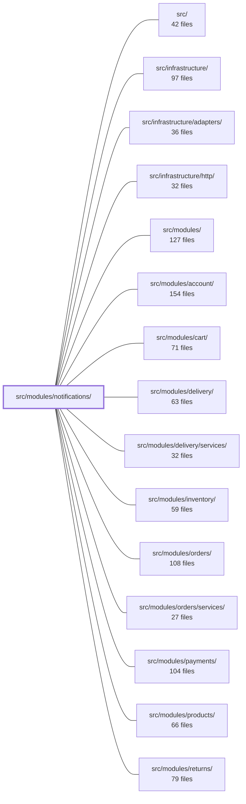

---
tags:
  - 2brain
  - 2brain/module
  - project/boilerplate-node-backend
type: module
module: src/modules/notifications/
files: 37
updated: 2026-10-29T19:26:38.669529+00:00
---

# src/modules/notifications/

## Purpose

The notifications module is the application's single inbox. It receives messages (via domain-event subscriptions, never direct calls), persists them as code + structured params, delivers them in real time over Server-Sent Events, sends staff-facing emails (one-off or batched digest), and runs scheduled daily/weekly digest jobs. Sibling modules treat it as a read-only audience: they emit domain events and the module's subscribers translate those into inbox rows or staff alerts.

## Key parts

- **Public surface & wiring** — `index.ts` (the only import point siblings may use, and primarily for *reading*), `module.ts` (registers routes, event subscriptions, jobs, and personal-data handlers with the kernel), `routes.ts` (Express router at `/notifications`, all routes authenticated).
- **Service layer** (`services/`) — `inbox.ts` (write/read/remove user rows, enforce caps, fan out SSE pushes), `staff.ts` (resolve which tenant members hold the right permission sets and deliver notices), `stream.ts` (per-user SSE hub), `digest.ts` (daily/weekly staff summary + consolidated email), `subscribers.ts` (the one-to-one mapping from each `DomainEventMap` payload to an inbox or staff row), `index.ts` (facade exposing all three as `notificationsService`).
- **Data & presentation** — `model.ts` (Mongoose schema, indexes, typed `code → params` map), `repository.ts` (domain CRUD keyed by `userId` so ownership isolation is structural), `presenter.ts` (maps internal documents to the OpenAPI wire shape).
- **Staff routing & email** — `staff-routing.ts` (single table declaring who hears each code, how loudly, and the link), `emails.ts` (builds the one-off and digest `EmailContent` payloads, localized).
- **Configuration & jobs** — `config.ts` (retention caps, digest thresholds, notice lifetime), `jobs.ts` / `jobs.generated.ts` (declarations for the daily and weekly digest runs).
- **Controllers** (`controllers/`) — thin HTTP adapters for each endpoint (`GET/POST/DELETE` variants plus the SSE stream endpoint); no business logic.
- **Tests** (`tests/`) — unit tests for the presenter, stream, routing table, and schema contract; integration tests covering the full event → subscription → inbox pipeline, digest idempotency, staff audience semantics, and ticket-alert end-to-end flows; contract tests pinning the HTTP response shapes.

## How it connects

- **Sibling modules** (`orders`, `products`, `inventory`, `returns`, `tickets`, `cart`, `delivery`, `payments`, `accounts`, `users`, `webhooks`) are the *producers*: they emit domain events onto the bus. The notifications module's `subscribers.ts` attaches handlers to those events. No sibling imports a service here to "send a notification" directly.
- **`orders/services`, `returns`, `delivery/services`** — the digest job reads pending-item counts from these modules to populate the staff summary row.
- **`src/infrastructure/adapters`** — the mailer adapter is called (through `emails.ts` and `digest.ts`) to deliver staff emails; the SSE response objects are raw Node/Express `Response` handles.
- **`src/infrastructure/http`** — provides the Express app/middleware stack onto which `routes.ts` is mounted.
- **`src/modules/users`** — provides the authenticated caller identity that controllers extract from the request; `staff.ts` queries tenant membership through user/role data.
- **Repository root / `src/`** — the kernel that loads `module.ts` registers this module's routes, jobs, and event subscriptions during application boot.

## Where to start

1. **`staff-routing.ts`** — a compact table that answers "which notification codes exist, who is told, and how loudly." Reading this first gives you the vocabulary the rest of the module uses.
2. **`services/subscribers.ts`** — the one file where you can see every inbound domain event mapped to a concrete inbox or staff action. It is the clearest way to trace how a business event (e.g. product deletion) becomes a bell icon or an email without hunting through callers in other modules.

## Connected modules

[[boilerplate-node-backend_ROOT|/ (repository root)]] · [[boilerplate-node-backend_src|src/]] · [[boilerplate-node-backend_src_infrastructure|src/infrastructure/]] · [[boilerplate-node-backend_src_infrastructure_adapters|src/infrastructure/adapters/]] · [[boilerplate-node-backend_src_infrastructure_http|src/infrastructure/http/]] · [[boilerplate-node-backend_src_modules|src/modules/]] · [[boilerplate-node-backend_src_modules_account|src/modules/account/]] · [[boilerplate-node-backend_src_modules_cart|src/modules/cart/]] · [[boilerplate-node-backend_src_modules_delivery|src/modules/delivery/]] · [[boilerplate-node-backend_src_modules_delivery_services|src/modules/delivery/services/]] · [[boilerplate-node-backend_src_modules_inventory|src/modules/inventory/]] · [[boilerplate-node-backend_src_modules_orders|src/modules/orders/]] · [[boilerplate-node-backend_src_modules_orders_services|src/modules/orders/services/]] · [[boilerplate-node-backend_src_modules_payments|src/modules/payments/]] · [[boilerplate-node-backend_src_modules_products|src/modules/products/]] · … and 4 more

## Files
- `src/modules/notifications/config.ts` — Declares the single configuration surface for the notifications module: retention caps for user and staff inboxes, staff notice lifetime, and the time-based thresholds that drive the daily digest and various staff workflow reminders. All values are typed integers with a minimum of 1 and sensible defaults, making the module's tunable knobs discoverable in one place.
- `src/modules/notifications/controllers/delete-notification.ts` — Thin HTTP adapter that handles the `DELETE /notifications/:id` endpoint. It extracts and validates the route parameter, delegates to `notificationsService.remove`, and maps the result to an appropriate HTTP response (204 or error). It exists so the route layer stays declarative while all request/response mechanics live here.
- `src/modules/notifications/controllers/delete-notifications.ts` — Thin HTTP adapter that exposes the `DELETE /notifications` endpoint. It delegates the actual work to `notificationsService.dismissAll` and translates the result into a `204 No Content` response.
- `src/modules/notifications/controllers/get-notification.ts` — Thin HTTP adapter for the `GET /notifications/:id` route. It extracts and validates the route parameter, delegates to `notificationsService.get`, and translates the service result into an appropriate Express response (200, 404, or error).
- `src/modules/notifications/controllers/get-notifications-stream.ts` — Controller for `GET /notifications/stream`. It validates that the caller was authenticated via the refresh cookie (since `EventSource` cannot send an `Authorization` header) and then delegates to the notifications service to open a Server-Sent Events stream for that user's notifications.
- `src/modules/notifications/controllers/get-notifications.ts` — Thin HTTP adapter for the `GET /notifications` endpoint. It extracts the authenticated caller from the request, delegates to `notificationsService.listVisible`, and writes the result (or an error) back to the client. Contains no business logic itself.
- `src/modules/notifications/controllers/post-read-all.ts` — Thin HTTP adapter for `POST /notifications/read-all`. Receives the request, delegates to `notificationsService.readAll` with the authenticated user's ID, and returns a `204 No Content` on success. Exists to keep route wiring and service logic separate.
- `src/modules/notifications/emails.ts` — Builds the `EmailContent` payload for the two staff-facing emails a work notice can produce: a single "what happened" notification and the daily digest. Only codes whose route declares `email: 'now'` get a one-off mail here; summary codes are batched into the digest. All copy is resolved through the recipient's locale before the mail is handed to the adapter.
- `src/modules/notifications/factories.ts` — Test/seed factory that builds a `NotificationDocument` ready for `notificationRepository.create`. It exists so that tests and seeds can construct realistic notification rows without hand-assembling every field, while staying out of the production barrel to avoid triggering the service-level cap and live-push side effects.
- `src/modules/notifications/index.ts` — Public barrel (single import surface) for the `notifications` module. Per the strategic-DDD rule (see `docs/theory/strategic-ddd.md` §5), sibling modules may only import from this file. It is designed primarily for *reading* notification data—siblings that need to *act* on a user should emit a domain event rather than call in.
- `src/modules/notifications/jobs.generated.ts` — Auto-generated data definition for the notifications module's scheduled jobs. It is produced by `npm run regenerate` from `src/modules/notifications/module.yaml` and should never be edited by hand.
- `src/modules/notifications/jobs.ts` — Declares the scheduled jobs the `notifications` module owns — the daily and weekly staff digest. It wires each job's execution to `runStaffDigest`, attaches logging, and exposes the result as a `JobDeclaration` array for the kernel's job registry.
- `src/modules/notifications/model.ts` — Defines the persistence contract for notifications: the Mongoose schema, indexes, model, and the full set of TypeScript types that tie each notification `code` to its `params`. Notifications are stored as code + structured params (never as sentences) so the frontend owns all copy and a row survives locale changes.
- `src/modules/notifications/module.ts` — The module manifest for the notifications inbox. It registers the module's routes, domain-event subscriptions, config, background jobs, personal-data handlers, and asset paths with the application kernel. All inbound communication is via subscribed domain events; no other module imports this file to send a message, which keeps the dependency graph acyclic and producers ignorant of the inbox.
- `src/modules/notifications/presenter.ts` — The single mapping layer that converts internal `NotificationDocument` records into the wire shape declared by `openapi.yaml`. It is a build (not a serialize) so that any field absent from the contract simply does not appear in the output.
- `src/modules/notifications/repository.ts` — Domain-specific repository for the notifications collection. Extends the standard CRUD factory with every write and read an inbox actually performs, all keyed by `userId` so ownership isolation is a property of the query itself rather than a check a caller must remember.
- `src/modules/notifications/routes.ts` — Defines the Express router mounted at `/notifications`, wiring each HTTP method and path to its controller with the appropriate authentication and permission middleware. All routes are scoped to the authenticated caller (an inbox is personal); no route is public.
- `src/modules/notifications/services/digest.ts` — Implements the staff digest: for a given run (`daily` or `weekly`), it reads pending-item counts from the owning modules, upserts one inbox summary row per relevant staff member, and—only for lines whose route is `digest`—sends a single consolidated email per person listing lines that are new or grew. The operation is idempotent; re-running writes the same counts and mails nothing unchanged.
- `src/modules/notifications/services/inbox.ts` — The inbox service for the notifications module: it writes, reads, and removes a user's own notifications and their tenant's staff (work) notices, enforces per-audience caps, and pushes every change to the owner's open WebSocket streams so multiple tabs stay in sync.
- `src/modules/notifications/services/index.ts` — Facade that aggregates the three internal notification services (`inbox`, `stream`, `subscribers`) behind a single exported object, `notificationsService`. Controllers and sibling modules interact with notifications exclusively through this surface rather than importing sub-service files directly.
- `src/modules/notifications/services/staff.ts` — Resolves the staff audience for a work notice (which members of a tenant hold the relevant permission sets) and delivers the notice to each — writing a deduplicated row and, on first delivery where the route allows, queueing an immediate email. Exists so producers can say "tell the people who do this work" without knowing who they are or how to reach them.
- `src/modules/notifications/services/stream.ts` — Manages live notification delivery over Server-Sent Events (SSE), one stream per open tab, routed per user. It maintains an in-process registry of open HTTP responses and exposes functions to open a new stream and to push a typed event to every stream belonging to a given user. No broker or cross-process fan-out—assumes a single-host deployment.
- `src/modules/notifications/services/subscribers.ts` — Maps each domain event to the notification rows it produces. Every exported function is a one-to-one event handler that converts a `DomainEventMap` payload into either user-inbox rows (delegated to `notificationsCreate` in `./inbox`) or staff alerts (delegated to `./staff`). The module's `subscribe()` (wired in `./index`) attaches these handlers to the event bus; this file contains only the mapping logic, no I/O beyond the calls it delegates to.
- `src/modules/notifications/staff-routing.ts` — Single-source routing table for staff work notices. For every `StaffNotificationCode` it declares **who** hears it (permission sets), **how loudly** (email now / digest / bell only), and **where** the notice links. It is the one file to read when auditing "who is told what" and why.
- `src/modules/notifications/tests/contract/api.contract.test.ts` — Contract tests that verify each `/notifications` HTTP route returns one of exactly two shapes — a 200 inbox payload or a 204 with no body — plus the expected refusal codes (401, 404). The file also exercises the SSE stream endpoint by reading a single frame. Ownership and cap rules are deliberately excluded (they live in the integration suite); this suite only confirms that every contract branch is reachable over HTTP.
- `src/modules/notifications/tests/factories.ts` — Test-database persistence layer for notification fixtures. It exists to keep the pure in-memory builder (`makeNotification` in `../factories.ts`) separate from the act of writing a document into the test database, so tests can call one function and get a persisted `NotificationDocument` back.
- `src/modules/notifications/tests/integration/digest.test.ts` — Integration test for the staff digest job. Drives `runStaffDigest` exactly as the scheduler would — real modules registered, real orders/returns/shipments in the database, the mailer mocked at the boundary — and verifies who receives which summary row, that a re-run is idempotent (no duplicate mail, single row rewrite), that a zero count clears the row, and that bell-only summaries are never mailed.
- `src/modules/notifications/tests/integration/events.test.ts` — Integration tests that verify the full domain-event → subscription → inbox-notification pipeline by registering **real** modules and triggering real service calls (product deletion, cart merge, stock receive, release-date update). The module doc comment is explicit: no subscriber is called directly — the wiring registered by `registerModules` is itself under test.
- `src/modules/notifications/tests/integration/service.test.ts` — Integration tests for the notifications service (`notificationsService`). They verify the safety invariants of a user's inbox—ownership isolation (404, never cross-user delete), the per-user cap with oldest-row eviction, real-time stream pushes to the owner's open tabs, and bulk operations (dismiss-all, read-all)—against a real test database with the stream layer wrapped in a recording mock.
- `src/modules/notifications/tests/integration/staff.test.ts` — Integration tests that drive the real module pipeline (registry → domain event → notification service → bell + mailer) to verify staff-notification semantics: which roles are told, which accounts are excluded, idempotency under redelivery, mail locale/link content, and that the bell reflects the reader's *current* role and tenant.
- `src/modules/notifications/tests/integration/ticket-alerts.test.ts` — Integration tests that drive the ticket-alert pipeline end-to-end through the real registered modules: a contact message or a ticket handover is filed via `ticketService`, and the tests assert on the in-app bell (who is told, with what params) and the email queue (what is and is *not* in the per-person notice or the fallback mailbox). The goal is to lock down the notification contract—audience, content sanitisation, and fallback semantics—without spinning up a mail server.
- `src/modules/notifications/tests/unit/get-notifications-stream.test.ts` — Unit tests for the `GET /notifications/stream` controller. Verifies that the handler delegates the live response, the authenticated caller's ID, and a permission-recheck closure to `notificationsService.stream`, and that it fails closed (401) when the request is missing the context the authorization middleware is expected to have set.
- `src/modules/notifications/tests/unit/presenter.test.ts` — Unit tests for the notification presenter (`presentNotification`, `presentNotifications`). They lock down the wire shape: exact contract fields, string-typed IDs and dates, `readAt` absent (not `null`) while unread, and passthrough of per-code `params` without mutation. They also act as a coverage guard so no notification code can reach the wire without a test naming its params.
- `src/modules/notifications/tests/unit/routes.test.ts` — Unit test for the notifications route table. Verifies that every route carries the correct authentication and authorization guards, and specifically that the SSE stream endpoint is gated by cookie-based permission rather than a bearer token — the one constraint an `EventSource` client cannot satisfy.
- `src/modules/notifications/tests/unit/schema-contract.test.ts` — Contract test that locks the **declarations** of the `notificationSchema` (required fields, closed enums, defaults, refs, indexes, timestamp options). It does not create documents; it asserts that the schema's shape matches the intended invariants so that a dropped enum, flipped index direction, or accidental default would be caught at review time.
- `src/modules/notifications/tests/unit/staff-routing.test.ts` — Unit tests for the staff work-notice routing subsystem. They verify that every notification code has a route with valid permission sets, that `staffLinkOf` resolves the correct URL template per notice, that `staffNoticeEmail` produces translated, PII-free output in every served locale, and that role-based visibility (`callerHoldsAnySet`, `setsOfRoute`) behaves correctly for admins, moderators, and managers.
- `src/modules/notifications/tests/unit/stream.test.ts` — Unit tests for the per-user SSE notification hub (`streamNotifications` and `publishToUser`). They verify the three failure modes that are invisible from inside the module: the SSE wire format (correct headers, `event:`/`data:`/blank-line framing), per-user routing (a frame reaches only that user's sockets), and teardown (timers and map entries are cleaned up on disconnect and on permission revocation).

---
[[boilerplate-node-backend_INDEX|← boilerplate-node-backend index]]
