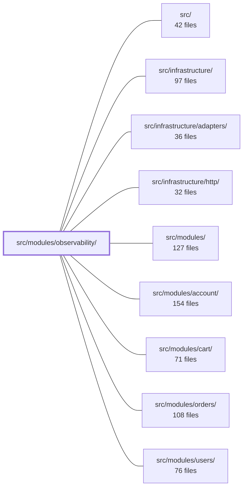

---
tags:
  - 2brain
  - 2brain/module
  - project/boilerplate-node-backend
type: module
module: src/modules/observability/
files: 38
updated: 2026-10-29T19:27:00.467417+00:00
---

# src/modules/observability/

## Purpose

The observability module is the operator-facing diagnostic surface of the application. It exposes a small set of read-only endpoints—readiness/health detail, Prometheus scrape, JSON metrics overview, a live SSE metrics stream, and an incident-filtered audit log—so that operators, dashboards, load balancers, and monitoring agents can inspect the system's current state without writing to any domain collection.

## Key parts

- **Routing & HTTP surface** — `module.ts` (the `AppModule` manifest that wires router, config slice, and locales into the kernel), `routes.ts` (the five-endpoint Express router with per-route auth guards), and the five controllers under `controllers/` (one per endpoint: health, metrics, metrics-overview, events/SSE, audit).
- **Services layer** — `services/` assembles the payload for each endpoint: `health.ts` (top-level health JSON), `dependency-health.ts` (readiness fold over database/cache/queue adapters), `job-health.ts` (crontab job outcomes from the `leases` collection), `parked-jobs.ts` (dead-letter queue depths), `process-snapshot.ts` (atomic memory/uptime read shared by three consumers), and `stream.ts` (SSE frame composition and cadence). `services/index.ts` re-exports them as a single `observabilityService` object.
- **Metrics** — `metrics.ts` defines the `dependency_up` gauge; `http-readback.ts` collapses shared HTTP counters/histograms into service-wide totals; `metrics-scraper.ts` is the bearer-credential guard for the Prometheus scrape route (bypasses JWT because Prometheus cannot log in).
- **Contracts & config** — `openapi.yaml` (OpenAPI 3.1 for the REST/SSE endpoints), `asyncapi.yaml` (standalone AsyncAPI 3.0.0 for the SSE channel, merged into the repo-root contract at build time), `config.ts` (typed env-var schema for scrape credential and optional Loki/Faro sinks), and `audit.ts` (module-owned audit action strings registered into the shared `AuditActionMap`).
- **Public barrel** — `index.ts` is the sole entry point sibling modules may import from, per the DDD convention.
- **Tests** — `tests/` contains unit, integration, and contract suites covering wire-shape pinning, auth semantics (cookie, bearer, permission recheck), metric mapping correctness, SSE frame format, and route-guard structure.

## How it connects

- **`src/infrastructure/`** — The module augments the shared `AuditActionMap` type (via `audit.ts`) and reads readiness state from the database, cache, and queue adapters. It also depends on the `metrics-http` counters and the `successResponse` helper from `src/infrastructure/http/`.
- **`src/modules/account/`** — `audit.ts` follows the same per-module audit-registration pattern established there; each module owns its action vocabulary independently.
- **`src/modules/cart/` and `src/modules/orders/`** — The metrics-overview endpoint resolves their counters **by name** from the shared prom-client registry, so the observability module reports on their traffic without any compile-time import of those modules.
- **`src/modules/users/`** — The SSE and REST endpoints enforce the `read:ObservabilitySnapshot` permission and cookie-based session checks, tying the module's auth path to the users module's session/permission infrastructure.
- **Repository root (`/`)** — The build bundler merges this module's `asyncapi.yaml` servers, channels, and components into the single repo-root AsyncAPI contract.

## Where to start

1. **`module.ts`** — It is the single manifest that shows which router, config slice, locales, and side-effect imports (the `dependency_up` gauge) the kernel loads for this module, giving you the module's full surface in one file.
2. **`routes.ts`** — Immediately after, it lays out the five endpoints, their auth guards (JWT, cookie, static bearer), and the exact mapping to controllers, so you can see the operator-facing API at a glance before diving into any individual handler.

## Connected modules

[[boilerplate-node-backend_ROOT|/ (repository root)]] · [[boilerplate-node-backend_src|src/]] · [[boilerplate-node-backend_src_infrastructure|src/infrastructure/]] · [[boilerplate-node-backend_src_infrastructure_adapters|src/infrastructure/adapters/]] · [[boilerplate-node-backend_src_infrastructure_http|src/infrastructure/http/]] · [[boilerplate-node-backend_src_modules|src/modules/]] · [[boilerplate-node-backend_src_modules_account|src/modules/account/]] · [[boilerplate-node-backend_src_modules_cart|src/modules/cart/]] · [[boilerplate-node-backend_src_modules_orders|src/modules/orders/]] · [[boilerplate-node-backend_src_modules_users|src/modules/users/]]

## Files
- `src/modules/observability/asyncapi.yaml` — Standalone AsyncAPI 3.0.0 document defining the Server-Sent Events stream the observability module serves at `/observability/events`. It is written as a complete, independently lintable contract so it can be read and validated without the rest of the repo; the bundler merges its servers, channels, operations, and components into the repo-root contract at build time.
- `src/modules/observability/audit.ts` — Declares and registers the audit action strings that the observability module can emit, and augments the shared infrastructure `AuditActionMap` type so those strings are available across the codebase. It exists to follow the per-module audit registration pattern (same pattern as `modules/account/audit.ts`) so each module owns its action vocabulary.
- `src/modules/observability/config.ts` — Declares the environment-variable schema for the observability module: the metrics scrape credential and the optional telemetry sink addresses (Loki, Faro). Exists so that the rest of the module can validate and access its configuration through a single typed export.
- `src/modules/observability/controllers/get-observability-audit.ts` — Controller for `GET /observability/audit`. It exposes a filtered, paged read over the **incident** subset of the `audit-logs` collection (security refusals, failed sign-ins, worker failures). It is the single point where the observability module depends on `audit-logs`, and the only place it reaches beyond its own process snapshot.
- `src/modules/observability/controllers/get-observability-events.ts` — Controller handler for `GET /observability/events`. It opens a Server-Sent Events (SSE) stream and attaches a periodic permission recheck (every 30 s) to the same cookie that originally authorized the connection, so a revoked caller's stream is terminated on the next recheck cycle.
- `src/modules/observability/controllers/get-observability-health.ts` — Express controller for `GET /observability/health`, the detailed authenticated readiness endpoint. It contains no business logic — it delegates the entire payload construction to the observability service and only wires the result into an HTTP response (or error response).
- `src/modules/observability/controllers/get-observability-metrics-overview.ts` — HTTP handler for `GET /observability/metrics/overview`. Aggregates counters, gauges, and histogram samples from the shared prom-client registry into a single `ObservabilityMetricsSummary` JSON response covering HTTP traffic, auth, shop/business, database, and process metrics. The critical design constraint is that it resolves every domain metric **by name** from the registry rather than importing the counter objects, so the observability module never has a compile-time dependency on the domains it reports on.
- `src/modules/observability/controllers/get-observability-metrics.ts` — Express controller that serves the `GET /observability/metrics` endpoint (the Prometheus scrape target). It returns metrics in the Prometheus exposition text format, or a valid-but-empty body on collection failure — never an HTML error page — so that a scraper never logs a format parse error on top of the underlying outage.
- `src/modules/observability/http-readback.ts` — Reads the shared HTTP request counters and duration histogram (defined in `metrics-http`) and collapses them into single service-wide numbers: total requests, total errors, and approximate p50/p95 latency. These numbers feed both the `GET /observability/metrics/overview` endpoint and the SSE stream publish.
- `src/modules/observability/index.ts` — Public barrel (re-export) file for the `observability` module. It is the **only** entry point a sibling module may import from, per the strategic DDD convention (`docs/theory/strategic-ddd.md` §5). It currently exposes the module's readiness/telemetry services so that future external callers reach them here rather than via a deep import into `./services`.
- `src/modules/observability/metrics-scraper.ts` — Express middleware that guards the single Prometheus scrape route (`GET /observability/metrics`) with a static bearer credential. It exists as a separate file (not a generic rate-limit middleware, not part of the module barrel) because Prometheus cannot hold a session and the other observability routes' `read:ObservabilitySnapshot` check does not apply to it.
- `src/modules/observability/metrics.ts` — Defines the `dependency_up` Prometheus gauge that reports, per backing service (`database`, `cache`, `queue`), whether it is currently serving. It exists to close the observability gap where, if a dependency like Mongo goes down, every other gauge that depends on it stops reporting and alerting rules go blind exactly when they are needed most.
- `src/modules/observability/module.ts` — Module manifest for the operator-facing observability surface (health, metrics overview, SSE stream, Prometheus scrape endpoint, audit trail). It wires the router, config slice, and locales into the kernel's `AppModule` contract and registers the `dependency_up` gauge as a side-effect import. It owns no domain collection and records no personal data.
- `src/modules/observability/openapi.yaml` — OpenAPI 3.1 contract for the observability module. It defines the wire-level API for operational endpoints—SSE event streams, health/readiness detail, Prometheus metrics, a JSON metrics overview, and incident-only audit logs—and documents their authentication requirements, response shapes, and error semantics for both consumers (dashboards, Prometheus, load balancers) and AI assistants reasoning about the system's surface.
- `src/modules/observability/routes.ts` — Defines the Express route table for the operator dashboard under `/observability`. It wires five read-only endpoints to their controllers and attaches the correct authentication middleware per route. Guards are chosen individually (not shared) because two endpoints are consumed by callers that cannot carry a standard admin JWT: a browser `EventSource` (SSE) and a Prometheus scraper.
- `src/modules/observability/services/dependency-health.ts` — Readiness (not liveness) reporter for every backing service this process depends on — database, cache, queue. It performs a synchronous memory read of each adapter's already-tracked state and folds the result into a single `ok` / `degraded` verdict. It backs `GET /observability/health` and is explicitly designed to **never** feed the orchestrator's restart decision (that is `GET /` / liveness's job), so a degraded Redis degrades the dashboard dot instead of killing a healthy container.
- `src/modules/observability/services/health.ts` — Assembles the JSON payload served by `GET /observability/health`: dependency probe results, telemetry-sink configuration flags, process/system resources, and per-job outcomes. It lives in the services layer (not the controller) so the response shape is defined alongside the helpers that produce its fields.
- `src/modules/observability/services/index.ts` — Barrel module for the observability services layer. It re-publishes every service function and probe into a single `observabilityService` object so that controllers and the module root (`src/modules/observability/index.ts`) can import from one stable entry point rather than reaching into individual service files.
- `src/modules/observability/services/job-health.ts` — Provides the job-status half of the `GET /observability/health` endpoint. It reports every crontab job's last observed outcome by issuing a single read against the `leases` collection (populated by `scripts/run-script.ts` and, where applicable, `withLease`). It exists because no in-memory copy of "when did `reap:orders` last finish" lives in the process.
- `src/modules/observability/services/parked-jobs.ts` — Provides the queue component of `GET /observability/health` by reading each worker queue's current dead-letter (parked) depth live from the broker. Unlike `dependency-health.ts`, this service performs I/O because parked counts exist only on the broker, not in process memory.
- `src/modules/observability/services/process-snapshot.ts` — Provides a single atomic read of process memory and uptime so that three consumers (the SSE stream and two REST endpoints) all publish numbers from the same instant. Without this, independent calls to `process.memoryUsage()` / `process.uptime()` across those consumers could drift and present as a bug. All values are in bytes; uptime is integer seconds.
- `src/modules/observability/services/stream.ts` — Serves live observability metrics to browser dashboards over Server-Sent Events (one-way, plain HTTP, auto-reconnecting via `EventSource`). It composes process memory, HTTP counters, and connection counts into a single payload and pushes it on a fixed cadence, plus a slower heartbeat to survive idle-proxy timeouts.
- `src/modules/observability/tests/contract/api.contract.test.ts` — Contract tests for the four `/observability` JSON endpoints (`/health`, `/metrics/overview`, `/audit`, `/events`). They pin the response shapes, field vocabularies, and error-body conventions that API clients code against, covering cases a serializer-level assertion would miss because the payloads are assembled field-by-field rather than through a shared serializer.
- `src/modules/observability/tests/integration/events-auth.test.ts` — Integration tests that verify the `/observability/events` SSE stream's cookie-based authentication. Because `EventSource` cannot set request headers, the stream authenticates exclusively via the `__Host-session` cookie. These tests confirm that forged cookies and revoked sessions are refused, and that the periodic recheck of an open stream tracks the session *family* (surviving refresh rotation) rather than the original cookie value.
- `src/modules/observability/tests/unit/dependency-health.test.ts` — Unit tests for the dependency-health readiness fold. Pins the mapping from each dependency's raw connection state to its semantic word (`ready`, `connecting`, `unavailable`, `disabled`) and verifies the `overallStatus` aggregation rule — specifically that `disabled` never degrades a service while `connecting` and `unavailable` always do. Exists because a contract/integration test can only assert the payload shape; this file is where the _meaning_ of each state is locked down.
- `src/modules/observability/tests/unit/dependency-up.test.ts` — Unit test for the `dependency_up` Prometheus metric. It locks in the exact mapping from `DependencyHealth` states to metric values (1 / 0 / label-absent) that the `DependencyUnavailable` alert depends on, with all real dependency checks mocked out.
- `src/modules/observability/tests/unit/get-observability-events.test.ts` — Unit test for the `GET /observability/events` controller handler. It verifies that the handler delegates the entire response lifecycle to the SSE streamer (writing nothing itself) and that the permission-recheck callback it passes is correctly wired to `stillHoldsRuleViaCookie` with the expected rule key and permission.
- `src/modules/observability/tests/unit/get-observability-metrics.test.ts` — Unit tests for the `GET /observability/metrics` Prometheus scrape handler. Covers the happy path (exposition body + registry content type), the failure path (500 + valid empty exposition comment), and the error-logging contract. Exists to guarantee that a collection failure still returns a body a Prometheus scraper can parse, avoiding a secondary format-error log on top of the outage.
- `src/modules/observability/tests/unit/health-identity.test.ts` — Unit tests that verify `buildObservabilityHealth` correctly populates the two identity fields (`environment` and `service`) in the `GET /observability/health` response. Job and queue health are mocked away so the suite isolates "which process answered" from "what jobs/queues report."
- `src/modules/observability/tests/unit/http-readback.test.ts` — Unit tests for the `percentileFromHistogramBuckets` helper, verifying that it correctly maps a target percentile to an upper-bound value from a list of histogram buckets.
- `src/modules/observability/tests/unit/job-health.test.ts` — Unit tests for the `jobHealth` service that back the jobs half of `GET /observability/health`. The entire suite guards one wire-shape contract: `lastSuccessAt` must be an ISO-8601 **string** in the response, not a `Date` object. Because `JSON.stringify` produces identical output for both, the failure would be invisible to a passing contract test and only surface when a consumer reads the field directly.
- `src/modules/observability/tests/unit/metrics-overview-shop.test.ts` — Unit tests for the `business` block of the `GET /observability/metrics/overview` endpoint, covering only the counters owned by shop modules (cart and orders). The file is deliberately isolated from the rest of the overview suite so that removing the shop removes exactly this file and nothing else.
- `src/modules/observability/tests/unit/metrics-overview.support.ts` — Shared helpers for the metrics-overview unit-test suites. It provides a small, typed surface for (1) looking up a registered counter or histogram by name, (2) invoking the overview controller, and (3) extracting the payload the controller passes to `successResponse`. Centralising these lets both `metrics-overview.test.ts` and `metrics-overview-shop.test.ts` avoid duplicating the same boilerplate.
- `src/modules/observability/tests/unit/metrics-overview.test.ts` — Unit tests for the `GET /observability/metrics/overview` endpoint. They verify that each domain row in the response carries real numbers resolved by metric **name** from the shared Prometheus registry, and that a missing counter (e.g. a deleted module) causes the entire block to be omitted rather than reporting zeros.
- `src/modules/observability/tests/unit/metrics-scraper.test.ts` — Unit tests for `isMetricsScraper`, the credential guard protecting `GET /observability/metrics`. This is the only auth check in the codebase that bypasses JWT middleware (Prometheus cannot log in), so the tests pin three security properties that each fail silently if broken: deny-by-default, Bearer-scheme enforcement, and safe length-mismatch handling.
- `src/modules/observability/tests/unit/parked-jobs.test.ts` — Unit test for the `queueHealth` function (the queue half of `GET /observability/health`). It verifies that `queueHealth` is a thin pass-through of `parkedCounts()` with no shape transformation, covering both populated and empty results.
- `src/modules/observability/tests/unit/routes.test.ts` — Verifies the structural contract of the observability router: which endpoints exist, in what order, and which guard chain protects each one. It asserts the two non-standard guard styles (cookie for SSE, static credential for Prometheus) and confirms no endpoint is left unguarded.
- `src/modules/observability/tests/unit/stream.test.ts` — Unit test suite for the SSE (Server-Sent Events) metrics stream. It verifies three things that fail silently if broken: the exact wire format of each SSE frame, timer teardown on disconnect (preventing zombie intervals and memory leaks), and error absorption inside interval callbacks. Uses fake timers and a hand-built fake `Response` so frames are deterministic and inspectable byte-for-byte.

---
[[boilerplate-node-backend_INDEX|← boilerplate-node-backend index]]
