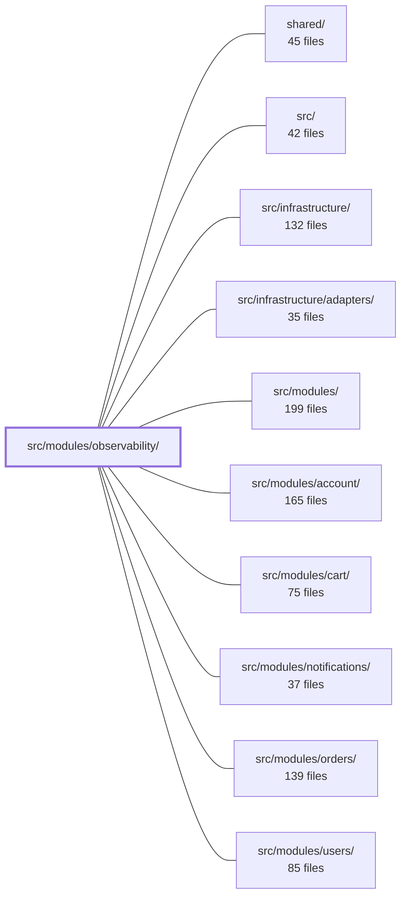

---
tags:
  - 2brain
  - 2brain/module
  - project/boilerplate-node-backend
type: module
module: src/modules/observability/
files: 40
updated: 2026-11-15T00:33:32.756243+00:00
---

# src/modules/observability/

## Purpose

The observability module is the platform-wide operational dashboard. It exposes five HTTP endpoints (health, Prometheus scrape, JSON metrics overview, live SSE stream, and incident audit) under `/observability`, providing a single pane-of-glass view of process health, dependency status, job/queue state, and security incidents. It is the sole **platform-scope** module in the boilerplate—its concerns belong to the installation as a whole rather than to any single shop's content.

## Key parts

- **Route surface & contracts** — `routes.ts` mounts the five endpoints with per-route auth guards; `module.yaml` and `module.ts` register the module with the kernel; `openapi.yaml` and `asyncapi.yaml` define the HTTP and SSE contracts (the AsyncAPI file is merged into the repo-root contract by the bundler).
- **Controllers** (`controllers/`) — Thin handlers for `/health`, `/metrics`, `/metrics/overview`, `/events`, and `/audit`. They delegate all logic to services and shape responses.
- **Services** (`services/`) — `health.ts` assembles the full health payload; `dependency-health.ts` reads in-memory backing-service state; `job-health.ts` and `parked-jobs.ts` fetch job/queue liveness from the data store and broker; `process-snapshot.ts` provides a single atomic memory/uptime reading; `stream.ts` implements the 5-second SSE push loop.
- **Prometheus integration** — `metrics.ts` defines the `dependency_up` gauge; `metrics-scraper.ts` is the bearer-token guard for the scrape route; `http-readback.ts` reduces histogram buckets into p50/p95 for the overview and SSE consumers.
- **Security & config** — `audit.ts` registers security-audit action strings; `authorization.yaml` grants platform-scope read rules; `config.ts` validates the scrape token and telemetry-sink URLs at boot.
- **Public surface** — `index.ts` is the only import point sibling modules may use (per the strategic-DDD rule).
- **Tests** (`tests/`) — Contract tests validate responses against the OpenAPI schema; unit tests lock down wire shapes, percentile math, guard behaviour, and route-table structure; integration tests cover SSE cookie-auth edge cases.

## How it connects

- **`src/infrastructure/`** — The module registers audit actions with the infrastructure security-events system and reads shared prom-client counters by metric *name* off the global registry (no direct imports of domain counter objects). The `metrics-scraper.ts` guard is a local middleware, deliberately kept out of `infrastructure/http/middlewares`.
- **`shared/`** — `asyncapi.yaml` is a self-contained slice that the build bundler merges into `shared/contracts/asyncapi.root.yaml`; the local `info` block exists only for standalone linting.
- **`src/modules/account/`** — `audit.ts` follows the identical "module-local action map + infrastructure registration" pattern defined there.
- **Shop modules (`cart/`, `orders/`, `users/`, `notifications/`)** — Their business counters are resolved by name from the shared Prometheus registry in `get-observability-metrics-overview.ts`. No import of those modules exists; removing a shop module degrades its overview block to zero without breaking this module.
- **`src/infrastructure/adapters/`** — `dependency-health.ts` reads the already-tracked in-memory `readyState` from the database, cache, and queue adapters (zero I/O). `parked-jobs.ts` calls the queue adapter's `parkedCounts()`.

## Where to start

1. **`module.ts`** — Ten lines that show the mount point, config slice, gauge registration, and locale path. It gives you the full wiring in one read.
2. **`services/health.ts`** — The composition root for the richest endpoint. Reading it shows how dependency health, job state, queue state, and the process snapshot are assembled into the single `ObservabilityHealth` object, and where the boundaries between "in-memory read" and "adapter I/O" fall.

## Connected modules

[[boilerplate-node-backend_ROOT|/ (repository root)]] · [[boilerplate-node-backend_shared|shared/]] · [[boilerplate-node-backend_src|src/]] · [[boilerplate-node-backend_src_infrastructure|src/infrastructure/]] · [[boilerplate-node-backend_src_infrastructure_adapters|src/infrastructure/adapters/]] · [[boilerplate-node-backend_src_modules|src/modules/]] · [[boilerplate-node-backend_src_modules_account|src/modules/account/]] · [[boilerplate-node-backend_src_modules_cart|src/modules/cart/]] · [[boilerplate-node-backend_src_modules_notifications|src/modules/notifications/]] · [[boilerplate-node-backend_src_modules_orders|src/modules/orders/]] · [[boilerplate-node-backend_src_modules_users|src/modules/users/]]

## Files
- `src/modules/observability/asyncapi.yaml` — AsyncAPI 3.0.0 document that specifies the Server-Sent Events stream served at `/observability/events`. It declares the channels, operations, and payload schemas for the observability dashboard's live metrics feed. The file is a self-contained "slice": a bundler merges its `servers`, `channels`, `operations`, and `components` into the repo-root contract (`shared/contracts/asyncapi.root.yaml`), while the local `info` block exists solely to make the file lintable and readable in isolation.
- `src/modules/observability/audit.ts` — Declares the observability module's security-audit action strings and registers them with the infrastructure security-events system. Currently defines a single action for detecting invalid bearer tokens on `/observability/metrics` scrapes. Follows the same "module-local action map + infrastructure registration" pattern as `modules/account/audit.ts`.
- `src/modules/observability/authorization.yaml` — Declares the authorization rules and rule-set for the observability module. It is the sole platform-scope module in the boilerplate, granting read access to health, metrics, and the operational audit — concerns that belong to the installation as a whole rather than to any single shop's content.
- `src/modules/observability/config.ts` — Declares the typed configuration schema for the observability module — the metrics-scrape credential and the endpoints for Loki and Faro telemetry sinks. It exists to centralize validation rules and placeholder detection so the module can fail fast on misconfiguration.
- `src/modules/observability/controllers/get-observability-audit.ts` — Controller for `GET /observability/audit`. Provides a paged, filtered read over the **incident** subset of the `audit-logs` collection (security refusals, failed sign-ins, worker failures). It is the sole reason the observability module depends on `audit-logs`, and it deliberately scopes to platform incidents — not per-customer activity, which is the admin's `GET /audit`.
- `src/modules/observability/controllers/get-observability-events.ts` — Controller for `GET /observability/events`. It validates that the request carries an authenticated user (set by the authorization middleware, not `isAuth`), then hands the Express response to the observability service to open a Server-Sent Events stream. A permission recheck is wired into the stream so a revoked caller's SSE connection is terminated even though no subsequent HTTP request will trigger a fresh authorization check.
- `src/modules/observability/controllers/get-observability-health.ts` — HTTP controller for `GET /observability/health`. It delegates payload construction to the observability service and shapes the resulting `ObservabilityHealth` object into a standard success response. It intentionally keeps no business logic of its own.
- `src/modules/observability/controllers/get-observability-metrics-overview.ts` — Controller handler for `GET /observability/metrics/overview`. It aggregates HTTP, auth, business, database, and process metrics into a single JSON summary. Domain counters are resolved **by metric name** off the shared prom-client registry rather than by importing the counter objects, so this module stays decoupled from the domain modules it reports on.
- `src/modules/observability/controllers/get-observability-metrics.ts` — Express controller for the `GET /observability/metrics` endpoint — the Prometheus scrape target. It returns the Prometheus exposition text format, and on collection failure returns a 500 in the same content type so Prometheus can mark the target `up = 0` from the status code alone without parsing the body.
- `src/modules/observability/http-readback.ts` — Reads the shared Prometheus HTTP metrics (request/error counters and the duration histogram) and reduces them to the single aggregate numbers consumed by the in-app `GET /observability/metrics/overview` endpoint and the SSE stream: total requests, total errors, and approximate p50/p95 latency. It exists so that the module-level consumers don't each re-implement prom-client histogram parsing.
- `src/modules/observability/index.ts` — Public barrel for the `observability` module. It is the **only** surface a sibling module is allowed to import from (per the strategic DDD rule in `docs/theory/strategic-ddd.md` §5), enforcing that external consumers never reach into this module's internal directory structure.
- `src/modules/observability/metrics-scraper.ts` — Express middleware that guards the single Prometheus scrape route (`GET /observability/metrics`) with a static bearer credential. Prometheus cannot hold a session, so this module's routes don't use the same `read:ObservabilitySnapshot` check; instead this middleware validates a dedicated `NODE_METRICS_TOKEN`. It is deliberately kept beside its route (not in `infrastructure/http/middlewares`) and excluded from the module barrel because it is wiring, not published language.
- `src/modules/observability/metrics.ts` — Defines the `dependency_up` Prometheus gauge, which reports whether each backing service (database, cache, queue) is currently serving. It exists to fill an observability gap: when a dependency goes down, other gauges (job counts, outbox depth) stop updating and alerts go silent. This gauge answers the question "is the dependency alive?" with a pure memory read, so it reports even when the dependency itself is unreachable.
- `src/modules/observability/module.ts` — Module manifest that registers the observability module with the kernel. It declares the route mount point (`/observability`), pulls in the config slice (scrape-token gate, telemetry sinks), points to a locales directory, and triggers the side-effect registration of the `dependency_up` gauge. It owns no data collection of its own.
- `src/modules/observability/module.yaml` — Module manifest for the **observability** subdomain. It declares the module's identity (summary, subdomain, group) and its dependency on the `audit-logs` module, serving as the routing/configuration entry point that the platform uses to register this module's endpoints (health, metrics, audit read, SSE stream).
- `src/modules/observability/openapi.yaml` — OpenAPI 3.1.0 module contract for the observability module. Defines the HTTP surface (SSE events, health, Prometheus metrics, JSON metrics overview, and incident audit) along with the schemas those endpoints produce, so consumers and tooling can discover and validate the API without reading implementation code.
- `src/modules/observability/routes.ts` — Defines the five HTTP routes for the operator observability dashboard (mounted at `/observability`) and assigns a per-route authentication strategy. Guards are chosen individually rather than shared because the SSE and Prometheus endpoints are consumed by clients that cannot present a standard admin JWT.
- `src/modules/observability/services/dependency-health.ts` — Provides a **readiness** snapshot of the three backing services (database, cache, queue) by reading their already-tracked in-memory state — zero I/O. Serves `GET /observability/health` and is explicitly kept separate from the liveness endpoint (`GET /`) that drives the orchestrator's restart decision, so a degraded Redis reports as degraded without killing a healthy container.
- `src/modules/observability/services/health.ts` — Builds the full JSON payload served at `GET /observability/health`. It aggregates dependency status, telemetry-sink wiring, process resources, and per-job / per-queue outcomes into a single `ObservabilityHealth` object. The assembly logic lives here (beside the sibling services it calls) rather than in the controller, so the payload shape co-locates with the readers it composes.
- `src/modules/observability/services/index.ts` — Barrel file for the observability services layer. It aggregates every service function and shared type into a single `observabilityService` object so that controllers and the module-level barrel (`src/modules/observability/index.ts`) have one stable import point for all health, streaming, and snapshot logic.
- `src/modules/observability/services/job-health.ts` — Provides the job section of the `GET /observability/health` endpoint. It reports each crontab job's last observed success or error by reading the `leases` document, because no in-memory copy of "when did `reap:orders` last finish" exists in the process.
- `src/modules/observability/services/parked-jobs.ts` — Provides the queue (dead-letter) portion of the `GET /observability/health` response. It reads each worker queue's parked-job count live from the message broker, since that figure lives nowhere in this process's memory. It exists as a thin, named wrapper so the health endpoint can compose it alongside other sub-checks without inlining broker I/O.
- `src/modules/observability/services/process-snapshot.ts` — Provides a single atomic reading of process memory and uptime so that three separate consumers (the SSE stream and two REST endpoints) publish numbers from the same instant. Without this, each consumer calling `process.memoryUsage()` and `process.uptime()` independently could produce values that disagree purely due to timing drift.
- `src/modules/observability/services/stream.ts` — Implements the server side of a one-way Server-Sent Events (SSE) stream that pushes live process and HTTP metrics to a dashboard every 5 seconds. SSE was chosen over WebSockets because the data flow is strictly server→client, it rides plain HTTP (no protocol upgrade), and browsers reconnect automatically via `EventSource`.
- `src/modules/observability/tests/contract/api.contract.test.ts` — Contract tests for the three JSON `/observability` endpoints (`/health`, `/metrics/overview`, `/audit`) plus the first-event shape of the `/events` SSE stream. They verify that each response matches the OpenAPI schema registered by `@tests/contract` and that the *values* carry the invariants a client codes against (status vocabulary, error-body shape, pagination meta), rather than merely checking that a 200 was returned.
- `src/modules/observability/tests/integration/events-auth.test.ts` — Integration tests for the `GET /observability/events` SSE endpoint's cookie-based authentication path. Because `EventSource` cannot set custom request headers, the stream authenticates solely via the `__Host-session` cookie; these tests verify that forged tokens, revoked sessions, and token rotation are handled correctly for both the initial connection and the periodic recheck of an already-open stream.
- `src/modules/observability/tests/unit/dependency-health.test.ts` — Unit test that pins the exact mapping from raw infrastructure states (Mongoose `readyState`, cache adapter state, queue adapter state) to the normalized four-word health vocabulary (`ready`, `connecting`, `unavailable`, `disabled`), and verifies the `overallStatus` fold that turns per-dependency states into a single service-level status. It exists because the contract suite can only assert that the payload *contains* the four words; this file locks down *which* raw state produces *which* word, including the two easily-mixed cases (`disabled` must not degrade, `connecting` must not read as broken).
- `src/modules/observability/tests/unit/dependency-up.test.ts` — Unit test for the `dependency_up` Prometheus metric. It verifies that the readiness-vocabulary → `1` / `0` / absent mapping rendered by the metric is correct, because the `DependencyUnavailable` alert fires on exactly this mapping.
- `src/modules/observability/tests/unit/get-observability-events.test.ts` — Unit tests for the `getObservabilityEvents` controller (the `GET /observability/events` endpoint). Verifies that the handler delegates entirely to the SSE streamer and wires a permission-recheck callback correctly, without writing anything to the response itself.
- `src/modules/observability/tests/unit/get-observability-metrics.test.ts` — Unit tests for the `GET /observability/metrics` Prometheus scrape handler. Covers the happy path (valid exposition body + registry content type) and the failure path (typed 500 with a comment-line body), plus side effects: structured error logging and span failure marking.
- `src/modules/observability/tests/unit/health-identity.test.ts` — Unit tests for the **identity fields** (`environment` and `service`) that `GET /observability/health` reports to identify which process answered. Job/queue health data is mocked out so this suite focuses solely on how the payload names the process.
- `src/modules/observability/tests/unit/http-readback.test.ts` — Unit tests for the `percentileFromHistogramBuckets` utility exported from the observability module. Verifies that percentile estimation from histogram buckets behaves correctly for edge cases (empty input) and for selecting the appropriate bucket at various percentile thresholds.
- `src/modules/observability/tests/unit/job-health.test.ts` — Unit test for the `jobHealth` service function (the job half of `GET /observability/health`). Its sole job is to guarantee the **wire-shape contract**: `lastSuccessAt` must leave the function as an ISO-8601 string, not a `Date`, even though `JSON.stringify` would mask the difference. It also pins down the handling of absent timestamps and errors.
- `src/modules/observability/tests/unit/metrics-overview-shop.test.ts` — Unit tests for the `business` block returned by `GET /observability/metrics/overview`, covering only the counters owned by shop modules (cart, orders). Extracted from the general overview suite so that removing a shop module deletes exactly this file and nothing else.
- `src/modules/observability/tests/unit/metrics-overview.support.ts` — Shared helpers for the two metrics-overview unit-test suites. It exposes small functions to look up registered counters/histograms by name and to invoke the controller and capture the payload it passes to `successResponse`, so each test file doesn't repeat that plumbing.
- `src/modules/observability/tests/unit/metrics-overview.test.ts` — Unit tests for the `GET /observability/metrics/overview` endpoint. Verifies that the controller resolves each domain counter by metric **name** off the shared Prometheus registry (rather than by direct import), so a renamed or deleted module degrades to zero without breaking the response. Also asserts the "absent counter" path where an entire business block is omitted.
- `src/modules/observability/tests/unit/metrics-scraper.test.ts` — Unit tests for `isMetricsScraper`, the credential guard protecting `GET /observability/metrics`. Because Prometheus scrapers cannot authenticate via JWT, this middleware is the sole gate on an endpoint that exposes operational state; these tests pin three security invariants—deny-by-default when unconfigured, mandatory `Bearer` scheme, and length-safe comparison—so that silent regressions in any single property are caught at the unit level rather than only in integration.
- `src/modules/observability/tests/unit/parked-jobs.test.ts` — Unit test for `queueHealth`, the queue half of `GET /observability/health`. It verifies that `queueHealth` is a faithful pass-through of `parkedCounts()`—no transformation, no filtering—by mocking the queue adapter and asserting the returned array is unchanged.
- `src/modules/observability/tests/unit/routes.test.ts` — Unit tests that verify the observability route table: exactly which endpoints are mounted, their declared order, and which guard chain protects each one. It pins the structural contract of `routes.ts` so that adding, reordering, or mis-guarding a route is caught immediately.
- `src/modules/observability/tests/unit/stream.test.ts` — Unit test suite for the SSE (Server-Sent Events) metrics stream. It verifies the three externally-observable, silently-failing concerns of the stream module — SSE wire-format correctness, interval teardown on disconnect, and error absorption inside interval callbacks — while also asserting the shape and contract-compliance of the metrics payload. All timers are faked and `getHttpRequestCounters` is mocked so frames are deterministic.

---
[[boilerplate-node-backend_INDEX|← boilerplate-node-backend index]]
