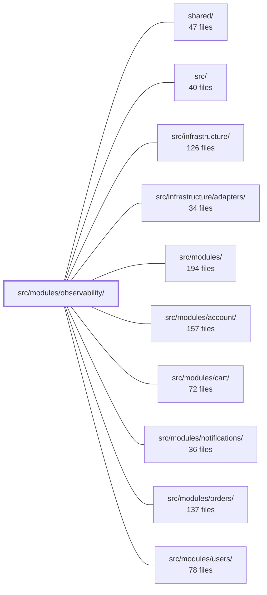

---
tags:
  - 2brain
  - 2brain/module
  - project/boilerplate-node-backend
type: module
module: src/modules/observability/
files: 40
updated: 2026-11-08T10:52:25.785772+00:00
---

# src/modules/observability/

## Purpose

The observability module is the single operator-facing surface for answering "is this installation healthy and what is it doing?" It exposes five HTTP endpoints under `/observability`—a readiness health snapshot, a Prometheus scrape endpoint, a JSON metrics overview, a live Server-Sent Events stream, and a platform-scoped incident audit log—and owns the configuration, authorization, and audit-event registration that make those endpoints safe and configurable.

## Key parts

- **Routing & authentication** — `routes.ts` declares the five endpoints and assigns a per-route guard (standard admin JWT for most, a dedicated bearer token for Prometheus via `metrics-scraper.ts`, and cookie-based session auth for the SSE stream). `authorization.yaml` declares the module's rule-set as the sole platform-scope module in the boilerplate.
- **Controllers** — Five thin handlers (`controllers/`) translate HTTP requests into service calls and shape responses. Notably, `get-observability-metrics-overview.ts` resolves domain counters by metric *name* off the shared prom-client registry so deleting a shop module degrades to zero rather than crashing; `get-observability-metrics.ts` always returns a valid Prometheus exposition body even on failure.
- **Services** — `services/` holds the real logic: `health.ts` assembles the full health payload; `dependency-health.ts` maps raw infrastructure states to a four-word vocabulary; `job-health.ts` and `parked-jobs.ts` read job/queue status from their stores; `process-snapshot.ts` gives one atomic memory/uptime reading to all three consumers; `stream.ts` manages the SSE lifecycle (initial snapshot, periodic deltas, heartbeats, permission recheck, cleanup).
- **Metrics & telemetry plumbing** — `metrics.ts` defines the `dependency_up` gauge; `http-readback.ts` reduces prom-client histogram buckets into p50/p95 numbers for the overview and SSE consumers; `config.ts` validates the scrape credential and Loki/Faro sink URLs at boot.
- **Module manifest & contracts** — `module.ts` / `module.yaml` register the module with the kernel; `openapi.yaml` and `asyncapi.yaml` document the REST and SSE contracts respectively (the AsyncAPI slice is merged into the repo-root contract by a bundler); `audit.ts` registers the module's security-audit actions with the infrastructure events system.
- **Tests** — A layered suite (unit, integration, contract) pins wire shapes, auth paths, percentile math, the dependency-vocabulary mapping, the SSE frame protocol, and the route table.

## How it connects

- **`src/infrastructure/`** — `audit.ts` registers its action strings with the infrastructure security-events system; `dependency-health.ts` and `parked-jobs.ts` read live state from infrastructure adapters (database, cache, queue) without issuing new I/O.
- **`src/modules/account/`** — `audit.ts` deliberately mirrors the "module-local action map + infrastructure registration" pattern established there.
- **`src/modules/cart/` and `src/modules/orders/`** — The metrics-overview endpoint reads their domain counters by *metric name* from the shared prom-client registry rather than importing them, so removing either module simply drops their block from the overview. The dedicated test file `metrics-overview-shop.test.ts` isolates this coupling.
- **`src/modules/users/`** — The SSE endpoint authenticates via the `__Host-session` cookie issued by the users/account flow, and the 30-second permission recheck queries the same authorization layer.
- **`shared/`** — The local `asyncapi.yaml` is a slice that a build step merges into `shared/contracts/asyncapi.root.yaml`; the module's OpenAPI contract likewise feeds the shared contract surface.
- **`src/modules/`** — The module's `index.ts` barrel is the *only* import surface sibling modules may use (per the strategic DDD rule), preventing cross-module reach into internal files.

## Where to start

1. **`routes.ts`** — Five lines of `router.get(...)` calls give you the complete endpoint inventory and the auth strategy for each, so you immediately know what the module exposes and who can call what.
2. **`services/health.ts`** — Reading how the health payload is assembled shows the composition pattern (dependency health + job health + queue health + process snapshot) and the "services own logic, controllers stay thin" convention that every other endpoint in the module follows.

## Connected modules

[[boilerplate-node-backend_ROOT|/ (repository root)]] · [[boilerplate-node-backend_shared|shared/]] · [[boilerplate-node-backend_src|src/]] · [[boilerplate-node-backend_src_infrastructure|src/infrastructure/]] · [[boilerplate-node-backend_src_infrastructure_adapters|src/infrastructure/adapters/]] · [[boilerplate-node-backend_src_modules|src/modules/]] · [[boilerplate-node-backend_src_modules_account|src/modules/account/]] · [[boilerplate-node-backend_src_modules_cart|src/modules/cart/]] · [[boilerplate-node-backend_src_modules_notifications|src/modules/notifications/]] · [[boilerplate-node-backend_src_modules_orders|src/modules/orders/]] · [[boilerplate-node-backend_src_modules_users|src/modules/users/]]

## Files
- `src/modules/observability/asyncapi.yaml` — AsyncAPI 3.0.0 document that specifies the Server-Sent Events stream served at `/observability/events`. It declares the channels, operations, and payload schemas for the observability dashboard's live metrics feed. The file is a self-contained "slice": a bundler merges its `servers`, `channels`, `operations`, and `components` into the repo-root contract (`shared/contracts/asyncapi.root.yaml`), while the local `info` block exists solely to make the file lintable and readable in isolation.
- `src/modules/observability/audit.ts` — Declares the observability module's security-audit action strings and registers them with the infrastructure security-events system. Currently defines a single action for detecting invalid bearer tokens on `/observability/metrics` scrapes. Follows the same "module-local action map + infrastructure registration" pattern as `modules/account/audit.ts`.
- `src/modules/observability/authorization.yaml` — Declares the authorization rules and rule-set for the observability module. It is the sole platform-scope module in the boilerplate, granting read access to health, metrics, and the operational audit — concerns that belong to the installation as a whole rather than to any single shop's content.
- `src/modules/observability/config.ts` — Declares the typed configuration schema for the observability module — the metrics-scrape credential and the endpoints for Loki and Faro telemetry sinks. It exists to centralize validation rules and placeholder detection so the module can fail fast on misconfiguration.
- `src/modules/observability/controllers/get-observability-audit.ts` — Controller for `GET /observability/audit`. Provides a paged, filtered read over the **incident** subset of the `audit-logs` collection (security refusals, failed sign-ins, worker failures). It is the sole reason the observability module depends on `audit-logs`, and it deliberately scopes to platform incidents — not per-customer activity, which is the admin's `GET /audit`.
- `src/modules/observability/controllers/get-observability-events.ts` — Express controller for `GET /observability/events`. It opens a Server-Sent Events (SSE) stream of observability metrics and attaches a periodic permission recheck (every 30 s) so a revoked caller loses access while the long-lived connection is still open. The actual streaming logic lives in the service layer; this file is a thin glue point between the route and the stream.
- `src/modules/observability/controllers/get-observability-health.ts` — HTTP controller for `GET /observability/health`. It delegates payload construction to the observability service and shapes the resulting `ObservabilityHealth` object into a standard success response. It intentionally keeps no business logic of its own.
- `src/modules/observability/controllers/get-observability-metrics-overview.ts` — Controller handler for `GET /observability/metrics/overview`. Assembles a structured JSON snapshot of HTTP, auth, business, database, and process metrics. Its defining design choice is that all domain counters are resolved by **metric name** against the shared prom-client registry (`readCounter`) rather than by direct import, so the dashboard survives deletion of any domain module it reports on.
- `src/modules/observability/controllers/get-observability-metrics.ts` — Express route handler for `GET /observability/metrics`, the Prometheus scrape endpoint. It returns metrics in Prometheus exposition format, or a valid empty body on collection failure — deliberately never an error page, so a scraper doesn't log a parse error on top of the outage.
- `src/modules/observability/http-readback.ts` — Reads the shared Prometheus HTTP metrics (request/error counters and the duration histogram) and reduces them to the single aggregate numbers consumed by the in-app `GET /observability/metrics/overview` endpoint and the SSE stream: total requests, total errors, and approximate p50/p95 latency. It exists so that the module-level consumers don't each re-implement prom-client histogram parsing.
- `src/modules/observability/index.ts` — Public barrel for the `observability` module. It is the **only** surface a sibling module is allowed to import from (per the strategic DDD rule in `docs/theory/strategic-ddd.md` §5), enforcing that external consumers never reach into this module's internal directory structure.
- `src/modules/observability/metrics-scraper.ts` — Express middleware that guards the single Prometheus scrape route (`GET /observability/metrics`) with a static bearer credential. Prometheus cannot hold a session, so this module's routes don't use the same `read:ObservabilitySnapshot` check; instead this middleware validates a dedicated `NODE_METRICS_TOKEN`. It is deliberately kept beside its route (not in `infrastructure/http/middlewares`) and excluded from the module barrel because it is wiring, not published language.
- `src/modules/observability/metrics.ts` — Defines the `dependency_up` Prometheus gauge, which reports whether each backing service (database, cache, queue) is currently serving. It exists to fill an observability gap: when a dependency goes down, other gauges (job counts, outbox depth) stop updating and alerts go silent. This gauge answers the question "is the dependency alive?" with a pure memory read, so it reports even when the dependency itself is unreachable.
- `src/modules/observability/module.ts` — Module manifest that registers the observability module with the kernel. It declares the route mount point (`/observability`), pulls in the config slice (scrape-token gate, telemetry sinks), points to a locales directory, and triggers the side-effect registration of the `dependency_up` gauge. It owns no data collection of its own.
- `src/modules/observability/module.yaml` — Module manifest for the **observability** subdomain. It declares the module's identity (summary, subdomain, group) and its dependency on the `audit-logs` module, serving as the routing/configuration entry point that the platform uses to register this module's endpoints (health, metrics, audit read, SSE stream).
- `src/modules/observability/openapi.yaml` — OpenAPI 3.1.0 module contract for the observability endpoints: a live SSE event stream, an authenticated health snapshot, Prometheus metrics (raw + JSON overview), and an incident-only audit log. It defines the request/response shapes, security requirements, and error semantics so that clients, scrapers, and dashboard consumers have a single source of truth.
- `src/modules/observability/routes.ts` — Defines the five HTTP routes for the operator observability dashboard (mounted at `/observability`) and assigns a per-route authentication strategy. Guards are chosen individually rather than shared because the SSE and Prometheus endpoints are consumed by clients that cannot present a standard admin JWT.
- `src/modules/observability/services/dependency-health.ts` — Provides a **readiness** snapshot of the three backing services (database, cache, queue) by reading their already-tracked in-memory state — zero I/O. Serves `GET /observability/health` and is explicitly kept separate from the liveness endpoint (`GET /`) that drives the orchestrator's restart decision, so a degraded Redis reports as degraded without killing a healthy container.
- `src/modules/observability/services/health.ts` — Builds the full JSON payload served at `GET /observability/health`. It aggregates dependency status, telemetry-sink wiring, process resources, and per-job / per-queue outcomes into a single `ObservabilityHealth` object. The assembly logic lives here (beside the sibling services it calls) rather than in the controller, so the payload shape co-locates with the readers it composes.
- `src/modules/observability/services/index.ts` — Barrel file for the observability services layer. It aggregates every service function and shared type into a single `observabilityService` object so that controllers and the module-level barrel (`src/modules/observability/index.ts`) have one stable import point for all health, streaming, and snapshot logic.
- `src/modules/observability/services/job-health.ts` — Provides the job section of the `GET /observability/health` endpoint. It reports each crontab job's last observed success or error by reading the `leases` document, because no in-memory copy of "when did `reap:orders` last finish" exists in the process.
- `src/modules/observability/services/parked-jobs.ts` — Provides the queue (dead-letter) portion of the `GET /observability/health` response. It reads each worker queue's parked-job count live from the message broker, since that figure lives nowhere in this process's memory. It exists as a thin, named wrapper so the health endpoint can compose it alongside other sub-checks without inlining broker I/O.
- `src/modules/observability/services/process-snapshot.ts` — Provides a single atomic reading of process memory and uptime so that three separate consumers (the SSE stream and two REST endpoints) publish numbers from the same instant. Without this, each consumer calling `process.memoryUsage()` and `process.uptime()` independently could produce values that disagree purely due to timing drift.
- `src/modules/observability/services/stream.ts` — Serves live observability metrics to connected dashboards over Server-Sent Events. It opens an SSE stream per client, pushes a full metrics snapshot immediately, then periodically emits deltas (memory, HTTP counters, SSE client count) and heartbeats on separate timers, cleaning up all state on disconnect.
- `src/modules/observability/tests/contract/api.contract.test.ts` — Contract tests for the `/observability` API. The three JSON endpoints (`/health`, `/metrics/overview`, `/audit`) build their response bodies field-by-field rather than through a shared serializer, making them prone to silent shape drift. This file pins the exact JSON shapes, status codes, and error bodies that a client codes against. `GET /events` (SSE) is read only up to its first event; frame-level assertions live in `stream.test.ts`.
- `src/modules/observability/tests/integration/events-auth.test.ts` — Integration tests for the `GET /observability/events` SSE endpoint's cookie-based authentication path. Because `EventSource` cannot set custom request headers, the stream authenticates solely via the `__Host-session` cookie; these tests verify that forged tokens, revoked sessions, and token rotation are handled correctly for both the initial connection and the periodic recheck of an already-open stream.
- `src/modules/observability/tests/unit/dependency-health.test.ts` — Unit test that pins the exact mapping from raw infrastructure states (Mongoose `readyState`, cache adapter state, queue adapter state) to the normalized four-word health vocabulary (`ready`, `connecting`, `unavailable`, `disabled`), and verifies the `overallStatus` fold that turns per-dependency states into a single service-level status. It exists because the contract suite can only assert that the payload *contains* the four words; this file locks down *which* raw state produces *which* word, including the two easily-mixed cases (`disabled` must not degrade, `connecting` must not read as broken).
- `src/modules/observability/tests/unit/dependency-up.test.ts` — Unit test for the `dependency_up` Prometheus metric. It verifies that the readiness-vocabulary → `1` / `0` / absent mapping rendered by the metric is correct, because the `DependencyUnavailable` alert fires on exactly this mapping.
- `src/modules/observability/tests/unit/get-observability-events.test.ts` — Unit test for the `GET /observability/events` controller handler. It verifies that the handler delegates entirely to the SSE streamer (passing the raw `Response` and a permission-recheck callback) and does not write to the response itself. The recheck path is the focus: it is the only mechanism that can revoke a caller mid-stream, since an SSE connection has no "next request" to trigger a fresh authorization check.
- `src/modules/observability/tests/unit/get-observability-metrics.test.ts` — Unit test for the `GET /observability/metrics` Prometheus scrape handler. It verifies two contract guarantees: a successful collection returns the registry's negotiated content type and exposition body, and a failed collection still returns a 500 with a syntactically valid (empty) exposition so scrapers don't log a secondary format error.
- `src/modules/observability/tests/unit/health-identity.test.ts` — Unit tests for the **identity fields** (`environment` and `service`) that `GET /observability/health` reports to identify which process answered. Job/queue health data is mocked out so this suite focuses solely on how the payload names the process.
- `src/modules/observability/tests/unit/http-readback.test.ts` — Unit tests for the `percentileFromHistogramBuckets` utility exported from the observability module. Verifies that percentile estimation from histogram buckets behaves correctly for edge cases (empty input) and for selecting the appropriate bucket at various percentile thresholds.
- `src/modules/observability/tests/unit/job-health.test.ts` — Unit test for the `jobHealth` service function (the job half of `GET /observability/health`). Its sole job is to guarantee the **wire-shape contract**: `lastSuccessAt` must leave the function as an ISO-8601 string, not a `Date`, even though `JSON.stringify` would mask the difference. It also pins down the handling of absent timestamps and errors.
- `src/modules/observability/tests/unit/metrics-overview-shop.test.ts` — Unit tests for the `business` block returned by `GET /observability/metrics/overview`, covering only the counters owned by shop modules (cart, orders). Extracted from the general overview suite so that removing a shop module deletes exactly this file and nothing else.
- `src/modules/observability/tests/unit/metrics-overview.support.ts` — Shared test-support module for the two metrics-overview unit suites. It centralises the small amount of setup both suites need: resolving a metric from the registry by name (so they can assert against its stub) and invoking the controller to capture the payload it sends to `successResponse`.
- `src/modules/observability/tests/unit/metrics-overview.test.ts` — Unit tests for the `GET /observability/metrics/overview` endpoint. Verifies that the controller resolves each domain counter by metric **name** off the shared Prometheus registry (rather than by direct import), so a renamed or deleted module degrades to zero without breaking the response. Also asserts the "absent counter" path where an entire business block is omitted.
- `src/modules/observability/tests/unit/metrics-scraper.test.ts` — Unit tests for `isMetricsScraper`, the credential guard protecting `GET /observability/metrics`. Because Prometheus scrapers cannot authenticate via JWT, this middleware is the sole gate on an endpoint that exposes operational state; these tests pin three security invariants—deny-by-default when unconfigured, mandatory `Bearer` scheme, and length-safe comparison—so that silent regressions in any single property are caught at the unit level rather than only in integration.
- `src/modules/observability/tests/unit/parked-jobs.test.ts` — Unit test for `queueHealth`, the queue half of `GET /observability/health`. It verifies that `queueHealth` is a faithful pass-through of `parkedCounts()`—no transformation, no filtering—by mocking the queue adapter and asserting the returned array is unchanged.
- `src/modules/observability/tests/unit/routes.test.ts` — Unit tests that verify the **route table** of the observability module: which endpoints are mounted, in what order, and which guard chain protects each one. It does not test handler logic — it asserts the structural contract of `router` as exported by `routes.ts`.
- `src/modules/observability/tests/unit/stream.test.ts` — Unit-test suite for the SSE metrics stream (`streamObservabilityMetrics`) and its payload builder (`buildObservabilityPayload`). It verifies the wire format, connection bookkeeping, timer cadence, permission-recheck lifecycle, and error absorption of the stream module using fake timers and a hand-built response stub, so no real socket or clock is involved.

---
[[boilerplate-node-backend_INDEX|← boilerplate-node-backend index]]
