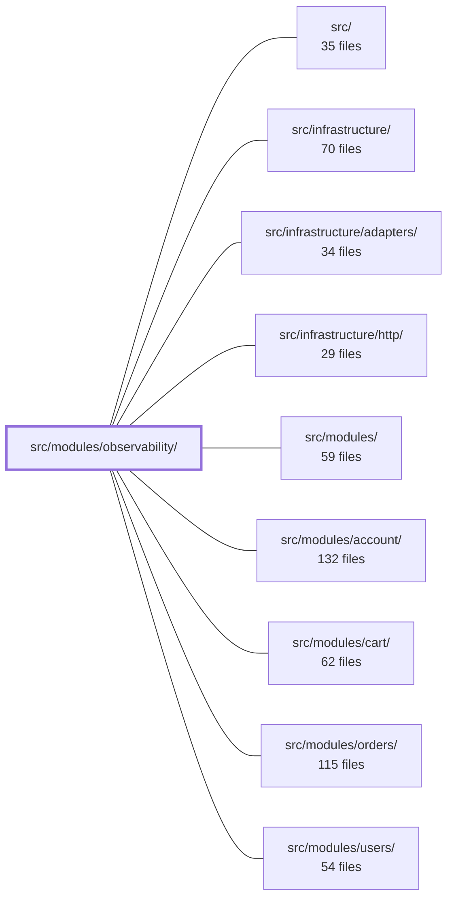

---
tags:
  - 2brain
  - 2brain/module
  - project/boilerplate-node-backend
type: module
module: src/modules/observability/
files: 36
updated: 2026-10-15T13:40:38.849621+00:00
---

# src/modules/observability/

## Purpose

The observability module is the operator-facing monitoring surface for the platform. It exposes five endpoints under `/observability` — a detailed health snapshot, a Prometheus scrape target, a JSON metrics overview, a live SSE stream, and a filtered audit trail — so that dashboards, scrapers, and admin tooling can see process state, dependency readiness, and operational metrics without coupling to any domain module.

## Key parts

- **Routing & module wiring** — `routes.ts` defines the Express router and per-route guard assignments; `module.ts` is the kernel manifest that registers routes, config, and locales; `index.ts` is the barrel (the only import path allowed for sibling modules); `config.ts` declares the typed environment schema (scrape credential, Loki/Faro sink addresses).
- **Controllers (HTTP boundary)** — `controllers/get-observability-health.ts`, `get-observability-metrics.ts`, `get-observability-metrics-overview.ts`, `get-observability-events.ts`, and `get-observability-audit.ts` each bridge one route to its service. All payload construction lives below them.
- **Services (logic layer)** — `services/health.ts` assembles the health JSON; `services/dependency-health.ts` folds adapter state into a readiness verdict; `services/job-health.ts` reads last crontab outcomes from the `leases` collection; `services/parked-jobs.ts` queries the broker for dead-letter depth; `services/process-snapshot.ts` provides an atomic memory/uptime read shared by three consumers; `services/stream.ts` manages the SSE client set, periodic snapshots, and stream lifecycle.
- **Metrics helpers** — `metrics.ts` defines the `dependency_up` gauge (per backing service); `http-readback.ts` collapses shared HTTP counters/histograms into service-wide totals and p50/p95; `metrics-scraper.ts` is the static-token bearer guard for the Prometheus scrape endpoint (kept out of the barrel by design).
- **API contracts** — `openapi.yaml` (REST endpoints) and `asyncapi.yaml` (SSE stream) are standalone, lintable documents; the bundler merges the AsyncAPI servers/channels into the repo-root contract at build time.
- **Tests** — `tests/contract/` pins wire shape for the three JSON endpoints; `tests/unit/` covers every service, controller, helper, and the SSE streamer with byte-level frame assertions and timer-teardown checks.

## How it connects

- **Domain modules (account, cart, orders, users):** The metrics-overview controller resolves counters **by name** on the shared prom-client registry rather than importing them. Deleting a domain module removes its registered counters and the overview omits that block — no compile-time dependency is created. The `metrics-overview-shop.test.ts` suite is the only test file that names cart/orders specifically.
- **`src/infrastructure/adapters/`:** `dependency-health.ts` performs a synchronous memory read of each adapter's already-tracked connection state (database, cache, queue) to produce the readiness verdict; `parked-jobs.ts` reads live dead-letter counts from the broker.
- **`src/infrastructure/http/`:** `http-readback.ts` reads the shared request counters and duration histogram defined there, feeding both the overview endpoint and the SSE publish.
- **`audit-logs` collection (via the audit controller):** This is the single point where the module reaches beyond its own process to read security-refusal, failed-sign-in, and worker-failure records.
- **Repository root:** The `asyncapi.yaml` is merged into the root-level AsyncAPI contract by the bundler; the module barrel (`index.ts`) is the sanctioned entry point for any sibling module that needs readiness or telemetry services.

## Where to start

1. **`routes.ts`** — five routes, five guards, one file. Reading it first gives the full endpoint map and the reason each guard differs (cookie/SSE, static token/Prometheus, JWT/admin).
2. **`services/health.ts`** — the most representative service: it shows how the module composes dependency probes, job outcomes, queue depth, and process snapshot into a single JSON payload, and it makes the separation between "readiness for dashboards" and "liveness for orchestrators" explicit.

## Connected modules

[[boilerplate-node-backend_ROOT|/ (repository root)]] · [[boilerplate-node-backend_src|src/]] · [[boilerplate-node-backend_src_infrastructure|src/infrastructure/]] · [[boilerplate-node-backend_src_infrastructure_adapters|src/infrastructure/adapters/]] · [[boilerplate-node-backend_src_infrastructure_http|src/infrastructure/http/]] · [[boilerplate-node-backend_src_modules|src/modules/]] · [[boilerplate-node-backend_src_modules_account|src/modules/account/]] · [[boilerplate-node-backend_src_modules_cart|src/modules/cart/]] · [[boilerplate-node-backend_src_modules_orders|src/modules/orders/]] · [[boilerplate-node-backend_src_modules_users|src/modules/users/]]

## Files
- `src/modules/observability/asyncapi.yaml` — Standalone AsyncAPI 3.0.0 document defining the Server-Sent Events stream the observability module serves at `/observability/events`. It is written as a complete, independently lintable contract so it can be read and validated without the rest of the repo; the bundler merges its servers, channels, operations, and components into the repo-root contract at build time.
- `src/modules/observability/config.ts` — Declares the environment-variable schema for the observability module: the metrics scrape credential and the optional telemetry sink addresses (Loki, Faro). Exists so that the rest of the module can validate and access its configuration through a single typed export.
- `src/modules/observability/controllers/get-observability-audit.ts` — Controller for `GET /observability/audit`. It exposes a filtered, paged read over the **incident** subset of the `audit-logs` collection (security refusals, failed sign-ins, worker failures). It is the single point where the observability module depends on `audit-logs`, and the only place it reaches beyond its own process snapshot.
- `src/modules/observability/controllers/get-observability-events.ts` — Express controller for `GET /observability/events`. Opens the SSE metrics stream and attaches a periodic (30 s) permission recheck so that a revoked caller is disconnected mid-stream rather than on their next request (which never comes).
- `src/modules/observability/controllers/get-observability-health.ts` — Thin Express controller that wires the `GET /observability/health` route to the health-building service and shapes the HTTP response. All payload construction lives in the service layer; this file exists solely to bridge the HTTP boundary.
- `src/modules/observability/controllers/get-observability-metrics-overview.ts` — Controller for `GET /observability/metrics/overview`. It assembles a structured JSON summary of operational metrics (HTTP, auth, business, database, process) by looking up each metric **by name** on the shared prom-client registry instead of importing the counters directly. This keeps the observability module free of compile-time dependencies on any domain module (account, cart, orders), so deleting a domain never breaks this file.
- `src/modules/observability/controllers/get-observability-metrics.ts` — Express controller that serves the `GET /observability/metrics` endpoint (the Prometheus scrape target). It returns metrics in the Prometheus exposition text format, or a valid-but-empty body on collection failure — never an HTML error page — so that a scraper never logs a format parse error on top of the underlying outage.
- `src/modules/observability/http-readback.ts` — Reads the shared HTTP request counters and duration histogram (defined in `metrics-http`) and collapses them into single service-wide numbers: total requests, total errors, and approximate p50/p95 latency. These numbers feed both the `GET /observability/metrics/overview` endpoint and the SSE stream publish.
- `src/modules/observability/index.ts` — Public barrel (re-export) file for the `observability` module. It is the **only** entry point a sibling module may import from, per the strategic DDD convention (`docs/theory/strategic-ddd.md` §5). It currently exposes the module's readiness/telemetry services so that future external callers reach them here rather than via a deep import into `./services`.
- `src/modules/observability/metrics-scraper.ts` — Single-purpose Express middleware that guards `GET /observability/metrics` with a static bearer token. Prometheus scrapers cannot hold sessions or present the `platform.observability.any.read` permission used by the other observability routes, so this endpoint gets its own credential. The file lives beside the route it protects and is deliberately kept out of the module barrel — it is wiring, not published language.
- `src/modules/observability/metrics.ts` — Defines the `dependency_up` Prometheus gauge that reports, per backing service (`database`, `cache`, `queue`), whether it is currently serving. It exists to close the observability gap where, if a dependency like Mongo goes down, every other gauge that depends on it stops reporting and alerting rules go blind exactly when they are needed most.
- `src/modules/observability/module.ts` — Module manifest for the **observability** module. It wires the operator-facing surface — health checks, metrics overview, live SSE stream, Prometheus scrape endpoint, and audit trail — into the kernel's module registry. It does no business logic itself; it declares *what* the module exposes (routes, config, locales) and *where* those live in sibling files.
- `src/modules/observability/openapi.yaml` — OpenAPI 3.1.0 module contract for the observability module. Defines the five operational endpoints (SSE event stream, detailed health snapshot, Prometheus metrics, JSON metrics overview, and platform-operator audit trail) along with their request/response schemas, security schemes, and shared-contract references. It exists so that API clients, dashboards, and documentation generators have a single source of truth for what this module exposes.
- `src/modules/observability/routes.ts` — Defines the Express router for all five observability endpoints (mounted under `/observability`). Guards are assigned per-route rather than shared because the `/events` (SSE) and `/metrics` (Prometheus scrape) routes are called by clients that cannot present a standard admin JWT, while the remaining three routes use the usual authorization chain.
- `src/modules/observability/services/dependency-health.ts` — Readiness (not liveness) reporter for every backing service this process depends on — database, cache, queue. It performs a synchronous memory read of each adapter's already-tracked state and folds the result into a single `ok` / `degraded` verdict. It backs `GET /observability/health` and is explicitly designed to **never** feed the orchestrator's restart decision (that is `GET /` / liveness's job), so a degraded Redis degrades the dashboard dot instead of killing a healthy container.
- `src/modules/observability/services/health.ts` — Assembles the JSON payload served by `GET /observability/health`: dependency probe results, telemetry-sink configuration flags, process/system resources, and per-job outcomes. It lives in the services layer (not the controller) so the response shape is defined alongside the helpers that produce its fields.
- `src/modules/observability/services/index.ts` — Barrel file for the observability services layer. It re-exports all service modules (health, job-health, dependency-health, parked-jobs, process-snapshot, stream) so that consumers can import from a single path (`.../observability/services`) rather than reaching into individual files.
- `src/modules/observability/services/job-health.ts` — Provides the job-status half of the `GET /observability/health` endpoint. It reports every crontab job's last observed outcome by issuing a single read against the `leases` collection (populated by `scripts/run-script.ts` and, where applicable, `withLease`). It exists because no in-memory copy of "when did `reap:orders` last finish" lives in the process.
- `src/modules/observability/services/parked-jobs.ts` — Provides the queue component of `GET /observability/health` by reading each worker queue's current dead-letter (parked) depth live from the broker. Unlike `dependency-health.ts`, this service performs I/O because parked counts exist only on the broker, not in process memory.
- `src/modules/observability/services/process-snapshot.ts` — Provides a single atomic read of process memory and uptime so that three consumers (the SSE stream and two REST endpoints) all publish numbers from the same instant. Without this, independent calls to `process.memoryUsage()` / `process.uptime()` across those consumers could drift and present as a bug. All values are in bytes; uptime is integer seconds.
- `src/modules/observability/services/stream.ts` — Provides a live metrics feed over Server-Sent Events (SSE) for an admin dashboard. It manages the set of connected SSE clients, builds periodic metric snapshots, and handles stream lifecycle (headers, heartbeat, permission re-verification, teardown). SSE was chosen over WebSockets because the data flows one direction, it is plain HTTP, and browsers reconnect automatically via `EventSource`.
- `src/modules/observability/tests/contract/api.contract.test.ts` — Contract tests for the three JSON endpoints under `/observability` (health, metrics overview, audit). Because those responses are assembled field-by-field in application code rather than produced by a shared serializer, shape drift goes undetected by unit tests. This file pins the wire shape, vocabulary, and validation behavior each client codes against, including error responses (422, 401/403 bodies). `GET /events` (SSE) is intentionally out of scope; `stream.test.ts` owns frame content.
- `src/modules/observability/tests/unit/dependency-health.test.ts` — Unit tests for the dependency-health readiness fold. Pins the mapping from each dependency's raw connection state to its semantic word (`ready`, `connecting`, `unavailable`, `disabled`) and verifies the `overallStatus` aggregation rule — specifically that `disabled` never degrades a service while `connecting` and `unavailable` always do. Exists because a contract/integration test can only assert the payload shape; this file is where the _meaning_ of each state is locked down.
- `src/modules/observability/tests/unit/dependency-up.test.ts` — Unit test for the `dependency_up` Prometheus metric. It locks in the exact mapping from `DependencyHealth` states to metric values (1 / 0 / label-absent) that the `DependencyUnavailable` alert depends on, with all real dependency checks mocked out.
- `src/modules/observability/tests/unit/get-observability-events.test.ts` — Unit tests for the `GET /observability/events` handler. They verify that the controller delegates entirely to the SSE streamer (writing nothing to the response itself) and that the permission recheck it hands over is correctly wired to the caller's request and the observability read key.
- `src/modules/observability/tests/unit/get-observability-metrics.test.ts` — Unit tests for the `GET /observability/metrics` Prometheus scrape handler. Covers the happy path (exposition body + registry content type), the failure path (500 + valid empty exposition comment), and the error-logging contract. Exists to guarantee that a collection failure still returns a body a Prometheus scraper can parse, avoiding a secondary format-error log on top of the outage.
- `src/modules/observability/tests/unit/health-identity.test.ts` — Unit tests that verify how `buildObservabilityHealth` names the answering process in the `GET /observability/health` payload — specifically the `environment` and `service` fields. The job- and queue-health sub-responses are mocked out so this suite focuses exclusively on identity reporting, leaving those concerns to their own test files.
- `src/modules/observability/tests/unit/http-readback.test.ts` — Unit tests for the `percentileFromHistogramBuckets` helper, verifying that it correctly maps a target percentile to an upper-bound value from a list of histogram buckets.
- `src/modules/observability/tests/unit/job-health.test.ts` — Unit tests for the `jobHealth` service that back the jobs half of `GET /observability/health`. The entire suite guards one wire-shape contract: `lastSuccessAt` must be an ISO-8601 **string** in the response, not a `Date` object. Because `JSON.stringify` produces identical output for both, the failure would be invisible to a passing contract test and only surface when a consumer reads the field directly.
- `src/modules/observability/tests/unit/metrics-overview-shop.test.ts` — Unit tests for the `business` block of the `GET /observability/metrics/overview` endpoint, covering only the counters owned by shop modules (cart and orders). The file is deliberately isolated from the rest of the overview suite so that removing the shop removes exactly this file and nothing else.
- `src/modules/observability/tests/unit/metrics-overview.support.ts` — Shared helpers for the metrics-overview unit-test suites. It provides a small, typed surface for (1) looking up a registered counter or histogram by name, (2) invoking the overview controller, and (3) extracting the payload the controller passes to `successResponse`. Centralising these lets both `metrics-overview.test.ts` and `metrics-overview-shop.test.ts` avoid duplicating the same boilerplate.
- `src/modules/observability/tests/unit/metrics-overview.test.ts` — Unit tests for the `GET /observability/metrics/overview` endpoint. They verify that each domain row in the response carries real numbers resolved by metric **name** from the shared Prometheus registry, and that a missing counter (e.g. a deleted module) causes the entire block to be omitted rather than reporting zeros.
- `src/modules/observability/tests/unit/metrics-scraper.test.ts` — Unit tests for `isMetricsScraper`, the credential guard protecting `GET /observability/metrics`. This is the only auth check in the codebase that bypasses JWT middleware (Prometheus cannot log in), so the tests pin three security properties that each fail silently if broken: deny-by-default, Bearer-scheme enforcement, and safe length-mismatch handling.
- `src/modules/observability/tests/unit/parked-jobs.test.ts` — Unit test for the `queueHealth` function (the queue half of `GET /observability/health`). It verifies that `queueHealth` is a thin pass-through of `parkedCounts()` with no shape transformation, covering both populated and empty results.
- `src/modules/observability/tests/unit/routes.test.ts` — Verifies the structural contract of the observability router: which endpoints exist, in what order, and which guard chain protects each one. It asserts the two non-standard guard styles (cookie for SSE, static credential for Prometheus) and confirms no endpoint is left unguarded.
- `src/modules/observability/tests/unit/stream.test.ts` — Unit test suite for the SSE (Server-Sent Events) metrics stream. It verifies three things that fail silently if broken: the exact wire format of each SSE frame, timer teardown on disconnect (preventing zombie intervals and memory leaks), and error absorption inside interval callbacks. Uses fake timers and a hand-built fake `Response` so frames are deterministic and inspectable byte-for-byte.

---
[[boilerplate-node-backend_INDEX|← boilerplate-node-backend index]]
