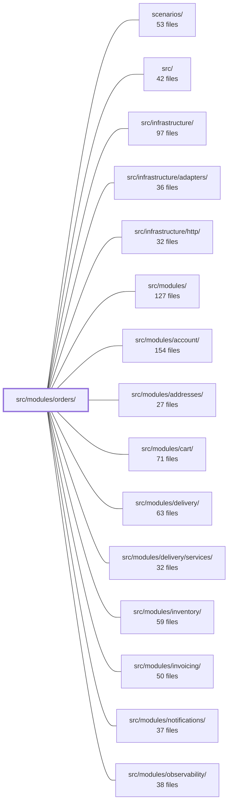

---
tags:
  - 2brain
  - 2brain/module
  - project/boilerplate-node-backend
type: module
module: src/modules/orders/
files: 108
updated: 2026-10-29T19:27:23.750461+00:00
---

# src/modules/orders/

## Purpose

The `orders` module is the bounded context that owns the complete order lifecycle: creation (admin and cart-based), status transitions, cancellation, soft/hard deletion, shipping-address correction, CSV export, timeline, and the pure business rules around totals, VAT, withdrawal rights, backorders, and purchase holds. It sits low in the dependency graph—upstream modules (payments, returns, delivery) cannot be imported *into* orders and instead stamp status back onto the order, which orders then interprets via its own read-side projections.

## Key parts

- **Controllers** (`controllers/`) — One file per HTTP endpoint (`create-order`, `get-order-item`, `post-cancel-order`, `update-order`, `delete-orders`, `restore-orders`, `get-orders-export`, `get-order-timeline`, `put-shipping-address`, `post-order-status-override`, `get-orders`). A shared `respond.ts` helper hydrates a single-order response with caller-scoped permitted actions. Most controllers are thin: they validate input, delegate to the service, and shape the response.
- **Domain layer** (`domain/`) — Pure, I/O-free business rules behind a single barrel (`domain/index.ts`). Highlights: `lifecycle.ts` (status state machine + actor permissions), `status-traits.ts` (exhaustive per-status trait map), `totals.ts` / `tax.ts` (money composition and VAT), `withdrawal.ts` (CDR Art. 9 window + guarantee), `backorder.ts`, `purchase-hold.ts`, `projections.ts` (read-side interpretation of payment/refund/return stamps), `fulfillment.ts` (consumes the record `delivery` writes), `timeline.ts`, `rules.ts`, `deletion.ts`, `export.ts` (CSV column mapping), `shop-time.ts`, `anonymization.ts`.
- **Module wiring** (`module.ts`, `index.ts`, `config.ts`, `events.ts`, `emails.ts`, `metrics.ts`, `audit.ts`, `analytics.ts`) — `module.ts` is the manifest the kernel reads to mount routes, register jobs, webhooks, rate limits, and event subscriptions. `index.ts` is the sole public import surface. `events.ts` and `audit.ts` register typed vocabulary into the app-wide maps. `config.ts` holds tunable thresholds read per-call. `emails.ts` holds all order-module email copy. `metrics.ts` defines the Prometheus counters.
- **Model & persistence** (`model.ts`, `factories.ts`) — Mongoose schema with a frozen product snapshot per line (no live catalogue reference) and wire-only derived totals at serialization time. `factories.ts` builds Mongoose-ready fixtures for tests.
- **Jobs** (`jobs.ts`, `jobs.generated.ts`) — A single retention-scrub job that anonymizes due orders and scrubs timeline text.

## How it connects

- **`cart`** — The cart module's checkout flow produces the order; the admin `POST /orders` path in this module is the alternative creation route. Both converge on the same service.
- **`payments`** / **`returns`** / **`delivery`** — These upstream modules stamp their side-status (payment, refund, return, fulfillment) onto the order document via an `orderService` method. Orders interprets those stamps in `domain/projections.ts` and `domain/fulfillment.ts` without importing the other modules.
- **`inventory`** — Stock commitment and backorder logic in the domain layer reference inventory outcomes frozen at order time.
- **`products`** — Each order line embeds a frozen, locale- and tax-rate-resolved product snapshot taken from the catalogue at purchase time; no live product reference is stored.
- **`notifications`** / **`invoicing`** / **`tickets`** — Consume the domain events declared in `events.ts` (order created, cancelled, status changed, etc.) to trigger downstream side effects.
- **`users`** / **`addresses`** / **`account`** — Supply buyer identity, shipping address validation, and account-level email conventions that `emails.ts` mirrors.
- **`infrastructure/http`** / **`infrastructure/adapters`** — Provide the Express middleware, shared controller factories (`createSearchController`, `createUpdateController`, `createDeleteController`, `createRestoreController`), and adapter primitives the controllers build on.
- **`observability`** — Reads the Prometheus counters defined in `metrics.ts` for the system overview endpoint.

## Where to start

1. **`domain/lifecycle.ts`** — It defines the status state machine (allowed transitions + actor permissions), which is the spine every other rule (traits, withdrawal, projections, deletion eligibility) hangs from. Reading it first gives you the vocabulary for the rest of the module.
2. **`controllers/create-order.ts`** — The simplest end-to-end path (validate → service → respond → metric → audit). Tracing one request from HTTP handler through the service into the domain layer shows the layering convention that every other endpoint follows.

## Connected modules

[[boilerplate-node-backend_ROOT|/ (repository root)]] · [[boilerplate-node-backend_scenarios|scenarios/]] · [[boilerplate-node-backend_src|src/]] · [[boilerplate-node-backend_src_infrastructure|src/infrastructure/]] · [[boilerplate-node-backend_src_infrastructure_adapters|src/infrastructure/adapters/]] · [[boilerplate-node-backend_src_infrastructure_http|src/infrastructure/http/]] · [[boilerplate-node-backend_src_modules|src/modules/]] · [[boilerplate-node-backend_src_modules_account|src/modules/account/]] · [[boilerplate-node-backend_src_modules_addresses|src/modules/addresses/]] · [[boilerplate-node-backend_src_modules_cart|src/modules/cart/]] · [[boilerplate-node-backend_src_modules_delivery|src/modules/delivery/]] · [[boilerplate-node-backend_src_modules_delivery_services|src/modules/delivery/services/]] · [[boilerplate-node-backend_src_modules_inventory|src/modules/inventory/]] · [[boilerplate-node-backend_src_modules_invoicing|src/modules/invoicing/]] · [[boilerplate-node-backend_src_modules_notifications|src/modules/notifications/]] · … and 7 more

## Files
- `src/modules/orders/analytics.ts` — Declares the analytics event names the orders module emits and registers them into the app-wide `AnalyticsEventMap` type. This file exists so that event names live in one source-of-truth location and the analytics port's union type stays in sync across modules.
- `src/modules/orders/audit.ts` — Defines the complete audit-action vocabulary for the orders module and registers it into the app-wide `AuditActionMap` via TypeScript module augmentation. It exists so that every order-lifecycle event (create, update, delete, restore, cancel, export, address correction, status override) carries a typed, centrally-known action string rather than ad-hoc literals scattered across services.
- `src/modules/orders/config.ts` — Defines the orders module's tunable rules—withdrawal window, data-retention periods, line/quantity caps, purchase-hold thresholds, and the link into the paired frontend. Every value is read per call (not captured at import) so tests can vary them; a deployment change takes effect on restart. Shop identity, currency, and VAT rates deliberately live elsewhere.
- `src/modules/orders/controllers/create-order.ts` — HTTP handler for `POST /orders`. Accepts an explicit `items` payload from the request body and delegates to `orderService.create`, making this the **admin** order-creation path (as opposed to the cart-based checkout flow in `@modules/cart`). It validates the body, calls the service, records a metric, and shapes the success/error response.
- `src/modules/orders/controllers/delete-orders.ts` — Thin adapter that wires the shared `createDeleteController` factory to the order-specific service. It exposes a single `deleteOrders` controller for the admin `DELETE /orders` endpoint, delegating all real logic to `orderService.removeById`.
- `src/modules/orders/controllers/get-order-item.ts` — Controller for `GET /orders/:id`. Validates the path id, fetches a single order scoped to the caller's role, records an audit event for staff, sets an ETag, and delegates response shaping (including caller-specific permitted actions) to the shared `respondWithOrder` helper.
- `src/modules/orders/controllers/get-order-timeline.ts` — Handler for `GET /orders/:id/timeline`. Returns the timeline of events for a given order, filtered by the caller's role (staff see all entries with actors; buyers see only buyer-visible types without actors). Authorization is the same scope as `GET /orders/:id`—an order the caller cannot see yields a 404.
- `src/modules/orders/controllers/get-orders-export.ts` — Implements `GET /orders/export`, a CSV download endpoint that streams an order list (filtered by the same criteria as the paginated list endpoint) directly to the HTTP response without buffering in memory. It exists to let operators export filtered order data while keeping peak memory flat and enforcing the same authorization and rate-limit gates as the list endpoint.
- `src/modules/orders/controllers/get-orders.ts` — Thin search/list controller for `GET /orders`. It wires the shared `createSearchController` factory to the order service, applying caller-scoped visibility and a permission gate on the `userId` filter so that only callers with `display:Order` can search across all users' orders.
- `src/modules/orders/controllers/post-cancel-order.ts` — Controller for `POST /orders/:id/cancel` — the single write a customer can perform on an order. It validates the request, extracts the caller's auth scope, and delegates the actual cancellation to `orderService.cancelOnRequestById`, then formats the response.
- `src/modules/orders/controllers/post-order-status-override.ts` — Thin Express controller for `POST /orders/:id/status-override`. Validates the path param and body, delegates to `orderService.overrideStatus`, and formats the response. By design it is a status-only mutation — it intentionally has no parcel or email side effects.
- `src/modules/orders/controllers/put-shipping-address.ts` — Express handler for `PUT /orders/:id/shipping-address`. It validates the path param and request body, delegates to `orderService.correctShippingAddress`, and formats the response. All business logic lives in the service; this file is pure HTTP wiring.
- `src/modules/orders/controllers/respond.ts` — Shared success-path helper for every order controller that writes or reads a single order. It hydrates the order document returned by the service layer with the caller's computed `actions` (via `orderService.withActions`) and then sends the result as the HTTP response body. It is deliberately kept outside `services/scope.ts` so that `withActions` remains framework-free; each call site still supplies its own HTTP status and operation name.
- `src/modules/orders/controllers/restore-orders.ts` — Thin admin controller that wires the shared `createRestoreController` factory to the order domain, exposing a single POST endpoint to undo a soft-deleted order.
- `src/modules/orders/controllers/update-order.ts` — Exports the `PUT /orders/:id` (replace) and `PATCH /orders/:id` (merge) handlers for the orders resource. Both are built from the shared `createUpdateController` factory so that validation, 404 handling, and response shaping stay consistent. Only `email` is a writable field here; `status` is deliberately excluded from both body schemas and must be changed via a separate action endpoint.
- `src/modules/orders/domain/anonymization.ts` — Defines a single domain constant used as the placeholder email for orders that have been anonymized. It exists to satisfy the non-nullable `email` schema field while ensuring no real mailbox can ever receive mail on behalf of a scrubbed buyer.
- `src/modules/orders/domain/backorder.ts` — Pure domain logic that defines and computes the "owed" portion of an order line—the units the shelf could not cover and the date they were promised to the buyer. It exists to keep the backorder calculation free of I/O and service concerns, living alongside other order domain types.
- `src/modules/orders/domain/deletion.ts` — Pure predicate functions that decide whether an order may be soft-deleted (hidden) or hard-deleted (destroyed). They exist so that the UI "delete door" and the service-layer `delete` / `hardDelete` actions share a single source of truth for eligibility, preventing the flag and the refusal from disagreeing.
- `src/modules/orders/domain/export.ts` — Defines the **shape** of the orders CSV export: which columns appear, in what order, and how a single order object maps to one row of cells. It is a pure, side-effect-free mapping layer so that the service that actually writes the file only deals with an array of strings/numbers, not with `Order` objects or `Date` objects.
- `src/modules/orders/domain/fulfillment.ts` — Defines the `FulfillmentSummary` record that `delivery` writes into an order (via `orderService.recordFulfillmentProgress`) and the pure read-side logic `orders` uses to interpret it: deriving the displayed fulfillment status and building the Mongo filter for `GET /orders?fulfillmentStatus=`. It exists because the dependency arrow points `delivery → orders`, so `orders` cannot import `delivery` directly and instead consumes this single small record. No I/O.
- `src/modules/orders/domain/index.ts` — Barrel re-export for the orders domain layer. It exposes a single public surface for all pure business rules (totals, lifecycle, withdrawal, tax, etc.) so that consumers import from one path instead of reaching into individual domain files. The header contract states the layer is lint-guaranteed free of Express, Mongoose, and database concerns—anything testable without a DB lives behind this entry point.
- `src/modules/orders/domain/lifecycle.ts` — Defines the order lifecycle state machine: which status may follow which, and which actor may make each move. The set of statuses comes from the contract; this file adds the directed edges and their actor permissions. A single source of truth so that services name an event and read its `from`/`to`/`actors` without guessing. Pairs with the conditional-write helper in the repository to ensure only one racing writer wins.
- `src/modules/orders/domain/projections.ts` — Provides the read-side projection logic for two "side" statuses on an order — payment (refund) status and return status. Because `orders` cannot import `payments` or `returns`, those modules **stamp** their status onto the order via a service; this file supplies the pure, dependency-free functions that turn the stored stamp (plus `paidAt`) into the caller-facing status, and the inverse Mongo filters used to query by status. `fulfillment_status` is explicitly excluded (see `./fulfillment`).
- `src/modules/orders/domain/purchase-hold.ts` — Pure domain logic that determines whether a buyer's own cancellations trigger an automatic purchase hold and, if so, computes the instant the hold expires. All temporal inputs are passed as arguments so the logic is testable without a clock or database.
- `src/modules/orders/domain/rules.ts` — Pure predicate and validation functions for order data. Each export takes structured input (lines, buyer references) and returns a plain verdict or boolean — no status codes, no i18n, no I/O. The service layer (primarily `services/place`) is responsible for translating verdicts into HTTP responses or side effects. See `docs/theory/domain-layer.md` for the design rationale.
- `src/modules/orders/domain/shop-time.ts` — Provides a single pure helper, `yearInZone`, that resolves the calendar year of an instant in a shop's IANA time zone. It exists so that number series (order numbers, invoice numbers) are assigned to the year the shop sees on its wall clock, not the UTC year the server happens to be in around the year boundary.
- `src/modules/orders/domain/status-traits.ts` — Declares, in a single record, what every `OrderStatus` means with respect to stock commitment, dispatch state, buyer withdrawability, and current fulfillment. Other domain files (lifecycle, withdrawal, fulfillment) read these traits to answer status-dependent questions instead of maintaining their own status lists. The `satisfies Record<OrderStatus, …>` annotation makes the mapping exhaustive: adding a new status to the contract breaks the build here rather than silently falling into a wrong category.
- `src/modules/orders/domain/tax.ts` — Computes all VAT figures for an order from its frozen (already-priced) lines and shipping cost. It derives per-line tax/net, per-rate summaries, and shipping's apportioned tax share at serialization time, guaranteeing that a later config rate change never restates what a past order was actually charged.
- `src/modules/orders/domain/timeline.ts` — Defines the audience mapping for every order-timeline type and the shape of a timeline entry as written by the `orders` module. Its job is to make the "who can read this row?" decision a compile-time, per-type choice rather than a field-stripping step at read time.
- `src/modules/orders/domain/totals.ts` — Computes what a list of priced line items adds up to and what the customer owes on top (frozen shipping). Exists as the single composition point so that a cart summary, the order it previews, the payment intent, and the confirmation email all derive the same number rather than each summing independently. All arithmetic delegates to `money.ts` in minor units; this file only composes.
- `src/modules/orders/domain/withdrawal.ts` — Pure domain logic for the right of withdrawal (Consumer Rights Directive Art. 9, 11a) and the statutory guarantee of conformity (Directive 2019/771 / 2019/770). Given only an order's status, lines, and timestamps, it computes when the withdrawal window opens and closes, whether the button may show, when the guarantee expires, and whether a withdrawal is a cancel or a return. No I/O, no side effects.
- `src/modules/orders/emails.ts` — Holds the full resolved copy (finished strings) for every email the orders module sends. Each function takes a locale and order data, produces translated text with all placeholders filled, and returns it as structured data the mailer's template engine can interpolate. The file is the single source of truth for order-module email wording, mirroring the convention in `@modules/account/emails`.
- `src/modules/orders/events.ts` — Declares the order module's domain events by augmenting the kernel's `DomainEventMap` (via `declare module '@kernel/events'`), and exports string constants so emitters and listeners share one spelling. Because `orders` sits low in the dependency graph, these events are the only mechanism for announcing state changes to upstream modules (payments, delivery, notifications, webhooks).
- `src/modules/orders/factories.ts` — Test-fixture factory that builds a Mongoose-ready `Order` document (an `OrderFixture`) from a caller's partial overrides. It translates contract-level shapes (string IDs, ISO date strings, product snapshots as embedded data) into the persistence shape (`Types.ObjectId`, `Date` objects, embedded `FrozenOrderLineProduct`) so tests can call `orderRepository.create` without hand-assembling documents.
- `src/modules/orders/index.ts` — Public barrel (the sole import surface) for the Orders module. Sibling modules (Cart, Delivery) import only from here, per the strategic-DDD rule in `docs/theory/strategic-ddd.md` §5. It re-exports the module's services, domain, events, and emails by value, and the model by type only.
- `src/modules/orders/jobs.generated.ts` — Auto-generated data file that declares the scheduled jobs for the orders module (names, cron schedules, summaries) as a typed constant. It exists so that `jobs.ts` can iterate over job metadata without hard-coding it, and so the single source of truth (`module.yaml`) can be regenerated cleanly.
- `src/modules/orders/jobs.ts` — Declares the scheduled job(s) owned by the `orders` module — currently a single retention-scrub job that anonymizes due orders and then scrubs timeline text. This file is the registration surface that ties together the generated job metadata and the service functions that perform the actual work.
- `src/modules/orders/metrics.ts` — Defines the Prometheus domain counters owned by the orders module. By co-locating metric definitions with the domain logic (rather than in `infrastructure/observability`), the module self-documents what it measures and the overview endpoint can read them without a direct import into this file.
- `src/modules/orders/model.ts` — Defines the Mongoose schema, document interface, and serialization transform for the order aggregate. It embeds a frozen product snapshot (locale-resolved, tax-rate-resolved) on each order line rather than referencing the live catalogue, and derives wire-only totals (`totalItems`, `totalQuantity`, `totalPrice`) at a single serialization point so they can be marked required in the contract without being stored.
- `src/modules/orders/module.ts` — The module manifest (default export) for the `orders` module. It wires the module into the kernel: mounts HTTP routes, declares public webhook events, registers background jobs, rate limits, config gates, PII hooks, and domain-event subscriptions. It exists so the kernel's registry can discover everything the orders module contributes without the module having to self-register elsewhere.
- `src/modules/orders/module.yaml` — Module descriptor for the **orders** subdomain. It declares the module's metadata (subdomain, group), its upstream dependencies, one rate-limit policy, and one scheduled job. Sibling files (`module.ts`, `openapi.yaml`) carry the implementation and API contract; this file is the declarative contract consumed by the framework at load time.
- `src/modules/orders/openapi.yaml` — OpenAPI 3.1.0 contract for the orders module. It declares the HTTP surface (list, create, delete, and other order-lifecycle endpoints), the module-specific error codes, and the orders' contribution to the account data export. Serves as the single source of truth for what the orders API exposes, how callers filter and sort, and what failure modes are guaranteed.
- `src/modules/orders/pii.ts` — Field-level encryption/decryption of the PII fields on an order document — the embedded shipping/billing addresses and the buyer's `notes`. It is the order-domain twin of `addresses/pii.ts`, operating under the same `NODE_PII_ENCRYPTION_KEY` ring. It exists as an explicit codec (encrypt-before-write, decrypt-after-read) rather than via Mongoose getters/setters, to avoid `toJSON` leaking ciphertext, double-encryption on subdocument copies, and silent filter mismatches.
- `src/modules/orders/presenter.ts` — The single presentation layer that converts order storage documents into the wire-format `Order` contract and its timeline entries. It exists so that callers (services, routes) never shape raw Mongo documents by hand; this file is the one place the storage model becomes the API-facing type.
- `src/modules/orders/probes.ts` — Defines the orders module's "probe" requests—HTTP calls that validate scoping behaviors the OpenAPI contract cannot express on its own. The probes are consumed by the client-collections bundle to generate runnable Postman/Insomnia-style requests that exercise role-based and ownership scoping in the orders API.
- `src/modules/orders/rate-limits.generated.ts` — Machine-generated data file that declares the rate-limit budgets for the orders module. It exists so that `rate-limits.ts` can consume the budgets as pure data (name, namespace, default max, window, etc.) while layering on keying and skip logic separately.
- `src/modules/orders/rate-limits.ts` — Declares the orders module's rate-limit budget for the `GET /orders/export` endpoint and turns it into a ready-to-attach Express middleware. The budget is scoped per authenticated account because the export performs a long cursor scan rather than a quick lookup.
- `src/modules/orders/repository.ts` — Order repository for the orders module. Because an order embeds a product snapshot (rather than referencing a product document), list and search operations run through MongoDB's aggregation pipeline instead of `find()`. The repository factory (`createRepository`) still supplies the plain-CRUD surface; this file overrides `search` and adds the order-specific write paths (PII-encrypted create, atomic status transitions, scoped reads, and streaming export).
- `src/modules/orders/routes.ts` — Express router that defines all HTTP endpoints for the Orders module. It wires each route to its controller, attaches authentication/authorization guards, cache-control headers, rate limits, and idempotency protection. The file also encodes route-ordering rules (static segments before `/:id`) and the boundary between this router and the `invoicing` module's sibling router (which owns `/invoice` and `/credit-note` at the same `/orders` base path).
- `src/modules/orders/tests/contract/api.contract.test.ts` — Contract tests for the `/orders` REST resource. They assert that live HTTP responses (list, detail, cancel) conform to the OpenAPI schema, that query filters behave as the published contract claims, and that role-scoped access (admin, moderator, user, operator) returns the correct shape without leaking data. The file exists because two prior bugs — a mismatched list-paginated `total` field and a per-role shape divergence on `GET /orders/{id}` — went uncaught by unit tests that never crossed the HTTP boundary.
- `src/modules/orders/tests/contract/export-schema-drift.test.ts` — Guards against drift between the API schemas (`Order`, `OrderTimelineEntry`) and their flat export restatements (`ExportOrder`, `OrderTimelineExportEntry`). Because the two schemas in each pair are maintained by hand in `openapi.yaml` (they cannot be composed with `allOf` due to closed-sibling validation and Zod generator limitations), this test asserts they stay in lockstep except for their single intentional difference.
- `src/modules/orders/tests/contract/export.contract.test.ts` — Contract (HTTP-level) test for `GET /orders/export`. It verifies the endpoint's observable HTTP surface — status codes, content-type, content-disposition, cache-control, BOM byte, role acceptance, session-freshness enforcement, and error shapes — without asserting on CSV column content or cap arithmetic, which the module doc explicitly delegates to the service suite.
- `src/modules/orders/tests/factories.ts` — Test-database factories for orders. This file wraps the in-memory order builder (`../factories.ts`) so that test fixtures work with **real persisted documents** (a hydrated `ProductDocument`, a `UserDocument`) rather than raw seed data. It also exposes direct repository/model mutations that let tests reach states the public API cannot produce, without driving full checkout or payment flows.
- `src/modules/orders/tests/integration/cancel.test.ts` — Integration test suite for the order-cancellation entry points (`cancelOnRequestById` and `cancelForErasureById`). It verifies the authorization and status-gate invariants that make cancellation safe to expose — ownership scope, per-role cancel permissions, the 404/409 refusal distinction, refund semantics per caller role, and that audit/analytics side-effects fire correctly.
- `src/modules/orders/tests/integration/create-audit.test.ts` — Integration test verifying that `orderService.create` writes an `order_created` audit row whose `actorRoleName` always reflects the **real** caller's role. It guards against a regression where the checkout path could silently overwrite the role label (e.g., forcing every purchase to read as "a customer action").
- `src/modules/orders/tests/integration/delete-restore-audit.test.ts` — Integration test that pins the audit-event contract for `orderService.removeById` and `orderService.restoreById`. It verifies that `ORDER_DELETED` (with `hardDelete` flag in metadata) and `ORDER_RESTORED` events are emitted with the expected fields, and that no audit row is written when no caller context is supplied. It exists to guard the refactor that moved audit-row creation out of the delete/restore controllers into the service layer.
- `src/modules/orders/tests/integration/erase-cancel-failure.test.ts` — Integration test verifying that when the cancel step of an account erasure fails (e.g. a write conflict on the order), the erasure still completes: the user record is deleted, the order is detached from the user, and the operation resolves as success. The design intent is that a missed cancel is a non-fatal edge case handled later by the reservation-sweep timeout.
- `src/modules/orders/tests/integration/erase-cancels-unpaid.test.ts` — Integration test verifying that a hard-delete ("erase") of a user account cancels all of that user's unpaid orders by going through the inventory reservation sweep (releasing stock holds), while paid orders are only detached (anonymized) and never cancelled. The test drives the flow through `userService.remove` with real module wiring so it would fail if the orders module stopped registering the erasure hook.
- `src/modules/orders/tests/integration/export.test.ts` — Integration tests for `orderService.openOrderExport`, exercised against a real Mongo database. Covers the CSV contract (column order, one row per match, no address fields, formula-injection escaping, read-scope enforcement), the row-count cap refusal, and the audit event's content and exclusions.
- `src/modules/orders/tests/integration/fulfillment-filter.test.ts` — Integration test that verifies the `fulfillmentStatus` query filter on `GET /orders` produces correct results against a real MongoDB instance. It proves that the Mongo query conditions for each fulfillment value select exactly the orders whose serialized `fulfillmentStatus` matches, and that the filter intersects with (rather than replaces) the caller's existing scope. The pure serialization logic is covered separately in `unit/fulfillment.test.ts`; this file closes the gap between in-memory logic and the database.
- `src/modules/orders/tests/integration/hierarchy.test.ts` — Integration tests that verify the order-cancellation and action-visibility rules driven by the caller's key set (e.g. `display:Order` vs. `update:Order`), ensuring that read-capable roles cannot cancel or pay, that operators can act on any buyer's order regardless of the buyer's role, and that own-order edge cases (self-service, offline payment) behave correctly. The suite exercises the service layer end-to-end against a real test database.
- `src/modules/orders/tests/integration/hold-doors.test.ts` — Integration tests (against a real MongoDB) for the three stock-hold "doors" the orders module exposes to other modules: `extendHold` (push a hold's expiry forward), `releaseStock` (return committed units to the shelf), and `isPayableNow` (pre-check before charging a card). The file exists to guarantee that no other module can drive an order's stock hold through undocumented paths.
- `src/modules/orders/tests/integration/mail-listeners.test.ts` — Integration tests for the buyer-facing email listeners on the `order.created` and `order.cancelled` domain events. Verifies three contracts: the created event alone is sufficient to queue a confirmation mail; the `cause` on a cancel event selects (or suppresses) the appropriate template; and a mail failure never rejects the originating action.
- `src/modules/orders/tests/integration/model.test.ts` — Integration tests verifying that the order serialization contract holds on every response path: a hydrated Mongoose document (`toJSON`) and a raw `.aggregate()` result (manually mapped via `applyOrderTransform`). Also guards that `transferInstructions` is never fabricated and that the embedded product schema does not smuggle indexes into the order schema.
- `src/modules/orders/tests/integration/order-number-filter.test.ts` — Integration test (real Mongo) that verifies the `orderNumber` filter on order list/search and CSV export. It confirms the filter tolerates common customer typing variants (leading `#`, extra whitespace, truncated serial digits), returns an empty page rather than an error for inputs that cannot be a valid order number, respects the caller's read scope so a buyer cannot retrieve another buyer's order, and that the unique index on `orderNumber` rejects duplicate inserts.
- `src/modules/orders/tests/integration/order-number.test.ts` — Integration test that verifies the order number is correctly published on the `GET /orders/{id}` HTTP response. It confirms the number is frozen at creation time (not regenerated or mutated on read) by creating an order with an explicit number and asserting it round-trips through a real HTTP call.
- `src/modules/orders/tests/integration/order-numbering.test.ts` — Integration tests for `allocateOrderNumber`, verifying that the atomic counter increment in Mongo guarantees unique, gap-free order numbers under real concurrency and correct year-boundary behavior. These tests run against a live database because the property under test—atomicity of a single `findOneAndUpdate`—cannot be meaningfully asserted against a mock.
- `src/modules/orders/tests/integration/order-tax-fields.test.ts` — Integration test for `GET /orders/{id}` that asserts every order response carries a complete VAT breakdown—per-line `taxRate`, `taxAmount`, `netAmount` as well as order-level `netTotal` and `taxTotal`. It exists to pin the shape and arithmetic of the tax fields returned by the order read endpoint.
- `src/modules/orders/tests/integration/outbox.test.ts` — Integration test that proves every order state transition is atomic with its outbox event row against a real MongoDB: the event lands with the write, or the write is rolled back when the event cannot be written. Covers order creation, status progression, admin overrides, and customer cancellation.
- `src/modules/orders/tests/integration/pii.test.ts` — Integration tests verifying that order PII fields (`shippingAddress`, `billingAddress`, `notes`) are encrypted at rest in the database and correctly decrypted on every read path (HTTP route, service-level search, account export). Also confirms that ciphertext is bound to a specific order via AAD so it cannot be replayed against another document.
- `src/modules/orders/tests/integration/purchase-hold.test.ts` — Integration tests for the **purchase-hold** behavior: after a buyer's repeated cancellations (or reservation expiries / withdrawals), the shop pauses that buyer's checkout. Verifies the hold is placed exactly once, staff are notified once, only the buyer's own cancellations count, and a staff lift resets the counter.
- `src/modules/orders/tests/integration/reencrypt.test.ts` — Integration test for the orders module's `reencrypt` walk. Simulates a mid-rotation PII key deployment (v2 in front, v1 behind) and verifies that an existing order's encrypted fields (shipping address, notes) are rewritten from v1 to v2 while the order remains fully deserializable.
- `src/modules/orders/tests/integration/remove-race.test.ts` — Integration tests (against real MongoDB) that verify `remove` correctly rejects a hard delete when the order's `status` or `paidAt` changes after the caller's read but before the conditional write commits. It also confirms the happy-path delete and the 404 path when the document is already gone.
- `src/modules/orders/tests/integration/repository.test.ts` — Integration tests for `orderRepository` that run against a real (test) database. They pin three contracts: `create` persists the correct embedded shape, `aggregate` is a raw passthrough that does not reshape the caller's pipeline stages, and `findByIdScoped` always returns the same hydrated Mongoose document regardless of whether a scope is applied.
- `src/modules/orders/tests/integration/retention.test.ts` — Integration tests for the order PII retention lifecycle. The suite verifies two phases in sequence: (1) **detach** — when a user account is hard-deleted, the order's `userId` is unset and `piiClockStartedAt` is set, while the order document itself survives; and (2) **sweep** (`anonymizeDueOrders`) — once the retention window (governed by order status, `conformityUntil`, and configurable day-count env vars) elapses, all remaining PII (email, both addresses, notes) is scrubbed and a single `order.redacted` outbox event is emitted. Tests exercise the real module wiring (hooks registered via `registerCheckoutModules`) rather than calling service internals directly, so a missing hook declaration would be caught.
- `src/modules/orders/tests/integration/schema-contract.test.ts` — Validates the *declarations* of the order schema (defaults, per-field `required`, `select: false` on credentials) against a real MongoDB instance, rather than testing transform logic or business behaviour. A real Mongo is required because the assertions depend on Mongoose's own interpretation of `default`, `select`, and path stripping — a mock would only assert its own semantics.
- `src/modules/orders/tests/integration/service-crud.test.ts` — Integration test for the write-half of the Order service (`create`, `update`, `updateById`, `remove`, `removeById`). It exercises the real service layer against a test database to verify business rules that unit tests cannot: product-snapshot semantics at creation, the `scope` authorization boundary on reads, permission-gated product visibility, stock holds, sequential order-number minting, and the atomicity of multi-line creation failures. The read/aggregation half (`search`) is covered by a sibling `service-search.test.ts`.
- `src/modules/orders/tests/integration/service-override.test.ts` — Integration tests for the `overrideStatus` admin action. Runs against a real MongoDB instance (via `setupTestDb`) rather than mocks, because the critical guarantee under test is a conditional write that cannot be validated when the store is simulated — a mock cannot race against itself. Covers status-transition rules, event emission, timeline entries, and edge cases for digital-only orders.
- `src/modules/orders/tests/integration/service-search.test.ts` — Integration tests for `orderService.search`, covering filtering, pagination, the three derived totals (`totalItems` / `totalQuantity` / `totalPrice`), live image resolution on order line items, and the "awaiting bank transfer" admin view. Exists to lock down the read path that `service-crud.test.ts` (the write half) does not touch.
- `src/modules/orders/tests/integration/service-status.test.ts` — Integration tests for the five status-transition functions in `services/status.ts` (`markPaid`, `markProcessing`, `markShipped`, `markDelivered`, `markFulfilmentComplete`). The file runs against a **real MongoDB** instance to verify the conditional-write guarantee (`$in` filter), domain-event emission, outbox delivery, transaction isolation, and concurrent-race safety—behaviours a mock cannot exercise.
- `src/modules/orders/tests/integration/ship-stock.test.ts` — Integration test (real MongoDB) that verifies the stock-deduction contract around order dispatch: `shipStock` takes shipped units off `onHand` within its own transaction, the follow-up status moves (`markShipped`, `markDelivered`) take nothing further, and the admin override is the only status change that dispatches remaining units on its own.
- `src/modules/orders/tests/integration/shipping-address.test.ts` — Integration tests for the staff endpoint `PUT /orders/{id}/shipping-address`. Verifies that correcting an order's shipping address is encrypted at rest, audit-logged without leaking address content, gated on fulfillment state, restricted to staff, validated against the shop's supported countries, and visible to the buyer as a plain address swap with no timeline entry.
- `src/modules/orders/tests/integration/timeline.test.ts` — Integration tests for the order timeline: verifies that each lifecycle move writes exactly one row (in the move's transaction), that readers see only the rows their audience permits, that retention/erasure rules scrub or delete rows correctly, and that a buyer's data export includes the right rows with the right fields stripped. Runs against real MongoDB through `orderService`'s public API.
- `src/modules/orders/tests/integration/update-audit.test.ts` — Integration test verifying that the `ORDER_UPDATED` audit event records *which* fields an admin changed (by name) but never the field *values*—specifically guarding that personal data like an email address never leaks into the audit metadata.
- `src/modules/orders/tests/unit/config.test.ts` — Unit tests for the orders module's runtime configuration functions — shop identity, admin order-line limits, the frontend order-link template, the withdrawal-period gate, and PII retention knobs. The suite drives validation through `assertModuleConfig` rather than reading the manifest, because the wiring is itself half of what makes the check fire.
- `src/modules/orders/tests/unit/domain-rules.test.ts` — Unit tests for the order domain rules module. All tests are pure-function checks: no mocks, no database, no fake timers. Each rule takes arguments and returns a verdict; these tests pin down those verdicts and the reasoning behind boundary cases.
- `src/modules/orders/tests/unit/emails.test.ts` — Unit tests for the order email builders in `@modules/orders/emails` (`orderConfirmEmail`, `orderCancelledEmail`, `cardHoldExpiredEmail`). Verifies that rendered email content—line items, totals, locale formatting, links, and payment-status language—is correct and internally consistent with the order's own computed values.
- `src/modules/orders/tests/unit/export.test.ts` — Unit tests for the `toOrderCsvRow` mapper, verifying that a single order is serialized into a flat, key-ordered object suitable for direct CSV consumption. It guards column completeness, ordering, date normalization, and the "empty cell for missing payment" contract.
- `src/modules/orders/tests/unit/factories.test.ts` — Unit tests for the `makeOrder` fixture builder exported from the orders factories module. They pin down the builder's contract: which fields it auto-generates (ObjectIds, email, empty items array), which optional fields it deliberately omits, and how it transforms the embedded product snapshot (renaming `id`→`_id`, freezing supplied catalogue fields, excluding live-stock counters). The file exists so that any regression in the fixture's shape is caught before it corrupts downstream tests that assume a specific document structure.
- `src/modules/orders/tests/unit/fulfillment.test.ts` — Unit tests for the two halves of the fulfillment-status projection: `fulfillmentStatusOf` (the row-by-row status derivation) and `fulfillmentStatusFilter` (the query filter that must select exactly the documents that derivation labels). Ensures the filter and the derivation agree for every status value and edge case.
- `src/modules/orders/tests/unit/lifecycle.test.ts` — Unit tests for the order-lifecycle transition table and its helper predicates. The suite asserts **properties** (sentences) over the whole table rather than restating individual rows, so a wrongly-copied table fails against the invariant it encodes. Pure — no mocks, no database.
- `src/modules/orders/tests/unit/notify.test.ts` — Unit tests for the `mailBuyer` buyer-mail **policy** (the decision logic in `services/notify.ts`): whether an email is sent at all, which name is used as the greeting, and how a failed user-lookup is handled. Mail content and template rendering are intentionally **out of scope** here — the module doc notes those are pinned by listener/integration tests.
- `src/modules/orders/tests/unit/order-number.test.ts` — Unit tests for `parseOrderNumber`, the function that normalizes an order number as a customer quotes it (with optional `#`, whitespace, or a shortened numeric part) into the canonical `YYYY-NNNNNN` stored form, and verifies that malformed inputs are rejected by returning `undefined`.
- `src/modules/orders/tests/unit/projections.test.ts` — Unit tests for the two order projection functions—`paymentStatusOf` and `returnStatusOf`—verifying their status-derivation logic (default values, override precedence, and pass-through) without exercising any fulfilment-related projections.
- `src/modules/orders/tests/unit/public-events.test.ts` — Unit tests that verify the orders module's **public event projections** — the `publicEvents` entries in the module manifest that translate internal domain events into the `{ eventType, data }` payload delivered to webhook subscribers. Each test pins the exact event name and the (intentionally minimal) data shape a subscriber receives.
- `src/modules/orders/tests/unit/purchase-hold.test.ts` — Unit tests for the pure `purchaseHoldUntil` rule: given a buyer's recent cancellation timestamps, a limit, a window, and a reference instant, it returns the date on which the purchase hold expires (or `undefined` if no hold applies). Also pins the `AUTOMATIC_PURCHASE_HOLD_MAX_DAYS` cap.
- `src/modules/orders/tests/unit/routes.test.ts` — Structural unit test for the orders router. It verifies that the exact set of endpoints is mounted in the correct order, that authorization guards cover the right routes (and only the right routes), and that the middleware chain (cache headers, rate limits, route flags, product invalidation) is composed in the intended sequence.
- `src/modules/orders/tests/unit/schema-contract.test.ts` — Asserts the Mongoose `orderSchema` object's *declarations* (required paths, types, defaults, enums, sub-schema options, index names/directions/flags) directly against expected values. It exists because integration tests that drive real saves will pass even when a `required` flag is dropped, a `_id: false` is flipped, or an index direction is reversed — none of those change what a valid document looks like, so only introspecting the schema object catches them.
- `src/modules/orders/tests/unit/serialization-guards.test.ts` — Unit tests that lock down the defensive guard branches in `applyOrderTransform`. The transform sits on the single path every order response takes; if a guard throws, a successful read becomes a 500 for the entire collection. These tests exist so that the "cannot happen" halves of guards (missing `items`, non-array `items`, absent `product`) are verified to degrade gracefully rather than crash.
- `src/modules/orders/tests/unit/service-scope.test.ts` — Unit tests for the order-read authorization boundary (`callerScope`) and the helper `actorOf` role classifier. They pin down the exact query shapes each caller role receives, the fail-closed behaviour when identity is absent, and the soft-delete exclusion rule — so that a future change to the scope compiler breaks a named assertion instead of silently widening or narrowing who can read what.
- `src/modules/orders/tests/unit/shop-time.test.ts` — Unit tests for the `yearInZone` helper, verifying that a single UTC instant is attributed to the correct calendar year when viewed through a shop's IANA timezone—specifically around the year boundary where UTC and the local zone disagree.
- `src/modules/orders/tests/unit/snapshot.test.ts` — Unit tests for `resolveSnapshotProducts` and `freezeOrderLines` (the buyer-language resolution and VAT/field-freezing logic in `snapshot.ts`). A fake `TranslationPort` replaces the real locale service so the tests verify fallback-chain wiring, explicit-locale binding, `_id` preservation, and the frozen-line field contract without a database.
- `src/modules/orders/tests/unit/status-traits.test.ts` — Unit tests for the order-status traits record and the `statusesWhere` predicate. They verify that `ORDER_STATUS_TRAITS` covers every `OrderStatus` value with the correct boolean traits, and that `statusesWhere` returns matching statuses in contract (enum declaration) order.
- `src/modules/orders/tests/unit/tax.test.ts` — Unit tests for `orderTaxBreakdown` (and `lineTaxFromRateTotals`), the pure VAT arithmetic that turns a list of taxable line items into per-line net/tax/gross figures, order-level totals, a shipping apportionment breakdown, and a rate-grouped `taxSummary`. The file pins down exact cent-level expectations so that floating-point edge cases, pro-rata shipping splits, and currency minor-unit exponents are all contractually locked.
- `src/modules/orders/tests/unit/timeline.test.ts` — Unit test that pins down the buyer-visibility contract for order timeline events. It asserts exactly which `OrderTimelineType` values are hidden from buyers and that the `TIMELINE_AUDIENCE` table covers the full enum with no extras, so any reclassification is caught immediately.
- `src/modules/orders/tests/unit/totals.property.test.ts` — Property-based tests (via `fast-check`) for `sumLineItems` and `orderTotal` in the orders domain. Verifies that the cart-total arithmetic is total (never NaN, never throws), additive, order-independent, and quantity-linear — all asserted exactly in cents to sidestep float tolerance.
- `src/modules/orders/tests/unit/withdrawal-notice.test.ts` — Unit tests for the `withdrawalNotice` builder and its integration into the placed-order confirmation email. Verifies the three CRD cases (physical goods, digital, mixed / all-excluded), that every statutory placeholder (period, shop identity, return address, postage payer) is resolved from environment or defaults, and that the shared EJS partial renders correctly in both `en` and `it`.
- `src/modules/orders/tests/unit/withdrawal.test.ts` — Unit tests for the pure withdrawal-window domain rules (Consumer Rights Directive Art. 9, 11a, 16). The file pins down the exact date arithmetic, status gates, and exclusion logic that determine whether a buyer can exercise a right of withdrawal, how long the window lasts, and what reason is reported when it is denied.

---
[[boilerplate-node-backend_INDEX|← boilerplate-node-backend index]]
