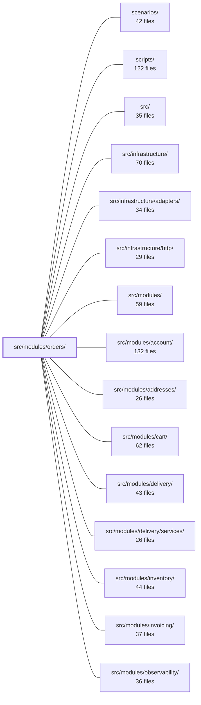

---
tags:
  - 2brain
  - 2brain/module
  - project/boilerplate-node-backend
type: module
module: src/modules/orders/
files: 115
updated: 2026-10-15T13:40:58.216701+00:00
---

# src/modules/orders/

## Purpose

The orders module is the central aggregate for a customer's purchase: it creates, reads, updates, cancels, and exports order records; owns the order status lifecycle and all pure business rules (totals, tax, withdrawal, fulfillment interpretation); and publishes domain events that downstream modules (payments, delivery, returns) consume to stamp their own state back onto the order. It is the single source of truth for what a customer bought, what they owe, and where the order stands.

## Key parts

- **`domain/`** — Pure, framework-free business rules. `lifecycle.ts` defines the status-transition graph and allowed actors; `status-traits.ts` maps every status to stock/dispatch/withdrawal/fulfillment traits; `totals.ts`, `tax.ts`, `withdrawal.ts`, `fulfillment.ts`, `projections.ts`, `rules.ts`, `transfer-reference.ts`, and `shop-time.ts` each own one cross-cutting concern. `index.ts` is the barrel that defines the public domain boundary.
- **`controllers/`** — Express handlers for every order endpoint (`GET/POST/PUT/PATCH/DELETE /orders…`, timeline, export, cancel, status-override, restore). Most are thin adapters over shared factories (`createSearchController`, `createUpdateController`, `createDeleteController`, `createRestoreController`) that delegate to `orderService`. `respond.ts` is the shared success-envelope helper.
- **`model.ts` + `presenter.ts`** — Mongoose schema/document types for the `Order` aggregate (with a frozen product snapshot), and the single translation point that turns a stored document into the public wire contract with audience-based visibility.
- **`module.ts` + `module.yaml`** — The kernel registration manifest (routes, config, rate-limits, PII hooks, cross-module event subscriptions) and the human-readable subdomain descriptor.
- **`events.ts` + `analytics.ts` + `audit.ts` + `metrics.ts`** — Outward communication: domain-event payload types (augmented into the kernel `DomainEventMap`), analytics event names, audit-action vocabulary, and Prometheus counter definitions.
- **`emails.ts` + `pii.ts` + `config.ts`** — Localized order email copy, field-level encryption for embedded addresses and buyer notes, and central operational configuration (shop identity, return rules, bank-transfer details, limits).
- **`openapi.yaml` + `probes.ts`** — The HTTP contract and role-scoping probe requests consumed by client collections and docs tooling.
- **`factories.ts`** — Test-fixture builder that produces a valid `OrderDocument` for repository calls without storing derived or catalogue-only fields.
- **`index.ts`** — The only public import surface for sibling modules; re-exports services, domain, events, emails, and model types while keeping the repository and internals private.

## How it connects

- **`@modules/cart`** — The cart-based checkout flow lives in `cart`; `orders` provides the admin (`POST /orders`) creation path and the `orderService` that cart ultimately calls to persist the order after checkout.
- **`@modules/payments`** — Payments depends on orders (never the reverse). Payments stamps its own status onto the order via a service call; `domain/projections.ts` reads that stamp to derive the caller-facing payment status. Orders emits domain events that payments subscribes to.
- **`@modules/delivery`** — Delivery depends on orders and writes fulfillment progress via `orderService.recordFulfillmentProgress`; `domain/fulfillment.ts` defines the shared `FulfillmentSummary` record and the read-side interpretation logic.
- **`@modules/returns`** — Returns depends on orders and stamps return status onto the order; `domain/projections.ts` interprets that stamp.
- **`@modules/invoicing`** — Invoicing depends on orders for the order reference and line data; invoice document copy is deliberately kept in `invoicing/emails`, not here.
- **`@modules/inventory`** — Stock commitment and reservation are expressed through `status-traits.ts`; inventory consumes the order's frozen line data.
- **`@modules/products`** — The order embeds a frozen product snapshot (`FrozenOrderLineProduct`) taken from the product catalogue at order time; orders does not query the live catalogue afterwards.
- **`@modules/addresses`** — Embedded shipping/billing addresses share the same `NODE_PII_ENCRYPTION_KEY` ring as `addresses/pii.ts`.
- **`@modules/account`** — Orders follows the same "copy lives here, template only interpolates" email pattern; the OpenAPI contract also contributes to the account personal-data export.
- **`@modules/observability`** — The audit-action and analytics-event vocabularies registered in `audit.ts` and `analytics.ts` feed the observability layer's type-checked event catalogues.
- **`src/infrastructure/http/`** — Controllers in this module are Express handlers registered via the infrastructure HTTP routing layer.
- **`scenarios/` / `scripts/`** — Consume the `module.yaml` descriptor and `openapi.yaml` contract for test-scenario generation and build-time bundling.

## Where to start

1. **`domain/lifecycle.ts`** — Understanding the status graph and who may move the order where is the key to every controller, service write, and action-availability check in the module.
2. **`index.ts`** — Reading the public barrel shows exactly what sibling modules can import and what stays internal, which orients you to the module boundary before diving into any single file.

## Connected modules

[[boilerplate-node-backend_ROOT|/ (repository root)]] · [[boilerplate-node-backend_scenarios|scenarios/]] · [[boilerplate-node-backend_scripts|scripts/]] · [[boilerplate-node-backend_src|src/]] · [[boilerplate-node-backend_src_infrastructure|src/infrastructure/]] · [[boilerplate-node-backend_src_infrastructure_adapters|src/infrastructure/adapters/]] · [[boilerplate-node-backend_src_infrastructure_http|src/infrastructure/http/]] · [[boilerplate-node-backend_src_modules|src/modules/]] · [[boilerplate-node-backend_src_modules_account|src/modules/account/]] · [[boilerplate-node-backend_src_modules_addresses|src/modules/addresses/]] · [[boilerplate-node-backend_src_modules_cart|src/modules/cart/]] · [[boilerplate-node-backend_src_modules_delivery|src/modules/delivery/]] · [[boilerplate-node-backend_src_modules_delivery_services|src/modules/delivery/services/]] · [[boilerplate-node-backend_src_modules_inventory|src/modules/inventory/]] · [[boilerplate-node-backend_src_modules_invoicing|src/modules/invoicing/]] · … and 6 more

## Files
- `src/modules/orders/analytics.ts` — Declares the analytics event names the orders module emits and registers them into the app-wide `AnalyticsEventMap` type. This file exists so that event names live in one source-of-truth location and the analytics port's union type stays in sync across modules.
- `src/modules/orders/audit.ts` — Declares the audit-action vocabulary owned by the orders module and registers it into the app-wide `AuditActionMap` via TypeScript module augmentation. No runtime logic — it is purely a set of string constants and a type-level declaration that lets the observability layer type-check order-specific audit events.
- `src/modules/orders/config.ts` — Central configuration for the orders module: the shop's legal identity (name, address, contact), return-shipment rules, bank-transfer payment details, operational limits (order size, retention, retry intervals), and the single frontend deep-link into the paired UI. All values are read per-call via getter functions so tests can vary them per case without re-imports; a deployment corrects a value with a restart.
- `src/modules/orders/controllers/create-order.ts` — HTTP handler for `POST /orders`. Accepts an explicit `items` payload from the request body and delegates to `orderService.create`, making this the **admin** order-creation path (as opposed to the cart-based checkout flow in `@modules/cart`). It validates the body, calls the service, records a metric, and shapes the success/error response.
- `src/modules/orders/controllers/delete-orders.ts` — Thin adapter that wires the shared `createDeleteController` factory to the order-specific service. It exposes a single `deleteOrders` controller for the admin `DELETE /orders` endpoint, delegating all real logic to `orderService.removeById`.
- `src/modules/orders/controllers/get-order-item.ts` — HTTP controller for `GET /orders/:id`. It retrieves a single order scoped to the caller's role (non-admins can only see their own), validates the path id before touching the database, records a staff-read audit event, sets an ETag for optimistic concurrency, and returns a caller-specific response body.
- `src/modules/orders/controllers/get-order-timeline.ts` — Express controller for `GET /orders/:id/timeline`. Returns the order's event timeline filtered by the caller's role: staff see every entry and its actor; buyers see only buyer-visible entry types and never an actor. The order must be visible to the caller, otherwise a 404 is returned (same scope as `GET /orders/:id`).
- `src/modules/orders/controllers/get-orders-export.ts` — Handles `GET /orders/export` by streaming the same filtered order list as `GET /orders` as a CSV attachment. The response is a cursor-based stream (never buffered in memory), so the handler must pipe directly to the HTTP response rather than build a body.
- `src/modules/orders/controllers/get-orders.ts` — Thin controller that wires `GET /orders` to the shared `createSearchController` factory. It defines the query schema, enforces caller-scoped visibility (own-orders vs. all-orders), and delegates the actual search to `orderService`.
- `src/modules/orders/controllers/post-cancel-order.ts` — Thin Express controller for `POST /orders/:id/cancel`. It validates the route param and optional body, then delegates the write to `orderService.cancelById`, passing the caller's auth context so the service can scope permissions (own-order vs. any-order) and honor the `refund` flag only for admins.
- `src/modules/orders/controllers/post-order-status-override.ts` — Thin controller for `POST /orders/:id/status-override`. It validates the order ID and request body, then delegates to `orderService.overrideStatus` to force an order into a new status with a recorded reason — with no parcel or email side-effects. Authorization (step-up-gated `orders.any.override`) is handled upstream by the route; this function assumes it has already passed.
- `src/modules/orders/controllers/respond.ts` — Shared success-tail helper for every order controller (writes and the single-order read). It hydrates the order document returned by the service with the caller's `actions` via `orderService.withActions`, then sends it as the HTTP success envelope. Kept separate from `services/scope.ts` so that `withActions` remains framework-free; each call site still declares its own status code and message.
- `src/modules/orders/controllers/restore-orders.ts` — Thin admin controller that wires the shared `createRestoreController` factory to the order domain, exposing a single POST endpoint to undo a soft-deleted order.
- `src/modules/orders/controllers/update-order.ts` — Exports the `PUT /orders/:id` (replace) and `PATCH /orders/:id` (merge) handlers for the orders resource. Both are built from the shared `createUpdateController` factory so that validation, 404 handling, and response shaping stay consistent. Only `email` is a writable field here; `status` is deliberately excluded from both body schemas and must be changed via a separate action endpoint.
- `src/modules/orders/domain/anonymization.ts` — Defines a single domain constant used as the placeholder email for orders that have been anonymized. It exists to satisfy the non-nullable `email` schema field while ensuring no real mailbox can ever receive mail on behalf of a scrubbed buyer.
- `src/modules/orders/domain/export.ts` — Defines the **shape** of the orders CSV export: which columns appear, in what order, and how a single order object maps to one row of cells. It is a pure, side-effect-free mapping layer so that the service that actually writes the file only deals with an array of strings/numbers, not with `Order` objects or `Date` objects.
- `src/modules/orders/domain/fulfillment.ts` — Defines the `FulfillmentSummary` record that `delivery` writes into an order (via `orderService.recordFulfillmentProgress`) and the pure read-side logic `orders` uses to interpret it: deriving the displayed fulfillment status and building the Mongo filter for `GET /orders?fulfillmentStatus=`. It exists because the dependency arrow points `delivery → orders`, so `orders` cannot import `delivery` directly and instead consumes this single small record. No I/O.
- `src/modules/orders/domain/index.ts` — Barrel re-export for the orders domain layer. It aggregates the public surface of all pure, framework-free order rules (totals, lifecycle, tax, withdrawal, fulfillment, etc.) into a single import path. The file itself contains no logic; its role is to define the boundary: everything exported here must be testable without a database, Express, or Mongoose.
- `src/modules/orders/domain/lifecycle.ts` — Declares the order status-transition graph: which status may follow which, and which actor may make each move. The set of statuses itself comes from the contract (`@types`); this file adds the directed edges, binds the allowed actor to each edge, and provides the query functions services use to gate writes, build conditional-update `from` sets, and render available actions to clients.
- `src/modules/orders/domain/projections.ts` — Provides the read-side projection logic for two "side" statuses on an order — payment (refund) status and return status. Because `orders` cannot import `payments` or `returns`, those modules **stamp** their status onto the order via a service; this file supplies the pure, dependency-free functions that turn the stored stamp (plus `paidAt`) into the caller-facing status, and the inverse Mongo filters used to query by status. `fulfillment_status` is explicitly excluded (see `./fulfillment`).
- `src/modules/orders/domain/rules.ts` — Pure validation and classification predicates for order lines. Takes already-joined line data in, returns a verdict or boolean out. No status codes, no i18n — the service layer (`services/place`) maps verdicts to HTTP/i18n responses. Lives in the domain layer per `docs/theory/domain-layer.md`.
- `src/modules/orders/domain/shop-time.ts` — Pure calendar-math helpers that resolve a `Date` to wall-clock values (year, day boundaries) in an arbitrary IANA time zone. They exist so that yearly number series and day-boundary logic follow the *shop's* calendar rather than the server's UTC, and so that all `Intl.DateTimeFormat` timezone logic lives in one place.
- `src/modules/orders/domain/status-traits.ts` — Declares, in a single record, what every `OrderStatus` means with respect to stock commitment, dispatch state, buyer withdrawability, and current fulfillment. Other domain files (lifecycle, withdrawal, fulfillment) read these traits to answer status-dependent questions instead of maintaining their own status lists. The `satisfies Record<OrderStatus, …>` annotation makes the mapping exhaustive: adding a new status to the contract breaks the build here rather than silently falling into a wrong category.
- `src/modules/orders/domain/tax.ts` — Derives VAT figures (tax, net, gross) for an order from its **frozen** line prices, quantities, and tax rates at serialization time. The central invariant is that a past order's tax is never re-resolved against a product's current tax class — a config rate change must not restate what was actually charged. Shipping is treated as ancillary to the goods it delivers and is apportioned pro-rata, taxed at each line's own rate.
- `src/modules/orders/domain/timeline.ts` — Defines **who may see each order-timeline row type** and the **input shape** a row must have when written. By making the audience a required mapping over every `OrderTimelineType`, it guarantees that no timeline type can exist without an explicit visibility decision (buyer, staff, or both).
- `src/modules/orders/domain/totals.ts` — Pure arithmetic for order totals: sums a list of priced line items (count, quantity, price) and composes that with a frozen shipping cost to produce the grand total the customer owes. It exists as a single source of truth so that the cart preview, the order, the payment intent, and every downstream email/invoice all agree on the same number without re-deriving it.
- `src/modules/orders/domain/transfer-reference.ts` — Implements ISO 11649 "RF" creditor reference generation and validation for `bank_transfer` orders. `buildReference` deterministically mints a checksummed reference from an order's ObjectId at write time; `parseReference` reads one back from an admin's paste-off-the-bank-website input. Lives in the **orders** domain (not payments) because the reference is derived from the order's own id and must be stable across retries.
- `src/modules/orders/domain/withdrawal.ts` — Pure decision logic for the EU right of withdrawal (Consumer Rights Directive Art. 9, 11a, 16) as applied to a single order. It answers three questions—whether a withdrawal is a cancel or a return, when the 14/21/30-day window closes, and whether the withdrawal button should render—without touching a database or any side effect.
- `src/modules/orders/emails.ts` — Resolves all order-related email copy into finished, localized strings. The language is passed in as an argument; the output is ready-to-interpolate text that the mailer's template engine only plugs into a layout. Follows the same "copy lives here, template only interpolates" rule as `@modules/account/emails`. Invoice document copy is deliberately *not* here (it lives in `@modules/invoicing/emails.ts`).
- `src/modules/orders/events.ts` — Declares the domain-event payload types that the orders module emits and exports the corresponding string-name constants. It augments the kernel's `DomainEventMap` (via `declare module '@kernel/events'`) so each module grows the event catalogue without editing a central file. Because `orders` sits low in the dependency graph—payments and delivery depend on it, never the reverse—emitting these events is the only way the module communicates outward.
- `src/modules/orders/factories.ts` — Test-fixture builder that constructs a complete `OrderDocument` ready for `orderRepository.create`. It exists so tests can pin specific order fields while the factory fills in identity, defaults, and the embedded product snapshot — without ever storing derived values (totals, `transferInstructions`) or catalogue-only fields (`onHand`, `reserved`) that the order schema has no path for.
- `src/modules/orders/index.ts` — Public barrel for the Orders module. It is the **only** import surface that sibling modules are allowed to use (per `docs/theory/strategic-ddd.md` §5). It re-exports the module's services, domain, events, and emails, and re-exports model **types** (not runtime values), keeping `orderRepository` and model internals private to the module.
- `src/modules/orders/metrics.ts` — Defines the Prometheus domain counters owned by the orders module. By co-locating metric definitions with the domain logic (rather than in `infrastructure/observability`), the module self-documents what it measures and the overview endpoint can read them without a direct import into this file.
- `src/modules/orders/model.ts` — Defines the Mongoose document interface and schema for the `Order` aggregate. It embeds a frozen product snapshot (not a catalogue reference), declares which fields are persisted versus derived at serialization time, and establishes the shared types (`FrozenOrderLineProduct`, `OrderDocumentItem`, `OrderDocument`) that every order read/write path depends on.
- `src/modules/orders/module.ts` — Module manifest (default `AppModule` export) that registers the **orders** module with the kernel: wires routes, config, rate-limits, public-event mappings, PII hooks, cross-module event subscriptions, and the test-scenario state list into a single declarative object. It is the one place where the orders module's surface area is declared to the rest of the system.
- `src/modules/orders/module.yaml` — Module descriptor for the **orders** subdomain. It declares what a checkout produces (status machine, totals, invoice link), assigns the module to the `shop` group under the `core` subdomain, and lists its four upstream dependencies with a one-line justification for each.
- `src/modules/orders/openapi.yaml` — OpenAPI 3.1.0 contract for the orders module. It declares the module's full HTTP surface (paths, parameters, request/response schemas), domain-specific error codes, and its contribution to the account personal-data export. It is the single source of truth that clients, docs generators, and the build-time bundler consume to know what the orders API exposes.
- `src/modules/orders/pii.ts` — Field-level encryption codec for the PII an order freezes: both embedded addresses (shipping & billing) and the buyer's notes. It is the order-domain twin of `addresses/pii.ts`, sharing the same `NODE_PII_ENCRYPTION_KEY` ring. It exists as an explicit, standalone set of transform functions rather than Mongoose getters/setters, so that `toJSON` output, query filters, and sub-document copying all behave predictably.
- `src/modules/orders/presenter.ts` — Transforms stored Mongoose documents into the public `Order` / `OrderTimelineEntry` wire contracts. It is the single translation point between the persistence layer (`model.ts`) and the API surface, and it enforces audience-based visibility rules (buyer vs. staff) on timeline data.
- `src/modules/orders/probes.ts` — Defines the orders module's "probe" requests—HTTP calls that validate scoping behaviors the OpenAPI contract cannot express on its own. The probes are consumed by the client-collections bundle to generate runnable Postman/Insomnia-style requests that exercise role-based and ownership scoping in the orders API.
- `src/modules/orders/rate-limits.ts` — Defines the orders module's rate-limit budget(s) and exports a ready-to-use Express middleware for the `GET /orders/export` endpoint. It is the single place where the module's export budget is declared, then handed to the shared `buildRateLimiter` factory to produce the actual limiter.
- `src/modules/orders/repository.ts` — Order persistence layer. Because an order embeds a product snapshot and filters like `items.product._id` are pipeline concerns, reads go through the aggregation framework rather than plain `find()`. The file provides the single write path for new orders (with PII encryption), scoped reads, paginated search, status-transition writes with conditional guards, and streaming for large exports.
- `src/modules/orders/routes.ts` — Express router for all order-management endpoints. It wires authentication, permission checks, caching headers, rate limits, and idempotency guards onto the order controllers and mounts them under the `/orders` basePath. It does not contain business logic; it defines *which* controller handles *which* path, in what order, under which guard.
- `src/modules/orders/services/announce.ts` — Defines the event-announcement factories for the orders module. Each factory returns a typed `OutboxAnnouncement` object that a calling service hands to `announceInTransaction`, ensuring the event row commits atomically with the order write it accompanies.
- `src/modules/orders/services/cancel.ts` — Implements the single code path for cancelling an order — whether triggered by a customer, an operator, or the system's reservation-expiry sweep. It performs the conditional status transition, releases the order's claim on inventory, and schedules any owed refund, all inside one Mongoose transaction so that a failed stock release rolls the status back with it. Post-commit side effects (refund event, emails, audit, analytics) run outside the transaction.
- `src/modules/orders/services/crud.ts` — The admin-facing write path for orders: creating a new order (product snapshot, stock hold, invoice allocation) and updating an existing one (email only). It composes validation, rank checks, locale resolution, and post-write side-effects (audit, analytics, email) around `placeOrder`, which owns the actual persistence and rollback.
- `src/modules/orders/services/current.ts` — Attaches live catalogue images (`imageUrl`, `thumbnailUrl`) to each order line at the serialization boundary. The frozen order snapshot carries no image fields, so this module performs a single batched `$in` lookup against the product catalogue per response, regardless of how many orders or lines are present. It mutates the serialized order objects in-place and returns the same array.
- `src/modules/orders/services/export.ts` — Streams the filtered orders list as a CSV (no file on disk, no email). Validates the row count against a cap, records an audit entry, and returns a `Readable` source plus a CSV `Transform` for the caller to pipe into the HTTP response. A client disconnect tears down the cursor automatically.
- `src/modules/orders/services/fulfillment.ts` — The transactional write surface that `delivery` calls when a fulfillment act changes where an order's goods stand. Because `orders` is the sole writer of its own fields, `delivery` reports results (summary, forced-act details, units leaving stock) and this file decides whether each report still applies, binding all writes to the act's `ClientSession` so they commit atomically or not at all.
- `src/modules/orders/services/index.ts` — Barrel file for the `orders/services` folder. It re-exports every operation (read, write, status, cancel, retention, scope, fulfillment, timeline, stats) and the config getters that other modules need, and aggregates them all into a single `orderService` object. Controllers and cross-module callers interact with the Order domain exclusively through this file.
- `src/modules/orders/services/notify.ts` — Outgoing buyer-facing email for the order lifecycle: sends the "order placed" mail (confirmation or bank-transfer instructions) and provides a shared `mailBuyer` helper that resolves the buyer's locale and display name before delegating to a caller-supplied `build` function. Exists so that `create`, `cancel`, and delivery all follow one consistent buyer-mail policy without duplicating lookup/fallback logic.
- `src/modules/orders/services/order-numbering.ts` — Formats the repository's atomic yearly counter into the order number string (`{year}-{sequence}`). This is a receipt number, **not** a tax invoice number. The file contains only the formatting decision; all atomicity lives in the repository.
- `src/modules/orders/services/override.ts` — Implements the admin status-override endpoint (`POST /orders/{id}/status-override`), the single authorized path for correcting an order status when the normal doors (shipped email, carrier record) don't apply. It performs the status write, timeline entry, stock adjustment, event publication, and audit recording in one atomic transaction so no status move can exist without its history row or vice versa.
- `src/modules/orders/services/place.ts` — The single write path for creating a new order row. Both the admin `create` in `crud.ts` and the cart `checkout` funnel through `placeOrder`, so the actual write, stock hold, and event announcement exist in exactly one place. It validates lines, freezes them, reserves stock, allocates the order number, and persists the document — returning a plain verdict rather than an HTTP envelope.
- `src/modules/orders/services/read.ts` — Read-only query layer for the orders module. Provides search, single-order retrieval, and a set of narrow reads (id lists, briefs, references, refund lookups) that sibling modules and controllers consume without touching the repository directly. Writes intentionally live elsewhere (`./crud`, `./remove`).
- `src/modules/orders/services/reencrypt.ts` — Domain-level re-encryption service for orders. It collects every order's encrypted PII fields (addresses and notes) and delegates to the repository to rotate them onto the newest `NODE_PII_ENCRYPTION_KEY`. Exists so the generic infrastructure re-encryption machinery (which knows *how* to swap keys) can be driven by order-specific field discovery (which knows *which* fields and *how* they are AAD-bound).
- `src/modules/orders/services/remove.ts` — Provides the delete and restore operations for orders. Because an order is a financial record, the default is a **soft delete** (stamping `deletedAt`, reversible via `restoreById`); a **hard delete** is restricted to orders that are `cancelled` and never paid. This file centralises the refusal logic, the conditional delete, the audit trail, and the caller-rank check that guards both paths.
- `src/modules/orders/services/retention.ts` — Implements the `personalData.erase` and `personalData.minimise` hooks for the orders module under GDPR Art. 17(3)(b)/(e). Because an order is an invoice, it survives account erasure; this file detaches the person from the order, starts a per-order PII clock, and later scrubs residual PII. It also cancels never-paid orders left behind by an erased account so their stock holds are released.
- `src/modules/orders/services/scope.ts` — Defines the authorization boundary for order reads and writes. It answers the three questions every other order service asks before acting: **who may read which orders** (`callerScope`, `cancelScope`), **which lifecycle column applies** (`actorOf`), and **what actions the caller is offered on the wire** (the `*Actions` helpers). It centralises scope filtering and refusal logic so that individual services (cancel, fulfill, etc.) don't re-derive permission rules.
- `src/modules/orders/services/ship-stock.ts` — Provides a single atomic operation for the **override** path: when an order's status is forced forward (to `shipped` or `delivered`), ship all remaining held stock for that order and publish the resulting domain events in one transaction. It is the "whole-remainder" counterpart to the per-shipment `shipStock` in `./fulfillment`, ensuring the shelf count drops at dispatch time rather than at payment time.
- `src/modules/orders/services/snapshot.ts` — Resolves catalogue products into the frozen order-line snapshot that an order stores. It translates product `title`/`description` into the buyer's locale, strips non-freezable fields, computes the tax rate, and assembles the final `OrderDocumentItem[]` shape. It lives in `services/` rather than `domain/` because it deliberately reaches into `@infrastructure/i18n` and `@kernel/translation`.
- `src/modules/orders/services/stats.ts` — Composes read-only MongoDB aggregation queries that answer reporting questions over the orders collection: orders/units per time bucket, top products by net sales, category totals, per-product series, customer and new-customer counts, cancellation cohorts, and the current open pipeline. Each query returns a few hundred rows at most, already grouped server-side, so no further joining is needed by callers.
- `src/modules/orders/services/status.ts` — The single status writer for orders. Other modules (`payments`, `delivery`) **report** a fact they have already recorded; this file decides whether the reported move still applies given the order's current status, performs the conditional write, and announces the resulting `ORDER_STATUS_CHANGED` event. No human-initiated request flows through this file.
- `src/modules/orders/services/timeline.ts` — Central write-and-read path for an order's event timeline. It provides the single door through which the `orders` module and any module that depends on it (payments, delivery, returns, invoicing) record what happened to an order, always inside the caller's transaction so the row commits atomically with the fact it describes. It also handles role-filtered reads, data-export collection, and data-hygiene operations (actor erasure, text retention scrubbing, hard-delete cleanup).
- `src/modules/orders/tests/contract/api.contract.test.ts` — Contract test suite for the `/orders` REST endpoints. It was created to catch two classes of regression that unit tests miss: response-shape drift from the OpenAPI spec (e.g. `totalItems`/`totalQuantity`/`totalPrice` vs. a single `total`) and role-dependent response differences on the same route. Every assertion that goes beyond a plain 200 check pins a specific past bug or a contract nuance (filter semantics, error codes, role gating) that no other test in the repo covers.
- `src/modules/orders/tests/contract/export.contract.test.ts` — Contract test for `GET /orders/export` over HTTP. Verifies the endpoint's "shell" — routing (not interpreted as an order id), auth/role gating, response headers (CSV content-type, `attachment` disposition, `private, no-store` cache control), the UTF-8 BOM prefix, the 422 `ORDER_EXPORT_TOO_LARGE` JSON error returned before any file bytes, and the 422 shape inherited from the list endpoint. CSV column content and cap arithmetic are explicitly delegated to the service suite.
- `src/modules/orders/tests/factories.ts` — Database-touching order factories for the orders test suite. While `../factories.ts` provides a pure in-memory builder (operating on data snapshots), this file wraps that builder around **real persisted Mongoose documents**, adds convenience seeds (`seedOrder`, `seedDigitalOrder`), and exposes direct repository/model helpers that tests use to assert on or force persisted state. It exists so integration and contract tests can create, inspect, and manipulate orders in the test database without driving full service flows.
- `src/modules/orders/tests/integration/cancel.test.ts` — Integration test suite for `orderService.cancelById`. It verifies the status-transition gate (pending/shipped/processing/paid), caller-scope enforcement (owner vs. admin vs. system actor vs. moderator), refund semantics carried in the `ORDER_CANCELLED` domain event, and that audit/analytics side-effects fire with the correct caller identity. Each test hits a real database (`setupTestDb`) and exercises the full service → repository → event pipeline.
- `src/modules/orders/tests/integration/create-audit.test.ts` — Integration test enforcing a single invariant on the order-creation path: the `order_created` audit row must always record the **real** caller's role (`actorRoleName`), never a hardcoded label. It guards against any code path (e.g. checkout's own purchases) silently rewriting the actor to "customer."
- `src/modules/orders/tests/integration/delete-restore-audit.test.ts` — Integration tests verifying that `removeById` and `restoreById` (service layer) emit the correct `ORDER_DELETED` / `ORDER_RESTORED` audit events with the expected fields, after those emissions were moved out of the controller into the service to match the cross-module write-path convention (rule 1 in `docs/theory/module-lifecycle.md`).
- `src/modules/orders/tests/integration/erase-cancels-unpaid.test.ts` — Integration test verifying that a hard-delete of a user account cancels all of that user's never-paid orders and releases their stock reservations, while leaving paid (invoice) orders in place. The test drives the flow through `userService.remove` with the real module wiring rather than calling the order-cancel hook directly, so it would fail if `orders/module.ts` stopped registering the erasure hook.
- `src/modules/orders/tests/integration/export.test.ts` — Integration tests for `orderService.openOrderExport`, exercising the full CSV export path against a real MongoDB instance. Covers column ordering and content, formula-injection escaping, read-scope enforcement, the row-count cap, and audit-row invariants (filter + count recorded, no PII or row data leaked).
- `src/modules/orders/tests/integration/fulfillment-filter.test.ts` — Integration test that verifies the `fulfillmentStatus` query filter on `GET /orders` produces correct results against a real MongoDB instance. It proves that the Mongo query conditions for each fulfillment value select exactly the orders whose serialized `fulfillmentStatus` matches, and that the filter intersects with (rather than replaces) the caller's existing scope. The pure serialization logic is covered separately in `unit/fulfillment.test.ts`; this file closes the gap between in-memory logic and the database.
- `src/modules/orders/tests/integration/hierarchy.test.ts` — Integration tests that verify the two-level permission model for order mutations: (1) a read-only role must not gain write access, and (2) an operator may only act on orders whose buyer is strictly lower in the role hierarchy. Every case is driven through `orderService` to exercise the real permission checks, not mocks.
- `src/modules/orders/tests/integration/model.test.ts` — Integration tests that verify the order serialization contract on every response path: hydrated documents (via `toJSON`) and aggregate results (via the manual mapping in the service layer) must expose `id`, never `_id` or `__v`, and must normalize embedded product snapshots and item entries the same way. A secondary concern is guarding the schema itself (no index smuggling from the embedded product sub-schema, no fabricated `transferInstructions`).
- `src/modules/orders/tests/integration/order-number.test.ts` — Integration test that verifies the `orderNumber` field on the `GET /orders/{id}` HTTP response matches the value supplied at order creation. It exists to guard the contract that the number is frozen at write-time and returned verbatim on read, over a real HTTP round-trip.
- `src/modules/orders/tests/integration/order-numbering.test.ts` — Integration test for `allocateOrderNumber`, verifying two invariants against a real MongoDB: order numbers are unique and the per-year sequence has no gaps. The concurrency test (50 simultaneous calls) specifically exercises the atomic `findOneAndUpdate` in the repository, which cannot be meaningfully asserted against a mock.
- `src/modules/orders/tests/integration/order-tax-fields.test.ts` — Integration test that verifies the `GET /orders/{id}` response includes a correct VAT breakdown — per-line `taxRate`, `taxAmount`, `netAmount` plus order-level `netTotal` and `taxTotal`. It guards against regressions where the order serialization drops or miscalculates tax fields.
- `src/modules/orders/tests/integration/outbox.test.ts` — Integration tests that prove the transactional-outbox guarantee for every order mutation door: an event row commits atomically with the order write it announces, and a failed event write rolls back the write. Runs against a real MongoDB instance (not in-memory) to exercise genuine transactional semantics.
- `src/modules/orders/tests/integration/pending-effects.test.ts` — Integration tests for the **pending-effects durability mechanism**: when `cancelById` fires `ORDER_REFUND_OWED` and the refund handler throws, a `pendingEffects: ['refund']` marker is written into the order document so that `retryPendingEffects` can later re-announce the event. These tests verify the full write → fail → sweep → discharge cycle against **real MongoDB** (no stubbed repository), because the guarantees depend on the shape of the conditional `$set`/`$pull` writes and the sparse-index query.
- `src/modules/orders/tests/integration/pii.test.ts` — Integration tests verifying that order PII (shipping address, billing address, notes) is encrypted at rest, decrypts correctly on every read path (route, search, account export), and is cryptographically bound to its owning order via AAD so it cannot be decrypted on a different order.
- `src/modules/orders/tests/integration/reencrypt.test.ts` — Integration test that verifies the orders `reencrypt` walk correctly migrates PII fields (shipping address and notes) from key version `v1` to `v2` during a simulated key rotation, and that the order still deserialises and serialises after the rewrite. It reads raw documents from the collection to confirm the version stamp was actually updated on disk, not just in the application layer.
- `src/modules/orders/tests/integration/remove-race.test.ts` — Integration tests (against real MongoDB) that verify `remove` correctly rejects a hard delete when the order's `status` or `paidAt` changes after the caller's read but before the conditional write commits. It also confirms the happy-path delete and the 404 path when the document is already gone.
- `src/modules/orders/tests/integration/repository.test.ts` — Integration tests that pin the behavioral contracts of `orderRepository` against a real MongoDB instance. They exist to lock down three things that TypeScript signatures and unit tests cannot guarantee: (1) `aggregate` is a raw pipeline passthrough that does not silently reshape stages, (2) `findByIdScoped` always returns the same hydrated Mongoose document regardless of whether a scope filter is applied, and (3) `create` embeds a full product snapshot rather than a reference.
- `src/modules/orders/tests/integration/retention.test.ts` — Integration tests for the order PII-retention lifecycle: (1) the detach cascade that fires when a user account is hard-deleted (unsetting `userId` and scheduling `anonymizeAfter`), and (2) the `anonymizeDueOrders` sweep that scrubs the remaining PII once the retention window elapses. The tests exercise the full `personalData.erase → detachUserId` hook through real module wiring rather than calling the service function directly, so they would fail if `orders/module.ts` ever stopped declaring the hook.
- `src/modules/orders/tests/integration/schema-contract.test.ts` — Validates the *declarations* of the order schema (defaults, per-field `required`, `select: false` on credentials) against a real MongoDB instance, rather than testing transform logic or business behaviour. A real Mongo is required because the assertions depend on Mongoose's own interpretation of `default`, `select`, and path stripping — a mock would only assert its own semantics.
- `src/modules/orders/tests/integration/service-crud.test.ts` — Integration test suite for the **write half** of the orders service (`create`, `update`, `updateById`, `remove`, `removeById`, `getById`, `getForCaller`). It verifies the two invariants that carry real business weight: (1) `create` embeds a full product snapshot so later repricing cannot silently rewrite what a customer was charged, and (2) `getById`'s `scope` argument is an authorization boundary—a mismatched scope must return `undefined`, not the order. The read/aggregation half (`search`) is covered separately in `service-search.test.ts`.
- `src/modules/orders/tests/integration/service-override.test.ts` — Integration tests for the admin order-status override (`overrideStatus`) and forced-fulfilment recording (`recordForcedFulfilment`). Runs against a real MongoDB instance so that the conditional-write guarantee and the read-then-write race window are exercised for real — the file header notes that a mock "cannot race against itself."
- `src/modules/orders/tests/integration/service-search.test.ts` — Integration tests for `orderService.search` — the read path of the order service. Covers the three computed totals (`totalItems`, `totalQuantity`, `totalPrice`) that exist only because the aggregate pipeline derives them, plus all filtering, pagination, live image resolution, and the admin "awaiting transfer" sorting view. Complements `service-crud.test.ts`, which covers the write half (`create`, `update`, `remove`).
- `src/modules/orders/tests/integration/service-status.test.ts` — Integration tests for the order status-transition functions (`markPaid`, `markProcessing`, `markShipped`, `markDelivered`, `markFulfilmentComplete`). Runs against a **real MongoDB** (not mocks) to verify that the conditional `$in` write guarantees exactly-once status moves under concurrent access, that `ORDER_STATUS_CHANGED` events are emitted through the outbox relay, that `withdrawUntil` is computed correctly, and that session-accepting variants commit atomically with the caller's transaction.
- `src/modules/orders/tests/integration/ship-stock.test.ts` — Integration test (real MongoDB) that verifies the stock-deduction contract around order dispatch: `shipStock` takes shipped units off `onHand` within its own transaction, the follow-up status moves (`markShipped`, `markDelivered`) take nothing further, and the admin override is the only status change that dispatches remaining units on its own.
- `src/modules/orders/tests/integration/timeline.test.ts` — Integration test for the order timeline: verifies that each lifecycle transition writes exactly one row (with the correct type, actor, and data), that role-based visibility filters rows and fields for buyers vs. staff, that GDPR/retention rules scrub actors and staff text, and that a buyer's data export includes their own full timeline. Runs against real MongoDB through `orderService`'s public API.
- `src/modules/orders/tests/unit/config.test.ts` — Unit tests for the orders module's deployment-config readers and its boot-time validation gate. Verifies that `assertModuleConfig` enforces required env vars (shop country, timezone, identity fields, withdrawal period) and that each individual reader (`shopCountry`, `bankTransferIbanFriendly`, `maxAdminOrderLines`, etc.) behaves correctly against a known-good environment.
- `src/modules/orders/tests/unit/domain-rules.test.ts` — Unit tests for the order-domain rule functions in `domain/rules.ts`. The tests are pure — no mocks, no database, no fake timers — because the rules under test are plain functions that take arguments and return verdicts.
- `src/modules/orders/tests/unit/emails.test.ts` — Unit tests for the order **confirmation** and **cancellation** email builders (`orderConfirmEmail`, `orderCancelledEmail`). They verify that the rendered output correctly interpolates order lines, defers total computation to the domain layer, carries locale and link parameters through unchanged, and never re-resolves frozen product titles through the i18n layer. They exist because a formatting slip in a money-facing email is read as a billing error by the least able party to check it.
- `src/modules/orders/tests/unit/export.test.ts` — Unit tests for `toOrderCsvRow`, verifying that a single order object is flattened into a CSV-ready row with the correct column names, UTC ISO date strings, and empty-string cells for missing payment data on unpaid orders.
- `src/modules/orders/tests/unit/factories.test.ts` — Unit tests for the `makeOrder` fixture builder exported from the orders factories module. They pin down the builder's contract: which fields it auto-generates (ObjectIds, email, empty items array), which optional fields it deliberately omits, and how it transforms the embedded product snapshot (renaming `id`→`_id`, freezing supplied catalogue fields, excluding live-stock counters). The file exists so that any regression in the fixture's shape is caught before it corrupts downstream tests that assume a specific document structure.
- `src/modules/orders/tests/unit/fulfillment.test.ts` — Unit tests for the two halves of the fulfillment-status projection: `fulfillmentStatusOf` (the row-by-row status derivation) and `fulfillmentStatusFilter` (the query filter that must select exactly the documents that derivation labels). Ensures the filter and the derivation agree for every status value and edge case.
- `src/modules/orders/tests/unit/lifecycle.test.ts` — Pure unit tests for the order-lifecycle state machine in `src/modules/orders/domain/lifecycle.ts`. Rather than restating individual table rows (which would pass even if the table were copied wrong), the suite asserts the *properties* the table must satisfy: terminality, direction, actor restrictions, and cross-function consistency. No mocks, no database.
- `src/modules/orders/tests/unit/line-ceilings.test.ts` — Guards against drift between the TypeScript ceiling constants in `config.ts` and the corresponding limits declared in the OpenAPI contract (`orders/openapi.yaml`). If the two sources ever disagree, this test fails, preventing the service from silently accepting or rejecting orders that the contract permits or forbids.
- `src/modules/orders/tests/unit/notify.test.ts` — Unit tests for `sendOrderPlacedEmail` and `mailBuyer` (both from `services/notify.ts`) focused on one invariant: **no invoice attachment is ever sent at order-placement time**, regardless of payment method. It also verifies that `mailBuyer` short-circuits entirely (no build, no enqueue) when the order email is the anonymized placeholder.
- `src/modules/orders/tests/unit/projections.test.ts` — Unit tests for the two order projection functions—`paymentStatusOf` and `returnStatusOf`—verifying their status-derivation logic (default values, override precedence, and pass-through) without exercising any fulfilment-related projections.
- `src/modules/orders/tests/unit/routes.test.ts` — Unit test that pins the orders router's observable contract: the exact set and order of mounted endpoints, the authorization guard on each, the middleware chain ordering (permission → rate-limit → controller), and the caching / invalidation policy. It exists so that a refactored or extended router is caught the moment it silently drops, reorders, or re-permissions a route.
- `src/modules/orders/tests/unit/schema-contract.test.ts` — Unit test that asserts the **declarations** of the Mongoose `orderSchema` object directly—required paths, field types, defaults, enum values, sub-schema options, index specs, and schema-level options. It exists because integration tests that drive real saves/reads cannot detect declaration-level defects (a dropped `required`, a flipped `_id: false`, a reversed index direction) since none of those change what a *valid* document looks like. No database is needed; the helpers in `tests/support/schema.ts` inspect the schema object in memory.
- `src/modules/orders/tests/unit/serialization-guards.test.ts` — Unit tests that lock in the defensive guards inside `applyOrderTransform`. The transform is the single choke point every order response passes through, so a throw there converts a valid read into a 500. These tests exist to ensure the guards (which handle "cannot happen" shapes like projected documents or non-array `items`) actually prevent that failure.
- `src/modules/orders/tests/unit/service-scope.test.ts` — Unit tests for the order-read authorization boundary: `orderService.callerScope` (how a CASL caller compiles into a MongoDB query filter) and `actorOf` (which lifecycle column a caller's identity resolves to). The file exists to lock down the fail-closed semantics — unrestricted reads, scoped reads, and anonymous reads — so a future rule change cannot silently widen what an unauthenticated or mis-identified caller sees.
- `src/modules/orders/tests/unit/shop-time.test.ts` — Unit tests for the `shop-time` domain module. They pin down the two timezone-sensitive primitives that the orders module relies on to determine "which year does this order belong to" and "what UTC instant is local midnight in the shop's zone," ensuring that year-boundary and DST-transition edge cases are handled correctly.
- `src/modules/orders/tests/unit/snapshot.test.ts` — Unit tests for `resolveSnapshotProducts` and `freezeOrderLines` (the buyer-language snapshot-freezing logic in the orders service). A fake `TranslationPort` replaces the real `@modules/locales` adapter, so the tests verify the fallback-chain wiring, explicit-locale binding, `_id` preservation, and VAT/field-freezing contracts without a database.
- `src/modules/orders/tests/unit/status-traits.test.ts` — Unit tests for the order-status traits record and the `statusesWhere` predicate. They verify that `ORDER_STATUS_TRAITS` covers every `OrderStatus` value with the correct boolean traits, and that `statusesWhere` returns matching statuses in contract (enum declaration) order.
- `src/modules/orders/tests/unit/tax.test.ts` — Unit tests for `orderTaxBreakdown` (and `lineTaxFromRateTotals`), the pure VAT arithmetic that turns a list of taxable line items into per-line net/tax/gross figures, order-level totals, a shipping apportionment breakdown, and a rate-grouped `taxSummary`. The file pins down exact cent-level expectations so that floating-point edge cases, pro-rata shipping splits, and currency minor-unit exponents are all contractually locked.
- `src/modules/orders/tests/unit/timeline.test.ts` — Unit tests that lock down the timeline audience table: which `OrderTimelineType` values are hidden from buyers and which are visible. They exist to make the buyer/staff visibility boundary an explicit, diffable contract rather than an implicit side effect of domain logic.
- `src/modules/orders/tests/unit/totals.property.test.ts` — Property-based tests (via `fast-check`) for `sumLineItems` and `orderTotal` in the orders domain. Verifies that the cart-total arithmetic is total (never NaN, never throws), additive, order-independent, and quantity-linear — all asserted exactly in cents to sidestep float tolerance.
- `src/modules/orders/tests/unit/transfer-reference.test.ts` — Unit tests for the transfer-reference domain logic. Verifies that `buildReference` mints a well-formed, deterministic identifier per order and that `parseReference` round-trips valid references while rejecting malformed, mistyped, or non-reference inputs—ensuring a customer-entered reference can never silently resolve to the wrong order.
- `src/modules/orders/tests/unit/withdrawal-notice.test.ts` — Unit tests for the `withdrawalNotice` function and its integration into the placed-order emails. Verifies that the correct legal case (physical goods, digital, fully/partially excluded) is selected, that every EU-mandated placeholder (withdrawal period, shop identity, goods/return address, postage payer, online-function link, Annex I note 3) is filled with a concrete value, and that the rendered EJS output matches expectations in both English and Italian.
- `src/modules/orders/tests/unit/withdrawal.test.ts` — Unit tests for the pure withdrawal-window rules (Consumer Rights Directive Art. 9/11a/16) that live in the orders domain layer. Verifies the start/end calculation of the 14-day window, status-based eligibility, dispatch state, and per-line exclusion logic.

---
[[boilerplate-node-backend_INDEX|← boilerplate-node-backend index]]
