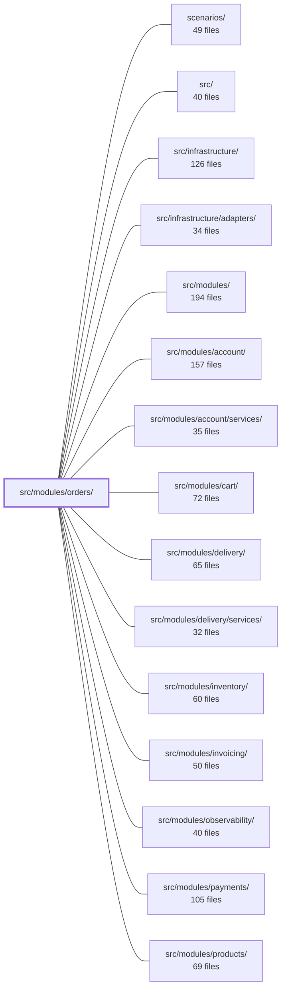

---
tags:
  - 2brain
  - 2brain/module
  - project/boilerplate-node-backend
type: module
module: src/modules/orders/
files: 137
updated: 2026-11-08T10:52:44.992637+00:00
---

# src/modules/orders/

## Purpose

The orders module owns the **Order** aggregate end-to-end: its Mongoose schema, the pure domain rules (lifecycle transitions, totals, tax, withdrawal rights, backorder snapshots, purchase-hold, PII anonymization), the HTTP controllers that expose it, the domain events it emits, its emails, and its scheduled retention job. It sits low in the dependency graph—payments, delivery, returns, and invoicing all depend on it, never the reverse—so its only outward channels are the events it emits and the small read-only records other modules stamp onto it.

## Key parts

- **`domain/`** — Pure, I/O-free business logic, re-exported through `domain/index.ts`. Includes the status lifecycle and trait tables (`lifecycle.ts`, `status-traits.ts`), monetary arithmetic (`totals.ts`, `tax.ts`), consumer-rights date math (`withdrawal.ts`), backorder snapshots (`backorder.ts`), purchase-hold expiry (`purchase-hold.ts`), validation predicates (`rules.ts`), and the derived-status helpers that let payments/returns write back without a circular import (`projections.ts`, `fulfillment.ts`).
- **`controllers/`** — Thin HTTP handlers (one file per endpoint) that validate input, call `orderService`, and shape the response. A shared `respond.ts` adds the caller's permitted actions to every write/single-read response. Search, create, update, and delete endpoints delegate to shared factory helpers in infrastructure.
- **`model.ts` / `config.ts`** — The Mongoose schema + serialization transform, and the centralised tunable rules (caps, retention windows, export limits) exposed as per-call getters.
- **Cross-cutting declarations** — `events.ts` (domain-event catalogue via module augmentation), `analytics.ts`, `audit.ts`, `authorization.yaml` (role-based action policy), `asyncapi.webhooks.yaml` (public webhook contract), `metrics.ts` (Prometheus counter), `jobs.ts` (retention scrub).
- **`index.ts`** — The single public import surface for sibling modules, per the project's strategic-DDD rule.
- **`emails.ts` / `factories.ts`** — Locale-resolved email copy and a test-fixture factory that builds a ready-to-insert `OrderDocument`.

## How it connects

- **`src/modules/delivery/`** — Delivery is the *writer*; it calls `orderService.recordFulfillmentProgress` to stamp a `FulfillmentSummary` onto the order. Orders reads that record via `domain/fulfillment.ts`. The arrow is delivery → orders; orders never imports delivery.
- **`src/modules/payments/` & `src/modules/returns/`** — Both depend on orders. They stamp `financial_status` / `returnStatus` through the helpers in `domain/projections.ts` rather than orders computing them, keeping the arrow one-directional.
- **`src/modules/cart/`** — The buyer-facing order-creation path flows cart → orders (the admin `POST /orders` bypasses cart). Orders consumes the cart's priced lines to build the frozen order snapshot.
- **`src/modules/products/`** — Supplies VAT rates and product data that orders freezes into the embedded product snapshot at placement time.
- **`src/modules/shop-tasks/`** — Provides shop identity, currency, and return address that orders references for emails and display but does not own.
- **`src/modules/account/` & `src/modules/users/`** — Account services supply buyer context; users provides the authenticated actor for authorization scoping.
- **`src/infrastructure/`** — Shared controller factories (`createSearchController`, `createDeleteController`, `createRestoreController`, `createUpdateController`), the kernel event bus, and the job registry all live here; orders plugs into them via thin controller files and `jobs.ts`.
- **`src/modules/observability/`** — Consumes the `AnalyticsEventMap` entries declared in `analytics.ts` and the Prometheus counter from `metrics.ts`.
- **`scenarios/`** — End-to-end test scenarios exercise the orders HTTP surface.

## Where to start

1. **`src/modules/orders/domain/lifecycle.ts`** — It defines the status set, the legal transitions, and which actor may make each move. Understanding this table makes every controller and service guard make sense immediately.
2. **`src/modules/orders/index.ts`** — It is the module's entire public API. Reading what is exported (and what is deliberately *not*) gives a newcomer the boundary: everything internal is an implementation detail, and the exports show exactly what sibling modules are allowed to touch.

## Connected modules

[[boilerplate-node-backend_ROOT|/ (repository root)]] · [[boilerplate-node-backend_scenarios|scenarios/]] · [[boilerplate-node-backend_src|src/]] · [[boilerplate-node-backend_src_infrastructure|src/infrastructure/]] · [[boilerplate-node-backend_src_infrastructure_adapters|src/infrastructure/adapters/]] · [[boilerplate-node-backend_src_modules|src/modules/]] · [[boilerplate-node-backend_src_modules_account|src/modules/account/]] · [[boilerplate-node-backend_src_modules_account_services|src/modules/account/services/]] · [[boilerplate-node-backend_src_modules_cart|src/modules/cart/]] · [[boilerplate-node-backend_src_modules_delivery|src/modules/delivery/]] · [[boilerplate-node-backend_src_modules_delivery_services|src/modules/delivery/services/]] · [[boilerplate-node-backend_src_modules_inventory|src/modules/inventory/]] · [[boilerplate-node-backend_src_modules_invoicing|src/modules/invoicing/]] · [[boilerplate-node-backend_src_modules_observability|src/modules/observability/]] · [[boilerplate-node-backend_src_modules_payments|src/modules/payments/]] · … and 4 more

## Files
- `src/modules/orders/analytics.ts` — Declares the set of analytics event names the orders module emits and registers them into the app-wide `AnalyticsEventMap` union so the analytics port can type-check them at the call site. It is a pure declaration file: no runtime logic, no side effects beyond exporting a frozen const.
- `src/modules/orders/asyncapi.webhooks.yaml` — AsyncAPI fragment declaring the four `order.*` webhook events exposed by the orders module. It is not a standalone document: it references shared servers and schema definitions owned by the root `webhooks/asyncapi.yaml` and is merged in by the bundler only while the orders module is registered. Its lifecycle is bound to the module—deleting the module removes these events from the public contract.
- `src/modules/orders/audit.ts` — Declares the audit-action vocabulary for the orders module and registers it into the application-wide `AuditActionMap` via TypeScript module augmentation. Every service and controller in `src/modules/orders/` references one of these constants when it writes an audit record, so the set of valid `orders` actions lives in exactly one place.
- `src/modules/orders/authorization.yaml` — Declarative authorization policy for the orders module. It defines the seven permitted actions on the `Order` entity (read, display, create, update, delete, override, export), any conditions or step-up requirements attached to each, and groups them into named rule sets that roles can reference when granting access.
- `src/modules/orders/config.ts` — Centralises every tunable rule that governs the orders module — line caps, withdrawal window, PII retention periods, export limits, purchase-hold thresholds, and the one frontend link path — behind per-call getter functions so tests can vary any value without re-importing. Shop identity, currency, and return address intentionally live in `shop`; VAT rates are resolved by `products`. A deployment changes a value via restart.
- `src/modules/orders/controllers/delete-orders.ts` — A thin admin delete controller for orders. It wires the shared `createDeleteController` factory to `orderService.removeById`, so the module's route can dispatch `DELETE /orders(/:id)(/hard)` without any bespoke HTTP logic living here.
- `src/modules/orders/controllers/get-order-timeline.ts` — Express controller handler for `GET /orders/:id/timeline`. It resolves the order under the caller's visibility scope (same rules as `GET /orders/:id`), then returns the order's timeline entries filtered for that caller—staff see all rows with actor info, buyers see only buyer-visible types with no actor exposed.
- `src/modules/orders/controllers/get-order.ts` — Handles `GET /orders/:id` — fetches a single order for the authenticated caller and returns a permission-aware view. It exists to isolate the read path (validation → scoped fetch → audit → ETag → response) from the shared response formatter and the order service, keeping the route handler thin.
- `src/modules/orders/controllers/get-orders-export.ts` — Implements the `GET /orders/export` endpoint: streams the full filtered order list as a CSV download. It reuses the same search filters as the paginated list view but strips paging, and pipes the result directly into the HTTP response so the file is never buffered in memory.
- `src/modules/orders/controllers/get-orders.ts` — Thin search/list controller for orders. Wires the shared `createSearchController` factory to the orders domain service, scoping results to the caller's own visibility via `orderService.callerScope`. Exists so the HTTP layer stays declarative while permission enforcement and pagination normalization live in the shared infrastructure and kernel.
- `src/modules/orders/controllers/order-notes.ts` — Thin HTTP controller layer for staff notes on an order. It maps `POST /orders/:id/timeline/notes` (create a note) and `DELETE /orders/:id/timeline/notes/:eventId` (withdraw a note's text) onto `orderService`, handling only request parsing, ID validation, and response shaping. Authorization (`requirePermission('update', 'Order')`) is enforced upstream by the route, not here.
- `src/modules/orders/controllers/post-cancel-order.ts` — HTTP controller for `POST /orders/:id/cancel` — the single order-write operation a customer is permitted to perform. It is a thin wiring layer that validates the route params and body, extracts the caller's auth context, and delegates the actual write to `orderService.cancelOnRequestById`.
- `src/modules/orders/controllers/post-order-restore.ts` — Thin controller wiring that exposes an admin `POST /orders/:id/restore` endpoint. It delegates all real work to the shared `createRestoreController` factory and the `orderService`, so the file itself contains no business logic—only the binding of entity name, service calls, and a 404 message key.
- `src/modules/orders/controllers/post-order-status-override.ts` — Thin HTTP controller for `POST /orders/:id/status-override` — an admin endpoint that forces an order's status to a new value with a required reason, without triggering parcel or email side-effects. All business logic lives in the service; this file only validates inputs, calls the service, and shapes the response.
- `src/modules/orders/controllers/post-order.ts` — Handler for `POST /orders` — the admin path that creates an order directly from an explicit payload in the request body, bypassing the cart. It validates the body, delegates to `orderService.create`, records a metric, and returns a `201` with the created order.
- `src/modules/orders/controllers/put-shipping-address.ts` — Thin HTTP controller for `PUT /orders/:id/shipping-address`. It validates the order ID and request body, delegates to `orderService.correctShippingAddress`, and formats the response. All business logic lives in the service layer; this file only wires the HTTP boundary.
- `src/modules/orders/controllers/respond.ts` — Shared "success tail" for every order controller (all write operations plus the single-order read). It hydrates the order document returned by a service with the caller's `actions` (via `orderService.withActions`) and sends it as the HTTP response body. Kept separate from the service layer on purpose: `withActions` stays framework-free, and the HTTP status / `Response` concerns live here where they genuinely differ per call site (e.g. 201 on create vs. 200 elsewhere).
- `src/modules/orders/controllers/update-order.ts` — Builds the two HTTP handlers for `PUT /orders/:id` (full replace) and `PATCH /orders/:id` (partial merge) by delegating to the shared `createUpdateController` factory. The only writable field exposed through either verb is `email`; `status` transitions are intentionally excluded from the request body and must go through a dedicated action endpoint.
- `src/modules/orders/domain/anonymization.ts` — Defines the single placeholder email value written into an order's `email` field when the order is anonymized. Exists as a shared constant so every consumer (repository writes, notification checks, tests) references the same string without hard-coding it.
- `src/modules/orders/domain/backorder.ts` — Defines the "owed" portion of an order line — how many units are backordered and when the buyer was promised delivery. Pure domain logic: it computes a frozen snapshot at order-placement time so that later catalogue changes (e.g. restock-date edits) don't silently alter what was already promised to the buyer.
- `src/modules/orders/domain/deletion.ts` — Defines the two pure predicates that determine whether an order may be soft-deleted (hidden) or hard-deleted (destroyed). Centralizing these rules here ensures the UI "delete door" and the service-layer actions agree on the same criteria and cannot diverge.
- `src/modules/orders/domain/export.ts` — Defines the shape and mapping of a single orders-CSV row: which columns appear (and in what order), what fields an order must supply, and the pure function that converts an order into a row of cells. It exists so the CSV contract is declarative, testable, and decoupled from the transport (writing, escaping, streaming) handled elsewhere.
- `src/modules/orders/domain/fulfillment.ts` — Defines the `FulfillmentSummary` record that the `delivery` module writes onto an order, plus pure helper functions that `orders` uses to interpret that record. Because the dependency arrow runs `delivery → orders` (not the reverse), `orders` cannot ask `delivery` directly; instead `delivery` reports state through this one small record (written only via `orderService.recordFulfillmentProgress`), and everything `orders` needs to know about the goods is read off it here.
- `src/modules/orders/domain/index.ts` — Barrel re-export for the orders domain layer. Aggregates every pure business rule (totals, lifecycle transitions, tax, withdrawal, etc.) behind a single import path so consumers never reach into individual domain files. The module doc block and a lint rule guarantee it contains no Express, Mongoose, or other infrastructure dependencies.
- `src/modules/orders/domain/lifecycle.ts` — Defines the order status lifecycle: which status may follow which, and which actor may make each move. It imports the generated `OrderStatus` set and layers on the directed edges (events) plus the permitted actor per edge, then exposes guard functions that services call instead of comparing status literals by hand. The file is the single source of truth for "is this transition legal, and by whom."
- `src/modules/orders/domain/projections.ts` — Defines how the two "adjacent" statuses on an order — Shopify's `financial_status` (payment) and `returnStatus` — are **derived on read** and **queried on write**. Because `orders` cannot import `payments` or `returns`, those modules stamp the stored field through this file's helpers rather than the order module computing them. Everything here is pure (no I/O) so the mappings are trivially unit-testable.
- `src/modules/orders/domain/purchase-hold.ts` — Pure domain logic that computes when an **automatic** purchase hold expires based on a buyer's recent cancellations. All time values (cancellation timestamps, "now", window, limit) are passed in as parameters so the module has no clock or I/O dependency.
- `src/modules/orders/domain/rules.ts` — Pure validation and classification predicates for order data. Functions take structured input and return a simple verdict or boolean — no side effects, no status codes, no i18n. The calling layer (primarily `services/place`) is responsible for translating verdicts into HTTP responses or user-facing messages.
- `src/modules/orders/domain/status-traits.ts` — Single source of truth for what each `OrderStatus` means in isolation. Every question the orders module asks of a status alone—stock commitment, dispatch state, withdrawal eligibility, fulfillment position—is answered by reading this one record instead of each consumer maintaining its own status list. Exhaustiveness is enforced at compile time via `satisfies Record<OrderStatus, OrderStatusTraits>`, so a new status in the contract fails the build here rather than silently falling into a wrong category.
- `src/modules/orders/domain/tax.ts` — Computes VAT arithmetic for an order from each line's **frozen** price, quantity, and tax rate, plus an apportioned shipping share. It exists so that tax figures are derived at serialization time from what was actually charged, never re-resolved against a product's current tax class — a config rate change must not restate a past order. Mirrors `totals.ts`'s approach to `totalPrice`: computed on demand, never stored.
- `src/modules/orders/domain/timeline.ts` — Defines the audience (buyer vs. staff) for every timeline entry type and derives the per-type write-input shape from the generated contract. It exists so that the "who can see this row" decision is made once, at the type level, rather than by stripping fields at read time — a new timeline type cannot compile without an explicit audience assignment.
- `src/modules/orders/domain/totals.ts` — Pure arithmetic for "what does this set of priced lines add up to, and what does the customer owe on top?" It exists as a single shared source of truth so that a cart preview, the order it becomes, the frozen payment intent, and the confirmation email all agree on the same number without any of them summing independently. All rounding is delegated to `money.ts`; this module only composes.
- `src/modules/orders/domain/withdrawal.ts` — Pure domain logic for the consumer's right of withdrawal and the legal guarantee of conformity, per the Consumer Rights Directive (Art. 9, 11a, 16) and Directives 2019/771 & 2019/770. Answers three questions for an order in isolation: *when does the withdrawal window close*, *may the withdrawal button show*, and *when does the two-year conformity guarantee end*. All date math is UTC calendar-day based (Regulation 1182/71); no I/O, no side effects.
- `src/modules/orders/emails.ts` — Resolves the copy of every order-related email into finished, locale-specific strings before handing them to the mailer template. The language is an input argument and the output is fully interpolated text; the template behind it only does variable substitution. This mirrors the convention in `@modules/account/emails` and keeps translation, money formatting, and legal-copy assembly in one place per module.
- `src/modules/orders/events.ts` — Declares the six domain events the orders module emits and exports their name constants. It augments the kernel's `DomainEventMap` (via `declare module '@kernel/events'`) so the event catalogue grows per-module without a central registry. Because `orders` sits low in the dependency graph (payments and delivery depend on it, never the reverse), emitting events is its only channel outward.
- `src/modules/orders/factories.ts` — Test-fixture factory that builds a MongoDB-ready `OrderDocument` for `orderRepository.create`. It bridges the contract-level `Order` wire type and the stored document, handling the product-snapshot embedding (data, not reference), wire-to-DB conversions (`id` → `ObjectId`, ISO strings → `Date`), and sensible defaults so test callers only pin what they care about.
- `src/modules/orders/index.ts` — Public barrel for the orders module. Per the strategic DDD rule (docs/theory/strategic-ddd.md §5), this is the **only** import surface a sibling module is allowed to use. It re-exports the module's services, domain, events, emails, and model types so callers never reach into internal files directly.
- `src/modules/orders/jobs.ts` — Declares the single scheduled job (`reapOrders`) that the orders module owns: a retention scrub that anonymizes overdue orders and then strips their data from timeline text. The file exists so the kernel's job registry can discover and invoke this work without the orders module hard-coding scheduling logic elsewhere.
- `src/modules/orders/metrics.ts` — Defines the single Prometheus counter owned by the orders module — `order_created_total` — which tracks admin-created orders. Counters live in the owning domain module (not in infrastructure) so each module is self-contained; the pattern rationale is documented in `modules/account/metrics.ts`.
- `src/modules/orders/model.ts` — Defines the Mongoose schema, TypeScript document interfaces, and the serialization transform for the order aggregate. It is the single source of truth for what an order document looks like in the database (embedded product snapshots, stamped status fields, PII clock fields) and what `applyOrderTransform` adds at read time (the wire-only totals `totalItems`, `totalQuantity`, `totalPrice`).
- `src/modules/orders/module.ts` — Module entry point (the `AppModule` manifest) for the **orders** module. It wires together the order module's routes, jobs, config, rate limits, event subscriptions, public webhook mappings, PII/personal-data hooks, and scenario-state list so the kernel can mount and coordinate the module. It also encodes the key invariants in its header comment: line items snapshot catalogue fields into a local schema (no live warehouse counter), inventory claims are released on cancel/expiry, and the module never imports `invoicing`.
- `src/modules/orders/module.yaml` — Module manifest for the **orders** subdomain (group `shop`, subdomain `core`). It declares the module's upstream dependencies, the rate-limit budgets that govern its write-heavy endpoints, and the single background job responsible for post-retention PII cleanup. It exists so that tooling, the rate-limiter, and the job scheduler can resolve orders-module policy without parsing code.
- `src/modules/orders/openapi.yaml` — OpenAPI 3.1.0 contract for the **orders** module. It declares the REST surface (list, create, export), the module-specific error-code vocabulary, the account-data-export section this module contributes, and the shared parameter/schema components other order-related specs reuse. It is the single source of truth that codegen tools, clients, and the authorization module consume.
- `src/modules/orders/pii.ts` — Explicit field-level encryption/decryption codec for the PII an order freezes: the two embedded postal addresses (shipping, billing) and the buyer's free-text notes. It exists as a deliberate alternative to Mongoose getters/setters, avoiding the pitfalls where `toJSON` leaks ciphertext, subdocument copies double-encrypt, or query filters silently match nothing. It is the order-side twin of `addresses/pii.ts` under the same `NODE_PII_ENCRYPTION_KEY` ring.
- `src/modules/orders/presenter.ts` — Single translation point from stored order documents (Mongoose schemas) to the wire-level `Order` contract and `OrderTimelineEntry[]` shapes. It owns audience-aware rendering (buyer vs. staff) and PII decryption for timeline notes, so no other layer re-implements that logic.
- `src/modules/orders/probes.ts` — Declares a set of **probes** — manual API requests that exercise authorization/scoping rules the OpenAPI contract cannot express on its own. Each probe documents a subtle ownership or role-scoping case in the orders module and tells the test runner how to seed variables before the real collection runs.
- `src/modules/orders/rate-limits.ts` — Declares the two rate-limit budgets specific to the orders module (export and timeline-note endpoints) and exposes them as ready-to-use Express `RequestHandler` middlewares. It converts the raw budget data into middleware via the shared `buildRateLimiter` factory so the orders routes can enforce per-account request windows without re-implementing limiter logic.
- `src/modules/orders/repository.ts` — The order repository. Orders embed product snapshots, so filtering (e.g. by `items.product._id`) is a pipeline concern rather than a simple query. This module extends the generic repository factory with aggregation-based search, PII encryption on write, scoped single-reads, atomic conditional status transitions, and streaming exports.
- `src/modules/orders/routes.ts` — Express router that wires every order-management HTTP endpoint to its controller, attaching the appropriate authentication, permission, cache-control, rate-limit, and idempotency middleware to each route. It exists as the single registration point for the `/orders` path segment within the orders module.
- `src/modules/orders/services/actions.ts` — Computes the full set of actions a caller may perform on an order by combining state-based rules (imported from `../domain`) with caller-specific checks (permission keys, buyer identity). It exposes two wire-level entry points — `withActions` for a single order response and `withListActions` for a paginated list — so that every order the API returns already carries its `actions` object and no client re-derives the rules.
- `src/modules/orders/services/address.ts` — Implements the staff-facing `PUT /orders/{id}/shipping-address` endpoint: correcting the destination of order units that have not yet been dispatched. It exists because nothing else in the system can change an address after checkout, and each shipment retains its own frozen copy (Solidus model), so a held `incorrect_address` order has no other path to fix its delivery.
- `src/modules/orders/services/announce.ts` — Factory functions that build typed `OutboxAnnouncement` payloads for order lifecycle events. Each returned object is passed to `announceInTransaction` so the event row commits atomically with the corresponding status write (or not at all), guaranteeing per-order event ordering via a shared `aggregateId`.
- `src/modules/orders/services/cancel-mail.ts` — Sends the buyer-facing email explaining why their order was canceled. Listens to the `order.canceled` domain event so that every cancellation path (manual, automatic, hold-expiry) produces the same buyer-visible explanation, and so the email is still dispatched even if a crash occurs between the DB commit and the send.
- `src/modules/orders/services/cancel.ts` — Atomic order cancellation: the status move, stock release, and `order.canceled` outbox event are committed in a single transaction so a failed release rolls back the status too. The refund is deliberately *outside* the transaction (it is a provider-side operation that cannot roll back); instead a `refund` flag rides on the outbox event, which the `payments` module later acts on. The file also owns the cause taxonomy that drives mail, analytics, lifecycle column, and refund rules.
- `src/modules/orders/services/crud.ts` — Admin-facing write operations for orders: **create** and **update** (email amendment). The file deliberately scopes itself to the "admin door" — creating an order composes around `placeOrder` (which owns the actual write, stock hold, and rollback), and updating delegates the raw save to `updateById`. Reads live in `./read`, deletes in `./remove`, and cancellation in `./cancel`.
- `src/modules/orders/services/current.ts` — Resolves each order line's live product images (`imageUrl`, `thumbnailUrl`) from the catalogue at the serialization boundary. It exists because the frozen order snapshot schema (`orderLineProductSchema`) deliberately omits image fields, so callers need a single, batched lookup that enriches serialized orders just before they leave the API layer.
- `src/modules/orders/services/digest.ts` — Provides the two aggregate figures the daily staff digest reads from the orders domain: bank transfers about to lapse and paid orders left unshipped. Returns counts only — no order data is materialized or held, keeping the digest lightweight.
- `src/modules/orders/services/export.ts` — Produces a streaming CSV export of orders. The function validates the result size against a configurable cap, writes an audit entry, and returns a pipeable pair (object-mode `Readable` source + `csv-stringify` `Transform`) that the caller wires into the HTTP response. Nothing is written to disk or emailed; the stream is discarded if the client disconnects.
- `src/modules/orders/services/fulfillment.ts` — Service layer that provides the transactional write paths through which a fulfillment act (shipment, cancellation, lost-parcel recovery, payment hold) mutates the order's fulfillment summary and the inventory shelf. It exists so that `orders` remains the sole writer of its own fields while delegating stock-counters to `inventory`, with every read-then-write pair sharing one Mongoose session so concurrent acts (e.g. ship vs. cancel) resolve atomically.
- `src/modules/orders/services/guarantee.ts` — Implements the one-time guarantee extension for repaired goods under EU Directive 2024/1799. When a repair is performed under the statutory warranty, the order's `conformityUntil` date is pushed forward by twelve months — but only once per order. The `returns` module calls in; `orders` owns the underlying field.
- `src/modules/orders/services/index.ts` — Barrel and facade for the entire Order service layer. It re-exports every sub-service (read, write, status, fulfillment, cancellation, timeline, stats, retention, etc.) into a single `orderService` object, which is the **only** entry point a controller or cross-module caller may use. This enforces the project's layering rule: one file per flow, one public surface.
- `src/modules/orders/services/notify.ts` — Sends the buyer-facing "order placed" confirmation email, wired as the `order.created` outbox-event listener. Centralising the mail here means the admin `create` path and the cart checkout path both emit the same message from one place, and a crash after the DB commit still triggers the send. No invoice data is included because invoicing happens later in the `invoicing` module's own status-changed listener.
- `src/modules/orders/services/order-numbering.ts` — Formats the repository's atomic yearly counter into the order-number string `{year}-{sequence}` (e.g. `2026-000041`) and parses customer-typed input back into that canonical form. It owns **string shape only**; the atomic increment lives in the repository.
- `src/modules/orders/services/override.ts` — Implements the admin status-override endpoint (`POST /orders/{id}/status-override`). It is the single authorized path to force an order's status without going through the normal lifecycle doors (no shipped email, no carrier record). The write is atomic: status change, timeline entry, stock shelf-movement, outbox events, and audit trail all commit in one transaction, so a status move can never exist without its history row or vice-versa.
- `src/modules/orders/services/place.ts` — The single write path for creating a new order. Both `crud.ts`'s admin `create` and the cart module's `checkout` funnel through this one function so that the actual write (freeze → hold → allocate number → persist) exists in exactly one place. Callers own everything upstream (payment-method validation, cart pre-flight, address resolution); this file owns only the order row and its stock hold.
- `src/modules/orders/services/purchase-hold.ts` — Implements the purchase-hold rule triggered by the `order.canceled` domain event. It counts a buyer's recent cancellations within a sliding window and, if a threshold is met, either pauses the buyer's next checkout (unpaid cancellations) or flags the account for staff review (paid cancellations). The rule is reactive and at-least-once safe: it never blocks the original cancel flow.
- `src/modules/orders/services/read.ts` — All read-side operations for the orders module: searching, single-order retrieval by ID, narrow batch lookups for sibling modules (delivery, checkout, admin boards, data export), and decryption of stored PII addresses. Writes live in `./crud` and `./remove`; this file is the read counterpart.
- `src/modules/orders/services/reencrypt.ts` — Re-encrypts all PII ciphertext in order documents (postal addresses, free-text notes) and in timeline staff notes onto the newest key in the PII encryption key ring. Serves as the orders-domain half of the ops-level key-rotation script (see `@infrastructure/security/reencrypt`).
- `src/modules/orders/services/remove.ts` — Handles order deletion (soft and hard) and restoration of soft-deleted orders. Because an order is a financial record, the default path stamps `deletedAt` (soft delete) and a separate `restoreById` undoes it; hard delete is restricted to orders that are canceled and were never paid. The file centralizes the refusal logic, the write, and the audit trail so callers need only know the public door.
- `src/modules/orders/services/retention.ts` — Implements the order-side of account erasure and data minimization. Because an order is an invoice retained under GDPR Art. 17(3)(b)/(e), erasure detaches the person (`userId`) from it rather than deleting it, then a later sweep scrubs the remaining PII once the legal claim window closes.
- `src/modules/orders/services/scope.ts` — Defines the authorization scoping layer for order reads and writes. Before any sibling service reads, cancels, or exports an order, it consults the functions here to get the correct query filter (which rows the caller may touch) and the correct lifecycle actor column. It centralizes the "who sees what" decision so individual services never re-derive permissions inline.
- `src/modules/orders/services/ship-stock.ts` — Provides the stock-release step for **status overrides** (shipped/delivered) that ship the entire remaining held quantity of an order in one go. It is the whole-remainder counterpart to the per-shipment `shipStock` in `./fulfillment`. Its reason for existence is to guarantee that an order never reads `shipped` while its units still count as on-hand: the status write and the stock decrement are committed atomically.
- `src/modules/orders/services/snapshot.ts` — Resolves catalogue products into the frozen order-line snapshots that an order persists. It lives in the `services/` tier (not `domain/`) on purpose: it reaches into `@infrastructure/i18n` and `@kernel/translation`, which the domain tier must not touch. Every order-writing path (admin create, checkout, admin line edit) funnels through `freezeOrderLines` so that locale stamping, tax-rate resolution, and preorder detection happen in one place.
- `src/modules/orders/services/stats.ts` — Read-only reporting queries for the orders domain. Each exported function runs a single MongoDB aggregation against the order collection (via `orderRepository`) and returns pre-grouped, small result sets (a few hundred rows at most). The file exists so that dashboard and API endpoints can compose order statistics—sales by bucket, top products, category totals, customer cohorts, cancellation rates, and the open pipeline—without writing raw aggregation pipelines at the call site.
- `src/modules/orders/services/status.ts` — The single status writer for the `orders` module. Other modules (`payments`, `delivery`, `returns`) **report** facts they have already recorded; this file decides whether the reported move still applies to the order's current status, writes it conditionally, and announces the resulting event. It is never the entry point for a human request — that path lives in `override` or `cancel`.
- `src/modules/orders/services/timeline.ts` — Manages the order timeline — the ordered log of what happened to an order. Implements a "two writers, one door" pattern: the orders module appends its own rows inside its own transaction, while dependent modules (payments, delivery, returns, invoicing) call `appendTimeline` inside *their* transaction. This avoids a circular dependency that would arise from event listening. Also handles staff-note CRUD, permission-scoped reads, GDPR data export, account-erasure scrubbing, and text retention.
- `src/modules/orders/tests/contract/api.contract.test.ts` — Contract (integration) tests for the `/orders` HTTP API. They exist because unit-level tests never crossed the HTTP boundary, so a shape mismatch between the implementation and `openapi.yaml` (e.g. `totalItems`/`totalQuantity`/`totalPrice` vs. a single `total`, or role-dependent response shapes on `GET /orders/{id}`) went undetected. This suite asserts actual HTTP responses against the published contract, covering list filters, scoped visibility, cancel authorization, and re-authentication.
- `src/modules/orders/tests/contract/export-schema-drift.contract.test.ts` — Guards against drift between the API's canonical schemas (`Order`, `OrderTimelineEntryBase`) and their flat "export" restatements (`ExportOrder`, `OrderTimelineExportEntryBase`) that exist because the Zod generator cannot compose the `allOf`-based originals and closed siblings cannot validate together. The test reads the module's own `openapi.yaml` and asserts each export mirrors its source with exactly one intentional field difference.
- `src/modules/orders/tests/contract/export.contract.test.ts` — Contract test for the `GET /orders/export` HTTP endpoint. It verifies the wire-level behaviour a client depends on — status codes, response headers (content-type, content-disposition, cache-control), authentication gates, and the 422 error shape — without asserting on CSV content correctness (that belongs to the service suite). The route must resolve as a fixed path, not as an order-id parameter.
- `src/modules/orders/tests/contract/timeline-variants.contract.test.ts` — Contract test that keeps the hand-written `oneOf` timeline variants in the module's `openapi.yaml` honest against the `OrderTimelineType` enum. It verifies that the variants split the type set exactly, that discriminator mappings are complete and correct, that the export surface mirrors the entry surface, that only approved variants carry a `text` property, that the domain audience table covers every type, and that the root (bundled) `openapi.yaml` closes variants with `unevaluatedProperties` while leaving bases open.
- `src/modules/orders/tests/factories.ts` — Database-touching order test factories. While the pure builder in `../factories.ts` works on in-memory data, this module wraps that builder with real repository/model calls so tests can persist, read back, and force-mutate order documents in the test database. It also converts persisted product documents into the full-snapshot order lines that the order model embeds, and provides narrow helpers for setting internal-only fields (PII clock, deadlines, `paidAt`) that no public service exposes.
- `src/modules/orders/tests/integration/cancel.test.ts` — Integration tests for the order-cancellation paths (`orderService.cancelOnRequestById` and the system-actor `cancelForErasureById`). They pin the authorization boundaries (customer vs. admin vs. moderator vs. system), the 404/409 refusal contract, the status-gate invariant (no interleaving can cancel a shipped or paid order), refund semantics, and the audit/analytics side effects that must fire on every successful cancel.
- `src/modules/orders/tests/integration/create-audit.test.ts` — Integration test that verifies the `order_created` audit row always records the **real** caller role (`actorRoleName`) rather than a hard-coded label (e.g. "customer"). It guards against a regression where checkout's own purchase path could mask the true identity of the actor in the audit trail.
- `src/modules/orders/tests/integration/delete-restore-audit.test.ts` — Integration test that pins the audit events emitted by `orderService.removeById` and `orderService.restoreById`. It verifies that `ORDER_DELETED` / `ORDER_RESTORED` rows still land at the correct layer (the service, not the controller) with the expected action, outcome, target, and metadata fields, including the `hardDelete` flag and the no-context guard.
- `src/modules/orders/tests/integration/erase-cancel-failure.test.ts` — Integration test verifying that when canceling an erased account's unpaid order fails (e.g., a payment race or write conflict), the erasure operation still completes successfully: the account is removed, the order is detached from the user, and the delete call resolves. The assumption is that the reservation sweep will eventually cancel the orphaned order when its hold times out.
- `src/modules/orders/tests/integration/erase-cancels-unpaid.test.ts` — Integration test verifying that a **hard** erasure of a user account cancels all of their never-paid orders (releasing the inventory reservation through the reservation-sweep path) while leaving paid orders intact as detached invoices. It drives the flow through `userService.remove` with real module wiring so a missing hook registration in the orders module would be caught.
- `src/modules/orders/tests/integration/export.test.ts` — Integration test for `orderService.openOrderExport` (the orders CSV endpoint) against a real MongoDB. Verifies the CSV contract (column order, formula escaping, read scoping), the row-cap refusal path, and the audit row's content invariants.
- `src/modules/orders/tests/integration/fulfillment-filter.test.ts` — Integration test that proves the `fulfillmentStatus` query filter on `GET /orders` is semantically identical to the value each order serializes back to the caller, verified against a real MongoDB instance. It complements the pure-logic coverage in `unit/fulfillment.test.ts` by exercising the actual Mongo query conditions.
- `src/modules/orders/tests/integration/hierarchy.test.ts` — Integration tests that verify the authorization model for order writes and action visibility. The core invariant: a read key (e.g. `display:Order`) never implies a write key (e.g. `update:Order`), a customer can cancel only their own order, and an operator holding the write key handles any buyer's order regardless of the buyer's role. Roles are treated as flat bundles of keys with no rank hierarchy.
- `src/modules/orders/tests/integration/hold-doors.test.ts` — Integration tests (real MongoDB) for the three "doors" the orders module exposes for stock-hold management: `releaseStock`, `extendHold`, and `isPayableNow`. The file verifies that no other module needs to drive an order's hold directly—these functions are the only entry points, and their edge-case behavior (committed holds, missing holds, partial release) is locked in here.
- `src/modules/orders/tests/integration/mail-listeners.test.ts` — Integration tests verifying that the orders module's event listeners send the correct buyer e-mail on `order.created` and `order.canceled`, that the cancel cause selects (or suppresses) the template, that a mail failure never rejects the underlying act, and that every cancel door records its cause on the outbox row.
- `src/modules/orders/tests/integration/model.test.ts` — Integration tests that verify order serialization never leaks Mongoose internals (`_id`, `__v`) on any response path — both the `toJSON` path (hydrated documents) and the `.aggregate()` path (plain-JS rows returned by `orderService.search`). Also guards two schema-level invariants: `transferInstructions` is absent when no `transferReference` was supplied, and the embedded product sub-schema's indexes are not silently copied onto `orderSchema`.
- `src/modules/orders/tests/integration/note-rate-limit.test.ts` — Integration test that verifies the per-account staff-note rate limiter (for `POST /orders/{id}/timeline/notes`) enforces its budget correctly over real HTTP. It isolates the limiter's own property (429 after exhaustion, per-account isolation) from the routing/permission concerns covered in `routes.test.ts`.
- `src/modules/orders/tests/integration/notes.test.ts` — Integration tests for the staff-note timeline rows on an order (`POST` and `DELETE /orders/{id}/timeline/notes`). Covers the full lifecycle—creation, staff-only visibility, encryption at rest, text-clock retention, erasure with the order, buyer data export, audit logging, and withdrawal—exercised over real HTTP against a real Mongo instance.
- `src/modules/orders/tests/integration/order-number-filter.test.ts` — Integration tests (against a real MongoDB) that verify the `orderNumber` filter behaves correctly across search and CSV export: it tolerates common typos and formatting variants, returns an empty page (not an error) for values that cannot be valid order numbers, respects the caller's read scope, and enforces uniqueness via a database index.
- `src/modules/orders/tests/integration/order-number.test.ts` — Integration test verifying that `GET /orders/{id}` returns the order number exactly as it was set at creation time. It runs against a real HTTP server with a fresh test database, confirming the field is persisted and surfaced unchanged.
- `src/modules/orders/tests/integration/order-numbering.test.ts` — Integration test for `allocateOrderNumber` that verifies order-number allocation is atomic, gap-free, and duplicate-free against a real MongoDB instance. It exists because the correctness guarantee (atomic `findOneAndUpdate` counter increment) is only observable through a live database — a mock cannot prove it.
- `src/modules/orders/tests/integration/order-tax-fields.test.ts` — Integration test verifying that `GET /orders/{id}` returns a complete VAT breakdown: per-line tax fields (`taxRate`, `taxAmount`, `netAmount`) and order-level aggregates (`netTotal`, `taxTotal`). It exists to lock in the contract that every order response carries these fields on every line and at the top level.
- `src/modules/orders/tests/integration/outbox.test.ts` — Integration tests proving that every order-state door (create, status move, admin override, cancel) commits its outbox event row atomically with the order write against a real MongoDB instance. Each door is tested in both directions: the event row appears when the write succeeds, and the order write is rolled back when the event write fails.
- `src/modules/orders/tests/integration/pii.test.ts` — Integration test verifying that an order's PII fields (shipping address, billing address, notes) are encrypted at rest in the database and correctly decrypted on every read path (route, search, account export). Also confirms the encryption is bound to the order ID via AAD so ciphertext is non-transferable between orders.
- `src/modules/orders/tests/integration/purchase-hold.test.ts` — Integration tests for the **purchase hold** feature: after a buyer's repeated cancellations (or bot-like expirations/withdrawals) within a configured window, their checkout is paused. The tests verify the counting rules, idempotency, staff-notification semantics, staff-lift reset, configurability via environment, and the module-level event wiring — all against a real test database.
- `src/modules/orders/tests/integration/reencrypt.test.ts` — Integration test for the order PII key-rotation "reencrypt" walk. It verifies that, after the `NODE_PII_ENCRYPTION_KEY` is rotated from `v1` to `v2`, all frozen PII fields on an order (shipping address, customer notes) and on the order-event timeline (staff notes) are re-encrypted to `v2` while remaining fully deserializable through the normal read path.
- `src/modules/orders/tests/integration/remove-race.test.ts` — Integration tests that verify `remove` correctly handles race conditions: if a settlement, reopen, or concurrent delete commits *after* `remove` read the document but *before* it issues its conditional write, the delete must abort with the appropriate error instead of destroying the order. Runs against a real MongoDB instance.
- `src/modules/orders/tests/integration/repository.test.ts` — Integration tests for `orderRepository` that verify three contracts: (1) `create` persists a full order with embedded product snapshots, (2) `aggregate` is a raw passthrough that does not reshape Mongo pipeline stages, and (3) `findByIdScoped` always returns a hydrated Mongoose document regardless of whether a scope is applied.
- `src/modules/orders/tests/integration/retention.test.ts` — Integration tests for the order PII retention pipeline: the two-phase erasure flow where a hard account delete first detaches `userId` (starting the PII clock), and a later `anonymizeDueOrders` sweep scrubs the remaining personal data (email, addresses, notes) once the retention window for that order's status has elapsed. Tests run against a real test database with full module wiring to prove the `personalData.erase → detachUserId` hook is actually declared in the order module, not just the service function.
- `src/modules/orders/tests/integration/schema-contract.test.ts` — Schema-contract tests for the orders Mongoose schema. Unlike sibling specs that verify transform/behaviour logic, this file asserts what the schema *declares*: serialization shape (`id` vs `_id`/`__v`), field presence/absence in embedded product snapshots, and (per the file's stated intent) defaults, `required` guards, and `select: false` on credentials. It runs against a real MongoDB instance because the behaviours under test belong to Mongoose itself, not application code.
- `src/modules/orders/tests/integration/service-crud.test.ts` — Integration test suite for the **write half** of the order service (`create`, `update`, `updateById`, `remove`, `removeById`) and the authorization boundary of `getById`. It verifies two invariants that carry real weight: `create` stores a **product snapshot** (price, title) rather than a live reference so later repricing cannot rewrite the charge, and `getById`'s `scope` argument is an authorization boundary (mismatch → `undefined`, not the order). The read/aggregation path (`search`) lives in the sibling `service-search.test.ts`.
- `src/modules/orders/tests/integration/service-override.test.ts` — Integration tests for the `overrideStatus` admin service, run against a real MongoDB instance. The file verifies the conditional-write guarantee (atomic compare-and-swap on status), event emission, history recording, and every guard rule the override door enforces (digital-only restrictions, `paid`/`pending` boundaries, backward moves, race rejection, stock guards, and menu filtering).
- `src/modules/orders/tests/integration/service-search.test.ts` — Integration tests for `orderService.search`, verifying filtering, pagination, the three aggregate-derived totals, live image resolution on order line items, and the admin "awaiting transfer" view. Complements `service-crud.test.ts` (write path) by covering the full read pipeline end-to-end against a real database.
- `src/modules/orders/tests/integration/service-status.test.ts` — Integration test suite for the order-status transition doors in `services/status.ts`. Runs against a **real MongoDB** instance to verify that conditional writes (`$in` filter), domain-event emission, deadline stamping, transactional atomicity, and concurrent-race correctness all hold together. The module-level doc comment states the rationale explicitly: a mock cannot race against itself, so the race and conditional-write guarantees are only observable with a live database.
- `src/modules/orders/tests/integration/ship-stock.test.ts` — Integration tests verifying that stock leaves the shelf (`onHand`) when a shipment is dispatched via `shipStock`, that subsequent status moves (`shipped`, `delivered`) take nothing further, and that an admin override past dispatch takes only the unshipped remainder. Runs against a real MongoDB instance with no service mocking.
- `src/modules/orders/tests/integration/shipping-address.test.ts` — Integration tests for the `PUT /orders/{id}/shipping-address` endpoint. Verifies that staff can replace an order's shipping address while units remain unsent, that the stored value is encrypted, that audit/timeline entries record *who* acted but never *what* the address was, that unsupported countries are rejected with no write, and that the endpoint is locked once fulfillment is complete.
- `src/modules/orders/tests/integration/timeline.test.ts` — Integration tests for the order timeline: verifies that every lifecycle move writes exactly the expected row (type, actor, data, audience), that readers see only the rows their audience permits, that erasure/retention rules clear actors and staff text without deleting rows, and that the buyer's data export includes only their own rows. Runs against real MongoDB through `orderService`'s public API.
- `src/modules/orders/tests/integration/update-audit.test.ts` — Integration test verifying that the `ORDER_UPDATED` audit row records only the **name** of a changed field (e.g. `email`) in its `metadata.changedFields`, never the field's value. This enforces the rule that personal data must not leak into audit logs.
- `src/modules/orders/tests/unit/config.test.ts` — Unit tests for the orders module's environment-driven configuration functions (admin order limits, frontend link templates, withdrawal period, PII retention windows). The file exists to pin down default values, env-var overrides, validation boundaries, and the boot-time gate that `assertModuleConfig` runs against a valid/invalid deployment — ensuring the wiring is exercised, not just the pure reads.
- `src/modules/orders/tests/unit/domain-rules.test.ts` — Unit tests for the pure domain-rule functions in `rules.ts`. The file deliberately uses no mocks, no database, and no fake timers—each rule takes plain arguments and returns a verdict, so the tests call them directly and assert the returned shape.
- `src/modules/orders/tests/unit/emails.test.ts` — Unit tests for the order-lifecycle email builders (`orderConfirmEmail`, `orderCanceledEmail`, `cardHoldExpiredEmail`) defined in `@modules/orders/emails`. The focus is on the *rendered output*: correct per-item lines, locale-aware money formatting, proper deferral to `orderTotal` for the total, and that copy slots are resolved (no raw i18n keys leak). It does **not** cover invoice-document emails (those live in `src/modules/invoicing/tests/unit/emails.test.ts`) or the correctness of the sum itself (covered by `totals.property.test.ts`).
- `src/modules/orders/tests/unit/export.test.ts` — Unit tests for `toOrderCsvRow`, verifying that an order serializes to exactly the declared CSV columns, that dates normalize to UTC ISO text regardless of input type (`Date` vs. string), and that an unpaid order's missing fields emit empty strings rather than `"undefined"`.
- `src/modules/orders/tests/unit/factories.test.ts` — Unit tests for the `makeOrder` fixture builder. They pin down two contracts: (1) the shape of a default order document (identity, required vs. optional fields, type conversions) and (2) how an `OrderSnapshotInput` override is transformed into the stored `product` snapshot embedded in each line item.
- `src/modules/orders/tests/unit/fulfillment.test.ts` — Unit tests for the order-fulfillment projection: verifies that `fulfillmentStatusOf` classifies every (status, summary) combination according to the documented first-match-wins priority table, and that `fulfillmentStatusFilter` produces a query selecting exactly the documents the classifier assigns to each of the six `OrderFulfillmentStatus` values.
- `src/modules/orders/tests/unit/lifecycle.test.ts` — Unit tests for the order-lifecycle state machine (`domain/lifecycle.ts`). The file asserts the *sentences* the transition table encodes—actor permissions, terminality, direction, and consistency—rather than re-listing rows. This catches structural violations (a new edge in the wrong direction, a status that silently becomes reachable by the wrong actor) without the expectation repeating the table's own mistake. Pure: no mocks, no database.
- `src/modules/orders/tests/unit/notify.test.ts` — Unit tests for the `mailBuyer` policy function (in `services/notify.ts`), verifying its guard and fallback behaviour: that anonymised orders are silently skipped and that a failed buyer lookup degrades gracefully to the order's own email as the display name. The actual email body is out of scope here — it is covered by the listener/integration tests.
- `src/modules/orders/tests/unit/order-number.test.ts` — Unit tests for the `parseOrderNumber` utility in the orders module. It verifies that customer-supplied order numbers (with varied formatting) normalize to the canonical `YYYY-NNNNNN` stored form, and that malformed inputs are rejected with `undefined`.
- `src/modules/orders/tests/unit/projections.test.ts` — Unit tests for the `paymentStatusOf` and `returnStatusOf` projection functions, verifying how they resolve an order's payment and return status from owner-stamped values and the `paidAt` timestamp.
- `src/modules/orders/tests/unit/public-events.test.ts` — Unit tests that verify the orders module's `publicEvents` registry: for each domain event, they assert exactly what a webhook subscriber receives (event name + payload shape) when the module's manifest projects a domain event outward.
- `src/modules/orders/tests/unit/purchase-hold.test.ts` — Unit tests for the pure domain function `purchaseHoldUntil`, verifying the rule that a buyer's own cancellations trigger a purchase hold when their count within a sliding window meets or exceeds a threshold. All tests are deterministic, pinning "now" to a fixed date.
- `src/modules/orders/tests/unit/routes.test.ts` — Structural test for the orders Express router. It asserts the exact set and order of mounted endpoints, verifies which authorization and caching guards sit on each route, and checks middleware chaining (permission → budget → controller). The goal is to make any accidental route re-ordering, missing guard, or cache-policy drift a red test rather than a production bug.
- `src/modules/orders/tests/unit/schema-contract.test.ts` — Asserts the **declaration** of `orderSchema` directly — required paths, types, enums, defaults, validation ranges, embedded sub-schema shapes, index names/directions/options, and `timestamps` — without a database. It exists because integration tests (which drive real saves) cannot catch declaration defects such as a dropped `required`, a flipped `_id: false`, or a reversed index direction, since none of those change what a *valid* document looks like.
- `src/modules/orders/tests/unit/serialization-guards.test.ts` — Unit tests for the defensive guard branches inside `applyOrderTransform`. The transform is the single serialization chokepoint for every order response; an unguarded throw turns a successful read into a 500 for the whole collection. These tests pin the behavior when `items` is missing (projected query), `items` is not an array, or individual lines lack a `product` snapshot.
- `src/modules/orders/tests/unit/service-scope.test.ts` — Unit tests for the order-read authorization boundary: `orderService.callerScope`, `orderService.actorOf`, and `orderService.ownLiveScope`. They pin the two critical shapes (unrestricted `{}` vs. fail-closed "matches nothing"), verify that `userId` is a real BSON `ObjectId` (not a string), and lock down how each caller role and edge-case (no auth, empty identity) maps to a concrete query filter.
- `src/modules/orders/tests/unit/snapshot.test.ts` — Unit tests for `resolveSnapshotProducts` and `freezeOrderLines` (the buyer-language resolution and field-freezing logic that runs before an order line is embedded in an order document). A fake `TranslationPort` replaces the real `@modules/locales` implementation so the tests verify fallback-chain wiring, explicit-locale binding, VAT-rate resolution, and field-preservation contracts without a database.
- `src/modules/orders/tests/unit/status-traits.test.ts` — Unit tests that lock down the `ORDER_STATUS_TRAITS` record and the `statusesWhere` predicate helper from the orders domain. They guarantee the traits table is a complete, correct mapping of every `OrderStatus` value and that `statusesWhere` filters statuses by a trait predicate in the expected contract order.
- `src/modules/orders/tests/unit/tax.test.ts` — Unit tests for the `orderTaxBreakdown` pure function (and its `TaxableLineItem` input shape) from the orders domain. The suite verifies VAT extraction from gross line totals, per-line rounding semantics, shipping apportionment rules (physical-vs-digital, pro-rata by gross value), order-level aggregation, and currency-specific minor-unit exponents. It exists to pin the exact cent-level arithmetic that downstream invoice rendering and reconciliation depend on.
- `src/modules/orders/tests/unit/timeline.test.ts` — Unit test that pins the exact set of timeline event types marked as staff-only (invisible to buyers). The list is hardcoded rather than derived dynamically so that promoting or demoting a type produces a visible, reviewable diff instead of a silent side effect.
- `src/modules/orders/tests/unit/totals.property.test.ts` — Property-based tests for `sumLineItems` and `orderTotal` in the orders domain. The file verifies totality (no NaN, no throws on arbitrary input), arithmetic invariants (additivity, scaling, order-independence, non-negativity), and the composition rule of `orderTotal` over `sumLineItems` plus shipping — all asserted exactly in minor units rather than to a float tolerance.
- `src/modules/orders/tests/unit/withdrawal-notice.test.ts` — Unit tests for the `withdrawalNotice` builder and its inclusion in the placed-order confirmation email. The file verifies that the statutory withdrawal text (CRD Art. 6(1)(h), 8(7), Annex I; Directive 2023/2673) is selected correctly for goods, digital, mixed, and fully-excluded baskets; that every placeholder the official text leaves open (period, shop identity, goods/return address, postage payer) is filled; and that the rendered EJS partial displays the notice and model form without double-escaping or leftover template keys.
- `src/modules/orders/tests/unit/withdrawal.test.ts` — Unit tests for the pure, side-effect-free withdrawal and conformity-window logic in the orders domain. Each test exercises a single exported function in isolation, pinning the exact date-boundary semantics (UTC day-end, month/year rollovers, the one-day "silent grace" period) that the Consumer Rights Directive Art. 9 / 11a / 16 rules imply for a single order.

---
[[boilerplate-node-backend_INDEX|← boilerplate-node-backend index]]
