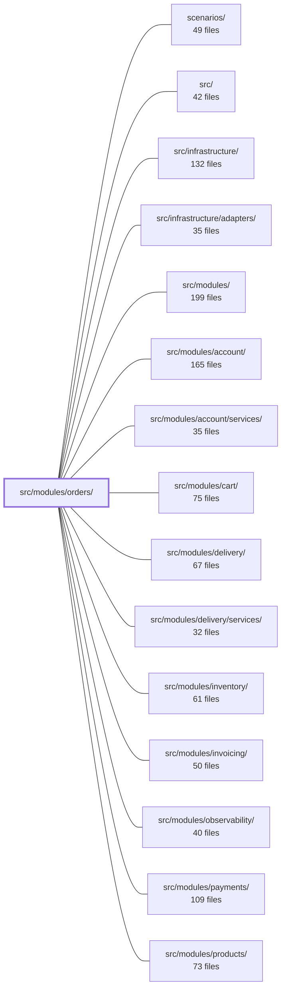

---
tags:
  - 2brain
  - 2brain/module
  - project/boilerplate-node-backend
type: module
module: src/modules/orders/
files: 139
updated: 2026-11-15T00:33:51.208496+00:00
---

# src/modules/orders/

## Purpose

The orders module is the bounded context that owns the full order lifecycle: creation (admin path and cart completion), status transitions, customer cancellation, withdrawal, anonymization, and retention scrubbing. It provides the HTTP API surface for reading, writing, exporting, and auditing orders; defines the pure domain rules (totals, tax, backorder, deletion, fulfillment interpretation, EU withdrawal logic) that every service and controller enforces; and publishes the module's events, webhooks, audit vocabulary, and authorization policy as declarative contracts.

## Key parts

- **Domain layer (`domain/`)** — A cluster of pure-logic files with no I/O. `lifecycle.ts` and `status-traits.ts` together define the status state machine and per-status invariants; `totals.ts`, `tax.ts`, and `backorder.ts` compute money and delivery promises; `withdrawal.ts`, `deletion.ts`, and `purchase-hold.ts` encode regulatory and policy rules; `projections.ts` and `fulfillment.ts` interpret data stamped by other modules. `index.ts` is the tier's barrel.
- **Controllers (`controllers/`)** — One thin handler per HTTP endpoint (list, get, create, cancel, override-status, restore, update, export, timeline, notes, delete, shipping-address). All delegate business logic to the order service and use shared helpers (`respond.ts`, `createDeleteController`, `createSearchController`, `createUpdateController`) so no bespoke HTTP plumbing is duplicated.
- **Cross-cutting declarations** — `analytics.ts`, `audit.ts`, `events.ts`, `metrics.ts`, `jobs.ts` register the module's vocabulary into app-wide maps (analytics events, audit actions, domain events, Prometheus counters, scheduled jobs). `authorization.yaml` and `asyncapi.webhooks.yaml` declare the policy and contract surface declaratively.
- **Config & contracts** — `config.ts` centralises tunables (line caps, withdrawal window, PII retention, export limits, purchase-hold thresholds) behind per-call getters. `emails.ts` resolves all customer-facing order email strings.
- **Boundary & barrel files** — `index.ts` is the sole public import surface for sibling modules. `friends/payments.ts` is the single narrow entry point `payments` may use inside orders. `factories.ts` builds valid order documents for tests and builders.

## How it connects

- **payments** — The only write-side interaction permitted into orders is through `friends/payments.ts`; a settled payment is the sole event that transitions an order to `paid`. Orders never import payment internals.
- **delivery** — Dependency arrow is `orders → delivery`: delivery writes a `FulfillmentSummary` record onto the order, and `domain/fulfillment.ts` interprets it to answer stock, dispatch, and filter questions. Orders never query delivery collections directly.
- **returns** — `domain/projections.ts` provides the helpers through which the returns module stamps `returnStatus` onto an order; orders reads the value but does not compute it.
- **invoicing** — Invoice-document email copy lives in invoicing's own `emails.ts`; orders' `emails.ts` only handles order-lifecycle notifications.
- **products** — VAT rates are resolved by the products module at placement time and frozen into the order line; orders' `domain/tax.ts` then computes figures from that frozen rate so a later product change never restates a past order.
- **cart** — `POST /orders` (admin) bypasses cart entirely; the cart path presumably feeds the same `orderService.create`. Both draw on `domain/totals.ts` for a single money implementation.
- **observability** — `metrics.ts` exposes `order_created_total`; the kernel's observability layer collects it.
- **infrastructure / adapters** — The order repository (Mongoose), mailer, and job scheduler live outside this module; orders only declares *what* to do (events, jobs, emails) and lets the infrastructure layer execute it.

## Where to start

1. **`domain/lifecycle.ts`** — Reading this first gives you the complete status state machine (allowed transitions, permitted actors) that every controller and service ultimately enforces. Once you know the graph, the rest of the module's rules (withdrawal, deletion, fulfillment) slot in naturally.
2. **`index.ts`** — This barrel shows the full public API the rest of the app can import. Skimming it tells you exactly what the module exposes versus what stays internal, which orients you before diving into individual files.

## Connected modules

[[boilerplate-node-backend_ROOT|/ (repository root)]] · [[boilerplate-node-backend_scenarios|scenarios/]] · [[boilerplate-node-backend_src|src/]] · [[boilerplate-node-backend_src_infrastructure|src/infrastructure/]] · [[boilerplate-node-backend_src_infrastructure_adapters|src/infrastructure/adapters/]] · [[boilerplate-node-backend_src_modules|src/modules/]] · [[boilerplate-node-backend_src_modules_account|src/modules/account/]] · [[boilerplate-node-backend_src_modules_account_services|src/modules/account/services/]] · [[boilerplate-node-backend_src_modules_cart|src/modules/cart/]] · [[boilerplate-node-backend_src_modules_delivery|src/modules/delivery/]] · [[boilerplate-node-backend_src_modules_delivery_services|src/modules/delivery/services/]] · [[boilerplate-node-backend_src_modules_inventory|src/modules/inventory/]] · [[boilerplate-node-backend_src_modules_invoicing|src/modules/invoicing/]] · [[boilerplate-node-backend_src_modules_observability|src/modules/observability/]] · [[boilerplate-node-backend_src_modules_payments|src/modules/payments/]] · … and 4 more

## Files
- `src/modules/orders/analytics.ts` — Declares the set of analytics event names the orders module emits and registers them into the app-wide `AnalyticsEventMap` union so the analytics port can type-check them at the call site. It is a pure declaration file: no runtime logic, no side effects beyond exporting a frozen const.
- `src/modules/orders/asyncapi.webhooks.yaml` — Defines the orders module's four outbound webhook events (`order.created`, `order.paid`, `order.canceled`, `order.redacted`) as an **AsyncAPI fragment**. It is not a standalone document: the bundler (`scripts/contracts/asyncapi-section-fragments.ts`) merges it into the top-level `webhooks` section, and `GET /webhooks/events` lists these events only while the orders module is registered. Deleting the module removes its events from the contract.
- `src/modules/orders/audit.ts` — Declares the audit-action vocabulary for the orders module and registers it into the application-wide `AuditActionMap` via TypeScript module augmentation. Every service and controller in `src/modules/orders/` references one of these constants when it writes an audit record, so the set of valid `orders` actions lives in exactly one place.
- `src/modules/orders/authorization.yaml` — Declarative authorization policy for the orders module. It defines the seven permitted actions on the `Order` entity (read, display, create, update, delete, override, export), any conditions or step-up requirements attached to each, and groups them into named rule sets that roles can reference when granting access.
- `src/modules/orders/config.ts` — Centralises every tunable rule that governs the orders module — line caps, withdrawal window, PII retention periods, export limits, purchase-hold thresholds, and the one frontend link path — behind per-call getter functions so tests can vary any value without re-importing. Shop identity, currency, and return address intentionally live in `shop`; VAT rates are resolved by `products`. A deployment changes a value via restart.
- `src/modules/orders/controllers/delete-orders.ts` — A thin admin delete controller for orders. It wires the shared `createDeleteController` factory to `orderService.removeById`, so the module's route can dispatch `DELETE /orders(/:id)(/hard)` without any bespoke HTTP logic living here.
- `src/modules/orders/controllers/get-order-timeline.ts` — Controller for `GET /orders/:id/timeline`. Returns a paginated, newest-first list of events that happened to a given order, filtered by what the caller is allowed to see. The order is resolved through the same visibility scope as `GET /orders/:id`, so an invisible order produces the same 404.
- `src/modules/orders/controllers/get-order.ts` — Handles `GET /orders/:id`. Validates the path id before any service call, fetches the order scoped to the caller's role (non-admins see only their own), records a staff-read audit event, and serialises the order into a response that includes caller-specific permissions and a version token for optimistic concurrency.
- `src/modules/orders/controllers/get-orders-export.ts` — Implements the `GET /orders/export` endpoint: streams the full filtered order list as a CSV download. It reuses the same search filters as the paginated list view but strips paging, and pipes the result directly into the HTTP response so the file is never buffered in memory.
- `src/modules/orders/controllers/get-orders.ts` — Thin search/list controller for orders. Wires the shared `createSearchController` factory to the orders domain service, scoping results to the caller's own visibility via `orderService.callerScope`. Exists so the HTTP layer stays declarative while permission enforcement and pagination normalization live in the shared infrastructure and kernel.
- `src/modules/orders/controllers/order-notes.ts` — Thin HTTP controller layer for staff notes on an order. It maps `POST /orders/:id/timeline/notes` (create a note) and `DELETE /orders/:id/timeline/notes/:eventId` (withdraw a note's text) onto `orderService`, handling only request parsing, ID validation, and response shaping. Authorization (`requirePermission('update', 'Order')`) is enforced upstream by the route, not here.
- `src/modules/orders/controllers/post-cancel-order.ts` — HTTP controller for `POST /orders/:id/cancel` — the single order-write operation a customer is permitted to perform. It is a thin wiring layer that validates the route params and body, extracts the caller's auth context, and delegates the actual write to `orderService.cancelOnRequestById`.
- `src/modules/orders/controllers/post-order-override-status.ts` — Admin controller for `POST /orders/:id/override-status`. It is a thin HTTP-layer handler that validates the request, delegates to `orderService.overrideStatus`, and formats the response. It enforces a **status-only** override (no parcel or email side-effects). Authorization (`requirePermission('override', 'Order')`, step-up gated) is handled upstream at the route, not here.
- `src/modules/orders/controllers/post-order-restore.ts` — Thin admin-facing controller that exposes the "restore a soft-deleted order" endpoint (`POST /orders/:id/restore`). All business logic and audit side-effects live in the order service; this file only wires the shared `createRestoreController` factory to the order-specific service methods.
- `src/modules/orders/controllers/post-order.ts` — Handler for `POST /orders` — the admin path that creates an order directly from an explicit payload in the request body, bypassing the cart. It validates the body, delegates to `orderService.create`, records a metric, and returns a `201` with the created order.
- `src/modules/orders/controllers/put-shipping-address.ts` — Thin HTTP handler for `PUT /orders/:id/shipping-address`. Validates the route parameter and request body, then delegates to `orderService.correctShippingAddress` to replace the shipping address on an unshipped order. All business logic lives in the service; this file only performs extraction, validation, and response shaping.
- `src/modules/orders/controllers/respond.ts` — Shared success-path helper for every order controller (reads and writes). It hydrates the order document returned by the service with the caller's `actions` (via `orderService.withActions`) and sends it as the HTTP response. Extracted from the individual controllers so the hydrate-then-send shape is written once, while each call site still declares its own status code and error context.
- `src/modules/orders/controllers/update-order.ts` — Builds the two HTTP handlers for `PUT /orders/:id` (full replace) and `PATCH /orders/:id` (partial merge) by delegating to the shared `createUpdateController` factory. The only writable field exposed through either verb is `email`; `status` transitions are intentionally excluded from the request body and must go through a dedicated action endpoint.
- `src/modules/orders/domain/anonymization.ts` — Defines the single placeholder email value written into an order's `email` field when the order is anonymized. Exists as a shared constant so every consumer (repository writes, notification checks, tests) references the same string without hard-coding it.
- `src/modules/orders/domain/backorder.ts` — Defines the "owed" portion of an order line — how many units are backordered and when the buyer was promised delivery. Pure domain logic: it computes a frozen snapshot at order-placement time so that later catalogue changes (e.g. restock-date edits) don't silently alter what was already promised to the buyer.
- `src/modules/orders/domain/deletion.ts` — Defines the two pure predicates that determine whether an order may be soft-deleted (hidden) or hard-deleted (destroyed). Centralizing these rules here ensures the UI "delete door" and the service-layer actions agree on the same criteria and cannot diverge.
- `src/modules/orders/domain/export.ts` — Defines the shape and mapping of a single orders-CSV row: which columns appear (and in what order), what fields an order must supply, and the pure function that converts an order into a row of cells. It exists so the CSV contract is declarative, testable, and decoupled from the transport (writing, escaping, streaming) handled elsewhere.
- `src/modules/orders/domain/fulfillment.ts` — Pure domain logic that interprets the fulfillment summary a `delivery` module writes onto an order. Because the dependency arrow points `orders → delivery` (not the reverse), `orders` cannot inspect fulfillment orders directly; instead `delivery` reports a small record (`FulfillmentSummary`) and this file derives every question `orders` asks about the goods—settlement moves, the user-facing fulfillment status, and the listing filter—from that single record. No I/O.
- `src/modules/orders/domain/index.ts` — Barrel (re-export) file for the orders **domain layer**. It aggregates the public API of every sibling domain module into a single import surface and, by its own doc comment, declares the invariant for the tier: pure rules only, with no Express, Mongoose, or any other framework/tier dependency. Consumers import from here rather than reaching into individual submodules.
- `src/modules/orders/domain/lifecycle.ts` — Single source of truth for the order status lifecycle: which status may follow which, and which actor (`customer`, `admin`, `system`, `withdrawal`) is permitted to make each move. The status *set* comes from the `OrderStatus` enum; this file adds the directed edges and actor restrictions. Services name an event to read the `from`/`to`/`actors` triple rather than hard-coding status comparisons.
- `src/modules/orders/domain/projections.ts` — Defines how the two "adjacent" statuses on an order — Shopify's `financial_status` (payment) and `returnStatus` — are **derived on read** and **queried on write**. Because `orders` cannot import `payments` or `returns`, those modules stamp the stored field through this file's helpers rather than the order module computing them. Everything here is pure (no I/O) so the mappings are trivially unit-testable.
- `src/modules/orders/domain/purchase-hold.ts` — Pure domain logic that computes when an **automatic** purchase hold expires based on a buyer's recent cancellations. All time values (cancellation timestamps, "now", window, limit) are passed in as parameters so the module has no clock or I/O dependency.
- `src/modules/orders/domain/rules.ts` — Pure validation and classification predicates for order data. Functions take structured input and return a simple verdict or boolean — no side effects, no status codes, no i18n. The calling layer (primarily `services/place`) is responsible for translating verdicts into HTTP responses or user-facing messages.
- `src/modules/orders/domain/status-traits.ts` — Single source of truth for what each `OrderStatus` means in isolation. Every question the orders module asks of a status alone—stock commitment, dispatch state, withdrawal eligibility, fulfillment position—is answered by reading this one record instead of each consumer maintaining its own status list. Exhaustiveness is enforced at compile time via `satisfies Record<OrderStatus, OrderStatusTraits>`, so a new status in the contract fails the build here rather than silently falling into a wrong category.
- `src/modules/orders/domain/tax.ts` — Computes VAT arithmetic for an order from each line's **frozen** price, quantity, and tax rate, plus an apportioned shipping share. It exists so that tax figures are derived at serialization time from what was actually charged, never re-resolved against a product's current tax class — a config rate change must not restate a past order. Mirrors `totals.ts`'s approach to `totalPrice`: computed on demand, never stored.
- `src/modules/orders/domain/timeline.ts` — Defines the closed set of order-timeline entry types and assigns each one a fixed audience (`buyer` or `staff`). It provides the compile-time guard that no type can exist without an audience decision, and the type-safe input shape (`TimelineEntryInput`) that writers must use when creating a timeline row. Visibility is decided here, up front, rather than by stripping fields at read time.
- `src/modules/orders/domain/totals.ts` — Pure arithmetic for "what does this set of priced lines add up to, and what is the grand total including shipping?" All money math runs in minor units via `money.ts` primitives and is converted to decimal text once at the boundary. The file exists so that cart previews, order totals, payment intents, and confirmation emails all derive the same number from one implementation instead of summing independently.
- `src/modules/orders/domain/withdrawal.ts` — Pure domain logic for the EU right of withdrawal (Consumer Rights Directive 2011/83/EU) and the statutory guarantee of conformity as they apply to a single order. It answers, without any I/O: when the withdrawal window opens and closes, whether a withdrawal is a cancel or a return, whether staff can still redirect unshipped units, when the shop must refund, and when the conformity guarantee expires. Every service, email, timeline row, and UI button reads from these functions so the answer is computed in exactly one place.
- `src/modules/orders/emails.ts` — Resolves every customer-facing email this module sends into finished, locale-specific strings. Language is an input argument; the output is complete text that the mailer template only interpolates. The same "resolve-then-interpolate" contract applies here as in `@modules/account/emails`. Invoice-document copy intentionally lives in `@modules/invoicing`'s own `emails.ts`, not in this file.
- `src/modules/orders/events.ts` — Declares every domain event the orders module emits by augmenting the kernel's `DomainEventMap` interface (via `declare module '@kernel/events'`), so the app-wide event catalogue grows with the module that owns each event rather than being edited centrally. Also exports one string constant per event name so emitters and listeners share a single spelling instead of duplicated literals.
- `src/modules/orders/factories.ts` — Factory module for constructing order fixtures ready for `orderRepository.create`. It converts API-contract-shaped data (ids as strings, ISO dates, product references) into a Mongoose `OrderDocument` shape with `ObjectId` fields, real `Date` values, and embedded product **snapshots** (value copies, not references). It exists so test code and other builders can create valid order documents without hand-assembling the nested structure or re-deriving serialization-time fields.
- `src/modules/orders/friends/payments.ts` — A single re-export that serves as the only write-side entry point `payments` is permitted to use inside the `orders` module. It exists to enforce a narrow, auditable boundary between the two bounded contexts: a settled payment is the sole event allowed to transition an order to `paid`.
- `src/modules/orders/index.ts` — Public barrel for the orders module. Per the strategic DDD rule (docs/theory/strategic-ddd.md §5), this is the **only** import surface a sibling module is allowed to use. It re-exports the module's services, domain, events, emails, and model types so callers never reach into internal files directly.
- `src/modules/orders/jobs.ts` — Declares the single scheduled job (`reapOrders`) that the orders module owns: a retention scrub that anonymizes overdue orders and then strips their data from timeline text. The file exists so the kernel's job registry can discover and invoke this work without the orders module hard-coding scheduling logic elsewhere.
- `src/modules/orders/metrics.ts` — Defines the single Prometheus counter owned by the orders module — `order_created_total` — which tracks admin-created orders. Counters live in the owning domain module (not in infrastructure) so each module is self-contained; the pattern rationale is documented in `modules/account/metrics.ts`.
- `src/modules/orders/model.ts` — Defines the Mongoose schema, TypeScript interfaces, and serialization transform for the Order document. It is the single persistence-layer contract that pins what an order stores (embedded product snapshot, quantities, frozen timestamps, stamped statuses) and what is derived at read time (totals, wire-level status fields), so that no later catalogue edit, locale change, or config drift can rewrite purchase history.
- `src/modules/orders/module.ts` — Module entry point (the `AppModule` manifest) for the **orders** module. It wires together the order module's routes, jobs, config, rate limits, event subscriptions, public webhook mappings, PII/personal-data hooks, and scenario-state list so the kernel can mount and coordinate the module. It also encodes the key invariants in its header comment: line items snapshot catalogue fields into a local schema (no live warehouse counter), inventory claims are released on cancel/expiry, and the module never imports `invoicing`.
- `src/modules/orders/module.yaml` — Module manifest for the **orders** subdomain (group `shop`). It declares what a checkout produces (status machine, totals, invoice link), the modules it depends on with a one-line note on *why*, the rate-limit budgets that guard two sensitive endpoints, and the single scheduled job that handles PII retention.
- `src/modules/orders/openapi.yaml` — The OpenAPI 3.1.0 contract for the orders module. It declares the module's public API surface (paths, parameters, request/response schemas), the module-specific error-code vocabulary, and the orders slice of the account personal-data export. Other modules and the bundler consume this file to compose the full API spec, generate code, and enforce error semantics.
- `src/modules/orders/pii.ts` — Field-level encryption/decryption of personal text in an order record: the embedded shipping/billing addresses and the buyer's notes. It is the order-side twin of `addresses/pii.ts`, sharing the same `NODE_PII_ENCRYPTION_KEY` ring. It deliberately avoids mongoose getters/setters (ciphertext leaks through `toJSON`, double-encryption on subdoc copies, and encrypted paths silently break query filters) in favour of an explicit codec applied at the repository boundary.
- `src/modules/orders/presenter.ts` — The single translation point that converts order storage documents into the `Order` wire contracts consumed by API responses. Every order read path funnels through this module so that formatting, PII handling, and audience-based field stripping live in exactly one place.
- `src/modules/orders/probes.ts` — Declares a set of **probes** — manual API requests that exercise authorization/scoping rules the OpenAPI contract cannot express on its own. Each probe documents a subtle ownership or role-scoping case in the orders module and tells the test runner how to seed variables before the real collection runs.
- `src/modules/orders/rate-limits.ts` — Declares the two rate-limit budgets specific to the orders module (export and timeline-note endpoints) and exposes them as ready-to-use Express `RequestHandler` middlewares. It converts the raw budget data into middleware via the shared `buildRateLimiter` factory so the orders routes can enforce per-account request windows without re-implementing limiter logic.
- `src/modules/orders/repository.ts` — Repository for the Order aggregate. Unlike other collections, orders are read through the Mongoose aggregation framework because product data is embedded (a snapshot per line item) and filtering on `items.product._id` is a pipeline concern. The factory still supplies plain CRUD; `search`, `countMatching`, and `streamMatching` override the default with pipeline-based reads. The file is also the single write path for PII encryption, atomic status transitions, and re-encryption.
- `src/modules/orders/routes.ts` — Express router that wires every order-management endpoint (list, read, create, cancel, override-status, shipping-address, timeline, notes, export, soft/hard delete, restore) behind a session-only auth guard and attaches the correct permission, cache, idempotency, and rate-limit middleware per route. Route registration order is load-bearing: static segments (`/search`, `/export`) and longer parameter paths (`/:id/hard`, `/:id/override-status`) must precede the bare `/:id` wildcard.
- `src/modules/orders/services/actions.ts` — Computes the `actions` flag object attached to every order (single or list) that a caller may act upon. The state-derivation predicates live in `../domain` (shared with the write-path guard); this file layers caller identity (keys, ownership, buyer vs. operator) on top so no client re-derives the rules. The two exports — `withActions` and `withListActions` — are the only async surfaces: they resolve live images and (for lists) hydrate documents, then stamp the pure `orderActionsOf` result onto the wire shape.
- `src/modules/orders/services/address.ts` — Implements the staff-facing `PUT /orders/{id}/shipping-address` handler: it replaces the shipping address on units that have not yet left, since no other code path can change an address after checkout. It is intentionally narrow — it writes the new address, emits one timeline entry, and records one audit row, and nothing else.
- `src/modules/orders/services/announce.ts` — Factory functions that build typed `OutboxAnnouncement` payloads for order lifecycle events. Each returned object is passed to `announceInTransaction` so the event row commits atomically with the corresponding status write (or not at all), guaranteeing per-order event ordering via a shared `aggregateId`.
- `src/modules/orders/services/cancel-mail.ts` — Handles the buyer-facing email that explains why their order was canceled. It is invoked from the `order.canceled` domain-event listener so that every cancellation path (regardless of origin) produces the same explanation, and a crash between the DB commit and the send still results in the email going out.
- `src/modules/orders/services/cancel.ts` — Executes an order cancellation as a single atomic transaction: the conditional status move to `canceled`, the release (or committed-release) of the order's stock claim, and the `order.canceled` outbox row all commit or roll back together. The refund is deliberately excluded from the transaction (it is an external-provider action that cannot roll back); instead it is carried as a `refund` flag on the outbox event, which the `payments` module consumes to open its own refund record.
- `src/modules/orders/services/crud.ts` — Admin-facing write operations for orders: **create** and **update** (email amendment). The file deliberately scopes itself to the "admin door" — creating an order composes around `placeOrder` (which owns the actual write, stock hold, and rollback), and updating delegates the raw save to `updateById`. Reads live in `./read`, deletes in `./remove`, and cancellation in `./cancel`.
- `src/modules/orders/services/current.ts` — Resolves each order line's live product images (`imageUrl`, `thumbnailUrl`) from the catalogue at the serialization boundary. It exists because the frozen order snapshot schema (`orderLineProductSchema`) deliberately omits image fields, so callers need a single, batched lookup that enriches serialized orders just before they leave the API layer.
- `src/modules/orders/services/digest.ts` — Provides the order-side counts for the daily staff digest: bank-transfer orders approaching or past their `payBy` deadline, and paid orders still awaiting shipment beyond a configurable allowance. Also exposes a small lookup for the shipping method each order froze at checkout. The digest holds counts only—no order records are returned.
- `src/modules/orders/services/export.ts` — Produces a streaming CSV export of orders. The function validates the result size against a configurable cap, writes an audit entry, and returns a pipeable pair (object-mode `Readable` source + `csv-stringify` `Transform`) that the caller wires into the HTTP response. Nothing is written to disk or emailed; the stream is discarded if the client disconnects.
- `src/modules/orders/services/fulfillment.ts` — The transactional write path that the `delivery` module calls when a fulfillment act changes where an order's goods stand. Because `orders` is the sole writer of its own fields, this file receives the report (summary, step history, units moved) and decides whether each write still applies. Every door accepts the act's Mongoose session so the shipment, summary, status move, and events commit atomically or not at all.
- `src/modules/orders/services/guarantee.ts` — Implements the one-time guarantee extension for repaired goods under EU Directive 2024/1799. When a repair is performed under the statutory warranty, the order's `conformityUntil` date is pushed forward by twelve months — but only once per order. The `returns` module calls in; `orders` owns the underlying field.
- `src/modules/orders/services/index.ts` — Barrel module that aggregates every order-service function from ~20 sub-files and re-exports them as a single `orderService` object. It is the **only** import surface a controller or cross-module caller may use to reach Order business logic, enforcing the "one door in, one door out" layering rule described in `docs/theory/layers.md`.
- `src/modules/orders/services/notify.ts` — Sends the buyer-facing "order placed" confirmation email, wired as the `order.created` outbox-event listener. Centralising the mail here means the admin `create` path and the cart checkout path both emit the same message from one place, and a crash after the DB commit still triggers the send. No invoice data is included because invoicing happens later in the `invoicing` module's own status-changed listener.
- `src/modules/orders/services/order-numbering.ts` — Formats the repository's atomic yearly counter into the order-number string `{year}-{sequence}` (e.g. `2026-000041`) and parses customer-typed input back into that canonical form. It owns **string shape only**; the atomic increment lives in the repository.
- `src/modules/orders/services/override.ts` — Implements the admin status-override endpoint (`POST /orders/{id}/override-status`). It corrects an order's status in a single MongoDB transaction—writing the new status, the timeline row, the stock adjustment, the outbox events, and the audit record atomically—so that no partial state is ever observable. It exists as the "back door" for manual corrections where the normal lifecycle (shipped email, carrier tracking) would produce an incorrect consequence.
- `src/modules/orders/services/place.ts` — The single write path for creating a new order. Both the admin `create` endpoint (`crud.ts`) and the cart checkout service funnel through `placeOrder`, so the "write an order" logic exists in exactly one place. It freezes line items, holds stock, allocates an order number, and persists the row — with the hold taken *before* the write so a refused hold burns neither a DB row nor an order number.
- `src/modules/orders/services/purchase-hold.ts` — Reacts to `order.canceled` domain events to enforce an automated purchase-hold rule. It counts a buyer's cancellations within a configurable window and either pauses their next checkout (unpaid cancels from `customer`, `withdrawal`, or `reservation_expired` causes) or flags the account for staff review (paid cancels only). The goal is to catch bot or loop behavior while leaving legitimate statutory withdrawals unblocked.
- `src/modules/orders/services/read.ts` — Provides all read-side operations for orders: paginated search, single-order retrieval by ID, narrow batch lookups (IDs, briefs, references), PII address decryption, and the open-unpaid-order check that checkout's stock cap depends on. It is the read counterpart to the write services in `./crud` and `./remove`, and the entry point controllers use when they need order data without side effects.
- `src/modules/orders/services/reencrypt.ts` — Re-encrypts all PII ciphertext in order documents (postal addresses, free-text notes) and in timeline staff notes onto the newest key in the PII encryption key ring. Serves as the orders-domain half of the ops-level key-rotation script (see `@infrastructure/security/reencrypt`).
- `src/modules/orders/services/remove.ts` — Implements order deletion (soft and hard) and soft-delete restoration. Because an order is a financial record, the default path is a soft delete that stamps `deletedAt`; a hard delete is restricted to orders that were canceled and never paid. The file also exposes the id-based public entry point (`removeById`) that loads the document before delegating to the core `remove` logic.
- `src/modules/orders/services/retention.ts` — Implements the order-side of account erasure and data minimization. Because an order is an invoice retained under GDPR Art. 17(3)(b)/(e), erasure detaches the person (`userId`) from it rather than deleting it, then a later sweep scrubs the remaining PII once the legal claim window closes.
- `src/modules/orders/services/scope.ts` — Defines the authorization scoping layer for order reads and writes. Before any sibling service reads, cancels, or exports an order, it consults the functions here to get the correct query filter (which rows the caller may touch) and the correct lifecycle actor column. It centralizes the "who sees what" decision so individual services never re-derive permissions inline.
- `src/modules/orders/services/ship-stock.ts` — Provides the stock-release step for **status overrides** (shipped/delivered) that ship the entire remaining held quantity of an order in one go. It is the whole-remainder counterpart to the per-shipment `shipStock` in `./fulfillment`. Its reason for existence is to guarantee that an order never reads `shipped` while its units still count as on-hand: the status write and the stock decrement are committed atomically.
- `src/modules/orders/services/snapshot.ts` — Resolves catalogue products into the frozen order-line snapshots that an order persists. It lives in the `services/` tier (not `domain/`) on purpose: it reaches into `@infrastructure/i18n` and `@kernel/translation`, which the domain tier must not touch. Every order-writing path (admin create, checkout, admin line edit) funnels through `freezeOrderLines` so that locale stamping, tax-rate resolution, and preorder detection happen in one place.
- `src/modules/orders/services/stats.ts` — Read-only aggregate statistics for the orders module. Each exported function returns a small, pre-grouped result (a few hundred rows at most) that a dashboard or report composer can merge by key. All queries hit `orderRepository.aggregate` and filter out soft-deleted orders; monetary results are expressed net-of-VAT using each line's frozen tax rate.
- `src/modules/orders/services/status.ts` — The single writer of order status in the application. Other modules (`payments`, `delivery`) **report** a fact they have already recorded; this file decides whether the status move still applies (conditional write against the current status), executes it inside a transaction, appends a timeline entry, and announces the change via the outbox. It never acts on a human request — every call here is a system reporting another module's completed act.
- `src/modules/orders/services/timeline.ts` — Implements the order timeline — an append-only, ordered log of everything that happened to an order. It exposes the single write door (`appendTimeline`) that both `orders` itself and dependent modules (payments, delivery, returns, invoicing) use to record events inside their own transactions, plus all read, note-management, and lifecycle functions (GDPR export, erasure, retention scrub, hard delete) for that log.
- `src/modules/orders/tests/contract/api.contract.test.ts` — Contract tests for the `/orders` HTTP surface. This suite exists because no prior test exercised the API over HTTP: the list endpoint once returned `totalItems`/`totalQuantity`/`totalPrice` while `openapi.yaml` specified a single `total`, and `GET /orders/{id}` answered a different shape per caller role. Every test here asserts that the live response matches the published contract for each role.
- `src/modules/orders/tests/contract/export-schema-drift.contract.test.ts` — Guards against drift between the API's canonical schemas (`Order`, `OrderTimelineEntryBase`) and their flat "export" restatements (`ExportOrder`, `OrderTimelineExportEntryBase`) that exist because the Zod generator cannot compose the `allOf`-based originals and closed siblings cannot validate together. The test reads the module's own `openapi.yaml` and asserts each export mirrors its source with exactly one intentional field difference.
- `src/modules/orders/tests/contract/export.contract.test.ts` — Contract test for the `GET /orders/export` HTTP endpoint. It verifies the wire-level behaviour a client depends on — status codes, response headers (content-type, content-disposition, cache-control), authentication gates, and the 422 error shape — without asserting on CSV content correctness (that belongs to the service suite). The route must resolve as a fixed path, not as an order-id parameter.
- `src/modules/orders/tests/contract/timeline-variants.contract.test.ts` — Contract test that keeps the hand-written `oneOf` timeline variants in the module's `openapi.yaml` honest against the `OrderTimelineType` enum. It verifies that the variants split the type set exactly, that discriminator mappings are complete and correct, that the export surface mirrors the entry surface, that only approved variants carry a `text` property, that the domain audience table covers every type, and that the root (bundled) `openapi.yaml` closes variants with `unevaluatedProperties` while leaving bases open.
- `src/modules/orders/tests/factories.ts` — Database-touching test factories for orders. Wraps the pure builder in `../factories.ts` with real Mongoose repository calls so integration and contract tests can seed, read, and manipulate persisted order documents. It converts live product/user documents into the embedded snapshots an order line requires, and exposes narrow assertion helpers (status forcing, timeline reads, PII-clock stamping) that bypass the service layer.
- `src/modules/orders/tests/integration/cancel.test.ts` — Integration tests for the order-cancellation write path (`cancelOnRequestById` and the system-actor `cancelForErasureById`). They verify the authorization matrix (customer / admin / moderator / system actor), status-gate invariants, refund semantics, and that the audit, analytics, mailer, and domain-event side effects fire correctly.
- `src/modules/orders/tests/integration/create-audit.test.ts` — Integration test that verifies the `order_created` audit row always records the **real** caller role (`actorRoleName`) rather than a hard-coded label (e.g. "customer"). It guards against a regression where checkout's own purchase path could mask the true identity of the actor in the audit trail.
- `src/modules/orders/tests/integration/delete-restore-audit.test.ts` — Integration tests that verify `orderService.removeById` and `orderService.restoreById` emit the correct audit events (`ORDER_DELETED`, `ORDER_RESTORED`) with the expected fields. They exist to pin that audit logging was moved from the controller layer into the service layer (module-lifecycle rule 1) without losing the audit trail.
- `src/modules/orders/tests/integration/erase-cancel-failure.test.ts` — Integration test verifying that a failed cancellation of an unpaid order does **not** block or roll back an account erasure. It simulates a cancel failure (e.g. a racing payment or write conflict) and asserts the erasure still completes: the user record is deleted, the order is detached from the user, and the operation resolves `true`. The design contract is that a later reservation-sweep job cancels the orphaned order once its hold times out.
- `src/modules/orders/tests/integration/erase-cancels-unpaid.test.ts` — Integration test verifying that a **hard** erasure of a user account cancels all of their never-paid orders (releasing the inventory reservation through the reservation-sweep path) while leaving paid orders intact as detached invoices. It drives the flow through `userService.remove` with real module wiring so a missing hook registration in the orders module would be caught.
- `src/modules/orders/tests/integration/export.test.ts` — Integration test for `orderService.openOrderExport` (the orders CSV endpoint) against a real MongoDB. Verifies the CSV contract (column order, formula escaping, read scoping), the row-cap refusal path, and the audit row's content invariants.
- `src/modules/orders/tests/integration/fulfillment-filter.test.ts` — Integration test that verifies the `GET /orders?fulfillmentStatus=` filter against a real MongoDB instance. It confirms that the database query conditions select exactly the same set of orders that the `FulfillmentSummary` table would assign to each value, closing the gap left by the pure unit tests in `unit/fulfillment.test.ts`.
- `src/modules/orders/tests/integration/hierarchy.test.ts` — Integration test for the order access-control hierarchy: verifies that a read key (`display:Order`) never grants a write (cancel), that a customer cancels only their own order, that any operator holding a write key handles every buyer's order regardless of the buyer's role, and that the client-facing action menu reflects these rules. Driven through `orderService` against a real test database.
- `src/modules/orders/tests/integration/hold-doors.test.ts` — Integration tests (real MongoDB) for the three "doors" the orders module exposes for stock-hold management: `releaseStock`, `extendHold`, and `isPayableNow`. The file verifies that no other module needs to drive an order's hold directly—these functions are the only entry points, and their edge-case behavior (committed holds, missing holds, partial release) is locked in here.
- `src/modules/orders/tests/integration/idempotent-note.test.ts` — Integration test for the `POST /orders/{id}/timeline/notes` endpoint's idempotency behavior. It verifies that a retry carrying the same `Idempotency-Key` replays the original 201 response without creating a second timeline entry, while a different key produces a new note.
- `src/modules/orders/tests/integration/mail-listeners.test.ts` — Integration tests for the buyer-mail listeners on `ORDER_CREATED` and `ORDER_CANCELED`. Verifies three invariants: the correct template is queued for each (cause × payment-method) combination, a mail failure never rejects the calling act, and every cancel path writes its `CancelCause` into the outbox event row.
- `src/modules/orders/tests/integration/model.test.ts` — Integration tests that verify the order serialization contract across both Mongoose `toJSON` paths and raw `.aggregate()` output: internal fields (`_id`, `__v`) must never appear in wire-shaped results, embedded product snapshots must be normalized the same way, and order-line subdocs must not carry their own `_id`. Also guards against a schema-level pitfall (index smuggling from the embedded product schema) and pins the `transferInstructions` absence rule for legacy bank-transfer orders.
- `src/modules/orders/tests/integration/note-rate-limit.test.ts` — Integration test that verifies the per-account staff-note rate limiter (for `POST /orders/{id}/timeline/notes`) enforces its budget correctly over real HTTP. It isolates the limiter's own property (429 after exhaustion, per-account isolation) from the routing/permission concerns covered in `routes.test.ts`.
- `src/modules/orders/tests/integration/notes.test.ts` — Integration tests for the staff-note endpoints (`POST` and `DELETE /orders/{id}/timeline/notes`) run over real HTTP against a real Mongo. They verify the full lifecycle of a note: creation, staff-only visibility, encryption at rest, inclusion in buyer data export (without author), audit logging by length only, time-based text scrubbing, erasure with the order, and withdrawal (soft delete that keeps the row but unsets text).
- `src/modules/orders/tests/integration/order-number-filter.test.ts` — Integration tests (against a real MongoDB) that verify the `orderNumber` filter behaves correctly across search and CSV export: it tolerates common typos and formatting variants, returns an empty page (not an error) for values that cannot be valid order numbers, respects the caller's read scope, and enforces uniqueness via a database index.
- `src/modules/orders/tests/integration/order-number.test.ts` — Integration test verifying that `GET /orders/{id}` returns the order number exactly as it was set at creation time. It runs against a real HTTP server with a fresh test database, confirming the field is persisted and surfaced unchanged.
- `src/modules/orders/tests/integration/order-numbering.test.ts` — Integration test for `allocateOrderNumber` that verifies order-number allocation is atomic, gap-free, and duplicate-free against a real MongoDB instance. It exists because the correctness guarantee (atomic `findOneAndUpdate` counter increment) is only observable through a live database — a mock cannot prove it.
- `src/modules/orders/tests/integration/order-tax-fields.test.ts` — Integration test verifying that `GET /orders/{id}` returns a complete VAT breakdown: per-line tax fields (`taxRate`, `taxAmount`, `netAmount`) and order-level aggregates (`netTotal`, `taxTotal`). It exists to lock in the contract that every order response carries these fields on every line and at the top level.
- `src/modules/orders/tests/integration/outbox.test.ts` — Integration tests (real Mongo) proving the transactional-outbox invariant for order events: every status move, creation, or cancellation either commits its outbox row together with the write it announces, or rolls back entirely. Each "door" that mutates an order is tested in both the happy path (event row appears with correct payload) and the failure path (event write fails → the order write is undone).
- `src/modules/orders/tests/integration/pii.test.ts` — Integration test verifying that an order's PII fields (shipping address, billing address, notes) are encrypted at rest in the database and correctly decrypted on every read path (route, search, account export). Also confirms the encryption is bound to the order ID via AAD so ciphertext is non-transferable between orders.
- `src/modules/orders/tests/integration/purchase-hold.test.ts` — Integration tests for the purchase-hold feature: a time-limited pause on a buyer's checkout that activates after the buyer's own repeated order cancellations (the third within a window). Verifies the counting rules, idempotency, staff notification, staff lift reset, configurable thresholds, module event wiring, error resilience, and that bot-like causes (reservation expiry, withdrawal through returns) also feed the same counter.
- `src/modules/orders/tests/integration/reencrypt.test.ts` — Integration test for the orders module's `reencrypt` walk. Verifies that after a PII key rotation (v1 → v2), an order's frozen PII fields (shipping address, notes) and timeline staff notes are re-encrypted to the new key version, and that the order still deserializes and reads back correctly through the public API.
- `src/modules/orders/tests/integration/remove-race.test.ts` — Integration tests that verify `remove` correctly handles race conditions: if a settlement, reopen, or concurrent delete commits *after* `remove` read the document but *before* it issues its conditional write, the delete must abort with the appropriate error instead of destroying the order. Runs against a real MongoDB instance.
- `src/modules/orders/tests/integration/repository.test.ts` — Integration tests for `orderRepository` that verify three contracts: (1) `create` persists a full order with embedded product snapshots, (2) `aggregate` is a raw passthrough that does not reshape Mongo pipeline stages, and (3) `findByIdScoped` always returns a hydrated Mongoose document regardless of whether a scope is applied.
- `src/modules/orders/tests/integration/retention.test.ts` — Integration tests for the order PII retention pipeline: the two-phase erasure flow where a hard account delete first detaches `userId` (starting the PII clock), and a later `anonymizeDueOrders` sweep scrubs the remaining personal data (email, addresses, notes) once the retention window for that order's status has elapsed. Tests run against a real test database with full module wiring to prove the `personalData.erase → detachUserId` hook is actually declared in the order module, not just the service function.
- `src/modules/orders/tests/integration/schema-contract.test.ts` — Schema-contract tests for the orders Mongoose schema. Unlike sibling specs that verify transform/behaviour logic, this file asserts what the schema *declares*: serialization shape (`id` vs `_id`/`__v`), field presence/absence in embedded product snapshots, and (per the file's stated intent) defaults, `required` guards, and `select: false` on credentials. It runs against a real MongoDB instance because the behaviours under test belong to Mongoose itself, not application code.
- `src/modules/orders/tests/integration/service-crud.test.ts` — Integration test suite covering the **write** half of the order service — `create`, `update`, `updateById`, `remove`, `removeById`. It exercises those operations against a real (test) database to verify business rules like product-snapshot pricing, stock reservation, scope-based authorization, sequential order numbers, and idempotent soft-delete. The read/aggregation half (`search`) is covered separately in `service-search.test.ts`.
- `src/modules/orders/tests/integration/service-override.test.ts` — Integration tests for `overrideStatus`, the admin "status-only" door that manually moves an order between statuses. Runs against real Mongo so that the conditional-write guarantee (a 409 if another writer lands between read and write) and the outbox-delivery path are exercised for real — behaviors a mock cannot reproduce by racing against itself.
- `src/modules/orders/tests/integration/service-search.test.ts` — Integration tests for `orderService.search`, verifying filtering, pagination, the three aggregate-derived totals, live image resolution on order line items, and the admin "awaiting transfer" view. Complements `service-crud.test.ts` (write path) by covering the full read pipeline end-to-end against a real database.
- `src/modules/orders/tests/integration/service-status.test.ts` — Integration tests for the order status transition functions in `services/status.ts`, run against a **real MongoDB** instance (not mocks). Verifies three guarantees: (1) conditional writes refuse invalid transitions, (2) exactly one `ORDER_STATUS_CHANGED` outbox event fires per successful move, and (3) transactional (session-variant) doors commit atomically with the caller's transaction. Also covers deadline calculations and concurrent-race correctness.
- `src/modules/orders/tests/integration/ship-stock.test.ts` — Integration tests verifying that stock leaves the shelf (`onHand`) when a shipment is dispatched via `shipStock`, that subsequent status moves (`shipped`, `delivered`) take nothing further, and that an admin override past dispatch takes only the unshipped remainder. Runs against a real MongoDB instance with no service mocking.
- `src/modules/orders/tests/integration/shipping-address.test.ts` — Integration tests for the `PUT /orders/{id}/shipping-address` endpoint. Verifies that staff can replace an order's shipping address while units remain unsent, that the stored value is encrypted, that audit/timeline entries record *who* acted but never *what* the address was, that unsupported countries are rejected with no write, and that the endpoint is locked once fulfillment is complete.
- `src/modules/orders/tests/integration/timeline.test.ts` — Integration tests for the order timeline: verifies that each lifecycle move writes exactly the expected row (type, actor, data, audience), that audience filtering hides staff-only rows and text from buyers, that GDPR obligations (erasure, text-retention scrubbing, hard-delete cleanup) behave correctly, and that the buyer data export includes only what it should. Runs against real MongoDB through `orderService`'s public API.
- `src/modules/orders/tests/integration/update-audit.test.ts` — Integration test verifying that the `ORDER_UPDATED` audit row records only the **name** of a changed field (e.g. `email`) in its `metadata.changedFields`, never the field's value. This enforces the rule that personal data must not leak into audit logs.
- `src/modules/orders/tests/unit/config.test.ts` — Unit tests for the orders module's environment-driven configuration functions (admin order limits, frontend link templates, withdrawal period, PII retention windows). The file exists to pin down default values, env-var overrides, validation boundaries, and the boot-time gate that `assertModuleConfig` runs against a valid/invalid deployment — ensuring the wiring is exercised, not just the pure reads.
- `src/modules/orders/tests/unit/domain-rules.test.ts` — Unit tests for the pure domain-rule functions in `rules.ts`. The file deliberately uses no mocks, no database, and no fake timers—each rule takes plain arguments and returns a verdict, so the tests call them directly and assert the returned shape.
- `src/modules/orders/tests/unit/emails.test.ts` — Unit tests for the order email builders (`orderConfirmEmail`, `orderCanceledEmail`, and by import `holdExpiredEmail`) in `@modules/orders/emails`. The file exists to pin the rendered copy, line-per-item mapping, locale-aware money formatting, date handling, and payment-status language that a customer receives, so that a formatting regression is caught before it is misread as a billing error.
- `src/modules/orders/tests/unit/export.test.ts` — Unit tests for `toOrderCsvRow`, verifying that an order serializes to exactly the declared CSV columns, that dates normalize to UTC ISO text regardless of input type (`Date` vs. string), and that an unpaid order's missing fields emit empty strings rather than `"undefined"`.
- `src/modules/orders/tests/unit/factories.test.ts` — Unit tests for the `makeOrder` fixture builder. They pin down two contracts: (1) the shape of a default order document (identity, required vs. optional fields, type conversions) and (2) how an `OrderSnapshotInput` override is transformed into the stored `product` snapshot embedded in each line item.
- `src/modules/orders/tests/unit/fulfillment.test.ts` — Unit tests that pin down the projection logic for order fulfillment status: the truth table for `fulfillmentStatusOf`, the agreement between that function and the Mongo query builder `fulfillmentStatusFilter`, and the settlement-action decision in `settlementFor`. They exist so that any change to the domain's status derivation or its query filter is caught by a concrete, enumerated matrix of order shapes.
- `src/modules/orders/tests/unit/lifecycle.test.ts` — Unit tests for the order-lifecycle transition table. Rather than re-listing every row (which would pass against a table copied wrong), the suite asserts the *properties* the table must satisfy: actor permissions per status, terminal-state immutability, forward-only direction, and the agreement between `canTransition` and the table's inverse lookups. Pure—no mocks, no database.
- `src/modules/orders/tests/unit/notify.test.ts` — Unit tests for the `mailBuyer` policy function (in `services/notify.ts`), verifying its guard and fallback behaviour: that anonymised orders are silently skipped and that a failed buyer lookup degrades gracefully to the order's own email as the display name. The actual email body is out of scope here — it is covered by the listener/integration tests.
- `src/modules/orders/tests/unit/order-number.test.ts` — Unit tests for the `parseOrderNumber` utility in the orders module. It verifies that customer-supplied order numbers (with varied formatting) normalize to the canonical `YYYY-NNNNNN` stored form, and that malformed inputs are rejected with `undefined`.
- `src/modules/orders/tests/unit/projections.test.ts` — Unit tests for the `paymentStatusOf` and `returnStatusOf` projection functions, verifying how they resolve an order's payment and return status from owner-stamped values and the `paidAt` timestamp.
- `src/modules/orders/tests/unit/public-events.test.ts` — Verifies that the orders module's public-event projections (the `publicEvents` registry on the module manifest) emit the correct webhook `eventType` strings and payload shapes for each domain event, and that the AsyncAPI contract stays in sync with the code.
- `src/modules/orders/tests/unit/purchase-hold.test.ts` — Unit tests for the pure domain function `purchaseHoldUntil`, verifying the rule that a buyer's own cancellations trigger a purchase hold when their count within a sliding window meets or exceeds a threshold. All tests are deterministic, pinning "now" to a fixed date.
- `src/modules/orders/tests/unit/routes.test.ts` — Locks down the orders router's surface: the exact set and order of mounted endpoints, the auth/permission guards on each route, the middleware chain ordering (budget, cache, flags), and the intentional gaps (e.g. `POST /:id/cancel` has no admin guard). It exists so that a refactoring of `routes.ts` cannot silently reorder paths, drop a guard, or change cache semantics without a test failing.
- `src/modules/orders/tests/unit/schema-contract.test.ts` — Asserts the **declaration** of `orderSchema` directly — required paths, types, enums, defaults, validation ranges, embedded sub-schema shapes, index names/directions/options, and `timestamps` — without a database. It exists because integration tests (which drive real saves) cannot catch declaration defects such as a dropped `required`, a flipped `_id: false`, or a reversed index direction, since none of those change what a *valid* document looks like.
- `src/modules/orders/tests/unit/serialization-guards.test.ts` — Unit tests for the defensive guard branches inside `applyOrderTransform`. The transform is the single serialization chokepoint for every order response; an unguarded throw turns a successful read into a 500 for the whole collection. These tests pin the behavior when `items` is missing (projected query), `items` is not an array, or individual lines lack a `product` snapshot.
- `src/modules/orders/tests/unit/service-scope.test.ts` — Unit tests for the order-read authorization boundary: `orderService.callerScope`, `orderService.actorOf`, and `orderService.ownLiveScope`. They pin the two critical shapes (unrestricted `{}` vs. fail-closed "matches nothing"), verify that `userId` is a real BSON `ObjectId` (not a string), and lock down how each caller role and edge-case (no auth, empty identity) maps to a concrete query filter.
- `src/modules/orders/tests/unit/snapshot.test.ts` — Unit tests for `resolveSnapshotProducts` and `freezeOrderLines` (the buyer-language resolution and field-freezing logic that runs before an order line is embedded in an order document). A fake `TranslationPort` replaces the real `@modules/locales` implementation so the tests verify fallback-chain wiring, explicit-locale binding, VAT-rate resolution, and field-preservation contracts without a database.
- `src/modules/orders/tests/unit/status-traits.test.ts` — Unit tests that lock down the `ORDER_STATUS_TRAITS` record and the `statusesWhere` predicate helper from the orders domain. They guarantee the traits table is a complete, correct mapping of every `OrderStatus` value and that `statusesWhere` filters statuses by a trait predicate in the expected contract order.
- `src/modules/orders/tests/unit/tax.test.ts` — Unit tests for the `orderTaxBreakdown` pure function (and its `TaxableLineItem` input shape) from the orders domain. The suite verifies VAT extraction from gross line totals, per-line rounding semantics, shipping apportionment rules (physical-vs-digital, pro-rata by gross value), order-level aggregation, and currency-specific minor-unit exponents. It exists to pin the exact cent-level arithmetic that downstream invoice rendering and reconciliation depend on.
- `src/modules/orders/tests/unit/timeline.test.ts` — Unit test that pins the exact set of timeline event types marked as staff-only (invisible to buyers). The list is hardcoded rather than derived dynamically so that promoting or demoting a type produces a visible, reviewable diff instead of a silent side effect.
- `src/modules/orders/tests/unit/totals.property.test.ts` — Property-based tests for `sumLineItems` and `orderTotal` in the orders domain. The file verifies totality (no NaN, no throws on arbitrary input), arithmetic invariants (additivity, scaling, order-independence, non-negativity), and the composition rule of `orderTotal` over `sumLineItems` plus shipping — all asserted exactly in minor units rather than to a float tolerance.
- `src/modules/orders/tests/unit/withdrawal-notice.test.ts` — Unit tests for the `withdrawalNotice` builder and its inclusion in the placed-order confirmation email. The file verifies that the statutory withdrawal text (CRD Art. 6(1)(h), 8(7), Annex I; Directive 2023/2673) is selected correctly for goods, digital, mixed, and fully-excluded baskets; that every placeholder the official text leaves open (period, shop identity, goods/return address, postage payer) is filled; and that the rendered EJS partial displays the notice and model form without double-escaping or leftover template keys.
- `src/modules/orders/tests/unit/withdrawal.test.ts` — Unit tests for the pure withdrawal-window rules that implement (as far as one order can express) Consumer Rights Directive Art. 9, 11a, and 16. The file exists to pin the exact calendar arithmetic, grace-period boundaries, and eligibility logic that the rest of the order module relies on, using only fixed-date inputs so every assertion is deterministic.

---
[[boilerplate-node-backend_INDEX|← boilerplate-node-backend index]]
