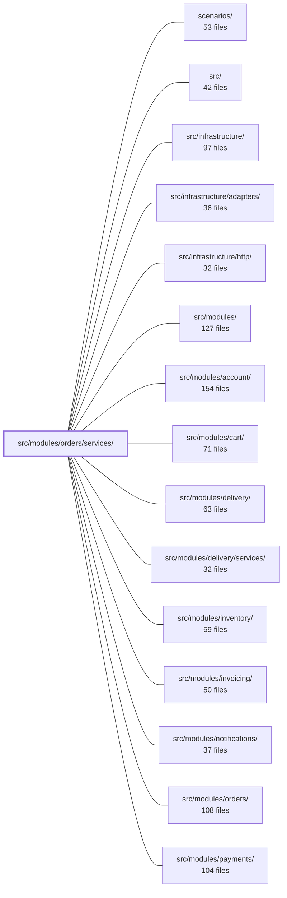

---
tags:
  - 2brain
  - 2brain/module
  - project/boilerplate-node-backend
type: module
module: src/modules/orders/services/
files: 27
updated: 2026-10-29T19:27:44.565688+00:00
---

# src/modules/orders/services/

## Purpose

The service layer for the Orders module. It contains every business-logic function the orders domain exposes to controllers, cross-module callers, and event listeners—order creation, cancellation, status transitions, fulfillment bookkeeping, read/search, PII handling, notifications, and audit-sensitive corrections. The barrel in `index.ts` re-exports all of it as a single `orderService` object so that callers never import from individual sub-files.

## Key parts

- **Lifecycle writes** — `place.ts` (single order-creation path), `cancel.ts` (atomic cancellation + inventory release), `override.ts` (admin forced status move), `status.ts` (the only writer of `Order.status` transitions), `remove.ts` (soft/hard delete + restore), `retention.ts` (GDPR PII scrub after claim window), `reencrypt.ts` (PII key rotation), `guarantee.ts` (post-repair guarantee extension), `crud.ts` (admin create/email update).
- **Reads & reporting** — `read.ts` (search, single fetch, batch reads, PII decryption), `stats.ts` (dashboard aggregations), `digest.ts` (daily staff counts), `export.ts` (CSV stream), `current.ts` (post-serialization product-image enrichment), `actions.ts` (per-caller action eligibility for API responses).
- **Fulfillment & inventory bridge** — `fulfillment.ts` (delegation doors the delivery module writes through), `ship-stock.ts` (override-path whole-remainder stock ship), `address.ts` (pre-dispatch shipping-address correction).
- **Events & buyer mail** — `announce.ts` (typed outbox-event factories), `notify.ts` (order-created confirmation + shared `mailBuyer` helpers), `cancel-mail.ts` (cancellation email), `purchase-hold.ts` (repeat-cancellation anti-abuse rule).
- **Cross-cutting helpers** — `scope.ts` (all authorization/scope predicates), `timeline.ts` (append-only order event log), `snapshot.ts` (catalogue→frozen order-line resolution), `order-numbering.ts` (human-readable number format + parser), `index.ts` (public facade / barrel).

## How it connects

- **`src/modules/orders/` (parent)** — This directory *is* the service layer of that module; the parent's controllers and routes call exclusively through the `orderService` object exported here.
- **`src/modules/orders/domain/`** (sibling, not listed as a separate dependency but imported) — `actions.ts` pulls status-based action rules from `../domain`; `status.ts` reads the status-transition table. The service layer is the only layer that mutates domain state.
- **`src/modules/payments/`** — `cancel.ts` flags refunds on the outbox event for the payments module to process asynchronously; `status.ts` is the single writer that `payments` reports into (e.g. "paid" → status move); `timeline.ts` receives `appendTimeline` calls inside payment transactions.
- **`src/modules/delivery/` and `src/modules/delivery/services/`** — `fulfillment.ts` exposes the functions delivery calls back into (shipment record, order status, inventory counters) inside the caller's transaction; `ship-stock.ts` provides the override-path counterpart.
- **`src/modules/inventory/`** — `cancel.ts` releases inventory holds; `place.ts` acquires them; `fulfillment.ts` and `ship-stock.ts` ship held stock. All inside the caller's Mongoose transaction.
- **`src/modules/cart/`** — The checkout service funnels through `placeOrder` (in `place.ts`) as the single order-creation path.
- **`src/modules/returns/`** — Calls `appendTimeline` (via `timeline.ts`) and `status.ts` for status moves; `guarantee.ts` runs inside the returns repair transaction.
- **`src/modules/invoicing/`** — Appends timeline rows and reads order data through `read.ts`.
- **`src/modules/account/` and `src/modules/users/`** — `retention.ts` reacts to account erasure/inactivity; `purchase-hold.ts` flags accounts for staff review.
- **`src/modules/products/`** — `snapshot.ts` resolves catalogue products into frozen order lines; `current.ts` batches product-ID lookups for image URLs.
- **`src/infrastructure/` and `src/infrastructure/http/`** — `export.ts` returns a `Readable` + `Transform` piped into the HTTP response; `announce.ts` produces `OutboxAnnouncement` objects consumed by the infrastructure outbox relay; `notify.ts` / `cancel-mail.ts` dispatch through the notifications/mail adapter.
- **`src/modules/notifications/`** — Buyer-facing email delivery (order-created, cancelled) is dispatched here and via the shared mail helpers in `notify.ts`.

## Where to start

1. **`index.ts`** — Read the barrel first to see the full public surface and how every sub-file plugs into the single `orderService` object. It makes the module's scope immediately clear.
2. **`place.ts`** — The canonical write path. Tracing `placeOrder` shows how snapshot resolution, stock holds, number allocation, persistence, and outbox announcement compose in one transaction, which is the pattern every other lifecycle operation (cancel, override, status) mirrors.

## Connected modules

[[boilerplate-node-backend_ROOT|/ (repository root)]] · [[boilerplate-node-backend_scenarios|scenarios/]] · [[boilerplate-node-backend_src|src/]] · [[boilerplate-node-backend_src_infrastructure|src/infrastructure/]] · [[boilerplate-node-backend_src_infrastructure_adapters|src/infrastructure/adapters/]] · [[boilerplate-node-backend_src_infrastructure_http|src/infrastructure/http/]] · [[boilerplate-node-backend_src_modules|src/modules/]] · [[boilerplate-node-backend_src_modules_account|src/modules/account/]] · [[boilerplate-node-backend_src_modules_cart|src/modules/cart/]] · [[boilerplate-node-backend_src_modules_delivery|src/modules/delivery/]] · [[boilerplate-node-backend_src_modules_delivery_services|src/modules/delivery/services/]] · [[boilerplate-node-backend_src_modules_inventory|src/modules/inventory/]] · [[boilerplate-node-backend_src_modules_invoicing|src/modules/invoicing/]] · [[boilerplate-node-backend_src_modules_notifications|src/modules/notifications/]] · [[boilerplate-node-backend_src_modules_orders|src/modules/orders/]] · … and 4 more

## Files
- `src/modules/orders/services/actions.ts` — Computes the full set of actions a caller may perform on an order by combining status-based rules (imported from `../domain`) with the caller's permission keys (from the kernel). Exposes the result on wire shapes so the API response tells each client exactly which buttons are live, eliminating client-side re-derivation of eligibility rules.
- `src/modules/orders/services/address.ts` — Implements the staff-facing `PUT /orders/{id}/shipping-address` operation: replacing the shipping address for units that have not yet been dispatched, while leaving addresses on already-cut shipments untouched. It exists as the single correction path for held `incorrect_address` fulfillment orders and as a general post-checkout address fix before full fulfillment.
- `src/modules/orders/services/announce.ts` — Defines the event-announcement factories for the orders module. Each factory returns a typed `OutboxAnnouncement` object that a calling service hands to `announceInTransaction`, ensuring the event row commits atomically with the order write it accompanies.
- `src/modules/orders/services/cancel-mail.ts` — Sends the buyer-facing cancellation email in response to the `order.cancelled` domain event. The cause carried on the event selects which email template to use, so every code path that cancels an order produces the same buyer-facing explanation, and the email is still dispatched if a crash occurs between the database commit and the send.
- `src/modules/orders/services/cancel.ts` — Implements the single atomic order-cancellation path: the status transition, the inventory hold release (or committed-hold release for paid orders), and the `order.cancelled` outbox row all commit in one database transaction. Refunds are intentionally excluded from the transaction (they are irreversible provider-side calls) and are instead carried as a `refund` flag on the outbox event, which the `payments` module and the outbox relay act on asynchronously.
- `src/modules/orders/services/crud.ts` — Admin-side order write path: creates a new order on behalf of a buyer (by resolving products and delegating the actual write to `placeOrder`) and updates an existing order's email. Read and delete operations live in sibling modules (`./read`, `./remove`); cancellation is handled by `./cancel`.
- `src/modules/orders/services/current.ts` — Attaches live product images (`imageUrl`, `thumbnailUrl`) to each order line at the serialization boundary. It exists because the frozen order snapshot (`orderLineProductSchema`) deliberately omits image URLs, so a post-serialization enrichment step is needed. It batches all referenced product IDs into a single `$in` query so a full page of orders costs one extra DB round-trip.
- `src/modules/orders/services/digest.ts` — Supplies the two order-side counts for the daily staff digest: bank-transfer orders nearing or past their `payBy` deadline, and paid/processing orders that have waited too long for shipment. Returns numbers only — no order data is surfaced to the digest layer.
- `src/modules/orders/services/export.ts` — Streams the filtered orders list as a CSV (no file on disk, no email). Validates the row count against a cap, records an audit entry, and returns a `Readable` source plus a CSV `Transform` for the caller to pipe into the HTTP response. A client disconnect tears down the cursor automatically.
- `src/modules/orders/services/fulfillment.ts` — Thin delegation layer that exposes the "doors" the `delivery` module writes through when a fulfillment act changes where an order's goods stand. Every function forwards to `orderRepository` or `inventoryService` inside the caller's Mongoose transaction, ensuring the shipment record, order summary, status move, and inventory counters commit together or not at all.
- `src/modules/orders/services/guarantee.ts` — Extends an order's legal guarantee by twelve months following a repair, as required by EU Directive 2024/1799. The extension is one-shot per order and runs inside the caller's Mongoose transaction (the receipt/return flow).
- `src/modules/orders/services/index.ts` — Barrel (public facade) for the Order entity's service layer. It aggregates every business-logic function from the module's sub-files and re-exports them as a single `orderService` object, enforcing a single call-in point for controllers and cross-module callers. It also re-exports the public type surface and two config getters that the barrel-allowed-sources rule prevents from being published directly via `../index.ts`.
- `src/modules/orders/services/notify.ts` — Sends the buyer-facing order-placed confirmation email. It is wired as the `order.created` event listener so that admin-created orders and storefront checkouts both emit the same mail from one place, and a crash after the DB commit still triggers the send. It also exposes the shared `mailBuyer` / `mailBuyerOfOrder` helpers that other order lifecycle mails (cancellation, shipment) reuse.
- `src/modules/orders/services/order-numbering.ts` — Converts the repository's atomic yearly counter into the human-readable order number format (`{year}-{sequence}`, zero-padded) and provides a tolerant parser for user-typed numbers. It decides *the string*; the atomicity guarantee lives in the repository.
- `src/modules/orders/services/override.ts` — Implements the admin status-override endpoint (`POST /orders/{id}/status-override`): a single-transaction correction that moves an order's status when the normal fulfillment path (shipped email, carrier record) is inapplicable. It atomically writes the new status, a timeline row, any required stock movement, outbox events, and an audit record so no partial state can exist.
- `src/modules/orders/services/place.ts` — The single write path for creating a new order row. Both `crud.ts`'s admin `create` and the cart `checkout` service funnel through `placeOrder`, ensuring the write (freeze lines → hold stock → allocate number → persist) exists in exactly one place. Callers remain responsible for payment validation, order caps, address resolution, and cart pre-flight.
- `src/modules/orders/services/purchase-hold.ts` — Reacts to the `order.cancelled` domain event to enforce a repeat-cancellation rule. It counts a buyer's recent cancellations (unpaid and paid) within a configured window and either pauses their next checkout or flags the account for staff review. It exists to stop automated or loop-driven abuse while keeping legitimate statutory withdrawals (pre-dispatch) from triggering a pause.
- `src/modules/orders/services/read.ts` — Read-side service layer for the orders module. Provides the search endpoint handler, single-order retrieval, narrow batch reads (ids, briefs, references), and PII address decryption that sibling modules (delivery, payments, checkout) depend on. All writes live in `./crud` and `./remove`; this file is strictly read.
- `src/modules/orders/services/reencrypt.ts` — Domain-level re-encryption service for orders. It collects every order's encrypted PII fields (addresses and notes) and delegates to the repository to rotate them onto the newest `NODE_PII_ENCRYPTION_KEY`. Exists so the generic infrastructure re-encryption machinery (which knows *how* to swap keys) can be driven by order-specific field discovery (which knows *which* fields and *how* they are AAD-bound).
- `src/modules/orders/services/remove.ts` — Handles order deletion and restoration. Because an order is a financial record, the default is a soft delete (stamp `deletedAt`); a hard delete is permitted only when the order is `cancelled` and has never been paid. A restore operation undoes a soft delete. All paths audit the action.
- `src/modules/orders/services/retention.ts` — Handles GDPR data-retention for orders after an account is erased or goes inactive. Because an order is an invoice kept under Art. 17(3)(b)/(e), erasure never deletes the row — it detaches the person from it, starts a per-order PII clock, and a later sweep scrubs whatever PII remains once the claim window closes.
- `src/modules/orders/services/scope.ts` — Defines the authorization boundaries for order reads and writes: which orders a caller may see (`callerScope`, `ownerScope`, `ownLiveScope`), which orders a caller may cancel (`cancelScope`), and which lifecycle column a caller is mapped to (`actorOf`). Every sibling service in this directory consults these functions before issuing a query, so the "who sees what" logic lives in exactly one place.
- `src/modules/orders/services/ship-stock.ts` — Provides a single atomic operation for the **override** path: when an order's status is forced forward (to `shipped` or `delivered`), ship all remaining held stock for that order and publish the resulting domain events in one transaction. It is the "whole-remainder" counterpart to the per-shipment `shipStock` in `./fulfillment`, ensuring the shelf count drops at dispatch time rather than at payment time.
- `src/modules/orders/services/snapshot.ts` — Resolves catalogue products into the frozen order-line snapshot that an order stores. It translates product `title`/`description` into the buyer's locale, strips non-freezable fields, computes the tax rate, and assembles the final `OrderDocumentItem[]` shape. It lives in `services/` rather than `domain/` because it deliberately reaches into `@infrastructure/i18n` and `@kernel/translation`.
- `src/modules/orders/services/stats.ts` — Read-only aggregation queries that produce order statistics for reporting dashboards. Each function returns a small, pre-grouped result set (a few hundred rows at most) covering paid volume per bucket, top products, category totals, product time series, customer acquisition, cancellation cohorts, and the open payment pipeline. The file exists so that report rendering never touches raw order documents directly.
- `src/modules/orders/services/status.ts` — The single writer of order status transitions in this application. Other modules (`payments`, `delivery`, `returns`) report a fact they have already recorded; this file decides whether the fact still applies (via a conditional `from`-status check) and, if so, writes the new status and announces it exactly once. It enforces the tactical-DDD rule that `orders` is the only module that mutates `Order.status`.
- `src/modules/orders/services/timeline.ts` — Manages the append-only event log of an order: what happened to it, in order, readable by the buyer and by staff. It is the single write path for timeline rows — `orders` appends within its own transaction, while dependent modules (payments, delivery, returns, invoicing) call `appendTimeline` inside their own transaction. It also provides the read, export, scrub, and delete operations on those rows.

---
[[boilerplate-node-backend_INDEX|← boilerplate-node-backend index]]
