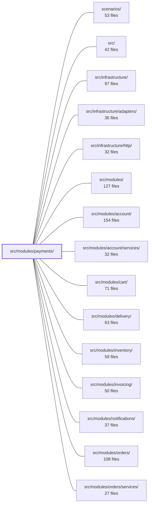

---
tags:
  - 2brain
  - 2brain/module
  - project/boilerplate-node-backend
type: module
module: src/modules/payments/
files: 104
updated: 2026-10-29T19:28:09.391013+00:00
---

# src/modules/payments/

## Purpose

The payments module owns the full payment lifecycle for the shop: creating provider-backed payment intents, confirming and settling them, issuing and settling refunds, tracking disputes, minting bank-transfer references, and surfacing payment status to both buyers and staff. It exposes an HTTP API, emits domain events, runs scheduled background jobs, and defines the provider-adapter port that a live PSP plugs into.

## Key parts

- **Domain layer (`domain/`)** — Pure, framework-free rules: payment/refund status transitions and concurrency guards (`lifecycle.ts`), dispute predicates (`disputes.ts`), display-label computation and its inverse query (`display-status.ts`), and ISO 11649 bank-transfer reference minting (`transfer-reference.ts`). Re-exported through `domain/index.ts`.
- **Data & model** — `model.ts` defines the single Mongoose document (one per order) that stores the provider payment lifecycle, embedded refunds, and disputes. `presenter.ts` shapes that document into the wire contract returned by every endpoint.
- **Controllers (`controllers/`)** — Thin HTTP handlers for the public and staff APIs: intent creation/confirm/sync, refund create/settle/cancel, webhook receipt, order-nested offline payments, staff list/search, and the attention dashboard.
- **Provider port (`providers/`)** — `providers/index.ts` declares the contract every PSP adapter must satisfy; `providers/registry.ts` lets a concrete adapter (or test double) register itself; `providers/webhook-signature.ts` provides the shared HMAC verify/sign pair; `providers/errors.ts` isolates the error types to avoid circular imports.
- **Module wiring & config** — `module.ts` is the single registration point (routes, event subscriptions, jobs, rate limits, GDPR hooks, demo scenario). `config.ts` centralises deployment-tunable values. `index.ts` is the only import surface other modules may use.
- **Cross-cutting declarations** — `events.ts` (domain-event names), `analytics.ts` (analytics event names), `audit.ts` (audit action strings), `metrics.ts` (Prometheus counters), `emails.ts` (i18n email bodies).
- **Background jobs** — `jobs.ts` + `jobs.generated.ts` wire scheduled work (abandoned-attempt reaping, effect sweeping) to service functions.
- **Contract & limits** — `openapi.yaml` (OpenAPI 3.1 spec) and `rate-limits.generated.ts` (typed rate-limit budgets derived from `module.yaml`).

## How it connects

- **`src/modules/orders/`** — Payments are 1-to-1 with orders (unique index on `orderId`). The order-nested routes (`order-routes.ts`, `post-order-payment.ts`) let an admin record an offline payment against an existing order, and the order service emits the `order.created` event that triggers bank-transfer reference minting.
- **`src/modules/inventory/`** — The "pending stock commits" surfaced by `get-payment-attention.ts` indicate inventory holds that resolve only after a payment settles. `config.ts` deliberately mirrors the inventory module's per-call-read config pattern.
- **`src/modules/notifications/`** — `emails.ts` produces the `EmailContent` objects (payment received, refund issued, transfer instructions, etc.) that the notifications module delivers.
- **`src/modules/account/`** — The OpenAPI spec contributes a slice to the account data export (GDPR personal-data hooks registered in `module.ts`). The metrics pattern here follows `modules/account/metrics.ts`.
- **`src/modules/returns/`** — Refund creation and settlement in this module are the financial counterpart to the return workflow; the attention endpoint tracks refunds pending stock commit.
- **`src/modules/users/`** — Tokenised payment-method references are tied to a user's account for repeat checkout; the `get-payment-methods` endpoint is public so guests can see options pre-signup.
- **`src/infrastructure/http/`** — Controllers are Express route handlers; `globals.d.ts` augments the shared `Request` type with a payments-specific flag per the project's layering rules.
- **`scenarios/`** — Test doubles (the fake provider) and the admin demo scenario (referenced in `module.ts`) live here and register through `providers/registry.ts` before the app boots.

## Where to start

1. **`domain/lifecycle.ts`** — Read this first: it defines which statuses each operation may start from and encodes the refund-settlement decision rules. Every guard in the repository and every status transition in the service layer traces back to these arrays, so understanding them makes the rest of the module predictable.
2. **`module.ts`** — The single registration point shows how routes, events, jobs, rate limits, and the provider port come together. Skimming it gives a complete map of what the module exposes to the application tier without reading every controller.

## Connected modules

[[boilerplate-node-backend_ROOT|/ (repository root)]] · [[boilerplate-node-backend_scenarios|scenarios/]] · [[boilerplate-node-backend_src|src/]] · [[boilerplate-node-backend_src_infrastructure|src/infrastructure/]] · [[boilerplate-node-backend_src_infrastructure_adapters|src/infrastructure/adapters/]] · [[boilerplate-node-backend_src_infrastructure_http|src/infrastructure/http/]] · [[boilerplate-node-backend_src_modules|src/modules/]] · [[boilerplate-node-backend_src_modules_account|src/modules/account/]] · [[boilerplate-node-backend_src_modules_account_services|src/modules/account/services/]] · [[boilerplate-node-backend_src_modules_cart|src/modules/cart/]] · [[boilerplate-node-backend_src_modules_delivery|src/modules/delivery/]] · [[boilerplate-node-backend_src_modules_inventory|src/modules/inventory/]] · [[boilerplate-node-backend_src_modules_invoicing|src/modules/invoicing/]] · [[boilerplate-node-backend_src_modules_notifications|src/modules/notifications/]] · [[boilerplate-node-backend_src_modules_orders|src/modules/orders/]] · … and 5 more

## Files
- `src/modules/payments/analytics.ts` — Declares the canonical analytics event names for the payments domain and registers them with the analytics port's `AnalyticsEventMap` via TypeScript module augmentation, so that any `emit` of a payments event is type-checked against this list. Controllers import this file directly (mirroring the pattern `./audit.ts` uses for audit actions) rather than a published copy.
- `src/modules/payments/audit.ts` — Centralises every audit action string the payments module can emit, registers its security-relevant events with the observability layer, and augments the shared `AuditActionMap` type so the rest of the codebase can reference these actions by name. It exists so that payment-related audit and security events have a single source of truth rather than scattered string literals.
- `src/modules/payments/config.ts` — Centralises every deployment-tunable payment value (bank-transfer account details, provider selection, webhook secrets, grace windows) behind a single `defineConfig` call, and exposes typed accessor functions so that consumers read the value at call-site rather than transcribing their own fallback. Follows the same per-call-read pattern as `@modules/inventory`'s config.
- `src/modules/payments/controllers/get-order-payments.ts` — HTTP handler for `GET /orders/:id/payments`. Serves the payment panel on the order page so that a mid-flow reload recovers the payment intent and its current status rather than forcing the caller to start over. Returns an empty `items` array for orders with no payment activity; reserves 404 for orders the caller genuinely cannot see.
- `src/modules/payments/controllers/get-payment-attention.ts` — Express route handler for `GET /payments/attention`. It surfaces a summary of items requiring manual attention (stale refunds, hand-owed refunds, pending stock commits, pending order refunds) by delegating entirely to the payment service and shaping the HTTP response.
- `src/modules/payments/controllers/get-payment-methods.ts` — Express controller that answers `GET /payments/methods` with the list of payment methods configured for the shop. It exists so the frontend can discover available checkout options dynamically instead of hard-coding them. The endpoint is intentionally public—guests should be able to see what payment options exist before signing up.
- `src/modules/payments/controllers/get-payment.ts` — Controller handler for `GET /payments/:id`. Retrieves a single payment by its id and returns it to the caller. It is the destination that a `Location` header points to after a successful `POST /payments`, and the read-back target an operator-refund response sends a client back to.
- `src/modules/payments/controllers/get-payments.ts` — Defines the controller for `GET /payments` and `POST /payments/search` (the staff payments list). Both routes are served by a single controller instance produced through the shared search-controller factory, with a query-string-aware schema that coerces text inputs to their proper types.
- `src/modules/payments/controllers/get-refund.ts` — Handler for `GET /payments/:id/refunds/:refundId`. It resolves a single refund record that is always addressed through its parent payment (the same target a `Location` header points to after creating a refund via `POST /payments/:id/refunds`). The controller performs ID validation, delegates the fetch to the payments service, and shapes the HTTP response.
- `src/modules/payments/controllers/get-refunds.ts` — HTTP controller for `GET /payments/refunds`. Exposes a paginated, filterable list of one row per refund across all payments, serving the Refunds tab in the UI. It validates query-string parameters and delegates to the payment service.
- `src/modules/payments/controllers/post-order-payment.ts` — HTTP controller for `POST /orders/:id/payments`. Lets an admin record an offline payment — money the card provider never saw — against an existing order. Thin adapter: extracts the order ID, validates the body, delegates to `paymentService.recordOfflinePayment`, and shapes the HTTP response.
- `src/modules/payments/controllers/post-payment-confirm.ts` — HTTP handler for `POST /payments/:id/confirm` — the step where the browser hands over the tokenised payment method reference and the payment is actually attempted. It maps the service result to three HTTP outcomes (succeeded, in-flight, declined) and fires the associated metrics and audit context.
- `src/modules/payments/controllers/post-payment-refund-cancel.ts` — Controller for `POST /payments/:id/refunds/:refundId/cancel`. Lets staff void a refund before it is paid. It validates path params and the request body, delegates to the payment service, and returns the now-voided refund. Business rules (refusing already-closed refunds or ones that may have moved money) live in the service layer, not here.
- `src/modules/payments/controllers/post-payment-refund-settle.ts` — HTTP handler for `POST /payments/:id/refunds/:refundId/settle`. An operator uses it to confirm that a refund's funds actually left the application. The controller extracts the two route IDs, delegates to the payment service, and returns the settled refund object on success.
- `src/modules/payments/controllers/post-payment-refund.ts` — Handles `POST /payments/:id/refunds`: creates a (full or partial) refund on an existing payment without altering the parent order's status. Returns **201 Created** with the new `Refund` record and a `Location` header. This is the operator's standalone refund action; "cancel and refund" is left to the client issuing this call *and* a separate order-cancel call.
- `src/modules/payments/controllers/post-payment-sync.ts` — HTTP handler for `POST /payments/:id/sync`. When the browser finishes a provider-side step (3-D Secure challenge, wallet sheet), this endpoint re-reads the provider's own record and applies it, making the happy path feel synchronous to the user while the webhook remains the source of truth. Already-settled payments short-circuit without re-querying the provider (idempotent).
- `src/modules/payments/controllers/post-payment-webhook.ts` — Single HTTP handler for `POST /payments/webhook/:provider`. Receives provider-originated payment event deliveries, verifies the request via the provider's own signature (no session auth), and delegates the parsed event to the payment service. It exists to be the one place where the "browser's word" is replaced by a cryptographically signed raw body as the sole authority for what happened to a payment.
- `src/modules/payments/controllers/post-payment.ts` — Thin HTTP handler for `POST /payments`. It validates the request body, delegates to `paymentService.createIntent`, and returns the payment intent. Deliberately contains no business logic, auditing, or analytics — an intent is preparation, not a business event; those concerns fire at confirm time.
- `src/modules/payments/domain/display-status.ts` — Computes the human-facing display label for a payment (Shopify's `displayFinancialStatus`) from its stored status and refund records, and provides the inverse MongoDB query for each label. The two must agree: the integration suite verifies every label in both directions.
- `src/modules/payments/domain/disputes.ts` — Pure domain rules for card-payment disputes. It encodes the distinction between an *inquiry* (no money moves) and a *chargeback* (bank reclaims funds, opens an evidence window), and answers the question "what may the shop still do with this payment while a dispute stands?" — specifically around refund blocking and partial-loss accounting. No I/O, no side effects.
- `src/modules/payments/domain/index.ts` — Barrel file that re-exports every public symbol of the payments **domain layer** — pure status vocabulary, dispute predicates, bank-transfer reference helpers, and display-label logic — so callers can import from a single path (`payments/domain`) without reaching into individual sub-modules. The header doc block states the contract: no Express, Mongoose, or framework-tier imports are permitted here (enforced by lint).
- `src/modules/payments/domain/lifecycle.ts` — Defines which payment and refund statuses each domain operation is allowed to act from, and encodes the refund-settlement decision rules (reversal, finality, overshoot, hand-settlement eligibility). Every status array here doubles as the `$in` predicate for the conditional writes in `repository.ts`, making the array itself the concurrency guard rather than an adjacent check.
- `src/modules/payments/domain/transfer-reference.ts` — Mints and validates the ISO 11649 "RF" creditor reference attached to a `bank_transfer` payment. The reference is derived deterministically from the order's ObjectId so a redelivered `order.created` event can never produce a second code, and ISO 7064 MOD 97-10 check digits ensure a mistyped code is rejected rather than matching the wrong order. The arithmetic is hand-rolled because `ibantools` (the repo's IBAN/BIC library) has no ISO 11649 support.
- `src/modules/payments/emails.ts` — Builds the five email bodies the payments module sends (payment received, refund issued, refund undeliverable, transfer instructions, transfer expired). Each function resolves all i18n strings into finished text at call time — language is an argument, output is done — and returns an `EmailContent` object whose template only performs simple interpolation later. This keeps translation logic out of the mailer adapter and out of the HTML templates.
- `src/modules/payments/events.ts` — Declares the domain events emitted by the payments module by augmenting the kernel's `DomainEventMap` interface (the same pattern as `modules/orders/events.ts`). Also exports a string constant for each event name so other code can reference them without hard-coding the string.
- `src/modules/payments/globals.d.ts` — Augments Express's `Request` interface with a payments-specific boolean flag via declaration merging. It exists as a separate file (rather than living in infrastructure's `src/globals.d.ts`) because the project's layering rules (`docs/theory/layers.md`) forbid infrastructure's global types file from naming a module, so payments-local fields live here.
- `src/modules/payments/index.ts` — Public barrel for the Payments module. It is the **only** import surface exposed to sibling modules (enforced by the strategic-DDD rule in `docs/theory/strategic-ddd.md` §5). It re-exports services, domain logic, events, and emails by value, and re-exports the model as **types only**, keeping the model's runtime internal to the module.
- `src/modules/payments/jobs.generated.ts` — Auto-generated data file that declares the scheduled jobs for the payments module as plain metadata (name, cron schedule, summary). It exists so that job definitions live in a single YAML source (`module.yaml`) and can be regenerated mechanically, keeping the "what" (scheduling) separate from the "how" (execution logic in `jobs.ts`).
- `src/modules/payments/jobs.ts` — Declares the two scheduled jobs the `payments` module owns—abandoned-attempt reaping and effect sweeping—as a readonly array of `JobDeclaration` objects. It wires generated schedule metadata to the actual service functions that do the work, so the kernel can discover and run them.
- `src/modules/payments/metrics.ts` — Defines the Prometheus counters for the payments domain: one for confirmation outcomes and one for settlement-amount mismatches. Metrics live here (in the module) rather than in `infrastructure` so the domain owns its observability vocabulary; the overview endpoint reads them without importing this file (see `modules/account/metrics.ts` for the pattern).
- `src/modules/payments/model.ts` — Defines the Mongoose schema, TypeScript document interface, and embedded sub-document types for the payment record. One document per order (enforced by a unique index on `orderId`), it persists the provider-facing payment lifecycle, all refund attempts, and all buyer-bank disputes. It is the single source of truth that `repository.ts` queries and `services/*` mutate.
- `src/modules/payments/module.ts` — The module manifest (default export) for the payments domain. It is the single registration point where the payments module wires itself into the application: HTTP routes, domain-event subscriptions, webhook-visible public events, personal-data (GDPR) hooks, rate limits, config slices, background jobs, and an admin demo scenario. Everything the app tier needs to "mount" payments is declared here.
- `src/modules/payments/openapi.yaml` — OpenAPI 3.1.0 contract for the payments module. Declares the module's operations (payment methods, payment lifecycle, staff list/search), its custom error-code vocabulary, and the slice it contributes to the account data export. Serves as the single source of truth for both server implementation and client SDK generation.
- `src/modules/payments/order-routes.ts` — Express router that exposes the two payment operations nested under an order's URL (`/orders/:id/payments`). It exists to keep the URL hierarchy order-first (matching the Solidus convention) while the domain logic and authorization keys remain in the payments module.
- `src/modules/payments/presenter.ts` — Transforms a stored `PaymentDocument` into the wire `Payment` contract that every write endpoint returns. It also produces an optional staff view that adds provider identifiers (`providerRef`, `providerRefundRef`) and refund `failureReason` fields stripped from the payer-facing shape. `services/view.ts`'s `withActions` layers `actions` on top of this for read endpoints that need them.
- `src/modules/payments/providers/errors.ts` — Defines the two error classes that a payment provider adapter (real or fake) throws when it refuses a cancel or a refund. It is split out of `providers/index.ts` so that an implementation can import only these error types without pulling in the port interface, the config, or the registry that the adapter itself is registered in — avoiding a circular import.
- `src/modules/payments/providers/index.ts` — This file defines the **payment provider port** — the contract every real PSP adapter must satisfy. It exists as a single, stable seam so that the rest of the codebase (controllers, settlement, sweep) never names a specific provider. No provider is shipped in the boilerplate; a live project plugs one in by writing one adapter file and one `registerPaymentProvider` call. The `fake` double used in dev/demo/tests lives under `scenarios/support/doubles/` and is registered before the app boots.
- `src/modules/payments/providers/registry.ts` — Standalone registry for payment provider implementations. It exists as its own module (importing only the registry helper and a *type* from `./index`) so that test doubles can register themselves at preload without pulling in the full provider barrel—config, orders, and all transitive dependencies.
- `src/modules/payments/providers/webhook-signature.ts` — Shared HMAC-SHA256 signing and verification for PSP webhook deliveries. The signature is over `<timestamp>.<raw body>`, compared in constant time, and rejected if the timestamp is outside a 5-minute window. This file exists because the **verify** side is called by production providers while the **sign** side is needed by the demo and the test harnesses, and because a real PSP's own verifier (e.g. `stripe.webhooks.constructEvent`) only replaces the verify half — this stays as the reference implementation for what it must do.
- `src/modules/payments/rate-limits.generated.ts` — Generated data table that declares the rate-limit budgets (namespaces, defaults, windows, and descriptive bounds) for every payments endpoint. It exists as a build artifact so that the single source of truth remains the YAML definition in `module.yaml`, and so consumers get a typed, importable object without parsing YAML at runtime.
- `src/modules/payments/rate-limits.ts` — Defines the payments module's rate-limit budgets (webhook, confirm attempts, confirm declines per account and per address block, intent/sync) and builds each into an Express middleware via the shared `buildRateLimiter` factory. It also composes a challenge gate that escalates to a human challenge when an account or its address block has already burned into the decline budget.
- `src/modules/payments/repository.ts` — Data-access layer for the Payments collection. It combines the generic CRUD factory (`createRepository`) with the bespoke reads and guarded writes that the payments service actually performs: intent/offline upserts, status transitions, refund sweeps, dispute recording, and the provider-facing lookups. The file exists to keep every Mongoose query, projection, and aggregation in one place so that service code only expresses intent.
- `src/modules/payments/routes.ts` — Express router that wires every payment HTTP endpoint to its controller and enforces the cross-cutting concerns (authentication, authorization, rate limiting, idempotency, cache-control) at the router level before any controller runs. It exists as a single, ordered declaration of routes so that public endpoints stay above the auth wall and sensitive money-movement routes carry the strongest guards.
- `src/modules/payments/services/announce.ts` — Provides the single entry point for recording a declined payment. It atomically writes the `declined` status, appends the order timeline row, and enqueues a `PAYMENT_FAILED` outbox event in one transaction, so a decline either fully lands (status + timeline + event) or does not at all. This is the counterpart to `settlement.ts`, which owns the `PAYMENT_SUCCEEDED` announcement.
- `src/modules/payments/services/deadline.ts` — Computes the due instant for a refund on a payment — the legal deadline when one is set, otherwise the "needs-attention" cutoff derived from the refund's creation time. Consumed by the `tickets` flow to date the work item it opens.
- `src/modules/payments/services/disputes.ts` — Applies a dispute report carried by a provider webhook delivery onto its payment. It records the dispute state on the payment, appends staff timeline rows, and announces a `payment.dispute_opened` or `payment.dispute_updated` domain event — all within a single database transaction. A dispute is explicitly **not** a refund: it never mutates `amountRefunded`, order status, or credit notes.
- `src/modules/payments/services/effects.ts` — Two scheduled sweep operations that finish what a settlement left undone: retrying refunds the provider refused or never acknowledged, and reconciling payments whose provider decided without delivering a webhook. Both sweeps are sequential, batch-capped, and idempotent, mirroring the sweep shape in `orders/services/cancel.ts`.
- `src/modules/payments/services/errors.ts` — Centralized factory functions and one internal error class for every "this payment action cannot proceed" response in the payments service layer. It is deliberately a **leaf module** (no persistence or cross-service imports) so any file under `services/` can reach it without creating dependency edges among the services themselves.
- `src/modules/payments/services/external-refunds.ts` — Handles refunds created directly in the payment provider's dashboard (outside the application). When a refund event fires, it lists the provider's refunds for the payment's intent and walks them: known refunds (ours) get their local record updated, while unknown successful refunds are imported as settled records so the credit note, buyer mail, and order stamp follow the same path as an in-app refund.
- `src/modules/payments/services/index.ts` — Barrel module that aggregates every payment-flow function (intent, settlement, refunds, effects, offline, transfer, notifications, scope, view, retention, listing, stats) into a single `paymentService` object. It exists so that the rest of the codebase has exactly one import path for all payment operations, and so the module-level docblock can document the invariants (order-gate, at-most-once refunds, provider authority) in one place.
- `src/modules/payments/services/intent.ts` — Entry point into the payments module's money-moving flow: creates (or refreshes) a provider payment intent for an order, and closes open intents when an order is cancelled. Guarantees the amount is frozen via the order's own `orderTotal`, enforces single-intent-per-payment, and coordinates with the orders module for status validation.
- `src/modules/payments/services/list.ts` — Server-side read queries behind the staff Payments page: the paginated payment list, the cross-payment refund list, and the "needs a person" attention feed. All three are `display:Payment` routes, so every row carries provider identifiers. The file composes data from the payments repository with order lookups and domain-pure checks to produce display-ready rows.
- `src/modules/payments/services/notify.ts` — Sends all buyer-facing emails for the payment lifecycle: payment received, refund issued, refund undeliverable, bank-transfer instructions, and transfer-expired cancellation. Two exports are registered as event listeners (`payment.succeeded`, `payment.refunded`) so they fire on every settlement path (webhook, browser confirm, offline record, crash-recovery sweep); the other two are called directly by the code that opens or cancels a transfer payment. A failed email never rolls back a financial action — all failures are logged and swallowed.
- `src/modules/payments/services/offline.ts` — Records payments that arrived outside the card provider (cash at the counter, bank transfer, phone-order payment) and settles them through the same `settlePayment` pipeline every card payment uses — moving the order `pending → paid`, committing stock, and firing the standard status/payment events.
- `src/modules/payments/services/refund-settlement.ts` — Handles the terminal states of a refund record: settling it to `succeeded` (stamping the order's payment status and emitting `payment.refunded` via the outbox) or recording a provider refusal with retry scheduling. Split out from `refunds.ts` so that provider-side flows (`refund-sync.ts`) and outgoing flows (`refunds.ts`) can share settlement logic without importing each other.
- `src/modules/payments/services/refund-sync.ts` — Bridges the provider-side lifecycle of a refund to the local record. It re-reads a refund from the provider until it reaches a terminal state, and converts the provider's reported status (success or failure) into the record's next state via conditional writes. The provider's own word is the sole authority; no delivery body or local assumption overrides it.
- `src/modules/payments/services/refunds.ts` — The sole mechanism for moving money out of a payment. Exposes the operator-facing `refundPayment` action and the `order.cancelled` listener's compensation (`refundForOrder`), both funnelled through `performRefund`. A refund is a conditional write on the payment document that reserves the amount, then asks the provider; the record settles only on provider confirmation.
- `src/modules/payments/services/retention.ts` — Handles the post-transaction lifecycle of payments: detaching `userId` when an account is erased, producing the account's full payment export, and sweeping out abandoned (never-succeeded) payment attempts past their retention window.
- `src/modules/payments/services/scope.ts` — Centralises the row-scoping rules for the payments collection so that every other service in this module applies a consistent "who can see/do what" filter. It separates **read** scope (possibly broad, role-driven) from **payer** scope (strictly the payer's own rows) to prevent a `display:Payment` role from accidentally granting cross-customer write or payment-intent access.
- `src/modules/payments/services/settlement.ts` — The single reconciliation point for payment success. Whether the signal arrives via a browser-driven confirm/sync poll or a provider webhook, both paths funnel into this file's settlement logic so that money is reconciled exactly once. It handles both the happy path (provider confirms the frozen payment) and the mismatch path (provider reports a success whose amount, currency, or payment id disagrees with what was frozen), ensuring the order is either marked paid or cancelled with a refund opened atomically.
- `src/modules/payments/services/stats.ts` — Computes the "payments mix" statistic: how much money came in broken down by payment method, provider, and currency within a given reporting window. It translates raw aggregate rows from the persistence layer into a clean `MixRow` shape suitable for reporting.
- `src/modules/payments/services/transfer.ts` — Opens the payment record for an order placed with the `bank_transfer` method. Acts as the `order.created` event listener: when a transfer order is placed it inserts a `requires_action` row (carrying the RF reference, deadline, and wire instructions) and mails the instructions to the buyer. Downstream settlement (`settlePayment`) and operator recording (`./offline`) consume that row later.
- `src/modules/payments/services/view.ts` — Read-layer for the payment domain. Serves the order page's payment panel and the standalone `GET /payments/:id` surface, always attaching a computed `actions` block (the same shape `orders` publishes as `OrderActions`) so the caller knows exactly which next-step endpoints are open to them.
- `src/modules/payments/tests/contract/api.contract.test.ts` — HTTP-level contract tests for every `/payments` route. Each test asserts that the correct status code, response shape, error code, and authentication requirement are reachable over a real HTTP round-trip. Business rules (amount math, state transitions) are deliberately left to the unit suite; this file pins the *shape* of the API so a client integration never silently breaks.
- `src/modules/payments/tests/factories.ts` — Test factories for the payments module. Provides high-level helpers that build common payment scenarios (card payment, bank-transfer order, refunds) through the same service/repo doors production uses, so integration and contract tests get realistic state—reference numbers, deadlines, `requires_action` rows—without duplicating setup logic.
- `src/modules/payments/tests/integration/announce.test.ts` — Integration tests that verify payment settlement announcements flow through the transactional outbox correctly. They assert atomicity (event row and state change commit or roll back together), idempotency (re-confirming a payment doesn't duplicate the event), and correct subscriber delivery — all against a real MongoDB via `setupTestDb`.
- `src/modules/payments/tests/integration/cancelled.test.ts` — Integration tests for the lifecycle of a payment whose order has been cancelled. Verifies that the payment transitions to `cancelled` only after the provider confirms the intent is closed, that late provider reports (processing, declined, or a belated success) are handled correctly (no-op, or refund-in-full with idempotency), and that the retention reaper purges old cancelled payments while preserving succeeded ones.
- `src/modules/payments/tests/integration/disputes.test.ts` — Integration tests for the card-payment dispute (chargeback / inquiry) workflow. They verify that a provider's dispute delivery is persisted on the payment, announced exactly once via domain events, surfaced on the order's staff timeline and attention list, gates or reduces the refundable amount, and is never exposed to the payer — while confirming a dispute is *not* a refund (no `payment.refunded` event, no credit note, no order-status change). Runs against real Mongo through the `paymentService` public API and the fake provider's dispute lever.
- `src/modules/payments/tests/integration/external-refunds.test.ts` — Integration tests for refunds initiated outside the application (in the provider's dashboard) and discovered via a refund webhook event. Covers import-once semantics, idempotent re-delivery, partial and over-refunds, matching of our-own refunds, and the "overtaken" scenario where an external refund leaves no room for a pending internal one. Runs against real Mongo with the fake provider's dashboard.
- `src/modules/payments/tests/integration/hand-refund.test.ts` — Integration tests for the operator-facing cash-refund workflow against a real MongoDB instance. They verify that every path that opens a refund record leaves it `pending`, that `settleRefundByHand` is the sole gate that marks money as returned, and that the correct domain events, audit rows, and permission flags are produced at each step.
- `src/modules/payments/tests/integration/intent-provider-ref.test.ts` — Integration test for the invariant that a payment row holds exactly **one** provider intent reference. It verifies that a second `createIntent` call resumes the stored intent (passing its reference to `prepare`) and that the service refuses (409) and cancels any stray intent the provider adapter opened instead.
- `src/modules/payments/tests/integration/late-payment.test.ts` — Integration test for the race condition in which a payment settles after an order's inventory hold has been released but before the order's cancellation has run. It verifies the two branches (enough stock → order paid; stock gone → order stays pending, payment refunded, late cancellation ends the order) for both card payments (simulated via a fake PSP webhook) and offline bank-transfer payments, and guards the hard-delete lock on a refunded-but-unpaid order.
- `src/modules/payments/tests/integration/payment-velocity.test.ts` — Integration tests for the rate-limiting chain on `POST /payments/:id/confirm`: the per-account confirm-attempt budget, the per-account decline budget, the anti-bot challenge gate (rung 3), and the shared address-block decline budget. The tests exercise the limiters in isolation using trivial Express handlers via `supertest`, deliberately avoiding the real `postPaymentConfirm` route to keep the property under test (the limiters' counting and gating logic) separate from payment domain logic and database round-trips.
- `src/modules/payments/tests/integration/provider-ref-lookup.test.ts` — Integration test that guards against MongoDB operator-object injection into `paymentRepository.findByProviderRef`. It proves the repository's cast validation rejects a payload like `{"$ne": null}` even when a caller has already smuggled it through the webhook port's parse step and type assertions.
- `src/modules/payments/tests/integration/reconcile.test.ts` — Integration test verifying two reconciliation paths against a fake PSP: (1) the stale-payment sweep detects and settles a charge the provider confirmed but the application never heard about (a "lost webhook"), and (2) cancelling an order whose intent already succeeded at the provider triggers a refund rather than leaving money stranded. The fake PSP (`fakePaymentProvider`) stands in for the real provider; "lost webhook" is simulated by calling `confirm` on the fake without delivering any event to the application.
- `src/modules/payments/tests/integration/refund-cancel.test.ts` — Integration test for the "void a refund" operation (staff cancelling a refund before money moves). It exercises the full path through `paymentService.cancelRefund` against a real MongoDB instance, covering the happy path (pending hand-paid refund, clearly-refused card refund), the guarded paths (settled refund, unclear failure, in-flight race), and the side-effect guarantees (audit row, timeline entry, outbox event, no credit note, no mail).
- `src/modules/payments/tests/integration/refund-claim.test.ts` — Integration tests for the refund-claim lifecycle against a real Mongo database. Verifies the full state machine: a conditional write claims a refund, a fence token prevents a stale attempt from overwriting a newer one, definite refusals are terminal, retryable refusals respect a growing delay, a removed provider ends the refund cleanly, and a provider timeout results in settlement rather than a duplicate charge.
- `src/modules/payments/tests/integration/refund-email.test.ts` — Integration test that verifies which refunds trigger a `payments.refund-issued` email to the buyer and which stay silent. It also exercises the authorization matrix on `refundForReturn` (who may initiate a goods-return refund vs. a cancellation-remainder refund) and confirms that a provider-level failure produces no mail.
- `src/modules/payments/tests/integration/refund-failed-event.test.ts` — Integration test for the `payment.refund_failed` outbox event. Verifies the deduplication rule (announced once per **new** refusal or **changed** reason; silent on same-reason retries) and the `final` flag semantics (transient refusal → `false`, definite refusal → `true`). Runs against real Mongo with the fake payment provider's refusal lever.
- `src/modules/payments/tests/integration/refund-provider-status.test.ts` — Integration test verifying the lifecycle of a refund the provider accepts but leaves `pending` (unsettled). It confirms three behaviors: the initial refund call returns 201 with no outbox announcement, the sweep re-reads (never re-sends) the refund and settles it only when the provider confirms, and a webhook settling the refund is idempotent across redeliveries. Uses real Mongo with the fake provider's `pending` lever.
- `src/modules/payments/tests/integration/refund-reversal.test.ts` — Integration test verifying the lifecycle of a refund that the provider later reports as failed (a "reversal"). It asserts that a settled refund re-opens as owed exactly once, an open refund is permanently failed, redeliveries and late success reports are no-ops, the retry sweep never re-sends a reversed refund, a manual settle re-announces the refund, and a webhook that arrives before `refund()` resolves fails the open record for good. Runs against real Mongo with the fake provider's late-failure lever.
- `src/modules/payments/tests/integration/refund-settle-card.test.ts` — Integration tests for the **settle-refund-by-hand** operator action on card payments. Verifies the full decision matrix: final refusals (declined, insufficient_funds, expired/canceled card, lost/stolen card) may be settled exactly once; unclear or in-flight refusals are rejected with `409 PAYMENT_REFUND_IN_FLIGHT`; and settled refunds are never re-sent to the provider. Also covers the `listAttention` surfacing rules and the 14-day legal deadline attached to refused refunds that pay a return.
- `src/modules/payments/tests/integration/refund-undeliverable.test.ts` — Integration test for the "refund undeliverable" path: when a payment provider permanently refuses a refund (or a bank bounces an already-settled one), the system must notify the buyer exactly once, omit the specific failure reason from the mail, and flag the refund `owedAnotherWay` on the buyer-facing view. Also verifies that non-card-related refusals produce no mail and no flag. Runs against real Mongo with the mailer mocked.
- `src/modules/payments/tests/integration/refunds.test.ts` — Integration tests for the payment-refund flow, run against a real MongoDB instance. Verifies the invariants that conditional Mongo writes enforce: partial refunds leave the remainder refundable, two racing refunds cannot overdraw, the provider is called with only the refunded slice under a unique idempotency key, and a provider refusal leaves the record in a recoverable state for the sweep.
- `src/modules/payments/tests/integration/retention.test.ts` — Integration tests covering two retention mechanisms for payments: (1) account erasure detaches a payment from its user without deleting it, and (2) the `reapAbandonedPayments` sweep deletes only unsettled attempts past a configurable window. Both are exercised through real module wiring rather than unit-level mocks.
- `src/modules/payments/tests/integration/service.test.ts` — Integration test suite for the payments service (`src/modules/payments/services/`) that pins the core financial invariants against a real Mongo database: the intent freezes the order's published total (shipping included), confirm atomically transitions the order `pending → paid` before marking the payment `succeeded`, a decline is retryable, and a refund fires at-most-once. The payment provider is the controlled `fake` double, not a real gateway.
- `src/modules/payments/tests/integration/settlement-email.test.ts` — Integration test that pins the `payment.succeeded` listener contract: the buyer receives exactly one `payments.payment-received` email when a payment settles, but never on a declined attempt or on a redundant re-confirmation of an already-settled payment.
- `src/modules/payments/tests/integration/settlement-mismatch.test.ts` — Integration test covering the "provider reports success but the figures don't match" settlement path. Verifies that when amount, currency, or payment ID differs from what was frozen, the system cancels the order, refunds the collected money through the existing refund path, emits no `payment.succeeded` event, commits no stock, and issues no invoice. Runs against a real Mongo instance; the only fake is the payment provider's receipt lever.
- `src/modules/payments/tests/integration/settlement-reports.test.ts` — Integration test verifying that settlement side-effects — the `payment.failed` outbox event, the audit row, and the analytics event — fire exactly **once per real state transition**, regardless of how many times the same payment is polled, webhooke'd, or synced. Uses a real Mongo instance.
- `src/modules/payments/tests/integration/staff-reads.test.ts` — Integration tests for the three staff-facing payment reads (list, per-order detail, needs-attention) executed against a real MongoDB instance. Verifies that every derived `displayStatus` label round-trips through its own filter, that provider identifiers and failure details are exposed only to staff callers, and that needs-attention rows clear once the underlying problem is resolved.
- `src/modules/payments/tests/integration/timeline.test.ts` — Integration tests that verify exactly what the payments module writes onto an order's timeline: the `paid` row (with method and optional actor), a single `payment_declined` row, and the three refund moments (`refund_issued`, `refund_settled`, `refund_failed`). Runs against a real Mongo instance through the services' public API, asserting that rows carry closed codes and structured data — never the provider's raw wording.
- `src/modules/payments/tests/integration/transfer-reference-filter.test.ts` — Integration tests that pin the `transferReference` filter in `paymentService.listPayments`: a bank-transfer reference must find its own payment regardless of spacing or case, a mistyped or never-minted reference must find nothing, and the order the filter returns is the same order the existing `recordOfflinePayment` endpoint settles — with no intermediate settlement code.
- `src/modules/payments/tests/integration/transfer.test.ts` — Integration test covering the full lifecycle of a bank-transfer payment: opening (from `order.created`), presenting instructions, recording the money, handling expiry, and matching a transfer that arrives after the order is already closed. It runs against a real MongoDB instance; only the mailer is mocked.
- `src/modules/payments/tests/unit/config.test.ts` — Unit tests for the payment configuration module (`src/modules/payments/config.ts`), covering the `listPaymentMethods` endpoint logic, the boot-time `validateBankTransferConfig` check, and the individual bank-transfer accessor functions. All tested functions are pure environment reads, so no database or HTTP layer is involved.
- `src/modules/payments/tests/unit/display-status.test.ts` — Unit tests for the `displayStatusOf` domain function, verifying that a payment's display label is derived correctly from its stored status, open/settled/failed/canceled refunds, and the `amountRefunded` figure. The file pins the precedence rule (an open refund overrides the stored status) and the minor-unit comparison for "fully refunded" detection.
- `src/modules/payments/tests/unit/emails.test.ts` — Unit tests for the four payment-email builders in `@modules/payments/emails`. They verify that the generated mail objects carry the correct template name, formatted currency, line-item detail, localization, and links — because a formatting or localization slip in a money-related email reads as a billing error to the recipient.
- `src/modules/payments/tests/unit/jobs.test.ts` — Unit test that verifies the `sweep:payment-effects` job's lease TTL is strictly greater than its 5-minute execution interval, ensuring a hung provider call cannot overlap with the next sweep and cause duplicate refund sends.
- `src/modules/payments/tests/unit/module.test.ts` — Unit tests for the payments module's **boot-time configuration gate** (`assertModuleConfig`). Covers two validation concerns from the module manifest: the `NODE_PAYMENT_PROVIDER` selector (accepted / rejected / unset) and the `NODE_PAYMENT_WEBHOOK_SECRET` (optional, minimum length, comma-separated rotation ring, placeholder rejection in production). The file deliberately does **not** test `validateBankTransferConfig`; those cases live in a sibling `config.test.ts`.
- `src/modules/payments/tests/unit/providers.test.ts` — Unit tests for the payment-provider port: the shared webhook-signature discipline (signing, verification, secret-ring rotation) and the `resolvePaymentProvider` registry lookup. It lives in `tests/unit/` because it touches no database or persistence; the provider's own outcome logic is covered separately in `tests/unit/scenarios/`.
- `src/modules/payments/tests/unit/rate-limits.test.ts` — Unit tests that pin the **relational invariants** among the payment confirm-attempt, confirm-decline, and intent-sync rate-limit budgets: relative strictness, shared window alignment, keying strategy, and which budgets skip successful requests. It deliberately avoids executing a real request through `express-rate-limit` (that belongs in the integration test `../integration/payment-velocity.test.ts`), so the assertions target the configuration objects directly.
- `src/modules/payments/tests/unit/refund-rules.test.ts` — Unit tests for the pure refund-rule predicates defined in the payments domain. The file exercises the state-machine logic that decides whether a refund is still open, may be voided or settled by hand, whether it exceeds the remaining refundable amount, its legal deadline, and how open disputes (chargebacks vs. inquiries) gate those actions.
- `src/modules/payments/tests/unit/routes.test.ts` — Verifies the structural and security contract of the payments HTTP route table: exact endpoint ordering, which routes sit above vs. below the auth wall, which carry admin vs. shopper permissions, and that guard lists (rate-limiters, idempotency, session checks) are attached to the right routes. It exists so a silent reordering or missing guard — neither of which throws at runtime — is caught at test time.
- `src/modules/payments/tests/unit/schema-contract.test.ts` — Contract test for the `paymentSchema` Mongoose model. It asserts the schema's declared shape — required fields, indexes, reference types, value constraints, numeric types, enum restriction, and defaults — so that any silent drift in the model definition fails the suite. The file's header comment frames the unique index on `orderId` as the module's entire idempotence guarantee.
- `src/modules/payments/tests/unit/transfer-reference.test.ts` — Unit tests for the `transfer-reference` domain module. Verifies that `buildReference` produces well-formed, deterministic, unique RF references from an order ID, and that `parseReference` correctly round-trips valid references while rejecting typos, malformed strings, and non-reference inputs (like raw ObjectIds).

---
[[boilerplate-node-backend_INDEX|← boilerplate-node-backend index]]
