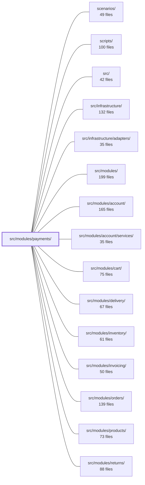

---
tags:
  - 2brain
  - 2brain/module
  - project/boilerplate-node-backend
type: module
module: src/modules/payments/
files: 109
updated: 2026-11-15T00:34:13.021384+00:00
---

# src/modules/payments/

## Purpose

The payments module owns the full monetary lifecycle of a shop: creating payment intents, confirming charges with a PSP, processing refunds (admin-initiated and buyer-disputed), recording offline bank-transfer payments, and receiving webhook settlements from external providers. It is a *supporting* subdomain in the `shop` group, meaning it serves the core order flow but does not own order status itself.

## Key parts

- **Domain layer (`domain/`)** — Pure, side-effect-free business rules: the six-wide `PaymentStatus` vocabulary and lifecycle guard-sets (`lifecycle.ts`), dispute semantics and monetary ceilings (`disputes.ts`), the `displayFinancialStatus` label and its inverse Mongo query (`display-status.ts`), and ISO 11649 bank-transfer reference generation (`transfer-reference.ts`). `index.ts` barrels them so callers import one path.
- **Data model (`model.ts`)** — The Mongoose schema for the `payments` collection (one document per order, unique index on `orderId`). Single source of truth for status, refund attempts, dispute records, and provider reference.
- **Provider port (`providers/`)** — The `PaymentProvider` interface, status unions, and a lightweight registry. The only seam between this module and a real PSP; a live project adds one adapter file plus one `registerPaymentProvider` call.
- **Controllers (`controllers/`)** — Thin HTTP handlers for every endpoint: intent creation (`post-payment`), confirmation (`post-payment-confirm`), sync (`post-payment-sync`), webhook receipt (`post-payment-webhook`), refunds (create / settle / cancel / read), search & list, order-scoped routes (`post-order-payment`, `get-order-payments`), and the public methods list.
- **Presentation (`presenter.ts`)** — The single serialisation boundary that turns a `PaymentDocument` into the wire contract, with distinct payer and staff views.
- **Module wiring (`module.ts`, `module.yaml`, `order-routes.ts`, `index.ts`)** — Registration manifest, cross-module dependency and rate-limit declarations, order-nested routes, and the public barrel (the *only* import surface siblings may use).
- **Cross-cutting declarations** — `analytics.ts` (event names), `audit.ts` (audit-action strings), `events.ts` (domain event payload types), `metrics.ts` (Prometheus counters), `emails.ts` (five customer-facing email builders), `jobs.ts` (abandoned-attempt reaper + effect-retry sweep), `config.ts` (bank-transfer details, payment methods, webhook secrets, grace windows), `authorization.yaml` (fine-grained action/subject rules), `openapi.yaml` (HTTP contract), `asyncapi.webhooks.yaml` (outbound webhook fragment).

## How it connects

- **`src/modules/orders/`** — Payments nest under the order URL namespace (`/orders/:id/payments`), carry a `orderId` unique index, and the offline-payment endpoint writes against an existing order. The order module never writes payment status directly; it reads through the payments barrel.
- **`src/modules/inventory/`** — A payment that has been charged but not yet confirmed for stock is surfaced in the "attention" list as "payments owing their stock commit," tying settlement to inventory release.
- **`src/modules/account/`** — The OpenAPI contract includes a payments section of the account data export; account reads the payment records through the public barrel.
- **`src/infrastructure/`** — `analytics.ts` and `audit.ts` register into infrastructure-level maps via TypeScript augmentation; `config.ts` plugs into the shared config store; `jobs.ts` binds to the kernel job runner.
- **`src/infrastructure/adapters/`** — The mailer adapter consumes the `EmailContent` objects produced by `emails.ts`; provider adapters implement the port defined in `providers/index.ts`.
- **`src/modules/users/`** — Authorization rules in `authorization.yaml` reference identity and role subjects; the `admin.` prefix on audit actions and the `create:Payment` permission gate assume the users module's role model.

## Where to start

1. **`index.ts`** — the public barrel. Reading its exports shows exactly what the module exposes to the rest of the app, and what stays hidden.
2. **`domain/lifecycle.ts`** — the status guard-sets. Understanding which transitions are legal (and *why* the arrays double as Mongo `$in` predicates) makes every controller and service file far easier to follow.

## Connected modules

[[boilerplate-node-backend_ROOT|/ (repository root)]] · [[boilerplate-node-backend_scenarios|scenarios/]] · [[boilerplate-node-backend_scripts|scripts/]] · [[boilerplate-node-backend_src|src/]] · [[boilerplate-node-backend_src_infrastructure|src/infrastructure/]] · [[boilerplate-node-backend_src_infrastructure_adapters|src/infrastructure/adapters/]] · [[boilerplate-node-backend_src_modules|src/modules/]] · [[boilerplate-node-backend_src_modules_account|src/modules/account/]] · [[boilerplate-node-backend_src_modules_account_services|src/modules/account/services/]] · [[boilerplate-node-backend_src_modules_cart|src/modules/cart/]] · [[boilerplate-node-backend_src_modules_delivery|src/modules/delivery/]] · [[boilerplate-node-backend_src_modules_inventory|src/modules/inventory/]] · [[boilerplate-node-backend_src_modules_invoicing|src/modules/invoicing/]] · [[boilerplate-node-backend_src_modules_orders|src/modules/orders/]] · [[boilerplate-node-backend_src_modules_products|src/modules/products/]] · … and 3 more

## Files
- `src/modules/payments/analytics.ts` — Declares the analytics event names for the payments module and registers them with the analytics port's `AnalyticsEventMap` via TypeScript module augmentation. Importing this file gives any caller type-safe event names (a typo fails at compile time) without pulling in a published copy.
- `src/modules/payments/asyncapi.webhooks.yaml` — Defines the AsyncAPI contract for the payments module's outbound webhook events (`payment.*`). It is a **fragment**, not a standalone document: it depends on `#/servers/subscriberEndpoint` and `#/components/schemas/WebhookHeaders` declared in the root `webhooks/asyncapi.yaml`, and is merged into the final contract only while the payments module is registered.
- `src/modules/payments/audit.ts` — Declares the audit-action strings emitted by the payments module and registers them in the infrastructure audit map via TypeScript declaration merging. It is the single source of truth for every payment-related audit event, separating "decision" events (refund requested) from "settlement" events (refund settled, refund canceled) and marking admin-only actions with an `admin.` prefix.
- `src/modules/payments/authorization.yaml` — Declares the fine-grained authorization rules and named rule-sets for the payments module. Each rule binds an action (`read`, `display`, `create`) to a subject (`Payment`, `Refund`) at tenant scope, and the `sets` block groups individual rules into reusable permissions that an identity or role can be granted.
- `src/modules/payments/config.ts` — Centralised, per-call configuration for the payments module. Declares every deployment-tuned value related to money — bank-transfer account details, the set of offered payment methods, webhook signing secrets, and the grace windows that drive background effect sweeps — in a single `defineConfig` instance so no other file transcribes its own fallback copy.
- `src/modules/payments/controllers/get-order-payments.ts` — Handler for `GET /orders/:id/payments`. Returns the payment records (intents and their statuses) for a given order so the order-page payment panel can rehydrate on load. An order with no payment started returns `{ items: [] }`; a 404 is returned only when the caller cannot see the order (authorization failure), not when the order simply has no payments.
- `src/modules/payments/controllers/get-payment-attention.ts` — Thin Express controller that handles `GET /payments/attention`. It delegates entirely to `paymentService.listAttention()` and forwards the result (or error) to the HTTP response. The "attention" payload surfaces items still needing human action: stale and hand-owed refunds, payments owing their stock commit, and orders owing their refund.
- `src/modules/payments/controllers/get-payment-methods.ts` — Express handler for `GET /payments/methods`. It returns the shop's available payment methods in a standard success envelope. The endpoint is intentionally public (no auth) so that a guest can discover checkout options before creating an account.
- `src/modules/payments/controllers/get-payment.ts` — HTTP handler for `GET /payments/:id`. Resolves a single payment by its ID and returns it as a JSON response. It exists as the destination target for the `Location` header set after a successful `POST /payments` and for operator-refund redirects that send a client back to read the payment they just interacted with.
- `src/modules/payments/controllers/get-payments.ts` — Single controller that serves both `GET /payments` and `POST /payments/search` (the staff payments list). It defines a query-string-aware Zod schema on top of the generated API body schema and delegates the actual lookup to `paymentService.listPayments`, using the shared `createSearchController` factory to wire up parsing, validation, and response shaping in one place.
- `src/modules/payments/controllers/get-refund.ts` — Handler for `GET /payments/:id/refunds/:refundId`. Returns a single refund record addressed through its parent payment (the read counterpart to `POST /payments/:id/refunds`). Delegates all data access to the payment service and translates the result into an HTTP response.
- `src/modules/payments/controllers/get-refunds.ts` — HTTP controller for `GET /payments/refunds`. It validates query-string parameters (pagination + optional filters) and delegates to `paymentService.listRefunds`, returning one row per refund for the Refunds tab in the UI.
- `src/modules/payments/controllers/post-order-payment.ts` — HTTP handler for `POST /orders/:id/payments`. Records an offline payment (money that never passed through the card provider) against an existing order. The permission gate (`create:Payment`, admin-only) is enforced at the route level, not here.
- `src/modules/payments/controllers/post-payment-confirm.ts` — Handles `POST /payments/:id/confirm` — the step where the browser hands over the tokenised payment method and the service fires the actual charge events. It normalises three distinct outcomes (succeeded, declined, in-flight) into appropriate HTTP responses and records a Prometheus counter for each.
- `src/modules/payments/controllers/post-payment-refund-cancel.ts` — Controller handler for `POST /payments/:id/refunds/:refundId/cancel`. It lets staff void a refund before it can be paid out. The handler extracts route IDs and the request body, delegates the cancellation to the payment service, and returns the voided refund object.
- `src/modules/payments/controllers/post-payment-refund-settle.ts` — Express controller for `POST /payments/:id/refunds/:refundId/settle`. It lets an operator confirm that a refund's funds have been returned outside the application, then responds with the settled refund object. The handler validates both path IDs, delegates to the payment service, and formats the success or error response.
- `src/modules/payments/controllers/post-payment-refund.ts` — Handler for `POST /payments/:id/refunds`. Processes a standalone (admin-initiated) full or partial refund on a payment without altering the associated order's status. Returns **201** with the new `Refund` record and a `Location` header identifying it.
- `src/modules/payments/controllers/post-payment-sync.ts` — Controller handler for `POST /payments/:id/sync`. When the browser signals it has finished a provider-side flow (3-D Secure challenge, wallet sheet), this endpoint re-reads the provider's own payment record and applies it, making the happy path *feel* synchronous to the user while the webhook remains the authoritative settlement mechanism. The operation is idempotent: a payment that is already settled responds without contacting the provider again.
- `src/modules/payments/controllers/post-payment-webhook.ts` — Single HTTP handler for `POST /payments/webhook/:provider`. Receives payment-event deliveries from external providers, validates the raw-body signature via the service layer, and applies the event idempotently. It is the only place in the codebase that turns a provider's signed HTTP POST into a state change.
- `src/modules/payments/controllers/post-payment.ts` — Thin HTTP controller for `POST /payments`. It validates the request body, delegates intent creation to the payment service, and returns the provider's `clientSecret` to the client. Business logic (ownership checks, `pending` gate, amount freezing) lives entirely in the service; no audit or analytics events fire here because a payment intent is a preparatory step, not a business event—those are emitted on confirm.
- `src/modules/payments/domain/display-status.ts` — Derives the Shopify `displayFinancialStatus` label for a payment from its stored status and refund records, and provides the inverse: a Mongo query that selects payments by that label. The label function and the filter are written side-by-side in this file because they must stay in agreement — the integration suite verifies every label both ways.
- `src/modules/payments/domain/disputes.ts` — Pure domain rules that determine what a shop may still do with a payment while a buyer-initiated dispute (inquiry or chargeback) stands. The file performs no I/O and produces no side effects; it only classifies dispute state and computes the monetary ceiling the bank has already taken. A key semantic distinction it enforces: a chargeback is **not** a refund — it lowers `charged`, never `refunded`, and never issues a credit note.
- `src/modules/payments/domain/index.ts` — Barrel file for the payments domain layer. It re-exports the pure business rules (status vocabularies, lifecycle transitions, dispute semantics, transfer-reference helpers, and display-status logic) from the four sibling modules so that application-layer consumers import from a single path. It exists because the 6-wide status vocabulary crosses the threshold that makes a dedicated `domain/` folder mandatory, consolidating what would otherwise be scattered constants beside each read site.
- `src/modules/payments/domain/lifecycle.ts` — Defines the payment status guard-sets and refund-state rules that control which conditional writes (`updateStatusIfIn`, `upsertConfirmable`) the repository is allowed to perform. Every exported array is both a membership test *and* the MongoDB `$in` predicate for the write it guards, making the set itself the at-most-once enforcement mechanism rather than a surrounding check.
- `src/modules/payments/domain/transfer-reference.ts` — Implements ISO 11649 "RF" creditor-reference generation and validation for `bank_transfer` payments. A deterministic reference is minted from the order's ObjectId when the transfer opens; admins later paste the reference back from their bank's website, and this module verifies the Mod-97 check digits before any lookup proceeds.
- `src/modules/payments/emails.ts` — Pure email-builder functions for the five customer-facing messages the payments module sends: payment received, refund issued, refund undeliverable, bank-transfer instructions, and transfer deadline expired. Each function takes a locale plus domain data and returns a fully translated `EmailContent` object whose `template` field the mailer adapter interpolates — the same "language is an argument, output is finished text" convention as `@modules/orders/emails` and `@modules/account/emails`.
- `src/modules/payments/events.ts` — Declares the payments module's domain event payload types by augmenting the kernel's `DomainEventMap` (TypeScript module augmentation in `@kernel/events`), and exports a string constant for each event name. It is the single source of truth for what data each payment event carries, decoupled from where and how the events are emitted.
- `src/modules/payments/globals.d.ts` — Augments Express's `Request` interface with a payments-specific flag (`paymentConfirmDeclined`) via TypeScript declaration merging. It exists here — rather than in infrastructure's global `globals.d.ts` — because the architecture rule (`docs/theory/layers.md`) forbids that file from naming a module, so module-local augmentations live in the owning module.
- `src/modules/payments/index.ts` — Public barrel (barrel export) for the payments module. It is the **only** import surface that sibling modules are permitted to use, enforcing the strategic-DDD rule documented in `docs/theory/strategic-ddd.md` §5. Internals such as `paymentRepository` and the model's runtime stay hidden; all writes are routed through the provider-confirmed choreography in `services/settlement.ts` rather than exposed as direct document writes.
- `src/modules/payments/jobs.ts` — Declares the two scheduled jobs owned by the `payments` module: the abandoned-attempt reaper and the effect-retry sweep. Each entry is a `JobDeclaration` that binds a pre-generated job descriptor (from `jobs.generated`) to the concrete service function(s) that perform the work.
- `src/modules/payments/metrics.ts` — Defines the two Prometheus counters owned by the payments domain: one for confirmation-attempt outcomes and one for settlement mismatches. Counters live here (in the module) rather than in `infrastructure` so the domain owns its own metrics; the module overview endpoint reads them without importing this file directly.
- `src/modules/payments/model.ts` — Defines the Mongoose schema and document interfaces for the `payments` collection — one document per order, made a database fact by a unique index on `orderId`. It is the single source of truth for the payment lifecycle status (`PaymentStatus`), refund attempt records, dispute records, and the provider reference, so that the enum values on the wire and in the database cannot drift apart.
- `src/modules/payments/module.ts` — The payments module manifest. Wires the module's routes, background jobs, event subscriptions, public webhook mapping, rate limits, config, and personal-data hooks into a single `AppModule` object consumed by the kernel registry. It is the single registration point the app tier uses to mount everything the payments domain exposes.
- `src/modules/payments/module.yaml` — Module manifest for the **payments** subdomain (group `shop`, subdomain `supporting`). It declares the module's identity, its cross-module dependencies, its rate-limit budgets, and its scheduled background jobs. The runtime reads this file to wire the module into the process; it contains no executable logic itself.
- `src/modules/payments/openapi.yaml` — OpenAPI 3.1.0 contract for the **payments** module. It declares the HTTP surface for listing payment methods, creating payment intents, listing and searching payments, and defines the module's shared error codes and the payments section of the account data export. It exists so that clients, staff tooling, and the account-export bundler all consume a single, versioned description of what the payments module exposes.
- `src/modules/payments/order-routes.ts` — Defines the two payment routes that live under the `/orders` URL namespace (`GET /orders/:id/payments` and `POST /orders/:id/payments`). The URL nests payments as a child of the order (Solidus-style), but the routes remain owned by the payments module and use the payments domain's `create:Payment` permission key. Mounted at `/orders` by `./module.ts`.
- `src/modules/payments/presenter.ts` — The single presentation boundary that turns a stored `PaymentDocument` into the `Payment` wire contract. Every write endpoint (confirm, offline, refund, sync, intent) serialises its response through this file. It produces two views: the payer's default view and a staff view that additionally exposes provider IDs and refund failure reasons — fields the payer-facing serializer always strips.
- `src/modules/payments/providers/errors.ts` — Defines the error types that payment provider implementations can throw. Split out of `providers/index.ts` so that an adapter (real or fake) can import and throw these errors without pulling in the port interface file, which itself imports the config and the registry the implementation is registered in — avoiding a circular dependency.
- `src/modules/payments/providers/index.ts` — Defines the **payment provider port** — the typed contract (interfaces, status unions, and the `PaymentProvider` interface) that any real PSP adapter or the test double must implement. It is the single seam where the application talks to a payment service: the card never reaches this server, an intent is prepared before charging, and the authoritative outcome arrives asynchronously via webhook. No production provider ships with the boilerplate; a live project adds one adapter file plus one `registerPaymentProvider` call.
- `src/modules/payments/providers/registry.ts` — A standalone payment-provider registry that can be imported in isolation without pulling in the full `./index` module (which loads the payments config chain: config store, `ibantools`). It exists so test doubles can register themselves at preload time without triggering that dependency tree, and so production PSPs can self-register with a single call in their own file.
- `src/modules/payments/providers/webhook-signature.ts` — Shared HMAC-based webhook signature verification for all PSP providers. It defines the signing/verification discipline (HMAC-SHA256 over `<timestamp>.<raw body>` in a single header, constant-time comparison, replay window) in one place so that providers verify signatures while the demo and test suites can produce valid ones without each re-implementing the scheme.
- `src/modules/payments/rate-limits.ts` — Declares and builds the payments module's rate-limit budgets (webhook forgery ceiling, confirm-attempt/decline/intent-sync caps) and a composite human-challenge gate. Each budget is plain `RateLimitBudget` data turned into Express middleware via the shared `buildRateLimiter` factory, so this file is purely wiring: it picks keying strategy, success semantics, and mount points for the payments routes.
- `src/modules/payments/repository.ts` — Repository layer for the payments aggregate. Wraps the generic `createRepository` factory with payment-specific guarded writes (conditional status transitions, dispute recording, upserts) and the read paths the staff UI and background sweeps actually take: paginated staff list, refund searches, refund sweeps, and the "one payment per order" intent/offline upsert. The unique index on `orderId` is what lets the upsert be a single `findOneAndUpdate` with no prior read.
- `src/modules/payments/routes.ts` — Express router defining the complete HTTP route table for payment operations. It layers authentication, authorization, rate-limiting, and idempotency guards per route so that the webhook (machine caller) and the public `/methods` lookup stay outside the auth wall, while every route that reads or moves money sits behind session auth plus route-specific permission and freshness checks.
- `src/modules/payments/services/announce.ts` — Moves a payment to `declined` and emits a `PAYMENT_FAILED` event in a single transactional unit, so a decline that commits is always announced and one that loses a race is never. This is the announce side of the payment lifecycle; `PAYMENT_SUCCEEDED` is handled separately by `settlement.ts`.
- `src/modules/payments/services/deadline.ts` — Reads the legally stamped refund deadline (date + governing rule) from an already-opened payment record. It exists so callers (e.g. task openers) can date and justify work without re-deriving the rule from scratch; if the law sets no deadline, it returns `undefined` and the caller picks its own date.
- `src/modules/payments/services/disputes.ts` — Handles provider-side dispute reports arriving via webhook delivery. It stores the dispute state on the payment, appends staff-timeline rows to the order, and announces a domain event — all within a single Mongoose transaction. A dispute here is explicitly **not** a refund: it never modifies `amountRefunded`, order status, or credit notes.
- `src/modules/payments/services/effects.ts` — Provides two scheduled sweep operations that finish work a settlement left outstanding: retrying refunds the provider refused or never answered, and reconciling payments whose provider decided without delivering a webhook. Both sweeps share a sequential, batch-capped skeleton and return a count of items actually settled.
- `src/modules/payments/services/errors.ts` — Centralised error responses and error classes for the payments service layer. It is deliberately a leaf module (no persistence imports) so every file under `services/` can reach a shared error shape without pulling in additional edges. All "order can no longer be paid" paths, 404s, refund refusals, and unknown-provider webhook cases flow through the exports here.
- `src/modules/payments/services/external-refunds.ts` — Handles refunds created outside the application (i.e., in the payment provider's own dashboard). When a refund event arrives, this module fetches the provider's refund list, distinguishes refunds already tracked locally from unknown ones, carries provider state onto existing records, and **imports** unknown succeeded refunds as settled records so that credit notes, buyer emails, and order stamps fire exactly as they would for an in-app refund.
- `src/modules/payments/services/index.ts` — Barrel/facade for the payments domain service. It re-exports the public surface of every sub-module (intent, settlement, refunds, effects, offline, transfer, notify, scope, view, retention, list, stats, deadline) under a single `paymentService` object, so callers never import from the individual files. The module-level doc comment encodes the domain invariants: the order's `paid` transition is the gate (not the charge), refunds are at-most-once via conditional write on `amountRefunded`, and the provider webhook is the authority for settlement.
- `src/modules/payments/services/intent.ts` — Entry point for the module's money-moving flow: creates (or idempotently refreshes) a payment intent for an order, cancels a still-open intent on a specific payment, and closes any dangling intent when its order is canceled. Every code path in this file guarantees that at most one provider-side intent is ever exposed to the client for a given order.
- `src/modules/payments/services/list.ts` — Provides the three read-side query functions behind the staff Payments page: a paginated payment list with order context, a cross-payment refund list, and a "needs attention" digest of problems that require a human. All three return `display:Payment`-shaped rows carrying provider identifiers.
- `src/modules/payments/services/notify.ts` — Buyer-facing email notifications for the payments module. Defines five mail functions that fire on payment lifecycle events (succeeded, refunded, refund undeliverable) or are called inline for bank-transfer specifics (instructions, expired). The core guarantee: a failed mail never undoes a money movement — every listener logs and swallows errors.
- `src/modules/payments/services/offline.ts` — Records a payment that arrived outside the card provider (cash, bank transfer, phone-order payment) and settles it through the same `settlePayment` path every card payment uses — order moves `pending → paid`, stock commits, and the standard events fire. It exists so that non-card money flows through identical domain logic rather than a parallel settlement branch.
- `src/modules/payments/services/refund-settlement.ts` — Terminal-state writer for refund records. Given a payment and an open refund, it either settles the refund to `succeeded` (stamping the order's payment status, appending a timeline row, and emitting the refund-settled domain event in the outbox) or records a provider refusal as `failed` (incrementing the attempt counter, scheduling the next retry, and optionally emitting the refund-failed domain event). It was split out of `refunds.ts` so that `refund-sync.ts` (provider-side flows) and `refunds.ts` (initiation-side flows) can share settlement logic without importing each other.
- `src/modules/payments/services/refund-sync.ts` — Bridges the provider's side of a refund to the local record. When a refund is still `pending`, a sweep re-reads the provider for a final status; when a webhook lists a refund (`external-refunds.ts`), the provider's report is applied here. The provider's own status is the sole authority — the delivery body itself changes nothing.
- `src/modules/payments/services/refunds.ts` — Single choke-point for moving money out of a payment in the module: the operator-triggered `refundPayment` and the `order.canceled` listener's compensation (`refundForOrder`) both funnel through `performRefund`. It opens a conditional refund record (reserving `amountRefunded`) before asking the provider, so concurrent refunds can never overdraw the original amount.
- `src/modules/payments/services/retention.ts` — Handles the post-movement lifecycle of payment records: detaching a user's ID during account erasure, producing an account's own payment data for export, and sweeping (deleting) abandoned payment attempts that never succeeded. It does not create, charge, or settle payments — it manages what happens to the row after the money event.
- `src/modules/payments/services/scope.ts` — Defines the four row-scope predicates every other payment service calls before reading or writing the `Payment` collection. It centralises the distinction between *read* scope (role-driven, may span all records) and *payer/buyer* scope (strictly the caller's own records), so that money-moving operations never inherit a broad `display:*` grant.
- `src/modules/payments/services/settlement.ts` — The single reconciliation point for payment success. Both the browser-driven confirm/sync path and the webhook delivery path funnel into `settlePayment` (referenced in the module docblock) so that money is settled exactly once. The file implements the three success-branch outcomes — *paid*, *mismatched*, and *order-lost* — as well as the idempotency gate that prevents two racing callers from settling the same order twice.
- `src/modules/payments/services/stats.ts` — Computes the payments "mix" for reporting: how much money came in, grouped by payment method, provider, and currency. It wraps the raw repository aggregation into a clean, typed result suitable for display or further processing.
- `src/modules/payments/services/transfer.ts` — Handles the payment-creation step for bank-transfer orders. When an order is placed with `paymentMethod: 'bank_transfer'`, this module opens a `requires_action` payment row (carrying the reference, deadline, and instructions) and mails the transfer instructions to the buyer. It exists so that the transfer payment is tied to the order lifecycle (`order.created`) rather than being created lazily at settlement time.
- `src/modules/payments/services/view.ts` — Read-side service that returns a payment (or its refund records) to the caller with a computed `actions` object describing what that caller may do next (pay, sync, refund, settle, cancel). It is the source of the payment panel on the order page and the payload of `GET /payments/:id`–style routes, mirroring the `OrderActions` pattern the orders module uses.
- `src/modules/payments/tests/contract/api.contract.test.ts` — Contract (integration) tests for the `/payments` HTTP surface. Every route's status code, response envelope shape, and error discriminator are pinned over real HTTP against a live app with a fake payment provider. The file explicitly defers money-rule logic to the unit suite; here the job is to prove that each contract branch — 201 intent, 200 confirm, the three distinguishable 409s, 404s, 422 — is actually reachable and shaped as the API contract specifies.
- `src/modules/payments/tests/deliver.ts` — Test helper that delivers a provider webhook event to the payments service through the same signed-entrypoint a real provider would use. It exists so integration tests can apply events without duplicating the sign-then-dispatch sequence that the webhook route performs.
- `src/modules/payments/tests/factories.ts` — Test factories that produce fully-formed payment states (a card-paid order, a pending bank-transfer order, an operator refund, a return refund) by driving the production service layer directly, so integration and contract tests can assert against the same persisted rows a real request would leave behind.
- `src/modules/payments/tests/integration/announce.test.ts` — Integration tests for the payment announcement path: verifying that `payment.succeeded` and `payment.failed` domain events are published via the transactional outbox, atomically with the payment state change. Confirms idempotency (no double-publish on re-confirm), rollback when a downstream commit fails, and that declined payments are written and announced as a single unit. Runs against a real MongoDB instance.
- `src/modules/payments/tests/integration/cancel-redelivery.test.ts` — Integration tests proving that a redelivered `ORDER_CANCELED` event never produces a second refund. The outbox re-delivers an event until its listener succeeds, and staff may void the first refund in between; the payment must deduplicate by the outbox `eventId` (stored in `handledCancelEvents`), not by the refund record's existence. Tests drive the real listener via `emitDomainEvent` with an explicit `eventId`, real Mongo, and the fake payment provider.
- `src/modules/payments/tests/integration/canceled.test.ts` — Integration tests for the `canceled` payment state. Verifies that canceling an order transitions the payment to `canceled` (or leaves it untouched if the provider refuses), that late provider reports on a canceled payment are handled correctly (ignored, refunded-if-money-landed, idempotent on redelivery, skipped by reconciliation), and that the retention reaper deletes old canceled payments while preserving succeeded ones.
- `src/modules/payments/tests/integration/disputes.test.ts` — Integration test that exercises the full dispute lifecycle (chargeback and inquiry) against real Mongo, driving the fake payment provider's dispute lever through the public `paymentService` API. It verifies that disputes are persisted, announced once, surfaced on the order timeline and staff attention list, and that they gate or reduce the refundable amount without ever being treated as a refund (no `payment.refunded`, no credit note, no order-status change).
- `src/modules/payments/tests/integration/external-refunds.test.ts` — Integration test (real Mongo, fake provider) for refunds that originate in the payment provider's dashboard. Verifies that such external refunds are imported idempotently as settled `external` records with the correct follow-ups (status stamp, outbox event, buyer email), that our own refunds are *matched* to incoming events rather than double-imported, and that an external refund which overshoots the remaining balance causes our in-flight refund to be held unsent and surfaced for staff cancellation.
- `src/modules/payments/tests/integration/hand-refund.test.ts` — Integration tests for the operator-side hand-refund lifecycle on offline (cash) payments. Every path that opens a refund record is verified to leave it `pending`; `settleRefundByHand` is the single action that flips it to `succeeded`. The tests run against a real MongoDB instance and exercise the system only through `paymentService`'s public API.
- `src/modules/payments/tests/integration/intent-provider-ref.test.ts` — Integration test verifying the single-intent invariant for a payment row: `createIntent` must resume the stored provider reference on repeat calls, and must reject (409) and cancel any stray intent the adapter opens instead. It exists to guard against a customer paying an intent the database does not name, which would orphan a subsequent webhook.
- `src/modules/payments/tests/integration/late-payment.test.ts` — Integration tests for the race where a payment (card or offline) arrives after the order's inventory hold has expired but before the order is formally canceled. Verifies that the system either re-takes stock and pays the order, or keeps the order pending, issues a refund, and lets the late cancellation proceed — without overselling.
- `src/modules/payments/tests/integration/payment-velocity.test.ts` — Integration tests for the three rate-limiting layers on `POST /payments/:id/confirm`: the per-account attempt budget, the per-account decline budget, the shared address-block decline budget, and the anti-bot challenge gate. The tests exercise the limiters through trivial Express handlers (not the real `postPaymentConfirm` route) so the property under test—isolation of limiter behavior—isn't confounded by database round trips. The real route's middleware ordering is covered separately in `payments/tests/unit/routes.test.ts`.
- `src/modules/payments/tests/integration/provider-ref-lookup.test.ts` — Integration test that guards against MongoDB operator-injection (e.g. `{"$ne": null}`) reaching the provider-reference lookup. It asserts that `findByProviderRef` rejects a non-string operator object rather than silently matching every payment, covering the case where a caller bypasses the webhook port's type parsing and passes a `JSON.parse`-derived `any` cast to `string`.
- `src/modules/payments/tests/integration/reconcile.test.ts` — Integration tests for the payment reconciliation sweep and the cancel-time provider query. The core scenario: the PSP charges a card but the confirming webhook is lost, leaving the payment stuck in an in-flight state. The sweep asks the provider about those stale payments and settles them; the cancel path asks the provider once when it refuses to close an intent that already succeeded.
- `src/modules/payments/tests/integration/refund-cancel.test.ts` — Integration tests for the **cancel (void) refund** operation. They verify that staff can void only refunds whose money provably did not move (hand-paid `pending`, card refusal with a clear reason) while settled refunds, unclear failures, and in-flight attempts are rejected. Tests run against real MongoDB via the payment service's public API.
- `src/modules/payments/tests/integration/refund-claim.test.ts` — Integration tests (against a real MongoDB instance) for the refund-claim lifecycle: a conditional write with a fence token guarantees only one worker claims a refund, a definite refusal is terminal, a retryable refusal backs off with a growing delay, a deregistered provider is marked `provider_removed` without further attempts, and a provider-side timeout is settled from the provider side rather than double-paid.
- `src/modules/payments/tests/integration/refund-email.test.ts` — Integration test verifying the email-notice policy around refunds: a standalone (non-return) refund triggers a `payments.refund-issued` mail to the buyer, while return-attached refunds and provider-refused refunds stay silent. Also asserts authorization boundaries for who may initiate a return refund.
- `src/modules/payments/tests/integration/refund-failed-event.test.ts` — Integration test verifying the deduplication and finality contract of the `payment.refund_failed` outbox event: a definite refusal emits a single `final: true` row; a transient refusal emits `final: false`; a retry failing with the same reason is silent; and a retry that fails with a *different* reason re-news the event. Runs against real Mongo with the fake payment provider's refusal lever.
- `src/modules/payments/tests/integration/refund-provider-status.test.ts` — Integration test verifying the lifecycle of a refund that the provider **accepts but has not yet settled**: the API returns 201 with the record in `pending` status and emits no domain event; the periodic sweep re-reads (never re-sends) the refund and settles it once the provider reports success; and a webhook naming the refund also settles it, with redelivery being a no-op. Runs against real Mongo with the fake payment provider's `pending` lever.
- `src/modules/payments/tests/integration/refund-reversal.test.ts` — Integration tests (real Mongo) for the provider-reported refund failure path: a refund that had already settled and then bounces back (a *reversal*), and a refund that fails before it ever settles (a *refusal*). Verifies status transitions, the single `PAYMENT_REFUND_REVERSED` / `PAYMENT_REFUND_FAILED` event, idempotency of webhook redeliveries, exclusion from the retry sweep, and the manual "settle by hand" escape hatch.
- `src/modules/payments/tests/integration/refund-settle-card.test.ts` — Integration test (real MongoDB) that verifies the operator's "settle refused refund by hand" workflow for card payments. It asserts the core domain rule: only a refund whose refusal proves the money did not move (final reasons) may be settled; an unclear or in-flight attempt returns 409; and once settled, the refund is never re-sent to the provider.
- `src/modules/payments/tests/integration/refund-undeliverable.test.ts` — Integration tests for the "undeliverable refund" flow: when a payment provider cannot deliver a refund to the buyer's card, the system mails the buyer exactly once (with no reason disclosed), marks the refund as `owedAnotherWay` in the buyer-facing view, and—critically—does **not** mail when the refusal reason is unrelated to the buyer's card. Uses a real MongoDB; the mailer is mocked.
- `src/modules/payments/tests/integration/refunds.test.ts` — Integration tests for the refund flow on a payment record. Uses **real MongoDB** (via `setupTestDb`) and a fake payment provider to verify the conditional-write invariants: partial refunds keep the remainder refundable, racing refunds cannot overdraw, a provider refusal leaves the record open for the sweep to retry with the same idempotency key, and validation rejects bad amounts/currencies before any provider call.
- `src/modules/payments/tests/integration/retention.test.ts` — Integration tests for payment retention semantics: verifying that account erasure *detaches* (unsets `userId`) rather than deletes a payment, and that the `reapAbandonedPayments` sweep only reclaims unsettled attempts past a configurable window. Runs against a real test database with full module wiring.
- `src/modules/payments/tests/integration/service.test.ts` — Integration tests that pin the payment service's core invariants against a **real Mongo** database: the intent freezes the order's published total (shipping included), confirm moves the order `pending → paid` only when the payment row goes `succeeded`, a decline is retryable on the same document, and refunds are at-most-once. The fake provider is the only non-real component; the conditional writes are the subject under test.
- `src/modules/payments/tests/integration/settlement-email.test.ts` — Integration test that pins the `payment.succeeded` listener's contract: the buyer receives exactly one `payments.payment-received` email when a payment actually commits stock, and receives none on a decline or on a no-op retry of an already-settled payment. The placed-order confirmation email is deliberately out of scope here.
- `src/modules/payments/tests/integration/settlement-mismatch.test.ts` — Integration test covering the settlement-mismatch guard: when a provider reports `succeeded` but the collected money does not match the frozen payment (wrong amount, currency, or payment ID), the system must cancel the order, refund the collected money, announce no `payment.succeeded`, commit no stock, and issue no invoice. Uses real Mongo and the fake provider's receipt lever; no network mocks beyond the provider double.
- `src/modules/payments/tests/integration/settlement-reports.test.ts` — Integration test verifying that settlement "reports"—a `payment.failed` outbox event, an audit row, and an analytics event—fire exactly once per real payment transition, regardless of how many times the same transition is observed (webhook replay, repeated polling, sync of an already-final payment). Uses a real MongoDB instance.
- `src/modules/payments/tests/integration/staff-reads.test.ts` — Integration tests (against a real MongoDB) for the three staff-facing payment reads — **list**, **refunds**, and **needs-attention** — verifying that every `displayStatus` label the server derives is the label its filter matches, that provider-specific identifiers (provider refs, failure reasons) reach staff but not the payer, and that a needs-attention row clears once its underlying problem is resolved.
- `src/modules/payments/tests/integration/timeline.test.ts` — Integration tests that verify the exact timeline entries the payments module writes onto an order: a `paid` row (card or offline), a single `payment_declined` row, and the three refund moments (`refund_issued`, `refund_settled`, `refund_failed`). Runs against real Mongo through the services' public API to confirm row shape, actor attribution, closed-code usage (never raw provider text), and role-based visibility.
- `src/modules/payments/tests/integration/transfer-reference-filter.test.ts` — Integration test that pins the `transferReference` filter on the staff payment list and its downstream effect: a valid reference finds exactly its own payment (regardless of spacing/case), invalid or unmatched inputs find nothing, and the order the filter names is the one the existing offline-settle endpoint then marks paid.
- `src/modules/payments/tests/integration/transfer.test.ts` — End-to-end integration test for the bank-transfer payment lifecycle: opening the payment row when an order is placed, presenting the instructions (IBAN, BIC, reference, deadline), recording a late or on-time settlement, handling expiry vs. customer cancellation, and matching a transfer that arrives after the order is already closed. Runs against a real MongoDB instance; only the mailer adapter is mocked.
- `src/modules/payments/tests/integration/webhook-no-body.test.ts` — Integration tests for the `POST /payments/webhook/:provider` endpoint covering the bodyless-request path. It verifies two distinct invariants: (1) a caller sending no body gets a 400 with **no** error-level log, and (2) the rare case where a body was sent but no raw body reached the controller (a parser-ordering break) gets a 400 **with** a specific error log.
- `src/modules/payments/tests/integration/webhook-rate-limit.test.ts` — Integration test that exercises the payment webhook's rate-limit budget over a real HTTP stack (supertest + Express). It verifies three properties of the real limiter and real controller together: only *refused* (forged-signature) deliveries spend the budget, the budget is scoped per /24 address block, and a rate-limit refusal writes no audit row. No database is involved because a delivery that names no intent applies nothing.
- `src/modules/payments/tests/unit/config.test.ts` — Unit tests for the payment-configuration module (`../../config`). Covers the pure, environment-reading helpers that power `GET /payments/methods`, checkout availability, and the boot-time `validateBankTransferConfig` check. No database or network is involved.
- `src/modules/payments/tests/unit/display-status.test.ts` — Unit tests for `displayStatusOf`, the pure function that resolves the human-facing label of a payment. The tests pin down the precedence rule: an open refund overrides the stored `PaymentStatus`, and `amountRefunded` is only consulted when no refund is still pending.
- `src/modules/payments/tests/unit/emails.test.ts` — Unit tests for the four payment email builders in `payments/emails.ts`. They verify that each email renders the correct template name, itemised lines, currency-formatted totals, order links, and locale-appropriate copy—because a formatting slip in a billing email is indistinguishable from a billing error to the recipient.
- `src/modules/payments/tests/unit/jobs.test.ts` — Unit test that guards the lease configuration of the `sweep:payment-effects` job, ensuring its TTL is strictly longer than the 5-minute sweep interval so a hung provider call cannot cause a second pass to resend the same refund keys.
- `src/modules/payments/tests/unit/module.test.ts` — Boot-time configuration validation tests for the payments module. It verifies that `assertModuleConfig` correctly accepts, rejects, or short-circuits the two environment-variable checks that belong to this file: the `NODE_PAYMENT_PROVIDER` selector and the `NODE_PAYMENT_WEBHOOK_SECRET` ring. The goal is to surface misconfiguration at startup rather than on the first payment call.
- `src/modules/payments/tests/unit/providers.test.ts` — Unit tests for the payment-provider port layer: the webhook signature sign/verify contract and the `resolvePaymentProvider` selector. It exists to pin down the security invariants (replay tolerance, secret-ring rotation, malformed-input rejection) and the "no silent fallback" rule for provider selection, without touching a database or any provider SDK.
- `src/modules/payments/tests/unit/rate-limits.test.ts` — Unit tests that pin the *declarative relationships* between the payments module's rate-limit budgets (attempts vs. declines, per-account vs. per-address-block, intent-sync pool, webhook limiter). They assert that the budget configuration encodes the intended invariants—relative strictness, shared windows, keying strategy—without sending any HTTP traffic.
- `src/modules/payments/tests/unit/refund-rules.test.ts` — Unit tests for the pure refund-rule functions in the payments domain: which refunds are still open, which may be voided or settled by hand, whether a new refund exceeds the remaining amount, the legal deadline, and how open disputes (chargebacks, inquiries) gate those decisions. Exists to lock down the business logic without touching the provider or database.
- `src/modules/payments/tests/unit/routes.test.ts` — Unit test that pins the **router-level security contract** of the payments module: which endpoints exist, in what order, and which guard each one carries. It treats route order and guard presence as invariants (not just "does it work") because moving a route below the auth wall or dropping a guard would silently break production with no runtime error.
- `src/modules/payments/tests/unit/schema-contract.test.ts` — Locks down the payment schema's contract as a set of executable assertions: required fields, the `unique` index on `orderId` (the module's entire idempotence guarantee), reference integrity, type choices, enum bounds, and safe defaults. It exists so that a schema change that silently breaks any of these invariants fails CI instead of letting the shop charge an order twice.
- `src/modules/payments/tests/unit/transfer-reference.test.ts` — Unit tests for the `buildReference` / `parseReference` pair in the payments domain, verifying the two guarantees that matter for matching a payment reference to the correct order: round-trip fidelity and rejection of mistyped input rather than silent mis-resolution.

---
[[boilerplate-node-backend_INDEX|← boilerplate-node-backend index]]
