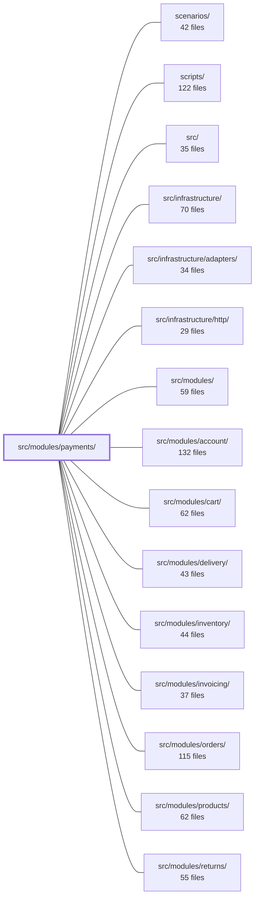

---
tags:
  - 2brain
  - 2brain/module
  - project/boilerplate-node-backend
type: module
module: src/modules/payments/
files: 75
updated: 2026-10-15T13:41:15.260273+00:00
---

# src/modules/payments/

## Purpose

The payments module owns the full monetary lifecycle of an order: creating provider payment intents, confirming charges, recording offline (cash/manual) settlements, issuing refunds, and reconciling stale or failed operations. It exposes the HTTP surface for checkout, admin payment management, and provider webhooks, while keeping all business rules, status-transition guards, and provider abstraction internal to the module boundary.

## Key parts

- **Domain layer** (`domain/`) — Pure, framework-free logic: the status vocabulary, permitted-transition guards (`lifecycle.ts`), and the `displayFinancialStatus` label/filter pair. Consumers import via `domain/index.ts`.
- **Services** (`services/`) — Business operations: intent creation/refresh, settlement, refund lifecycle, decline recording, background reconciliation sweeps, and staff-facing read queries. Published through `services/index.ts`.
- **Controllers** (`controllers/`) — Thin HTTP handlers (one per endpoint) that validate input and delegate to the service layer. No business logic lives here.
- **Provider port** (`providers/`) — The `PaymentProvider` interface, a runtime registry for plugging in real or fake adapters, shared webhook-signature helpers, and the two canonical provider error types. The boilerplate ships zero implementations.
- **Model & Repository** (`model.ts`, `repository.ts`) — Mongoose schema (one document per order), serialization transform, and every bespoke lookup or guarded write the services need.
- **Module manifest** (`module.ts`, `index.ts`) — `module.ts` wires routes, events, subscriptions, and config into the app-tier loader; `index.ts` is the *only* import surface exposed to sibling modules.
- **Cross-cutting vocabulary** — `analytics.ts`, `audit.ts`, `events.ts`, `emails.ts`, `metrics.ts`, `rate-limits.ts`, `config.ts`: each registers or owns one concern (event names, audit strings, domain events, outbound email bodies, Prometheus counters, velocity budgets, deployment-tuned values) via module augmentation or per-module ownership.
- **Contract & security** — `openapi.yaml` (merged into the shop's root spec), `routes.ts` (layered middleware policy), `globals.d.ts` (payments-specific `Request` augmentation).

## How it connects

- **`src/modules/orders/`** — The strongest dependency. The payments module freezes an order's total into an intent (using the same `orderTotal` the order serializer uses), reads order data to enrich payment rows, and records timeline rows on settle/decline. Bank-transfer *values* (IBAN, BIC, hold hours) live in orders; payments only validates them at boot.
- **`src/modules/account/`** — Shared conventions: the same email-builder pattern (explicit language argument, fully-interpolated output), the same per-module `events.ts`/`analytics.ts` augmentation style, and account-data export includes a `payments` slice declared in the OpenAPI contract.
- **`src/infrastructure/`** (and `adapters/`, `http/`) — Provides the Express app, Mongoose connection, mail transport, and the shared repository factory that `repository.ts` builds on. Payments never imports infrastructure types into its domain layer.
- **`src/modules/`** (sibling modules: cart, delivery, inventory, invoicing, products, returns, users) — Interact through `index.ts` only. For example, the returns module may trigger a refund via the public service API; users/auth middleware checks permissions before a controller runs; cart/inventory state is read (not mutated) when enriching payment listings.

## Where to start

1. **`module.ts`** — Reading the registration manifest first gives you the full surface: which routes exist, which events are emitted/subscribed, and how the module plugs into the app. It's the shortest file that tells you the module's entire contract.
2. **`services/intent.ts` → `services/settlement.ts`** (via `services/index.ts`) — Together they walk you through the happy path (freeze price → confirm charge → settle) and show how the domain guards, provider port, repository, and announcement events fit together in one flow.

## Connected modules

[[boilerplate-node-backend_ROOT|/ (repository root)]] · [[boilerplate-node-backend_scenarios|scenarios/]] · [[boilerplate-node-backend_scripts|scripts/]] · [[boilerplate-node-backend_src|src/]] · [[boilerplate-node-backend_src_infrastructure|src/infrastructure/]] · [[boilerplate-node-backend_src_infrastructure_adapters|src/infrastructure/adapters/]] · [[boilerplate-node-backend_src_infrastructure_http|src/infrastructure/http/]] · [[boilerplate-node-backend_src_modules|src/modules/]] · [[boilerplate-node-backend_src_modules_account|src/modules/account/]] · [[boilerplate-node-backend_src_modules_cart|src/modules/cart/]] · [[boilerplate-node-backend_src_modules_delivery|src/modules/delivery/]] · [[boilerplate-node-backend_src_modules_inventory|src/modules/inventory/]] · [[boilerplate-node-backend_src_modules_invoicing|src/modules/invoicing/]] · [[boilerplate-node-backend_src_modules_orders|src/modules/orders/]] · [[boilerplate-node-backend_src_modules_products|src/modules/products/]] · … and 2 more

## Files
- `src/modules/payments/analytics.ts` — Declares the canonical analytics event names for the payments domain and registers them with the analytics port's `AnalyticsEventMap` via TypeScript module augmentation, so that any `emit` of a payments event is type-checked against this list. Controllers import this file directly (mirroring the pattern `./audit.ts` uses for audit actions) rather than a published copy.
- `src/modules/payments/audit.ts` — Declares the set of audit action strings the payments module can emit and registers them into the shared `AuditActionMap` via TypeScript module augmentation. It exists so that every payment-related audit event has a single, type-safe vocabulary and so the infrastructure audit layer knows which strings belong to the `payments` namespace.
- `src/modules/payments/config.ts` — Central read-point for every deployment-tuned value the payments module owns: which methods are offered, the payment-effect sweep grace windows, abandoned-payment retention, and the webhook secret ring. Bank-transfer *values* (beneficiary, IBAN, BIC, hold hours) belong to `@modules/orders`; this file only validates them at boot. All getters read the config per call (never cache) so tests can vary values and no second module transcribes its own fallback.
- `src/modules/payments/controllers/get-order-by-reference.ts` — Handles the `GET /payments/order-by-reference` endpoint. An admin pastes a reference code (RF code) read from a bank's website and receives the order that code corresponds to. This is the lookup step that precedes `POST /payments/order/:orderId/offline` — the doc comment treats it as carrying the same authority as actually recording the payment.
- `src/modules/payments/controllers/get-payment-attention.ts` — Express route handler for `GET /payments/attention`. It surfaces a summary of items requiring manual attention (stale refunds, hand-owed refunds, pending stock commits, pending order refunds) by delegating entirely to the payment service and shaping the HTTP response.
- `src/modules/payments/controllers/get-payment-by-order.ts` — Controller handler for `GET /payments/order/:orderId`. It retrieves the payment (intent and status) tied to a given order so that the order page's payment panel can rehydrate its state on reload rather than forcing the user to restart the payment flow.
- `src/modules/payments/controllers/get-payment-methods.ts` — Express controller that answers `GET /payments/methods` with the list of payment methods configured for the shop. It exists so the frontend can discover available checkout options dynamically instead of hard-coding them. The endpoint is intentionally public—guests should be able to see what payment options exist before signing up.
- `src/modules/payments/controllers/get-payments.ts` — Defines a single controller (`getPayments`) that serves both `GET /payments` and `POST /payments/search`, delegating the actual work to `paymentService.listPayments`. The controller exists to translate raw HTTP query/body parameters (text strings) into validated, typed search criteria before handing them to the service layer.
- `src/modules/payments/controllers/get-refunds.ts` — HTTP controller for `GET /payments/refunds`. Exposes a paginated, filterable list of one row per refund across all payments, serving the Refunds tab in the UI. It validates query-string parameters and delegates to the payment service.
- `src/modules/payments/controllers/post-payment-confirm.ts` — HTTP handler for `POST /payments/:id/confirm`. Receives the tokenised payment-method reference from the browser's payment form, delegates to the payment service to complete the charge, and maps the outcome (succeeded, declined, or in-flight) to the appropriate HTTP status and response body.
- `src/modules/payments/controllers/post-payment-intent.ts` — Handler for `POST /payments/intent`. Freezes an order's price into a payment intent and opens one at the provider, ready to confirm. Deliberately thin: ownership checks, the `pending` gate, and amount calculation all live in the service layer. No audit or analytics events fire here—an intent is page-load preparation, not a business event; those fire on confirm.
- `src/modules/payments/controllers/post-payment-offline.ts` — Controller handler for `POST /payments/order/:orderId/offline`. An admin endpoint for recording a payment the card provider never saw (e.g. cash, in-person, manual settlement). Audit and analytics events are emitted by the service layer at settlement time, mirroring the offline-confirm flow.
- `src/modules/payments/controllers/post-payment-refund.ts` — HTTP controller for `POST /payments/order/:orderId/refund`. Handles an admin-initiated refund (full or partial) of an order's payment without altering the order's status. Kept as a standalone endpoint so an operator can refund, cancel, or do both independently.
- `src/modules/payments/controllers/post-payment-sync.ts` — Handles `POST /payments/:id/sync` — the browser notifying the backend that it has finished interacting with the payment provider (e.g., completed a 3-D Secure challenge or closed a wallet sheet). The controller re-reads the provider's own record and applies it, giving the happy path a synchronous feel while the webhook remains the ultimate authority. The operation is idempotent: an already-settled payment responds without contacting the provider again.
- `src/modules/payments/controllers/post-payment-webhook.ts` — Handles `POST /payments/webhook`: receives a signed event from the payment provider confirming what happened to a payment, verifies the signature against the raw body, and delegates processing to the payment service. It is the sole entry point for provider-originated state changes — no session, no cookie, just a cryptographically signed raw byte string.
- `src/modules/payments/domain/display-status.ts` — Derives the Shopify `displayFinancialStatus` label from a payment's stored status, refund records, and monetary amounts, and provides the inverse: a MongoDB query that selects payments matching a given label. The label function and its filter are written side-by-side because an integration suite asserts they agree in both directions.
- `src/modules/payments/domain/index.ts` — Barrel file for the payments domain layer. It re-exports the pure status vocabulary and display-status helpers so that consumers (presenter, services, repository) import from a single entry point rather than reaching into individual domain files. The domain layer is lint-guaranteed free of Express, Mongoose, and every other tier.
- `src/modules/payments/domain/lifecycle.ts` — Defines the set of payment statuses from which each write operation is permitted to run. Unlike an explicit `from → to` transition graph, these arrays encode only the "may I still move this payment?" guard, because every transition funnels through the single `settlePayment` function. Each array doubles as the `$in` predicate in the conditional write, so membership in the set **is** the concurrency guard, not an annotation.
- `src/modules/payments/emails.ts` — Builds the finished, locale-resolved content for the two outbound emails the payments module sends: "payment received" (when a payment settles) and "refund issued" (when a non-return refund completes). Following the same convention as `@modules/account/emails`, the language is an explicit argument and the output is fully-interpolated text; the downstream mail template only does structural layout.
- `src/modules/payments/events.ts` — Declares the three domain events the payments module emits (`payment.succeeded`, `payment.failed`, `payment.refunded`) by augmenting the kernel's `DomainEventMap`, and exports string constants for each event name. Uses the per-module augmentation pattern (rather than a central registry) for the same reasons documented in `modules/orders/events.ts`.
- `src/modules/payments/globals.d.ts` — Augments Express's `Request` interface with a payments-specific boolean flag via declaration merging. It exists as a separate file (rather than living in infrastructure's `src/globals.d.ts`) because the project's layering rules (`docs/theory/layers.md`) forbid infrastructure's global types file from naming a module, so payments-local fields live here.
- `src/modules/payments/index.ts` — Public barrel for the Payments module. It is the **only** import surface exposed to sibling modules (enforced by the strategic-DDD rule in `docs/theory/strategic-ddd.md` §5). It re-exports services, domain logic, events, and emails by value, and re-exports the model as **types only**, keeping the model's runtime internal to the module.
- `src/modules/payments/metrics.ts` — Defines the Prometheus counters for the payments domain: one for confirmation outcomes and one for settlement-amount mismatches. Metrics live here (in the module) rather than in `infrastructure` so the domain owns its observability vocabulary; the overview endpoint reads them without importing this file (see `modules/account/metrics.ts` for the pattern).
- `src/modules/payments/model.ts` — Defines the Mongoose schema, document interfaces, and serialization transform for the `payments` collection. One document per order (enforced by `unique` on `orderId`); the file also shapes the embedded `refunds` subdocuments and governs which fields reach the wire vs. stay internal.
- `src/modules/payments/module.ts` — The module registration manifest for the payments domain. It wires together the module's routes, public-event mappings, event subscriptions, provider config, personal-data hooks, and rate-limit budgets into a single `AppModule` object that the app tier loads. It exists so that the rest of the codebase never imports payment internals directly—everything goes through this one exported manifest.
- `src/modules/payments/openapi.yaml` — OpenAPI 3.1.0 module contract for the payments domain. It declares every HTTP endpoint the payments module exposes (method listing, payment/refund queries, the attention queue, intent creation), the module-specific error vocabulary, and the `payments` slice of the account data export. A bundler merges this file into the shop's root OpenAPI document; removing the module removes its paths and export section.
- `src/modules/payments/presenter.ts` — Sole transformation point from a stored `PaymentDocument` to the wire-level `Payment` contract. Every write endpoint (confirm, offline, refund, sync, intent) and read service serialises through `presentPayment` here, so field-stripping, `displayStatus` derivation, and the payer-vs-staff split all live in one file.
- `src/modules/payments/providers/errors.ts` — Defines the two error classes that a payment provider adapter (real or fake) throws when it refuses a cancel or a refund. It is split out of `providers/index.ts` so that an implementation can import only these error types without pulling in the port interface, the config, or the registry that the adapter itself is registered in — avoiding a circular import.
- `src/modules/payments/providers/index.ts` — Defines the **payment-provider port** — the interface (`PaymentProvider`) that any real payment service provider must implement, plus the shared types that describe what a provider reports (payment state, webhook events, prepared payments, refunds). It also exposes two resolvers that look up a registered implementation by name. The file contains **no implementation**; the boilerplate ships zero providers, and a live deployment plugs one in via `registerPaymentProvider`.
- `src/modules/payments/providers/registry.ts` — A lightweight, runtime-import-minimal file that exposes a shared payment-provider registry. It exists in isolation so that test doubles can call `registerPaymentProvider` without pulling in the full `./index` module (config, orders, and their transitive dependencies).
- `src/modules/payments/providers/webhook-signature.ts` — Provides the shared HMAC-SHA256 signing and verification discipline for PSP webhook deliveries. The signature scheme is `HMAC-SHA256(secret, "<timestamp>.<raw body>")` transmitted as a single header and compared in constant time against a bounded timestamp window. The file exists as a standalone module so that the verify half (used by providers) and the sign half (used by the demo and tests) can be imported independently, and so that a real provider's own verifier (e.g. `stripe.webhooks.constructEvent`) can replace the verify half while this remains the reference contract.
- `src/modules/payments/rate-limits.ts` — Defines the payments module's rate-limit budgets and the Express middleware derived from them. It exists to put explicit ceilings on the unauthenticated webhook route, the intent→confirm loop, and the card-testing attack surface on `POST /:id/confirm`, and to escalate to a human challenge when decline patterns cross a threshold.
- `src/modules/payments/repository.ts` — The persistence layer for the payments domain. It exposes standard CRUD (via the shared repository factory) plus every bespoke lookup and guarded write the payment services need: owner-scoped reads, the one-payment-per-order upsert, status-transition writes, refund lifecycle operations, staff/refund search, and the aggregation queries behind the Mix and Reap reports.
- `src/modules/payments/routes.ts` — Express router that wires every payment endpoint to its controller, applying the correct sequence of auth, permission, rate-limit, and idempotency middleware per route. It encodes the layered security policy (public → session → role → fresh-auth → cart-verification → velocity → idempotency) so individual controllers stay purely about business logic.
- `src/modules/payments/services/announce.ts` — Provides the single entry point for recording a declined payment. It atomically writes the `declined` status, appends the order timeline row, and enqueues a `PAYMENT_FAILED` outbox event in one transaction, so a decline either fully lands (status + timeline + event) or does not at all. This is the counterpart to `settlement.ts`, which owns the `PAYMENT_SUCCEEDED` announcement.
- `src/modules/payments/services/effects.ts` — Background sweep that finishes work left incomplete by the normal settlement flow: retries refunds the provider refused or never answered, and asks the provider about payments that settled without a webhook arriving. Exports two entry points (`retryOpenRefunds`, `reconcileStalePayments`) intended to be called on a schedule.
- `src/modules/payments/services/errors.ts` — Provides the two canonical 409 refusal responses for the payments service: an order that is no longer payable, and card payment being unavailable in this deployment. It is a deliberate leaf node (no persistence or cross-service imports) so any file under `services/` can import a standardised error response without pulling in extra dependency edges.
- `src/modules/payments/services/index.ts` — Barrel file that publishes the public API of the payments service folder. It re-exports every operation callers may use from a single import path so that controllers, event modules, and tests never reach into individual sub-files (`intent.ts`, `settlement.ts`, `refunds.ts`, etc.). It also assembles the `paymentService` object handle for callers that prefer a single named reference.
- `src/modules/payments/services/intent.ts` — Entry point for the payments module's money-moving flow: creates (or refreshes) a provider payment intent for an order and handles cancellation of still-open intents when an order is cancelled. Guarantees the amount is frozen through the same `orderTotal` the order serializer uses, and ensures at most one live intent exists per payment.
- `src/modules/payments/services/list.ts` — Staff-facing read queries for the Payments page: a paginated payment list, a cross-payment refund list, and a consolidated "needs attention" feed. All three are `payments.any.read` routes. The file orchestrates repository calls and enriches results with order data before returning presentable rows.
- `src/modules/payments/services/lookup.ts` — Resolves an RF (bank transfer) reference to the order it pays. It is the single lookup step in front of the existing `POST /payments/order/{orderId}/offline` settlement endpoint; no settlement logic lives here.
- `src/modules/payments/services/notify.ts` — Event-listener handlers that send buyer-facing notification emails when a payment settles (`payment.succeeded`) or a refund is recorded (`payment.refunded`). Using listeners instead of inline sends ensures every settlement path (webhook, browser confirm, offline record, crash-recovery sweep) triggers the mail. A mail failure is logged and swallowed — it must never roll back money that already moved.
- `src/modules/payments/services/offline.ts` — Records a payment that arrived outside any card provider (cash at the counter, phone order paid by bank transfer) and routes it through the identical `settlePayment` path used by card payments, so the order transitions `pending → paid`, stock commits, and the same domain events fire. It exists so that non-card money enters the system with exactly the same lifecycle guarantees as provider-confirmed card charges.
- `src/modules/payments/services/refunds.ts` — The single service in the payments module that moves money out. It exposes the operator-facing `refundByOrder` action and the automatic `ORDER_REFUND_OWED` compensation (`refundForOrder`), both funnelled through a shared `performRefund` path. Refunds are reserved with one conditional write before the provider is ever contacted, so racing requests cannot over-refund a payment.
- `src/modules/payments/services/retention.ts` — Post-transaction lifecycle operations for payments: detaching a user's identity at erasure, assembling the account's full payment history for data export, and sweeping out abandoned (never-succeeded) payment attempts past a retention window.
- `src/modules/payments/services/scope.ts` — Defines the four row-level scoping rules for the payments collection. Every other payments service and controller consults these helpers instead of re-deriving "which rows does this caller see?" logic, ensuring a single, consistent permission boundary across the module.
- `src/modules/payments/services/settlement.ts` — The single reconciliation point for payment settlement. All entry paths—browser-driven confirm/sync and provider webhook delivery—funnel into `settlePayment` so that money is reconciled in exactly one place. This prevents two divergent code paths from committing inventory twice.
- `src/modules/payments/services/stats.ts` — Computes the payments "mix" — a breakdown of how much money came in, grouped by payment method, provider, and currency — for a given time window. It is the service-layer wrapper that shapes raw repository aggregates into the `MixRow` contract consumed by reporting/staff-read APIs.
- `src/modules/payments/services/view.ts` — Read-side query service for the order page's payment panel. Given an order ID and an auth context, it fetches the associated payment, computes which `actions` (`pay`, `refund`) the caller may take, and returns a shaped `Payment` payload ready for the frontend.
- `src/modules/payments/tests/contract/api.contract.test.ts` — Contract tests for every `/payments` HTTP route. They pin the observable API surface — status codes, response envelopes, `Location` headers, error codes, and field-level invariants (e.g. `providerRef` never leaks) — over real HTTP against a test database. Business-rule correctness (amounts, state transitions) is the unit suite's job; this file only verifies that each contract branch is reachable and shaped correctly.
- `src/modules/payments/tests/integration/announce.test.ts` — Integration test for the payment **announcement** (outbox delivery) flow. Verifies that `payment.succeeded` and `payment.failed` domain events are written in the same transaction as the state change (transactional outbox), delivered exactly once, and that rollback/race conditions leave no spurious events. Runs against a real MongoDB instance.
- `src/modules/payments/tests/integration/cancelled.test.ts` — Integration tests for the `cancelled` payment state. Verifies that a payment only transitions to `cancelled` after the payment provider confirms the intent is closed, and that late provider reports (webhook settlement, buyer-initiated sync, reconciliation sweep) are safely ignored or fully refunded once the payment is already cancelled.
- `src/modules/payments/tests/integration/intent-provider-ref.test.ts` — Integration tests verifying the single-intent-per-payment invariant: `createIntent` must resume the provider reference already stored on the payment row, and must reject (409) + cancel any stray intent the provider accidentally opens on a subsequent or racing call.
- `src/modules/payments/tests/integration/lookup.test.ts` — Integration test for the admin's RF-reference lookup path (`getOrderByReference`). It verifies that a `bank_transfer` order's own minted reference resolves back to that order, that mistyped/unmatched references all collapse to an indistinguishable 404, and that the two-step admin flow (lookup → settle via the existing `recordOfflinePayment` endpoint) works end-to-end with no additional settlement code.
- `src/modules/payments/tests/integration/payment-velocity.test.ts` — Integration tests for the three velocity limiters and the anti-bot challenge gate that guard `POST /payments/:id/confirm`. They verify budget exhaustion, per-account isolation, correct outcome discrimination (decline vs. success vs. order-lost), and block-level (IP) budgeting — all against trivial Express stubs rather than the real payment route, keeping each assertion focused on limiter behaviour without a database round trip.
- `src/modules/payments/tests/integration/rate-limit-double-count.test.ts` — Integration test verifying that the two rate-limit budgets (attempt and decline) mounted on `POST /payments/:id/confirm` are treated as separate counters by `express-rate-limit`, and that the pair does not trigger an `ERR_ERL_DOUBLE_COUNT` error. It exercises the real store wrappers with an intentionally unreachable Redis URL to force the in-memory fallback path.
- `src/modules/payments/tests/integration/reconcile.test.ts` — Integration tests for the payment reconciliation sweep and the cancel-when-already-charged path. The scenario being guarded: the PSP successfully charged a card but the "payment.succeeded" webhook never arrived, so the application would otherwise strand money. The tests verify that `reconcileStalePayments` picks up such payments and that cancelling an order still settles correctly when the provider has already closed the intent.
- `src/modules/payments/tests/integration/refund-email.test.ts` — Integration test verifying that the `payments.refund-issued` email is sent (or deliberately **not** sent) when a refund is processed. It asserts the boundary: a standalone admin refund mails the buyer; a refund tied to a return is left to `returns`' closing notice; a provider-rejected refund moves no money and stays silent.
- `src/modules/payments/tests/integration/refunds.test.ts` — Integration tests for the refund lifecycle: partial and full refunds, over-refund rejection, concurrent (racing) refunds, provider-failure handling, and the sweep (`retryOpenRefunds`) path. Runs against a real MongoDB instance (`setupTestDb`) because the guarantees under test—conditional writes, idempotency-key uniqueness, and atomic `amountRefunded` accounting—depend on the database's own concurrency semantics.
- `src/modules/payments/tests/integration/retention.test.ts` — Integration tests for two retention behaviors of the payments module: (1) what happens to a payment when its owning user account is hard-deleted (the "detach" / erasure cascade), and (2) the `reapAbandonedPayments` sweep that deletes never-settled payment attempts past a configurable retention window. Tests exercise real module wiring (via `registerCheckoutModules`) rather than unit-mocking services.
- `src/modules/payments/tests/integration/service.test.ts` — Integration test suite that pins the core invariants of the payments service: an intent freezes the order's published total (shipping included), a confirm moves the order `pending → paid` and the payment to `succeeded` atomically, a decline is retryable, and refunds are at-most-once. The suite runs against real Mongo because the conditional writes *are* the guarantees under test; only the payment provider is faked.
- `src/modules/payments/tests/integration/settlement-email.test.ts` — Integration test that pins the `payment.succeeded` email behavior: a buyer receives a `payments.payment-received` email **only** when a payment settles to `succeeded` and stock actually commits. It explicitly guards against the two common false-positive cases — a declined attempt and a retry of an already-settled payment — so the mailer adapter is never called in either scenario.
- `src/modules/payments/tests/integration/settlement-mismatch.test.ts` — Integration test proving that when the payment provider reports `succeeded` but the collected amount, currency, or payment ID does not match what was frozen, the system rejects the settlement: the order is cancelled, the money is returned via the refund path, no `PAYMENT_SUCCEEDED` outbox event is emitted, stock is not committed, and no invoice is issued. Uses real MongoDB; only the provider is faked (via its receipt lever).
- `src/modules/payments/tests/integration/settlement-reports.test.ts` — Integration tests that verify settlement reports — the `payment.failed` domain event, the corresponding audit row, and the analytics event — are emitted exactly **once per real state transition**, even when multiple code paths (confirm + webhook for the same decline, repeated `syncPayment` polls) observe that transition. Runs against a real MongoDB instance.
- `src/modules/payments/tests/integration/staff-reads.test.ts` — Integration tests (real Mongo) for the three staff-facing payment reads — `listPayments`, `listRefunds`, and `listAttention`. Validates that every derived `displayStatus` label is consistent with the filter that selects on it, that provider identifiers and failure details reach staff only, and that an attention row disappears once `retryOpenRefunds` has swept the underlying problem.
- `src/modules/payments/tests/integration/timeline.test.ts` — Integration tests that verify the timeline rows payment operations write onto an order: a `paid` entry, a `payment_declined` entry, and the three refund moments (`refund_issued`, `refund_settled`, `refund_failed`). They run against a real Mongo instance and exercise the payment services through their public API, asserting that rows carry structured codes (never raw provider text) and that visibility differs between buyer and staff.
- `src/modules/payments/tests/unit/config.test.ts` — Unit tests for the two pure-read functions in the payments config slice: `listPaymentMethods` (the shared source for `GET /payments/methods` and checkout) and `validateBankTransferConfig` (boot-time IBAN/BIC check). No database is required; all state comes from environment variables.
- `src/modules/payments/tests/unit/display-status.test.ts` — Unit tests for `displayStatusOf`, which derives the human-facing label of a payment from its stored status, refund list, and `amountRefunded`. The tests encode the precedence rule: an open (pending/failed) refund overrides the stored status, and `amountRefunded` is only consulted when no refund is still open.
- `src/modules/payments/tests/unit/emails.test.ts` — Unit tests for the two payment email builders (`paymentReceivedEmail`, `refundIssuedEmail`). Because a formatting slip in a money email reads as a billing error to the customer, these tests pin down template names, line rendering, total/link correctness, locale translation, and full-vs-partial refund wording.
- `src/modules/payments/tests/unit/module.test.ts` — Unit tests for the payments module's **boot-time configuration gate** (`assertModuleConfig`). Covers two validation concerns from the module manifest: the `NODE_PAYMENT_PROVIDER` selector (accepted / rejected / unset) and the `NODE_PAYMENT_WEBHOOK_SECRET` (optional, minimum length, comma-separated rotation ring, placeholder rejection in production). The file deliberately does **not** test `validateBankTransferConfig`; those cases live in a sibling `config.test.ts`.
- `src/modules/payments/tests/unit/providers.test.ts` — Unit tests for the payment-provider port: the shared webhook-signature discipline (signing, verification, secret-ring rotation) and the `resolvePaymentProvider` registry lookup. It lives in `tests/unit/` because it touches no database or persistence; the provider's own outcome logic is covered separately in `tests/unit/scenarios/`.
- `src/modules/payments/tests/unit/rate-limits.test.ts` — Unit tests that pin the **relational invariants** among the payment confirm-attempt, confirm-decline, and intent-sync rate-limit budgets: relative strictness, shared window alignment, keying strategy, and which budgets skip successful requests. It deliberately avoids executing a real request through `express-rate-limit` (that belongs in the integration test `../integration/payment-velocity.test.ts`), so the assertions target the configuration objects directly.
- `src/modules/payments/tests/unit/refunds.test.ts` — Unit test for the corrupted-row guard in `performRefund`: when a payment is marked `succeeded` but carries no `providerRef`, the system must audit the refund as a **failure** (no real money ever moved) even though the repository operations complete normally. The suite proves the audit outcome in isolation, without a database.
- `src/modules/payments/tests/unit/routes.test.ts` — Locks in the security-critical routing decisions of the payments module: which routes sit above vs. below the auth wall, which are admin-only, which share pooled rate-limit budgets, and the declaration order that prevents route shadowing. It exists so that a single mis-ordered `router.use` or a missing guard is caught as a test failure rather than a production incident.
- `src/modules/payments/tests/unit/schema-contract.test.ts` — Contract test for the `paymentSchema` Mongoose model. It asserts the schema's declared shape — required fields, indexes, reference types, value constraints, numeric types, enum restriction, and defaults — so that any silent drift in the model definition fails the suite. The file's header comment frames the unique index on `orderId` as the module's entire idempotence guarantee.

---
[[boilerplate-node-backend_INDEX|← boilerplate-node-backend index]]
