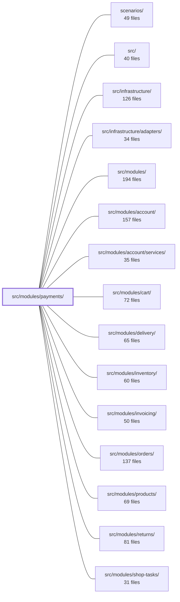

---
tags:
  - 2brain
  - 2brain/module
  - project/boilerplate-node-backend
type: module
module: src/modules/payments/
files: 105
updated: 2026-11-08T10:53:06.546654+00:00
---

# src/modules/payments/

## Purpose

The payments module owns the full lifecycle of an order's money: creating provider payment intents, confirming charges, processing webhooks and disputes, issuing and settling refunds, and supporting offline (bank-transfer) payments. It is a supporting subdomain in the *shop* group, sitting behind a provider port so that no concrete PSP code is baked into the codebase.

## Key parts

- **Domain layer (`domain/`)** — Pure, framework-free business rules. `lifecycle.ts` defines the status-set membership guards that double as concurrency predicates in the repository; `disputes.ts` encodes the invariants of buyer-initiated disputes (chargeback ≠ refund); `transfer-reference.ts` mints/validates ISO 11649 bank-transfer references; `display-status.ts` maps internal status to the Shopify-facing financial label.
- **Provider port (`providers/`)** — `index.ts` is the single interface every real PSP must implement; `registry.ts` is the process-wide registration point so test doubles can substitute at preload; `errors.ts` isolates the throwables an adapter may raise without creating a circular import.
- **Controllers (`controllers/`)** — One thin HTTP handler per endpoint (intent, confirm, sync, webhook, refund create/settle/cancel, search, attention, methods, order-scoped reads/writes). All business logic lives in the service layer; controllers parse, delegate, and shape the response.
- **Service & settlement layer** — Orchestrates the provider-confirmed choreography (`settlement.ts` referenced throughout), the read-model presenter, and the "attention" sweep that surfaces stale refunds, uncommitted stock, and pending order refunds.
- **Model & config** — `model.ts` is the Mongoose schema (one document per order, embedded refund/dispute sub-docs); `config.ts` centralises every deployment-tuned value (bank details, offered methods, signing secrets, grace windows) in a single `defineConfig` instance.
- **Contracts & manifests** — `openapi.yaml` (public REST API), `asyncapi.webhooks.yaml` (the seven `payment.*` webhook channels, merged by the contract bundler), `authorization.yaml` (fine-grained action/subject rules and named rule-sets), `module.yaml` / `module.ts` (kernel mount manifest: routes, jobs, listeners, rate-limit budgets, personal-data hooks).
- **Cross-cutting declarations** — `events.ts` (domain-event payload types via module augmentation), `analytics.ts` (type-safe event names), `audit.ts` (decision vs. settlement audit strings), `metrics.ts` (Prometheus counters), `emails.ts` (five customer-facing email templates), `jobs.ts` (abandoned-attempt reaper, effect-retry sweep).
- **Presentation & routing** — `presenter.ts` is the single transform from `PaymentDocument` → wire contract (payer view vs. staff view); `order-routes.ts` mounts the two order-scoped payment endpoints as a sub-router.

## How it connects

- **`src/modules/orders/`** — The payment document is 1:1 with an order (unique index on `orderId`). Order-scoped routes (`GET/POST /orders/:id/payments`) are mounted via `order-routes.ts`. The attention sweep checks whether an order still owes its refund, and dispute rules constrain what can be done to the payment while a chargeback is open.
- **`src/modules/inventory/`** — The "attention" payload surfaces payments that still owe their stock commit, tying payment settlement back to inventory release.
- **`src/modules/invoicing/`** — Refund and dispute handling intersects with credit-note generation; the disputes domain explicitly notes that a chargeback "never issues a credit note," leaving that to the invoicing module.
- **`src/modules/returns/`** — Refunds in this module are the monetary counterpart to a return initiated elsewhere; admin-initiated refunds operate on the payment without altering the order status, keeping the two subdomains decoupled.
- **`src/modules/cart/` / `src/modules/products/`** — Payment intent creation depends on the cart's line items and products for amount freezing; the public `GET /payments/methods` endpoint lets a guest discover checkout options before any account or cart state exists.
- **`src/modules/account/` / `src/modules/users/`** — Authorization rules in `authorization.yaml` bind actions to subjects at tenant scope; personal-data lifecycle hooks declared in `module.ts` integrate with the account module's export surface.
- **`src/infrastructure/`** — The audit map, analytics port, and mailer adapter all live here. The payments module registers its audit strings, event names, and email templates into those shared ports without importing concrete implementations.
- **`src/modules/shop-tasks/`** — The two scheduled jobs (abandoned-attempt reaper, effect-retry sweep) declared in `jobs.ts` are executed by the shared job runner.

## Where to start

1. **`domain/lifecycle.ts`** — Read this first to understand the six-plus payment/refund states and the membership guards that control every legal transition. Every other file in the module (repository writes, webhook handlers, refund endpoints) ultimately calls into these sets, so grasping them makes the rest of the code read naturally.
2. **`providers/index.ts`** — Next, read the provider port to see the complete contract a PSP must satisfy (create intent, confirm, capture, refund, fetch status, verify webhook). Because the boilerplate ships zero real provider code, this file is the cleanest single place to understand *what* the module expects of the outside world before diving into any specific adapter.

## Connected modules

[[boilerplate-node-backend_ROOT|/ (repository root)]] · [[boilerplate-node-backend_scenarios|scenarios/]] · [[boilerplate-node-backend_src|src/]] · [[boilerplate-node-backend_src_infrastructure|src/infrastructure/]] · [[boilerplate-node-backend_src_infrastructure_adapters|src/infrastructure/adapters/]] · [[boilerplate-node-backend_src_modules|src/modules/]] · [[boilerplate-node-backend_src_modules_account|src/modules/account/]] · [[boilerplate-node-backend_src_modules_account_services|src/modules/account/services/]] · [[boilerplate-node-backend_src_modules_cart|src/modules/cart/]] · [[boilerplate-node-backend_src_modules_delivery|src/modules/delivery/]] · [[boilerplate-node-backend_src_modules_inventory|src/modules/inventory/]] · [[boilerplate-node-backend_src_modules_invoicing|src/modules/invoicing/]] · [[boilerplate-node-backend_src_modules_orders|src/modules/orders/]] · [[boilerplate-node-backend_src_modules_products|src/modules/products/]] · [[boilerplate-node-backend_src_modules_returns|src/modules/returns/]] · … and 2 more

## Files
- `src/modules/payments/analytics.ts` — Declares the analytics event names for the payments module and registers them with the analytics port's `AnalyticsEventMap` via TypeScript module augmentation. Importing this file gives any caller type-safe event names (a typo fails at compile time) without pulling in a published copy.
- `src/modules/payments/asyncapi.webhooks.yaml` — AsyncAPI **fragment** (not a standalone document) that declares the seven `payment.*` webhook channels, their send operations, and the message/payload schemas the payments module publishes. It is merged into the top-level `webhooks/asyncapi.yaml` by the contract bundler and is only visible in `GET /webhooks/events` while the payments module is registered.
- `src/modules/payments/audit.ts` — Declares the audit-action strings emitted by the payments module and registers them in the infrastructure audit map via TypeScript declaration merging. It is the single source of truth for every payment-related audit event, separating "decision" events (refund requested) from "settlement" events (refund settled, refund canceled) and marking admin-only actions with an `admin.` prefix.
- `src/modules/payments/authorization.yaml` — Declares the fine-grained authorization rules and named rule-sets for the payments module. Each rule binds an action (`read`, `display`, `create`) to a subject (`Payment`, `Refund`) at tenant scope, and the `sets` block groups individual rules into reusable permissions that an identity or role can be granted.
- `src/modules/payments/config.ts` — Centralised, per-call configuration for the payments module. Declares every deployment-tuned value related to money — bank-transfer account details, the set of offered payment methods, webhook signing secrets, and the grace windows that drive background effect sweeps — in a single `defineConfig` instance so no other file transcribes its own fallback copy.
- `src/modules/payments/controllers/get-order-payments.ts` — Handler for `GET /orders/:id/payments`. Returns the payment records (intents and their statuses) for a given order so the order-page payment panel can rehydrate on load. An order with no payment started returns `{ items: [] }`; a 404 is returned only when the caller cannot see the order (authorization failure), not when the order simply has no payments.
- `src/modules/payments/controllers/get-payment-attention.ts` — Thin Express controller that handles `GET /payments/attention`. It delegates entirely to `paymentService.listAttention()` and forwards the result (or error) to the HTTP response. The "attention" payload surfaces items still needing human action: stale and hand-owed refunds, payments owing their stock commit, and orders owing their refund.
- `src/modules/payments/controllers/get-payment-methods.ts` — Express handler for `GET /payments/methods`. It returns the shop's available payment methods in a standard success envelope. The endpoint is intentionally public (no auth) so that a guest can discover checkout options before creating an account.
- `src/modules/payments/controllers/get-payment.ts` — HTTP handler for `GET /payments/:id`. Resolves a single payment by its ID and returns it as a JSON response. It exists as the destination target for the `Location` header set after a successful `POST /payments` and for operator-refund redirects that send a client back to read the payment they just interacted with.
- `src/modules/payments/controllers/get-payments.ts` — Single controller that serves both `GET /payments` and `POST /payments/search` (the staff payments list). It defines a query-string-aware Zod schema on top of the generated API body schema and delegates the actual lookup to `paymentService.listPayments`, using the shared `createSearchController` factory to wire up parsing, validation, and response shaping in one place.
- `src/modules/payments/controllers/get-refund.ts` — Handler for `GET /payments/:id/refunds/:refundId`. Returns a single refund record addressed through its parent payment (the read counterpart to `POST /payments/:id/refunds`). Delegates all data access to the payment service and translates the result into an HTTP response.
- `src/modules/payments/controllers/get-refunds.ts` — HTTP controller for `GET /payments/refunds`. It validates query-string parameters (pagination + optional filters) and delegates to `paymentService.listRefunds`, returning one row per refund for the Refunds tab in the UI.
- `src/modules/payments/controllers/post-order-payment.ts` — HTTP handler for `POST /orders/:id/payments`. Records an offline payment (money that never passed through the card provider) against an existing order. The permission gate (`create:Payment`, admin-only) is enforced at the route level, not here.
- `src/modules/payments/controllers/post-payment-confirm.ts` — Handles `POST /payments/:id/confirm` — the step where the browser hands over the tokenised payment method and the service fires the actual charge events. It normalises three distinct outcomes (succeeded, declined, in-flight) into appropriate HTTP responses and records a Prometheus counter for each.
- `src/modules/payments/controllers/post-payment-refund-cancel.ts` — Controller handler for `POST /payments/:id/refunds/:refundId/cancel`. It lets staff void a refund before it can be paid out. The handler extracts route IDs and the request body, delegates the cancellation to the payment service, and returns the voided refund object.
- `src/modules/payments/controllers/post-payment-refund-settle.ts` — Express controller for `POST /payments/:id/refunds/:refundId/settle`. It lets an operator confirm that a refund's funds have been returned outside the application, then responds with the settled refund object. The handler validates both path IDs, delegates to the payment service, and formats the success or error response.
- `src/modules/payments/controllers/post-payment-refund.ts` — Handler for `POST /payments/:id/refunds`. Processes a standalone (admin-initiated) full or partial refund on a payment without altering the associated order's status. Returns **201** with the new `Refund` record and a `Location` header identifying it.
- `src/modules/payments/controllers/post-payment-sync.ts` — Controller handler for `POST /payments/:id/sync`. When the browser signals it has finished a provider-side flow (3-D Secure challenge, wallet sheet), this endpoint re-reads the provider's own payment record and applies it, making the happy path *feel* synchronous to the user while the webhook remains the authoritative settlement mechanism. The operation is idempotent: a payment that is already settled responds without contacting the provider again.
- `src/modules/payments/controllers/post-payment-webhook.ts` — Handles `POST /payments/webhook/:provider`. It receives payment-status callbacks from external providers, verifies the signature (delegated to the provider adapter), and hands the parsed event to the payment service for a single idempotent apply. It deliberately uses no session authentication; the raw-body signature is the sole credential.
- `src/modules/payments/controllers/post-payment.ts` — Thin HTTP controller for `POST /payments`. It validates the request body, delegates intent creation to the payment service, and returns the provider's `clientSecret` to the client. Business logic (ownership checks, `pending` gate, amount freezing) lives entirely in the service; no audit or analytics events fire here because a payment intent is a preparatory step, not a business event—those are emitted on confirm.
- `src/modules/payments/domain/display-status.ts` — Derives the Shopify `displayFinancialStatus` label for a payment from its stored status and refund records, and provides the inverse: a Mongo query that selects payments by that label. The label function and the filter are written side-by-side in this file because they must stay in agreement — the integration suite verifies every label both ways.
- `src/modules/payments/domain/disputes.ts` — Pure domain rules that determine what a shop may still do with a payment while a buyer-initiated dispute (inquiry or chargeback) stands. The file performs no I/O and produces no side effects; it only classifies dispute state and computes the monetary ceiling the bank has already taken. A key semantic distinction it enforces: a chargeback is **not** a refund — it lowers `charged`, never `refunded`, and never issues a credit note.
- `src/modules/payments/domain/index.ts` — Barrel file for the payments domain layer. It re-exports every public symbol from four sibling modules (`lifecycle`, `disputes`, `transfer-reference`, `display-status`) so consumers import from a single path. The domain layer is deliberately framework-free (no Express, Mongoose, or tier dependencies)—enforced by lint rules—and exists as a folder because the status vocabulary (6+ states) exceeds the project's threshold for a scattered-constant approach.
- `src/modules/payments/domain/lifecycle.ts` — Defines the status sets and guard predicates that control which payment and refund transitions are legal. Every exported array is read both as a membership test and as the `$in` operand of the conditional writes in `repository.ts` (`updateStatusIfIn` / `upsertConfirmable`), so the sets *are* the concurrency guard. There is no explicit from→to graph: all transitions funnel through `settlePayment`, which decides the landing status; these sets only answer "may I still move this payment/refund."
- `src/modules/payments/domain/transfer-reference.ts` — Implements ISO 11649 "RF" creditor-reference generation and validation for `bank_transfer` payments. A deterministic reference is minted from the order's ObjectId when the transfer opens; admins later paste the reference back from their bank's website, and this module verifies the Mod-97 check digits before any lookup proceeds.
- `src/modules/payments/emails.ts` — Pure email-builder functions for the five customer-facing messages the payments module sends: payment received, refund issued, refund undeliverable, bank-transfer instructions, and transfer deadline expired. Each function takes a locale plus domain data and returns a fully translated `EmailContent` object whose `template` field the mailer adapter interpolates — the same "language is an argument, output is finished text" convention as `@modules/orders/emails` and `@modules/account/emails`.
- `src/modules/payments/events.ts` — Declares the payments module's domain event payload types by augmenting the kernel's `DomainEventMap` (TypeScript module augmentation in `@kernel/events`), and exports a string constant for each event name. It is the single source of truth for what data each payment event carries, decoupled from where and how the events are emitted.
- `src/modules/payments/globals.d.ts` — Augments Express's `Request` interface with a payments-specific flag (`paymentConfirmDeclined`) via TypeScript declaration merging. It exists here — rather than in infrastructure's global `globals.d.ts` — because the architecture rule (`docs/theory/layers.md`) forbids that file from naming a module, so module-local augmentations live in the owning module.
- `src/modules/payments/index.ts` — Public barrel (barrel export) for the payments module. It is the **only** import surface that sibling modules are permitted to use, enforcing the strategic-DDD rule documented in `docs/theory/strategic-ddd.md` §5. Internals such as `paymentRepository` and the model's runtime stay hidden; all writes are routed through the provider-confirmed choreography in `services/settlement.ts` rather than exposed as direct document writes.
- `src/modules/payments/jobs.ts` — Declares the two scheduled jobs owned by the `payments` module: the abandoned-attempt reaper and the effect-retry sweep. Each entry is a `JobDeclaration` that binds a pre-generated job descriptor (from `jobs.generated`) to the concrete service function(s) that perform the work.
- `src/modules/payments/metrics.ts` — Defines the two Prometheus counters owned by the payments domain: one for confirmation-attempt outcomes and one for settlement mismatches. Counters live here (in the module) rather than in `infrastructure` so the domain owns its own metrics; the module overview endpoint reads them without importing this file directly.
- `src/modules/payments/model.ts` — Defines the Mongoose schema and TypeScript document interfaces for the payment collection — one document per order (enforced by a unique index on `orderId`). It is the single source of truth for the payment's shape: status lifecycle, embedded refund and dispute sub-documents, and the serialization/typing contracts that every other file in the module reads from or writes to.
- `src/modules/payments/module.ts` — The payments module's manifest entry. It declares everything the kernel needs to mount, subscribe, and expose the payments domain: HTTP routes, background jobs, public webhook event mappings, rate-limit budgets, personal-data lifecycle hooks, and domain-event listeners. It exists so the app tier can discover the module generically via the registry rather than importing each piece individually.
- `src/modules/payments/module.yaml` — Module declaration for the **payments** supporting subdomain (group: *shop*). It registers the module's cross-module dependencies, its rate-limit budgets, and its scheduled background jobs, so the runtime can wire up payment handling ("an order's money, behind a provider port") without hard-coding those concerns into handler code.
- `src/modules/payments/openapi.yaml` — OpenAPI 3.1.0 contract for the **payments** module. It declares the module's public API surface (endpoints, schemas, error codes, and personal-data export shape) so the runtime bundler can register routes, validate requests, and generate client SDKs from a single source of truth.
- `src/modules/payments/order-routes.ts` — Express router that wires the two payment routes living under an order path (`GET /orders/:id/payments` and `POST /orders/:id/payments`). It exists so that payment operations scoped to a specific order can be mounted as a sub-router by the payments module, keeping URL hierarchy (Solidus-style nested resource) separate from the module's top-level payment routes.
- `src/modules/payments/presenter.ts` — Single transformation point from the stored `PaymentDocument` to the `Payment` wire contract. Every write endpoint (confirm, offline, refund, sync, intent) returns the result of `presentPayment` alone; `services/view.ts` layers `actions` on top for reads. Encodes the two-audience split: the default payer view and a staff view that re-exposes provider IDs and refund failure reasons the serializer always strips.
- `src/modules/payments/providers/errors.ts` — Defines the error types that payment provider implementations can throw. Split out of `providers/index.ts` so that an adapter (real or fake) can import and throw these errors without pulling in the port interface file, which itself imports the config and the registry the implementation is registered in — avoiding a circular dependency.
- `src/modules/payments/providers/index.ts` — This file is the **payment provider port** — the single interface a real PSP (Stripe, Adyen, …) must implement, plus every supporting type the rest of the payments module consumes. It exists so that no concrete provider is shipped: the boilerplate contains zero card-payment code, and a live project plugs in by adding one adapter file and one `registerPaymentProvider` call. The file is the canonical place to see *what a provider must answer*, without reading any specific adapter.
- `src/modules/payments/providers/registry.ts` — Provides a single, process-wide registry of payment provider implementations. It exists as an isolated module (importing only the registry helper and a type) so that test doubles can register themselves at preload without pulling in the full provider stack (config, orders, etc.) that `./index` would otherwise load.
- `src/modules/payments/providers/webhook-signature.ts` — Implements the shared HMAC-SHA256 signature scheme for PSP webhook deliveries. It provides both the **verify** half (production: check an inbound header against the raw body) and the **sign** half (tests and demo: mint a valid header so a delivery can be exercised end-to-end). Lives in its own file because the two halves are consumed in different places and because a real provider's native verifier (e.g. `stripe.webhooks.constructEvent`) replaces the verify half while this file stays as the canonical reference for the required discipline.
- `src/modules/payments/rate-limits.ts` — Declares and exports the five rate-limit budgets that protect the payments module's HTTP surface — the unauthenticated webhook route, the authenticated confirm/intent/sync routes — and wires a conditional human-challenge gate on top of the two decline budgets. Each budget is plain `RateLimitBudget` data (sourced from `rate-limits.generated`) converted to an Express middleware via the shared `buildRateLimiter` factory.
- `src/modules/payments/repository.ts` — Repository layer for the Payments domain. Wraps `paymentModel` (Mongoose) into a `Repository` built via the shared factory, and adds the specific guarded writes and lookups that payment flows actually need: intent/offline upserts keyed on `orderId`, dispute recording, refund-row searches, and a paginated staff list. The `unique` index on `orderId` makes "one payment per order" a database invariant, so upserts are a single `findOneAndUpdate` with no preceding read.
- `src/modules/payments/routes.ts` — Defines the Express router and route table for all payment operations (intent creation, confirmation, sync, webhook, refund lifecycle, and read-back). It centralises the security layering — authentication, permission checks, fresh-session enforcement, rate limiting, and idempotency — in one place so that individual controllers stay focused on domain logic.
- `src/modules/payments/services/announce.ts` — Moves a payment to `declined` and emits a `PAYMENT_FAILED` event in a single transactional unit, so a decline that commits is always announced and one that loses a race is never. This is the announce side of the payment lifecycle; `PAYMENT_SUCCEEDED` is handled separately by `settlement.ts`.
- `src/modules/payments/services/deadline.ts` — Provides the single service-level lookup for a refund's legal processing deadline. `tasks` calls it to date the work item it opens; when the law imposes no deadline (or the record is missing) it resolves to `undefined`, letting the caller choose its own timing.
- `src/modules/payments/services/disputes.ts` — Handles provider-side dispute reports arriving via webhook delivery. It stores the dispute state on the payment, appends staff-timeline rows to the order, and announces a domain event — all within a single Mongoose transaction. A dispute here is explicitly **not** a refund: it never modifies `amountRefunded`, order status, or credit notes.
- `src/modules/payments/services/effects.ts` — Provides two scheduled sweep operations that finish work a settlement left outstanding: retrying refunds the provider refused or never answered, and reconciling payments whose provider decided without delivering a webhook. Both sweeps share a sequential, batch-capped skeleton and return a count of items actually settled.
- `src/modules/payments/services/errors.ts` — Central collection of standardized HTTP error responses (409 / 404) and one domain error class for the payments service layer. It is a deliberate leaf module — no persistence or cross-module imports beyond infrastructure — so every file under `services/` can pull an error constant without introducing new dependency edges.
- `src/modules/payments/services/external-refunds.ts` — Handles refunds created outside the application (i.e., in the payment provider's own dashboard). When a refund event arrives, this module fetches the provider's refund list, distinguishes refunds already tracked locally from unknown ones, carries provider state onto existing records, and **imports** unknown succeeded refunds as settled records so that credit notes, buyer emails, and order stamps fire exactly as they would for an in-app refund.
- `src/modules/payments/services/index.ts` — Barrel file that assembles every payment-flow function from the sibling modules (`intent`, `settlement`, `refunds`, `effects`, `offline`, `transfer`, `notify`, `scope`, `view`, `retention`, `list`, `stats`, `deadline`) into a single `paymentService` handle. It exists so callers import one name instead of reaching into a dozen sub-files, and so the module's public surface is explicitly curated — internal choreography functions are deliberately left out.
- `src/modules/payments/services/intent.ts` — Entry point into the payments module's money-moving flow: creates (or refreshes) a payment intent at the provider for a given order, and provides the cancel counterpart. Every call that opens, resumes, or closes a provider-side intent flows through this file.
- `src/modules/payments/services/list.ts` — Staff-facing read endpoints for the Payments page: a paginated payment list, a paginated refund list, and a "needs-attention" feed. All three return `display:Payment`-shaped rows (each carries provider IDs). The file exists so the UI never touches the repository or domain logic directly — it composes pagination, order enrichment, canonical-reference parsing, and attention classification in one place.
- `src/modules/payments/services/notify.ts` — Buyer-facing email notifications for the payments module. Defines five mail functions that fire on payment lifecycle events (succeeded, refunded, refund undeliverable) or are called inline for bank-transfer specifics (instructions, expired). The core guarantee: a failed mail never undoes a money movement — every listener logs and swallows errors.
- `src/modules/payments/services/offline.ts` — Records a payment that arrived outside the card provider (cash, bank transfer, phone-order payment) and settles it through the same `settlePayment` path every card payment uses — order moves `pending → paid`, stock commits, and the standard events fire. It exists so that non-card money flows through identical domain logic rather than a parallel settlement branch.
- `src/modules/payments/services/refund-settlement.ts` — Shared settlement logic for refund records that reaches a terminal state: either the provider confirms the refund (status → `succeeded`, order stamped, `payment.refunded` outbox row committed) or the provider refuses it (status → `failed`, attempt counted). Split out of `refunds.ts` so that the provider-side sync flow (`./refund-sync.ts`) and the operator-driven send flow (`./refunds.ts`) can both call these functions without importing each other.
- `src/modules/payments/services/refund-sync.ts` — Bridges the provider's side of a refund to the local record. When a refund is still `pending`, a sweep re-reads the provider for a final status; when a webhook lists a refund (`external-refunds.ts`), the provider's report is applied here. The provider's own status is the sole authority — the delivery body itself changes nothing.
- `src/modules/payments/services/refunds.ts` — Implements the two entry points for returning money on a payment — the operator action `refundPayment` and the automatic `refundForOrder` (triggered by `order.canceled`) — both delegating to a shared `performRefund`. This file owns the full refund lifecycle: opening the record, calling the PSP, and settling the outcome. No other file in the payments module is permitted to move money out.
- `src/modules/payments/services/retention.ts` — Handles the post-movement lifecycle of payment records: detaching a user's ID during account erasure, producing an account's own payment data for export, and sweeping (deleting) abandoned payment attempts that never succeeded. It does not create, charge, or settle payments — it manages what happens to the row after the money event.
- `src/modules/payments/services/scope.ts` — Defines the four row-scope predicates every other payment service calls before reading or writing the `Payment` collection. It centralises the distinction between *read* scope (role-driven, may span all records) and *payer/buyer* scope (strictly the caller's own records), so that money-moving operations never inherit a broad `display:*` grant.
- `src/modules/payments/services/settlement.ts` — The single reconciliation point for all payment settlement. Whether the signal arrives via a browser-driven confirm/sync poll or a provider webhook, both paths funnel into this module so that money is settled exactly once. It detects provider-reported mismatches, performs the atomic `succeeded` write plus order state transition, and opens the refund path when the order can no longer accept the payment.
- `src/modules/payments/services/stats.ts` — Computes the payments "mix" for reporting: how much money came in, grouped by payment method, provider, and currency. It wraps the raw repository aggregation into a clean, typed result suitable for display or further processing.
- `src/modules/payments/services/transfer.ts` — Handles the payment-creation step for bank-transfer orders. When an order is placed with `paymentMethod: 'bank_transfer'`, this module opens a `requires_action` payment row (carrying the reference, deadline, and instructions) and mails the transfer instructions to the buyer. It exists so that the transfer payment is tied to the order lifecycle (`order.created`) rather than being created lazily at settlement time.
- `src/modules/payments/services/view.ts` — Read-only (GET) views for payments: fetch a payment by order, by id, or its refunds, and attach the `actions` block that tells the caller which follow-up mutations (pay, sync, refund, settleByHand, cancelRefund) are available to them. The `actions` shape intentionally mirrors the one `orders` publishes on `OrderActions`.
- `src/modules/payments/tests/contract/api.contract.test.ts` — HTTP-level contract tests for every `/payments` route. Each test asserts the exact status code, response envelope shape, error-code `code`, and header behavior a client can observe over the wire. Business/money rules are delegated to the unit suite; this file only pins that each documented contract branch (201 intent, 200 confirm, the distinguishable 409s, 404s, 422) is actually reachable and shaped correctly through the real HTTP stack.
- `src/modules/payments/tests/factories.ts` — Test-factory helpers for the payments module. Each function replays the same production entry point (the `order.created` listener, `paymentService` methods, the repository) so a test gets the exact rows and references a real flow would produce — without spinning up HTTP or event-bus machinery.
- `src/modules/payments/tests/integration/announce.test.ts` — Integration tests for the payment announcement path: verifying that `payment.succeeded` and `payment.failed` domain events are published via the transactional outbox, atomically with the payment state change. Confirms idempotency (no double-publish on re-confirm), rollback when a downstream commit fails, and that declined payments are written and announced as a single unit. Runs against a real MongoDB instance.
- `src/modules/payments/tests/integration/canceled.test.ts` — Integration tests covering the **canceled** payment lifecycle: what happens when an order is canceled while a payment intent is open, how late provider reports (webhooks, buyer sync, reconciliation) interact with a canceled payment, and the retention reaper's treatment of canceled records. The provider side is driven by a fake PSP; the application side is exercised only through its public settlement and service entry points.
- `src/modules/payments/tests/integration/disputes.test.ts` — Integration tests for the buyer-bank dispute (chargeback/inquiry) flow: how a provider's dispute report is stored on the payment, announced via the outbox, surfaced on the order's staff timeline, and how it constrains (or doesn't) subsequent refunds. Uses a real MongoDB instance, the fake payment provider's dispute lever, and exercises everything through `paymentService`'s public API.
- `src/modules/payments/tests/integration/external-refunds.test.ts` — Integration tests for the "external refund" path: refunds that originate in the payment provider's own dashboard and are discovered via a webhook event. Verifies one-time import with correct records, matching (not re-importing) of the app's own refunds, rejection of pending/failed/foreign-currency events, overshoot handling, and the hold-and-cancel workflow when an external refund leaves no remaining amount for an in-flight refund of the app.
- `src/modules/payments/tests/integration/hand-refund.test.ts` — Integration test suite for the "hand refund" workflow on offline (cash) payments. It verifies, against a real Mongo instance, that operator-initiated refunds open a `pending` record, that `settleRefundByHand` is the sole path to confirm the money went back, and that the cancel listener, audit trail, outbox announcements, permission visibility, and legal-due-date logic all behave correctly.
- `src/modules/payments/tests/integration/intent-provider-ref.test.ts` — Integration test verifying the single-intent invariant for a payment row: `createIntent` must resume the stored provider reference on repeat calls, and must reject (409) and cancel any stray intent the adapter opens instead. It exists to guard against a customer paying an intent the database does not name, which would orphan a subsequent webhook.
- `src/modules/payments/tests/integration/late-payment.test.ts` — Integration tests for the race where a payment (card or offline) arrives after the order's inventory hold has expired but before the order is formally canceled. Verifies that the system either re-takes stock and pays the order, or keeps the order pending, issues a refund, and lets the late cancellation proceed — without overselling.
- `src/modules/payments/tests/integration/payment-velocity.test.ts` — Integration tests for the three rate-limiting layers on `POST /payments/:id/confirm`: the per-account attempt budget, the per-account decline budget, the shared address-block decline budget, and the anti-bot challenge gate. The tests exercise the limiters through trivial Express handlers (not the real `postPaymentConfirm` route) so the property under test—isolation of limiter behavior—isn't confounded by database round trips. The real route's middleware ordering is covered separately in `payments/tests/unit/routes.test.ts`.
- `src/modules/payments/tests/integration/provider-ref-lookup.test.ts` — Integration test that guards against MongoDB operator-injection (e.g. `{"$ne": null}`) reaching the provider-reference lookup. It asserts that `findByProviderRef` rejects a non-string operator object rather than silently matching every payment, covering the case where a caller bypasses the webhook port's type parsing and passes a `JSON.parse`-derived `any` cast to `string`.
- `src/modules/payments/tests/integration/reconcile.test.ts` — Integration tests for the payment reconciliation sweep and the cancel-time provider query. The core scenario: the PSP charges a card but the confirming webhook is lost, leaving the payment stuck in an in-flight state. The sweep asks the provider about those stale payments and settles them; the cancel path asks the provider once when it refuses to close an intent that already succeeded.
- `src/modules/payments/tests/integration/refund-cancel.test.ts` — Integration test for `paymentService.cancelRefund`, verifying the full business rule: a refund may be voided only if money provably did not move (hand-paid `pending`, or a card refusal with a clear reason). It asserts the happy path (status flip, share release, audit, timeline, outbox event) and every rejection path (already settled, unclear/in-flight, double-cancel, unknown id), including a race against the retry sweep. Runs against real Mongo through the service's public API.
- `src/modules/payments/tests/integration/refund-claim.test.ts` — Integration tests (against a real MongoDB instance) for the refund-claim lifecycle: a conditional write with a fence token guarantees only one worker claims a refund, a definite refusal is terminal, a retryable refusal backs off with a growing delay, a deregistered provider is marked `provider_removed` without further attempts, and a provider-side timeout is settled from the provider side rather than double-paid.
- `src/modules/payments/tests/integration/refund-email.test.ts` — Integration test verifying the email-notice policy around refunds: a standalone (non-return) refund triggers a `payments.refund-issued` mail to the buyer, while return-attached refunds and provider-refused refunds stay silent. Also asserts authorization boundaries for who may initiate a return refund.
- `src/modules/payments/tests/integration/refund-failed-event.test.ts` — Integration test verifying the deduplication and finality contract of the `payment.refund_failed` outbox event: a definite refusal emits a single `final: true` row; a transient refusal emits `final: false`; a retry failing with the same reason is silent; and a retry that fails with a *different* reason re-news the event. Runs against real Mongo with the fake payment provider's refusal lever.
- `src/modules/payments/tests/integration/refund-provider-status.test.ts` — Integration test (real Mongo) for the full lifecycle of a refund the provider accepts but holds in `pending`: it must answer 201 without announcing, be re-read (not re-sent) by the open-refund sweep, and settle exactly once via the provider or a webhook. Exercises the fake provider's `pending` lever and the outbox.
- `src/modules/payments/tests/integration/refund-reversal.test.ts` — Integration tests (against real MongoDB) that verify the full lifecycle when a payment provider reports a refund as failed: a settled refund that bounces is re-opened as owed exactly once, an open refund that never settled is failed for good, and neither case is ever re-sent to the provider or re-announced on redelivery. Also covers the race where the failure webhook arrives before the `refund()` call resolves.
- `src/modules/payments/tests/integration/refund-settle-card.test.ts` — Integration test for the operator's "settle by hand" action on a refused card refund. Verifies the full decision matrix: definitive refusals may be settled (one-time, not re-sent to the provider), unclear or in-flight refusals are rejected with 409, and the attention list surfaces refused refunds correctly. Runs against real Mongo through the services' public API.
- `src/modules/payments/tests/integration/refund-undeliverable.test.ts` — Integration tests covering the "refund undeliverable" flow: when a card refund is permanently refused (lost/stolen card, declined) or an already-settled refund is reversed by the bank, the buyer receives exactly one email with no reason stated, and the buyer-facing refund view exposes `owedAnotherWay` instead of a retry message. Also verifies that transient or non-card-specific failures mail nobody, and that a manual settle clears the undeliverable state in favour of a success mail.
- `src/modules/payments/tests/integration/refunds.test.ts` — Integration tests for the refund flow against a real Mongo database. They verify the conditional-write guarantees that make partial refunds safe: a refund row is opened *before* the provider is called, so racing refunds cannot over-refund, a provider failure leaves the record open for the sweep to retry with the same idempotency key, and the payment's `amountRefunded` always sums correctly in minor units.
- `src/modules/payments/tests/integration/retention.test.ts` — Integration tests for payment retention semantics: verifying that account erasure *detaches* (unsets `userId`) rather than deletes a payment, and that the `reapAbandonedPayments` sweep only reclaims unsettled attempts past a configurable window. Runs against a real test database with full module wiring.
- `src/modules/payments/tests/integration/service.test.ts` — Integration tests that pin the payments service's core invariants against real MongoDB: the intent freezes the order's published total (shipping included), confirmation moves order `pending → paid` and payment `→ succeeded` as a conditional write, a decline is retryable (not terminal), and one payment per order is a database fact. The provider is the `fake` double; everything else (orders, inventory, outbox, events) runs for real.
- `src/modules/payments/tests/integration/settlement-email.test.ts` — Integration test that pins the `payment.succeeded` listener's contract: the buyer receives exactly one `payments.payment-received` email when a payment actually commits stock, and receives none on a decline or on a no-op retry of an already-settled payment. The placed-order confirmation email is deliberately out of scope here.
- `src/modules/payments/tests/integration/settlement-mismatch.test.ts` — Integration test verifying the guard-rail for a payment provider that reports `succeeded` but collected money that does not match the frozen payment (wrong amount, wrong currency, or wrong payment ID). It asserts the full negative outcome: order canceled, collected funds refunded exactly once, no `payment.succeeded` outbox event, no stock committed, no invoice issued, and a single `PAYMENT_AMOUNT_MISMATCH` event for operational follow-up. Also covers the sync, webhook, and no-figures entry points, the happy-path regression, float tolerance, and the reservation-expiry crash recovery path.
- `src/modules/payments/tests/integration/settlement-reports.test.ts` — Integration test verifying that settlement "reports"—a `payment.failed` outbox event, an audit row, and an analytics event—fire exactly once per real payment transition, regardless of how many times the same transition is observed (webhook replay, repeated polling, sync of an already-final payment). Uses a real MongoDB instance.
- `src/modules/payments/tests/integration/staff-reads.test.ts` — Integration tests (real MongoDB) for the three staff-facing Payment reads — `listPayments`, refund visibility, and `listAttention`. The subject is that every `displayStatus` label the server derives is the same label its filter matches, that provider IDs and failure reasons reach staff but never the payer, and that a needs-attention row disappears once its stored problem is resolved.
- `src/modules/payments/tests/integration/timeline.test.ts` — Integration test (real Mongo) that verifies which events the payments module writes onto an order's timeline and what data those events carry. Covers the `paid` row, a single `payment_declined` row, and the three refund moments (`refund_issued`, `refund_settled`, `refund_failed`), asserting ids, amounts, closed failure codes, actor attribution, and role-based visibility.
- `src/modules/payments/tests/integration/transfer-reference-filter.test.ts` — Integration test that pins the `transferReference` filter on the staff payment list and its downstream effect: a valid reference finds exactly its own payment (regardless of spacing/case), invalid or unmatched inputs find nothing, and the order the filter names is the one the existing offline-settle endpoint then marks paid.
- `src/modules/payments/tests/integration/transfer.test.ts` — End-to-end integration test for the bank-transfer payment lifecycle: opening the payment row when an order is placed, presenting the instructions (IBAN, BIC, reference, deadline), recording a late or on-time settlement, handling expiry vs. customer cancellation, and matching a transfer that arrives after the order is already closed. Runs against a real MongoDB instance; only the mailer adapter is mocked.
- `src/modules/payments/tests/unit/config.test.ts` — Unit tests for the payment-configuration module (`../../config`). Covers the pure, environment-reading helpers that power `GET /payments/methods`, checkout availability, and the boot-time `validateBankTransferConfig` check. No database or network is involved.
- `src/modules/payments/tests/unit/display-status.test.ts` — Unit tests for `displayStatusOf`, the pure function that resolves the human-facing label of a payment. The tests pin down the precedence rule: an open refund overrides the stored `PaymentStatus`, and `amountRefunded` is only consulted when no refund is still pending.
- `src/modules/payments/tests/unit/emails.test.ts` — Unit tests for the four payment email builders in `payments/emails.ts`. They verify that each email renders the correct template name, itemised lines, currency-formatted totals, order links, and locale-appropriate copy—because a formatting slip in a billing email is indistinguishable from a billing error to the recipient.
- `src/modules/payments/tests/unit/jobs.test.ts` — Unit test that guards the lease configuration of the `sweep:payment-effects` job, ensuring its TTL is strictly longer than the 5-minute sweep interval so a hung provider call cannot cause a second pass to resend the same refund keys.
- `src/modules/payments/tests/unit/module.test.ts` — Boot-time configuration validation tests for the payments module. It verifies that `assertModuleConfig` correctly accepts, rejects, or short-circuits the two environment-variable checks that belong to this file: the `NODE_PAYMENT_PROVIDER` selector and the `NODE_PAYMENT_WEBHOOK_SECRET` ring. The goal is to surface misconfiguration at startup rather than on the first payment call.
- `src/modules/payments/tests/unit/providers.test.ts` — Unit tests for two things the payment-provider port exposes: the shared webhook-signature discipline (`sign` / `verify` / `WebhookRejected`) and the `resolvePaymentProvider` selection function. No database, no external mocks — the file exercises pure logic and env-var-driven configuration in isolation.
- `src/modules/payments/tests/unit/rate-limits.test.ts` — Unit tests that assert the *structural invariants* of the payment rate-limit budget declarations in `paymentsRateLimits` — specifically the relative magnitudes, shared windows, keying strategy, and skip-successful behavior of the confirm-attempt, confirm-decline, decline-block, and intent-sync budgets. It exists to pin the *relationships between* those numbers (decline < attempt, block > account, shared hourly window) so refactors that silently break the intended tiering are caught.
- `src/modules/payments/tests/unit/refund-rules.test.ts` — Unit tests for the pure refund-rule functions that decide what a staff operator may do with an existing refund: whether it is still open, may be voided, may be settled by hand, whether it exceeds the remaining refundable amount, and the legal deadline tied to a return. Each test encodes the business contract of those decisions without touching a database or provider SDK.
- `src/modules/payments/tests/unit/routes.test.ts` — Unit test that pins the **router-level security contract** of the payments module: which endpoints exist, in what order, and which guard each one carries. It treats route order and guard presence as invariants (not just "does it work") because moving a route below the auth wall or dropping a guard would silently break production with no runtime error.
- `src/modules/payments/tests/unit/schema-contract.test.ts` — Locks down the payment schema's contract as a set of executable assertions: required fields, the `unique` index on `orderId` (the module's entire idempotence guarantee), reference integrity, type choices, enum bounds, and safe defaults. It exists so that a schema change that silently breaks any of these invariants fails CI instead of letting the shop charge an order twice.
- `src/modules/payments/tests/unit/transfer-reference.test.ts` — Unit tests for the `buildReference` / `parseReference` pair in the payments domain, verifying the two guarantees that matter for matching a payment reference to the correct order: round-trip fidelity and rejection of mistyped input rather than silent mis-resolution.

---
[[boilerplate-node-backend_INDEX|← boilerplate-node-backend index]]
