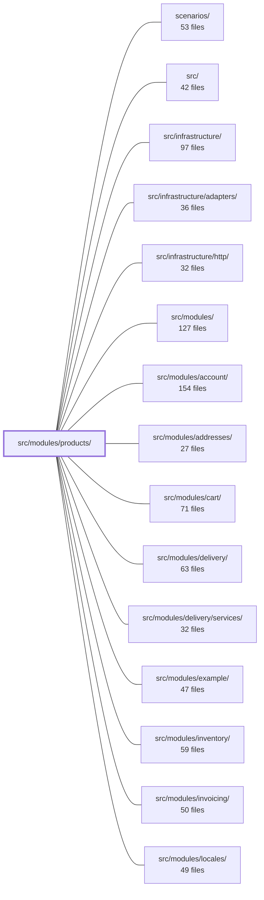

---
tags:
  - 2brain
  - 2brain/module
  - project/boilerplate-node-backend
type: module
module: src/modules/products/
files: 66
updated: 2026-10-29T19:28:31.652287+00:00
---

# src/modules/products/

## Purpose

The products module owns the shop's product catalogue: its data shape, multilingual translations, derived availability/stock fields, tax-rate resolution, and the full HTTP surface for public reads (search, detail, facets) and admin writes (create, update, soft-delete, restore). It is a strategic-DDD leaf context—it emits domain events (`product.created`, `product.deleted`) so that sibling modules (cart, orders, wishlist, inventory) conform to its model without creating circular imports.

## Key parts

- **Domain rules** (`domain/`) — Pure, clock-injected predicates and derivations: `stock.ts` (available units, in-stock/low-stock flags), `buyable.ts` (orderability + transition detection), `preorder.ts`, `backorder.ts`, and the barrel `domain/index.ts`. These are the module's invariants, importable by any layer without touching HTTP or Mongoose.
- **Data layer** — `model.ts` (Mongoose schema, Zod validation, TypeScript interfaces; the single owner of the product document shape) and `repository.ts` (CRUD via the shared factory, public-scoping queries, facet counts, stock-cache mirror).
- **Services** (`services/`) — The business-logic layer behind one `productService` object:
  - `crud.ts` / `translated-write.ts` — Transactional create/update, keeping translation rows and fallback columns in sync.
  - `search.ts` / `read.ts` / `lookups.ts` — Locale-aware search, scoped single-product reads, and the read-only door siblings use.
  - `remove.ts` — Soft/hard delete and restore with outbox events.
  - `stock-view.ts` / `translation-view.ts` — Ability gates for stock counters and full-locale visibility.
- **HTTP surface** — `routes.ts` (Express router, cache-scope policy, permission checks), `controllers/` (thin adapters delegating to `productService`), and `openapi.yaml` (the 3.1.0 contract for client codegen and docs).
- **Module wiring** — `module.ts` (kernel manifest: routes, config, locales, image pipeline, event registration), `index.ts` (the only public barrel), `config.ts` (VAT rates, URL template), `tax.ts` (taxClass → rate), `events.ts` / `analytics.ts` / `audit.ts` (event and audit vocabulary registration).
- **Presentation & support** — `presenter.ts` (document → public contract, computes derived fields once), `browser-events.ts` (analytics payload shaping), `factories.ts` (fixture builder).
- **Tests** (`tests/`) — Contract tests pinned to `openapi.yaml`, stock-visibility integration tests, and a test-database factory for sibling-module suites.

## How it connects

- **`src/modules/inventory/`** — Inventory writes `onHand`/`reserved` counters onto the product document via `productService.syncStockCache`; the products module then derives `available`, `inStock`, and `lowStock` for catalogue reads (no join needed).
- **`src/modules/orders/`** (and `src/modules/payments/`) — Freeze the VAT rate resolved by `tax.ts` at order-creation time; they never re-derive it.
- **`src/modules/cart/`, `src/modules/returns/`, wishlist** — Subscribe to `product.deleted` / `product.created` domain events to clean up or refresh line items; they never import the products repository directly.
- **`src/modules/locales/`** — Supplies the translation infrastructure that `translated-write.ts` and `translation-view.ts` use to persist and gate multi-locale content.
- **`src/modules/account/`, `src/modules/users/`** — Provide the session and ability checks (`read:StockLevel`, admin write permissions) that `stock-view.ts`, `translation-view.ts`, and `routes.ts` enforce.
- **`scenarios/`** — `factories.ts` seeds the `shop` scenario catalogue; `tests/factories.ts` persists realistic documents for sibling-module integration tests.
- **`src/infrastructure/`** — Supplies the shared repository factory, HTTP kernel, event bus, and outbox that the module's `module.ts` registers into.

## Where to start

1. **`src/modules/products/index.ts`** — The public barrel. Reading it tells you exactly what sibling modules may import and what the module's contract is, without pulling in internals.
2. **`src/modules/products/domain/index.ts`** (then `domain/stock.ts` and `domain/buyable.ts`) — The pure business rules are the module's invariants. Understanding *what* makes a product buyable or in-stock before reading the services or controllers makes the rest of the module far easier to follow.

## Connected modules

[[boilerplate-node-backend_ROOT|/ (repository root)]] · [[boilerplate-node-backend_scenarios|scenarios/]] · [[boilerplate-node-backend_src|src/]] · [[boilerplate-node-backend_src_infrastructure|src/infrastructure/]] · [[boilerplate-node-backend_src_infrastructure_adapters|src/infrastructure/adapters/]] · [[boilerplate-node-backend_src_infrastructure_http|src/infrastructure/http/]] · [[boilerplate-node-backend_src_modules|src/modules/]] · [[boilerplate-node-backend_src_modules_account|src/modules/account/]] · [[boilerplate-node-backend_src_modules_addresses|src/modules/addresses/]] · [[boilerplate-node-backend_src_modules_cart|src/modules/cart/]] · [[boilerplate-node-backend_src_modules_delivery|src/modules/delivery/]] · [[boilerplate-node-backend_src_modules_delivery_services|src/modules/delivery/services/]] · [[boilerplate-node-backend_src_modules_example|src/modules/example/]] · [[boilerplate-node-backend_src_modules_inventory|src/modules/inventory/]] · [[boilerplate-node-backend_src_modules_invoicing|src/modules/invoicing/]] · … and 7 more

## Files
- `src/modules/products/analytics.ts` — Declares the products-domain analytics event names and registers them into the app-wide `AnalyticsEventMap` type. It exists so the products module can emit typed discovery events (`products_searched`, `product_viewed`) through the shared analytics port without duplicating the string literals at call sites.
- `src/modules/products/audit.ts` — Declares the audit-action vocabulary for the products module and registers it into the app-wide `AuditActionMap` via TypeScript declaration merging. Only write operations (create, update, delete, restore) are audited; catalogue reads are public and unauthenticated, so there is no actor to record.
- `src/modules/products/browser-events.ts` — Defines how the two product-page browser events (`POST /analytics/events` request bodies) are transformed into analytics report payloads. It is the runtime "relay" half of the analytics contract; the request shapes live in `./openapi.browser-events.yaml` and are folded into the analytics contract by the bundler.
- `src/modules/products/config.ts` — Defines the products module's deployment configuration — the two VAT rates and the product-page URL template — using a lazy-read pattern (call-site accessors rather than captured-at-import values) so tests can vary a rate per case. A rate change reaches production only on restart, like every environment variable.
- `src/modules/products/controllers/create-product.ts` — Admin-facing HTTP handler for `POST /products`. It decodes the multipart or JSON request body (including a base64 image upload and per-language translations), validates the payload against the service's Zod schema, persists the product via `productService.create`, and returns a `201` with the new product or an appropriate error.
- `src/modules/products/controllers/delete-products.ts` — Admin endpoint controller for deleting a product by ID. It is a thin wiring layer that plugs `productService.removeById` into the shared `createDeleteController` factory, so the actual HTTP handling (route parsing, `?hardDelete` flag, 404 response) is inherited rather than re-implemented.
- `src/modules/products/controllers/get-catalogue-facets.ts` — A thin HTTP adapter that exposes catalogue facet counts (categories and tags with their usage counts) at `GET /products/facets`. It exists to bridge the `productService.facets()` call onto the project's standard success/error response envelope so the storefront can render filter chips.
- `src/modules/products/controllers/get-product-item.ts` — Thin controller for `GET /products/:id`. It wires the shared `createItemController` factory to the product service so that a single product can be fetched by path id, with row visibility scoped to the calling user (or API key).
- `src/modules/products/controllers/get-products.ts` — Builds the shared Zod validation schema, cache-key helpers, and the final Express handler for both `GET /products` and `POST /products/search`. The controller is produced entirely by the `createSearchController` factory; this file's job is to supply the schema, input normalisation, and the service call.
- `src/modules/products/controllers/restore-products.ts` — Thin admin controller that wires the shared `createRestoreController` factory to the product service, exposing a single endpoint to undo a soft-deleted product (`POST /products/:id/restore`). The file contains no business logic; all domain behavior lives in `productService`.
- `src/modules/products/controllers/update-product.ts` — Defines the `PUT /products/:id` (full replace) and `PATCH /products/:id` (partial merge) handlers. Both verbs funnel into `productService.updateById`; the only difference is what an *omitted* field means — PUT clears clearable fields and deletes omitted locales, PATCH leaves them untouched.
- `src/modules/products/domain/backorder.ts` — Defines the backorder eligibility rule for RELEASED products whose shelf is empty. Exposes a single pure predicate (`isBackorder`) that, given a product's backorder fields and a clock, answers whether an order may be placed against the backorder cap. The clock is a parameter, not a side effect, so every branch is unit-testable without waiting.
- `src/modules/products/domain/buyable.ts` — Pure domain rule that answers "can a shopper order this product right now?" at a given instant, plus a transition helper that detects when an edit flips a product from non-buyable to buyable. Keeping this logic in a standalone, clock-injected module means it is trivially testable and reusable by any layer (alerts, CRUD, presentation) that needs to reason about orderability.
- `src/modules/products/domain/index.ts` — Barrel file that exposes the **domain rules** of the products module as a single import point. It isolates pure business logic (stock, preorder, backorder, buyability) from the module's HTTP surface, so consumers can `import { isBuyable } from '…/products/domain'` without pulling in routes or controllers.
- `src/modules/products/domain/preorder.ts` — Pure domain logic for determining whether a product is currently a preorder (on sale, not yet released) and what the maximum allowed release date is. All time-dependent checks receive `now` as an argument so tests need no clock mocking or waiting.
- `src/modules/products/domain/stock.ts` — Pure functions that derive customer-facing stock information (available units, preorder allowance, and in-stock/low-stock flags) from the raw `onHand` / `reserved` / `backorderLimit` counters written by the inventory layer. It lives in the product domain so that catalogue price and availability remain this module's own invariant, consistent with the layering rule that kernel and domain layers carry no business logic of their own.
- `src/modules/products/events.ts` — Declares the products module's domain-event payloads by augmenting the kernel's `DomainEventMap` interface (module augmentation, not direct editing) and exports string constants for each event name. This keeps the event catalogue distributed—each module owns its own payloads—and gives emitters and listeners a single shared spelling instead of independent string literals.
- `src/modules/products/factories.ts` — Builds a single product fixture row for the `shop` scenario's catalogue (`scenarios/products.ts`) and for any test that needs a seeded product document. It fills only the two required fields (`title`, `price`) with placeholders and leaves every other field to the Mongoose schema's `default:` values, so downstream reads go through the real serializer rather than a hardcoded guess.
- `src/modules/products/index.ts` — Public barrel (module facade) for the products domain. It is the **only** entry point sibling modules may import from, enforcing the strategic-DDD boundary rule (`docs/theory/strategic-ddd.md` §5). Internal implementation details—`productRepository`, `productSchema`, `applyProductTransform`, `productModel`—are deliberately kept out of this surface.
- `src/modules/products/model.ts` — Defines the Mongoose schema, TypeScript interfaces, and Zod validation schemas for the `products` collection. It is the single owner of the product data shape: what is stored, what is derived at read-time (e.g. `available`, `preorder`), and what business rules gate every create/replace/update body.
- `src/modules/products/module.ts` — Manifest file for the **products** module — the product catalogue (public read, admin write, soft-delete with restore). It registers the module's routes, config, locales, image pipeline, translatable fields, browser-event schemas, scenario subjects, and personal-data classification with the kernel registry. The module is deliberately a **leaf**: it emits domain events (`product.deleted`, `product.created`) rather than importing sibling modules, so downstream contexts (cart, orders, stock) conform to its model without creating circular dependencies.
- `src/modules/products/openapi.yaml` — OpenAPI 3.1.0 module contract for the **Products** module. It defines the HTTP surface (list, create, delete, detail, facets) and the request/response schemas that the module's controller implements. Serves as the single source of truth for client codegen, validation, and documentation of the product catalogue API.
- `src/modules/products/presenter.ts` — Singular mapping layer that turns a `ProductDocument` (Mongoose) into the public `Product` contract. Every read path that serialises a full document — including `services/read.ts`'s `getById` — funnels through this file so that derived fields (`available`, `inStock`, `lowStock`, `preorder`, `backorder`, `buyable`, `currency`) are computed once and agree everywhere. Search lean-rows skip the full presentation and call `derivedStockFields` directly.
- `src/modules/products/probes.ts` — Defines hand-written API probes for the products module that exercise behaviors the OpenAPI contract cannot express—validation error shape, language negotiation, optional filter combinations, and visibility rules around soft-deleted, inactive, and off-sale states. It complements the auto-generated request collections; `scripts/contracts/client-collections-bundle.ts` owns the emission pipeline and the full `{{seedToken}}` vocabulary.
- `src/modules/products/repository.ts` — Defines the product catalogue's data-access layer: standard CRUD inherited from the shared repository factory, plus the catalogue's own query rules (public scoping, facet counts, sitemap-style listing) and the stock-cache mirror that `@modules/inventory` writes through. It exists so every product read and write in the module goes through one object with a consistent visibility contract.
- `src/modules/products/routes.ts` — Defines the Express router for all product catalogue endpoints. Public reads (search, single product, facets) are cacheable and anonymous-friendly; admin writes (create, update, delete, restore) require specific permission keys and invalidate the cache on mutation. The file also encodes the cache-scope policy that prevents a privileged caller's broader response from being stored under an anonymous cache key.
- `src/modules/products/services/crud.ts` — The transactional write core for product creation and updates. It defines exactly what the product document holds after each write and what domain events accompany it. A higher-level module (`./translated-write`) composes these primitives into the public create/update doors; this file is the inner, transaction-bound layer.
- `src/modules/products/services/index.ts` — The barrel (public surface) of the product service. It aggregates every flow — search, read, write, translate, remove, and lookups — behind a single `productService` object so that controllers and sibling modules have exactly one import path into product business logic. It also exposes the Zod validation schemas and the `toProduct` wire-shaping helper, which siblings need but cannot reach through the presenter barrel.
- `src/modules/products/services/lookups.ts` — The read-only lookup service for the products module. It is the single door through which sibling modules (inventory, orders, cart, wishlist, delivery) read product data, so they never touch the repository directly. The one exception is `syncStockCache`, which lets inventory mirror its stock counters onto the product document so a catalogue read needs no join.
- `src/modules/products/services/read.ts` — Single-product read service: determines what a caller may see, fetches one product by ID within that scope, resolves its display fields to the request's locale, and conditionally enriches the result with full translations and stock counters based on the caller's permissions.
- `src/modules/products/services/remove.ts` — Service layer for product deletion and restoration. Provides soft delete (stamp `deletedAt`), hard delete (destroy row + translations + image file), and restore (clear `deletedAt`). Each mutating operation emits a `PRODUCT_DELETED` outbox event atomically with the write, so subscribers (cart, wishlist) are notified exactly when the delete commits.
- `src/modules/products/services/search.ts` — Catalogue search service for products. Handles locale-aware free-text search (unioning the product's own columns with its translated rows in the caller's locale chain), wraps results with stock redaction for authenticated callers, and exposes public facet counts.
- `src/modules/products/services/stock-view.ts` — Enforces the visibility boundary for product stock data. Exact counters (`onHand`, `reserved`, `available`) are exposed only to callers holding the `read:StockLevel` ability; all other callers receive just the boolean flags `inStock` and `lowStock`. This prevents leaking sales-velocity data to competitors and reduces the attack surface for inventory-denial planning.
- `src/modules/products/services/translated-write.ts` — Implements the two write operations (`create`, `updateById`) for multilingual products. Each call writes the product row and all its translation rows inside a single database transaction, guaranteeing that the derived fallback-locale title/description columns always stay in sync with the translation rows. A third export, `clearOmittedLocales`, normalizes a PUT body so every stored locale is explicitly addressed before `updateById` runs.
- `src/modules/products/services/translation-view.ts` — Single-purpose ability gate that decides whether a given caller can view a product's full `translations` field (all locales, including drafts). It exists because the editor's tab UI needs every locale's copy, which is a broader read than the shopper-facing resolved `title`/`description`. The check is isolated so route handlers and read services can apply it without duplicating the rule name.
- `src/modules/products/tax.ts` — Resolves a product's `taxClass` into the concrete decimal VAT rate that will be charged. It lives in the catalogue module (not in `orders`) because "every product resolves to a rate" is a catalogue invariant; orders simply freeze whatever value this file returns.
- `src/modules/products/tests/contract/api.contract.test.ts` — Contract tests for the `/products` and `/products/search` endpoints. Every response is automatically validated against `openapi.yaml` (including `additionalProperties: false`) via the side-effect import of `@tests/contract`. Beyond shape, the suite pins behavioural invariants that the OpenAPI spec alone cannot express—scope enforcement for anonymous callers, pagination/id/sort validation limits, and text-length guards—so that a contract branch going unexercised or a filter leaking past a caller's scope is caught in CI.
- `src/modules/products/tests/contract/stock-visibility.contract.test.ts` — Contract test asserting the stock-visibility rule on product reads: every caller receives the boolean flags `inStock` and `lowStock`, but the exact counters (`onHand`, `reserved`, `available`) are exposed only to callers holding the `read:StockLevel` permission. Covers both the single-product endpoint and the list endpoint, including cache-isolation behavior.
- `src/modules/products/tests/factories.ts` — Test-database persistence layer for product fixtures. It re-exports the in-memory builder (`makeProduct`) from `../factories.ts` and wraps it with create/read/save/delete helpers so that sibling module tests (cart, account, addresses) can spin up and tear down realistic product documents without reaching into production code paths. It also seeds the `stocklevels` collection, which production populates via a `PRODUCT_CREATED` event this factory deliberately skips.
- `src/modules/products/tests/integration/api-key-reads.test.ts` — Integration tests verifying that `sk_...` API-key credentials produce the same read-visible data as an equivalent session: soft-deleted and draft product rows, the `translations` field, and cache-scope isolation relative to the anonymous guest.
- `src/modules/products/tests/integration/backorder.test.ts` — Integration tests that exercise the product backorder feature end-to-end over HTTP: verifying the derived `backorder` flag on GET, the write/read/validation rules for `allowBackorder` and `restockDate` on PATCH, the outbox events emitted for restock-date changes, and the `product.buyable_again` event fired on stock or edit transitions.
- `src/modules/products/tests/integration/delete-outbox.test.ts` — Integration test proving that the `product.deleted` domain event is written to the transactional outbox atomically with the delete on both soft-delete and hard-delete paths, and that a failing consumer is retried by the relay rather than silently dropped.
- `src/modules/products/tests/integration/delete-restore-audit.test.ts` — Integration tests that pin the audit-emission contract of `productService.removeById` and `productService.restoreById` after the audit logic was relocated from the delete/restore controllers into the service layer. They verify that `ADMIN_PRODUCT_DELETED` and `ADMIN_PRODUCT_RESTORED` events still land with the expected fields, and that no event is emitted when no caller context is supplied.
- `src/modules/products/tests/integration/delete-titles.test.ts` — Integration test verifying that the `product.deleted` domain event carries the product's translated titles (read before a hard delete drops the translation rows), and that `productService.titlesById` resolves correctly for live, soft-deleted, and hard-deleted products. Exists because a message that outlives the product can only display what travelled with the event.
- `src/modules/products/tests/integration/facets.test.ts` — Integration tests for `productRepository.facets`, the storefront's filter-chip data. The tests pin the contract that facet counts reflect **only public, active, non-deleted products**, that results are deterministically sorted, and that an empty catalogue yields empty arrays rather than an error. They exist to catch visibility-drift that a passing listing query would not surface (a chip pointing at zero results).
- `src/modules/products/tests/integration/image-clear.test.ts` — Integration test for the "clear image" path of `productService.updateById`. It verifies that passing `imageUrl: null` both unsets `imageUrl` and `thumbnailUrl` in the stored document *and* deletes the old picture and its thumbnail from the filesystem. Real files in a temp directory and a real test DB are used (rather than a mocked store) so the test can assert *which* files are removed.
- `src/modules/products/tests/integration/model.test.ts` — Integration test that guards a single invariant: a Product must never expose MongoDB internals (`_id`, `__v`) on any response path. It covers both the hydrated-document path (`toJSON`) and the `.lean()` list path (which bypasses `toJSON` and must be transformed manually).
- `src/modules/products/tests/integration/no-translation-provider.test.ts` — Integration test proving that the products service degrades gracefully when no translation port is registered (i.e. the `locales` module is absent in a deployment). It asserts that the fallback language still writes and reads successfully, and that any non-fallback language produces a field-specific 422 rather than a 500 from a missing port.
- `src/modules/products/tests/integration/preorder.test.ts` — Integration tests (over real HTTP + a real test database) for the product preorder feature: verifying that `preorder` is derived from `releaseDate` (never stored), that the date is bounded to one year ahead, and that editing the date announces `product.release_date_changed` through the outbox in the same transaction.
- `src/modules/products/tests/integration/product-states.test.ts` — Integration tests that verify the two product visibility flags (`active` and `purchasable`) behave correctly over HTTP. Confirms that anonymous shoppers see only `active && purchasable` or `active && !purchasable` products in listings and by ID, that `active: false` hides a product entirely (404), and that staff with `display:Product` can still view hidden products.
- `src/modules/products/tests/integration/repository.test.ts` — Integration tests for `productRepository` run against a real MongoDB instance. Covers CRUD operations (`create`, `findById`, `findOne`, `findAll`, `count`, `save`, `deleteOne`), the `facets` aggregate, and the `writebackImage` image-processing callback — including the critical "empty catalogue" arms where `$group`/`$facet` pipelines return no row at all rather than a zeroed one.
- `src/modules/products/tests/integration/schema-contract.test.ts` — Verifies that the Mongoose schema *declarations* for the Product model (the `required` constraint, `select: false` on `_id`/`__v`, `toJSON` serialization) behave as intended against a real Mongo instance. It exists to pin down driver-level semantics that sibling specs (which cover application transforms) intentionally leave out.
- `src/modules/products/tests/integration/service.test.ts` — Integration tests for `productService` covering three areas: caller-scoped visibility rules on `search` and `getById`, the create/update/remove mutation flows (including image-store side effects), and the hard-delete cart cascade. Runs against a real test database rather than unit-level mocks of the repository.
- `src/modules/products/tests/integration/transactional-write.test.ts` — Integration test that verifies product `create` and `updateById` are single transactions: the product document, its translation rows, and the outbox event either all commit or all roll back. Runs against a real Mongo instance while replacing only the translation port with a controllable double.
- `src/modules/products/tests/integration/update-audit.test.ts` — Integration tests that verify the `ADMIN_PRODUCT_UPDATED` audit event emitted by `productService.updateById` records every non-text field that actually changed as `{ from, to }`, and that free-text / picture fields appear only by name. The goal is a self-sufficient audit trail: a "lower price, change VAT, restore" story must be readable from the audit row alone, without reconstructing it from frozen order lines.
- `src/modules/products/tests/unit/backorder.test.ts` — Unit-test suite for the `isBackorder` domain function. Because the function is pure (it accepts the current time as a parameter), every assertion runs against a fixed clock, making the tests deterministic and free of `Date.now()` mocking.
- `src/modules/products/tests/unit/buyable.test.ts` — Unit tests for the two pure functions exported by the products domain (`isBuyable`, `becameBuyable`). Because both are pure, every case runs against three fixed `Date` constants rather than the wall clock, so no timer mocking is needed.
- `src/modules/products/tests/unit/config.test.ts` — Unit tests for the products module's VAT-rate boot gate. Validates that `assertModuleConfig` correctly rejects invalid or missing `NODE_VAT_RATE_*` values through the module manifest wiring, and that the `vatRateDefault`/`vatRateReduced` readers return the expected numbers. Driven through the public manifest entry point (not the internal check directly) so the slice-check wiring is exercised.
- `src/modules/products/tests/unit/factories.test.ts` — Unit tests for the `makeProduct` fixture builder. They pin down the factory's contract: which fields are always present, how overrides interact with Mongoose schema defaults, how `undefined` values are stripped, and how falsy-but-meaningful values are preserved. Because the same factory is used by `scenarios/products.ts` to seed the shipped demo catalogue, a regression here propagates beyond the test suite into production fixtures.
- `src/modules/products/tests/unit/preorder.test.ts` — Unit tests for the two pure date/product helpers in the products domain (`isPreorder`, `latestReleaseDate`). All cases run against a fixed clock (`NOW = 2026-10-12T10:00:00Z`) so results are deterministic and independent of wall-clock time.
- `src/modules/products/tests/unit/product-page-path.test.ts` — Unit tests for `productPagePath`, the single function that produces a product's URL path. Because both the sitemap generator and the back-in-stock email read this path, the tests lock down its template-filling, environment-override, and encoding behavior to prevent silent breakage across those two consumers.
- `src/modules/products/tests/unit/routes.test.ts` — Structural contract test for the product catalogue route table. It verifies that routes are mounted in the correct order, carry the expected middleware chains (auth, caching, upload, flags), and that no route is accidentally added, reordered, or silently un-guarDED — regressions that TypeScript and runtime both miss.
- `src/modules/products/tests/unit/schema-contract.test.ts` — Verifies the product schema's field contract (required fields, defaults, constraints, indexes) and the derived `available` value computed by `applyProductTransform`. Each assertion encodes a business decision—why a default is what it is, why a field is absent rather than empty—so that schema changes are caught against the intended semantics, not just type-shape.
- `src/modules/products/tests/unit/stock-view.test.ts` — Unit tests for the two public functions of the stock-view service (`canSeeStock`, `redactStock`). Validates the role-based gate for reading exact stock counters and the redaction contract that strips counters while preserving boolean flags, other fields, and the row's version.
- `src/modules/products/tests/unit/stock.test.ts` — Unit tests for the three pure stock-calculation functions exported from the products domain layer. Every case a caller (`@modules/inventory`, `@modules/cart`) might pass is exercised without any database or mock.
- `src/modules/products/tests/unit/tax.test.ts` — Unit tests for `resolveTaxRate`, the single decision point that maps a product's (possibly absent) tax class to a concrete VAT rate. The suite guards the invariant that every product resolves to a real number and never to `undefined`.

---
[[boilerplate-node-backend_INDEX|← boilerplate-node-backend index]]
