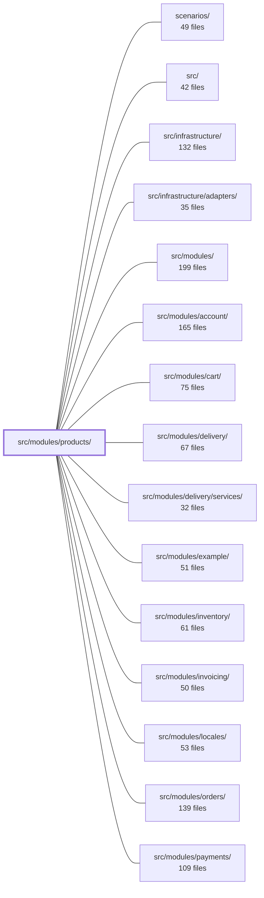

---
tags:
  - 2brain
  - 2brain/module
  - project/boilerplate-node-backend
type: module
module: src/modules/products/
files: 73
updated: 2026-11-15T00:34:31.365687+00:00
---

# src/modules/products/

## Purpose

The products module is the product catalogue: it owns the product document, its multilingual translations, and the public HTTP surface for browsing, searching, creating, updating, soft-deleting, and restoring products. It also houses the pure domain rules that answer "is this product buyable right now?" (stock, preorder, backorder) so that downstream modules share a single definition of catalogue availability.

## Key parts

- **Domain rules** (`domain/`) — Pure, side-effect-free functions for buyability (`buyable.ts`), stock derivation (`stock.ts`), preorder windows (`preorder.ts`), backorder eligibility (`backorder.ts`), and caller-action flags (`actions.ts`). Exported through `domain/index.ts` so consumers never reach into individual files.
- **Service layer** (`services/`) — The business-logic core. `search.ts` and `read.ts` handle the read path; `crud.ts` + `translated-write.ts` handle the write path (single-transaction product + translation persistence); `remove.ts` handles soft/hard delete and restore; `stock-view.ts` enforces the stock-visibility boundary; `lookups.ts` is the sanctioned door for sibling modules; `actions.ts` stamps caller-specific permission flags. All are assembled into one `productService` object via `services/index.ts`.
- **Controllers & routes** (`controllers/`, `routes.ts`) — Thin HTTP adapters that validate input, handle uploads, and delegate to the service. Route ordering, per-route authorization, cache tagging, and idempotency are declared once in `routes.ts`.
- **Model & schema** (`model.ts`) — Mongoose schema, Zod validation, and business-level refinements (locale presence, date horizon, price precision). Derived fields are computed at serialization time, never persisted.
- **Presenter** (`presenter.ts`) — Single mapping point from `ProductDocument` to the wire `Product` contract, ensuring derived fields are consistent across every read path.
- **Module wiring** (`module.ts`, `module.yaml`, `index.ts`) — Registers routes, config, fixtures, and browser-event schemas with the kernel; declares the `shop` dependency for currency; exposes the public barrel that sibling modules import.
- **Contract & config** (`openapi.yaml`, `openapi.browser-events.yaml`, `config.ts`, `authorization.yaml`) — The OpenAPI 3.1 contract, analytics event schemas, runtime VAT/URL config, and declarative authorization rules for the Product subject.
- **Analytics & audit** (`analytics.ts`, `audit.ts`, `browser-events.ts`, `events.ts`) — Declare and register the module's analytics events, audit-action vocabulary, browser-event relay transforms, and domain events into the app-wide type system.

## How it connects

- **`shop`** — Provides the base currency; all product pricing is quoted in that currency (declared in `module.yaml`).
- **`inventory`** — Writes stock counters (`onHand`, `reserved`) onto the product document through the single sanctioned mirror (`syncStockCache` in `lookups.ts`). Products never writes stock itself.
- **`cart` / `orders`** — Consume product data and domain rules (buyability, stock flags, preorder) exclusively through the public barrel (`index.ts`) and the domain layer; never reach into the repository or schema directly.
- **`locales`** — Translations are stored per-locale; the write path coordinates product row and translation rows in one transaction.
- **`account` / `users`** — Supply the caller identity and key standing that `authorization.yaml` and `services/actions.ts` evaluate to gate admin-only fields (stock counters, full translations, delete/restore).
- **`src/infrastructure/`** — Provides persistence (Mongoose), HTTP middleware, and the kernel that `module.ts` registers into.
- **`scenarios/`** — Receives the minimal product fixtures produced by `factories.ts` for integration-test seeding.
- **`delivery` / `payments` / `invoicing` / `returns`** — Downstream consumers of the product data frozen onto order line items; they read the product snapshot rather than the live catalogue.

## Where to start

1. **`index.ts`** — Read this first to see exactly what the module exposes to the rest of the codebase; it defines the public boundary.
2. **`domain/buyable.ts`** — A short, pure function that pulls together stock, preorder, and backorder logic. Reading it (and the small files it calls) gives you the module's central business invariant in under a minute.

## Connected modules

[[boilerplate-node-backend_ROOT|/ (repository root)]] · [[boilerplate-node-backend_scenarios|scenarios/]] · [[boilerplate-node-backend_src|src/]] · [[boilerplate-node-backend_src_infrastructure|src/infrastructure/]] · [[boilerplate-node-backend_src_infrastructure_adapters|src/infrastructure/adapters/]] · [[boilerplate-node-backend_src_modules|src/modules/]] · [[boilerplate-node-backend_src_modules_account|src/modules/account/]] · [[boilerplate-node-backend_src_modules_cart|src/modules/cart/]] · [[boilerplate-node-backend_src_modules_delivery|src/modules/delivery/]] · [[boilerplate-node-backend_src_modules_delivery_services|src/modules/delivery/services/]] · [[boilerplate-node-backend_src_modules_example|src/modules/example/]] · [[boilerplate-node-backend_src_modules_inventory|src/modules/inventory/]] · [[boilerplate-node-backend_src_modules_invoicing|src/modules/invoicing/]] · [[boilerplate-node-backend_src_modules_locales|src/modules/locales/]] · [[boilerplate-node-backend_src_modules_orders|src/modules/orders/]] · … and 4 more

## Files
- `src/modules/products/analytics.ts` — Declares the analytics event names for the products module and registers them into the app-wide analytics type system. These are top-of-funnel discovery events (search, product view) whose ratio to `CART_ITEM_ADDED` serves as a catalogue-health signal. They are emitted client-side via `POST /analytics/events` because server-side response caching hides most product reads.
- `src/modules/products/audit.ts` — Defines the audit-action vocabulary for the products module and registers it into the application-wide `AuditActionMap` via TypeScript module augmentation. Only write actions (create, update, delete, restore) are tracked; reads are intentionally excluded because they are public and unauthenticated, leaving no actor to record.
- `src/modules/products/authorization.yaml` — Defines the authorization rules and named rule-sets for the **Product** subject in the `products` module. It is the declarative policy layer that determines which tenant-scoped actions (read, display, create, update, delete) are permitted, separating the public storefront view from internal staff views.
- `src/modules/products/browser-events.ts` — Defines the product-page browsing events that arrive via `POST /analytics/events` and transforms each typed request body into the `{ event, properties }` shape the analytics relay expects. It is the "relay-call" half of a contract whose request schemas live in `./openapi.browser-events.yaml` (folded into the analytics module by the bundler).
- `src/modules/products/config.ts` — Defines the products domain's runtime configuration — two VAT rates and the product-page URL template — and exposes thin accessor functions so callers read values per call rather than at import time. This lets tests vary a rate per case without re-importing. The file lives under `products` because `resolveTaxRate` (`./tax`) is the sole reader of the rates; `orders` never reads a rate directly, it just freezes whatever the catalogue resolves onto a line item.
- `src/modules/products/controllers/delete-products.ts` — Thin admin controller for deleting a product by ID. It delegates all delete logic to the shared `createDeleteController` factory, wiring in the product-specific service call and error-key, so the module stays consistent with other delete endpoints in the codebase.
- `src/modules/products/controllers/get-catalog-facets.ts` — Thin HTTP adapter that exposes the catalogue's category and tag facet counts (the storefront's filter chips) as a `GET /products/facets` response. It delegates all logic to the product service and only shapes the HTTP reply.
- `src/modules/products/controllers/get-product.ts` — Thin controller for `GET /products/:id`. It wires the shared `createItemController` factory to the product service, applying caller-scoped visibility so that non-active (inactive/deleted) products are only returned to admins.
- `src/modules/products/controllers/get-products.ts` — Builds the query schema, cache-key derivation, and search handler for the two catalogue endpoints (`GET /products` and `POST /products/search`), then hands them to the shared `createSearchController` factory so both routes share identical validation, caching, and response-shaping logic.
- `src/modules/products/controllers/post-product-restore.ts` — Admin controller that exposes `POST /products/:id/restore` to undo a soft-deleted product. It is a thin wiring layer: all restore semantics (conflict detection, audit emission, response shaping) live in the product service; this file only maps HTTP concerns to the shared restore-controller factory.
- `src/modules/products/controllers/post-product.ts` — Admin controller for `POST /products`. Decodes scalar, array, and JSON fields from either a JSON or multipart request, validates the assembled body against a Zod schema, then delegates to `productService.create` (which persists the product and all its language translations in one write). Handles upload lifecycle and emits a `201 Created` with a `Location` header on success.
- `src/modules/products/controllers/update-product.ts` — Defines the two write handlers for product modification — `PUT /products/:id` (full replace) and `PATCH /products/:id` (partial merge) — by configuring a single `createUpdateController` instance. All business logic (404 check, audit emit, locale management) lives in `productService`; this file only wires validation, content-type decoding, image-upload handling, and the verb-specific omission semantics to that service.
- `src/modules/products/domain/actions.ts` — Pure domain rule that translates a caller's key standing plus a product's deletion state into the four concrete action flags (`update`, `delete`, `restore`, `hardDelete`) a UI or service layer may offer. It exists to centralise the "what can I do with this product?" decision so that no other module re-derives it.
- `src/modules/products/domain/backorder.ts` — Pure domain rule that decides whether a RELEASED product may still be purchased while its shelf stock is empty (i.e., sold on backorder). All logic is a single derived boolean — no state is stored, and the clock is injected so every branch is testable in isolation.
- `src/modules/products/domain/buyable.ts` — Pure decision logic that answers two questions: "Can this product be ordered right now?" and "Did an edit just make it orderable?" It consolidates the stock, preorder, and backorder rules into a single `isBuyable` predicate so that alerting, UI, and CRUD flows share one definition of "buyable."
- `src/modules/products/domain/index.ts` — Barrel (re-export) file that defines the **public API surface** of the products domain layer. It curates a selective set of symbols from the domain's sub-modules so that consumers can import domain rules without reaching into individual files or pulling in the module's HTTP surface. See `docs/theory/domain-layer.md` for the architectural rationale.
- `src/modules/products/domain/preorder.ts` — Pure domain rules for determining whether a product is a preorder (on sale but not yet released) and what the maximum allowed release date is. The file exists so that preorder logic lives in the products domain as clock-injected, side-effect-free functions that any consumer (cart, presenter, order snapshot) can call without duplicating the rule.
- `src/modules/products/domain/stock.ts` — Pure calculation helpers that derive a customer-facing stock picture (available units, remaining preorder allowance, and display flags) from the raw `onHand` / `reserved` counters that the inventory module writes onto a product. It lives in the products domain rather than in `inventory` or `cart` because a product's catalogue availability is a product invariant, following the same layering rationale as `tax.ts`.
- `src/modules/products/events.ts` — Declares the five domain events the products module emits by augmenting the kernel's `DomainEventMap` interface (via `declare module '@kernel/events'`), so the global event catalogue grows per-module without a shared enumeration file. Also exports one string constant per event name so emitters and listeners share a single spelling.
- `src/modules/products/factories.ts` — Builds minimal product fixtures (placeholder `title` + `price`) for the `shop` scenario catalogue and for any test that needs a catalogue row. Everything else is deliberately left unset so Mongoose schema defaults apply, letting integration tests read seeded rows back through the real serializer rather than a hardcoded guess.
- `src/modules/products/index.ts` — Public barrel for the Products module. It is the **only** import surface that a sibling module (e.g. `cart`, `orders`) may use, per the strategic DDD rule in `docs/theory/strategic-ddd.md` §5. It re-exports the module's public API while deliberately keeping internal implementation (`productRepository`, `productSchema`, `applyProductTransform`, `productModel`) private.
- `src/modules/products/model.ts` — Defines the Mongoose schema, document/model types, and Zod validation schemas for the product collection. It owns the shape of stored product data (including the `onHand`/`reserved` stock counters and preorder fields) and enforces business-level refinements (fallback-locale presence, date horizon, price precision) that the OpenAPI-generated Zod schemas cannot express. Derived fields (`available`, `preorder`, `inStock`, `lowStock`, `buyable`) are computed at serialization time and never persisted.
- `src/modules/products/module.ts` — Module manifest that registers the **products** catalogue with the application kernel: mounts its HTTP routes, declares its config, translation rules, image pipeline, scenario fixtures, and browser-event schemas. It is a leaf module — it emits domain events rather than importing sibling modules, and it never writes stock counters itself (those belong to `inventory`).
- `src/modules/products/module.yaml` — Module declaration for the **products** module. It defines the module's identity (summary, subdomain, group) and its dependency on the `shop` module, establishing that products lives in the core subdomain of the shop group and that all pricing is quoted in the currency provided by `shop`.
- `src/modules/products/openapi.browser-events.yaml` — OpenAPI fragment defining the browser-side analytics events emitted by product pages via `POST /analytics/events`. It exists as a fragment (components only) so it can be assembled into the `AnalyticsEventRequest` oneOf schema by the contract script, keeping event definitions co-located with the product module rather than in a monolithic root document.
- `src/modules/products/openapi.yaml` — OpenAPI 3.1.0 contract for the **Products** module (tag `Products`, family `Catalogue`). It defines the HTTP surface for browsing, filtering, creating, reading, replacing, patching, and soft-deleting products and their catalogue facets. It is the single source of truth that clients, gateway docs, and the bundler middleware all consume.
- `src/modules/products/presenter.ts` — Single mapping point that turns a `ProductDocument` (Mongoose model) into the `Product` wire contract. Every read path—including `services/read.ts`'s `getById`—routes through this module instead of hand-rolling a `.toJSON() as Product` cast, so the document's own serialisation and a presented document always agree on derived fields.
- `src/modules/products/probes.ts` — Exports the products module's probe collection — hand-written test requests that cover behaviors the OpenAPI contract cannot express (validation envelopes, i18n, optional filters, and visibility-state distinctions). It complements the auto-generated client collections owned by `scripts/contracts/client-collections-bundle.ts`.
- `src/modules/products/repository.ts` — Defines the product data-access layer. Extends the generic `createRepository` factory with catalogue-specific concerns: authorization scoping (public vs. admin), a sitemap-oriented pagination query, a single-aggregation facet count, and the stock-counter mirror that `@modules/inventory` writes through. Exists as a single exported object so the products services and module wiring have one entry point for all product reads and the two write-side mirrors.
- `src/modules/products/routes.ts` — Express router that maps every product-catalogue HTTP endpoint to its controller and surrounding middleware. It exists as the single place where route ordering (static segments before `/:id`), per-route authorization, cache tagging, idempotency, and upload handling are declared, so the controllers stay pure business logic.
- `src/modules/products/services/actions.ts` — Computes the `actions` block on a product for the current caller and stamps it onto the wire object, so clients receive ready-made permission flags instead of re-deriving the rules. The rules themselves live in `domain/actions.ts`; this file reads the caller's keys and produces the concrete standing.
- `src/modules/products/services/crud.ts` — Transactional write steps for product create and update: what the document holds, how dates are normalised, what gets audited, and which outbox events each write announces. Composed by `./translated-write` into the public create/update doors.
- `src/modules/products/services/index.ts` — Barrel/facade for the product module's service layer. It re-exports the individual flow files (`search`, `read`, `translated-write`, `remove`, `lookups`, `stock-view`) and the Zod schemas from `../model`, then assembles them into a single `productService` object. Controllers and sibling modules interact with the catalogue exclusively through this one object; they never reach the individual flow files or the model directly.
- `src/modules/products/services/lookups.ts` — Read-only lookup service for the products collection. It is the "door" through which sibling modules (inventory, orders, cart, wishlist, sitemaps) access product data, translation content, and public catalogue listings without reaching into the repository directly. It also provides the single sanctioned write (`syncStockCache`) for mirroring inventory's stock counters onto a product document.
- `src/modules/products/services/read.ts` — Read-side service for single-product lookups. It resolves a stored product to the caller's locale, layers on permission-gated visibility (stock counters, full translation set), and attaches caller-specific actions. It is the shared presentation pipeline used by both the read route (`GET /products/:id`) and the write routes, so a write response is always the product's own read.
- `src/modules/products/services/remove.ts` — Implements the product deletion and restore operations (soft delete, hard delete, and undo). It coordinates the write, the `PRODUCT_DELETED` outbox event, translation cleanup, image removal, and audit logging within a single transaction so that the event exists exactly when the delete commits.
- `src/modules/products/services/search.ts` — Service-layer entry point for product catalogue search. It composes a locale-aware free-text query (unioning the product's own columns with matches in the translations collection), applies caller-scoped stock redaction and per-row action flags, and exposes public facets. Exists so that controllers and the analytics/layering rules never reach directly into `productRepository` or the persistence helpers.
- `src/modules/products/services/stock-view.ts` — Enforces the stock-visibility boundary on product responses. Exact counters (`onHand`, `reserved`, `available`) are stripped for callers without the `read:StockLevel` ability, leaving only the pre-computed boolean flags (`inStock`, `lowStock`) that every response already carries. This prevents leaking sales velocity or enabling inventory-denial planning.
- `src/modules/products/services/translated-write.ts` — The multilingual write surface for products. Provides the two mutation doors — `create` and `updateById` — that persist a product row together with its per-locale translation rows in a single database transaction, guaranteeing that the fallback-locale title can never be changed without its translation row changing with it. Also exports `clearOmittedLocales`, the PUT-semantics preparer that turns a sparse body into the full locale set expected by `updateById`.
- `src/modules/products/services/translation-view.ts` — Read-gate for a product's `translations` field. Editor tabs need every locale's copy (including drafts), which exceeds the resolved `title`/`description` a shopper sees, so this module exposes a single capability check that restricts access to callers holding the `read:Translation` grant.
- `src/modules/products/tax.ts` — Resolves a product's `taxClass` into the concrete decimal VAT rate the shop will charge. It lives in the catalogue module (not `orders`) because "every product resolves to a rate" is a catalogue invariant; `orders` merely freezes the already-resolved number onto an order line.
- `src/modules/products/tests/contract/actions.contract.test.ts` — Contract tests for the `actions` object the server attaches to every product row/detail, verifying that the flag set (`update`, `delete`, `restore`, `hardDelete`) is role-aware, correct for live vs. deleted rows, and never leaks staff privileges into the guest-shared cache.
- `src/modules/products/tests/contract/api.contract.test.ts` — Contract tests for the `/products` endpoints. They assert that the wire response shape conforms to the OpenAPI contract (enforced by the `@tests/contract` setup, including `additionalProperties: false` to catch unexpected field leakage) and that a small set of behavioural guarantees—scope enforcement, pagination validation, filter limits, date formatting, and sort order—are actually exercised on the wire. They are not a replacement for unit/service tests; they exist to prove the contract surface and its edge cases.
- `src/modules/products/tests/contract/stock-visibility.contract.test.ts` — Contract test asserting that the three exact stock counters (`onHand`, `reserved`, `available`) are stripped from product responses for any caller lacking the `read:StockLevel` permission, while the two boolean flags (`inStock`, `lowStock`) remain visible to everyone. It covers single-product reads, list reads, threshold behaviour, and cache isolation.
- `src/modules/products/tests/factories.ts` — Test-database persistence layer for product fixtures. The in-memory builder (`makeProduct`) lives one level up in `../factories.ts`; this file only writes the result to the test database and provides small read/mutation helpers so that cart, account, and address test suites can create, inspect, and clean up product documents without importing production services directly.
- `src/modules/products/tests/integration/api-key-reads.test.ts` — Integration tests verifying that an `sk_…` API key, when used to call the product endpoints, receives the same visibility and scoping rules as a session with identical permissions. Specifically, it asserts that scope-dependent fields (drafts, soft-deleted rows, translations) appear or disappear based on the key's granted scopes, and that the cache middleware correctly distinguishes a key caller from an anonymous guest so a wider answer is never stored under the guest's cache key.
- `src/modules/products/tests/integration/backorder.test.ts` — Integration tests for the product backorder feature over HTTP. Verifies that `allowBackorder` and `restockDate` round-trip through GET and PATCH, that the derived `backorder` flag is computed correctly (never persisted), that restock dates are bounded to one year ahead, that a passed date makes the product read sold out, and that the correct outbox events (`product.restock_date_changed`, `product.buyable_again`) are emitted with the right payloads and cardinality.
- `src/modules/products/tests/integration/delete-outbox.test.ts` — Integration test that verifies the `product.deleted` domain event is written to the transactional outbox atomically with the product delete (both hard and soft paths), that a failing consumer is retried by the relay rather than silently dropped, and that the operation is idempotent on an already-deleted product.
- `src/modules/products/tests/integration/delete-restore-audit.test.ts` — Integration tests that pin the audit events emitted by `productService.removeById` and `productService.restoreById` after the audit logic was relocated from the delete/restore controllers into the service layer. They verify that `ADMIN_PRODUCT_DELETED` (with `metadata.hardDelete` reflecting soft vs. hard) and `ADMIN_PRODUCT_RESTORED` still land with the correct action, outcome, target, and metadata.
- `src/modules/products/tests/integration/delete-titles.test.ts` — Integration tests verifying that the `product.deleted` domain event carries the product's titles (by locale) captured **before** translation rows are hard-deleted, and that `productService.titlesById` returns correct results for soft-deleted vs. hard-deleted products. Ensures downstream consumers (e.g. notifications) can still display a product's names after it no longer exists.
- `src/modules/products/tests/integration/facets.test.ts` — Integration tests for `productRepository.facets()`, the query that powers the storefront's filter chips. The suite locks in three invariants: counts reflect only publicly visible products, the result set is stably ordered for UI rendering, and an empty catalogue yields empty lists rather than an error.
- `src/modules/products/tests/integration/image-clear.test.ts` — Integration test for `productService.updateById` when `imageUrl: null` is passed. It verifies the field is truly *unset* in the database (not defaulted to `""`) and that the corresponding picture and thumbnail files are removed from disk — using a real temp directory and a real test database, because a mocked filesystem cannot confirm *which* files are deleted.
- `src/modules/products/tests/integration/model.test.ts` — Integration test that enforces a single invariant: product responses must never expose Mongoose-internal fields (`_id`, `__v`) regardless of the serialization path — hydrated `toJSON`, single-document lookup, or `.lean()` list results.
- `src/modules/products/tests/integration/no-translation-provider.test.ts` — Integration test suite that simulates a deployment where the `locales` module is entirely uninstalled (no translation port registered). It verifies that the products service degrades gracefully: the fallback language (`en`) still works for reads and writes, and any non-fallback language produces a structured 422 response rather than a 500 from a missing port.
- `src/modules/products/tests/integration/preorder.test.ts` — Integration tests that exercise the preorder behavior of a product over HTTP: a future `releaseDate` marks a product as a preorder (a derived flag, never persisted), the date is bounded to one year ahead, clearing/moving the date emits a `product.release_date_changed` outbox event within the edit's transaction, and the stored instant always corresponds to the shop's local midnight (including DST edge cases).
- `src/modules/products/tests/integration/product-states.test.ts` — Integration tests verifying the two product visibility flags (`active` and `purchasable`) over HTTP. They assert how an anonymous shopper and an authenticated staff member see products in listing and by-id endpoints across all four flag combinations.
- `src/modules/products/tests/integration/repository.test.ts` — Integration tests for `productRepository` run against a real MongoDB instance. Covers the full CRUD surface (`create`, `findById`, `findOne`, `findAll`, `count`, `save`, `deleteOne`), the `facets` aggregate read, and the `writebackImage` image-pipeline callback. A dedicated "empty catalogue" block pins the no-row-at-all behaviour of Mongo `$group`/`$facet` pipelines and the idempotency/staleness semantics of `writebackImage`.
- `src/modules/products/tests/integration/schema-contract.test.ts` — Verifies Mongoose schema-level declarations (defaults, `required`, `select: false`, serialization shape) for the Product model by running against a real MongoDB instance. It exists separately from the sibling transform tests because a mocked model would assert the mock's interpretation of `default`/`required` rather than Mongoose's actual behaviour.
- `src/modules/products/tests/integration/service.test.ts` — Integration tests for `productService`: caller-scoped visibility rules on `search` and `getById`, CRUD field updates, and side-effect verification (image-store removal, hard-delete cart cascade). Runs against a real test database (`setupTestDb`) with collaborators stubbed at the port boundary rather than at the filesystem or collection level.
- `src/modules/products/tests/integration/transactional-write.test.ts` — Integration test that proves a product write (create or update) and its translation rows are committed atomically against a real Mongo instance, and that the resulting `product.created` outbox event rides the same transaction. The translation port is replaced with a double whose `write` can be forced to fail, simulating a locales store dying mid-write.
- `src/modules/products/tests/integration/update-audit.test.ts` — Integration test that verifies the `ADMIN_PRODUCT_UPDATED` audit event records every non-text field an update actually moved as a `{ from, to }` pair (or one-sided when the field was unset/cleared), while free-text fields (title) appear only by name. The goal is to ensure an auditor can reconstruct a "lower, sell, restore" sequence from the audit trail alone.
- `src/modules/products/tests/unit/actions.test.ts` — Unit tests for the `productActions` pure function. They verify the four action flags (`update`, `delete`, `restore`, `hardDelete`) returned for every combination of caller standing and soft-delete state, without requiring a database.
- `src/modules/products/tests/unit/backorder.test.ts` — Unit tests for the `isBackorder` domain function. Because the function is pure (it receives the current time as a parameter rather than calling `Date.now()`), every test case runs against a fixed clock, making assertions deterministic without mocking.
- `src/modules/products/tests/unit/buyable.test.ts` — Unit tests for the two pure buyability functions (`isBuyable`, `becameBuyable`) in the products domain. Because both functions accept an explicit `Date` parameter rather than reading the system clock, every scenario runs against three fixed instants (`NOW`, `LATER`, `EARLIER`) with no `jest.useFakeTimers` or other clock mocking required.
- `src/modules/products/tests/unit/config.test.ts` — Unit tests for the products module's VAT rate boot gate. Verifies that `assertModuleConfig` rejects missing or malformed `NODE_VAT_RATE_DEFAULT` / `NODE_VAT_RATE_REDUCED` values, accepts valid ones, and that the accessor functions (`vatRateDefault`, `vatRateReduced`) read per-call and fall back to declared defaults.
- `src/modules/products/tests/unit/factories.test.ts` — Unit tests for the `makeProduct` catalogue fixture builder. They pin down the override/defaults contract: which fields are required, how `stripUndefined` interacts with Mongoose `default:` values, how falsy overrides are preserved, and how soft-delete dates are coerced. Because `scenarios/products.ts` reuses `makeProduct` to seed the shipped demo catalogue, these tests also guard the live seed path.
- `src/modules/products/tests/unit/preorder.test.ts` — Unit tests for the two pure functions exported by the products domain (`isPreorder`, `latestReleaseDate`). Every case runs against a fixed, hardcoded clock so the suite is deterministic and free from `Date.now()` drift.
- `src/modules/products/tests/unit/product-page-path.test.ts` — Unit tests for `productPagePath`, the single source of truth for a product's URL slug. This file exists to lock down that the function correctly substitutes the product id into the path template, respects the `NODE_FRONTEND_LINK_PRODUCT` environment override, and safely encodes the id (treating `$&` as literal text rather than a regex substitution token).
- `src/modules/products/tests/unit/routes.test.ts` — Route-table contract tests for the product catalogue router. Guards against silent failures a type checker cannot catch: a dropped auth guard, a static path shadowed by a later `/:id`, or a cache tag renamed on the writer but not the reader. Does not test handler logic—only what is mounted, in what order, and with what middleware chain.
- `src/modules/products/tests/unit/schema-contract.test.ts` — Contract tests that pin the product schema's field requirements, defaults, indexes, and the `available` derivation logic in `applyProductTransform`. They exist to guarantee that the minimal create path, stock accounting, visibility scope, and SKU uniqueness all behave as the rest of the system (cart, catalogue, ledger replay) expects without having to re-derive those assumptions at runtime.
- `src/modules/products/tests/unit/stock-view.test.ts` — Unit tests for the stock-visibility contract in the products module: which caller roles may see raw stock counters (`onHand`, `reserved`, `available`) and what `redactStock` strips (or preserves) from a product when the caller lacks the `read:StockLevel` permission.
- `src/modules/products/tests/unit/stock.test.ts` — Unit tests for the three pure stock-calculation functions exported from `domain/stock.ts`. Exercises every input shape the inventory and cart modules can pass, with no database or I/O involved.
- `src/modules/products/tests/unit/tax.test.ts` — Unit tests for `resolveTaxRate`, the single decision point that maps a product's tax class (or the absence of one) to a concrete numeric VAT rate. The suite guarantees that every product resolves to *some* rate and isolates the two relevant environment variables per case so the suite-wide fallback from `tests/support/setup-environment.ts` cannot leak between cases.

---
[[boilerplate-node-backend_INDEX|← boilerplate-node-backend index]]
