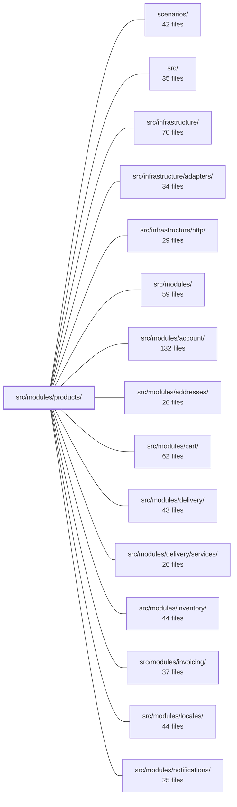

---
tags:
  - 2brain
  - 2brain/module
  - project/boilerplate-node-backend
type: module
module: src/modules/products/
files: 62
updated: 2026-10-15T13:41:33.245873+00:00
---

# src/modules/products/

## Purpose

The products module owns the product catalogue: its data model, CRUD lifecycle, multilingual content, search and filtering, stock-visibility rules, tax-rate resolution, and the HTTP surface that both the public storefront and the admin console consume. It is a leaf module in the dependency graph—other modules read from it via its `lookups` service or react to its domain events, but it never imports sibling business logic back.

## Key parts

- **Domain & tax** (`domain/`, `tax.ts`, `presenter.ts`) — Pure, framework-free business rules: stock availability derivation (`stock.ts`), preorder windows (`preorder.ts`), VAT-rate resolution (`tax.ts`), and the single Mongoose→public-contract mapping point (`presenter.ts`).
- **Services** (`services/`) — The "persistence wall" that every controller and cross-module caller must go through. Split into focused files: `crud.ts` (write lifecycle), `read.ts` (single-product read + redaction), `search.ts` (list/facet queries), `remove.ts` (delete/restore), `stock-view.ts` (permission-gated counters), `translated-write.ts` (atomic product + translation commits), `lookups.ts` (sibling-module door), and `image.ts` (async image-digest enqueue).
- **Controllers & routes** (`controllers/`, `routes.ts`) — Thin HTTP adapters that wire Express routes to the service layer. Public reads are unauthenticated; admin writes are permission-gated. Route ordering and caching are handled here.
- **Model & OpenAPI** (`model.ts`, `openapi.yaml`) — Mongoose schema + Zod validation schemas define the document shape; the OpenAPI 3.1 spec is the single source of truth for the wire contract.
- **Cross-cutting declarations** (`analytics.ts`, `audit.ts`, `events.ts`, `browser-events.ts`, `config.ts`) — Type-level registration of analytics events, audit actions, domain events, browser-event payloads, and runtime config (VAT rates, currency, low-stock threshold) into app-wide maps.
- **Module entry** (`index.ts`, `module.ts`) — `index.ts` is the *only* barrel a sibling module may import from (strategic-DDD rule). `module.ts` is the kernel manifest that assembles routes, repository, events, and config into an `AppModule`.
- **Tests & fixtures** (`tests/`, `factories.ts`) — Contract tests validate wire shape against the OpenAPI spec; `factories.ts` builds seedable product documents that rely on Mongoose defaults for realistic serializer output.

## How it connects

- **`src/modules/inventory/`** — Inventory writes the raw `onHand` / `reserved` counters onto the product document via the repository's "derived-write" port. The products module's `stock-view.ts` and `domain/stock.ts` then derive the public `available`, `inStock`, and `lowStock` fields. Products never imports inventory's internal logic; it only reads the two numeric fields inventory has already stored.
- **`src/modules/orders/`** — Orders call `tax.ts` (`resolveTaxRate`) to freeze the applicable VAT rate at order time. Products owns the invariant "every product resolves to a rate"; orders simply consume the returned decimal.
- **`src/modules/cart/`, `src/modules/wishlist/`, `src/modules/delivery/`** — These siblings read product data (price, title, stock flags) exclusively through `services/lookups.ts`, which handles locale fallback and bulk queries. They never touch `productRepository` or `model.ts` directly.
- **`src/modules/locales/`** — Product translations are stored as per-locale rows alongside the product document. `translated-write.ts` commits both atomically and keeps a fallback-locale column in sync, so consumers of the catalogue get a guaranteed non-null title.
- **`src/modules/users/`** — Permission checks (e.g., `inventory.any.read` in `stock-view.ts`, admin-write gates in controllers) rely on the user/ability context that the kernel injects; the products module reads the ability but does not manage accounts.
- **`src/infrastructure/`** — HTTP adapter (request/response lifecycle, upload handling in `routes.ts`), queue adapter (image-digest job enqueued by `services/image.ts`), and the analytics/audit ports declared in `analytics.ts` / `audit.ts` are all provided by the infrastructure layer.
- **`src/modules/notifications/`, `src/modules/returns/`, `src/modules/payments/`, `src/modules/invoicing/`** — These react to products domain events (create, update, delete, restore) via the kernel's event bus. The products module emits; it does not import them.
- **`src/modules/account/`, `src/modules/addresses/`** — Read product data for order-history or address-linked order views through the same `lookups` service.
- **`scenarios/`** — Integration test scenarios (e.g., the `shop` scenario) seed product fixtures via `tests/factories.ts` and exercise the full HTTP surface end-to-end.

## Where to start

1. **`src/modules/products/index.ts`** — Read this first to see the module's entire public surface in ~20 lines. It tells you exactly what a sibling module is allowed to import and what stays internal.
2. **`src/modules/products/model.ts`** — Next, read the schema and Zod definitions to understand what a product document actually contains, which fields are derived vs. stored, and how translations are structured. With the public surface and the data shape in hand, the service and controller layers become straightforward wiring.

## Connected modules

[[boilerplate-node-backend_ROOT|/ (repository root)]] · [[boilerplate-node-backend_scenarios|scenarios/]] · [[boilerplate-node-backend_src|src/]] · [[boilerplate-node-backend_src_infrastructure|src/infrastructure/]] · [[boilerplate-node-backend_src_infrastructure_adapters|src/infrastructure/adapters/]] · [[boilerplate-node-backend_src_infrastructure_http|src/infrastructure/http/]] · [[boilerplate-node-backend_src_modules|src/modules/]] · [[boilerplate-node-backend_src_modules_account|src/modules/account/]] · [[boilerplate-node-backend_src_modules_addresses|src/modules/addresses/]] · [[boilerplate-node-backend_src_modules_cart|src/modules/cart/]] · [[boilerplate-node-backend_src_modules_delivery|src/modules/delivery/]] · [[boilerplate-node-backend_src_modules_delivery_services|src/modules/delivery/services/]] · [[boilerplate-node-backend_src_modules_inventory|src/modules/inventory/]] · [[boilerplate-node-backend_src_modules_invoicing|src/modules/invoicing/]] · [[boilerplate-node-backend_src_modules_locales|src/modules/locales/]] · … and 6 more

## Files
- `src/modules/products/analytics.ts` — Declares the products-domain analytics event names and registers them into the app-wide `AnalyticsEventMap` type. It exists so the products module can emit typed discovery events (`products_searched`, `product_viewed`) through the shared analytics port without duplicating the string literals at call sites.
- `src/modules/products/audit.ts` — Declares the audit-action vocabulary for the products module and registers it into the app-wide `AuditActionMap` via TypeScript declaration merging. Only write operations (create, update, delete, restore) are audited; catalogue reads are public and unauthenticated, so there is no actor to record.
- `src/modules/products/browser-events.ts` — Defines how the two product-page browser events (`POST /analytics/events` request bodies) are transformed into analytics report payloads. It is the runtime "relay" half of the analytics contract; the request shapes live in `./openapi.browser-events.yaml` and are folded into the analytics contract by the bundler.
- `src/modules/products/config.ts` — Defines the products module's runtime configuration — the two VAT rates (default and reduced) — and re-exposes two infrastructure-level values (currency, low-stock threshold) under product-domain names. Rates are read per call (not captured at import) so individual tests can vary them, following the same pattern as `inventory/config.ts`.
- `src/modules/products/controllers/create-product.ts` — Admin-facing controller that handles `POST /products`. It decodes a mixed JSON/multipart request body (scalar fields + `translations` JSON), reads an optional image upload, validates the assembled payload against the Zod schema, and delegates the actual write to `productService.writeCreate`.
- `src/modules/products/controllers/delete-products.ts` — Admin endpoint controller for deleting a product by ID. It is a thin wiring layer that plugs `productService.removeById` into the shared `createDeleteController` factory, so the actual HTTP handling (route parsing, `?hardDelete` flag, 404 response) is inherited rather than re-implemented.
- `src/modules/products/controllers/get-catalogue-facets.ts` — Thin HTTP adapter that exposes the product service's facet counts (categories and tags with counts) as a public JSON endpoint. It exists to separate the request/response lifecycle from the domain query logic so the storefront's filter-chip endpoint stays cacheable and the service stays framework-agnostic.
- `src/modules/products/controllers/get-product-admin.ts` — Admin-only read controller that returns a product together with every language row it has, intended to populate the editor's language tabs. It is a thin wrapper over the shared `createItemController` factory, configured with an explicit handler suffix to avoid a name collision with the customer-facing `get-product-item` controller.
- `src/modules/products/controllers/get-product-item.ts` — Thin controller for `GET /products/:id`. It wires the shared `createItemController` factory to the product service so that a single product can be fetched by path id, with row visibility scoped to the calling user (or API key).
- `src/modules/products/controllers/get-product-settings.ts` — A single-purpose GET controller that exposes the shop's configured currency as the catalogue's public "settings." It exists so client code (e.g., a product-creation form) can size its price input from a canonical currency value before any individual product carries its own `currency` field.
- `src/modules/products/controllers/get-products.ts` — List/search controller for the product catalogue. It builds a single Zod query schema shared by `GET /products` and `POST /products/search`, derives the response-cache key from that schema's keys, and hands both routes to the shared `createSearchController` factory.
- `src/modules/products/controllers/restore-products.ts` — Thin admin controller that wires the shared `createRestoreController` factory to the product service, exposing a single endpoint to undo a soft-deleted product (`POST /products/:id/restore`). The file contains no business logic; all domain behavior lives in `productService`.
- `src/modules/products/controllers/update-product.ts` — Defines the `PUT /products/:id` (full replace) and `PATCH /products/:id` (partial merge) handlers for the products module. Both verbs are built on the shared `createUpdateController` factory and delegate the actual write to `productService.writeUpdate`. The only verb-specific behavior is what an *omitted* field means: PUT clears clearable fields and deletes omitted locales; PATCH leaves them untouched.
- `src/modules/products/domain/index.ts` — Barrel file for the products domain layer. It re-exports the pure business rules (stock and preorder logic) so callers can import domain functions without pulling in the module's HTTP/API surface.
- `src/modules/products/domain/preorder.ts` — Pure domain logic for determining whether a product is currently a preorder (on sale, not yet released) and what the maximum allowed release date is. All time-dependent checks receive `now` as an argument so tests need no clock mocking or waiting.
- `src/modules/products/domain/stock.ts` — Pure domain functions that derive customer-facing stock information (`available` count, `inStock`/`lowStock` flags) from the two raw counters (`onHand`, `reserved`) that the inventory module writes onto products. Lives here rather than in `inventory` or `cart` because stock availability is a product-domain invariant, mirroring how `tax.ts` owns `resolveTaxRate`.
- `src/modules/products/events.ts` — Declares the products module's domain events by augmenting the kernel's `DomainEventMap` interface (type-level only, no runtime logic), and exports one string constant per event name so emitters and listeners share a single spelling instead of independent literals.
- `src/modules/products/factories.ts` — Builds product fixtures (catalogue rows) for the `shop` scenario and for any test that needs a seedable product document. It placeholderes only the required `title` and `price` fields and leaves every other field to Mongoose's own `default:`, so downstream readers (e.g. `tests/integration/scenarios/shop.test.ts`) see real serializer output rather than hand-guessed values.
- `src/modules/products/index.ts` — Public barrel for the Products module. Per the strategic-DDD rule (§5 of `docs/theory/strategic-ddd.md`), this is the **only** entry point a sibling module may import from. It re-exports the module's service, event, domain, tax, and model-type surfaces while keeping the repository, schema, and runtime model internals private.
- `src/modules/products/model.ts` — Defines the Mongoose schema, Zod validation schemas, and TypeScript interfaces for the `products` collection. It is the single source of truth for what a product document looks like (both as a plain record and as a Mongoose document), what the API accepts on create/replace/update, and how stock fields are declared but left to `@modules/inventory` to write. Derived fields (`available`, `inStock`, `lowStock`, `preorder`) are intentionally excluded from storage and computed at serialization time.
- `src/modules/products/module.ts` — Module manifest (registration entry) for the product catalogue. It wires together the module's routes, repository, config, events, and browser-event declarations into a single `AppModule` object consumed by the kernel. The catalogue is a leaf module: public read, admin write, soft-delete with restore — it coordinates with siblings (inventory, orders, delivery) purely through emitted events and shared document fields, never by importing them back.
- `src/modules/products/openapi.yaml` — OpenAPI 3.1.0 contract for the products module. It defines the full HTTP surface (list, create, read-by-id, replace, patch, delete, restore, catalogue facets, and shop settings) with schemas, parameters, and error responses, serving as the single source of truth for the module's API shape. The module entry point (`module.ts`) mounts these routes; the spec is what clients, tests, and tooling consume.
- `src/modules/products/presenter.ts` — Single mapping point that converts a Mongoose `ProductDocument` into the public `Product` contract. All read paths (including `services/read.ts`'s `getById`) route through here so that derived stock/availability fields are computed once and agree everywhere, rather than each caller hand-casting `.toJSON() as Product`.
- `src/modules/products/probes.ts` — Holds hand-written API requests for the products module that a generated contract cannot express — validation-failure payloads, headers the generator omits, optional-parameter combinations, and visibility-rule edge cases. It complements the generated collection owned by `scripts/contracts/client-collections-bundle.ts`.
- `src/modules/products/repository.ts` — Defines the product catalogue's data-access layer: a `createRepository`-based CRUD object extended with scoping helpers, a single-pass facet aggregation, and three "derived-write" ports (stock mirror, translation writeback, image digest writeback) that other modules call to copy pre-decided values onto the product document without triggering admin-edit semantics.
- `src/modules/products/routes.ts` — Defines the Express Router for all product catalogue HTTP endpoints. Splits traffic into public storefront reads (no identity required) and admin/machine writes (permission-gated), applies per-route caching and upload handling, and enforces route ordering so static segments are not swallowed by the `/:id` wildcard.
- `src/modules/products/services/crud.ts` — Implements the full write lifecycle for products — create and update (including update-by-id) — splitting each operation into a transactional core (DB save + outbox event) and a set of best-effort post-commit steps (audit, image enqueue, outbox nudge). It owns what goes into the document, what events are announced, and what happens after the commit is durable.
- `src/modules/products/services/image.ts` — Single-responsibility hand-off point that enqueues the image-digest job for a product immediately after it has been persisted. It exists so the CRUD layer can trigger the async image-processing step without knowing the queue adapter or writeback mechanics.
- `src/modules/products/services/index.ts` — Barrel file that aggregates every product-service operation into a single public surface (`productService`) and also re-exports each function by name. It exists as a folder (not one file) because the module passed ~800 lines; see `docs/theory/layers.md`. All controllers and cross-module callers must go through this file — it enforces the "persistence wall" that keeps controllers from reaching `./presenter` or `./model` directly.
- `src/modules/products/services/lookups.ts` — Read-only lookup service that acts as the sole "door" onto the products collection for sibling modules (inventory, orders, cart, wishlist, delivery). It wraps raw, public, bulk, and count queries, mirrors inventory's stock counters onto the product document, and resolves multi-locale titles with a fallback — so callers never touch `productRepository` directly or hand-roll scope/translation logic.
- `src/modules/products/services/read.ts` — Provides the single-product read operations for the products module: scoping a caller's visible products, fetching one product resolved to their locale, applying stock-visibility redaction, and returning the all-locales admin view. It centralises the read-path ordering (present → translate → redact) so callers never duplicate it.
- `src/modules/products/services/remove.ts` — Service layer for deleting and restoring products. Owns the three write paths (soft delete, hard delete, restore) and their side-effects: transactional event announcement, translation cleanup, image file removal, and audit logging.
- `src/modules/products/services/search.ts` — Service-layer glue for catalogue product search. It orchestrates locale-aware free-text matching (union of a product's own column with its translation rows), overlays the caller's language onto results, applies stock-visibility redaction per caller role, and exposes facet counts. Controllers call into this module rather than the repository directly, keeping the layer boundary intact.
- `src/modules/products/services/stock-view.ts` — Gates exact inventory counters (`onHand`, `reserved`, `available`) behind the `inventory.any.read` ability so that only authorised callers receive them; everyone else sees only the derived `inStock` / `lowStock` flags. This prevents a public API from leaking sales velocity or enabling denial-of-inventory planning.
- `src/modules/products/services/translated-write.ts` — The multilingual write door for products: it persists a product row and its per-locale translation rows in a single database transaction, serving both the create and the PUT/PATCH update paths. It exists so that the product and its translations always commit or roll back atomically, and so that the derived (fallback-locale) column stays in sync without the caller managing it.
- `src/modules/products/services/validation.ts` — Input-sanitization helpers for the products module. Provides a shared utility that normalizes string-array fields (categories, tags, etc.) before they are processed or persisted by the CRUD service.
- `src/modules/products/tax.ts` — Resolves a product's `taxClass` into the concrete decimal VAT rate that will be charged. It lives in the catalogue module (not in `orders`) because "every product resolves to a rate" is a catalogue invariant; orders simply freeze whatever value this file returns.
- `src/modules/products/tests/contract/api.contract.test.ts` — Contract tests for the `/products` endpoints. They validate the **shape** of wire responses against `openapi.yaml` (including `additionalProperties: false`) and assert that every filter, pagination, sort, and search parameter the contract publishes is actually enforced. Behavioural assertions (which products a role may see) live in the unit/service suites; this file exists so that each contract branch is exercised and so that a field leaking into a payload or a limit being silently ignored is caught here.
- `src/modules/products/tests/contract/stock-visibility.contract.test.ts` — Contract test asserting the stock-visibility boundary: every caller receives the boolean flags `inStock` / `lowStock`, but the exact counters (`onHand`, `reserved`, `available`) are exposed only to callers holding the `inventory.any.read` permission. It covers single-product reads, the low-stock threshold logic, list reads, and a cache-isolation guarantee.
- `src/modules/products/tests/factories.ts` — Test-database persistence layer for the products module. It wraps the in-memory `makeProduct` builder (one level up in `../factories.ts`) with actual DB writes and a small set of read/mutate helpers so that checkout, cart, delivery, and account test suites can create, inspect, and clean up product fixtures without importing the production barrel or reaching into sibling modules.
- `src/modules/products/tests/integration/api-key-reads.test.ts` — Integration tests that verify an API key (`sk_…` secret) inherits the same read-visibility semantics as a session credential: a key scoped with `products.any.read` sees drafts and soft-deleted products, while a key without that scope sees only the published catalogue. Also asserts that the cache-scope predicate correctly distinguishes elevated callers from guests to prevent wider results from being stored under a guest cache key.
- `src/modules/products/tests/integration/delete-outbox.test.ts` — Integration test proving that the `product.deleted` domain event is written to the transactional outbox atomically with the delete on both soft-delete and hard-delete paths, and that a failing consumer is retried by the relay rather than silently dropped.
- `src/modules/products/tests/integration/delete-restore-audit.test.ts` — Integration tests that pin the audit-logging contract for `productService.removeById` and `productService.restoreById`. They verify that the correct `ADMIN_PRODUCT_DELETED` / `ADMIN_PRODUCT_RESTORED` events are emitted from the **service layer** (not a controller) with the expected fields, and that no event fires when no caller context is supplied.
- `src/modules/products/tests/integration/delete-titles.test.ts` — Integration tests that verify the `product.deleted` domain event carries the product's titles (by locale) captured **before** a hard delete removes the translation rows. The guarantee matters because a `notifications` message outliving the product can only display titles that travelled with the event. A secondary block covers `productService.titlesById` behaviour for live, soft-deleted, and hard-deleted products.
- `src/modules/products/tests/integration/facets.test.ts` — Integration tests for `productRepository.facets`, the storefront's filter-chip data. The tests pin the contract that facet counts reflect **only public, active, non-deleted products**, that results are deterministically sorted, and that an empty catalogue yields empty arrays rather than an error. They exist to catch visibility-drift that a passing listing query would not surface (a chip pointing at zero results).
- `src/modules/products/tests/integration/image-clear.test.ts` — Integration test that verifies the `imageUrl: null` path of `productService.updateById`. It confirms the field is truly unset in MongoDB (no placeholder written) and that the old image file plus its thumbnail are removed from disk **only after** the save succeeds. Real files in a temp directory and a real store are used because the point is *which* files get deleted—something a mocked filesystem cannot express.
- `src/modules/products/tests/integration/model.test.ts` — Integration tests that enforce a single invariant: product responses must never expose Mongoose internals (`_id`, `__v`). It covers both serialization paths — hydrated documents (via `toJSON`) and `.lean()` query results (which bypass `toJSON` and rely on manual mapping inside the service).
- `src/modules/products/tests/integration/no-translation-provider.test.ts` — Integration test suite that verifies `productService` degrades gracefully when no translation port is registered — simulating a deployment where the `locales` module is absent. It asserts that the fallback language (`en`) still reads and writes correctly, and that any request for a non-fallback language produces a field-specific 422 instead of a 500 from a missing port.
- `src/modules/products/tests/integration/preorder.test.ts` — Integration tests for the product preorder feature over HTTP. Verifies that a future `releaseDate` makes a product a derived preorder (never stored as a flag), that the date is bounded to one year ahead, that past dates read as released, and that any change to `releaseDate` writes a `product.release_date_changed` row into the outbox within the same transaction.
- `src/modules/products/tests/integration/product-states.test.ts` — Integration tests that verify, over HTTP, how the two product visibility flags behave for anonymous shoppers versus staff: `active: false` hides a product entirely, while `purchasable: false` only removes it from sale but keeps it visible. Covers both the catalogue listing endpoint and the single-product endpoint.
- `src/modules/products/tests/integration/repository.test.ts` — Integration test suite for `productRepository` that exercises CRUD operations, aggregate reads (`facets`), and image-writeback logic against a real MongoDB instance. It specifically pins down the empty-catalogue arms of `$group`/`$facet` pipelines (which return no row rather than a zeroed one) and the idempotent/stale-job behaviour of `writebackImage`. Stock-level aggregates are explicitly out of scope and live in the inventory module's own tests.
- `src/modules/products/tests/integration/schema-contract.test.ts` — Verifies that the Mongoose schema *declarations* for the Product model (the `required` constraint, `select: false` on `_id`/`__v`, `toJSON` serialization) behave as intended against a real Mongo instance. It exists to pin down driver-level semantics that sibling specs (which cover application transforms) intentionally leave out.
- `src/modules/products/tests/integration/service.test.ts` — Integration tests for `productService` covering caller-scoped visibility rules on `search`/`getById`, the `create`/`updateById` flows, and `remove` side-effects (image-store cleanup, cart cascade on hard delete, translation-port invocation). Uses a real database (`setupTestDb`) with mocked collaborators (image store, translation port) to verify service logic and wiring without external infrastructure.
- `src/modules/products/tests/integration/transactional-write.test.ts` — Integration test proving that a product write and its translation rows are a single transaction: either the product, its translations, and the outbox event all commit, or none do. It also asserts the outbox event is part of the same commit. Uses a real Mongo instance for the product store, but a double for the translation port whose `write` can be made to fail mid-flight.
- `src/modules/products/tests/unit/config.test.ts` — Unit tests for the products module's VAT-rate boot gate. Validates that `assertModuleConfig` correctly rejects invalid or missing `NODE_VAT_RATE_*` values through the module manifest wiring, and that the `vatRateDefault`/`vatRateReduced` readers return the expected numbers. Driven through the public manifest entry point (not the internal check directly) so the slice-check wiring is exercised.
- `src/modules/products/tests/unit/factories.test.ts` — Unit tests for the `makeProduct` fixture builder. They pin down the factory's contract: which fields are always present, how overrides interact with Mongoose schema defaults, how `undefined` values are stripped, and how falsy-but-meaningful values are preserved. Because the same factory is used by `scenarios/products.ts` to seed the shipped demo catalogue, a regression here propagates beyond the test suite into production fixtures.
- `src/modules/products/tests/unit/preorder.test.ts` — Unit tests for the two pure date/product helpers in the products domain (`isPreorder`, `latestReleaseDate`). All cases run against a fixed clock (`NOW = 2026-10-12T10:00:00Z`) so results are deterministic and independent of wall-clock time.
- `src/modules/products/tests/unit/routes.test.ts` — Structural regression tests for the product catalogue router. It asserts the full route table (signatures, order, middleware chains, cache tags, guard stacking, upload fields, and route flags) so that silent misconfigurations—dropped auth guards, a static path shadowed by `/:id`, a cache-tag rename on one side, or an unvalidated upload—fail in CI rather than in production.
- `src/modules/products/tests/unit/schema-contract.test.ts` — Contract test that pins the behavioral guarantees of the product schema and its `applyProductTransform`: which fields are required, what defaults a new product receives, which indexes are declared (and why), and how the derived `available` counter is computed from `onHand` and `reserved`. It exists so that changing any of these without updating the test fails CI, making implicit product-shape assumptions explicit.
- `src/modules/products/tests/unit/stock-view.test.ts` — Unit tests for the `stock-view` service. Verifies the authorization gate (`canSeeStock`) so that only callers holding the literal `inventory.any.read` permission see exact stock counters, and verifies the redaction path (`redactStock`) which strips the three counters while preserving boolean flags, other fields, and the row's version for ETag purposes.
- `src/modules/products/tests/unit/stock.test.ts` — Unit tests for the two pure stock-calculation helpers (`availableStock`, `stockFlags`) exported from the products domain layer. It exists to pin down the exact numeric and edge-case behavior that downstream modules (`@modules/inventory`, `@modules/cart`) rely on when deciding whether to let a purchase proceed.
- `src/modules/products/tests/unit/tax.test.ts` — Unit tests for `resolveTaxRate`, the single decision point that maps a product's (possibly absent) tax class to a concrete VAT rate. The suite guards the invariant that every product resolves to a real number and never to `undefined`.

---
[[boilerplate-node-backend_INDEX|← boilerplate-node-backend index]]
