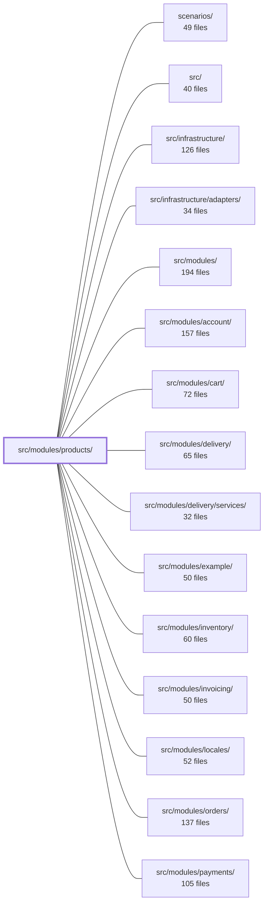

---
tags:
  - 2brain
  - 2brain/module
  - project/boilerplate-node-backend
type: module
module: src/modules/products/
files: 69
updated: 2026-11-08T10:53:25.430693+00:00
---

# src/modules/products/

## Purpose

The products module owns the catalogue aggregate: product CRUD, multi-locale translation, search & facets, stock-derived display flags, tax-rate resolution, and the buyability/preorder/backorder rules that govern whether a shopper can order a product. It exposes all of this through a REST API (public storefront + admin) and through a typed service/lookups surface consumed by sibling modules like `cart` and `orders`.

## Key parts

- **Domain rules** (`domain/`) — Pure, clock-injected functions for stock display, preorder eligibility, backorder allowance, and the composite "is this product buyable right now?" check. Consumers import only from `domain/index.ts`; no HTTP or DB code leaks in.
- **Data model & persistence** (`model.ts`, `repository.ts`, `presenter.ts`) — `model.ts` is the single source of truth for the Mongoose schema, TypeScript shapes, and Zod validation. `repository.ts` wraps the generic CRUD factory with catalogue-specific queries (facets, scoping, sitemap). `presenter.ts` is the one place a Mongoose document becomes the wire `Product` contract.
- **Read services** (`services/read.ts`, `services/search.ts`, `services/lookups.ts`, `services/stock-view.ts`, `services/translation-view.ts`) — Per-product reads with locale resolution and permission gating, locale-aware full-text search + facet passthrough, the sanctioned door for sibling-module lookups, stock-counter redaction, and the editor-only translation grant check.
- **Write services** (`services/crud.ts`, `services/translated-write.ts`, `services/remove.ts`) — Transactional create/update (product row + translation rows together), event enqueuing, and soft/hard-delete + restore with side-effect cleanup.
- **Controllers & routes** (`controllers/`, `routes.ts`) — Thin HTTP adapters (create, update, delete, restore, get, search, facets) wired to the shared controller factories. `routes.ts` is the single point where middleware order (auth, caching, upload, rate-limit) and cache-invalidation policy are decided.
- **Contract & policy** (`openapi.yaml`, `authorization.yaml`, `config.ts`, `tax.ts`) — The OpenAPI 3.1 spec driving codegen; declarative per-action authorization rules separating public vs. staff views; runtime VAT rates + URL template; and the `taxClass → rate` resolution that `orders` freezes onto line items.
- **Events, analytics & audit** (`events.ts`, `analytics.ts`, `browser-events.ts`, `audit.ts`) — Domain-event declarations, client-side analytics event names, the browser-event relay contract (OpenAPI fragment), and the write-only audit-action vocabulary.
- **Module plumbing** (`index.ts`, `module.ts`, `module.yaml`, `factories.ts`, `probes.ts`) — `index.ts` is the *only* import surface siblings may use. `module.ts` is the kernel manifest (routes, config gate, image pipeline, seeded scenarios). `factories.ts` produces minimal test fixtures; `probes.ts` holds hand-written contract test cases the generator can't express.

## How it connects

- **`shop`** — Declared dependency in `module.yaml`; provides the currency in which all product prices are quoted.
- **`cart`** — Reads products through `services/lookups.ts` and evaluates `domain/buyable.ts` to decide whether an item can be added.
- **`orders`** — Calls `tax.ts` to resolve the VAT rate, then freezes that number onto an order line; never re-resolves.
- **`inventory`** — Writes `onHand` / `reserved` counters onto product documents; the products domain (`domain/stock.ts`) derives the customer-facing availability flags from those raw numbers.
- **`locales`** — Supplies the translation-store infrastructure that `services/translated-write.ts` and `services/translation-view.ts` use to persist and gate per-locale text.
- **`users` / `account`** — Provide the actor identity and tenant scoping that `authorization.yaml` rules and the stock/translation visibility gates rely on.
- **`src/infrastructure/`** — Mongoose driver, Express server, analytics relay, and image pipeline that the module's `module.ts` manifest wires up at boot.
- **`scenarios/`** — The `factories.ts` fixtures seed scenario catalogues consumed by integration and contract tests.

## Where to start

1. **`domain/buyable.ts`** — A ~60-line pure function that combines active status, stock, preorder, and backorder into one boolean. Reading it in five minutes shows the module's core rule, the clock-injection testability pattern, and the strict "no I/O in domain" boundary the rest of the layer enforces.
2. **`index.ts`** — The public barrel. Scanning its re-exports tells you exactly what `cart`, `orders`, or any other module is allowed to import, and what stays private (`repository`, `schema`, internal models). Together these two files frame the module's internal vs. external contract.

## Connected modules

[[boilerplate-node-backend_ROOT|/ (repository root)]] · [[boilerplate-node-backend_scenarios|scenarios/]] · [[boilerplate-node-backend_src|src/]] · [[boilerplate-node-backend_src_infrastructure|src/infrastructure/]] · [[boilerplate-node-backend_src_infrastructure_adapters|src/infrastructure/adapters/]] · [[boilerplate-node-backend_src_modules|src/modules/]] · [[boilerplate-node-backend_src_modules_account|src/modules/account/]] · [[boilerplate-node-backend_src_modules_cart|src/modules/cart/]] · [[boilerplate-node-backend_src_modules_delivery|src/modules/delivery/]] · [[boilerplate-node-backend_src_modules_delivery_services|src/modules/delivery/services/]] · [[boilerplate-node-backend_src_modules_example|src/modules/example/]] · [[boilerplate-node-backend_src_modules_inventory|src/modules/inventory/]] · [[boilerplate-node-backend_src_modules_invoicing|src/modules/invoicing/]] · [[boilerplate-node-backend_src_modules_locales|src/modules/locales/]] · [[boilerplate-node-backend_src_modules_orders|src/modules/orders/]] · … and 4 more

## Files
- `src/modules/products/analytics.ts` — Declares the analytics event names for the products module and registers them into the app-wide analytics type system. These are top-of-funnel discovery events (search, product view) whose ratio to `CART_ITEM_ADDED` serves as a catalogue-health signal. They are emitted client-side via `POST /analytics/events` because server-side response caching hides most product reads.
- `src/modules/products/audit.ts` — Defines the audit-action vocabulary for the products module and registers it into the application-wide `AuditActionMap` via TypeScript module augmentation. Only write actions (create, update, delete, restore) are tracked; reads are intentionally excluded because they are public and unauthenticated, leaving no actor to record.
- `src/modules/products/authorization.yaml` — Defines the authorization rules and named rule-sets for the **Product** subject in the `products` module. It is the declarative policy layer that determines which tenant-scoped actions (read, display, create, update, delete) are permitted, separating the public storefront view from internal staff views.
- `src/modules/products/browser-events.ts` — Defines the product-page browsing events that arrive via `POST /analytics/events` and transforms each typed request body into the `{ event, properties }` shape the analytics relay expects. It is the "relay-call" half of a contract whose request schemas live in `./openapi.browser-events.yaml` (folded into the analytics module by the bundler).
- `src/modules/products/config.ts` — Defines the products domain's runtime configuration — two VAT rates and the product-page URL template — and exposes thin accessor functions so callers read values per call rather than at import time. This lets tests vary a rate per case without re-importing. The file lives under `products` because `resolveTaxRate` (`./tax`) is the sole reader of the rates; `orders` never reads a rate directly, it just freezes whatever the catalogue resolves onto a line item.
- `src/modules/products/controllers/delete-products.ts` — Thin admin controller for deleting a product by ID. It delegates all delete logic to the shared `createDeleteController` factory, wiring in the product-specific service call and error-key, so the module stays consistent with other delete endpoints in the codebase.
- `src/modules/products/controllers/get-catalog-facets.ts` — Thin HTTP adapter that exposes the catalogue's category and tag facet counts (the storefront's filter chips) as a `GET /products/facets` response. It delegates all logic to the product service and only shapes the HTTP reply.
- `src/modules/products/controllers/get-product.ts` — Thin controller for `GET /products/:id`. It wires the shared `createItemController` factory to the product service, applying caller-scoped visibility so that non-active (inactive/deleted) products are only returned to admins.
- `src/modules/products/controllers/get-products.ts` — Builds the query schema, cache-key derivation, and search handler for the two catalogue endpoints (`GET /products` and `POST /products/search`), then hands them to the shared `createSearchController` factory so both routes share identical validation, caching, and response-shaping logic.
- `src/modules/products/controllers/post-product-restore.ts` — Thin admin controller that exposes `POST /products/:id/restore` to undo a product's soft delete. It exists solely to wire the shared `createRestoreController` factory to product-specific service calls, keeping the module's routing layer consistent with other entities.
- `src/modules/products/controllers/post-product.ts` — Admin "create product" controller for `POST /products`. Decodes the incoming request body (handling both JSON and multipart encodings), validates it against the service's Zod schema, attaches the server-side image upload, delegates to `productService.create`, and returns the created product.
- `src/modules/products/controllers/update-product.ts` — Builds the `PUT /products/:id` (replace) and `PATCH /products/:id` (merge) handlers for the product entity. It is a thin controller layer: it handles input decoding (multipart ↔ JSON), body validation, image-upload plumbing, and the PUT-only "clear omitted" semantics, then delegates the actual write to `productService.updateById`.
- `src/modules/products/domain/backorder.ts` — Pure domain rule that decides whether a RELEASED product may still be purchased while its shelf stock is empty (i.e., sold on backorder). All logic is a single derived boolean — no state is stored, and the clock is injected so every branch is testable in isolation.
- `src/modules/products/domain/buyable.ts` — Encapsulates the single "can this product be ordered right now?" rule as a pure function (clock injected via argument). It combines the product's active/purchasable flags with preorder allowance, available stock, and backorder state into one boolean, and also exposes a transition helper for detecting the *flip* from not-buyable to buyable (used by the back-in-stock signal).
- `src/modules/products/domain/index.ts` — Barrel file for the products domain layer. It re-exports the pure business rules (stock, preorder, backorder, buyability) so that consumers can import domain logic without pulling in the module's HTTP surface. This enforces the boundary described in `docs/theory/domain-layer.md`.
- `src/modules/products/domain/preorder.ts` — Pure domain rules for determining whether a product is a preorder (on sale but not yet released) and what the maximum allowed release date is. The file exists so that preorder logic lives in the products domain as clock-injected, side-effect-free functions that any consumer (cart, presenter, order snapshot) can call without duplicating the rule.
- `src/modules/products/domain/stock.ts` — Pure calculation helpers that derive a customer-facing stock picture (available units, remaining preorder allowance, and display flags) from the raw `onHand` / `reserved` counters that the inventory module writes onto a product. It lives in the products domain rather than in `inventory` or `cart` because a product's catalogue availability is a product invariant, following the same layering rationale as `tax.ts`.
- `src/modules/products/events.ts` — Declares the five domain events the products module emits by augmenting the kernel's `DomainEventMap` interface (via `declare module '@kernel/events'`), so the global event catalogue grows per-module without a shared enumeration file. Also exports one string constant per event name so emitters and listeners share a single spelling.
- `src/modules/products/factories.ts` — Builds minimal product fixtures (placeholder `title` + `price`) for the `shop` scenario catalogue and for any test that needs a catalogue row. Everything else is deliberately left unset so Mongoose schema defaults apply, letting integration tests read seeded rows back through the real serializer rather than a hardcoded guess.
- `src/modules/products/index.ts` — Public barrel for the Products module. It is the **only** import surface that a sibling module (e.g. `cart`, `orders`) may use, per the strategic DDD rule in `docs/theory/strategic-ddd.md` §5. It re-exports the module's public API while deliberately keeping internal implementation (`productRepository`, `productSchema`, `applyProductTransform`, `productModel`) private.
- `src/modules/products/model.ts` — Defines the product data model end-to-end: the Mongoose schema, the TypeScript interfaces that describe stored vs. derived vs. snapshot shapes, and the Zod validation schemas (create / replace / update) that layer business refinements on top of the generated API contract. It is the single source of truth for what a product document looks like in the database and how inbound bodies are validated before a write.
- `src/modules/products/module.ts` — The manifest (entry point) for the **products** catalogue module. It declares the module's identity, mounted routes, configuration gate, translation schema, image pipeline, seeded test scenarios, and browser-event contract — all in a single `AppModule`-typed default export so the kernel can register and wire the module without the module importing its siblings.
- `src/modules/products/module.yaml` — Module declaration for the **products** module. It defines the module's identity (summary, subdomain, group) and its dependency on the `shop` module, establishing that products lives in the core subdomain of the shop group and that all pricing is quoted in the currency provided by `shop`.
- `src/modules/products/openapi.browser-events.yaml` — OpenAPI fragment defining the browser-side analytics events emitted by product pages via `POST /analytics/events`. It exists as a fragment (components only) so it can be assembled into the `AnalyticsEventRequest` oneOf schema by the contract script, keeping event definitions co-located with the product module rather than in a monolithic root document.
- `src/modules/products/openapi.yaml` — OpenAPI 3.1.0 contract for the products module. It defines the REST surface for browsing, filtering, creating, updating, and deleting catalogue products, including facets, pagination, i18n translation handling, and image upload. Serves as the single source of truth that both the server implementation and the client SDKs/code-generation derive from.
- `src/modules/products/presenter.ts` — Single presentation layer that transforms a Mongoose `ProductDocument` into the `Product` wire contract. Every read path (including `services/read.ts`'s `getById`) funnels through this file so the document's own serialisation and the API response agree on every derived field.
- `src/modules/products/probes.ts` — Exports the products module's probe collection — hand-written test requests that cover behaviors the OpenAPI contract cannot express (validation envelopes, i18n, optional filters, and visibility-state distinctions). It complements the auto-generated client collections owned by `scripts/contracts/client-collections-bundle.ts`.
- `src/modules/products/repository.ts` — Defines `productRepository`, the catalogue's data-access object. It composes the generic Mongoose CRUD from the repository factory with the catalogue's own query rules (public scoping, facets, sitemap listing, stock-cache mirroring, image writeback, and translatable columns). It exists as a single exported const so that services and tests interact with the product collection through one surface rather than touching the Mongoose model directly.
- `src/modules/products/routes.ts` — Express router that wires every product-catalogue HTTP endpoint (public reads, admin writes) to its controller, applying the correct middleware chain (auth, caching, rate-limiting, upload, permission guards) in the correct order. It is the single place where route paths, middleware composition, and cache-invalidation policy are decided for the product domain.
- `src/modules/products/services/crud.ts` — Transaction-level write steps for the product aggregate: it builds the document, enqueues domain events inside the caller's MongoDB session, and schedules post-commit side-effects (outbox nudge, audit, image queue). It is the "what gets written and what gets announced" half of product create/update; `./translated-write` composes these steps into the public create and update doors.
- `src/modules/products/services/index.ts` — Barrel file that assembles every product-service function into a single `productService` object. It is the sole sanctioned entry point for controllers and sibling modules (per `docs/theory/layers.md`); no other file in the service may be imported directly by a caller outside the products module.
- `src/modules/products/services/lookups.ts` — Read-side service (the "door") that sibling modules use to look up products without touching the repository or translation infrastructure directly. Covers single/batch reads, public-count queries, stock-cache sync, and locale-aware title/translation retrieval.
- `src/modules/products/services/read.ts` — Handles all single-product read operations: scoping what a caller may read, resolving a stored product into the request's locale, and conditionally attaching translations and stock counters based on caller permissions. Exists as the canonical "read one product" path so that locale resolution, presentation ordering, and permission gating live in one place.
- `src/modules/products/services/remove.ts` — Implements soft delete, hard delete, and restore of a product. Coordinates the database write, side-effect cleanup (translations, image), event announcement, and audit logging into a single transactional unit, then returns an HTTP-shaped response object.
- `src/modules/products/services/search.ts` — Service-layer entry point for catalog product search. It adds locale-aware free-text matching (unioning the product's own columns with its translation rows) and caller-scoped stock redaction on top of the raw repository query, then exposes a thin `facets` pass-through for the public catalog.
- `src/modules/products/services/stock-view.ts` — Enforces the stock-visibility boundary on product responses. Exact counters (`onHand`, `reserved`, `available`) are stripped for callers without the `read:StockLevel` ability, leaving only the pre-computed boolean flags (`inStock`, `lowStock`) that every response already carries. This prevents leaking sales velocity or enabling inventory-denial planning.
- `src/modules/products/services/translated-write.ts` — The multilingual write surface for products. Provides the two mutation doors — `create` and `updateById` — that persist a product row together with its per-locale translation rows in a single database transaction, guaranteeing that the fallback-locale title can never be changed without its translation row changing with it. Also exports `clearOmittedLocales`, the PUT-semantics preparer that turns a sparse body into the full locale set expected by `updateById`.
- `src/modules/products/services/translation-view.ts` — Read-gate for a product's `translations` field. Editor tabs need every locale's copy (including drafts), which exceeds the resolved `title`/`description` a shopper sees, so this module exposes a single capability check that restricts access to callers holding the `read:Translation` grant.
- `src/modules/products/tax.ts` — Resolves a product's `taxClass` into the concrete decimal VAT rate the shop will charge. It lives in the catalogue module (not `orders`) because "every product resolves to a rate" is a catalogue invariant; `orders` merely freezes the already-resolved number onto an order line.
- `src/modules/products/tests/contract/api.contract.test.ts` — Contract tests for the `/products` endpoints that validate the **shape of the wire response** against `openapi.yaml` (including `additionalProperties: false`). They do not assert *which* products a role sees (that lives in unit/service suites) — they exist to prove each contract branch is exercised, that pagination/filter limits are actually enforced, and that response fields (dates, sort order, batch-id semantics) match the published schema.
- `src/modules/products/tests/contract/stock-visibility.contract.test.ts` — Contract test asserting that the three exact stock counters (`onHand`, `reserved`, `available`) are stripped from product responses for any caller lacking the `read:StockLevel` permission, while the two boolean flags (`inStock`, `lowStock`) remain visible to everyone. It covers single-product reads, list reads, threshold behaviour, and cache isolation.
- `src/modules/products/tests/factories.ts` — Test-database persistence layer for product fixtures. The in-memory builder (`makeProduct`) lives one level up in `../factories.ts`; this file only writes the result to the test database and provides small read/mutation helpers so that cart, account, and address test suites can create, inspect, and clean up product documents without importing production services directly.
- `src/modules/products/tests/integration/api-key-reads.test.ts` — Integration tests verifying that an `sk_…` API key, when used to call the product endpoints, receives the same visibility and scoping rules as a session with identical permissions. Specifically, it asserts that scope-dependent fields (drafts, soft-deleted rows, translations) appear or disappear based on the key's granted scopes, and that the cache middleware correctly distinguishes a key caller from an anonymous guest so a wider answer is never stored under the guest's cache key.
- `src/modules/products/tests/integration/backorder.test.ts` — Integration tests that exercise the backorder feature over HTTP: verifying the `allowBackorder` switch and `restockDate` can be set, cleared, and read back; that the derived `backorder` flag (never stored) reflects the correct combination of stock, date, and cap; that the restock date is bounded to one year ahead; and that the `product.restock_date_changed` and `product.buyable_again` outbox events fire with correct payloads and only on meaningful transitions.
- `src/modules/products/tests/integration/delete-outbox.test.ts` — Integration test that verifies the `product.deleted` domain event is written to the transactional outbox atomically with the product delete (both hard and soft paths), that a failing consumer is retried by the relay rather than silently dropped, and that the operation is idempotent on an already-deleted product.
- `src/modules/products/tests/integration/delete-restore-audit.test.ts` — Integration tests that verify the products service's `removeById` and `restoreById` methods emit the correct audit events (`ADMIN_PRODUCT_DELETED` / `ADMIN_PRODUCT_RESTORED`) from the service layer, with the expected action, outcome, target, and metadata fields. The tests pin the audit contract after the emit calls were moved out of the controller into the service (module-lifecycle rule 1).
- `src/modules/products/tests/integration/delete-titles.test.ts` — Integration tests verifying that the `product.deleted` domain event carries the product's titles (by locale) captured **before** translation rows are hard-deleted, and that `productService.titlesById` returns correct results for soft-deleted vs. hard-deleted products. Ensures downstream consumers (e.g. notifications) can still display a product's names after it no longer exists.
- `src/modules/products/tests/integration/facets.test.ts` — Integration tests for `productRepository.facets()`, the query that powers the storefront's filter chips. The suite locks in three invariants: counts reflect only publicly visible products, the result set is stably ordered for UI rendering, and an empty catalogue yields empty lists rather than an error.
- `src/modules/products/tests/integration/image-clear.test.ts` — Integration test for `productService.updateById` when `imageUrl: null` is passed. It verifies the field is truly *unset* in the database (not defaulted to `""`) and that the corresponding picture and thumbnail files are removed from disk — using a real temp directory and a real test database, because a mocked filesystem cannot confirm *which* files are deleted.
- `src/modules/products/tests/integration/model.test.ts` — Integration test that enforces a single invariant: product responses must never expose Mongoose-internal fields (`_id`, `__v`) regardless of the serialization path — hydrated `toJSON`, single-document lookup, or `.lean()` list results.
- `src/modules/products/tests/integration/no-translation-provider.test.ts` — Integration test suite that simulates a deployment where the `locales` module is entirely uninstalled (no translation port registered). It verifies that the products service degrades gracefully: the fallback language (`en`) still works for reads and writes, and any non-fallback language produces a structured 422 response rather than a 500 from a missing port.
- `src/modules/products/tests/integration/preorder.test.ts` — Integration tests that exercise the preorder behavior of a product over HTTP: a future `releaseDate` marks a product as a preorder (a derived flag, never persisted), the date is bounded to one year ahead, clearing/moving the date emits a `product.release_date_changed` outbox event within the edit's transaction, and the stored instant always corresponds to the shop's local midnight (including DST edge cases).
- `src/modules/products/tests/integration/product-states.test.ts` — Integration tests verifying the two product visibility flags (`active` and `purchasable`) over HTTP. They assert how an anonymous shopper and an authenticated staff member see products in listing and by-id endpoints across all four flag combinations.
- `src/modules/products/tests/integration/repository.test.ts` — Integration tests for `productRepository` run against a real MongoDB instance. Covers the full CRUD surface (`create`, `findById`, `findOne`, `findAll`, `count`, `save`, `deleteOne`), the `facets` aggregate read, and the `writebackImage` image-pipeline callback. A dedicated "empty catalogue" block pins the no-row-at-all behaviour of Mongo `$group`/`$facet` pipelines and the idempotency/staleness semantics of `writebackImage`.
- `src/modules/products/tests/integration/schema-contract.test.ts` — Verifies Mongoose schema-level declarations (defaults, `required`, `select: false`, serialization shape) for the Product model by running against a real MongoDB instance. It exists separately from the sibling transform tests because a mocked model would assert the mock's interpretation of `default`/`required` rather than Mongoose's actual behaviour.
- `src/modules/products/tests/integration/service.test.ts` — Integration tests for `productService`: caller-scoped visibility rules on `search` and `getById`, CRUD field updates, and side-effect verification (image-store removal, hard-delete cart cascade). Runs against a real test database (`setupTestDb`) with collaborators stubbed at the port boundary rather than at the filesystem or collection level.
- `src/modules/products/tests/integration/transactional-write.test.ts` — Integration test that proves a product write (create or update) and its translation rows are committed atomically against a real Mongo instance, and that the resulting `product.created` outbox event rides the same transaction. The translation port is replaced with a double whose `write` can be forced to fail, simulating a locales store dying mid-write.
- `src/modules/products/tests/integration/update-audit.test.ts` — Integration test that verifies the `ADMIN_PRODUCT_UPDATED` audit event records every non-text field an update actually moved as a `{ from, to }` pair (or one-sided when the field was unset/cleared), while free-text fields (title) appear only by name. The goal is to ensure an auditor can reconstruct a "lower, sell, restore" sequence from the audit trail alone.
- `src/modules/products/tests/unit/backorder.test.ts` — Unit tests for the `isBackorder` domain function. Because the function is pure (it receives the current time as a parameter rather than calling `Date.now()`), every test case runs against a fixed clock, making assertions deterministic without mocking.
- `src/modules/products/tests/unit/buyable.test.ts` — Unit tests for the two pure buyability functions (`isBuyable`, `becameBuyable`) in the products domain. Because both functions accept an explicit `Date` parameter rather than reading the system clock, every scenario runs against three fixed instants (`NOW`, `LATER`, `EARLIER`) with no `jest.useFakeTimers` or other clock mocking required.
- `src/modules/products/tests/unit/config.test.ts` — Unit tests for the products module's VAT rate boot gate. Verifies that `assertModuleConfig` rejects missing or malformed `NODE_VAT_RATE_DEFAULT` / `NODE_VAT_RATE_REDUCED` values, accepts valid ones, and that the accessor functions (`vatRateDefault`, `vatRateReduced`) read per-call and fall back to declared defaults.
- `src/modules/products/tests/unit/factories.test.ts` — Unit tests for the `makeProduct` catalogue fixture builder. They pin down the override/defaults contract: which fields are required, how `stripUndefined` interacts with Mongoose `default:` values, how falsy overrides are preserved, and how soft-delete dates are coerced. Because `scenarios/products.ts` reuses `makeProduct` to seed the shipped demo catalogue, these tests also guard the live seed path.
- `src/modules/products/tests/unit/preorder.test.ts` — Unit tests for the two pure functions exported by the products domain (`isPreorder`, `latestReleaseDate`). Every case runs against a fixed, hardcoded clock so the suite is deterministic and free from `Date.now()` drift.
- `src/modules/products/tests/unit/product-page-path.test.ts` — Unit tests for `productPagePath`, the single source of truth for a product's URL slug. This file exists to lock down that the function correctly substitutes the product id into the path template, respects the `NODE_FRONTEND_LINK_PRODUCT` environment override, and safely encodes the id (treating `$&` as literal text rather than a regex substitution token).
- `src/modules/products/tests/unit/routes.test.ts` — Route-table contract tests for the product catalogue router. Guards against silent failures a type checker cannot catch: a dropped auth guard, a static path shadowed by a later `/:id`, or a cache tag renamed on the writer but not the reader. Does not test handler logic—only what is mounted, in what order, and with what middleware chain.
- `src/modules/products/tests/unit/schema-contract.test.ts` — Contract tests that pin the product schema's field requirements, defaults, indexes, and the `available` derivation logic in `applyProductTransform`. They exist to guarantee that the minimal create path, stock accounting, visibility scope, and SKU uniqueness all behave as the rest of the system (cart, catalogue, ledger replay) expects without having to re-derive those assumptions at runtime.
- `src/modules/products/tests/unit/stock-view.test.ts` — Unit tests for the `stock-view` service, verifying two behaviors: role-based visibility of exact stock counters (`canSeeStock`) and the redaction that strips those counters from a product object for unauthorized callers (`redactStock`).
- `src/modules/products/tests/unit/stock.test.ts` — Unit tests for the three pure stock-calculation helpers in the products domain (`availableStock`, `stockFlags`, `preorderAllowanceLeft`). It exists so that the "how much can we sell" logic is verified in isolation—no database, no HTTP—covering every input shape that inventory and cart callers can produce, including `undefined` counters.
- `src/modules/products/tests/unit/tax.test.ts` — Unit tests for `resolveTaxRate`, the single decision point that maps a product's tax class (or the absence of one) to a concrete numeric VAT rate. The suite guarantees that every product resolves to *some* rate and isolates the two relevant environment variables per case so the suite-wide fallback from `tests/support/setup-environment.ts` cannot leak between cases.

---
[[boilerplate-node-backend_INDEX|← boilerplate-node-backend index]]
