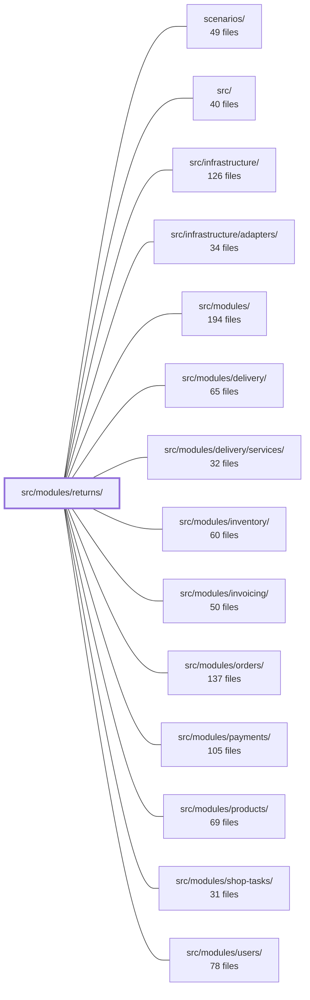

---
tags:
  - 2brain
  - 2brain/module
  - project/boilerplate-node-backend
type: module
module: src/modules/returns/
files: 81
updated: 2026-11-08T10:53:42.681491+00:00
---

# src/modules/returns/

## Purpose

The returns module owns the full lifecycle of customer goods returns and the EU 14-day withdrawal ("cooling-off") flow. It handles everything from a buyer opening a return request, through staff approval/decline decisions, physical receipt and restocking, refund computation, and final closure—covering both post-dispatch returns and pre-dispatch cancellations of unshipped order remainders.

## Key parts

- **Domain layer (`domain/`)** — Pure, side-effect-free business rules split across focused files: `lifecycle.ts` (status-transition guards used as concurrency predicates), `quantities.ts` (how much of an order can still come back), `reasons.ts` (statutory withdrawal and guarantee clocks), `refund-amount.ts` (integer-minor-unit refund arithmetic), `accounting.ts` (settled-unit / delivery-refund tracking), `restock.ts` (per-line restock decisions), `statement.ts` (who may set the timing fields), and `status-projection.ts` (the single status shown beside an order). Re-exported through `domain/index.ts`.
- **Services (`services/`)** — Use-case orchestrators that coordinate domain rules, the repository, and cross-module side-effects: `create.ts` (open a return or withdrawal), `cancel-remainder.ts` (close an unshipped remainder at creation), `cancel.ts` / `close.ts` (lifecycle transitions), plus decision and receive handlers.
- **Controllers (`controllers/`)** — Thin Express handlers for `GET /returns`, `GET /returns/:id`, `GET /returns/options`, and the POST actions (`/`, `/:id/approve`, `/:id/decline`, `/:id/receive`, `/:id/cancel`, `/:id/close`).
- **Persistence & model** — `model.ts` (Mongoose schema for `Return` and the per-order lock collection) and `repository.ts` (CRUD + atomic `claimStatus` conditional-write primitive).
- **Module wiring & contracts** — `module.ts` (manifest consumed by the kernel), `routes.ts` (route table with auth, rate-limit, idempotency middleware), `config.ts` (retention window), `rate-limits.ts`, `jobs.ts` (free-text scrub), `emails.ts` (rendered email copy), `events.ts` (domain-event augmentation), `presenter.ts` (document → wire-shape), and the YAML contracts (`openapi.yaml`, `asyncapi.webhooks.yaml`, `authorization.yaml`, `module.yaml`).

## How it connects

- **`src/modules/orders/`** — Reads order state (shipped units, `withdrawUntil` / `conformityUntil` deadlines, fulfillment status) and writes back a status projection; uses the orders' lock row to serialise return openings against the same order.
- **`src/modules/payments/`** — Fires refund instructions when a return is received or a remainder is cancelled; listens for the `PAYMENT_REFUNDED` outbox event to trigger the automatic `received → closed` transition.
- **`src/modules/inventory/`** — Restocks units back on sale when goods are physically received; releases held stock when a return is cancelled or declined.
- **`src/modules/delivery/`** — Consulted for delivery-cost data so the refund logic can determine whether a delivery refund is still owed (last-unit rule, Art. 13(2)).
- **`src/modules/invoicing/`** — Adjusts invoice line items when a cancellation or return settles.
- **`src/modules/products/`** — Reads product/variant data needed for return lines and restock calculations.
- **`src/modules/users/`** — Provides the authenticated caller context that drives permission scoping (staff vs. buyer) in controllers and services.
- **`src/infrastructure/`** — Consumes shared facilities: the audit type map (augmented in `audit.ts`), the mailer adapter (target of `emails.ts` output), the job scheduler (picks up `jobs.ts`), the outbox for async events, and the AsyncAPI bundler that merges `asyncapi.webhooks.yaml` into the global contract.
- **`src/modules/shop-tasks/`** — Consumes return status to gate or schedule shop-level fulfilment tasks.

## Where to start

1. **`domain/lifecycle.ts`** — Five lines of exported status-transition arrays tell you the entire state machine (`requested → approved → received → closed`, with `declined` / `canceled` branches) and how concurrency is guarded. Reading this first gives you the vocabulary every other file uses.
2. **`services/create.ts`** — The single entry point for both buyer-initiated returns and staff-initiated withdrawals. Following its logic (path selection → quantity validation → locked write → outbox enqueue) shows how the module composes domain rules, persistence, and cross-module effects into one use case.

## Connected modules

[[boilerplate-node-backend_ROOT|/ (repository root)]] · [[boilerplate-node-backend_scenarios|scenarios/]] · [[boilerplate-node-backend_src|src/]] · [[boilerplate-node-backend_src_infrastructure|src/infrastructure/]] · [[boilerplate-node-backend_src_infrastructure_adapters|src/infrastructure/adapters/]] · [[boilerplate-node-backend_src_modules|src/modules/]] · [[boilerplate-node-backend_src_modules_delivery|src/modules/delivery/]] · [[boilerplate-node-backend_src_modules_delivery_services|src/modules/delivery/services/]] · [[boilerplate-node-backend_src_modules_inventory|src/modules/inventory/]] · [[boilerplate-node-backend_src_modules_invoicing|src/modules/invoicing/]] · [[boilerplate-node-backend_src_modules_orders|src/modules/orders/]] · [[boilerplate-node-backend_src_modules_payments|src/modules/payments/]] · [[boilerplate-node-backend_src_modules_products|src/modules/products/]] · [[boilerplate-node-backend_src_modules_shop-tasks|src/modules/shop-tasks/]] · [[boilerplate-node-backend_src_modules_users|src/modules/users/]]

## Files
- `src/modules/returns/asyncapi.webhooks.yaml` — AsyncAPI **fragment** (not a standalone document) that declares the three webhook events the returns module emits: `return.requested`, `return.received`, and `return.closed`. A bundler (`scripts/contracts/asyncapi-section-fragments.ts`) merges this file into the `webhooks` section of the global `webhooks/asyncapi.yaml` only while the returns module is registered; deleting the module removes these events from the contract entirely.
- `src/modules/returns/audit.ts` — Declares the set of audit action strings the returns module emits and registers them in the infrastructure audit type map via module augmentation. It exists so that every audit log entry the returns domain produces is type-safe and discoverable from the infrastructure layer.
- `src/modules/returns/authorization.yaml` — Declares the authorization rules and permission sets that govern access to the `Return` resource in the returns module. It encodes three tenant-scope permissions (read, update, receive) and bundles them into named sets that other parts of the system can grant or require.
- `src/modules/returns/config.ts` — Defines the retention window (in days) for free-text fields on returns. Follows the read-per-call pattern established by `orders/config.ts` so that tests can override the value case-by-case without mutating module state.
- `src/modules/returns/controllers/get-return-options.ts` — Controller for `GET /returns/options?orderId=`. Given an order ID, it asks the return service what the order can still send back and cancel (with the refund each cancel would owe), then serializes that into a JSON response. The server computes the options; the client only displays them.
- `src/modules/returns/controllers/get-return.ts` — HTTP handler for `GET /returns/:id`. Retrieves a single return by ID scoped to the authenticated caller's permissions and returns the return document with the caller's available `actions`. Returns a 404 (not 403) when the return belongs to someone else's order, so existence is not leaked.
- `src/modules/returns/controllers/get-returns.ts` — Controller for `GET /returns` that returns a paginated list of returns. Staff callers see every return; all other callers see only returns on their own orders. The scoping decision lives in the service (derived from the caller's auth context), never from a query parameter.
- `src/modules/returns/controllers/post-return-cancel.ts` — Controller handler for `POST /returns/:id/cancel`, which lets staff cancel an approved return whose goods never arrived. It validates the ID and optional body, delegates to the return service, and responds with 200 and the updated return entity (in its `canceled` state).
- `src/modules/returns/controllers/post-return-close.ts` — Handler for `POST /returns/:id/close`, the endpoint a staff member uses to close a received return by hand. It validates the path id and optional note, delegates to the return service, and replies `200` with the updated `Return` (status now `closed`).
- `src/modules/returns/controllers/post-return-decision.ts` — Thin Express handlers for the two staff-facing decision actions on a return request: **approve** (`POST /returns/:id/approve`) and **decline** (`POST /returns/:id/decline`). Each validates the route id (and, for decline, the request body), delegates to `returnService`, and responds with HTTP 200 carrying the updated `Return` object enriched with action metadata.
- `src/modules/returns/controllers/post-return-receive.ts` — HTTP controller for `POST /returns/:id/receive`. Validates the incoming request, delegates to the returns service to put units back on sale and refund the customer, then responds with the updated `Return` entity (status `closed` on successful refund, `received` when a provider-refused refund is pending a sweep retry).
- `src/modules/returns/controllers/post-return.ts` — HTTP handler for `POST /returns`. Opens a return record and responds 201 with a `Location` header. The same endpoint doubles as the EU withdrawal button (distinguished by `reason: withdrawal` in the body). It is a thin controller: it validates/parses the request, delegates to the return service, and formats the HTTP response.
- `src/modules/returns/domain/accounting.ts` — Pure domain logic that answers one question: *what has the order already settled?* It tallies which units are accounted for (canceled before shipping, or physically back) and how much delivery has already been refunded, so that a service settling a new return or cancellation can determine whether it takes the **last** unit and whether a delivery refund is still owed. Keeping the rule here, free of I/O, makes it unit-testable without a database.
- `src/modules/returns/domain/index.ts` — Barrel re-export for the Returns domain layer. It consolidates the public API of eight sibling domain modules (lifecycle, quantities, reasons, statement, restock, status-projection, refund-amount, accounting) into a single import surface, guaranteeing that consumers only see pure rules—no Express, Mongoose, or other framework dependencies.
- `src/modules/returns/domain/lifecycle.ts` — Defines the return lifecycle as a set of status-transition guards and helper predicates. Each exported array enumerates the *source* statuses from which a particular write operation may proceed, and these arrays are consumed directly as conditional-write predicates (via `repository.ts`'s `claimStatus`), making them the concurrency guard that ensures exactly one staff action wins a race. The file is a pure, side-effect-free module: it imports only type definitions and exports constants and small functions.
- `src/modules/returns/domain/quantities.ts` — Pure domain logic that answers "how much of an order can still come back?" and validates a return's requested lines against that remaining pool. It exists as a database-free layer so the quantity rules that decide a return's lines are unit-testable in isolation.
- `src/modules/returns/domain/reasons.ts` — Pure domain logic that answers one question: *which return reasons is a buyer still allowed to name right now?* It encodes the two statutory clocks (the 30-day withdrawal window and the 2-year guarantee of conformity) without depending on any service, transport, or storage layer.
- `src/modules/returns/domain/refund-amount.ts` — Pure arithmetic (integer minor units via `Money`) that computes what a customer is owed when a return is received or a fulfillment order is canceled. Keeps the quoted figure and the `payments` figure identical by avoiding any float math. Encodes the shipping-refund rules tied to Art. 13(2): only the entity that takes the last unit of the order refunds delivery, and the amount depends on the reason.
- `src/modules/returns/domain/restock.ts` — Pure domain rule that decides how many units of each returned line go back on sale when goods are received. Staff can override the default (full quantity) per line—e.g. set a broken unit to 0. Keeping this as a stateless function makes the "broken unit never reaches the shelf" invariant testable without a database.
- `src/modules/returns/domain/statement.ts` — Defines the "statement" — the date (`requestedAt`) and channel (`statedVia`) recorded when a buyer or staff member makes a return request or withdrawal. Provides a single pure validation function (`checkStatement`) that enforces *who* may supply each field and whether the supplied date is plausible, encoding the rule that timing is judged on the day the message was **sent**, not read (CRD Art. 11(2)).
- `src/modules/returns/domain/status-projection.ts` — Computes the single projected return status displayed beside an order's own status. It is a pure function over a collection of returns, so every status boundary is testable without a database or external state.
- `src/modules/returns/emails.ts` — Resolves the copy for return and withdrawal notice emails into finished, language-specific text. It takes a notice kind, the recipient's locale, and contextual data, then returns a fully-rendered `EmailContent` object ready for the mailer adapter. The file follows the same convention as `@modules/account/emails`: the language is an explicit argument, the output is final text, and downstream rendering resolves nothing further.
- `src/modules/returns/events.ts` — Declares the returns module's domain events by augmenting the kernel's `DomainEventMap` interface, and exports the four event-name string constants that services and tests import to reference those events. The augmentation pattern (per-module `declare module` blocks rather than one central list) mirrors `modules/orders/events.ts`.
- `src/modules/returns/index.ts` — Public barrel (re-export) for the returns module. It is the **only** import surface a sibling module is allowed to use, enforcing the DDD module-boundary rule described in `docs/theory/strategic-ddd.md` §5. Internal plumbing (`returnRepository`, the model's runtime) is deliberately excluded; consumers interact with returns exclusively through the service layer exposed here.
- `src/modules/returns/jobs.ts` — Declares the scheduled jobs owned by the `returns` module. Currently exposes a single job — the free-text scrub — as a `JobDeclaration` array that the runtime scheduler can pick up.
- `src/modules/returns/model.ts` — Defines the Mongoose schema, TypeScript interfaces, and compiled models for a **Return** — the record of a customer's request to send goods back (or cancel an unshipped remainder). It also defines a lightweight `ReturnOrderLock` collection used as a write-conflict primitive to serialise parallel return openings against the same order. The schema encodes the full lifecycle (`requested → approved → received → closed`, with `declined` and `canceled` branches) and all decision-making fields so that queries and business rules (in `./services`) can operate on a single document.
- `src/modules/returns/module.ts` — Entry point (module manifest) for the **returns** module — handling customer goods returns and the EU 14-day withdrawal ("cooling-off") flow. It wires together the module's routes, jobs, config, rate limits, public webhook events, domain-event subscriptions, and personal-data collection into a single `AppModule` object consumed by the kernel.
- `src/modules/returns/module.yaml` — Module descriptor for the **returns** sub-module (EU returns + pre-dispatch withdrawal). It declares the module's domain summary, group membership, upstream dependencies, a write-path rate limit, and a periodic cleanup job — all operational metadata that sits alongside the API definition rather than in it.
- `src/modules/returns/openapi.yaml` — OpenAPI 3.1.0 contract for the **returns** module. It defines the REST surface for opening, listing, and managing returns (including EU withdrawal-of-contract as a special return), plus the module's contribution to the account data export. It exists so that the API is documented, validated, and discoverable independently of the runtime code.
- `src/modules/returns/presenter.ts` — Single transformation point that converts a stored `ReturnDocument` into the wire-contract shape (`StoredReturn`). It isolates the `_id` → `id` and date-to-ISO-string serialization so the rest of the codebase deals only with the typed contract. The read service layers `actions` on top of this result.
- `src/modules/returns/rate-limits.ts` — Declares the Returns module's rate-limit budget for `POST /returns` and converts it into a ready-to-use Express middleware. It is the module-local "source of truth" for how many return-openings a single authenticated account may perform per window.
- `src/modules/returns/repository.ts` — Persistence layer for the returns domain. Exposes the generic CRUD surface (via the shared `createRepository` factory) plus the two primitives every lifecycle service depends on: an atomic conditional status transition (`claimStatus`) and per-order reads needed for quantity checks and locking.
- `src/modules/returns/routes.ts` — Defines the Express route table for the returns module. Every route sits behind the auth wall (`getAuth` + `isAuth` applied globally on the router) and layers the correct combination of permission checks, step-up authentication, idempotency, rate limiting, and cache-control middleware in front of each controller.
- `src/modules/returns/services/cancel-remainder.ts` — Implements the "cancel the unshipped remainder" flow (`POST /returns` with `kind: cancellation`). Unlike a full order cancellation, this targets a single fulfillment order and creates a Return row that is **closed at creation time** (no open→close lifecycle). It moves money, returns stock, and adjusts the shipping rule atomically under the order's lock row, then fires the provider refund and post-commit side effects.
- `src/modules/returns/services/cancel-right.ts` — Single source of truth for *who may cancel a remainder* (the unshipped portion of an order). Both the enforcement gate (`cancel-remainder.ts`) and the UI-facing options read (`options.ts`) call this one function so the button never promises what the door would refuse.
- `src/modules/returns/services/cancel.ts` — Implements the staff action of canceling an approved return that will never be shipped (`approved → canceled`). This releases the held units and unblocks the order from staying `in_progress` indefinitely. It is pure bookkeeping—no refund, no stock adjustment, no event, no mail.
- `src/modules/returns/services/cancellation-refund.ts` — Computes the refund breakdown owed when cancelling a fulfillment order's remainder. It exists as a single shared computation for the two callers that need the same number: the cancel operation itself (inside its transaction) and `GET /returns/options` (which quotes the refund before anything is written).
- `src/modules/returns/services/close.ts` — Handles the `received → closed` status transition for a return. Exposes two public entry points: an automatic close (triggered in-request after a refund settles, or later by the `PAYMENT_REFUNDED` outbox listener) and a manual staff close for refunds that never flow through the payment provider. Both share an idempotent claim so that whichever path arrives second is a no-op.
- `src/modules/returns/services/create.ts` — Opens a return for an order, or a withdrawal when the order has not yet been dispatched. It is the single entry point for both buyer-initiated and staff-initiated openings. The file decides which path to take (withdrawal vs. return + cancellation of unshipped lines), validates requested quantities against what actually shipped and is not already being returned, writes the return document inside a locked transaction, and enqueues the outbox messages that trigger downstream side-effects (mails, status sync).
- `src/modules/returns/services/deadlines.ts` — Converts the two raw deadline dates stored on an order (`withdrawUntil`, `conformityUntil`) into the normalised `FrozenDeadlines` shape that the reason-evaluation logic (`reasonsOpenAt`, `isReasonOpen`) expects. The key transformation: the withdrawal deadline is advanced by one "silent day" via `withdrawalClosesAt` so the returned value is the instant a withdrawal actually stops being accepted, not the last calendar day the buyer was told.
- `src/modules/returns/services/decide.ts` — Implements the two staff-facing mutations for a return request in the `requested` state: **approve** or **decline**. Each call performs a single conditional write (CAS-style status claim) so that concurrent staff members cannot both decide the same request—the loser receives a 409. Downstream effects (order timeline entry, `return.decided` outbox event, audit row, order-projection sync) are committed within the same transaction or immediately after, and the customer-facing email is deferred to the outbox consumer.
- `src/modules/returns/services/digest.ts` — Computes the two return-side counts that the daily staff digest displays: how many return requests are still undecided past a configurable grace period, and how many approved withdrawals are still awaiting receipt of goods. It is a read-only aggregation service; it never mutates state.
- `src/modules/returns/services/index.ts` — Aggregate entry point for the returns domain. It re-imports every operation a controller might need (creating, deciding, receiving, closing, cancelling, listing, reading, notifying, stats, retention scrubbing, personal-data collection, digest) and bundles them into a single `returnService` object, so callers only depend on this one file rather than twelve siblings.
- `src/modules/returns/services/notify.ts` — Event listeners that email the customer at each return lifecycle stage—requested, decided, closed. Each listener loads the return, picks the right notice kind and copy, and enqueues a localized email via the buyer lookup in the orders module. All failures are logged and swallowed so that a mail outage never blocks or replays the underlying event.
- `src/modules/returns/services/options.ts` — Computes, in one authoritative pass, what an order can still return and what it can still cancel. By centralising the quantity math, refund calculation, and reason-deadline checks here, no client (or other service) needs to re-derive returnable/cancelable state.
- `src/modules/returns/services/outcome.ts` — Shared response and side-effect builders for "opening a return." Both the goods-return path (`create.ts`) and the cancel-remainder path (`cancel-remainder.ts`) import from this single module so neither needs to import the other. It centralises the 201 success shape, every 409/422/403 refusal the two paths can produce, the outbox event writes that accompany a freshly created return, and the audit row.
- `src/modules/returns/services/ownership.ts` — Answers a single gatekeeping question for the returns module: *who may open a return on a given order?* Both `createReturn` and `getReturn` call into this file before performing any return-specific work, so the authorization logic lives in one place rather than being duplicated across service files.
- `src/modules/returns/services/personal-data.ts` — Provides the `personalData` contribution for the returns module in the `POST /account/export` GDPR data-export flow. It collects every return linked to a user's orders and shapes them into a customer-facing export record. There is intentionally no `erase` function here: a return is keyed by `orderId` (not `userId`), so once `orders` runs its own `detachUserId`, the link is already broken. Returns are legal/accounting records of a consumer-rights act, falling under the Art. 17(3)(b)/(e) retention exemption (same rationale as `invoicing`).
- `src/modules/returns/services/projection.ts` — Keeps the `orders` module's `returnStatus` field in step with the returns attached to an order. Because `orders` cannot import this module, this file acts as the bridge: after any state-changing return operation, it reads the order's returns, computes the correct status word, and reports it back through the orders module's own public API (`orderService.markReturnStatus`).
- `src/modules/returns/services/read.ts` — Read-side service for the returns domain. It answers "what returns can this caller see?" and "what can this caller do to each one?" by combining permission checks, order-ownership scoping, and lifecycle-status gating into two public operations: a paginated list and a single-return fetch.
- `src/modules/returns/services/receive.ts` — Implements the "goods arriving" step of a return: transitions the status `approved → received`, restocks the requested units into inventory, and (for a refund remedy) opens the refund record — all in a single transaction. It is the single entry point a staff member calls when a returned parcel physically arrives at the warehouse.
- `src/modules/returns/services/retention.ts` — Implements the free-text retention sweep for returns: after a return has been quiet (no updates) for longer than a configured number of days, its free-text fields are wiped while the row itself remains as a legal record. Exposes a single function consumed by the `reap:returns` job.
- `src/modules/returns/services/stats.ts` — Aggregation queries that report how many units were received back (returned) within a time window, broken down by currency-bucket, by product, or by bucket for a single product. All three functions delegate to the `sumReceived` repository method with a different MongoDB group-by pipeline.
- `src/modules/returns/services/withdraw.ts` — Implements the buyer's right to withdraw an order **before dispatch** (Art. 11a). It composes two effects into one operation: the `orders` module's full cancellation (refunds in full, releases the stock hold) and a `Return` document written *closed at birth* with no lines (no goods are expected back), serving as the dated proof of the withdrawal. A second path handles the case where the shop has already started on made-to-order goods (Art. 16 exclusions): only eligible shipment groups are cancelled, one `kind: 'cancellation'` return per group.
- `src/modules/returns/tests/contract/api.contract.test.ts` — Contract tests that exercise every `/returns` HTTP endpoint over a real HTTP layer (supertest) and, via the side-effect import of `@tests/contract`, automatically validate each response body and status against the OpenAPI spec. The file also pins that each major contract branch is actually reached: the `201` + `Location` header, a pre-dispatch withdrawal that lands as a closed return, staff approve/decline decisions, and every documented refusal (422, 409, 404).
- `src/modules/returns/tests/factories.ts` — Provides a minimal, validation-free way to seed return documents into the database for integration tests that live **outside** the returns module. It exists so those tests can create the few fields a "count by status and age" query actually reads, without constructing full return objects with lines, orders, or monetary amounts.
- `src/modules/returns/tests/integration/cancel-remainder.test.ts` — Integration test for the "cancel the remainder" flow: creating a `Return` of `kind: 'cancellation'` against a real database and the fake payment provider to verify that lines, stock counters, the order summary, and the Return row all commit atomically, that delivery fees are refunded only on the cancellation that removes the last unshipped unit, and that buyer and staff access paths are enforced correctly.
- `src/modules/returns/tests/integration/cancel.test.ts` — Integration tests for the `approved → canceled` return transition. They verify that canceling an approved return is purely bookkeeping: no refunds, no stock movement, no domain events, and no outbound email. They also pin down which states reject cancel, and that post-cancel the return is inert (cannot be received or closed).
- `src/modules/returns/tests/integration/close-by-hand.test.ts` — Integration tests for `returnService.closeReturnByHand`, the manual-close path for a `received` return whose refund was settled outside the app (e.g., cash given at the counter). Verifies the state transition to `closed`, the audit trail, the timeline row, and—critically—that **no** `RETURN_CLOSED` outbox event is emitted and no money or stock moves.
- `src/modules/returns/tests/integration/hand-paid-refund.test.ts` — Integration test verifying the lifecycle of refunds on offline (cash / manual-transfer) payments. Because no external gateway can confirm the money was returned, these tests assert that a received return or a buyer cancellation only *opens* a refund in `pending` state, and that only an explicit operator call to `settleRefundByHand` transitions it to settled and closes the return.
- `src/modules/returns/tests/integration/lost-parcel.test.ts` — Integration test covering the buyer-remedy surface when a shipped parcel is marked lost in transit. It verifies three invariants: (1) the buyer can still cancel the units the lost parcel carried (full refund including delivery, stock returned), (2) goods that never arrived cannot be returned, and (3) a replacement shipment is counted once—never double the original quantity. Runs against a real database with the `fake` payment provider.
- `src/modules/returns/tests/integration/order-actions-parity.test.ts` — Integration test that pins the `OrderActions` flags returned to clients against the actual server responses for every combination of role × order status × action. It guarantees that a button is offered (`flag === true`) **iff** the corresponding endpoint returns a 2xx, and that a button is withheld **iff** the endpoint rejects. This catches any drift between the read-model flags and the write-side authorization logic.
- `src/modules/returns/tests/integration/outbox.test.ts` — Integration tests (against a real MongoDB) that verify return domain events are written to the transactional outbox atomically with their corresponding state changes, keyed by `orderId` for per-order ordering, and delivered to subscribers via the outbox relay. Also confirms that when the outbox write fails, the entire transaction rolls back (no partial state).
- `src/modules/returns/tests/integration/receive.test.ts` — Integration test for the "receive return" operation. It exercises the full flow—status transition, inventory restock, payment refund, and return closure—against a real database and a fake payment provider, verifying that the restock and status write are transactional, the refund is opened on the payment *before* the provider is called and carries the return's id, and a provider-refused refund is eventually resolved rather than left stuck.
- `src/modules/returns/tests/integration/remedy.test.ts` — Integration tests for the remedy ladder (Directive 2019/771 Art. 13) applied to a returned defective or wrong item: staff choose **replace** (reopen the same order, ship again) or **repair** (extend the guarantee by 12 months, once). Confirms that neither remedy moves money, that replaced units stay returnable, and that a withdrawal return can never carry a preferred remedy. Runs against a real database with the fake payment provider.
- `src/modules/returns/tests/integration/repository.test.ts` — Integration tests for the return repository's **read** path against a real database. Verifies two invariants: (1) `findByOrderId` / `findByOrderIds` always return rows ordered oldest-first regardless of write order, and (2) a read issued inside a transaction sees that same transaction's uncommitted write.
- `src/modules/returns/tests/integration/restock.test.ts` — Integration tests for the **receive-return** flow that verify how per-line restock counts affect sellable inventory, refund amounts, inventory ledger movements, audit metadata, and backorder fulfilment. The core invariant under test: restock count governs the *goods* (shelf units, backorder claims), never the *money* (refund is always the full order total).
- `src/modules/returns/tests/integration/retention.test.ts` — Integration tests (against a real database) for the `reap:returns` retention job. Verifies that `scrubReturnText` removes free-text fields (`note`, `declineMessage`) on returns older than the configured window while preserving structured fields, and that a second run is a no-op.
- `src/modules/returns/tests/integration/return-refund-retry.test.ts` — Integration test that verifies the refund-retry contract when the payment provider refuses or cannot record a refund during `receiveReturn`. It proves three invariants: a failed refund does not undo the receipt (goods are still returned), a failure to even record the refund aborts the whole receipt so a second attempt can succeed, and a post-commit failure leaves a durable pending record that the payment sweep later completes. Both the `returns` and `payments` modules run as real implementations (no service-level mocks), so the actual sweep logic executes.
- `src/modules/returns/tests/integration/service.test.ts` — Integration tests for the returns service (`returnService`) executed against a real database. They verify conditional-write guarantees (a withdrawal actually cancels the order and refunds the payment; a return on shipped goods actually writes lines and quantities) and scoping invariants (tenant isolation, customer ownership, role-based access). The only external effects mocked are the mail queue and the audit port; every domain event, outbox relay, and database write runs for real.
- `src/modules/returns/tests/integration/staff-opens.test.ts` — Integration tests that exercise the staff-initiated return path (support or moderator opening a return on behalf of a buyer). Covers the happy path (approved return with single buyer notification), date and channel validation, authorization rejections (404 for warehouse/stranger), quantity guards, recovery from a prior declined return, and the policy-waiver surface (`window_closed`, `excluded_goods`) including the boundary of what staff *cannot* waive.
- `src/modules/returns/tests/integration/stats.test.ts` — Integration tests for the returns stats service. Verifies that the three aggregation functions (`returnedBuckets`, `returnedByProduct`, `returnedSeries`) correctly count only goods actually received (not merely requested) and bucket them by shop day in a real database, using a fixed Rome-timezone window.
- `src/modules/returns/tests/integration/withdrawal-before-dispatch.test.ts` — Integration test that pins the cross-module contract for a customer withdrawal on a paid, undispatched order. It verifies that the order is canceled, the full amount is refunded exactly once through the order's own refund path (not a second time via the return), one credit note is issued, the return is written as closed at birth, and exactly one acknowledgement email goes out from the returns module — ensuring a refund and a return never announce the same money twice.
- `src/modules/returns/tests/unit/deadlines.test.ts` — Unit tests for `frozenDeadlinesOf`, verifying that the withdrawal deadline is shifted one full UTC day past the customer-facing announcement (the "silent grace day") while the guarantee/conformity deadline remains untouched, and that the set of eligible return reasons flips correctly at the grace boundary.
- `src/modules/returns/tests/unit/domain.test.ts` — Unit tests for the pure domain rules that decide a return's line items, initial status, quantity accounting, and reason eligibility. Because the domain is database-free, these tests walk every boundary condition in isolation, ensuring the business logic stays correct without a running service.
- `src/modules/returns/tests/unit/emails.test.ts` — Unit-test suite for the `returnNoticeEmail` function. It verifies that every statutory and informational return notice (withdrawal-acknowledged, return-requested, return-approved, return-declined, return-closed, return-replaced, return-repaired) renders the correct legal content — order reference, exact UTC timestamp, postage responsibility, refund amount, remedy language, and localisation — through a single shared template.
- `src/modules/returns/tests/unit/public-events.test.ts` — Verifies that the returns module's `publicEvents` registry projects domain events into the correct external shape—right event name, right payload fields—and that sensitive fields (e.g. the customer's free-text note) are stripped before reaching webhook subscribers.
- `src/modules/returns/tests/unit/refund-amount.test.ts` — Unit tests for the pure-arithmetic refund calculation in the returns domain module. Every rule derived from the Consumer Rights Directive (Art. 13 shipping, Art. 14 handling deduction) is pinned to an expected value, including edge cases around currency formatting and the interaction between earlier partial refunds and later returns.
- `src/modules/returns/tests/unit/routes.test.ts` — Unit test that asserts the structure of the returns route table: which routes are mounted, what authorization guards protect them, their relative order, and which middleware (rate-limit, idempotency) is attached. It exists to catch accidental route additions/removals, guard regressions, and ordering mistakes without spinning up a server.
- `src/modules/returns/tests/unit/schema-contract.test.ts` — Locks the structural contract of `returnSchema` so that accidental field additions, enum drift, default changes, or index removals are caught immediately. It exists as a living specification: the assertions *are* the requirements for what a return record must and must not contain.
- `src/modules/returns/tests/unit/status-projection.test.ts` — Unit tests for `projectReturnStatus`, which collapses an order's collection of `ProjectedReturn` entries (each with a status, kind, and product lines) into a single order-level status string (`'requested'`, `'in_progress'`, `'partially_returned'`, `'returned'`, or `undefined`). The file verifies that the projection respects status priority, ignores non-relevant returns (declined, canceled, remedy-closed, line-less), and correctly accounts for partial versus full coverage across multiple returns.

---
[[boilerplate-node-backend_INDEX|← boilerplate-node-backend index]]
