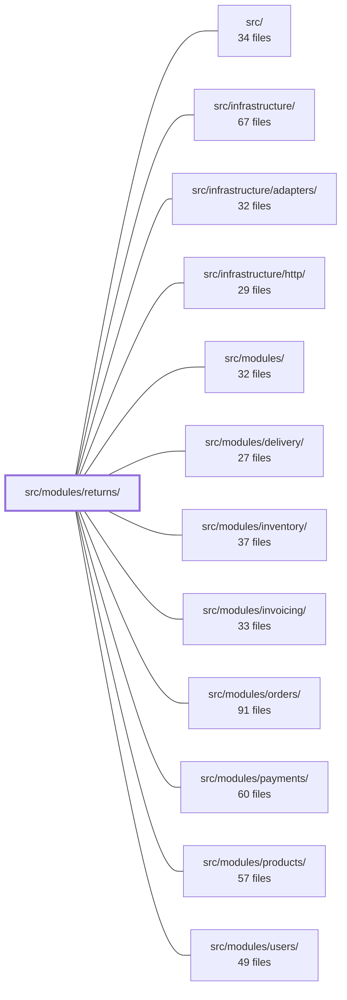

---
tags:
  - 2brain
  - 2brain/module
  - project/boilerplate-node-backend
type: module
module: src/modules/returns/
files: 40
updated: 2026-10-08T00:00:42.898776+00:00
---

# src/modules/returns/

## Purpose

The returns module handles the full lifecycle of customer-initiated returns: creation, approval/rejection decisions, physical receipt, closing, and the financial side (refund amount calculation). It encapsulates domain rules (quantities, status transitions, lifecycle constraints), exposes a small HTTP API, and orchestrates side-effects such as notifications, inventory updates, and payment refunds.

## Key parts

- **Domain core** – `domain/` (lifecycle, quantities, status-projection) defines the invariants and state machine for a return; `model.ts` and `events.ts` describe the persisted shape and domain events emitted during transitions.
- **Services** – `services/` contains one file per business operation: `create`, `decide`, `receive`, `close`, `read`, `notify`, `refund-amount`, `ownership`, `personal-data`, and `projection`. Each service composes domain rules with repository and cross-module calls to perform a single use-case.
- **HTTP layer** – `controllers/` maps incoming requests to service calls; `routes.ts` declares the URL surface; `presenter.ts` shapes API responses; `rate-limits.ts` guards abuse-sensitive endpoints.
- **Persistence & side-effects** – `repository.ts` abstracts data access; `emails.ts` builds notification content; `audit.ts` records tamper-evident action logs.
- **Wiring** – `module.ts` and `index.ts` wire the module's dependencies together and export its public interface.
- **Tests** – `tests/unit/` covers domain logic, schema, and presentation; `tests/integration/` exercises service and API flows; `tests/contract/` pins the public API shape.

## How it connects

- **orders** – a return is always anchored to an order line; `services/create` and `services/ownership` validate against the order module.
- **payments** – `services/refund-amount` and `services/close` calculate and trigger refund transactions through the payments module.
- **inventory** – `services/receive` updates stock levels once a returned item is physically accepted.
- **products** – product data (SKU, variant) is needed to validate what is being returned and to compute refundable quantities.
- **delivery** – the return-receipt flow may reference the original delivery and any return shipping leg.
- **invoicing** – closing a return can generate a credit note via the invoicing module.
- **users** – `services/ownership` and `services/personal-data` enforce that only the acting user (or staff) may view/modify a return.
- **infrastructure/http & adapters** – the controllers, routes, and repository all build on the shared HTTP framework and persistence adapters.

## Where to start

1. **`src/modules/returns/domain/lifecycle.ts`** – reading the state machine first makes every subsequent file (services, controllers, tests) easier to follow because you'll understand the valid transitions and their guards.
2. **`src/modules/returns/services/create.ts`** – this is the entry-point use-case; tracing it shows how domain rules, the repository, and cross-module calls (orders, products, users) fit together in one concrete flow.

## Connected modules

[[boilerplate-node-backend_ROOT|/ (repository root)]] · [[boilerplate-node-backend_src|src/]] · [[boilerplate-node-backend_src_infrastructure|src/infrastructure/]] · [[boilerplate-node-backend_src_infrastructure_adapters|src/infrastructure/adapters/]] · [[boilerplate-node-backend_src_infrastructure_http|src/infrastructure/http/]] · [[boilerplate-node-backend_src_modules|src/modules/]] · [[boilerplate-node-backend_src_modules_delivery|src/modules/delivery/]] · [[boilerplate-node-backend_src_modules_inventory|src/modules/inventory/]] · [[boilerplate-node-backend_src_modules_invoicing|src/modules/invoicing/]] · [[boilerplate-node-backend_src_modules_orders|src/modules/orders/]] · [[boilerplate-node-backend_src_modules_payments|src/modules/payments/]] · [[boilerplate-node-backend_src_modules_products|src/modules/products/]] · [[boilerplate-node-backend_src_modules_users|src/modules/users/]]

## Files
- `src/modules/returns/audit.ts`
- `src/modules/returns/controllers/get-return-by-id.ts`
- `src/modules/returns/controllers/get-returns.ts`
- `src/modules/returns/controllers/post-return-decision.ts`
- `src/modules/returns/controllers/post-return-receive.ts`
- `src/modules/returns/controllers/post-return.ts`
- `src/modules/returns/domain/index.ts`
- `src/modules/returns/domain/lifecycle.ts`
- `src/modules/returns/domain/quantities.ts`
- `src/modules/returns/domain/status-projection.ts`
- `src/modules/returns/emails.ts`
- `src/modules/returns/events.ts`
- `src/modules/returns/index.ts`
- `src/modules/returns/model.ts`
- `src/modules/returns/module.ts`
- `src/modules/returns/presenter.ts`
- `src/modules/returns/rate-limits.ts`
- `src/modules/returns/repository.ts`
- `src/modules/returns/routes.ts`
- `src/modules/returns/services/close.ts`
- `src/modules/returns/services/create.ts`
- `src/modules/returns/services/decide.ts`
- `src/modules/returns/services/index.ts`
- `src/modules/returns/services/notify.ts`
- `src/modules/returns/services/ownership.ts`
- `src/modules/returns/services/personal-data.ts`
- `src/modules/returns/services/projection.ts`
- `src/modules/returns/services/read.ts`
- `src/modules/returns/services/receive.ts`
- `src/modules/returns/services/refund-amount.ts`
- `src/modules/returns/tests/contract/api.contract.test.ts`
- `src/modules/returns/tests/integration/receive.test.ts`
- `src/modules/returns/tests/integration/service.test.ts`
- `src/modules/returns/tests/integration/withdrawal-before-dispatch.test.ts`
- `src/modules/returns/tests/unit/domain.test.ts`
- `src/modules/returns/tests/unit/emails.test.ts`
- `src/modules/returns/tests/unit/refund-amount.test.ts`
- `src/modules/returns/tests/unit/routes.test.ts`
- `src/modules/returns/tests/unit/schema-contract.test.ts`
- `src/modules/returns/tests/unit/status-projection.test.ts`

---
[[boilerplate-node-backend_INDEX|← boilerplate-node-backend index]]
