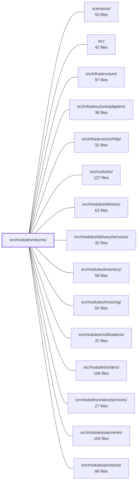

---
tags:
  - 2brain
  - 2brain/module
  - project/boilerplate-node-backend
type: module
module: src/modules/returns/
files: 79
updated: 2026-10-29T19:28:53.686540+00:00
---

# src/modules/returns/

## Purpose

The returns module owns the complete lifecycle of return and cancellation requests against an order: opening a return (including the EU 14-day withdrawal path), staff decision (approve/decline), physical receipt of goods, refund processing, and closure. It also handles cancellation of an order's unshipped remainder. Business rules (quantities, deadlines, refund arithmetic, restocking) live as pure domain functions; side effects (persistence, payments, inventory, email) are delegated to sibling modules and infrastructure.

## Key parts

- **Domain layer (`domain/`)** — Pure, side-effect-free logic that encodes the business rules: `lifecycle.ts` (state-transition guards and concurrency-safe status claims), `quantities.ts` (how much is still returnable), `refund-amount.ts` (integer-minor-unit refund math including the "last-unit ships the delivery refund" rule), `reasons.ts` (CRD / conformity-deadline eligibility), `restock.ts`, `accounting.ts`, `statement.ts`, `status-projection.ts`. Re-exported through `domain/index.ts`.
- **Services (`services/`)** — One file per user-facing operation: `create.ts` (open a return / withdrawal), `decide.ts` (approve or decline), `close.ts` (auto or manual close), `cancel.ts` (staff cancel of a no-arrival return), `cancel-remainder.ts` (cancel unshipped order remainder, coordinating delivery, inventory, payments, and the order lock), `cancellation-refund.ts`, `cancel-right.ts`, `deadlines.ts`, `digest.ts`, and others. Each service is the single place where a transition's writes, events, and cross-module calls are sequenced.
- **Controllers (`controllers/`)** — Thin Express handlers that parse the request, extract auth context, delegate to the service, and shape the HTTP response. Ownership enforcement (foreign IDs → 404) lives here, not in the service.
- **Persistence (`model.ts`, `repository.ts`)** — Mongoose schema and the `claimStatus` conditional-write primitive that makes concurrent lifecycle transitions safe. `model.ts` also defines the `ReturnOrderLock` row used to serialise `POST /returns`.
- **Module manifest & routing (`module.ts`, `routes.ts`, `rate-limits.ts`)** — Declares routes, jobs, events, personal-data hooks, and the `PAYMENT_REFUNDED` subscription that closes a return when the provider's refund lands. Rate-limiting covers the single write endpoint.
- **Cross-cutting (`events.ts`, `emails.ts`, `audit.ts`, `config.ts`)** — Typed domain-event payloads, localized email composition (single `returns.notice` template), audit-action string registry, and the free-text retention window.
- **Jobs (`jobs.ts`, `jobs.generated.ts`)** — A single scheduled job that scrubs stale free-text fields on return records.

## How it connects

- **`src/modules/orders/`** — The returns module reads order state (items, deadlines, dispatch status) to validate and price returns, syncs the order's `return-status` projection after every transition, and delegates pre-dispatch cancellations back to the order's own cancellation logic. The order module in turn exposes the lock row that serialises concurrent `POST /returns` calls.
- **`src/modules/delivery/`** — Cancel-remainder services call delivery to mark lines as cancelled and release fulfilment.
- **`src/modules/inventory/`** — Cancel-remainder releases held stock through the inventory service after the transaction commits.
- **`src/modules/payments/`** — Refund records are opened here and fired to the payment provider; the module subscribes to `PAYMENT_REFUNDED` to close the return once the provider confirms.
- **`src/modules/notifications/`** — Receives the `EmailContent` objects composed in `emails.ts` for delivery to the customer.
- **`src/infrastructure/`** — Supplies the audit type map (augmented by `audit.ts`), the job scheduler, the HTTP adapter (Express), and the i18n translator used by `emails.ts`.
- **`src/modules/products/`** — Restock logic in the domain layer determines quantities; the products module performs the actual re-listing.

## Where to start

Read **`module.ts`** first — it is the single entry point that declares every route, event subscription, job, and cross-module side effect, giving you a map of the module's entire surface. Then read **`domain/lifecycle.ts`** to understand the state machine (`requested → approved/received/closed/canceled`) and the `claimStatus` guard pattern; nearly every service and controller in the module is organized around those transitions.

## Connected modules

[[boilerplate-node-backend_ROOT|/ (repository root)]] · [[boilerplate-node-backend_scenarios|scenarios/]] · [[boilerplate-node-backend_src|src/]] · [[boilerplate-node-backend_src_infrastructure|src/infrastructure/]] · [[boilerplate-node-backend_src_infrastructure_adapters|src/infrastructure/adapters/]] · [[boilerplate-node-backend_src_infrastructure_http|src/infrastructure/http/]] · [[boilerplate-node-backend_src_modules|src/modules/]] · [[boilerplate-node-backend_src_modules_delivery|src/modules/delivery/]] · [[boilerplate-node-backend_src_modules_delivery_services|src/modules/delivery/services/]] · [[boilerplate-node-backend_src_modules_inventory|src/modules/inventory/]] · [[boilerplate-node-backend_src_modules_invoicing|src/modules/invoicing/]] · [[boilerplate-node-backend_src_modules_notifications|src/modules/notifications/]] · [[boilerplate-node-backend_src_modules_orders|src/modules/orders/]] · [[boilerplate-node-backend_src_modules_orders_services|src/modules/orders/services/]] · [[boilerplate-node-backend_src_modules_payments|src/modules/payments/]] · … and 2 more

## Files
- `src/modules/returns/audit.ts` — Defines the set of audit action strings emitted by the returns module and registers them in the infrastructure audit type map via TypeScript module augmentation. This keeps the returns module's audit vocabulary in one place so every service that records an event uses a stable, typed identifier.
- `src/modules/returns/config.ts` — Defines the retention window (in days) for free-text fields on returns. Follows the same per-call read pattern as `orders/config.ts`, so individual tests can override the value without mutating module state.
- `src/modules/returns/controllers/get-return-by-id.ts` — Express route handler for `GET /returns/:id`. Resolves a single return by ID, enforces ownership (a return belonging to another user's order returns **404**, indistinguishable from a missing one), records a staff-read audit event, and replies with the return payload plus the caller's available `actions`.
- `src/modules/returns/controllers/get-return-options.ts` — Express controller for `GET /returns/options?orderId=…`. Given an order ID (and the caller's identity), it asks the return service what items are still returnable and which cancellations are still possible, along with the refund each cancel would produce. It exists to keep HTTP parsing, auth extraction, and response shaping out of the service layer.
- `src/modules/returns/controllers/get-returns.ts` — Handles the `GET /returns` endpoint, returning a paginated list of return records. The visibility scope (all returns for staff, own-order returns for everyone else) is determined exclusively by the service layer from the authenticated caller's context — never from a query parameter.
- `src/modules/returns/controllers/post-return-cancel.ts` — Controller for `POST /returns/:id/cancel`. Allows staff to cancel an approved return whose goods never arrived. Validates the route id and optional body, delegates to the return service, and responds 200 with the return in its new `canceled` state.
- `src/modules/returns/controllers/post-return-close.ts` — HTTP controller handler for `POST /returns/:id/close`. It lets staff finish a received return by hand, then responds 200 with the updated return entity (now in `closed` state).
- `src/modules/returns/controllers/post-return-decision.ts` — Express handlers for the two staff-facing return-decision actions (`POST /returns/:id/approve` and `POST /returns/:id/decline`). Each validates the request, delegates to `returnService`, and responds with the updated `Return` object (HTTP 200).
- `src/modules/returns/controllers/post-return-receive.ts` — HTTP controller for `POST /returns/:id/receive`. It marks a returned item as physically received (goods arrived), triggers the refund to the customer, and returns the updated `Return` record — `closed` once the refund succeeds, `received` if the provider refused and the refund is queued for a later sweep.
- `src/modules/returns/controllers/post-return.ts` — HTTP handler for `POST /returns`. Opens a return record and responds **201 Created** with a `Location` header. The same endpoint doubles as the EU 14-day withdrawal button (distinguished only by `reason: "withdrawal"` in the body); in that case the return is closed at birth if it reaches the order before dispatch, canceling the order.
- `src/modules/returns/domain/accounting.ts` — Pure accounting logic that determines which order units are already settled (cancelled pre-ship or returned) and how much delivery has been refunded. It lets the "shipping is refunded by whichever cancel or return takes the last unit" rule be evaluated and tested without a database.
- `src/modules/returns/domain/index.ts` — Barrel file for the returns domain layer. It re-exports every public function, constant, and type from the sibling domain modules so that consumers (services, repository, external modules) can import from a single path (`../domain`) instead of reaching into individual files. It contains no logic of its own.
- `src/modules/returns/domain/lifecycle.ts` — Defines the return lifecycle's state-transition guards: which `ReturnStatus` values permit each write operation (decide, receive, close, cancel). Because each constant is consumed directly as the `FROM` clause in a conditional database write (`claimStatus`), membership in these arrays *is* the concurrency guard, not documentation. Also provides pure helpers that compute a return's initial status and whether it still "holds" a unit of goods.
- `src/modules/returns/domain/quantities.ts` — Pure, side-effect-free functions that answer "how much of this order can still come back?" and "does this return consume the last unit?" They encode the business rules for returnable quantity, line validation, and whole-order completion so that services and domain projections can rely on them without touching a database.
- `src/modules/returns/domain/reasons.ts` — Pure domain logic that determines which return reasons a buyer may still cite, based on the two deadlines frozen at delivery (withdrawal window and guarantee of conformity). It encodes Consumer Rights Directive Art. 9/16 and Directive 2019/771 Art. 10 into classification and eligibility checks, with no I/O or side effects.
- `src/modules/returns/domain/refund-amount.ts` — Pure arithmetic for computing how much a customer is owed when a return or cancellation is processed. All calculations use integer minor units (via the `Money` primitive) to eliminate float drift between the quoted figure and the payment sent. Encodes the shipping-refund rule: only the return/cancel that takes the last unit of an order refunds delivery, with the amount depending on reason (full refund for defects, cheapest-standard cap for withdrawals).
- `src/modules/returns/domain/restock.ts` — Pure domain rule that decides how many units of each returned line go back on sale once goods are received. It isolates the "keep a broken unit off the shelf" logic from persistence so the invariant is testable without a database.
- `src/modules/returns/domain/statement.ts` — Domain rule that decides what statement (date + channel) a return is written with, depending on whether the caller is the buyer or a staff member. It encodes the CRD Art. 11(2) timing rule (a withdrawal is judged on the day it was *sent*, not read) and enforces which fields each caller may or must supply. Pure, synchronous, no I/O.
- `src/modules/returns/domain/status-projection.ts` — Pure function that collapses an order's collection of returns into a single `OrderReturnStatus` word (the value `orders` displays beside its own status). It exists so the "what state are we in?" question is answerable and unit-testable without a database or service layer.
- `src/modules/returns/emails.ts` — Composes the finished, localized email content for every return and withdrawal notice the returns module sends. It resolves all copy into concrete strings at call time (via the i18n translator), so the downstream renderer (`mailer` adapter) only formats an `EmailContent` object and resolves nothing further. A single template ID (`returns.notice`) carries all notice kinds; differences live in the locale files, not in separate templates.
- `src/modules/returns/events.ts` — Declares the four domain events the returns module emits by augmenting the kernel's shared `DomainEventMap` (same pattern as `modules/orders/events.ts`). Provides the typed payload shapes for each event and exports string-name constants so callers reference events without hard-coding literals.
- `src/modules/returns/index.ts` — Public barrel for the **returns** module. It is the *only* import surface exposed to sibling modules (per the strategic-DDD boundary rule in `docs/theory/strategic-ddd.md` §5). It re-exports the service API, domain types, events, email helpers, and model *types*—keeping the `returnRepository` and the model's runtime internals encapsulated behind the service layer.
- `src/modules/returns/jobs.generated.ts` — Machine-generated data module that describes the returns module's scheduled jobs (name, cron schedule, summary) as a frozen object. It is produced from `src/modules/returns/module.yaml` so that job metadata lives in one declarative source while the executable wiring lives elsewhere.
- `src/modules/returns/jobs.ts` — Declares the scheduled jobs owned by the `returns` module. Currently there is exactly one: a free-text scrub that reaps stale return records. The file wires together the job's metadata (generated) and its runtime behavior (a service call) into a single `JobDeclaration` list for the scheduler.
- `src/modules/returns/model.ts` — Defines the Mongoose schema, compiled model, and serialization transform for **Return** documents (one per return/cancellation request, keyed by `orderId`). Also declares a small **ReturnOrderLock** model that serializes concurrent `POST /returns` calls via a write-conflict counter. All domain rules and queries live elsewhere (`./services`, `./repository`); this file is the persistence contract.
- `src/modules/returns/module.ts` — Module manifest (entry point) for the **returns** module. It declares everything the kernel needs to mount and operate the module—routes, jobs, config, rate limits, public (webhook-visible) events, domain-event subscriptions, personal-data hooks, and a test scenario. It also wires the cross-module side effect: reacting to a `PAYMENT_REFUNDED` event to close a return once the provider's refund lands.
- `src/modules/returns/presenter.ts` — Single responsibility: convert a `ReturnDocument` (as stored in the database) into the `StoredReturn` shape that the API contract expects, before the read service layers on caller-specific `actions`.
- `src/modules/returns/rate-limits.generated.ts` — Auto-generated data file that declares the returns module's rate-limit budgets as a plain const object. It exists so that `rate-limits.ts` can import structured limit definitions (name, namespace, env var, default max, window, bounds rationale) without embedding them in logic. The source of truth is `src/modules/returns/module.yaml`; this file is a build artifact.
- `src/modules/returns/rate-limits.ts` — Defines the rate-limit budget for the Returns module's single write endpoint (`POST /returns`) and exposes it as ready-to-use Express middleware. It is the "declaration" step: it binds the numeric thresholds (sourced from the generated file) to a per-account keying strategy and hands the result to the shared `buildRateLimiter` factory, matching the pattern every other module follows.
- `src/modules/returns/repository.ts` — The persistence boundary for the returns module. It exposes a generic CRUD surface (built on `createRepository`) plus the two primitives every service uses to drive lifecycle transitions: `claimStatus` (an atomic, conditional status write) and the per-order reads that quantity checks, locking, and reports depend on.
- `src/modules/returns/routes.ts` — Express route table for the returns module. Wires every HTTP endpoint for creating, listing, reading, and transitioning return records, and attaches the per-route policy stack (auth, permission, rate-limit, step-up, idempotency, cache-control) in the correct order.
- `src/modules/returns/services/cancel-remainder.ts` — Implements cancellation of the **unshipped remainder** of a single fulfillment order. It creates a Return document of `kind: 'cancellation'` that is **closed at the moment of creation** (no open state). Within one transaction under the order's lock row it marks lines cancelled (via `delivery`), releases stock (via `inventory`), writes the closed Return row, and opens a refund record. After commit it nudges the outbox, refreshes caches, syncs the order's return-status projection, and fires the refund to the payment provider. The `returns` module owns this because it is the only module that already reaches delivery, inventory, payments, and the order lock together.
- `src/modules/returns/services/cancel-right.ts` — Defines the single shared rule for who may cancel a remainder (the unshipped portion of an order). It exists so that the enforcing door (`cancel-remainder.ts`) and the UI options reader (`options.ts`) agree on the same decision, preventing a situation where the button offers an action the door then refuses.
- `src/modules/returns/services/cancel.ts` — Implements the staff action of canceling an approved return whose goods were never shipped (`approved → canceled`). It exists to release units held by a return that will never arrive, preventing the parent order from being stuck at `in_progress` indefinitely. The operation is bookkeeping only: no money moves, no stock adjusts, no event fires, no mail is sent.
- `src/modules/returns/services/cancellation-refund.ts` — Computes the refund breakdown for cancelling the remainder of a fulfillment order. It exists so that both the cancel transaction (`cancel-remainder`) and the pre-write quote endpoint (`GET /returns/options`) share a single, consistent calculation of what the cancel owes, accounting for what earlier returns and cancels have already settled.
- `src/modules/returns/services/close.ts` — Handles the transition of a return to `closed` status after its money has gone back. Provides two public entry points — `closeReturn` (automatic, tied to refund settlement) and `closeReturnByHand` (manual staff action when no refund occurred) — both built on a shared atomic claim-and-append operation that is safe under concurrent calls.
- `src/modules/returns/services/create.ts` — Opens a return for an order — the same call that powers the withdrawal button. The shape of the resulting `Return` record depends on whether goods have shipped: pre-dispatch it delegates to the order's own cancellation (full refund, stock release) and writes a closed, line-less `Return` as dated proof; post-dispatch it writes an open `Return` with the goods coming back and cancels unshipped items separately. Handles both buyer-initiated and staff-initiated openings, including policy waivers.
- `src/modules/returns/services/deadlines.ts` — Normalizes an order's stored deadline fields into the `FrozenDeadlines` shape that the returns reason-judging logic expects. The key transform: the order records the *last day* a buyer is told for withdrawal, but the deadline actually closes one silent day later; this file applies that shift so downstream checks operate on the true close instant.
- `src/modules/returns/services/decide.ts` — Handles a staff member's decision on a return request: approve or decline with a reason. Each decision is a conditional write from `requested` status, so concurrent decisions on the same request are mutually exclusive — the loser receives a 409. After the write commits, the file records an audit row, nudges the outbox, and syncs the order's return-status projection.
- `src/modules/returns/services/digest.ts` — Computes the two returns-side counts that feed the daily staff digest: how many return requests have been waiting for a decision beyond the allowed number of days, and how many approved withdrawal returns are still awaiting receipt of goods. It produces counts only—no record data is returned.
- `src/modules/returns/services/index.ts` — Barrel module that re-exports every returns-domain function into a single `returnService` handle. Controllers and the module container interact with one object instead of scattering imports across a dozen sub-files.
- `src/modules/returns/services/notify.ts` — Outbound customer-email handlers for the return lifecycle. It subscribes to the module's own domain events (`return.requested`, `return.decided`, `return.closed`) and queues a localized notice to the buyer via the order service's mail pipeline. Every handler is fire-and-forget: a failed mail is logged and swallowed so the event relay never redelivers.
- `src/modules/returns/services/options.ts` — Computes the full set of return and cancellation options for a single order in one pass: which shipped goods the caller may still return (and under which reasons), and which fulfillment-order remainders they may still cancel (with the exact refund owed). Centralising this derivation here means no client re-computes quantities, deadlines, or refund amounts independently.
- `src/modules/returns/services/outcome.ts` — Shared vocabulary for what "opening a return" answers with: the input types both writers accept, the success/refusal HTTP responses they return, the outbox events they enqueue in the creating transaction, and the audit row they leave. It exists as a single home so `create.ts` (goods coming back) and `cancel-remainder.ts` (unshipped remainder cancelled) never import each other.
- `src/modules/returns/services/ownership.ts` — Central ownership gate for the `returns` module. Before any return-related operation touches an order, this file answers the single question: *may this caller open (or view) a return on this order?* It is the shared prerequisite that `createReturn` and `getReturn` invoke before proceeding.
- `src/modules/returns/services/personal-data.ts` — Provides the returns section of the `POST /account/export` endpoint (registered in `module.ts` as `personalData`). It retrieves and reshapes all return records belonging to a requesting user's orders into the `ExportReturn` shape. There is deliberately **no** `erase`/unlink function here: a return is keyed by `orderId` and stores no `userId`, so once `orders` breaks its own user link, the return is already unreachable. Returns are treated as legal/accounting records under Art. 17(3)(b)/(e) and are retained rather than erased.
- `src/modules/returns/services/projection.ts` — Keeps the `returnStatus` field on an `Order` in sync with the actual returns attached to it. Because the `orders` module cannot import the `returns` module, this file acts as a one-way reporter: after any return state change, it reads the current returns, derives the correct status word, and pushes it into the order via `orderService`. It is idempotent and fire-and-forget—failures are logged, never thrown, since the next state change re-stamps the value.
- `src/modules/returns/services/read.ts` — Handles the read path for returns: listing and fetching individual returns with caller-aware visibility and per-row action flags. Staff (holders of `read:Return`) see all returns; everyone else is scoped to returns on their own orders. The file centralises the "what actions can this caller take on this return?" decision so no client re-implements the lifecycle.
- `src/modules/returns/services/receive.ts` — Handles the "goods arrived" step of a return: transitions a return from `approved → received`, restocks the units that go back on sale, resolves the remedy (refund, replace, or repair), and opens the refund record — all in a single transaction guarded by an order-level lock. The file keeps the receipt fact (parcel + restock) atomic while deliberately deferring the money fact (provider refund call) to an outbox-driven sweep, so a received return can never be stuck without a retry.
- `src/modules/returns/services/retention.ts` — Implements the free-text retention sweep for returns: once a return's `updatedAt` exceeds the configured quiet period, its human-authored text fields (`note`, `declineMessage`) are unset while the structured row (and reason codes) is preserved as a legal record. Exists to satisfy the data-retention policy described in `docs/theory/data-retention.md#free-text-on-returns`.
- `src/modules/returns/services/stats.ts` — Provides read-only statistical queries about returned goods, aggregated by time bucket, currency, and product. The core convention: a return is attributed to the day its goods were **received** back (i.e. when stock went back on sale and the refund was opened), not when it was initiated.
- `src/modules/returns/services/withdraw.ts` — Implements the buyer's right of withdrawal (Art. 11a) before dispatch: it cancels the order, triggers a full refund, and writes a `Return` document that is closed at birth (no lines, since no goods are coming back) as the dated legal record. It also handles the partial-cancellation case where the shop has already started on made-to-order (Art. 16-excluded) items, and provides a race-safe fallback if a shipment lands between the "before dispatch" read and the cancel.
- `src/modules/returns/tests/contract/api.contract.test.ts` — Contract tests for the `/returns` HTTP surface. Every response is validated against the shared API spec via `@tests/contract`, and each test pins a specific contract branch: the 201 + `Location` header on creation, the withdrawal-before-dispatch shortcut that yields a closed return, staff approve/decline/receive/close decisions, and the refusal codes a client must handle (422, 409, 404). The file exists so that any regression in status codes, body shape, headers, or error payloads is caught against the spec rather than by ad-hoc assertions alone.
- `src/modules/returns/tests/factories.ts` — Provides a minimal return-row fixture for **cross-module** tests (e.g. notifications) that only need a countable return document in the database—no lines, orders, or money. It writes directly to the collection, bypassing the returns service and its validation, so external tests can seed the few fields a status-and-age aggregation actually reads.
- `src/modules/returns/tests/integration/cancel-remainder.test.ts` — Integration test that exercises the "cancel the unshipped remainder" path: a `Return` of `kind: cancellation` created by the buyer is immediately closed, refunds only the unshipped lines plus delivery (attributed to the cancel that takes the last unit), releases inventory, and transitions the order and fulfillment records. Runs against a real test database with the `fake` payment provider to verify the cross-module invariants (lines, stock, order summary, and the Return row all commit together; money is never refunded twice).
- `src/modules/returns/tests/integration/cancel.test.ts` — Integration tests for `returnService.cancelReturn` — the `approved → canceled` transition for a return whose goods were never received. Verifies the operation is purely bookkeeping: no money moves, no stock changes, no domain events publish, and no email is sent. Also pins down which states are cancelable and what happens to the order after cancellation.
- `src/modules/returns/tests/integration/close-by-hand.test.ts` — Integration test for the `closeReturnByHand` service action — the manual "way out" for a return that is already in `received` status but whose refund was canceled or settled outside the app (e.g., cashed out at the register). It verifies that the close is idempotent, writes the correct audit/timeline rows, and deliberately suppresses the `RETURN_CLOSED` domain event (whose wording implies money went back).
- `src/modules/returns/tests/integration/hand-paid-refund.test.ts` — Integration test verifying the two-step refund flow for hand-paid (cash/offline) orders: receiving a returned parcel or a buyer's withdrawal only **opens** a refund (status `pending`, audit row `payment.refund_owed_by_hand`), and a separate operator call to `settleRefundByHand` is what actually settles it and closes the return. This file exists to pin down that the system never auto-closes a hand refund and that the owed-then-settled audit trail is correct.
- `src/modules/returns/tests/integration/lost-parcel.test.ts` — Integration tests for the buyer's remedies when a parcel is lost in transit: the units remain cancellable (refunded, stock restored), goods that never arrived cannot be returned, and a replacement shipment's quantity is capped at what was originally bought. Runs against a real database with the `fake` payment provider.
- `src/modules/returns/tests/integration/order-actions-parity.test.ts` — Integration test that pins the `OrderActions` flags returned on the order resource (what the client renders as buttons) to the actual server endpoints (what the server accepts). For every role × order-status × action combination, it asserts the flag is `true` **if and only if** the corresponding endpoint returns a 2xx, and that at least one cell per sweep actually opens (guards against a vacuous all-`false` pass).
- `src/modules/returns/tests/integration/outbox.test.ts` — Integration test that verifies return domain events ride the transactional outbox: each event row commits atomically with the write it announces, is keyed on the order so per-order events stay in sequence, and is delivered to the event bus (and webhook fan-out) through the relay. Runs against a real MongoDB instance.
- `src/modules/returns/tests/integration/receive.test.ts` — Integration tests for the `receiveReturn` operation: they verify, against a real database and a fake payment provider, that the status transition, inventory restock, and refund open on the payment are one coherent transaction; that a provider-refused return is eventually closed when the refund lands; and that partial or withdrawal-excluded returns settle correctly.
- `src/modules/returns/tests/integration/remedy.test.ts` — Integration tests for the remedy ladder (EU Directive 2019/771 Art. 13) on returned defective/wrong items. Verifies that a **replacement** reopens the original order's fulfillment units and re-ships them through the normal delivery pipeline without moving money, and that a **repair** extends the guarantee by 12 months (once per order) while leaving the order in `delivered` state. Runs against a real database with the `fake` payment provider.
- `src/modules/returns/tests/integration/repository.test.ts` — Integration tests for the **read** side of the return repository (`findByOrderId`, `findByOrderIds`) against a real database. Verifies that results are always sorted oldest-first regardless of write order, and that a read within a transaction can see that same transaction's uncommitted write.
- `src/modules/returns/tests/integration/restock.test.ts` — Integration tests for the **restock decision** made when an approved return is received: staff specify per-line how many units are sellable (`restock` count), and the system must (a) restock only that many into inventory, (b) still refund the full order amount regardless, (c) write correct audit metadata, (d) reject invalid counts with a 422, and (e) allocate or withhold a backorder claim depending on whether the unit is restocked.
- `src/modules/returns/tests/integration/retention.test.ts` — Integration test for the `scrubReturnText` service (the `reap:returns` job) run against a real database. It verifies that free-text fields (`note`, `declineMessage`) are unset on returns past the retention window while all structured data (reason codes, status, lines, currency, `decidedAt`) is preserved, that returns inside the window are untouched, that the operation is idempotent, and that the repository-level method accepts a custom cutoff.
- `src/modules/returns/tests/integration/return-refund-retry.test.ts` — Integration test that verifies the refund-retry path in the returns module: when a payment provider refuses a refund, the goods are still received, the refund stays open on the payment, and the **real** payment sweep (`retryOpenRefunds`) is what ultimately completes the refund and closes the return. It also covers two failure modes where the receipt itself fails and a retry must succeed.
- `src/modules/returns/tests/integration/service.test.ts` — Integration tests for `returnService` run against a real database. The file verifies the service's conditional writes (order cancellation, refund calculation, line-item scoping) and its tenant/role scoping, without mocking any domain logic. Only the mail queue and the audit emitter are stubbed. It covers withdrawals before dispatch, goods excluded under Art. 16, and concurrent staff decisions.
- `src/modules/returns/tests/integration/staff-opens.test.ts` — Integration tests for the "staff opens a return on the buyer's behalf" flow. Verifies that a support or moderator call produces an immediately-approved return, that the buyer receives exactly one notification email, that audit/timeline records name the staff actor, that policy waivers (closed window, excluded goods) are recorded correctly, and that authorization, date, channel, and quantity guards reject bad input.
- `src/modules/returns/tests/integration/stats.test.ts` — Integration test for the "returned units" read queries in the returns stats service. It verifies that `returnedBuckets`, `returnedByProduct`, and `returnedSeries` count only *received* goods (status `received` or `closed`) within a time window, bucket them by shop-local day (Europe/Rome), and aggregate correctly per product and per single product over time.
- `src/modules/returns/tests/integration/withdrawal-before-dispatch.test.ts` — Integration test that pins the cross-module behavior of a customer withdrawal (pre-dispatch cancel) on a paid order. It asserts that exactly one `payment.refunded` domain event fires, one credit note is created, and one acknowledgement mail is sent from `returns`—ensuring the refund and the return never announce the same money twice.
- `src/modules/returns/tests/unit/deadlines.test.ts` — Unit tests for `frozenDeadlinesOf`, verifying that the withdrawal deadline is shifted one full UTC day past the consumer-facing "announced" date while the guarantee (conformity) deadline passes through unchanged, and that withdrawal reasons remain selectable only up to and including that grace instant.
- `src/modules/returns/tests/unit/domain.test.ts` — Unit tests for the pure, database-free rules in the returns domain. They lock down the initial-status mapping, lifecycle status-set invariants, quantity arithmetic, line validation, remedy accounting, and minor-unit (integer-cent) money math so that every boundary condition is explicit and regression-safe.
- `src/modules/returns/tests/unit/emails.test.ts` — Unit tests for `returnNoticeEmail`, verifying that each notice kind (withdrawal-acknowledged, return-requested, return-approved, return-declined, return-closed, return-replaced, return-repaired) renders correct legal content — order reference, UTC timestamp, postage responsibility, decline reason, refund amount, remedy notice, and return address — in the customer's locale without leaking raw i18n keys.
- `src/modules/returns/tests/unit/public-events.test.ts` — Unit tests that verify the returns module's public event projections — the exact shape and content of the payloads webhook subscribers receive for `RETURN_REQUESTED` and `RETURN_RECEIVED`, as well as the exclusion of customer-supplied free-text fields.
- `src/modules/returns/tests/unit/refund-amount.test.ts` — Unit tests for the refund-amount domain module. Every calculation rule derived from the Consumer Rights Directive (Art. 13 and Art. 14) is exercised here: goods-line totals, shipping refund caps and exceptions, handling deductions, zero-decimal currencies, and the still-owed shipping guard. The file exists to pin down exact minor-unit arithmetic and the boundary/error conditions of the three exported functions.
- `src/modules/returns/tests/unit/routes.test.ts` — Verifies the structural contract of the returns router: which routes are mounted, what guards protect each one, the relative ordering of paths, and the middleware chain (rate-limit, step-up auth, idempotency) on the write endpoints. It exists to catch accidental route additions, guard removals, re-ordering regressions, and chain re-arrangements in `@modules/returns/routes` before they reach integration or production.
- `src/modules/returns/tests/unit/schema-contract.test.ts` — Asserts the structural contract of `returnSchema`: which fields are required, their types/enums/defaults, the index layout, and—critically—that the schema carries **no `userId`** so GDPR account erasure (Art. 17(3)(b)/(e)) never needs to touch a return record. It exists to fail loudly if anyone adds a person-linked field or breaks the order-keyed design.
- `src/modules/returns/tests/unit/status-projection.test.ts` — Unit tests for `projectReturnStatus`, verifying how a set of return records projects down to the single status word an order displays. Covers the full status spectrum (requested → in_progress → partially_returned → returned), edge cases (empty, declined, canceled, no-lines), cancellation-vs-return kind, and remedy (replace/repair) handling.

---
[[boilerplate-node-backend_INDEX|← boilerplate-node-backend index]]
