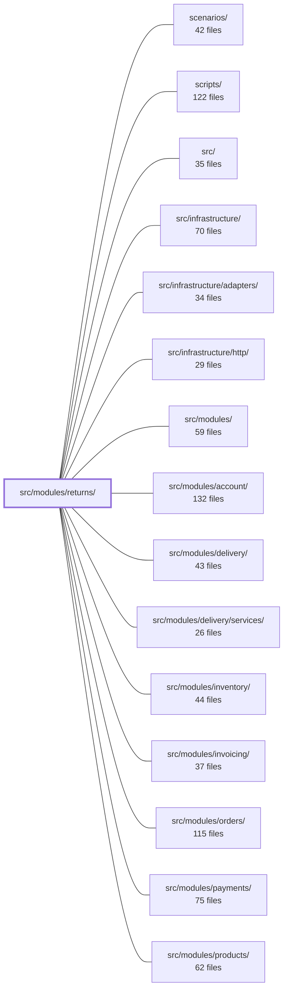

---
tags:
  - 2brain
  - 2brain/module
  - project/boilerplate-node-backend
type: module
module: src/modules/returns/
files: 55
updated: 2026-10-15T13:41:51.490020+00:00
---

# src/modules/returns/

## Purpose

The returns module implements the full customer-facing return and EU 14-day withdrawal lifecycle: opening a return request, staff approval or decline, physical receipt of goods, restocking, and customer refund. It also handles the separate remainder-cancellation path (unshipped items) and keeps the parent order's `returnStatus` projection in sync after every state change.

## Key parts

- **Domain layer (`domain/`)** — Pure, side-effect-free business rules: quantity validation (`quantities.ts`), refund arithmetic in minor units (`refund-amount.ts`), settled-unit accounting (`accounting.ts`), the closed status-transition guards that back `claimStatus` (`lifecycle.ts`), and the order-visible status projection (`status-projection.ts`). All are independently unit-testable without a database.
- **Services layer (`services/`)** — The operational heart. `create.ts` is the single entry point for opening a return (or withdrawal); `decide.ts` handles approve/decline; `receive.ts` runs the goods-arrived → restock → refund pipeline; `close.ts` finalises the status after the refund settles; `cancel-remainder.ts` and `cancellation-refund.ts` cover the unshipped-cancellation path. Supporting services handle reads, options quoting, ownership checks, notification, stats, retention sweeps, and personal-data export.
- **Controllers & routes (`controllers/`, `routes.ts`)** — Thin HTTP handlers and the declarative route table wiring auth, permissions, rate-limiting, and idempotency middleware to each endpoint.
- **Persistence (`model.ts`, `repository.ts`)** — Mongoose schema (including the per-order concurrency lock document) and the repository wrapping shared CRUD with domain-specific primitives: `claimStatus` (conditional, exactly-once transition), `lockOrder`, and `findByOrderId`.
- **Module wiring (`module.ts`, `index.ts`, `presenter.ts`, `emails.ts`, `events.ts`, `audit.ts`, `config.ts`, `rate-limits.ts`)** — The `AppModule` manifest, the sole public barrel (encapsulating the repository and model internals), document-to-wire adapter, email copy resolver, domain-event and audit-action declarations, retention config, and the `POST /returns` rate-limit budget.

## How it connects

- **orders** — Returns reads the parent order's quantities and buyer identity; after every state-changing move it projects the computed status back through the orders service API. It also reuses the orders module's `mailBuyer` helper to resolve the buyer's preferred language before sending notices.
- **payments** — The refund triggered at `receive` is an independent, retryable payment operation; the module also listens for a `PAYMENT_REFUNDED` event to handle asynchronous settlement and idempotently close the return.
- **inventory** — On receipt, returned units are restocked (put back on sale) via the inventory module.
- **delivery** — Refund calculations account for how much delivery has already been refunded, and remainder cancellation must release the delivery state.
- **account** — Follows the same "resolve email copy here, render nowhere" pattern as the account module's email helper; contributes to the `POST /account/export` personal-data flow.
- **infrastructure** — Consumes shared Mongoose repository factories, Express middleware helpers, the `buildRateLimiter` factory, and the kernel's `DomainEventMap` / audit-action augmentation interfaces.

## Where to start

1. **`services/create.ts`** — The single entry point for the return flow. Reading it shows how the module branches on dispatch state, delegates to the domain quantity checks, invokes the cancellation path for unshipped remainders, and emits events. It pulls in nearly every other service in the module, so tracing one call gives you the whole graph.
2. **`domain/lifecycle.ts`** — A short file that defines the closed set of valid status transitions. Understanding these guards explains why concurrent approve/decline resolves to exactly one winner and why `close.ts` is idempotent, which is the concurrency story for the rest of the module.

## Connected modules

[[boilerplate-node-backend_ROOT|/ (repository root)]] · [[boilerplate-node-backend_scenarios|scenarios/]] · [[boilerplate-node-backend_scripts|scripts/]] · [[boilerplate-node-backend_src|src/]] · [[boilerplate-node-backend_src_infrastructure|src/infrastructure/]] · [[boilerplate-node-backend_src_infrastructure_adapters|src/infrastructure/adapters/]] · [[boilerplate-node-backend_src_infrastructure_http|src/infrastructure/http/]] · [[boilerplate-node-backend_src_modules|src/modules/]] · [[boilerplate-node-backend_src_modules_account|src/modules/account/]] · [[boilerplate-node-backend_src_modules_delivery|src/modules/delivery/]] · [[boilerplate-node-backend_src_modules_delivery_services|src/modules/delivery/services/]] · [[boilerplate-node-backend_src_modules_inventory|src/modules/inventory/]] · [[boilerplate-node-backend_src_modules_invoicing|src/modules/invoicing/]] · [[boilerplate-node-backend_src_modules_orders|src/modules/orders/]] · [[boilerplate-node-backend_src_modules_payments|src/modules/payments/]] · … and 2 more

## Files
- `src/modules/returns/audit.ts` — Declares the set of audit action strings that the returns module can emit and registers them into the global audit action map via TypeScript module augmentation. This centralises the action identifiers so that services and controllers fire consistent, type-safe audit events without re-declaring the strings.
- `src/modules/returns/config.ts` — Defines the retention window (in days) for free-text fields (`note`, `declineReason`) on returns. The value is read per call rather than captured at module load, following the same pattern as `orders/config.ts`, so individual tests can vary it.
- `src/modules/returns/controllers/get-return-by-id.ts` — Handles `GET /returns/:id`. Retrieves a single return for the authenticated caller, attaching the caller's available `actions`. A return on another user's order is indistinguishable from a nonexistent one (both return 404) to avoid leaking existence.
- `src/modules/returns/controllers/get-return-options.ts` — Express controller for `GET /returns/options?orderId=…`. Given an order ID (and the caller's identity), it asks the return service what items are still returnable and which cancellations are still possible, along with the refund each cancel would produce. It exists to keep HTTP parsing, auth extraction, and response shaping out of the service layer.
- `src/modules/returns/controllers/get-returns.ts` — HTTP handler for `GET /returns`. Returns a paginated list of returns: all returns for staff callers, only their own returns for non-staff callers. Visibility scoping is decided entirely by the service layer from the auth context — never from a query parameter.
- `src/modules/returns/controllers/post-return-decision.ts` — Thin Express handlers for the two staff decision actions on a return request — `POST /returns/:id/approve` and `POST /returns/:id/decline`. Each validates input, delegates to `returnService`, enriches the result with available actions, and sends a `200` response containing the updated `Return` object.
- `src/modules/returns/controllers/post-return-receive.ts` — HTTP handler for `POST /returns/:id/receive`. When goods arrive back at the warehouse, this endpoint records the receipt, puts the units back on sale, and triggers the customer refund. Responds `200` with the current `Return` object — status `closed` if the refund succeeded, `received` if the provider refused and the refund is queued for a later sweep.
- `src/modules/returns/controllers/post-return.ts` — HTTP handler for `POST /returns`. Opens a return request, or (when the body carries `reason: "withdrawal"`) exercises the EU 14-day withdrawal right. In every successful case the endpoint responds `201` with a `Location` header pointing at the new resource — there is no plain-`200` path.
- `src/modules/returns/domain/accounting.ts` — Pure accounting helper that answers two questions for the return/cancellation flow: *which units of this order are already settled* (cancelled pre-ship or received back) and *how much delivery has already been refunded*. Keeping this logic in a side-effect-free module makes the "shipping is refunded by whichever cancel or return takes the **last** unit" rule unit-testable without a database.
- `src/modules/returns/domain/index.ts` — Barrel (re-export) file for the returns domain layer. It aggregates all public values and types from the five domain sub-modules into a single import surface, so consumers never need to reach into individual files. The file contains no logic of its own.
- `src/modules/returns/domain/lifecycle.ts` — Defines the return lifecycle: which `ReturnStatus` each write operation may execute **from**. Each exported status array is a closed, membership-checked guard that backs a conditional write in `repository.ts` (`claimStatus`), making concurrent duplicate decisions (e.g. approve + decline) resolve to exactly one winner at the database level.
- `src/modules/returns/domain/quantities.ts` — Pure functions that compute how much of an order can still be returned and validate a customer's requested lines against that remainder. Keeping this logic database-free makes the core "what can come back" rule unit-testable in isolation.
- `src/modules/returns/domain/refund-amount.ts` — Pure-arithmetic module that computes what a received return (or a remainder cancellation) owes the customer, working exclusively in integer minor units so the quoted figure and the payment wire can never diverge by float drift. It encodes the shipping-refund rule (only the last unit of an order refunds delivery; withdrawal is capped at cheapest standard, defective/wrong-item refunds full shipping, cancellation refunds all shipping) and the handling-deduction guard.
- `src/modules/returns/domain/status-projection.ts` — Pure function that derives the single `orders`-visible return status (`requested`, `in_progress`, `returned`, `partially_returned`, or `undefined`) from a set of return records and the order's outstanding quantities. Exists to keep that derivation database-free and independently testable.
- `src/modules/returns/emails.ts` — Resolves the customer-facing copy for all return/withdrawal notices into finished, language-ready strings at call time. It exists so that whichever layer sends the email (mail adapter, queue worker, etc.) only ever handles complete text and never performs locale lookups itself — the same "resolve here, render nowhere" rule as `@modules/account/emails`.
- `src/modules/returns/events.ts` — Declares the three domain events the returns module emits by augmenting the kernel's app-wide `DomainEventMap` interface, and exports a string constant for each event name so other code can reference them without hard-coding the strings.
- `src/modules/returns/index.ts` — Public barrel for the **returns** module. It is the *only* import surface exposed to sibling modules (per the strategic-DDD boundary rule in `docs/theory/strategic-ddd.md` §5). It re-exports the service API, domain types, events, email helpers, and model *types*—keeping the `returnRepository` and the model's runtime internals encapsulated behind the service layer.
- `src/modules/returns/model.ts` — Defines the Mongoose schema, interfaces, and compiled model for a **Return** — the record of a customer's request to send goods back (or cancel an unshipped remainder). It also defines a per-order lock document used to serialise concurrent `POST /returns` calls. This file is purely structural: no queries, no business rules — those live in `./repository` and `./services`.
- `src/modules/returns/module.ts` — Module manifest for the **returns** feature (customer-initiated goods returns and EU withdrawal/cancel). Wires together the module's routes, config, rate limits, public-event projections, cross-module event subscriptions, personal-data hooks, and a test scenario into a single `AppModule` object consumed by the kernel registry.
- `src/modules/returns/presenter.ts` — A single-purpose adapter that converts a stored `ReturnDocument` into the `Return` wire contract. It exists so that the document's internal shape (MongoDB `_id`, native dates) is translated to the external shape (`id`, ISO strings) in exactly one place, keeping the rest of the codebase free of manual field mapping.
- `src/modules/returns/rate-limits.ts` — Declares the Returns module's rate-limit budget for `POST /returns` and exposes the resulting Express middleware. It exists so the module can register its budget alongside other modules through the shared `buildRateLimiter` factory, keeping per-endpoint throttling declarative and auditable.
- `src/modules/returns/repository.ts` — Persistence layer for the Returns module. Wraps the shared Mongoose `createRepository` generic CRUD with three domain-specific primitives: `claimStatus` (the conditional, exactly-once status transition that guards every lifecycle move), `lockOrder` (a per-order advisory lock row for concurrent transaction safety), and `findByOrderId` (the read the quantity check depends on). Also hosts the stats aggregation and the GDPR text-scrub job.
- `src/modules/returns/routes.ts` — Express route table for the returns module. It wires every return endpoint to the correct authentication, permission, rate-limiting, caching, and idempotency middleware, then delegates to the corresponding controller. It exists so that the module's HTTP surface is declarative and auditable in one place.
- `src/modules/returns/services/cancel-remainder.ts` — Cancels the unshipped remainder of a single fulfillment order as a `kind: cancellation` Return that is **closed at creation time**. It exists because a remainder cancel atomically moves money (refund), stock (inventory release), shipping rules, and the delivery state — and only the `returns` module already reaches all four. Once a fulfillment order has shipped, the order can no longer be cancelled whole; this is the per-fulfillment-order path for the buyer's CRD Art. 16 withdrawal or a staff refund of unshipped items.
- `src/modules/returns/services/cancellation-refund.ts` — Computes the refund breakdown for cancelling the remainder of a fulfillment order. It exists so that both the cancel transaction (`cancel-remainder`) and the pre-write quote endpoint (`GET /returns/options`) share a single, consistent calculation of what the cancel owes, accounting for what earlier returns and cancels have already settled.
- `src/modules/returns/services/close.ts` — Transitions a return from `received` to `closed` after its refund has settled. Because the refund can complete synchronously (same request) or asynchronously (provider retry via the `PAYMENT_REFUNDED` listener), two different call sites reach this function; the conditional `claimStatus` move makes it idempotent so the second arrival is a no-op.
- `src/modules/returns/services/create.ts` — Single entry point for opening a return. It also serves as the "withdrawal button" handler: the same call branches on whether goods have been dispatched. Pre-dispatch it cancels the order, refunds in full, and writes a `Return` closed at birth (no lines). Post-dispatch it writes an open `Return` with the lines coming back and delegates the unshipped remainder to a separate cancellation.
- `src/modules/returns/services/decide.ts` — Implements the staff-facing decision path for a return request: **approve** or **decline** (with a mandatory reason). Each decision is a single conditional write from `requested` (guarded by `DECIDABLE_RETURN_STATUSES`), so concurrent staff members racing on the same request cannot both succeed—the loser receives a 409. Withdrawals never reach this module; they are opened already approved.
- `src/modules/returns/services/index.ts` — Barrel (index) file for the returns services layer. It re-exports every public function and type from the individual service files (`create`, `decide`, `receive`, `read`, `options`, `retention`, `stats`, `close`, `cancel-remainder`, `personal-data`) and also bundles a subset of them into a single `returnService` object, giving callers one stable import surface instead of reaching into each leaf file.
- `src/modules/returns/services/notify.ts` — Sends a single buyer-facing email about a return event (approval, cancellation, closure, etc.). It composes the orders module's buyer-mail policy (`mailBuyer` — resolve the buyer's preferred language with a safe fallback) with the returns module's email copy. Designed as a fire-and-forget helper: it never rejects, because every caller is mid state-change and a mail hiccup must not roll that change back.
- `src/modules/returns/services/options.ts` — Computes, in a single server-side call, what an order can still **return** (shipped units not already heading back) and what it can still **cancel** (fulfillment orders with a remainder, plus the exact refund owed). Centralising this logic ensures no client re-derives quantities or refund amounts.
- `src/modules/returns/services/outcome.ts` — Defines the shared outcome type, refusal helpers, and write helpers (outbox event, audit) that both return-opening flows — `create.ts` (goods coming back) and `cancel-remainder.ts` (cancelling an unshipped remainder) — return and record. Centralizing these here lets each service import this file instead of the other.
- `src/modules/returns/services/ownership.ts` — Single-purpose guard that answers one question for the returns module: *does the caller own this order?* Both `createReturn` and `getReturn` call this before proceeding, because being able to *see* an order (operator visibility) is not the same as having the buyer's right to act on it (ownership).
- `src/modules/returns/services/personal-data.ts` — Implements the returns module's contribution to the `POST /account/export` endpoint (registered as `personalData` in `module.ts`). Given a user ID, it resolves the user's order IDs, fetches all associated returns, and shapes them into the `ExportReturn` export format. It intentionally has no `erase` counterpart: a return is keyed by `orderId` and stores no `userId`, so once the orders module detaches the user link, no further unlinking is needed here.
- `src/modules/returns/services/projection.ts` — Keeps an order's `returnStatus` field in sync with the actual state of its returns. Because the `orders` module cannot import from `returns`, this file reads back the returns after each state-changing move (create, decide, receive, close), computes the correct status word via the domain projection, and writes it back through `orders`' own service API.
- `src/modules/returns/services/read.ts` — Read-only service for the returns module: lists and fetches individual returns with caller-scoped visibility. Staff holding `returns.any.read` see all returns; everyone else sees only returns tied to their own orders. Each return is returned with a computed `actions` object so the client never re-implements lifecycle permissions.
- `src/modules/returns/services/receive.ts` — Handles the "goods arrived" workflow for a return: atomically transitions the status from `approved` to `received`, restocks the returned units, enqueues the domain event, then refunds the customer and closes the return. The two facts — parcel received and money returned — are deliberately kept on separate clocks: the status move and restock are one idempotent transaction, while the refund is an independent, retryable operation on the payment.
- `src/modules/returns/services/retention.ts` — Implements the free-text retention sweep for returns: after a return has been quiet past a configurable number of days, its user- or staff-authored text fields (`note`, `declineReason`) are wiped. The return row itself (the legal record) is never deleted—only the free text is removed.
- `src/modules/returns/services/stats.ts` — Provides read-only statistical queries about returned goods, aggregated by time bucket, currency, and product. The core convention: a return is attributed to the day its goods were **received** back (i.e. when stock went back on sale and the refund was opened), not when it was initiated.
- `src/modules/returns/tests/contract/api.contract.test.ts` — Contract tests for every `/returns` HTTP endpoint (create, list, get, approve, decline, receive). Each response is auto-validated against the API spec via the `@tests/contract` import, while the assertions pin the *behavioral* contracts: status codes, `Location` headers, side-effects (order cancellation, status transitions), and the specific 4xx error codes a client must handle. The file exists so that any change to the returns API shape or semantics fails here before it reaches consumers.
- `src/modules/returns/tests/integration/cancel-remainder.test.ts` — Integration test that verifies the "cancel the unshipped remainder" flow end-to-end against a real database and the fake payment provider. It pins the invariants around a `kind: 'cancellation'` Return: atomic commit of lines/stock/summary/Return row, refund amount (lines only, plus delivery only on the last unit), role-based access for buyer vs. staff, and the `GET /returns/options` quote matching the actual refund.
- `src/modules/returns/tests/integration/outbox.test.ts` — Integration tests that verify the transactional outbox guarantees for return domain events (`RETURN_REQUESTED`, `RETURN_RECEIVED`, `RETURN_CLOSED`). Confirms each event row is committed atomically with the write it announces, is keyed on the order ID for ordering, and is delivered to `onDomainEvent` subscribers via the relay. Runs against a real MongoDB instance.
- `src/modules/returns/tests/integration/receive.test.ts` — Integration tests for the `receiveReturn` operation. They exercise the full receive-against-real-DB + fake-payment-provider path: inventory restock, refund creation, order/payment status projection, event emission, idempotency, concurrency safety, and the customer email notification — all in one transactional flow.
- `src/modules/returns/tests/integration/repository.test.ts` — Integration tests for the **read** side of the return repository (`findByOrderId`, `findByOrderIds`) against a real database. Verifies that results are always sorted oldest-first regardless of write order, and that a read within a transaction can see that same transaction's uncommitted write.
- `src/modules/returns/tests/integration/retention.test.ts` — Integration tests for the `reap:returns` retention job. Verifies against a real database that `scrubReturnText` removes only the free-text fields (`note`, `declineReason`) on returns whose `updatedAt` falls outside the configured window, leaves all other fields intact, is idempotent on re-run, and respects an explicit cutoff passed to the repository.
- `src/modules/returns/tests/integration/service.test.ts` — Integration tests for the returns service (`createReturn`, `approveReturn`, `declineReturn`, etc.) run against a real database. The goal is to verify conditional writes and tenant scoping end-to-end: a withdrawal genuinely cancels the order and refunds the payment, a return on shipped goods writes real lines, and concurrent staff decisions race correctly. The only things mocked are the mail queue and the audit event emitter.
- `src/modules/returns/tests/integration/stats.test.ts` — Integration test for the "returned units" read queries in the returns stats service. It verifies that `returnedBuckets`, `returnedByProduct`, and `returnedSeries` count only *received* goods (status `received` or `closed`) within a time window, bucket them by shop-local day (Europe/Rome), and aggregate correctly per product and per single product over time.
- `src/modules/returns/tests/integration/withdrawal-before-dispatch.test.ts` — Integration test that pins the cross-module contract for a customer withdrawing a paid order before dispatch: the order is cancelled, the payment is refunded in full through the order's own refund path, and the return record is written already closed. It asserts that exactly one `payment.refunded` event, one credit note, and one mail from `returns` are produced — so the refund and the return never announce the same money twice.
- `src/modules/returns/tests/unit/domain.test.ts` — Unit tests for the pure, database-free rules in the returns domain module. It verifies the status-transition invariants, quantity arithmetic, line validation, and accounting aggregation without any external infrastructure, so the domain logic can be reasoned about and regression-tested in isolation.
- `src/modules/returns/tests/unit/emails.test.ts` — Unit tests for the `returnNoticeEmail` function, verifying that every return/withdrawal notice renders correct copy, legal required fields (order ref, exact UTC date-time, postage responsibility per Art. 11a / Art. 14(1)), locale-appropriate formatting, and that no i18n key strings leak into the output.
- `src/modules/returns/tests/unit/public-events.test.ts` — Unit tests verifying that the returns module's public-event projections (the shape webhook subscribers receive) are correct, well-named, and free of PII. The file exists to guard the public contract between the module's internal domain events and the externally-visible `eventType` / `data` payload.
- `src/modules/returns/tests/unit/refund-amount.test.ts` — Unit tests for the refund-amount domain module. Every calculation rule derived from the Consumer Rights Directive (Art. 13 and Art. 14) is exercised here: goods-line totals, shipping refund caps and exceptions, handling deductions, zero-decimal currencies, and the still-owed shipping guard. The file exists to pin down exact minor-unit arithmetic and the boundary/error conditions of the three exported functions.
- `src/modules/returns/tests/unit/routes.test.ts` — Unit test for the returns module's route table. It verifies the exact set of mounted routes, the authorization guards applied to each, the ordering constraint between `GET /options` and `GET /:id`, and which routes carry the `returns-write` rate-limit budget and the `idempotencyKey` middleware.
- `src/modules/returns/tests/unit/schema-contract.test.ts` — Unit test that pins down the public contract of `returnSchema` — which fields are required, which enums are closed, what defaults apply, what references exist, and which indexes are declared. It also asserts the deliberate *absence* of a `userId` field, encoding the design decision that a return is owned solely by its order (supporting GDPR Art. 17(3)(b)/(e) account-erasure without touching return records).
- `src/modules/returns/tests/unit/status-projection.test.ts` — Unit tests for `projectReturnStatus`, the function that collapses an order's set of returns into a single display status (`'requested'`, `'in_progress'`, `'partially_returned'`, `'returned'`, or `undefined`). The tests pin down the priority rules, edge cases (empty returns, no-line returns, mixed kinds), and the special handling of cancellations.

---
[[boilerplate-node-backend_INDEX|← boilerplate-node-backend index]]
