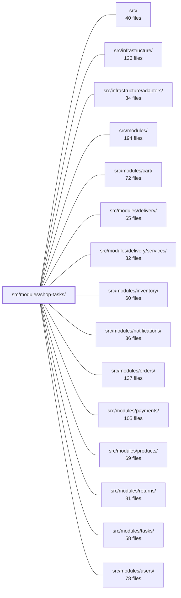

---
tags:
  - 2brain
  - 2brain/module
  - project/boilerplate-node-backend
type: module
module: src/modules/shop-tasks/
files: 31
updated: 2026-11-08T10:53:58.797799+00:00
---

# src/modules/shop-tasks/

## Purpose

`shop-tasks` is the shop's helpdesk layer. It subscribes to domain events emitted by the payment, inventory, delivery, orders, returns, and cart modules and translates each one into concrete staff actions: opening or clearing to-do tasks, writing buyer-facing inbox messages, issuing staff work notices, and producing periodic (daily/weekly) digest emails. It also exposes a single read-only summary endpoint that drives navigation-badge counts in the shop UI. The module owns no persistent data of its own—rows are written by the `tasks` and `notifications` modules.

## Key parts

- **Domain rules** (`domain/`) — Pure-data factory functions (`openings.ts`) that decide *which* shop situation an event represents, which permission set is responsible, what due date applies, and what inbox text to show. Barrel (`domain/index.ts`) gives consumers a single import path.
- **Event-to-task & notification handlers** (`services/tasks.ts`, `services/notices.ts`, `services/delayed.ts`) — One function per domain event, mapping the event payload into a task opening/clear (delegated to the `tasks` module) and/or notification rows (delegated to the `notifications` module). `delayed.ts` is the combined handler for `fulfillment_order.delayed`.
- **Staff digest pipeline** (`services/digest.ts`, `emails.ts`, `jobs.ts`) — `digest.ts` reads pending-work counts, writes or clears summary notifications per staff member, and triggers a consolidated email when a count appeared or grew. `emails.ts` builds the email body; `jobs.ts` wraps the digest into `JobDeclaration` objects for kernel registration.
- **Work summary & routing** (`services/work-summary.ts`, `staff-routing.ts`, `config.ts`) — `work-summary.ts` computes per-screen badge counts; `staff-routing.ts` defines the routing table (recipient permissions, email flag, severity) for every staff notice; `config.ts` holds the tunable time thresholds that gate digest eligibility.
- **Module wiring & public API** (`module.ts`, `module.yaml`, `index.ts`, `routes.ts`, `controllers/get-shop-work-summary.ts`) — `module.ts` registers event subscriptions, jobs, config, locales, and the single summary route. `routes.ts` / the controller expose `GET /shop-tasks/summary`. `index.ts` is the only import surface available to sibling modules.
- **Contract fragments** (`openapi.yaml`, `openapi.notifications.yaml`, `openapi.tasks.yaml`, `asyncapi.notifications.yaml`) — Declare the module's API surface and extend the shared task/notification schemas with shop-specific variants. They are merged in only while this module exists; removing the module reverts those schemas to the base set.
- **Tests** (`tests/unit/`, `tests/integration/`, `tests/contract/`) — Unit tests cover the pure domain and routing logic; integration tests exercise full event-emission → task/notification/digest pipelines against a real database; contract tests pin the summary endpoint's response shape and cache directives.

## How it connects

- **`payments`, `inventory`, `delivery`, `orders`, `returns`, `cart`, `products`** — Emit the domain events (purchase-hold, stock-out, shipment delay, return-request, etc.) that `shop-tasks` subscribes to. This module is purely reactive to their events; it does not import their services.
- **`tasks`** — Owns the task rows and the dedup/persistence engine. `shop-tasks` hands it opening/clearing instructions but never writes task records itself.
- **`notifications`** — Owns notification rows, the inbox-bell write, the live-push, and the email dispatch. `shop-tasks` produces payload rows and hands them to `notificationsService.notifyStaff`; it does not store or send anything directly.
- **`users`** — Supplies role and permission-set lookups used by `work-summary.ts` (authorization scoping) and `staff-routing.ts` (recipient resolution).
- **`src/infrastructure/adapters/`** — Provides the email-sending adapter that the digest pipeline calls when a consolidated email is due.

## Where to start

1. **`module.ts`** — The single entry point that lists every event subscription, the two digest jobs, the config registration, and the one route. Reading it first gives you the full "what happens when" map before diving into any handler.
2. **`services/tasks.ts`** — The core translation table from domain event → task opening/clear. It shows how the module decides *which* situation an event is, *where* the work lands, and *when* it closes, which is the central business logic of the module.

## Connected modules

[[boilerplate-node-backend_ROOT|/ (repository root)]] · [[boilerplate-node-backend_src|src/]] · [[boilerplate-node-backend_src_infrastructure|src/infrastructure/]] · [[boilerplate-node-backend_src_infrastructure_adapters|src/infrastructure/adapters/]] · [[boilerplate-node-backend_src_modules|src/modules/]] · [[boilerplate-node-backend_src_modules_cart|src/modules/cart/]] · [[boilerplate-node-backend_src_modules_delivery|src/modules/delivery/]] · [[boilerplate-node-backend_src_modules_delivery_services|src/modules/delivery/services/]] · [[boilerplate-node-backend_src_modules_inventory|src/modules/inventory/]] · [[boilerplate-node-backend_src_modules_notifications|src/modules/notifications/]] · [[boilerplate-node-backend_src_modules_orders|src/modules/orders/]] · [[boilerplate-node-backend_src_modules_payments|src/modules/payments/]] · [[boilerplate-node-backend_src_modules_products|src/modules/products/]] · [[boilerplate-node-backend_src_modules_returns|src/modules/returns/]] · [[boilerplate-node-backend_src_modules_tasks|src/modules/tasks/]] · … and 1 more

## Files
- `src/modules/shop-tasks/asyncapi.notifications.yaml` — An AsyncAPI **fragment** (not a standalone document) that extends the global `NotificationPayload` union with every buyer-message and staff-work-notice payload the shop-tasks module emits. It is the AsyncAPI-side mirror of `./openapi.notifications.yaml`; the bundler (`scripts/contracts/asyncapi-section-fragments.ts`) merges it into the `notifications` section only while this module exists. Deleting the module removes these payloads and the stream falls back to the five base notices every project shares.
- `src/modules/shop-tasks/config.ts` — Defines the tunable thresholds (in hours or days) that control when shop items become eligible for the staff daily digest. It centralises these "knobs" so that the digest logic and any future consumers read from a single, validated source.
- `src/modules/shop-tasks/controllers/get-shop-work-summary.ts` — Thin HTTP controller that handles `GET /shop-tasks/summary`. It retrieves aggregate work counts (used for staff navigation badges) from the `workSummary` service and returns them as a JSON success response. All business logic lives in the service; this file only bridges the request to the response.
- `src/modules/shop-tasks/domain/index.ts` — Barrel (re-export) file for the **domain layer** of the shop-tasks module. It exists to give consumers a single import path (`…/domain`) for all domain-level pure-data types without needing to know the individual filenames inside the layer.
- `src/modules/shop-tasks/domain/openings.ts` — Pure-data factory functions that translate a payment, stock, or delivery event into the first facts of a shop task (kind, responsible permission set, linked record, inbox text, due date). This file produces the `ShopOpening` shape; it does not deduplicate, persist, or render — that is `tasks`' job. It exists so the domain layer can describe *what* a situation demands without coupling to the service layer that *writes* it.
- `src/modules/shop-tasks/emails.ts` — Builds the content of the daily staff-digest email: one line per summary that appeared or grew, each carrying a localized label and a link to the corresponding frontend page. The file is a pure content-builder — it produces an `EmailContent` object but never sends anything.
- `src/modules/shop-tasks/index.ts` — Public barrel for the shop-tasks module. It is the **only** import surface available to sibling modules (per the rule in `docs/theory/strategic-ddd.md` §5). Because the module owns no domain event of its own, the barrel simply re-exports the openings rules, the service, and the digest e-mail.
- `src/modules/shop-tasks/jobs.ts` — Declares the two scheduled jobs owned by the `shop-tasks` module — the daily and weekly staff digest — by wrapping the shared `runStaffDigest` service into `JobDeclaration` objects ready for kernel registration.
- `src/modules/shop-tasks/module.ts` — Module entry point for the shop's helpdesk. Subscribes to domain events emitted by other shop modules and, for each, opens or clears a to-do (task), writes a buyer-facing message or a staff work notice (notification), or both. Also registers the periodic staff-digest jobs, module config, locales, and a single summary route for navigation badges. It owns no data collection itself; `tasks` and `notifications` perform the writes and own their rows.
- `src/modules/shop-tasks/module.yaml` — Declarative manifest for the shop-tasks module. It declares the module's role (opening to-do items for payment, stock, and delivery situations that require a human, writing buyer-facing messages and staff notices, and producing the staff digest), its upstream event subscriptions, and its two scheduled jobs. The actual logic lives in the sibling `module.ts`.
- `src/modules/shop-tasks/openapi.notifications.yaml` — An OpenAPI 3.1.0 contract fragment that extends the core `Notification` schema with shop-specific notification variants (buyer-facing order/stock events and staff work-queue notices). It exists so that a project *with* a shop gets these additional `oneOf` members, while a project *without* one carries only the five base notices and never sees them.
- `src/modules/shop-tasks/openapi.tasks.yaml` — OpenAPI contract fragment that extends the shared tasks contract with shop-specific values. It does not define a standalone API; instead it appends entries to the `TaskKind`, `TaskLinkType`, and `TaskCategory` enums declared in `../tasks/openapi.yaml` via the `x-extends` custom extension, so that a project with the shop module gets a richer task vocabulary while a shop-less project keeps only the base values (`contact`, `account_review`, `export_failed`).
- `src/modules/shop-tasks/openapi.yaml` — OpenAPI 3.1.0 contract for the **shop-tasks** module. It defines the single public endpoint (`GET /shop-tasks/summary`) that returns per-screen badge counts for staff navigation, and the `ShopWorkSummary` response schema. The file exists to document and constrain the module's API surface independently of its implementation.
- `src/modules/shop-tasks/routes.ts` — Express route table for the shop-tasks module. It exposes a single read-only endpoint (`GET /summary`) that returns per-staff work counts used to drive navigation badges in the shop UI. Every count is resolved as the calling user; API-key auth is deliberately excluded because it would silently widen the orders scope.
- `src/modules/shop-tasks/services/delayed.ts` — Event handler for the `fulfillment_order.delayed` domain event. It combines two side effects—opening a consent-reminder to-do and writing a buyer notice—into a single handler, running the to-do first. The file exists so that one module maps to one event handler per the project's event-dispatch convention.
- `src/modules/shop-tasks/services/digest.ts` — Implements the daily and weekly staff digest. Each run reads pending-work counts from the modules that own them, writes or clears a summary notification for every staff member whose role covers that work, and — when a count appeared or grew and the route specifies `digest` — sends one consolidated email per person. Re-runs are idempotent: unchanged counts neither update nor mail.
- `src/modules/shop-tasks/services/index.ts` — Barrel file for the shop-tasks service layer. It re-exports every event handler and utility function into a single `shopTasksService` object so that `module.ts` (and the module barrel) have one import target instead of reaching into each sibling file individually.
- `src/modules/shop-tasks/services/notices.ts` — Maps shop, cart, fulfillment, and return domain events into inbox notification rows (for the buyer) or staff notices (for the acting staff). Each handler is a pure payload→rows transform; the actual write, cap, and live push are delegated to the notifications module. Exists so that `module.ts` can subscribe one function per event without mixing notification logic into domain code.
- `src/modules/shop-tasks/services/tasks.ts` — Maps domain events (payment, inventory, shipment, fulfillment) to shop-task openings or clears. It decides *which* situation an event represents, *which* staff screen the work belongs on, and *when* to open vs. close a task. The actual persistence and dedup are delegated to `taskService`; this file is purely the event-to-task translation layer.
- `src/modules/shop-tasks/services/work-summary.ts` — Computes the per-screen "work badge" counts shown in staff navigation. Each count is read through the owning module's own list function with the caller's context, so the badge number always matches what the corresponding screen would display.
- `src/modules/shop-tasks/staff-routing.ts` — Pure data module that defines the routing table for every shop staff work notice: which permission-set holders receive it, whether it triggers an immediate email, and what severity level it carries. The routing objects are handed directly to `notificationsService.notifyStaff` at call time; the `notifications` module stores no persistent copy of these mappings.
- `src/modules/shop-tasks/tests/contract/api.contract.test.ts` — Contract tests for the `GET /shop-tasks/summary` endpoint. Verifies that the response satisfies the shared contract for both an administrator and a restricted role (`warehouse`), and that the response carries a `no-store` cache-control directive so it is never held in a shared cache.
- `src/modules/shop-tasks/tests/integration/delayed.test.ts` — Integration test for the `fulfillment_order.delayed` domain event. It verifies that a single emission produces both a `consent_due` task and a buyer notification, and that a redelivery (simulating outbox retry after a failed notification) is idempotent — the task is not duplicated and the notice is written exactly once.
- `src/modules/shop-tasks/tests/integration/digest.test.ts` — Integration test for the staff digest job (`runStaffDigest`). Exercises the full pipeline—real module registration, real orders/returns/shipments in the test database, and the notification bell plus mail queue at the output end—to verify correct audience targeting, idempotent re-runs, zero-count row clearing, locale-aware mailing, and the split between daily and weekly digests.
- `src/modules/shop-tasks/tests/integration/erasure.test.ts` — Integration test verifying that when a person's account is erased, shop to-do tasks that reference their orders are **retained** (the record outlives the account) while the pointer to the person (`subjectId`) is detached. It ensures the erasure path does not delete order-linked tasks.
- `src/modules/shop-tasks/tests/integration/notices.test.ts` — Integration test suite that verifies each shop domain event produces the correct buyer-facing notification in the inbox. It exercises the full production wiring—module registration, domain-event emission, outbox settlement, and notification delivery—without calling any subscriber directly, so the subscription wiring in the module entry-point is itself under test.
- `src/modules/shop-tasks/tests/integration/staff-notices.test.ts` — Integration test that verifies the shop's staff-notification pipeline end-to-end: real modules are registered, a domain event is emitted, and the test asserts who sees a bell entry, who receives a mail, in what language, and that redelivery does not duplicate. Covers two event types — `ORDER_PURCHASE_HOLD_PLACED` and `RETURN_REQUESTED` — and proves role-based eligibility, "can-act" gating, idempotency, and locale-aware mail content.
- `src/modules/shop-tasks/tests/integration/tasks.test.ts` — Integration test suite that verifies the shop-task lifecycle end-to-end: which domain events open a task, which events close one, the delay rule's jurisdiction logic, and the notifications staff receive. It runs against a real test database with the full module registry wired up, treating the task engine as a black box and asserting only on persisted task rows and outbound mail.
- `src/modules/shop-tasks/tests/integration/work-summary.test.ts` — Integration test for the `GET /shop-tasks/summary` endpoint. It verifies that each summary count equals the total its corresponding list endpoint reports, that authorization restricts which keys a caller can see, that a shipped order decrements the count, and that empty categories are returned as explicit zeros rather than omitted keys.
- `src/modules/shop-tasks/tests/unit/openings.test.ts` — Unit tests for the pure opening functions in `domain/openings.ts`. Verifies which shop situations create a task (consent reminders, refunds, disputes, payment anomalies), their kind/route/link metadata, due-date arithmetic, and FTC jurisdiction gating. No mocks, no database — every assertion is against a returned `SystemOpening` object.
- `src/modules/shop-tasks/tests/unit/staff-routing.test.ts` — Unit tests for the shop-staff routing module. Verifies that every route code references permission sets that actually exist in the kernel, that the ten summary codes resolve to the correct frontend screen paths, and that both the single-notice and digest emails render localized text with correct links in every served language.

---
[[boilerplate-node-backend_INDEX|← boilerplate-node-backend index]]
