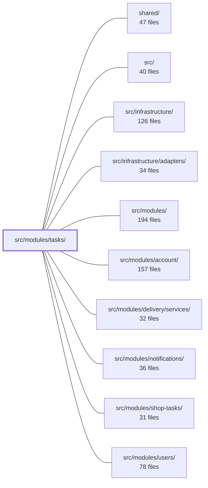

---
tags:
  - 2brain
  - 2brain/module
  - project/boilerplate-node-backend
type: module
module: src/modules/tasks/
files: 58
updated: 2026-11-08T10:54:17.296488+00:00
---

# src/modules/tasks/

## Purpose

The tasks module manages contact requests submitted by visitors and system-opened situations that require staff attention. It owns the full lifecycle of a task — creation, triage, assignment, resolution, and archival — behind exactly one public write endpoint and a set of staff-facing read/update/delete routes. It also exposes the personal-data hooks (export and erasure) that the account module calls into for GDPR-style operations.

## Key parts

- **Domain layer** (`domain/`) — Pure, side-effect-free business rules: the state machine and allowed status transitions (`lifecycle.ts`), per-caller action flags (`actions.ts`), the single ownership rule for visitor tasks (`ownership.ts`), the jurisdiction/route-set mapping (`routing.ts`), and the event-to-task factory for system openings (`system.ts`). A barrel (`index.ts`) re-exports all five.
- **Service layer** (`service.ts`, `services/`) — `service.ts` handles contact-form creation, staff search, and the export/erasure hooks. `services/workflow.ts` executes all lifecycle mutations (resolve, mark-spam, reopen, assign, unassign, note) with optimistic-concurrency writes. `services/overdue.ts` implements the due-soon and overdue reminder sweeps. `services/system.ts` opens and clears system tasks from domain events.
- **HTTP layer** (`routes.ts`, `controllers/`) — `routes.ts` declares the single public `POST /tasks` endpoint and the authenticated staff routes. Individual controllers cover search, single-task read, summary counts, the three status "doors," assignment, unassignment, note-appending, and hard-delete. A shared factory produces the three status-door handlers.
- **Data layer** (`model.ts`, `repository.ts`) — Mongoose schema and serialization transform, plus a repository built on the shared factory that adds atomic status transitions, bulk erasure writes, and conditional claim operations for the reminder sweeps.
- **Cross-cutting concerns** — `access.ts` (row-level visibility rules), `audit.ts` (typed audit-action identifiers), `authorization.yaml` (RBAC permission sets), `config.ts` (retention and SLA settings), `rate-limits.ts` (three anti-abuse budgets on the public endpoint), `emails.ts` (operator notification content), `events.ts` (four internal domain-event payloads), `jobs.ts` (the periodic sweep), `presenter.ts` (single document-to-wire serializer).
- **Module infrastructure** — `module.ts` / `module.yaml` (boot-time manifest), `index.ts` (public barrel; the only import surface sibling modules may use), `openapi.yaml` (API contract).

## How it connects

- **`notifications/`** consumes the four internal domain events declared in `events.ts` (task created, overdue, due-soon, resolved) to produce staff work-notices. No AsyncAPI channel or webhook is involved.
- **`account/`** calls into the tasks module's personal-data hooks (export and erasure) exposed through the `index.ts` barrel. The `domain/ownership.ts` rule guarantees both operations select the same set of rows.
- **`shop-tasks/`** is a sibling module that reads task data through the public barrel; it does not reach into internal files.
- **`users/`** is referenced by assignment and unassignment operations, which resolve a target user ID against the users module's records.
- **`delivery/services/`** handles actual email transport for the two operator notifications defined in `emails.ts`; the tasks module only composes the content.
- **`shared/`** provides the repository factory, the `DomainEventMap` kernel, the `AuditActionMap` type, and the `createSearchController` / `buildRateLimiter` utilities the tasks module builds on.
- **`src/infrastructure/adapters/`** supplies the Mongoose connection and database adapter that `model.ts` and `repository.ts` persist through.

## Where to start

1. **`openapi.yaml`** — the complete API surface in one file: every endpoint, request/response shape, error code, and the data-export section this module contributes. Reading it first gives you the "what" before you touch any code.
2. **`domain/lifecycle.ts`** — the heart of the module: a small, pure state machine that encodes every allowed status transition. Understanding which "doors" exist and what each one sets or unsets makes the rest of the service, controller, and repository layers straightforward to follow.

## Connected modules

[[boilerplate-node-backend_ROOT|/ (repository root)]] · [[boilerplate-node-backend_shared|shared/]] · [[boilerplate-node-backend_src|src/]] · [[boilerplate-node-backend_src_infrastructure|src/infrastructure/]] · [[boilerplate-node-backend_src_infrastructure_adapters|src/infrastructure/adapters/]] · [[boilerplate-node-backend_src_modules|src/modules/]] · [[boilerplate-node-backend_src_modules_account|src/modules/account/]] · [[boilerplate-node-backend_src_modules_delivery_services|src/modules/delivery/services/]] · [[boilerplate-node-backend_src_modules_notifications|src/modules/notifications/]] · [[boilerplate-node-backend_src_modules_shop-tasks|src/modules/shop-tasks/]] · [[boilerplate-node-backend_src_modules_users|src/modules/users/]]

## Files
- `src/modules/tasks/access.ts` — Defines the access-control rules for tasks: which rows a caller may see and which actions they may perform on them. The two governing facts are the task's `source` (visitor vs. system) and its `routeSet`. Visitor tasks are open to anyone past the route guard; system tasks are scoped to callers holding the matching route set. This file centralises the "which rows" decision so that route guards and data queries cannot diverge.
- `src/modules/tasks/audit.ts` — Declares the audit-action vocabulary for the tasks module and registers it into the app-wide `AuditActionMap` type. It exists so that every auditable task operation (admin views, mutations, and system lifecycle events) has a stable, typed string identifier. Reads are explicitly audited here because task rows contain a stranger's email and free text, making "who looked" a data-protection concern rather than a routine catalogue read.
- `src/modules/tasks/authorization.yaml` — Declares the authorization rules and composable permission sets that govern who can read, update, or delete `Task` resources within the `tasks` module, scoped at the tenant level.
- `src/modules/tasks/config.ts` — Declares the runtime configuration schema for the tasks module. It defines two integer settings — how long a closed task is retained and the SLA window for responding to a contact message — so that operators can override them via environment or config files rather than hard-coding values.
- `src/modules/tasks/controllers/delete-task-assignee.ts` — Request handler for the `DELETE /tasks/:id/assignee` endpoint. Despite the "delete" in the name, it performs an *unassign* ("give back") of a task — a staff-level action that removes the assignee from an existing task. It validates the route ID, delegates to the task service, and formats the HTTP response.
- `src/modules/tasks/controllers/delete-task.ts` — Express controller for `DELETE /tasks/:id` that permanently removes a task. It is hand-written (rather than produced by `createDeleteController`) because the tasks module has no soft-delete tier, making the factory's soft/hard triplet inapplicable.
- `src/modules/tasks/controllers/get-task-summary.ts` — Thin HTTP controller for `GET /tasks/summary`. It extracts the caller context from the request, delegates to the task service to fetch staff badge counts, and returns them as a 200 JSON response. Exists to separate the Express plumbing from the domain logic in `service.ts`.
- `src/modules/tasks/controllers/get-task.ts` — HTTP handler for `GET /tasks/:id` (staff endpoint). Retrieves a single task from the staff queue scoped to the caller's jurisdiction and, when the task belongs to a visitor, records an audit entry naming the person the task references.
- `src/modules/tasks/controllers/get-tasks.ts` — Controller for `GET /tasks` and `POST /tasks/search`, exposing the staff task queue in both query-string and DTO-body spellings. It is built on the shared `createSearchController` factory so the two routes share one validation/search pipeline. The response is scoped to the caller's jurisdiction and is deliberately never Redis-cached.
- `src/modules/tasks/controllers/post-task-doors.ts` — Defines the three bodyless "status door" handlers for a single task — `POST /tasks/:id/resolve`, `POST /tasks/:id/mark-spam`, and `POST /tasks/:id/reopen`. Each handler follows an identical shape (extract id → invoke a service method → 200 with the updated task) and is produced by a shared factory so the wiring logic lives in one place.
- `src/modules/tasks/controllers/post-task-note.ts` — Controller handler for `POST /tasks/:id/notes`. Validates the incoming note body, resolves the task ID, and delegates to the task service to append a staff note (append-only). Exists to keep HTTP-layer concerns (parsing, ID validation, response shaping) separate from business logic.
- `src/modules/tasks/controllers/post-task.ts` — HTTP controller for the `POST /tasks` endpoint — the single public write in the tasks module. It validates and normalises the incoming contact-task payload, delegates creation to `taskService`, and returns a bare `202 Accepted` with no body.
- `src/modules/tasks/controllers/put-task-assignee.ts` — Controller handler for `PUT /tasks/:id/assignee`. Accepts a task ID (URL param) and a target user ID (body), validates both, and delegates to the task service to reassign the task to that user. Handles the "take" case implicitly — assigning oneself is the same operation.
- `src/modules/tasks/domain/actions.ts` — Pure, server-side mapping from a caller's standing on one task to the set of actions that are available. By computing flags in one place, no client re-implements the lifecycle rules. The function is synchronous and side-effect-free: the service resolves permissions upstream and hands the facts in.
- `src/modules/tasks/domain/index.ts` — Barrel re-export for the tasks domain layer. It surfaces every public symbol from the five domain submodules (lifecycle, actions, ownership, routing, system) through a single import path, so that service-layer, repository-layer, and test code all pull the same pure business rules from one canonical location.
- `src/modules/tasks/domain/lifecycle.ts` — Pure-function module that encodes every allowed status transition (the "doors") for a task. Each door is a total function from the task's current facts to either a concrete `TaskPatch` (fields to set/unset) or a typed refusal. Keeping transitions here — separate from services, repositories, or HTTP handlers — makes the state machine auditable in one place and trivially testable without I/O.
- `src/modules/tasks/domain/ownership.ts` — Defines the single ownership rule that determines which visitor tasks belong to a given person. It exists as a pure, shared definition so that data export and data erasure always agree on the exact set of tasks, eliminating any risk of the two operations diverging.
- `src/modules/tasks/domain/routing.ts` — Defines the jurisdiction mapping between a task and the permission set that reads and routes it. Contact messages are fixed to a single route set; system tasks inherit the set named by their opener (`SystemOpening.routeSet`), so this module holds no enumeration of task kinds — a new kind introduces its own set. Admin requires no special case because it holds every set by construction.
- `src/modules/tasks/domain/system.ts` — Pure-data factory module that turns a producer's event into the first facts of a system task — the `SystemOpening` interface and its two concrete factories. It deliberately contains no side effects: no dedup, no writes, no persistence. Those concerns belong to the service layer.
- `src/modules/tasks/emails.ts` — Defines the fully-resolved email content (subject, plain-text body, HTML template data) for the two operator-facing notifications the tasks module sends: new contact requests (and their reminders) and erasure notices. All i18n strings are resolved to finished text at call time — language is an argument, output is plain strings. Emails go to the main mailbox (`NODE_SUPPORT_EMAIL`) and render in `NODE_DEFAULT_LOCALE`; customer-supplied text is passed through untranslated, and the shared `footer` partial is skipped.
- `src/modules/tasks/events.ts` — Declares the tasks module's four domain-event payloads by augmenting the kernel's `DomainEventMap` interface (the same pattern used in `modules/orders/events.ts`). All four events are **internal only** — no AsyncAPI channel, no webhook — and serve as the signal that the `notifications` module turns into staff work-notices. A single helper builds the shared payload shape so producers never duplicate it.
- `src/modules/tasks/index.ts` — Barrel (public API) for the Tasks module. It is the **only** import surface that sibling modules (e.g. `notifications`, `shop-tasks`) are allowed to use, enforcing the strategic-Ddd boundary rule described in `docs/theory/strategic-ddd.md` §5. It contains no logic of its own—only re-exports.
- `src/modules/tasks/jobs.ts` — Declares the scheduled job(s) owned by the `tasks` module. Currently a single job — the **sweep** — which reminds staff of overdue tasks and tasks due soon, then flushes the resulting outbox nudges before the process exits.
- `src/modules/tasks/model.ts` — Defines the Mongoose schema, document type, and model for the **Task** collection — a visitor's contact message or a system-opened situation. It bridges the API-generated `Task` type (strings for dates/IDs) and Mongoose's native storage (`Date`, `ObjectId`), and provides the serialization transform that converts documents back to wire format.
- `src/modules/tasks/module.ts` — Module manifest for the **tasks** (contact-request) module. It assembles the module's public surface—routes, scheduled jobs, config, rate-limit budgets, personal-data hooks, and domain-event subscriptions—into a single `AppModule` object that the kernel registry consumes at boot.
- `src/modules/tasks/module.yaml` — Module manifest for the **tasks** domain: declares the module's identity, its upstream dependencies, one scheduled sweep job, and three contact-submission rate limiters. It exists so the runtime can discover the module's metadata (group, subdomain, dependencies) and configure its non-request-facing concerns (cron schedule, rate limits) without parsing TypeScript.
- `src/modules/tasks/openapi.yaml` — OpenAPI 3.1.0 contract for the **tasks** module. It declares every public endpoint the module exposes (contact intake, staff listing/search, summary counts, single-task retrieval and its sub-operations), the error codes the module can return, and the sections this module contributes to the account data-export response. It is the single source of truth that the bundler, the client, and documentation all derive from.
- `src/modules/tasks/presenter.ts` — Transforms a stored `TaskDocument` into the wire shape declared in `openapi.yaml`. It is the single choke-point where the computed, per-reader fields (`overdue`, `actions`, `assigneeName`, `earlierTasks`) are attached, so that the contact form's 201, staff reads, and every other API door all emit a consistent `Task`.
- `src/modules/tasks/rate-limits.ts` — Defines the three rate-limit budgets for the tasks module — address, submitted-email identity, and caller address-block — and exposes them as Express middleware. Budget raw values live in `./rate-limits.generated`; this file shapes them into `RateLimitBudget` objects and hands each to `buildRateLimiter`.
- `src/modules/tasks/repository.ts` — Task repository: standard CRUD via the shared repository factory, plus the domain-specific atomic status transitions ("moves"), bulk writes for data-erasure, and single-claim operations for overdue and due-soon reminders. Every write that could race is expressed as one conditional `findOneAndUpdate` so two concurrent callers cannot both succeed.
- `src/modules/tasks/routes.ts` — Express route table for the tasks module. It exposes exactly one public endpoint (the visitor contact-form `POST /`) and, below a positional auth gate, a set of admin-only read/update/delete routes for staff to triage, assign, and manage submitted tasks.
- `src/modules/tasks/service.ts` — The task service that handles contact-form creation (with anti-spam gating), staff search, and the two `personalData` halves (export/erasure). It is the entry point where a visitor's message becomes a persistent, event-announced task row. Status transitions (resolve, assign, note) live in `./workflow`; domain rules live in `./domain`.
- `src/modules/tasks/services/overdue.ts` — Implements the two periodic "reminder sweeps" for open tasks: announcing a task once as `task.overdue` when it passes its due date, and once as `task.due_soon` when it approaches it. Both announcements are written to the outbox inside a transaction so that at-least-once delivery is guaranteed without duplicate claims.
- `src/modules/tasks/services/system.ts` — Handles the system-driven side of the task lifecycle: opening a task when a domain event flags a situation (account review flag, export failure) and clearing it when the situation resolves. Every operation is idempotent and ownership-free — the system acts on behalf of the platform, not a human, so there is no permission gate.
- `src/modules/tasks/services/workflow.ts` — Write-path service that executes task lifecycle mutations—status transitions (resolve, mark-as-spam, reopen), assignment, unassignment, and note-appending—by applying domain rules from `../domain` through conditional (optimistic-concurrency) repository writes. It exists to centralise the "read-then-write-with-retry" pattern so that concurrent callers produce one success and one 409 rather than silent overwrites.
- `src/modules/tasks/tests/contract/api.contract.test.ts` — Contract tests for the `/tasks` resource. Tasks is the only resource with a genuinely public write endpoint (`POST /tasks`, `security: []`) alongside admin-only routes. This file guards that public responses carry no admin fields, that admin routes answer 401/403 rather than leaking data, and that validation/error shapes match the OpenAPI schema. Records are created exclusively through the public endpoint (no fixture builder exists) so assertions run against payloads the app actually produces.
- `src/modules/tasks/tests/factories.ts` — Test-only factory helpers that write directly to the task database, bypassing the service/domain layer. They exist so integration and contract tests across tasks, notifications, shop-tasks, and account can seed realistic task state (open, overdue, resolved) without exercising production business rules.
- `src/modules/tasks/tests/integration/accepted-response.test.ts` — Integration test for `POST /tasks` that asserts the 202 Accepted response carries **no** `content-type` header and an empty body, and that a repeated request with the same idempotency key is replayed identically (202, `idempotent-replay: true`) without creating a second task. Runs through the real route so the idempotency ledger's capture-and-replay path is exercised.
- `src/modules/tasks/tests/integration/contact-identity-rate-limit.test.ts` — Integration test for `contactLimiters`'s identity (submitted-email) budget — the dimension layered on top of the per-address `submissionLimiter`. It verifies the limiter enforces a per-identity cap in isolation (via a trivial handler) and that the limiter is actually mounted on the real `POST /tasks` route.
- `src/modules/tasks/tests/integration/due-soon.test.ts` — Integration tests for the `remindDueSoon` sweep against a real (in-memory) database. Verifies that an open task within three days of its deadline — with a life longer than that window — emits exactly one `task.due_soon` domain event, and that all other combinations (too early, too short a life, already closed, already overdue, opted-out, uncategorised, non-privacy contact) are left untouched.
- `src/modules/tasks/tests/integration/erasure-notice.test.ts` — Integration test proving that, when a user account is erased, exactly one `tasks.erasure-notice` email is queued to the support mailbox containing **only** the `[#ref]` identifiers of that user's deleted contact messages. It asserts that no personal data (email address, subject, body text, username) leaks into the notice. The test drives all four erasure paths through the `users` module's real service calls so the notice is proven to survive the transaction and any deferred step.
- `src/modules/tasks/tests/integration/export.test.ts` — Integration tests for the two task-related sections of a personal data export (the "tasks" section and the "systemTasks" section). They verify the GDPR Art. 12(6) identity rule: a task filed under an address is only exported once the account has proved that address, whereas a task filed while signed in (matched by account ID) is always exported. They also confirm that staff-identifying fields are stripped from the output and that no other account's data leaks in.
- `src/modules/tasks/tests/integration/model.test.ts` — Integration tests that enforce a single invariant: the Task document must never expose `_id` or `__v` to the client, on **both** serialization paths — a hydrated Mongoose document (`toJSON`) and a `.lean()` list result (mapped manually via `applyTaskTransform`). Also verifies the TTL index definitions that drive message retention clocks.
- `src/modules/tasks/tests/integration/overdue.test.ts` — Integration tests for the `remindOverdue` sweep, run against a real database. Verifies that an open task past its due date is announced exactly once as a `task.overdue` domain event, is stamped (`overdueNotifiedAt`) to prevent re-announcement, and that closed, not-yet-due, or already-notified tasks are correctly skipped. Also covers outbox redelivery on handler failure and ordering of a multi-task backlog.
- `src/modules/tasks/tests/integration/ownership.test.ts` — Integration tests verifying the ownership invariant for tasks: a signed-in visitor's messages are tied to their account, and the personal-data erasure hook removes exactly the set that the export hook lists. The file also covers that the `POST /tasks` endpoint records the authenticated sender's `subjectId` and that erasure scrubs staff references (assignee, note authors) from system tasks.
- `src/modules/tasks/tests/integration/schema-contract.test.ts` — Integration test that verifies Mongoose schema-level declarations on the task document (serialization shape, defaults, required fields, `select: false` credentials) by exercising a real Mongo instance. It exists separately from sibling transform specs because the behaviours under test belong to Mongoose itself, not to application logic — a mocked model would only assert the mock's own interpretation.
- `src/modules/tasks/tests/integration/service.test.ts` — Integration tests for the task service's public surface: `create` (field normalisation, SLA due-date, honeypot disposition, domain-event announcement, outbox row) and `mailMainMailbox` (envelope shape, threading, error swallowing). Runs against a real test database with the mailer and audit port mocked out.
- `src/modules/tasks/tests/integration/submission-rate-limit.test.ts` — Integration tests for `submissionLimiter`, the rate-limit budget applied to `POST /contact`. Verifies that the limiter spends its budget on both successful and failed responses (the opposite of `credentialLimiters`, which use `skipSuccessfulRequests`) and that every 429 refusal is logged with the real request path. Lives in the integration suite because it drives real requests through `express-rate-limit`'s middleware; the unit suite only checks pure configuration values.
- `src/modules/tasks/tests/integration/system-sources.test.ts` — Integration test for the system-task engine: it verifies that specific domain events (flagged account, failed export) open a task in the correct jurisdiction, that their counterpart events close it, and that dedup semantics (repeat, redelivery, racing) behave as intended. It runs against a real database with the real module graph registered, exercising the full event → outbox → task pipeline rather than unit-level mocks.
- `src/modules/tasks/tests/integration/workflow.test.ts` — Integration test that exercises every state-moving operation on a task (resolve, markSpam, reopen, assign, unassign) against a real database. It pins the field stamps each move must write (`closedAt`, `resolution`, `respondedAt`, `openKey` dedup), the 409 contract on idempotent repeats, the reopen/supersede collision, jurisdiction gating (404 for out-of-set callers), and the outbox + audit side-effects each move produces.
- `src/modules/tasks/tests/unit/emails.test.ts` — Unit tests for the two email-builder functions exported by `src/modules/tasks/emails.ts`. They pin down the operator-facing subject-line grammar, the shape and locale of the template data payload, the reminder-variant copy, and the privacy guarantee that no sender address leaks into an erasure-notice payload.
- `src/modules/tasks/tests/unit/lifecycle.test.ts` — Unit tests for the task-lifecycle domain functions (status transitions, stamping rules, and the dedup key). The module is pure—no mocks, no database—so this file exercises the state-machine logic directly to verify which transitions are legal, what fields each move sets or unsets, and when a transition is refused.
- `src/modules/tasks/tests/unit/rate-limits.test.ts` — Unit test that pins invariant **relationships** between the contact-form rate-limit budgets (submissions, submission-identity, submission-block) rather than their absolute values. It exists to prevent accidental re-tuning of those numbers from breaking the design intent that a one-time contact filing stays well below ordinary browsing and that the broader block budget encloses the narrower address budget.
- `src/modules/tasks/tests/unit/routes.test.ts` — Verifies that the tasks router exposes exactly the documented endpoints in the documented order, that the single public route (`POST /`) sits above the auth/permission gate while every other route sits below it, and that caching, rate-limiting, and the human-challenge gate are applied to the correct routes with the correct ordering. Assertions are deliberately positional because the routes below `router.use` are keyed by position.
- `src/modules/tasks/tests/unit/routing.test.ts` — Unit tests for task routing and jurisdiction logic. Verifies that every task type (contact messages, account reviews, failed exports) is routed to a declared permission set, that an administrator holds all routed sets by virtue of role permissions (not a special case), and that `inJurisdiction` correctly grants or denies task visibility based on the caller's held sets.
- `src/modules/tasks/tests/unit/schema-contract.test.ts` — Unit test that pins down the public contract of `taskSchema`: which fields are required vs. optional, what defaults exist, which indexes are declared, and how TTL/retention is wired. It encodes the design decision that a stranger submitting a task must provide email, subject, and message (so operators can reply and understand context), while name stays optional.
- `src/modules/tasks/tests/unit/system-openings.test.ts` — Unit tests for the "system openings" that the `tasks` module owns — the functions defined in `domain/system.ts` and re-exported via `domain/index.ts`. The tests are pure (no mocks, no database) and live beside the module they verify. They assert that each opening correctly names its task kind, links to the right record, declares a valid permission route set, and that the `clear` operation produces the expected resolution shape.
- `src/modules/tasks/views.ts` — Projects raw task data into what a reader (the caller) actually sees: resolves assignee usernames in a single batch query and computes the set of available actions based on the caller's standing. The caller is resolved once per page of rows, not once per row, keeping the cost at one ability check and one user lookup per page.

---
[[boilerplate-node-backend_INDEX|← boilerplate-node-backend index]]
