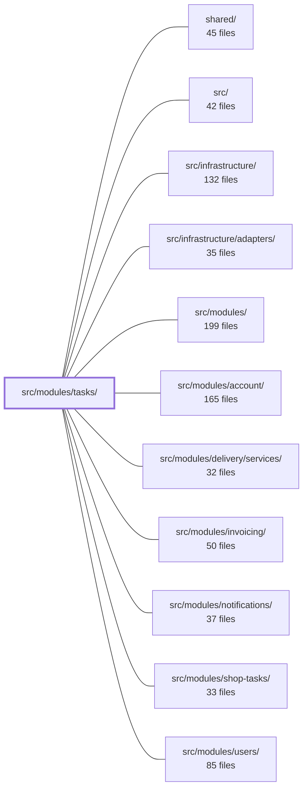

---
tags:
  - 2brain
  - 2brain/module
  - project/boilerplate-node-backend
type: module
module: src/modules/tasks/
files: 63
updated: 2026-11-15T00:35:23.444325+00:00
---

# src/modules/tasks/

## Purpose

The tasks module manages inbound visitor contact requests and system-opened situations (e.g., an overdue order or an export failure) as a unified "task" queue. It provides staff with read, search, status-transition, assignment, note, and delete operations; handles GDPR export/erasure for task data; sends operator-facing email notifications; and fires periodic overdue reminders. The single public surface is the visitor contact form; everything else sits behind an auth gate.

## Key parts

- **Domain layer (`domain/`)** — Pure, I/O-free business rules. `lifecycle.ts` encodes every allowed status transition ("doors") as total functions; `routing.ts` maps a task to the permission set that may see it; `actions.ts` derives the action set for a caller; `ownership.ts` defines the canonical "own tasks" filter shared by export and erasure; `system.ts` provides side-effect-free factories for system-opened tasks.
- **Service layer (`services/`)** — One file per use case (`contact`, `read`, `workflow`, `remove`, `personal-data`, `overdue`, `system`) assembled into a flat `taskService` object in `services/index.ts`. Each service orchestrates domain rules → repository write → audit → presentation.
- **Controllers (`controllers/`)** — Thin Express handlers, one per endpoint (get, search, resolve, mark-spam, reopen, assign, unassign, note, delete, summary). A shared factory builds the three bodyless status-transition routes.
- **Access & authorization** — `access.ts` centralises the "which rows" decision so route guards and queries cannot diverge; `authorization.yaml` declares composable permission sets at the tenant level; `domain/routing.ts` ties a task's `routeSet` to the permission that governs it.
- **Persistence & model** — `model.ts` defines the Mongoose schema and serialization transform; `repository.ts` wires standard CRUD plus conditional `findOneAndUpdate` status moves (optimistic concurrency) and bulk-detach writes for erasure.
- **Module wiring** — `module.ts` / `module.yaml` register the router, jobs, config, rate limits, and event subscriptions into the kernel; `routes.ts` defines the public-above-gate / staff-below-gate route table; `index.ts` is the sole cross-module import boundary.
- **Supporting infrastructure** — `presenter.ts` is the single mapping point from stored document to wire shape; `emails.ts` resolves operator notification content; `events.ts` declares four internal domain events; `jobs.ts` wires the overdue-sweep cron; `rate-limits.ts` exposes three contact-form budgets; `audit.ts` registers typed audit actions.

## How it connects

- **`src/modules/notifications/`** — Consumes the four internal domain events emitted by tasks (contact received, overdue, due-soon, resolved) and turns them into staff work-notices.
- **`src/modules/account/`** — The tasks module contributes its personal-data export/erasure hooks to the account module's `POST /account/export` and erasure endpoints; `services/personal-data.ts` implements both sides against the shared `ownTasksFilter`.
- **`src/modules/delivery/services/`** and **`src/modules/invoicing/`** — Upstream event producers whose domain events (e.g., an overdue delivery, a failed export) trigger the system-task opening path in `services/system.ts`.
- **`src/modules/users/`** — Provides the identity and permission data behind assignment (`assign`/`unassign`), the `assigneeName` enrichment in the presenter, and the route-set checks in `access.ts`.
- **`shared/`** — Supplies the kernel contracts: `AuditActionMap` (augmented by `audit.ts`), `DomainEventMap` (augmented by `events.ts`), and the module-registry interface used by `module.ts`.
- **`src/infrastructure/adapters/`** — Provides the Mongoose connection, the outbox (at-least-once event delivery used by `overdue.ts`), and the audit sink that `workflow.ts` and `read.ts` write through.

## Where to start

1. **`domain/lifecycle.ts`** — The entire task state machine in ~100 lines of pure functions. Reading this first tells you what statuses exist, what transitions are legal, and what each transition writes. No I/O, no framework imports, trivially testable.
2. **`routes.ts`** — A short file that shows the full API surface and the public/staff boundary in one view. From there you can follow any endpoint through its controller → service → domain → repository path.

## Connected modules

[[boilerplate-node-backend_ROOT|/ (repository root)]] · [[boilerplate-node-backend_shared|shared/]] · [[boilerplate-node-backend_src|src/]] · [[boilerplate-node-backend_src_infrastructure|src/infrastructure/]] · [[boilerplate-node-backend_src_infrastructure_adapters|src/infrastructure/adapters/]] · [[boilerplate-node-backend_src_modules|src/modules/]] · [[boilerplate-node-backend_src_modules_account|src/modules/account/]] · [[boilerplate-node-backend_src_modules_delivery_services|src/modules/delivery/services/]] · [[boilerplate-node-backend_src_modules_invoicing|src/modules/invoicing/]] · [[boilerplate-node-backend_src_modules_notifications|src/modules/notifications/]] · [[boilerplate-node-backend_src_modules_shop-tasks|src/modules/shop-tasks/]] · [[boilerplate-node-backend_src_modules_users|src/modules/users/]]

## Files
- `src/modules/tasks/access.ts` — Defines the access-control rules for tasks: which rows a caller may see and which actions they may perform on them. The two governing facts are the task's `source` (visitor vs. system) and its `routeSet`. Visitor tasks are open to anyone past the route guard; system tasks are scoped to callers holding the matching route set. This file centralises the "which rows" decision so that route guards and data queries cannot diverge.
- `src/modules/tasks/audit.ts` — Declares the audit-action vocabulary for the tasks module and registers it into the app-wide `AuditActionMap` type. It exists so that every auditable task operation (admin views, mutations, and system lifecycle events) has a stable, typed string identifier. Reads are explicitly audited here because task rows contain a stranger's email and free text, making "who looked" a data-protection concern rather than a routine catalogue read.
- `src/modules/tasks/authorization.yaml` — Declares the authorization rules and composable permission sets that govern who can read, update, or delete `Task` resources within the `tasks` module, scoped at the tenant level.
- `src/modules/tasks/config.ts` — Declares the runtime configuration schema for the tasks module. It defines two integer settings — how long a closed task is retained and the SLA window for responding to a contact message — so that operators can override them via environment or config files rather than hard-coding values.
- `src/modules/tasks/controllers/delete-task.ts` — Controller for the `DELETE /tasks/:id` endpoint (staff-only). Permanently removes a task by id. It is hand-written rather than produced by the shared `createDeleteController` factory, which is reserved for modules that implement a soft/hard-delete triplet; the tasks module has no soft-delete tier.
- `src/modules/tasks/controllers/get-task-summary.ts` — Thin HTTP controller for the `GET /tasks/summary` endpoint, which returns aggregate task counts for the staff badge. It extracts the caller context, delegates to the task service, and formats the JSON response.
- `src/modules/tasks/controllers/get-task.ts` — Controller for the `GET /tasks/:id` staff endpoint. Resolves a single task from the staff queue scoped to the caller's jurisdiction and, when the task originates from a visitor, records a named staff-read audit event before returning the task.
- `src/modules/tasks/controllers/get-tasks.ts` — Single-export controller that serves `GET /tasks` and `POST /tasks/search` for staff, searching and paginating tasks within the caller's jurisdiction. It is deliberately **never Redis-cached** because the result set is scoped to one person's permissions, not a shared shop-wide answer.
- `src/modules/tasks/controllers/post-task-assign.ts` — HTTP controller for the `POST /tasks/:id/assign` endpoint. It validates the task ID and request body, then delegates to `taskService.assign` to hand a task to a specified user (or the caller themselves — "taking" is just self-assignment).
- `src/modules/tasks/controllers/post-task-doors.ts` — Defines the three bodyless task-status transition endpoints — `POST /tasks/:id/resolve`, `/mark-spam`, `/reopen` — as thin Express handlers. Each one extracts the task ID from the URL, delegates to the matching `taskService` method, and replies `200` with the updated task. All three are built from a single shared factory so they stay structurally identical.
- `src/modules/tasks/controllers/post-task-note.ts` — Controller handler for `POST /tasks/:id/notes`. Validates the incoming note body, extracts the caller context, and delegates to the task service to append a staff note. The operation is append-only: there is no update or delete path for notes.
- `src/modules/tasks/controllers/post-task-unassign.ts` — HTTP controller for the `POST /tasks/:id/unassign` endpoint. It validates the path parameter, delegates the "give back" operation to the task service with caller context, and serializes the result or error into an Express response.
- `src/modules/tasks/controllers/post-task.ts` — Controller for `POST /tasks`, the module's sole public write endpoint. It validates and trims the inbound contact-task body, delegates creation to the task service, and returns a bare `202` (no response body). It is mounted above the admin gate in `../routes` rather than being carved out of it.
- `src/modules/tasks/domain/actions.ts` — Pure, server-side logic that maps a caller's standing (permissions) and a task's current status to the set of actions they are allowed to perform on that task. It centralises the decision so no client re-implements the lifecycle rules.
- `src/modules/tasks/domain/index.ts` — Barrel re-export for the tasks domain layer. It surfaces every public symbol from the five domain submodules (lifecycle, actions, ownership, routing, system) through a single import path, so that service-layer, repository-layer, and test code all pull the same pure business rules from one canonical location.
- `src/modules/tasks/domain/lifecycle.ts` — Pure-function module that encodes every allowed status transition (the "doors") for a task. Each door is a total function from the task's current facts to either a concrete `TaskPatch` (fields to set/unset) or a typed refusal. Keeping transitions here — separate from services, repositories, or HTTP handlers — makes the state machine auditable in one place and trivially testable without I/O.
- `src/modules/tasks/domain/ownership.ts` — Defines the single ownership rule that determines which visitor tasks belong to a given person. It exists as a pure, shared definition so that data export and data erasure always agree on the exact set of tasks, eliminating any risk of the two operations diverging.
- `src/modules/tasks/domain/routing.ts` — Defines the jurisdiction mapping between a task and the permission set that reads and routes it. Contact messages are fixed to a single route set; system tasks inherit the set named by their opener (`SystemOpening.routeSet`), so this module holds no enumeration of task kinds — a new kind introduces its own set. Admin requires no special case because it holds every set by construction.
- `src/modules/tasks/domain/system.ts` — Pure-data factory module that turns a producer's event into the first facts of a system task — the `SystemOpening` interface and its two concrete factories. It deliberately contains no side effects: no dedup, no writes, no persistence. Those concerns belong to the service layer.
- `src/modules/tasks/emails.ts` — Defines the fully-resolved email content (subject, plain-text body, HTML template data) for the two operator-facing notifications the tasks module sends: new contact requests (and their reminders) and erasure notices. All i18n strings are resolved to finished text at call time — language is an argument, output is plain strings. Emails go to the main mailbox (`NODE_SUPPORT_EMAIL`) and render in `NODE_DEFAULT_LOCALE`; customer-supplied text is passed through untranslated, and the shared `footer` partial is skipped.
- `src/modules/tasks/events.ts` — Declares the tasks module's four domain-event payloads by augmenting the kernel's `DomainEventMap` interface (the same pattern used in `modules/orders/events.ts`). All four events are **internal only** — no AsyncAPI channel, no webhook — and serve as the signal that the `notifications` module turns into staff work-notices. A single helper builds the shared payload shape so producers never duplicate it.
- `src/modules/tasks/index.ts` — Public barrel (module boundary) for the **tasks** module. Per the strategic DDD rule (see `docs/theory/strategic-ddd.md` §5), sibling modules may import tasks functionality *only* through this file. It re-exports the module's public API without adding any logic of its own.
- `src/modules/tasks/jobs.ts` — Declares the scheduled job(s) owned by the `tasks` module: a single "sweep" job that fires reminders for overdue and due-soon tasks. It wires the generated job metadata to the actual execution logic and sets the lease window.
- `src/modules/tasks/model.ts` — Defines the Mongoose schema, indexes, serialization transform, and model for the **Task** collection. A task is either a visitor's inbound message or a system-opened situation (e.g., an overdue order). The file bridges the API-generated `Task` type (string dates, string IDs) with Mongoose's native storage (Date, ObjectId) and provides the canonical serialization path back to the wire format.
- `src/modules/tasks/module.ts` — Entry-point manifest for the **tasks** module (public contact requests + system tasks). It wires the router, scheduled jobs, config, rate limits, personal-data export/erasure hooks, and cross-module domain-event subscriptions into a single `AppModule` object that the kernel registry can discover and mount.
- `src/modules/tasks/module.yaml` — Module manifest for the **tasks** domain: declares the module's identity, its upstream dependencies, one scheduled sweep job, and three contact-submission rate limiters. It exists so the runtime can discover the module's metadata (group, subdomain, dependencies) and configure its non-request-facing concerns (cron schedule, rate limits) without parsing TypeScript.
- `src/modules/tasks/openapi.yaml` — OpenAPI 3.1.0 contract for the **Tasks** module. It declares every public endpoint the module exposes (create, list, search, summary, read, and the truncated write operations), the module-specific error vocabulary, the tag taxonomy, and the personal-data sections the bundler injects into `POST /account/export`. It exists as the single source of truth for the tasks API surface consumed by clients, staff tooling, and the shared contract bundler.
- `src/modules/tasks/presenter.ts` — Single transformation point that turns a stored `TaskDocument` into the wire shape declared in `openapi.yaml`. It layers per-reader computed fields (`overdue`, `actions`, `assigneeName`, `earlierTasks`) onto the stored record and provides the inbox row projection. Every consumer that returns a task to a client (contact-form 201, staff reads, etc.) goes through this file so the mapping lives in exactly one place.
- `src/modules/tasks/rate-limits.ts` — Defines the three rate-limit budgets for the tasks module — address, submitted-email identity, and caller address-block — and exposes them as Express middleware. Budget raw values live in `./rate-limits.generated`; this file shapes them into `RateLimitBudget` objects and hands each to `buildRateLimiter`.
- `src/modules/tasks/repository.ts` — The persistence layer for tasks. It wires the Mongoose `taskModel` into the shared repository factory for standard CRUD, then layers on the conditional status moves that lifecycle transitions ("doors") need and the bulk/detach writes that data-erasure needs. Every move is a single `findOneAndUpdate` filtered on the status the caller already read, so two concurrent clicks cannot both win.
- `src/modules/tasks/routes.ts` — Defines the Express route table for the tasks module. A single public route (visitor contact form) is mounted above a positional auth gate; everything below that gate is the operator/admin view of visitor submissions (read, status changes, assignment, notes, delete).
- `src/modules/tasks/services/contact.ts` — Handles the two user-facing operations for the contact form: creating a contact task (with spam filtering) and mailing the visitor's message to the support mailbox. Both live here so that "a customer asked us something" is a single atomic concern rather than a write the HTTP layer must remember to follow up.
- `src/modules/tasks/services/index.ts` — Barrel module that assembles the task service from one file per use case (`./contact`, `./read`, `./remove`, `./personal-data`, `./workflow`, `./overdue`, `./system`) into a single `taskService` object. It exists so controllers and external modules can import a flat, predictable API surface without reaching into individual sub-files. Domain rules applied by these functions live in `../domain`.
- `src/modules/tasks/services/overdue.ts` — Implements the two periodic "reminder sweeps" for open tasks: announcing a task once as `task.overdue` when it passes its due date, and once as `task.due_soon` when it approaches it. Both announcements are written to the outbox inside a transaction so that at-least-once delivery is guaranteed without duplicate claims.
- `src/modules/tasks/services/personal-data.ts` — Implements the two GDPR personal-data operations for tasks — **export** and **erasure** — against the same set of "own tasks" identified by `ownTasksFilter`. The functions are co-located so the export and the deletion can never drift apart.
- `src/modules/tasks/services/read.ts` — Service layer for the two read operations in the tasks module: a paginated, multi-filter search and a single-task fetch by id. Both are bounded to the caller's jurisdiction so a caller never sees tasks outside their scope. The file translates domain filters into repository queries, enriches raw documents with assignee names and viewer-specific presentation, and returns shaped responses.
- `src/modules/tasks/services/remove.ts` — Permanently deletes a task by ID after verifying jurisdiction and delete permissions. Serves as the single "hard delete" entry point for the tasks module—there is no soft-delete tier to fall back on.
- `src/modules/tasks/services/system.ts` — Handles the system-driven side of the task lifecycle: opening a task when a domain event flags a situation (account review flag, export failure) and clearing it when the situation resolves. Every operation is idempotent and ownership-free — the system acts on behalf of the platform, not a human, so there is no permission gate.
- `src/modules/tasks/services/workflow.ts` — The write path for every status-changing task operation: resolve, mark-as-spam, reopen, assign, unassign, and the staff badge counts. Each mutation is a single conditional write (`moveFrom`) filtered on the status the caller read, so concurrent clicks yield exactly one 200 and one 409. Domain rules live in `../domain`; this file orchestrates the read → decide → write → audit → present sequence around them.
- `src/modules/tasks/tests/contract/api.contract.test.ts` — Contract tests for every `/tasks` route: the one genuinely public write endpoint (`POST /tasks`, `security: []`) and the admin-only read/search/status-action routes. Verifies that public responses carry no admin fields, that admin routes answer 401/403 rather than leaking data, and that validation bounds (pagination, enum values, field lengths, whitespace trimming) behave consistently whether expressed as query params or a JSON body.
- `src/modules/tasks/tests/factories.ts` — Test-only factory helpers that write directly to the task database, bypassing the service/domain layer. They exist so integration and contract tests across tasks, notifications, shop-tasks, and account can seed realistic task state (open, overdue, resolved) without exercising production business rules.
- `src/modules/tasks/tests/integration/accepted-response.test.ts` — Integration test asserting that `POST /tasks` returns a bare `202` (no content-type header, no body) and that replaying a request with the same idempotency key reproduces that exact response without creating a second task. Exercises the real route so the idempotency ledger's capture-and-replay path is part of the assertion.
- `src/modules/tasks/tests/integration/contact-identity-rate-limit.test.ts` — Integration test verifying that `contactLimiters` (from the tasks rate-limits module) enforces an identity-based (submitted-email) budget on top of the per-address submission budget. It also confirms the limiter array is actually mounted on the real `POST /tasks` route. It tests the limiter itself, not the contact controller logic.
- `src/modules/tasks/tests/integration/due-soon.test.ts` — Integration test (real database) for the `remindDueSoon` sweep. Verifies that an open task within three days of its deadline—and with a life long enough to matter—is announced exactly once as a `task.due_soon` domain event, while closed, overdue, too-short-lived, suppressed, or out-of-window tasks are left untouched.
- `src/modules/tasks/tests/integration/erasure-notice.test.ts` — Integration test that verifies, across all four user-erasure paths, that a single support-mailbox notice is enqueued containing only the deleted messages' `[#ref]` identifiers—and that no sensitive fields (sender email, subject, body, username) leak into the envelope or payload. It confirms the notice survives the erasure transaction and any deferred event flush.
- `src/modules/tasks/tests/integration/export.test.ts` — Integration tests for the **tasks** section of a personal-data export (GDPR Art. 12(6)). Verifies the ownership rule — a person sees tasks filed under their account ID *or* under an address they have proven — and the redaction rules (no staff IDs, no dedup keys). Also covers the separate **systemTasks** subsection for account-related system tasks.
- `src/modules/tasks/tests/integration/idempotent-note.test.ts` — Integration test that verifies the `POST /tasks/{id}/notes` endpoint honors an `Idempotency-Key` header: a retried request must replay the original response rather than appending a duplicate note to the task thread. It exists because task notes have no delete endpoint, so an accidental double-submit would be unrecoverable.
- `src/modules/tasks/tests/integration/model.test.ts` — Integration test verifying two invariants of the task domain: (1) TTL indexes are defined correctly so MongoDB purges stale documents on schedule, and (2) serialized task objects never expose internal Mongoose fields (`_id`, `__v`) on either the hydrated (`toJSON`) or `.lean()` response path.
- `src/modules/tasks/tests/integration/overdue.test.ts` — Integration test for the overdue sweep, run against a real database. Verifies that an open task past its due date is announced exactly once as a `task.overdue` domain event (with correct payload), stamped to prevent re-announcement, and that closed, not-yet-due, or reopened tasks are left untouched.
- `src/modules/tasks/tests/integration/ownership.test.ts` — Integration tests verifying two coupled guarantees: (1) a signed-in visitor's contact form submission is attributed to their account (`subjectId`), and (2) the personal-data erasure hook removes *exactly* the set of records the export (`collect`) hook lists. Covers edge cases around email verification, anonymous vs. authenticated senders, staff erasure, transactional rollback, and the collect/erase parity invariant.
- `src/modules/tasks/tests/integration/schema-contract.test.ts` — Integration test that verifies Mongoose schema-level declarations on the task document (serialization shape, defaults, required fields, `select: false` credentials) by exercising a real Mongo instance. It exists separately from sibling transform specs because the behaviours under test belong to Mongoose itself, not to application logic — a mocked model would only assert the mock's own interpretation.
- `src/modules/tasks/tests/integration/service.test.ts` — Integration tests for the task service's public operations: `create` (field normalisation, due-date SLA, honeypot disposition, domain-event announcement, outbox row), `mailMainMailbox` (envelope shape, threading, system-task guard, error swallowing), and the staff search / `removeById` paths. The "doors" (permission checks) are deliberately excluded and live in the service's own permission test file.
- `src/modules/tasks/tests/integration/submission-rate-limit.test.ts` — Integration test for `submissionLimiter`, the rate-limit middleware on `POST /tasks`. It verifies the limiter spends its budget on **every** request (not just successes, unlike `credentialLimiters`) and that each 429 refusal is logged, since no downstream middleware will record it. The file guards against the regression of accidentally mounting the credential limiter on this endpoint, where every abusive submission returns `201` and the credential limiter's `skipSuccessfulRequests` would silently let all of them through.
- `src/modules/tasks/tests/integration/system-sources.test.ts` — Integration test for the system-task engine: it verifies that specific domain events (flagged account, failed export) open a task in the correct jurisdiction, that their counterpart events close it, and that dedup semantics (repeat, redelivery, racing) behave as intended. It runs against a real database with the real module graph registered, exercising the full event → outbox → task pipeline rather than unit-level mocks.
- `src/modules/tasks/tests/integration/workflow.test.ts` — Integration test suite that exercises the full task lifecycle moves — resolve, markSpam, reopen, assign, unassign — against a real database. It pins the state stamps each move writes (`closedAt`, `resolution`, `respondedAt`, `openKey`), the 409/404/422 error codes and their codes, jurisdiction (route-set) enforcement, dedup-key release/restoration, and outbox event emission. It exists so regressions in any of those contracts are caught at the integration boundary.
- `src/modules/tasks/tests/unit/emails.test.ts` — Unit tests for the two email-builder functions exported by `src/modules/tasks/emails.ts`. They pin down the operator-facing subject-line grammar, the shape and locale of the template data payload, the reminder-variant copy, and the privacy guarantee that no sender address leaks into an erasure-notice payload.
- `src/modules/tasks/tests/unit/lifecycle.test.ts` — Unit tests for the task-lifecycle domain functions (status transitions, stamping rules, and the dedup key). The module is pure—no mocks, no database—so this file exercises the state-machine logic directly to verify which transitions are legal, what fields each move sets or unsets, and when a transition is refused.
- `src/modules/tasks/tests/unit/rate-limits.test.ts` — Unit test that pins invariant **relationships** between the contact-form rate-limit budgets (submissions, submission-identity, submission-block) rather than their absolute values. It exists to prevent accidental re-tuning of those numbers from breaking the design intent that a one-time contact filing stays well below ordinary browsing and that the broader block budget encloses the narrower address budget.
- `src/modules/tasks/tests/unit/routes.test.ts` — Unit tests that pin the exact route table, guard placement, caching policy, rate-limiting, and human-challenge gate of the tasks module's router. Because `router.use` makes guard boundaries positional and invisible to per-route inspection, these assertions are intentionally order-sensitive and sweep-based rather than per-route.
- `src/modules/tasks/tests/unit/routing.test.ts` — Unit tests for task routing and jurisdiction logic. Verifies that every task type (contact messages, account reviews, failed exports) is routed to a declared permission set, that an administrator holds all routed sets by virtue of role permissions (not a special case), and that `inJurisdiction` correctly grants or denies task visibility based on the caller's held sets.
- `src/modules/tasks/tests/unit/schema-contract.test.ts` — Contract test that pins the publicly observable shape of `taskSchema`: which fields are required vs. optional, which defaults exist, the status enum, and the full set of MongoDB index specifications (including partial filters, uniqueness, and TTL expiry). It exists so that any change to the schema's public contract—fields, defaults, indexes—fails loudly in CI before reaching production.
- `src/modules/tasks/tests/unit/system-openings.test.ts` — Unit tests for the system-owned task openings (`accountReviewOpening`, `exportFailedOpening`) and the `clear` helper defined in the tasks domain (`src/modules/tasks/domain/system.ts`). Verifies structural invariants—kind membership, declared route sets, dedup-key format, due-date offset, subject binding, and message privacy—using only pure in-memory values with no mocks or database.
- `src/modules/tasks/views.ts` — Projects raw task data into what a reader (the caller) actually sees: resolves assignee usernames in a single batch query and computes the set of available actions based on the caller's standing. The caller is resolved once per page of rows, not once per row, keeping the cost at one ability check and one user lookup per page.

---
[[boilerplate-node-backend_INDEX|← boilerplate-node-backend index]]
