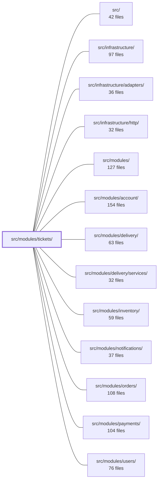

---
tags:
  - 2brain
  - 2brain/module
  - project/boilerplate-node-backend
type: module
module: src/modules/tickets/
files: 49
updated: 2026-10-29T19:29:14.208227+00:00
---

# src/modules/tickets/

## Purpose

The tickets module manages the full lifecycle of support tickets: visitor contact-form submissions and system-generated tickets (payment failures, inventory alerts, disputes, delay notices, etc.). It owns creation, assignment, status transitions (new → in_progress → resolved / spam), staff notes, audit logging, GDPR export/erasure, anti-automation rate limiting, and staff-facing email notifications.

## Key parts

- **Domain layer** (`domain/`) — Pure, I/O-free business rules. `lifecycle.ts` defines status-transition "doors"; `actions.ts` maps caller standing to permitted operations; `ownership.ts` is the single authority for which tickets belong to a person (used by both export and erasure); `routing.ts` is the jurisdiction lookup table; `system.ts` constructs the initial facts for system-opened tickets. All re-exported through `domain/index.ts`.
- **Service layer** (`service.ts`, `services/workflow.ts`, `services/system.ts`) — Orchestrates I/O around domain rules. `service.ts` handles creation, search, read, notification, and GDPR hooks. `services/workflow.ts` applies state transitions as single conditional writes (guaranteeing 200-vs-409 on races). `services/system.ts` translates inbound domain events from other modules into open/close ticket actions.
- **HTTP layer** (`routes.ts`, `controllers/`) — One public route (contact form) above an auth gate, then admin-only handlers. Controllers are thin: validate → delegate to service → serialize. `ticket-doors.ts` uses a single factory for resolve/mark-spam/reopen to avoid triplication.
- **Data layer** (`model.ts`, `repository.ts`) — Mongoose schema, indexes, and serialization transform. The repository adds domain-specific operations (atomic transitions, dedup, GDPR writes) on top of the shared CRUD factory so the service never touches Mongoose directly.
- **Cross-cutting** — `access.ts` (row-level and action-level jurisdiction), `audit.ts` (typed audit-action vocabulary), `events.ts` (domain events for notifications), `emails.ts` (operator notification copy), `config.ts` (SLA, retention, consent countries), `rate-limits.ts` + `rate-limits.generated.ts` (three-dimension anti-abuse budgets on `POST /tickets`), `presenter.ts` (single wire-shape serializer).
- **Module wiring** — `module.ts` (manifest: routes, config, rate limits, personal-data hooks, event subscriptions) and `index.ts` (the only import surface other modules may use).
- **Tests** (`tests/`) — Contract, integration (ownership, rate limits, system-event routing, schema serialization), and factory utilities.

## How it connects

- **`notifications`** — Consumes the `ticket.opened` and `ticket.assigned` domain events declared in `events.ts` to produce staff work-queue notices, keeping producer and bus from double-alerting.
- **`account`, `orders`, `payments`, `inventory`, `delivery`, `users`** — Emit domain events (flagged account, failed payment, shipment delay, dispute, etc.) that `services/system.ts` translates into system-opened or system-closed tickets. The mapping from event → `TicketKind` lives in this module; the emitting modules never import ticket internals.
- **`infrastructure/http`** — Provides the Express app, rate-limit middleware (`express-rate-limit`), and routing utilities that `routes.ts` and `rate-limits.ts` build on.
- **`infrastructure/adapters`** — Mongoose connection, mailer, and audit ports that the service/repository layers call through.
- **`src/modules/` (sibling modules)** — May import this module *only* through `index.ts`, per the strategic-DDD import rule.

## Where to start

Read **`domain/index.ts`** first — it is a short barrel that names every pure rule in the module (lifecycle doors, action flags, ownership, routing) and makes the boundary between "what the business says" and "how we persist it" immediately visible. Then read **`services/workflow.ts`** to see how those pure rules are wrapped in a single conditional write, an audit record, and a domain-event emission — the pattern every state mutation in the module follows.

## Connected modules

[[boilerplate-node-backend_ROOT|/ (repository root)]] · [[boilerplate-node-backend_src|src/]] · [[boilerplate-node-backend_src_infrastructure|src/infrastructure/]] · [[boilerplate-node-backend_src_infrastructure_adapters|src/infrastructure/adapters/]] · [[boilerplate-node-backend_src_infrastructure_http|src/infrastructure/http/]] · [[boilerplate-node-backend_src_modules|src/modules/]] · [[boilerplate-node-backend_src_modules_account|src/modules/account/]] · [[boilerplate-node-backend_src_modules_delivery|src/modules/delivery/]] · [[boilerplate-node-backend_src_modules_delivery_services|src/modules/delivery/services/]] · [[boilerplate-node-backend_src_modules_inventory|src/modules/inventory/]] · [[boilerplate-node-backend_src_modules_notifications|src/modules/notifications/]] · [[boilerplate-node-backend_src_modules_orders|src/modules/orders/]] · [[boilerplate-node-backend_src_modules_payments|src/modules/payments/]] · [[boilerplate-node-backend_src_modules_users|src/modules/users/]]

## Files
- `src/modules/tickets/access.ts` — Defines the jurisdiction rules that determine which tickets a caller may see and work on. Visitor-sourced tickets are open to any caller who passes the route's `Ticket` permission; system-sourced tickets are further restricted to callers who hold the ticket's route set. The file separates *row-level* scoping (which documents a query returns) from *action-level* checks (whether a specific mutation is allowed), so that route guards and data queries cannot disagree.
- `src/modules/tickets/audit.ts` — Declares the audit-action vocabulary owned by the tickets module and registers it into the app-wide `AuditActionMap` via TypeScript module augmentation. It exists so that every ticket-related audit event (both admin-driven and system-driven) has a typed, single-source identifier, enabling compile-time safety and cross-cutting audit validation.
- `src/modules/tickets/config.ts` — Declares the runtime configuration surface for the tickets module: the fallback contact mailbox, ticket retention window, contact-message SLA, and the set of ship-to countries subject to FTC consent-reminder obligations. It exists so that every tickets-related constant lives in one typed, validated object rather than being scattered across services.
- `src/modules/tickets/controllers/delete-ticket.ts` — Express handler for `DELETE /tickets/:id`. It validates the ticket id, delegates the permanent removal to the ticket service with the caller's context, and returns a bare `204 No Content` on success. It is hand-written (not built via the `createDeleteController` factory) because the tickets module has no soft-delete tier and the factory assumes a soft/hard delete triplet.
- `src/modules/tickets/controllers/get-ticket-by-id.ts` — Express route handler for `GET /tickets/:id`. Retrieves a single ticket from the staff queue, scoped to the caller's jurisdiction, and records an audit event when the ticket belongs to a visitor.
- `src/modules/tickets/controllers/get-ticket-summary.ts` — Thin Express controller for the `GET /tickets/summary` endpoint, which returns aggregated ticket counts for the staff badge. It delegates all business logic to `ticketService.summary` and only handles request/response plumbing.
- `src/modules/tickets/controllers/get-tickets.ts` — Controller that serves `GET /tickets` and `POST /tickets/search` (staff-only). It delegates the actual query to `ticketService.search` and is built via the shared `createSearchController` factory. The file exists so the routes layer can register a ready-made handler without duplicating validation or pagination logic.
- `src/modules/tickets/controllers/post-ticket-note.ts` — Handles `POST /tickets/:id/notes` — appending a staff-only note to an existing ticket. It validates the request (ID lookup, body trimming), delegates to the ticket service, and returns the updated ticket with a `201` status.
- `src/modules/tickets/controllers/post-ticket.ts` — Controller for `POST /tickets`, the module's sole public write endpoint. It validates and trims the inbound body, delegates creation to the ticket service, and replies with a `201` containing the presented ticket record.
- `src/modules/tickets/controllers/ticket-assignee.ts` — HTTP controller for the ticket-assignment endpoints. Exposes two handlers: `PUT /tickets/:id/assignee` (assign a ticket to a user, or take it by assigning yourself) and `DELETE /tickets/:id/assignee` (unassign / give the ticket back). Each handler validates input, delegates to the ticket service, and serialises the result.
- `src/modules/tickets/controllers/ticket-doors.ts` — Defines the three bodyless staff-facing ticket status-change endpoints (`POST /tickets/:id/resolve`, `/mark-spam`, `/reopen`). Each handler follows the same read-id → call-service → return-200-with-ticket shape, implemented via a single factory to avoid triplication.
- `src/modules/tickets/domain/actions.ts` — Pure, server-side decision logic that maps a caller's standing and a ticket's status to the set of actions the caller may perform. It centralizes the "what is this user allowed to do?" rule so no client or other layer re-implements the ticket lifecycle.
- `src/modules/tickets/domain/index.ts` — Barrel file that aggregates the public API of the tickets **domain layer**. It re-exports pure business rules (lifecycle transitions, action flags, ownership predicates, routing sets, and system-opening constructors) from sibling modules so that consumers import from a single entry point. The domain layer is lint-enforced to be free of Express, Mongoose, and any application-tier dependency; this file is the sole surface through which those rules are consumed.
- `src/modules/tickets/domain/lifecycle.ts` — Pure-function transition logic for ticket status. Each exported "door" takes a ticket's current facts and returns either a concrete patch (fields to set/unset) or a typed refusal. This file contains no I/O, no side effects, and no framework imports beyond `TicketStatus`—it exists so that the rules for how a ticket moves between `new`, `in_progress`, `resolved`, and `spam` are testable in isolation and shared by every caller.
- `src/modules/tickets/domain/ownership.ts` — Defines the single, authoritative rule for determining which visitor tickets "belong" to a person. Both data-export and data-erasure paths call the same pure function, guaranteeing they always agree on the ticket set (export lists exactly what erase removes).
- `src/modules/tickets/domain/routing.ts` — Defines the single source of truth for ticket jurisdiction: which permission set is responsible for each ticket kind. It is a pure lookup table so that the rule "a role is a bundle of sets, so routing to a set routes to every role holding it" exists in exactly one place. Admin requires no special case because it holds every set by construction.
- `src/modules/tickets/domain/system.ts` — Pure-data factory functions that turn a specific system event (a flagged account, a failed export, a dispute, a delay notice, etc.) into the **first facts** of a system ticket: its kind, linked record, inbox text, and due date. This file deliberately stops at "what to say and when it's due"; dedup, routing, and persistence belong to the service layer.
- `src/modules/tickets/emails.ts` — Contains the fully-resolved email copy for the tickets module (operator-facing notifications). Follows the same convention as `@modules/account/emails`: language is a function argument and the return value is finished, translated text ready for the mailer. Emails land in the fallback mailbox (rendered in `NODE_DEFAULT_LOCALE`), skip the shared `footer` partial, and leave customer-supplied fields (subject, message) untranslated.
- `src/modules/tickets/events.ts` — Defines the two domain events emitted by the tickets module (`ticket.opened`, `ticket.assigned`) by augmenting the kernel's `DomainEventMap` interface. These are purely internal events—no AsyncAPI channel or webhook carries them—and exist so that the `notifications` module can translate them into staff work notices without the producer and the event bus both alerting the same person.
- `src/modules/tickets/index.ts` — Public barrel file for the tickets module. It is the **only** import surface that sibling modules (e.g. notifications) may use, per the rule in `docs/theory/strategic-ddd.md` §5. It re-exports the module's sub-files so consumers never reach into internal paths directly.
- `src/modules/tickets/model.ts` — Defines the Mongoose schema, document types, indexes, and serialization transform for the single **tickets** collection. It bridges the API-generated `Ticket` wire type (strings, ISO dates) and what Mongoose stores natively (ObjectId, Date), and exposes a ready-to-use model plus a transform that normalizes documents back to the wire shape.
- `src/modules/tickets/module.ts` — Module manifest for the **tickets** feature (contact requests + system-generated tickets). It wires together the module's routes, config, rate limits, personal-data hooks, and event subscriptions into a single `AppModule` export that the kernel registry loads and mounts.
- `src/modules/tickets/presenter.ts` — Single presentation layer that turns a stored `TicketDocument` into the wire shape declared by `openapi.yaml`: the stored fields plus per-reader computed values (`overdue`, `actions`, `assigneeName`, `earlierTickets`). Every code path that serializes a ticket for a response funnels through this module so the shape is defined once.
- `src/modules/tickets/rate-limits.generated.ts` — Static data table describing the three rate-limit budgets for the tickets (contact-form) module. It is generated from `src/modules/tickets/module.yaml` via `npm run regenerate` so that limit names, namespaces, env-var names, defaults, and audit flags live in one declarative source while the runtime logic (key derivation, skip conditions) stays in `rate-limits.ts`.
- `src/modules/tickets/rate-limits.ts` — Defines the tickets module's rate-limit budgets (as `RateLimitBudget` data) and turns them into Express middleware via `buildRateLimiter`. The budgets govern the contact-form submission endpoint (`POST /tickets`) across three dimensions: caller address, submitted email identity, and caller address block.
- `src/modules/tickets/repository.ts` — Ticket repository that layers domain-specific operations (atomic status transitions, assignment changes, system-ticket dedup, and GDPR erasure writes) on top of the shared CRUD repository factory. It exists so the service layer never touches Mongoose directly and so concurrent status changes are guarded at the query level.
- `src/modules/tickets/routes.ts` — Defines the Express router for the tickets module. It wires one public route (the visitor contact form) above a single positional auth gate, then mounts all admin-only read/update/delete handlers below that gate. Each route pairs its controller with the specific authorization, caching, and anti-abuse middleware it requires.
- `src/modules/tickets/service.ts` — Service layer for the tickets module's non-workflow operations: creating contact-form tickets (with spam screening and domain-event announcement), staff search and read, the fallback-mailbox notification, and the module's two `personalData` halves (export and erasure). State-transition operations (resolve, assign, add note) live in `./workflow`; the business rules they enforce live in `./domain`.
- `src/modules/tickets/services/system.ts` — Translates domain events (payment, user, inventory, order, shipment, account) into system-opened and system-closed tickets. Each producer event maps to a specific `TicketKind`; this service decides whether to open a new ticket, touch an existing one, or clear already-open tickets when a situation resolves. Both directions are idempotent so outbox redelivery is safe.
- `src/modules/tickets/services/workflow.ts` — The write path for every ticket state transition (resolve, mark-spam, reopen, assign, unassign, add-note). It applies the domain's transition rules as a single conditional (status-filtered) database write so that concurrent clicks yield one 200 and one 409, records an audit entry on success, and emits domain events where needed. All business rules live in `../domain`; this file is the authorization, concurrency, and I/O layer around them.
- `src/modules/tickets/tests/contract/api.contract.test.ts` — Contract tests for the `/tickets` API surface. Validates that the public `POST /tickets` endpoint produces only visitor-visible fields, that admin list/detail routes enforce authentication and return correct shapes, and that status-transition sub-routes (`resolve`, `mark-spam`, `reopen`) behave as the OpenAPI contract specifies. Exists to catch drift between the live API and the generated schema without needing a UI or integration harness.
- `src/modules/tickets/tests/factories.ts` — Test-only factory for persisting ticket documents that bypass the domain rules a service layer would normally enforce. It exists so that tests can seed the database with a specific ticket state (e.g. a refund ticket awaiting manual action) without going through the production creation flow.
- `src/modules/tickets/tests/integration/contact-identity-rate-limit.test.ts` — Integration test for `contactLimiters` (Anti-automation Rung 1) in the tickets module. It verifies that the identity (submitted-email) dimension caps repeat senders *on top of* the per-address budget already covered by `submission-rate-limit.test.ts`, and that the limiter is actually mounted on the real `POST /tickets` route.
- `src/modules/tickets/tests/integration/export.test.ts` — Integration tests for the two personal-data export sections exposed by the tickets module (`tickets` and `systemTickets`). Verifies the ownership rules (account-ID match always; address match only when the account has verified that address), the GDPR Art. 12(6) "prove identity before disclosing" requirement, and data-minimization constraints (staff IDs, dedup keys, and internal fields must not appear in the export output).
- `src/modules/tickets/tests/integration/model.test.ts` — Integration test that verifies ticket objects never expose `_id` or `__v` on either serialization path: hydrated Mongoose documents (via `toJSON`) and lean query results returned through `ticketService.search`. It guards against a class of bug where an internal Mongoose field leaks into API responses.
- `src/modules/tickets/tests/integration/ownership.test.ts` — Integration tests for the tickets module's personal-data ownership semantics. Verifies two invariants: (1) the `POST /tickets` endpoint records the signed-in sender's `subjectId`, and (2) the `PersonalDataEraser` hook deletes or detaches exactly the set of tickets the module's `collect` export lists — no more, no less — including transactional rollback.
- `src/modules/tickets/tests/integration/schema-contract.test.ts` — Integration test that verifies the Mongoose ticket schema's serialization contract against a real Mongo instance. It asserts that a persisted ticket's `toJSON()` output exposes `id` (as a string) and omits `_id` and `__v`. The file intentionally runs against real Mongo rather than a mocked model so it tests Mongoose's actual serialization behaviour, not a mock's interpretation.
- `src/modules/tickets/tests/integration/service.test.ts` — Integration tests for the ticket service that pin its create-time normalisation (email lowercasing, whitespace trimming, blank-name → `undefined`, category/order-number passthrough), the `ticket.opened` domain-event payload, the honeypot and disposable-email anti-automation runs, `mailFallbackMailbox`, staff search, and `removeById`. Uses a real test database so repository round-trips are exercised; the mailer and audit port are mocked.
- `src/modules/tickets/tests/integration/submission-rate-limit.test.ts` — Integration test for `submissionLimiter`, the rate-limit budget on `POST /tickets` (contact form). It sends real requests through `express-rate-limit` middleware via `supertest` to verify three behaviors: the budget is spent on successful requests (the opposite of `credentialLimiters`), it is also spent on failed requests, and every refusal is logged via `logger.warn` because no downstream middleware records a 429. It lives in the integration suite (not the unit suite) because it exercises the middleware end-to-end rather than inspecting pure configuration.
- `src/modules/tickets/tests/integration/system-sources.test.ts` — Integration test that drives the **real registered ticket modules** with domain events (the same `emitDomainEvent` path production uses, including an outbox-style `eventId`) to verify: which events open a system ticket and with the correct kind/jurisdiction, which events close one as *cleared*, deadline derivation, and that non-qualifying events open nothing. The module docstring also references dedup, redelivery no-op, racing-event, and staff-closes-first scenarios (in the truncated tail).
- `src/modules/tickets/tests/integration/workflow.test.ts` — Integration test that exercises every ticket "move" through the real service + repository stack (against a test database): resolve, markSpam, reopen, assign, unassign, and note. It verifies the side-effect stamps each move owes (`closedAt`, `resolution`, `respondedAt`, the dedup `openKey`), the 409 guard on every repeat, the reopen-supersede collision, jurisdiction (route-set) enforcement, and the audit row each move writes.
- `src/modules/tickets/tests/unit/emails.test.ts` — Unit tests for the `contactRequestEmail` builder — the operator-facing notification email generated when a customer submits a ticket contact request. The suite pins down subject composition, field pass-through, locale-sensitive fallbacks, and that all human-readable strings are resolved translations rather than raw i18n keys.
- `src/modules/tickets/tests/unit/lifecycle.test.ts` — Unit tests for the pure ticket-lifecycle domain functions (status transitions, timestamp stamps, and the dedup key). No mocks, no database — only deterministic assertions against the decision objects the domain layer returns.
- `src/modules/tickets/tests/unit/rate-limits.test.ts` — Unit test that pins the **numeric invariants** between the ticket-module rate-limit budgets: contact-form budgets must stay a small fraction of the global browsing budget, and a block-scoped budget must sit above the address-scoped budget it widens. It does **not** exercise the middleware behaviorally.
- `src/modules/tickets/tests/unit/routes.test.ts` — Unit test for the tickets router's route table. It verifies that `POST /` (the visitor contact form) is mounted **above** the auth gate and is the only public route, that every other route sits **below** the gate with `requirePermissionGuard`, and that caching, rate-limiting, and human-challenge middleware are attached to the correct routes in the correct order. Assertions are positional (not per-middleware) because `router.use` makes routes keyed only by their position in the table.
- `src/modules/tickets/tests/unit/routing.test.ts` — Unit tests that verify two routing invariants: (1) every ticket kind resolves to a permission set that actually exists in the system, and (2) the administrator role holds every permission rule in every set a ticket can be routed to, guaranteeing no ticket is unreachable by the all-seeing role.
- `src/modules/tickets/tests/unit/schema-contract.test.ts` — Contract tests for the `ticketSchema` Zod schema. They pin the policy decisions encoded in the model — which fields a stranger must supply to reach an operator, which fields only an operator fills, what the status enum permits, and which indexes (including the TTL retention index) exist. The tests are the executable specification: if the schema drifts, these fail.
- `src/modules/tickets/tests/unit/system-openings.test.ts` — Unit tests for the pure, side-effect-free opening functions defined in `domain/system.ts`. Each test verifies which ticket `kind`, `link`, and `dueAt` a given situation produces, plus the close shape returned by `clear`. No mocks or database access. The consent-reminder path (16 CFR 435.2) receives the largest coverage block because of its jurisdiction and date-arithmetic rules.
- `src/modules/tickets/views.ts` — Transforms raw stored tickets into a viewer-facing `TicketView` by attaching the assignee's display name and the set of actions the caller is permitted to perform. Both enrichments are resolved **once per page** (one user lookup, one standing check) so that rendering N rows costs the same as rendering one.

---
[[boilerplate-node-backend_INDEX|← boilerplate-node-backend index]]
