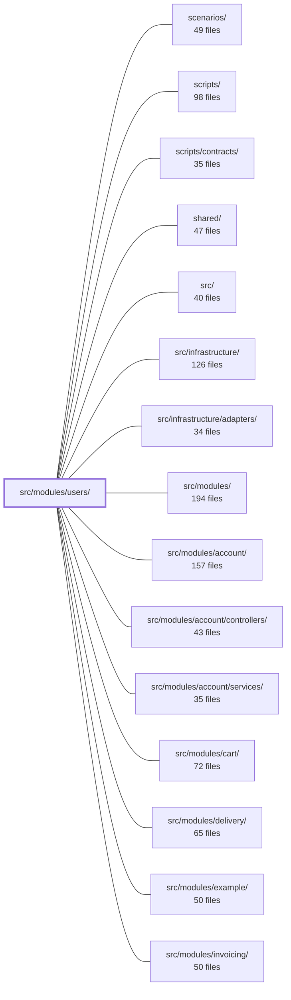

---
tags:
  - 2brain
  - 2brain/module
  - project/boilerplate-node-backend
type: module
module: src/modules/users/
files: 78
updated: 2026-11-08T10:54:38.057793+00:00
---

# src/modules/users/

## Purpose

The `users` module owns the user-account domain: the Mongoose schema, admin-facing CRUD and lifecycle operations (activate, deactivate, soft/hard delete, erasure), the purchase-hold mechanism, credential management, and the module's REST and webhook contracts. It is the authoritative source for "who is a user and what may be done to their record from the admin/staff side," while the sibling `account` module handles the owner-facing half of the same document.

## Key parts

- **Model & persistence** — `model.ts` (schema, pre-save password hook, 2FA/OAuth/session-epoch fields) and `repository.ts` (all data-access operations: credential writes, MFA, inactivity reaping, purchase-hold, soft-delete, OAuth-link, credential re-selection).
- **Services (domain logic)** — `services/` contains the business rules behind every admin action: `create.ts`, `read.ts`, `activation.ts`, `purchase-hold.ts`, `credentials.ts`, `reaper.ts`, `own-account.ts`, `personal-data-subject.ts`, `audit-changes.ts`, `actions.ts`, `lookups.ts`, and `image.ts`. They are re-exported as a single `userService` object via `services/index.ts`.
- **Controllers & routes** — `controllers/` (thin HTTP handlers for each endpoint) and `routes.ts` (Express router wiring permission gates, rate limits, upload handling, and fresh-auth guards).
- **Contracts & declarations** — `openapi.yaml` (REST API shape), `authorization.yaml` (tenant-scoped permission sets), `asyncapi.webhooks.yaml` (webhook event envelopes), `events.ts` (domain-event payload types), `audit.ts` (audit-action vocabulary), `analytics.ts` (analytics event names).
- **Module wiring** — `module.ts` (kernel manifest: routes, jobs, event subscriptions, PII hooks, config), `config.ts` (PII encryption key + email links), `index.ts` (public barrel for sibling modules), `erasure-registry.ts` (injected eraser/minimiser lists from other modules), `authenticatable.ts` (shared "may this account authenticate?" filter + predicate), `presenter.ts` (document → public contract mapping), `emails.ts` (purchase-hold buyer email), `jobs.ts` (nightly expired-hold sweep), `factories.ts` (test/seed fixtures).

## How it connects

- **`src/modules/account/`** — The two modules share the same `UserDocument`. `authenticatable.ts` is the single source of truth both modules use to decide whether an account may log in. `services/lookups.ts` exposes named queries *for* the account domain. `presenter.ts` maps documents into the `Account` contract that account controllers return. `personal-data-subject.ts` provides the canonical identity shape that the account export flow consumes. `emails.ts` follows the same finished-text convention as `account/emails`.
- **`src/infrastructure/`** — `config.ts` delegates shape/validation of the PII key to `infrastructure/security/config.ts`; `services/audit-changes.ts` delegates the generic before/after diff to an infrastructure helper; `module.ts` registers PII re-encryption hooks with the kernel.
- **`src/modules/webhooks/`** — The `asyncapi.webhooks.yaml` fragment declares `user.erased` and `user.updated` events that the webhooks module publishes to external subscribers.
- **`src/modules/notifications/`** — Purchase-hold and activation emails produced here are delivered through the notifications module.
- **`src/modules/cart/`, `src/modules/orders/`** — The purchase-hold state (`purchase-hold.ts`) is checked at checkout to block or allow a buyer's orders.
- **Other sibling modules** (`delivery`, `invoicing`, `payments`, `products`, `returns`, etc.) — Register their `PersonalDataEraser`/`PersonalDataMinimiser` implementations into `erasure-registry.ts` at boot, so a hard-delete or Art. 17 erasure cascades through every module that stored personal data.
- **`scripts/contracts/`, `scenarios/`** — Consume `openapi.yaml` and the service barrel for contract tests and integration scenarios.

## Where to start

1. **`model.ts`** — Reading the schema first gives you the full shape of a user record (fields, defaults, `select: false` password, purchase-hold, 2FA, session-epoch) that every other file in the module operates on.
2. **`services/index.ts`** — This barrel shows the complete public API surface of the domain (`create`, `read`, `updateById`, `removeById`, `setPurchaseHold`, `liftPurchaseHold`, `activate`, `deactivate`, …). From there you can trace any admin action from the controller down through the service into the repository in a single pass.

## Connected modules

[[boilerplate-node-backend_ROOT|/ (repository root)]] · [[boilerplate-node-backend_scenarios|scenarios/]] · [[boilerplate-node-backend_scripts|scripts/]] · [[boilerplate-node-backend_scripts_contracts|scripts/contracts/]] · [[boilerplate-node-backend_shared|shared/]] · [[boilerplate-node-backend_src|src/]] · [[boilerplate-node-backend_src_infrastructure|src/infrastructure/]] · [[boilerplate-node-backend_src_infrastructure_adapters|src/infrastructure/adapters/]] · [[boilerplate-node-backend_src_modules|src/modules/]] · [[boilerplate-node-backend_src_modules_account|src/modules/account/]] · [[boilerplate-node-backend_src_modules_account_controllers|src/modules/account/controllers/]] · [[boilerplate-node-backend_src_modules_account_services|src/modules/account/services/]] · [[boilerplate-node-backend_src_modules_cart|src/modules/cart/]] · [[boilerplate-node-backend_src_modules_delivery|src/modules/delivery/]] · [[boilerplate-node-backend_src_modules_example|src/modules/example/]] · … and 10 more

## Files
- `src/modules/users/analytics.ts` — Declares the analytics event names for admin-initiated user lifecycle actions (account creation and deactivation) and registers them into the app-wide analytics event map. It exists so that event names live in one typed location and are available to any service that fires them, without duplicating string literals.
- `src/modules/users/asyncapi.webhooks.yaml` — AsyncAPI **fragment** (not a standalone document) that declares the two webhook events emitted by the users module — `user.erased` and `user.updated`. It exists so that a global AsyncAPI document can be assembled by merging module-level fragments, and so that the event contract (envelope shape, field enums, firing conditions) is documented alongside the code that fires it.
- `src/modules/users/audit.ts` — Declares the full set of audit-action string constants for user-record writes and registers them into the app-wide `AuditActionMap` via TypeScript module augmentation. It exists so every audit event emitted anywhere in the users module uses a single, type-safe vocabulary, and so the audit log can answer specific operational questions (e.g. "was this account banned?", "was the erasure actually discharged?") without a reader diffing row revisions.
- `src/modules/users/authenticatable.ts` — Single source of truth for the "is this account allowed to authenticate?" check. It pairs a Mongo query filter with an in-memory predicate so that database lookups and post-load checks always agree on the state of banned or soft-deleted accounts, eliminating a class of disagreement bugs between the two code paths.
- `src/modules/users/authorization.yaml` — Declares the tenant-scoped authorization rules and named permission sets for the `users` module. It defines which actions a tenant actor may perform on *other* users (as opposed to their own account, which uses the `account` scope) and groups those rules into reusable sets that the rest of the system checks at runtime.
- `src/modules/users/config.ts` — Defines the `users` module's runtime configuration: the encryption key for personal fields and the two frontend links (contact + privacy) embedded in purchase-hold mail. It owns the *requirement* that the PII key be set, while the shape/validation lives in `infrastructure/security/config.ts`. Deleting this module removes that requirement.
- `src/modules/users/controllers/delete-purchase-hold.ts` — Controller for `DELETE /users/:id/purchase-hold`. It lifts (ends) the staff-imposed pause on a user's purchase functionality and restarts the cancellation count. The controller is intentionally thin: it extracts the ID, delegates the business logic to `userService.liftPurchaseHold`, and shapes the HTTP response.
- `src/modules/users/controllers/delete-users.ts` — Admin-facing controller that handles `DELETE /users/:id` with an optional `?hardDelete=true` query parameter. Soft delete is the default; hard delete permanently removes the user and runs all registered `personalData.erase` hooks in a single transaction. Only the hard path discharges an Art. 17 erasure request.
- `src/modules/users/controllers/get-user.ts` — Controller for `GET /users/:id` (admin-only). Resolves a single user by path id, records a staff-read audit event, and returns the user serialized through the standard contract.
- `src/modules/users/controllers/get-users.ts` — Defines the controller for `GET /users` (and the corresponding `POST /users/search` surface). It validates incoming query parameters or body, delegates the actual search to `userService`, and post-processes each row through `userService.toUserContracts` so that the caller's role and allowed actions are resolved per-request before the response is returned.
- `src/modules/users/controllers/post-user-activation.ts` — Thin HTTP controller for `POST /users/:id/activate` and `POST /users/:id/deactivate`. It extracts the user id, builds caller context, delegates the actual state change to `userService`, and shapes the JSON response. All business rules (404, 403 for staff, 409 on repeat, audit logging) are owned by the service layer, not here.
- `src/modules/users/controllers/post-user-restore.ts` — Thin HTTP controller for `POST /users/:id/restore`, which undoes an admin soft delete of a user account. It delegates all domain logic to the user service and returns a 409 if the account is not in a deleted state.
- `src/modules/users/controllers/post-user.ts` — Controller for the `POST /users` endpoint (staff user creation). Validates the incoming body against a strict Zod schema, decodes multipart booleans, handles an optional image upload, delegates the write to `userService.create`, and returns a `201` with a sanitized user contract. The complementary `PUT` half lives in `update-user.ts`.
- `src/modules/users/controllers/put-purchase-hold.ts` — Thin HTTP controller for `PUT /users/:id/purchase-hold`. It validates the request (ID extraction, body parsing via a Zod schema) and delegates all business logic—including 404 handling, staff-account 403 guard, and audit logging—to `userService.setPurchaseHold`. Exists to keep route-level concerns (serialization, caller context, response shape) separate from domain logic.
- `src/modules/users/controllers/update-user.ts` — Defines the HTTP handlers for `PUT /users/:id` (full replace) and `PATCH /users/:id` (partial merge) by configuring the shared `createUpdateController` factory. It handles avatar image upload before delegating the actual field merge and audit to `userService.updateById`.
- `src/modules/users/emails.ts` — Produces the single email the `users` module sends to a buyer when a purchase hold is placed on their account. It resolves all copy into finished, locale-aware strings (via i18n) and returns an `EmailContent` object whose template only interpolates — no logic lives in the template. Follows the same "finished-text, not template" rule as `@modules/account/emails`.
- `src/modules/users/erasure-registry.ts` — Holds the in-memory lists of `PersonalDataEraser` and `PersonalDataMinimiser` registrations that the `users` module uses at runtime. It exists because `users` cannot import sibling modules under `src/modules/*` to collect their manifest entries directly (circular-dependency wall); instead the lists are injected once at boot by the module registration hook.
- `src/modules/users/events.ts` — Declares the domain event payloads owned by the users module by augmenting the kernel's `DomainEventMap` (via `declare module '@kernel/events'`), so the global event catalogue grows per-module without a shared enumeration file. Also exports the string constants used to reference each event name at emit sites.
- `src/modules/users/factories.ts` — Builds user fixtures (partial `UserDocument` objects) for seed accounts and tests. It intentionally omits fields the Mongoose schema defaults (`imageUrl`, `locale`, `active`, `verifiedAt`) so a seeded row reflects what the schema actually does rather than a factory's guess. Passwords stay plaintext through the builder; the model's pre-save hook handles hashing.
- `src/modules/users/index.ts` — Public barrel for the `users` module. It is the **only** import surface available to sibling modules (per `docs/theory/strategic-ddd.md` §5), re-exporting services, events, emails, and model types while keeping the repository and model runtime strictly internal.
- `src/modules/users/jobs.ts` — Declares the scheduled job(s) owned by the `users` module. Currently exposes a single nightly job that reaps expired purchase holds, wiring together the domain service, structured logging, and a lease TTL so the kernel scheduler can dispatch it safely.
- `src/modules/users/model.ts` — Defines the Mongoose schema and TypeScript interfaces for the user record. Kept as a single file deliberately: the pre-save `hashPassword` hook must sit alongside the `select: false` declaration on `password` so the hash never leaks into reads. Everything else (2FA, OAuth links, purchase holds, email-change state, session-epoch fields) is modelled here so that one schema owns the full document shape.
- `src/modules/users/module.ts` — The manifest entry that registers the `users` module with the application kernel. It wires up HTTP routes, background jobs, domain-event subscriptions, webhook-visible public events, personal-data export/erase hooks, PII re-encryption, and configuration — all in one object that the kernel's registry consumes at boot.
- `src/modules/users/openapi.yaml` — OpenAPI 3.1.0 contract defining the REST surface of the **users** module: listing, creating, reading, updating, and (implied) deleting user accounts, along with module-specific 409 error codes and a contributed section of the account data export. Serves as the single source of truth for the module's HTTP API shape.
- `src/modules/users/presenter.ts` — The presentation (shaping) layer that converts a stored `UserWire` record into the public `Account` or `User` contract. It enforces the "persistence wall": controllers reach account data only through `userService.toAccount`, which delegates here, never importing `./model` directly. This module is pure mapping — it contains no business rules, lookups, or `actions` logic (those live in `./services`).
- `src/modules/users/repository.ts` — The persistence (data-access) layer for the user collection. It wraps the Mongoose `userModel` with standard CRUD via the shared repository factory, then layers on every credential, MFA/2FA, activity-tracking, inactivity-reaping, purchase-hold, OAuth-link, and soft-delete operation that the `account` module needs across the domain-primitives boundary. All writes to sensitive fields flow through this single file so that credential re-selection, throttling, and atomicity guarantees are enforced in one place.
- `src/modules/users/routes.ts` — Defines the admin-only Express router for the `/users` namespace: search, CRUD, purchase-hold, activation/deactivation, and soft-delete restore. Wires each route to the correct permission gate, cache headers, upload handling, rate limiter, and the `requireFreshAuthWhen` guard for power-sensitive writes.
- `src/modules/users/services/actions.ts` — Computes the `User.actions` flag block for a single account from the perspective of a single caller. It encodes, at the route level, whether the caller may update, delete, ban, or toggle purchase-hold state on the target account, factoring in the caller's ability rules, the target's staff protection, and the account's current lifecycle state. This lets a client render only the controls the server will actually accept.
- `src/modules/users/services/activation.ts` — Implements the two account-state toggles — `activate` and `deactivate` — for the users module. Deactivation is modeled as a ban: it ends every session the account holds within the same database transaction that persists the flag change and publishes the `user.deactivated` outbox event. Both operations are idempotency-guarded (409 on repeat) and authorization-guarded (403 for protected roles).
- `src/modules/users/services/audit-changes.ts` — Defines the field-level audit diff for user account edits (admin edit and owner self-edit alike). It classifies which user fields are recorded by value versus by name—a privacy decision—then delegates the actual before/after comparison to the generic infrastructure `auditChanges`.
- `src/modules/users/services/create.ts` — Admin-side user creation service. An operator creates a user account (no self-service email confirmation), optionally assigns a staff role, and triggers a one-time password-setup email — all committed in a single MongoDB transaction.
- `src/modules/users/services/credentials.ts` — Write-side of the account domain: a set of narrow, single-purpose mutation functions that each perform exactly one atomic write to a user's credential fields (password, email, 2FA methods, reauth code, delivered codes). The file deliberately does **not** orchestrate role promotions, session purging, or link cleanup — those are the caller's job. Its contract is: take an already-loaded `UserDocument`, mutate the relevant fields, persist, and return.
- `src/modules/users/services/image.ts` — Single-purpose service that enqueues the image-digest job for a user document immediately after its persisting write commits. It decouples "the user is saved" from "the uploaded image is processed," so a digest failure never blocks account creation or update.
- `src/modules/users/services/index.ts` — Barrel/index file for the users service. It aggregates every sub-module function (read, credentials, signup, purchase-hold, reaper, etc.) into a single `userService` object that serves as the **only** public API surface for the User domain. Controllers and account services call through this object and never import the bare sub-module functions directly.
- `src/modules/users/services/lookups.ts` — Read-side named lookups over `userRepository` for the **account** domain (the "account" half of the repo's single domain-primitives relationship). Every function is a thin, single-purpose pass-through whose name describes the question it answers, so callers never touch the repository barrel directly.
- `src/modules/users/services/own-account.ts` — Owner-facing doors into the account record for operations the admin doors (`updateById`, `removeById`) do not cover: the owner editing their own profile, the inactivity reaper's soft/hard delete cycle, the owner's scheduled deletion (lock → restore → purge), and the ops `reapply-erasures` commands. Each exported function narrows or guards the `@internal` raw `update` / `remove` it wraps, which deliberately skip the ban check and staff protection the admin path enforces.
- `src/modules/users/services/personal-data-subject.ts` — Defines the single canonical shape of a "personal data subject" (who an export or erasure targets) derived from a stored `UserDocument`. Both the account export flow and the user-removal cascade consume this so every downstream module sees the same identity fields without re-deriving them independently.
- `src/modules/users/services/purchase-hold.ts` — Implements the purchase-hold mechanism: a time-boxed pause on checkout for one account. It provides pure read helpers (is the hold in force?), staff actions (set / lift a manual hold), the automatic hold triggered by repeated buyer cancellations, a nightly sweep of expired records, and the buyer-notification email. It exists so that a bot loop or a single runaway buyer cannot keep damaging the shop without a human stepping in.
- `src/modules/users/services/read.ts` — Admin-facing read operations for the user domain: searching, single-document fetches, batch/single resolution of a user's live role + permitted actions into the public `User` contract, and a helper to collect eligible staff contacts for outbound notifications. It sits between the repository (raw documents) and the API layer (serialisable DTOs), adding the role/action logic that a raw `UserDocument` lacks.
- `src/modules/users/services/reaper.ts` — Read and write helpers for the inactivity reaper — the background process that progressively takes dormant customer accounts offline through four stages (warn → soft-delete → hard-delete → personal-data minimise). Each exported function corresponds to one stage's candidate selection or execution, and every path excludes staff and administrator accounts.
- `src/modules/users/services/reencrypt.ts` — Provides user-scoped re-encryption operations for the two encrypted fields stored on the `users` collection: phone numbers (PII) and per-method 2FA secrets. It is the user-module half of the key-rotation pipeline orchestrated by the `reencrypt` ops script in `@infrastructure/security/reencrypt`. It deliberately never imports the `account` module; 2FA secret metadata is passed in by the caller that owns that ring.
- `src/modules/users/services/remove.ts` — Implements the full lifecycle of user deletion: soft delete, hard delete (erasure), scheduled-deletion cancellation, and restore. It ensures a hard delete's cascade (personal-data erasure, membership removal, document deletion, event emission) is atomic via a Mongoose transaction, while post-commit side-effects (deferred eraser work, image cleanup, audit) run best-effort outside it.
- `src/modules/users/services/role-refusal.ts` — Maps a refused role grant (from the access layer) to an HTTP rejection response. It encodes the two distinct failure modes—granter lacking the `assign:Role` permission (→ 403) versus a role name that is not assignable (→ 422 with a `role` field error)—so that the user create and update services share one consistent rejection shape.
- `src/modules/users/services/sign-in-methods.ts` — Produces the `signInMethods` section of a GDPR Art. 15 account data export: the linked OAuth providers and armed second factors an account holds, expressed as non-secret facts. It exists as a separate section because those credential fields live behind `select: false` on the User document and therefore are not reachable through the plain `profile` projection.
- `src/modules/users/services/signup.ts` — Thin service layer for every account-creation path in the system: self-service signup, OAuth-vouched signup, the anti-automation decoy response, and attaching/detaching federated identities. Each entry point is a one-line delegation to `userRepository`, distinguished from its siblings only by a compile-time `Pick<>` field type that encodes which account fields that path is allowed to write.
- `src/modules/users/services/update.ts` — Admin-side user update service. Assigns field changes (username, phone, website, image, locale, consent) onto a loaded user document, optionally grants or revokes a staff role, writes an audit row, emits a GDPR Art. 19 rectification event, and commits everything in a single transaction. Returns a `ResponseSuccess` / `ResponseReject` envelope rather than throwing.
- `src/modules/users/tests/contract/api.contract.test.ts` — Contract tests for the `/users` and `/account` endpoints that act as a **credential-leak guard**: because the OpenAPI `User` schema declares `additionalProperties: false`, any undeclared field (a raw password, an argon2 hash) in a response fails here regardless of whether a developer thought to name it. The file also validates request-body strictness (422 on undeclared fields), PUT full-replacement semantics (RFC 9110 §9.3.4), and cache-control headers.
- `src/modules/users/tests/factories.ts` — Test-database factories for the users module. It sits one layer above `../factories` (the plain-payload builder) and adds persistence via `userRepository`, role/membership seeding, and password-policy fixtures. Its job is to give every users-module test a single `createUser` entry point and a small set of named password constants so tests never hand-roll credentials.
- `src/modules/users/tests/integration/admin-user-grant-atomicity.test.ts` — Integration tests proving that a `userService.create` or `userService.updateById` call and its associated role-grant write are a single atomic unit: a refusal produces no write but does emit an audit event, and an infrastructure failure during the role write leaves the user record unchanged (no half-made account, no need for a compensating delete).
- `src/modules/users/tests/integration/authenticatable.test.ts` — Integration tests that verify the Mongo filter (`AUTHENTICATABLE_FILTER`) and the in-memory predicate (`isAuthenticatable`) produce the same answer for every combination of the `active` and `deletedAt` flags, using a real database. A second block exercises `linkOAuthAccount` on the user repository.
- `src/modules/users/tests/integration/erasure-announce.test.ts` — Integration tests that verify the `user.erased` outbox event is written (exactly once) on every hard-delete path, absent when the erasure is abandoned or the delete is soft, and that the analytics provider's `forget` method is invoked in response. PostHog is never called directly—`forget` is observed on the resolved provider via a spy.
- `src/modules/users/tests/integration/erasure-roles.test.ts` — Integration test verifying that a hard-delete of a user account atomically removes the account's roles via the `access` module's erase hook, and that if a *later* module's erasure hook fails the entire transaction rolls back (account and roles both survive). Requests are sent over real HTTP so the production module bootstrap path builds the eraser chain.
- `src/modules/users/tests/integration/external-key-lookups.test.ts` — Integration tests verifying that every external-key lookup (email, federated OAuth subject) rejects a query operator injected in place of a plain string, producing a cast failure rather than a wide match. This guards against the case where upstream sanitization (Zod) is bypassed and a raw operator reaches the persistence layer.
- `src/modules/users/tests/integration/hierarchy.test.ts` — Integration tests for the "who may change whom" rules enforced by `userService`. Covers three axes: activate/deactivate, protection of accounts that hold a staff role (only `assign:Role` holders may modify them, self excepted), and granting/revoking a role. Driven at the service layer so each case names the caller's role and the target's held role explicitly; the route-level cross-cutting matrix lives elsewhere.
- `src/modules/users/tests/integration/image-clear.test.ts` — Integration tests for `userService.updateById` when called with `{ imageUrl: null }`. They verify that clearing a user's avatar unsets both `imageUrl` and `thumbnailUrl` in the stored document **and** deletes the old avatar file and its thumbnail from disk — using real files in a temp directory and a real store, because a mocked store cannot confirm *which* files are removed.
- `src/modules/users/tests/integration/minimise.test.ts` — Integration test for the inactivity-minimisation feature. It exercises `userService.minimiseInactiveBefore` through **real module wiring** (address, users, and a fake failing module) against a real test database, verifying that an account quiet past the cutoff loses its address book, gets its orders' PII clock started, retains its login and orders, and is stamped so subsequent runs skip it.
- `src/modules/users/tests/integration/model.test.ts` — Integration tests that verify two invariants of the User model against a real (in-memory) MongoDB: (1) email addresses are stored and matched case-insensitively, and (2) the password hash can never leak into a serialized response. The file asserts both guards independently—`select: false` at query time and `applyUserTransform` at serialization time—so that a regression in either layer is caught.
- `src/modules/users/tests/integration/profile-changed-announce.test.ts` — Integration tests that verify the `user.profile_changed` outbox event — the event behind the `user.updated` webhook. They assert when the event is written, which field names appear in its `changed` array, and that it never leaks actual field values.
- `src/modules/users/tests/integration/purchase-hold.test.ts` — Integration tests for the purchase-hold lifecycle on user records: placing a manual hold, lifting it, the review-flag state machine, audit event emission, buyer email queueing, and outbox announcements. Runs against a real database with infrastructure ports (mailer, audit) mocked, so it exercises the service layer end-to-end without network calls.
- `src/modules/users/tests/integration/reaper.test.ts` — Integration tests for the inactivity reaper pipeline. Verifies that across its three stages (warn → soft-delete → hard-delete), the reaper targets only customer-level accounts and never touches staff, admin, or platform-operator accounts, regardless of their inactivity. Also covers the `deletedBy` marker lifecycle, refusal conditions, and that API-key usage counts as activity.
- `src/modules/users/tests/integration/reencrypt.test.ts` — Integration test for the `reencrypt` walk on the users module. It verifies that after a PII key rotation (v1 → v2), a phone field still stamped with the old key version is rewritten to the new version. The test reads the raw Mongo document—bypassing the repository's own decryption layer—to inspect the version stamp directly.
- `src/modules/users/tests/integration/repository.test.ts` — Integration test suite for `userRepository`, exercising the full CRUD surface and the module-specific `writebackImage` method against a real (in-memory) MongoDB instance provided by `setupTestDb`. It validates persistence semantics, filtering, pagination, bulk updates, and the image-digest writeback protocol end-to-end.
- `src/modules/users/tests/integration/scheduled-deletion.test.ts` — Integration tests for the owner-scheduled deletion lifecycle (schedule → restore → erase) run against a real database. They exist because the correctness of the "restore *or* erase, never both" guarantee depends on conditional, atomic database operations that cannot be verified with unit-level mocks.
- `src/modules/users/tests/integration/schema-contract.test.ts` — Integration test that pins down **Mongoose schema-level guarantees** — `select: false` on credentials, password hashing, `toJSON` virtuals, and the unique email index — by running them against a real MongoDB instance. It exists because these are database-engine behaviours, not application logic; a mocked model would only confirm the mock's own defaults.
- `src/modules/users/tests/integration/service-oauth.test.ts` — Integration tests for `userService.findByOAuthIdentity`, the case-1 lookup that `account/services/oauth.ts` runs on every OAuth callback. The suite verifies that the method not only matches on provider + providerId but also applies the same `active` / `deletedAt` guards as `findForLogin`, so that a deactivated or soft-deleted account cannot walk straight into a session simply because it still has a linked OAuth row.
- `src/modules/users/tests/integration/service.test.ts` — Integration test suite for `userService` that exercises validation, search, and the admin create/update/delete flows against an in-memory MongoDB instance (via `setupTestDb`). It verifies cross-cutting concerns the service depends on—role granting through `accessService`, domain-event dispatch via the kernel outbox, audit/analytics emission, and image-store hand-off—without hitting real filesystem, network, or database.
- `src/modules/users/tests/integration/session-epoch-lifecycle.test.ts` — Integration tests verifying that the session-epoch mechanism keeps tokens invalid after an account is deactivated-then-reactivated or soft-deleted-then-restored (ASVS V7.4.2). Without the epoch bump, clearing `active` or `deletedAt` alone would silently revive every previously-issued token. Tests are driven end-to-end over HTTP: an admin performs the state change, then the original token holder's next request must be rejected.
- `src/modules/users/tests/integration/sign-in-methods.test.ts` — Integration test for `userService.exportSignInMethods`. It verifies that the export section returns only the linked OAuth providers and the armed second-factor methods as opaque facts (method + enrollment date), and that it never leaks secrets, in-flight codes, or backup-code digests. It also pins the behavior for edge cases: unconfirmed factors, password-only accounts, and deleted users.
- `src/modules/users/tests/integration/staff-contacts.test.ts` — Integration test for `userService.staffContacts`, verifying that the method returns only those members of a staff notice who can actually act on it—specifically, accounts with an armed authenticator that are neither banned nor deleted.
- `src/modules/users/tests/integration/two-factor-writes.test.ts` — Integration tests for the two-factor write path (`persistTwoFactorMethods`, `spendBackupCode`, and the derived armed-flag logic). Every test models the "two requests in flight" scenario—two loaded copies of one account that write in turn—to verify per-method atomic updates, lost-update resistance, idempotent re-persist, and versioning invariants.
- `src/modules/users/tests/integration/update-audit.test.ts` — Integration test verifying what the `ADMIN_USER_UPDATED` audit event records when an admin edits a user: non-sensitive fields (e.g. `locale`) are captured by value, while personal identifiers (`username`, `phone`, `email`) appear only as field names in `changedFields`. This guards against leaking PII into the audit collection, which is never scrubbed on user erasure.
- `src/modules/users/tests/unit/actions.test.ts` — Unit-tests `userActionsFor` as a pure decision table: given a caller role and an account state, which action flags are returned. Each test cell names the exact key or account field that drives the flag, making the permission contract explicit without hitting real routes (that coverage lives in the users contract suite).
- `src/modules/users/tests/unit/factories.test.ts` — Unit tests for the `makeUser` fixture builder and the shared password constants. Verifies that the fixture produces a complete, insertable user document with correct override semantics, and that every password constant in the test vocabulary actually satisfies (or violates) the real signup policy rather than a hand-written copy of it.
- `src/modules/users/tests/unit/mark-sessions-ended.test.ts` — Unit tests for `markSessionsEnded`, verifying the core invariant that the `tokensValidAfter` epoch on a user document advances forward but is never set backwards.
- `src/modules/users/tests/unit/public-events.test.ts` — Unit tests that verify the users module's public-event projections: given an internal domain event, the `publicEvents` registry maps it to the correct outbound shape (event name + payload) and—critically—strips all sensitive values, exposing only identifiers and field names.
- `src/modules/users/tests/unit/routes.test.ts` — Unit test for the user-administration router that asserts, **per endpoint**, three invariants: the exact set and order of mounted routes, the authorization guard chain on every route, and the caching/upload middleware composition. It exists so that a route accidentally mounted above the shared `use(getAuth, isAuthOrCredential)` guard, or a missing `requirePermissionGuard`, is caught by a failing test rather than by a customer reading another tenant's data.
- `src/modules/users/tests/unit/schema-contract.test.ts` — Contract tests for the `userSchema` — the most security-sensitive schema in the codebase. Verifies that required paths, defaults, email validation, password concealment (`select: false` + transform `omit`), OAuth sub-document shape, index declarations, and the `pre('save')` hashing hook all hold the invariants the authentication and recovery flows depend on.
- `src/modules/users/two-factor-write.ts` — Defines the **write-plan data shape** and the **diffing logic** for persisting one account's two-factor state. Instead of `$set`-ing the entire `twoFactorMethods` array (which would replay stale TOTP steps per RFC 6238 §5.2 and cause version-conflict failures between concurrent requests), this module captures only the fields a request actually changed and assembles them into a single atomic `updateOne` payload.

---
[[boilerplate-node-backend_INDEX|← boilerplate-node-backend index]]
