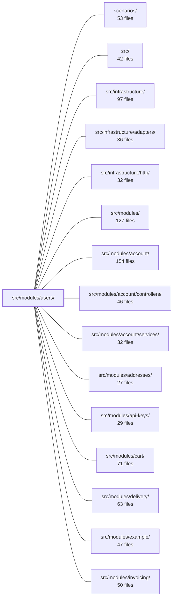

---
tags:
  - 2brain
  - 2brain/module
  - project/boilerplate-node-backend
type: module
module: src/modules/users/
files: 76
updated: 2026-10-29T19:29:37.733108+00:00
---

# src/modules/users/

## Purpose

The **users** module is the admin-facing domain boundary for user accounts. It owns the full lifecycle of a user record — creation, read, update, activation/banning, soft- and hard-delete, restoration, purchase holds, credential mutations, inactivity reaping, and PII re-encryption — and exposes a single typed service facade (`userService`) that the `account` module and other sibling modules consume for their account-level needs.

## Key parts

- **Model & persistence** — `model.ts` (Mongoose schema, password-hash hook, wire/stored interface bridge), `repository.ts` (all user-specific queries: credentials, MFA, OAuth linking, purchase-hold claims, reaping aggregations), `authenticatable.ts` (single-source filter + predicate for "may this account authenticate?").
- **Service layer** (`services/`) — the business-logic core, bundled by `services/index.ts` into the `userService` object. Sub-files cover: `read.ts` (search, retrieval, contract conversion), `create.ts` (admin creation), `activation.ts` (ban/unban), `remove.ts` (soft-delete, hard-delete, restore, scheduled-deletion lifecycle), `purchase-hold.ts` (time-boxed checkout block), `credentials.ts` (mutating password/MFA/OAuth fields), `audit-changes.ts` (field-level diff for the audit trail), `actions.ts` (per-caller permission flags), `reaper.ts` (inactivity lifecycle stages), `own-account.ts` (owner edit, reaper doors), `personal-data-subject.ts` (canonical identity for export/erasure), `reencrypt.ts` (key-rotation for phone/2FA), `image.ts` (post-commit digest enqueue), `lookups.ts` (read-only passes for the account module).
- **Controllers** (`controllers/`) — thin HTTP handlers for every admin endpoint (CRUD, activation, purchase-hold, restore). They validate input, delegate to `userService`, and shape responses.
- **Module wiring** — `module.ts` (AppModule manifest consumed by the kernel), `routes.ts` (Express router with auth/permission/rate-limit middleware), `index.ts` (public barrel; the only cross-module import surface), `events.ts` / `audit.ts` / `analytics.ts` (type-safe event & audit vocabularies via module augmentation), `config.ts` (PII key, email links), `emails.ts` (localised purchase-hold text), `erasure-registry.ts` (passive personal-data eraser list).
- **Scheduling** — `jobs.ts` / `jobs.generated.ts` (nightly purchase-hold reaping).
- **Contract & fixtures** — `openapi.yaml` (OpenAPI 3.1 spec), `factories.ts` (seed/test builders), `presenter.ts` (pure document → wire-contract mapper).

## How it connects

- **`src/modules/account/`** — The primary consumer. The account module's self-service flows (signup, login, profile edit, MFA, OAuth linking, personal-data export/erasure) call into `userService` and `userRepository` through the `users` module's public barrel. In return, `users` never imports `account` internals; the 2FA key ring, for example, is passed *in* by the caller (`reencrypt.ts`).
- **`src/modules/orders/services/`** — The orders module triggers automatic purchase holds after repeated buyer cancellations by calling the users purchase-hold service; the nightly reaper in `users` then expires those holds.
- **`src/modules/notifications/`** — Receives the `USER_SETUP_REQUESTED` domain event (fired on admin creation) and the purchase-hold email payload resolved by `emails.ts`.
- **`src/modules/webhooks/`** — Publishes the domain events declared in `events.ts` (e.g. `user.deactivated`, `USER_ERASED`) to external subscribers.
- **`src/modules/observability/`** — Consumes the analytics events (`analytics.ts`) and audit rows (`audit.ts`, `services/audit-changes.ts`) for admin dashboards.
- **`src/infrastructure/http/`** — Provides the shared Express helpers, error handlers, and response utilities that every controller in this module relies on.
- **`src/infrastructure/adapters/`** — Supplies the repository factory and storage adapters underlying `repository.ts`.
- **`scenarios/`** — Imports `factories.ts` to build seed accounts and test fixtures that mirror real schema defaults.
- **Other sibling modules** (`addresses`, `invoicing`, `products`, `returns`, `tickets`, `payments`, `delivery`, `api-keys`, `cart`) — Indirectly depend on `users` through the `account` module's personal-data export/erasure cascade and through the `authenticatable` gate that every authenticated route enforces.

## Where to start

1. **`model.ts`** — Reading the `UserRecord` schema, the `select: false` guards, and the wire↔document interface gives you the data shape everything else revolves around.
2. **`services/index.ts`** — This barrel shows the complete public surface of `userService` in one screen; from there you can jump into any sub-service (read, create, remove, purchase-hold, etc.) with context for what the module as a whole exposes.

## Connected modules

[[boilerplate-node-backend_ROOT|/ (repository root)]] · [[boilerplate-node-backend_scenarios|scenarios/]] · [[boilerplate-node-backend_src|src/]] · [[boilerplate-node-backend_src_infrastructure|src/infrastructure/]] · [[boilerplate-node-backend_src_infrastructure_adapters|src/infrastructure/adapters/]] · [[boilerplate-node-backend_src_infrastructure_http|src/infrastructure/http/]] · [[boilerplate-node-backend_src_modules|src/modules/]] · [[boilerplate-node-backend_src_modules_account|src/modules/account/]] · [[boilerplate-node-backend_src_modules_account_controllers|src/modules/account/controllers/]] · [[boilerplate-node-backend_src_modules_account_services|src/modules/account/services/]] · [[boilerplate-node-backend_src_modules_addresses|src/modules/addresses/]] · [[boilerplate-node-backend_src_modules_api-keys|src/modules/api-keys/]] · [[boilerplate-node-backend_src_modules_cart|src/modules/cart/]] · [[boilerplate-node-backend_src_modules_delivery|src/modules/delivery/]] · [[boilerplate-node-backend_src_modules_example|src/modules/example/]] · … and 10 more

## Files
- `src/modules/users/analytics.ts` — Defines the analytics event names emitted by the users module for admin-facing account lifecycle actions, and registers them into the app-wide `AnalyticsEventMap` type via module augmentation. It exists so that event emission is type-safe at the call site and so the analytics port's union stays a single source of truth.
- `src/modules/users/audit.ts` — Declares the complete set of audit action identifiers emitted by the `users` module and registers them into the app-wide `AuditActionMap` type via TypeScript module augmentation. This gives every service in the module a typed, single-source vocabulary for logging writes and reads to the user record.
- `src/modules/users/authenticatable.ts` — Defines the single source of truth for "may this account authenticate?" as a matched pair: a Mongo filter for queries and a predicate for documents already loaded. This guarantees that a path that *queries* for an account and a path that *checks* an in-hand document can never disagree about a banned or soft-deleted account.
- `src/modules/users/config.ts` — Declares the `users` module's runtime configuration: the PII encryption key under which personal fields are stored, and the two frontend links (contact and privacy) embedded in purchase-hold emails. It also exposes helper functions that turn those link fields into locale-aware URLs.
- `src/modules/users/controllers/activation.ts` — HTTP controller for `POST /users/:id/activate` and `POST /users/:id/deactivate`. It extracts the user id and caller context from the request, delegates the actual state change (validation, audit, session teardown) to `userService`, and serialises the resulting user into the response. All business rules (404, 403 for staff, 409 on repeat, audit logging) live in the service layer.
- `src/modules/users/controllers/create-user.ts` — HTTP handler for `POST /users` (staff create). Validates the incoming body against a strict Zod schema, resolves an optional image upload, delegates persistence to `userService.create`, and serialises the result through `userService.toUserContract` before sending a `201` response. It exists to keep the controller thin: all business logic lives in the service, all HTTP plumbing in `@infrastructure/http/*`.
- `src/modules/users/controllers/delete-users.ts` — Admin-only controller for `DELETE /users` (id in body) and `DELETE /users/:id` (path param). Supports soft delete by default and permanent hard delete via `?hardDelete=true`. It delegates all deletion logic to `userService` and records the outcome in an audit trail.
- `src/modules/users/controllers/get-user-item.ts` — Route handler for `GET /users/:id` — retrieves a single user document by path id and returns it as a serialised contract. Restricted to admin callers (enforced upstream by the route/authorization layer). Exists as a thin adapter between the HTTP surface and the user service.
- `src/modules/users/controllers/get-users.ts` — Admin-facing controller that handles `GET /users` (query-parameter search) and `POST /users/search` (body search). It validates incoming pagination and filter params against a Zod schema, delegates to `userService.search`, then enriches the resulting rows via `userService.toUserContracts` so each user carries its current role and the `actions` the caller's rank permits.
- `src/modules/users/controllers/purchase-hold.ts` — Thin HTTP controllers for two staff-facing endpoints: **PUT** `/users/:id/purchase-hold` (set or replace a manual checkout hold on an account) and **DELETE** `/users/:id/purchase-hold` (lift the hold and restart the cancellation count). All business rules — existence checks, staff-account 403s, audit logging — live in the service layer; these handlers only wire request → service → response.
- `src/modules/users/controllers/restore-users.ts` — Thin HTTP controller that handles `POST /users/:id/restore`, undoing an admin soft-delete of a user account. It delegates all business logic (restoration, audit emission, serialization) to `userService` and relies on the shared `createRestoreController` factory for request parsing, error handling, and response shaping.
- `src/modules/users/controllers/update-user.ts` — Thin controller layer for `PUT /users/:id` (full replace) and `PATCH /users/:id` (partial merge). It delegates all business logic to `userService.updateById` and only handles HTTP concerns: schema validation, avatar upload, and response shaping.
- `src/modules/users/emails.ts` — Resolves the single outbound email the `users` module can send (purchase-hold notice) into finished, localized strings. The recipient's locale is an argument; the return value is ready-to-interpolate text. Follows the same "resolved strings, not templates" rule as `@modules/account/emails`.
- `src/modules/users/erasure-registry.ts` — Holds the module-local lists of personal-data erasers and minimisers that the `users` module operates on. Because `users` cannot import from other `src/modules/*` packages (circular-dependency wall), this file acts as a passive registry: it stores whatever list the app tier injects at boot and exposes it to in-module consumers. It does not assemble, resolve, or own the eraser definitions itself.
- `src/modules/users/events.ts` — Declares the domain events emitted by the `users` module and registers their payload types into the kernel's app-wide `DomainEventMap` via TypeScript module augmentation. This keeps the event catalogue distributed across owning modules rather than enumerated in a shared file.
- `src/modules/users/factories.ts` — Builder for user fixtures used by seed accounts (`scenarios/users.ts`) and tests. It intentionally omits schema-defaulted fields (`active`, `locale`, `verifiedAt`, `imageUrl`) so a seeded row reflects what the Mongoose schema actually does. The password is kept plaintext here; hashing is delegated to the model's pre-save hook.
- `src/modules/users/index.ts` — Public barrel (module boundary) for the `users` module. It is the **only** import surface available to sibling modules, enforcing the strategic-DDD rule that cross-module access goes through an explicit facade. It re-exports the service layer, the event definitions, and the schema's Zod types while keeping `userRepository` and the model's runtime strictly internal.
- `src/modules/users/jobs.generated.ts` — Machine-generated data definitions for the users module's scheduled jobs. It declares *what* jobs exist (name, cron schedule, human-readable summary) without containing their execution logic. The file is produced by `npm run regenerate` from `src/modules/users/module.yaml` and must not be edited directly.
- `src/modules/users/jobs.ts` — Declares the scheduled jobs owned by the `users` module. Currently a single job — the nightly reaping of expired purchase holds — is registered here so the scheduler can discover and execute it.
- `src/modules/users/model.ts` — Defines the Mongoose record shape (`UserRecord`) and its supporting subdocument interfaces for the user collection. It intentionally lives in a single file so the `pre-save` password-hash hook and the `select: false` guard on `password` (and `pendingEmail`/`previousEmail`) cannot be separated. The interface bridges the wire `User` contract (ISO-string dates, no internal fields) and the stored document (real `Date`s, internal-only columns).
- `src/modules/users/module.ts` — Module manifest for the **users** domain: admin-facing search, read, write, and soft-delete of user records. It wires together routing, personal-data erasure hooks, public webhook events, a `USER_ERASED` analytics subscription, image writeback, and PII re-encryption into a single `AppModule` object consumed by the kernel registry at startup.
- `src/modules/users/openapi.yaml` — OpenAPI 3.1.0 contract for the **users** module: it defines every HTTP endpoint for managing user accounts (list, create, read, replace, delete, activate/deactivate/restore), the module-specific 409 error codes, the "Users" tag, and the slice of the account data export that the bundler merges into `AccountExportResponse`.
- `src/modules/users/presenter.ts` — The single presentation (shaping) layer for the users module: it converts a stored `UserWire` document into the public `Account` or `User` wire contract. It enforces the persistence wall — controllers reach the model only through the service, and the service delegates the actual field-mapping here. The file is pure: no I/O, no lookups, no rule evaluation; it only reshapes already-resolved data.
- `src/modules/users/repository.ts` — Persistence layer for the `users` collection. It combines the generic CRUD provided by the repository factory with every user-specific query the `account` module needs: credential reads, MFA / delivered-code operations, OAuth account linking, activity stamping, inactivity-reaping aggregations, purchase-hold claims, and the scheduled-deletion lifecycle. It exists so that all of those concerns live in one module instead of being scattered across service code.
- `src/modules/users/routes.ts` — Defines the admin-only Express router for `/users` CRUD, activation, purchase-hold, and hard-delete operations. Wires each endpoint to its controller with the appropriate authentication, permission, caching, rate-limit, and fresh-auth middleware so that sensitive writes (role changes, account activation) demand re-authentication while reads stay cacheable per RFC 9111.
- `src/modules/users/services/actions.ts` — Computes the `User.actions` block — a set of boolean flags telling a client exactly which operations a given caller may perform on a given account. By folding route-level rules (`heldRules`), staff-account protection (`mayChangeAccount`), and the account's own state into one pure calculation, the UI never offers a move the server would refuse.
- `src/modules/users/services/activation.ts` — Implements account activation and deactivation (unban / ban). Deactivation is treated as a hard ban: it ends every session the account holds and emits a `user.deactivated` domain event, all within a single database transaction. Both operations reject a no-op repeat with a 409 rather than returning a misleading success.
- `src/modules/users/services/audit-changes.ts` — Computes the field-level diff produced by a user account edit (admin or owner) into audit-row metadata, applying a privacy rule: identifying fields are logged by name only, preference fields by value. This exists because the audit collection is append-only and never scrubbed on erasure, so what is recorded must be chosen deliberately.
- `src/modules/users/services/create.ts` — Admin-side user creation. An operator creates a user account (not the self-service `accountService.signup` path). The function assigns a random password the owner must later reset, optionally grants a staff role, fires a `USER_SETUP_REQUESTED` outbox event, and records audit + analytics — all committed atomically.
- `src/modules/users/services/credentials.ts` — The write-side (mutation) layer for account credential operations. Each export is a single, narrow mutation applied to an already-loaded `UserDocument`; callers own validation, role promotion, session purging, and transaction boundaries. The file deliberately keeps "what changed" in the document and "what gets persisted" in the repository, so that a loaded copy always mirrors stored state after a write.
- `src/modules/users/services/image.ts` — Provides the post-persistence hand-off that enqueues the image-digest job for a user whose write carried a pending upload. It exists so that the digest work is deferred until the transaction has committed, guaranteeing the account is saved regardless of whether the enqueue succeeds.
- `src/modules/users/services/index.ts` — Barrel and public-surface file for the **users** domain service. It re-exports every sub-module (read, credentials, signup, reaper, purchase-hold, etc.) and bundles them into a single `userService` object. The `account` module's controllers and services call through this object; they never import the individual sub-files directly.
- `src/modules/users/services/lookups.ts` — Read-side lookup functions for the `account` domain (shared kernel). Each export is a thin, named pass-through to `userRepository`, scoped to a single question the caller is asking. The file deliberately contains **no** writes; mutation operations live elsewhere and are designed to take only the fields their specific caller possesses.
- `src/modules/users/services/own-account.ts` — Provides the "owner-facing" and "reaper-facing" doors into user records: an account editing its own profile, the inactivity reaper's soft-delete/erase cycle, and the owner-scheduled deletion lifecycle (lock → grace → restore or purge). It wraps the `@internal` `update` and `remove` services—both of which skip the ban-check and staff-protection guards the admin doors enforce—with the additional invariants that each caller type requires.
- `src/modules/users/services/personal-data-subject.ts` — Provides a single, canonical way to derive the "subject" (identity + verification status) of the account a personal-data export or erasure targets. By funneling both the export path and the erasure cascade through this one function, every downstream `personalData` section receives the same `PersonalDataSubject` shape regardless of which operation is running.
- `src/modules/users/services/purchase-hold.ts` — Implements the "purchase hold": a time-boxed block on **new checkout** for a single account so a human can intervene before a bot or runaway loop causes damage. Can be set manually by staff or triggered automatically after repeated buyer cancellations (owned by the `orders` module). A hold is "in force" purely by clock (`until > now`), so no TTL daemon is needed for correctness. The hold never blocks paying existing orders, cancelling, withdrawals, returns, or data-rights requests—checkout is the only gate that consults it.
- `src/modules/users/services/read.ts` — Read-side service for the users module. Exposes admin search, single-document retrieval, staff-contact resolution for notifications, and the conversion of persisted user documents into the API `User` contract (role + permitted actions). It sits between the repository/persistence layer and the HTTP handlers, keeping write-mutation logic in `actions.ts`.
- `src/modules/users/services/reaper.ts` — Provides the per-stage read queries and the personal-data minimisation step for the inactivity reaper. Each exported function corresponds to one stage of the reaper's lifecycle (warn → soft-delete → hard-delete → minimise) and always excludes staff/administrator accounts before returning results.
- `src/modules/users/services/reencrypt.ts` — Provides the user-side re-encryption operations used by the ops script (`@infrastructure/security/reencrypt`) to rotate phone numbers and 2FA secrets onto newer encryption keys. It deliberately keeps the `users` module free of any `account` import: the 2FA key ring is passed in by the caller rather than fetched here.
- `src/modules/users/services/remove.ts` — Implements the full lifecycle of user deletion and restoration: soft delete (timestamp stamp), hard delete (erasure cascade + row removal), restore of soft-deleted accounts, and cancellation of a scheduled (owner-initiated) deletion before its grace period expires. All state changes are transactional where needed, and every mutation is paired with an audit row and, for hard delete, an outbox event.
- `src/modules/users/services/role-refusal.ts` — Maps a `GrantRefusal` produced by the access layer into the appropriate HTTP rejection payload (403 or 422) so that the admin create and update user flows can share a single, consistent "role could not be granted" response.
- `src/modules/users/services/sign-in-methods.ts` — Builds the `signInMethods` section of a GDPR Art. 15 account data export. It reports *which* sign-in methods an account holds (linked OAuth providers, armed 2FA methods) without exposing any secret material. It is a separate section from the main `profile` export because the underlying fields (`oauthAccounts`, `twoFactorMethods`) live behind `select: false` on the User document and would not appear in a plain profile projection.
- `src/modules/users/services/signup.ts` — Service-layer entry points for account creation across four flows (self-service, OAuth-vouched, anti-automation decoy, and OAuth link/unlink). Each flow gets its own narrowly-typed field set so that compile-time errors catch a caller passing fields that only another flow is allowed to set.
- `src/modules/users/services/update.ts` — Admin-side user update: assigns field values on the user document, handles the staff-role membership change, saves both atomically in a transaction, and enqueues the GDPR Art. 19 rectification announcement. It is the single write path shared by `updateById` (staff editing another user) and `updateOwnProfile` (self-service), centralising PII encryption, image writeback, and audit in one place.
- `src/modules/users/tests/contract/api.contract.test.ts` — Contract tests for the `/users` and `/account` HTTP surface. Their primary job is the **credential-leak guard**: because `openapi.yaml` declares `additionalProperties: false` on the `User` schema, any undeclared field (a plaintext password, an argon2 hash, a raw phone) that sneaks into a response body is caught here regardless of whether anyone thought to name it explicitly. Secondary duties include asserting PUT full-replace semantics, the `no-store` cache header on `/account`, and that admin-created accounts never accept a `password` or `sendSetupEmail` field.
- `src/modules/users/tests/factories.ts` — Test factory for the users module that persists users into the test database. It wraps the plain-payload `makeUser` from `../factories` (so there is exactly one builder) and adds DB insertion, role/membership seeding, and password-vocabulary constants. It exists so account and access tests can create realistic, persisted user fixtures without duplicating persistence logic.
- `src/modules/users/tests/integration/admin-user-grant-atomicity.test.ts` — Integration tests that verify the atomicity contract between user write and role (membership) grant: if the membership write fails, no partial user row is left behind, and a refused escalation is still audited. Covers both `userService.create` and `userService.updateById`.
- `src/modules/users/tests/integration/authenticatable.test.ts` — Integration test that verifies two code paths never disagree about whether a user may authenticate: the Mongo query filter (`AUTHENTICATABLE_FILTER`) and the in-memory predicate (`isAuthenticatable`). It exercises all four flag combinations (active/banned × live/soft-deleted) against a real database, plus edge cases like an explicit `null` for `deletedAt` and the `linkOAuthAccount` write-once semantics.
- `src/modules/users/tests/integration/erasure-announce.test.ts` — Integration tests verifying that the `user.erased` outbox event is written (or withheld) correctly across every hard-delete path in the users module, and that the analytics provider's `forget` is the sole downstream consumer. PostHog is never called directly; only the resolved provider interface is observed.
- `src/modules/users/tests/integration/erasure-roles.test.ts` — Integration test proving that a hard-delete removes a user's roles atomically via the `access` module's erase hook, and that the account (with its roles) survives if a *later* erasure hook throws. Drives the real HTTP endpoint so the module registry builds erase hooks the same way a deployment does.
- `src/modules/users/tests/integration/external-key-lookups.test.ts` — Integration tests proving that user-lookup methods keyed on externally supplied values (email, OAuth subject) reject MongoDB query operators (e.g. `{"$ne": null}`) when they arrive where a plain string is expected, rather than silently matching all documents. The file documents that the cast-to-string path is the last line of defence if Zod validation is bypassed.
- `src/modules/users/tests/integration/hierarchy.test.ts` — Integration tests that verify the role-hierarchy rules enforced by `userService` when one account modifies another: which callers may activate/deactivate, edit, delete, restore, or assign/remove a role on a target that holds a staff role. Tests are driven at the service layer (not the HTTP route) so each case names the caller's role and the target's held role explicitly.
- `src/modules/users/tests/integration/image-clear.test.ts` — Integration test verifying that setting `imageUrl: null` on a user unsets both `imageUrl` and `thumbnailUrl` on the stored document **and** deletes the actual avatar + thumbnail files from disk. It uses a real temp directory and a real database (not mocks) so it can assert *which* files are removed after the save lands.
- `src/modules/users/tests/integration/minimise.test.ts` — Integration test for the inactivity-minimisation flow: it verifies that accounts quiet past a configurable window lose their address book, start the PII clock on their orders, retain login credentials and order records, and receive an `inactivityMinimisedAt` stamp. It also covers edge cases (banned accounts, idempotent reruns, re-activation cycles, and hook-failure retry).
- `src/modules/users/tests/integration/model.test.ts` — Integration tests that verify two independent safeguards against credential leakage in user responses: Mongoose `select: false` (prevents loading) and `applyUserTransform` (strips at serialization). Also asserts email case-normalisation and the exact shape of the serialised User contract.
- `src/modules/users/tests/integration/profile-changed-announce.test.ts` — Integration test verifying the `user.profile_changed` outbox event that backs the `user.updated` webhook. It asserts *when* the event is emitted (admin edit, self-edit, email confirmation/undo), *when it is suppressed* (no-op writes, preference-only changes), and that the payload always names changed fields but never carries their values.
- `src/modules/users/tests/integration/purchase-hold.test.ts` — Integration tests for the purchase-hold feature on user records. Covers the two staff actions (set and lift a hold), the system's automatic/nightly sweep entry point, the review-flag outbox announcements, staff permission gating, and the audit rows each write produces. Runs against a real test database rather than in-memory fakes.
- `src/modules/users/tests/integration/reaper.test.ts` — Integration tests for the inactivity reaper — the three-stage process (warn → soft-delete → hard-delete) that takes long-idle **customer** accounts offline. The file's core invariant: staff, admin, and platform-operator accounts are never candidates at any stage, regardless of activity.
- `src/modules/users/tests/integration/reencrypt.test.ts` — Integration test for the `reencrypt` walk in the users module. It verifies that, after a PII encryption key rotation, a phone value still stamped with the old key version (`v1`) is rewritten to the new version (`v2`). It asserts both the reported rewrite count and the actual version stamp visible in the raw collection data.
- `src/modules/users/tests/integration/repository.test.ts` — Integration test suite for `userRepository`, exercising the full CRUD surface plus the `writebackImage` method against an in-memory MongoDB instance. It verifies both happy paths and edge cases (null returns, pagination options, filter behavior, password hashing, idempotent image write-back) so that the repository contract is pinned before any consumer depends on it.
- `src/modules/users/tests/integration/scheduled-deletion.test.ts` — Integration tests (run against a real database) for the owner-scheduled deletion lifecycle: scheduling a deletion with a `purgeAt` grace period, restoring within that grace, and erasing once the grace has expired. The suite specifically validates the concurrency invariants—conditional restore vs. unconditional erase—that a unit-level mock would not exercise.
- `src/modules/users/tests/integration/schema-contract.test.ts` — Integration test that verifies the **declarations** of the user Mongoose schema — `select: false` on credentials, password hashing, serialization shape, and the `unique` email index — against a real MongoDB instance. These are Mongoose-level behaviors (not application logic), so a mocked model would only assert the mock's opinion and provide no real coverage.
- `src/modules/users/tests/integration/service-oauth.test.ts` — Integration tests for `userService.findByOAuthIdentity`, the first lookup executed on every OAuth callback (see `account/services/oauth.ts`). The tests verify that the method resolves a valid linked account and correctly rejects deactivated, soft-deleted, or nonexistent identities, ensuring a deactivated or deleted user cannot walk into a session simply because an OAuth identity is still linked.
- `src/modules/users/tests/integration/service.test.ts` — Integration test suite for `userService` exercising search, getById, and the admin create/update/delete flows against an in-memory Mongo instance wired up by `setupTestDb`. It verifies business logic end-to-end (validation, filtering, role assignment, post-commit side effects) without a live database or real infrastructure adapters.
- `src/modules/users/tests/integration/session-epoch-lifecycle.test.ts` — Integration tests verifying that an admin deactivating or soft-deleting an account advances its session epoch so that previously issued tokens remain invalid after a subsequent reactivation or restore (ASVS V7.4.2). Without the epoch, clearing `active` or `deletedAt` alone would resurrect every old token. All assertions are driven over HTTP.
- `src/modules/users/tests/integration/sign-in-methods.test.ts` — Integration tests for `userService.exportSignInMethods`, verifying that the export section returns only non-sensitive "facts" about a user's sign-in methods (linked OAuth providers, armed two-factor methods) and never leaks secrets, in-flight codes, or backup-code digests.
- `src/modules/users/tests/integration/staff-contacts.test.ts` — Integration tests for `userService.staffContacts`, which filters a list of member IDs down to those who can actually act on a staff notice. The rule under test: a contact must have an armed authenticator and must not be banned (`active: false`) or deleted (`deletedAt` set). The file exists to lock in that filtering logic end-to-end against a real database.
- `src/modules/users/tests/integration/two-factor-writes.test.ts` — Integration tests for the two-factor write path on the user service. The file verifies that `persistTwoFactorMethods`, `spendBackupCode`, and the derived "armed" flag behave correctly under concurrent-write conditions — i.e., when two loaded copies of the same account write in turn, each write touches only the methods/fields it changed, never clobbering a value another request already settled.
- `src/modules/users/tests/integration/update-audit.test.ts` — Integration test verifying the privacy contract of the `ADMIN_USER_UPDATED` audit row: non-identifying preferences (e.g. `locale`) are recorded by value, while personal identifiers (e.g. `phone`, `email`) appear only as field names in `changedFields`. Because the audit collection is never scrubbed on erasure, this test guards against accidentally persisting PII into audit metadata.
- `src/modules/users/tests/unit/actions.test.ts` — Unit tests for `userActionsFor`, the pure permission-resolver that maps (caller role, account state) → a boolean action-flag object. Each test pins one cell of that table in isolation, without HTTP routes or a database. The module docstring positions this file as the "pure table" complement to a separate users contract suite that exercises the same logic over real routes.
- `src/modules/users/tests/unit/factories.test.ts` — Unit tests for the `makeUser` fixture builder and the shared password test constants. Guards that the fixture produces insertable users, respects override semantics, and that the password vocabulary actually satisfies the real signup policy and avoids the bundled breach list.
- `src/modules/users/tests/unit/mark-sessions-ended.test.ts` — Unit tests for the `markSessionsEnded` service function, verifying the single invariant that the `tokensValidAfter` epoch on a user document can only advance forward in time and is never pushed backward.
- `src/modules/users/tests/unit/public-events.test.ts` — Verifies the privacy contract of the users module's public-event projections: that webhook subscribers receive only identifiers (and field names), never sensitive values. Each test pulls a projection from the module's `publicEvents` registry, feeds it a representative domain-event payload, and asserts the resulting `{ eventType, data }` shape.
- `src/modules/users/tests/unit/routes.test.ts` — Unit test suite that pins down the user-administration router's contract: exact endpoint set and mount order, per-route authorization guard chain, cache-header policy, and upload-validation wiring. It exists so that a new route added above the shared `use(getAuth, isAuthOrCredential)` line, or a route that silently loses its permission guard, is caught immediately rather than at review time.
- `src/modules/users/tests/unit/schema-contract.test.ts` — Contract tests for the `userSchema` Mongoose definition. Because this is the most security-sensitive schema in the codebase (password hashing, credential leakage, OAuth identity, uniqueness invariants), these tests pin down the schema's *declarative* guarantees—required paths, field defaults, `select: false` layers, index specs, and the pre-save hook's behavior—without touching a database or issuing real Mongoose saves.
- `src/modules/users/two-factor-write.ts` — Models a two-factor-authentication write as an explicit, per-field diff plan (`TwoFactorWrite`) and the MongoDB aggregation pipeline that applies it as a single atomic `updateOne`. It replaces a naive whole-array `$set` that would replay stale TOTP steps (RFC 6238 §5.2) and cause version-conflict failures when two requests touch different methods.

---
[[boilerplate-node-backend_INDEX|← boilerplate-node-backend index]]
