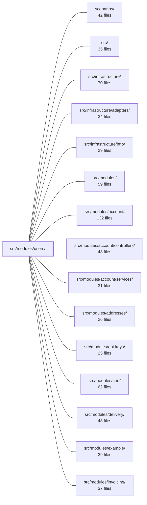

---
tags:
  - 2brain
  - 2brain/module
  - project/boilerplate-node-backend
type: module
module: src/modules/users/
files: 54
updated: 2026-10-15T13:42:11.337682+00:00
---

# src/modules/users/

## Purpose

The `users` module owns the user-account domain end-to-end: the Mongoose schema and document shape, admin-facing CRUD (create, read, update, soft/hard-delete, restore), the credential and 2FA write surface shared with the `account` module, the inactivity-reaper lifecycle, PII encryption/decryption, and GDPR personal-data erasure and minimisation. It exposes a single barrel (`index.ts`) as the only import surface visible to sibling modules, enforcing the strategic-DDD rule that cross-module coupling flows through one file.

## Key parts

- **Model & persistence** — `model.ts` (Mongoose schema, sub-documents, pre-save password-hash hook, `select: false` fields), `repository.ts` (all user-collection I/O: CRUD, search, credential/token/MFA operations), `authenticatable.ts` (single source of truth for "may this account log in?", expressed as both a Mongo filter and an in-memory predicate).
- **Service layer** — `services/index.ts` aggregates the sub-services into the `userService` facade. Sub-files split by concern: `create.ts`, `update.ts`, `remove.ts` (admin writes), `read.ts` / `lookups.ts` (admin reads vs. account-context reads), `credentials.ts` (atomic credential/2FA writes), `signup.ts` (self-service and OAuth-vouched account creation), `reaper.ts` (inactivity lifecycle stages), `reencrypt.ts` (key-rotation for PII), `image.ts` (post-write image-digest queueing), `sign-in-methods.ts` (GDPR Art. 15 export section).
- **HTTP surface** — `routes.ts` wires the Express router with auth, rate-limit, caching, and upload middleware; `controllers/` holds one thin handler per endpoint (create, update, delete, restore, get-item, get-list) that delegates all domain logic to the service layer. `openapi.yaml` is the single source of truth for the HTTP contract.
- **Presentation & contracts** — `presenter.ts` is the sole mapping point from `UserDocument` → public `User` wire contract (date ISO-stringification, PII decryption, permission resolution, version stamping). `analytics.ts`, `audit.ts`, and `events.ts` register the module's event vocabulary into app-wide type maps.
- **Module wiring** — `module.ts` assembles routes, repository, services, PII hooks, and erase/minimise/re-encrypt hooks into the `AppModule` the kernel registry consumes at boot. `config.ts` enforces the `NODE_PII_ENCRYPTION_KEY` requirement. `erasure-registry.ts` passively holds the cross-module eraser/minimiser lists injected at boot (resolving the circular-import wall).
- **Test infrastructure** — `factories.ts` (payload builder), `tests/factories.ts` (DB-persisting variants), and integration/contract test suites covering model invariants, erasure transactions, hierarchy rules, image cleanup, minimisation, and API credential-leak guards.

## How it connects

- **`src/modules/account/`** — The `account` module (self-service login, signup, session management) is the primary consumer of `users`. It imports *only* through `users/index.ts`, calling the service facade for credential writes (`credentials.ts`), lookups (`lookups.ts`), signup flows (`signup.ts`), and reaper actions. Conversely, `users` never imports from `account`; the 2FA key ring and role-management hooks are passed in by callers or injected at boot.
- **`src/infrastructure/` & `src/infrastructure/adapters/`** — PII encryption/decryption, the shared security adapter (key-ring shape), HTTP middleware (auth, rate-limiting, file upload), and the shared repository factory all live here and are consumed by `users`'s repository, presenter, and routes.
- **`src/infrastructure/http/`** — Provides the Express middleware stack and the `createUpdateController` / `createRestoreController` factories that `controllers/` compose.
- **`src/modules/` (kernel / module registry)** — Consumes the `AppModule` export from `users/module.ts` at boot, assembling the erase-hook and minimise-hook chains that cross module boundaries (addresses, orders, cart, etc. register their erasers into `erasure-registry.ts` so a hard delete in `users` cascades correctly).
- **`scenarios/`** — Uses `users/factories.ts` to build seed-account rows for end-to-end scenarios.
- **Other domain modules (orders, addresses, payments, etc.)** — Participate in the user's GDPR lifecycle by registering personal-data erasers and minimisers that the `users` reaper and hard-delete path invoke; they never call `users` directly for those hooks (the registry indirection prevents circular imports).

## Where to start

1. **`model.ts`** — Reading the Mongoose schema and `UserRecord` interface first gives you the authoritative shape of a user document, the `select: false` credential fields, and the pre-save hashing hook. Every other file in the module either writes to, reads from, or projects this shape.
2. **`services/index.ts`** — The facade that aggregates all sub-services into `userService`. Tracing the re-exports here shows the full API surface that controllers and the `account` module rely on, and makes the layering (controller → service → repository → model) concrete before you dive into any single operation.

## Connected modules

[[boilerplate-node-backend_ROOT|/ (repository root)]] · [[boilerplate-node-backend_scenarios|scenarios/]] · [[boilerplate-node-backend_src|src/]] · [[boilerplate-node-backend_src_infrastructure|src/infrastructure/]] · [[boilerplate-node-backend_src_infrastructure_adapters|src/infrastructure/adapters/]] · [[boilerplate-node-backend_src_infrastructure_http|src/infrastructure/http/]] · [[boilerplate-node-backend_src_modules|src/modules/]] · [[boilerplate-node-backend_src_modules_account|src/modules/account/]] · [[boilerplate-node-backend_src_modules_account_controllers|src/modules/account/controllers/]] · [[boilerplate-node-backend_src_modules_account_services|src/modules/account/services/]] · [[boilerplate-node-backend_src_modules_addresses|src/modules/addresses/]] · [[boilerplate-node-backend_src_modules_api-keys|src/modules/api-keys/]] · [[boilerplate-node-backend_src_modules_cart|src/modules/cart/]] · [[boilerplate-node-backend_src_modules_delivery|src/modules/delivery/]] · [[boilerplate-node-backend_src_modules_example|src/modules/example/]] · … and 9 more

## Files
- `src/modules/users/analytics.ts` — Declares the analytics event names for the user module's administrative actions and registers them into the app-wide `AnalyticsEventMap` type so that emitters (e.g. `service.ts`) can reference them in a type-safe, stringly-typed-free way. The events distinguish operator-initiated account actions from the self-signup path (`USER_SIGNED_UP`) so that dashboards can sum or split them independently.
- `src/modules/users/audit.ts` — Declares the audit-action vocabulary owned by the users module and registers it into the app-wide `AuditActionMap` type via TypeScript module augmentation. Every write (and one targeted read) that the users module performs emits one of these action strings into the audit log.
- `src/modules/users/authenticatable.ts` — Defines the single canonical rule for "may this account authenticate?" in two equivalent forms: a MongoDB filter for query-time lookups and a boolean predicate for documents already in hand. By deriving both from the same logic, query paths and in-memory checks cannot diverge on the state of a banned or soft-deleted account.
- `src/modules/users/config.ts` — Defines the `users` module's configuration schema. Its single responsibility is to **require** (via presence validation) the `NODE_PII_ENCRYPTION_KEY` environment variable that protects personal fields such as phone numbers. The shape of that key lives in the shared security adapter; this file owns the *requirement* so that deleting the `users` module removes the requirement.
- `src/modules/users/controllers/create-user.ts` — Request handler for `POST /users` (staff-initiated user creation). Validates the incoming body against a strict Zod schema, resolves server-side image-upload fields, delegates persistence to `userService`, and serialises the response. It is the "create" half of the user write surface; the counterpart lives in `update-user.ts`.
- `src/modules/users/controllers/delete-users.ts` — Admin-only controller for `DELETE /users` (id in body) and `DELETE /users/:id` (path param). Supports soft delete by default and permanent hard delete via `?hardDelete=true`. It delegates all deletion logic to `userService` and records the outcome in an audit trail.
- `src/modules/users/controllers/get-user-item.ts` — HTTP controller for `GET /users/:id`, restricted to admin callers. It fetches a single user by path id, records a staff-read audit event, and returns the user shaped through the standard contract. Exists to keep the users module's read endpoint thin and auditable while delegating data access and serialization to the service layer.
- `src/modules/users/controllers/get-users.ts` — Controller that exposes the admin-facing `GET /users` endpoint (and its `POST /users/search` counterpart) for listing and searching users via query parameters or a JSON body. It delegates the actual lookup to the users service and post-processes results into per-caller contracts before returning.
- `src/modules/users/controllers/restore-users.ts` — Thin controller that wires the `POST /users/:id/restore` endpoint (admin-only) to the user service. It delegates the actual restore logic and response shaping to `userService`, while relying on the shared `createRestoreController` factory for request validation, 404/409 handling, and audit-emit conventions.
- `src/modules/users/controllers/update-user.ts` — Builds the `PUT /users/:id` (full replace) and `PATCH /users/:id` (partial merge) HTTP handlers for the users module by calling the shared `createUpdateController` factory. All domain logic is delegated to `userService`; this file only wires schemas, input coercion, avatar-upload handling, and response shaping.
- `src/modules/users/erasure-registry.ts` — Holds the module-local lists of personal-data erasers and minimisers that the `users` module operates on. Because `users` cannot import from other `src/modules/*` packages (circular-dependency wall), this file acts as a passive registry: it stores whatever list the app tier injects at boot and exposes it to in-module consumers. It does not assemble, resolve, or own the eraser definitions itself.
- `src/modules/users/events.ts` — Declares the domain events owned by the users module by augmenting the kernel's `DomainEventMap` interface, so the event catalogue grows per-module without a shared enumeration file.
- `src/modules/users/factories.ts` — Builds user-row fixtures for seed accounts (`scenarios/users.ts`) and any test that needs a person. It deliberately leaves `imageUrl`, `locale`, `active`, and `verifiedAt` to the schema defaults in `./model` so a seeded row mirrors what the schema actually produces. The password stays plaintext through the builder; the model's pre-save hook handles hashing before the row reaches Mongo.
- `src/modules/users/index.ts` — Public barrel for the `users` module. It is the **only** import surface exposed to sibling modules (per the rule in `docs/theory/strategic-ddd.md` §5). The `account` module imports exclusively through this file; no other entry point exists.
- `src/modules/users/model.ts` — Defines the Mongoose schema, document interface, and all sub-document types (`TwoFactorMethodRecord`, `OAuthAccount`, `DeliveredCodeState`) for the user account. It is deliberately a single file so the pre-save password-hash hook and the `select: false` field remain co-located. The `UserRecord` interface is the authoritative shape of what a Mongoose user document holds, bridging the wire `User` contract (ISO strings) to real `Date` values in the database.
- `src/modules/users/module.ts` — Module manifest for the `users` domain: admin-facing search, read, write, and soft-delete of user records. It wires together the module's routes, repository, services, PII encryption, and personal-data lifecycle hooks (erase, minimise, re-encrypt) into a single `AppModule` export that the kernel registry consumes at boot.
- `src/modules/users/openapi.yaml` — OpenAPI 3.1.0 contract for the **users** module. It declares the HTTP surface (list, create, delete, fetch, replace, edit, restore users) along with the schemas and query parameters that implement it, so that client code, docs, and the account-data-export bundler all derive from a single source of truth.
- `src/modules/users/presenter.ts` — The single mapping point that turns a stored account document (`UserWire` / `UserDocument`) into the public `User` contract: ISO-stringifies date fields, decrypts PII, resolves the caller's permission actions, and wraps the result in `carryVersion`. It enforces the "persistence wall" — controllers reach user data only through `userService.toUser` / `toUserContract`, never `./model` directly.
- `src/modules/users/repository.ts` — Persistence layer for the user collection. It combines the shared repository factory (standard CRUD + search) with the credential, token, MFA, and inactivity-tracking operations that the `account` module needs across the shared-kernel boundary, keeping all user-document I/O in one file.
- `src/modules/users/routes.ts` — Defines the Express `Router` for the admin-only `/users` resource: search, list, create, read-by-id, replace, patch, soft/hard delete, and restore. It wires each route to the correct authorization, caching, rate-limit, and upload middleware, then delegates business logic to the `controllers/` functions.
- `src/modules/users/services/create.ts` — Admin-side user creation: writes a new user document, grants a role membership, and emits a setup-request event — all in a single MongoDB transaction. Unlike the self-service `accountService.signup` path, the caller supplies the email and role; the password is never accepted from the client and is generated as an unguessable random value the owner must later replace via a reset link.
- `src/modules/users/services/credentials.ts` — Write-side credential mutations for the shared kernel. Each exported function is a single, narrow atomic write (or no-op) against a user document—setting passwords, stamping verification, swapping emails, persisting 2FA state, and spending/record-ing delivered codes. The file intentionally handles *only* the document-level write; account-level side effects (role promotion, token revocation, session-ending policies) are the caller's responsibility.
- `src/modules/users/services/image.ts` — Thin service wrapper that queues a background image-digest job for a user document immediately after it has been persisted, but only when that write carried a pending image upload (`pendingImageKey`). It exists so that `create` and `update` flows can trigger the digest in one call without duplicating the queue-logic.
- `src/modules/users/services/index.ts` — Barrel and service-facade for the users module. It aggregates admin CRUD, search, credential/2FA, signup, and reaper operations from the sub-files into a single `userService` object, and re-exports each function individually. Account controllers and services call through this surface; they never import the sub-files or the presenter directly.
- `src/modules/users/services/lookups.ts` — Read-side of the shared kernel for the `account` context. Provides a small set of purpose-named lookup functions that are thin pass-throughs to `userRepository`, each named for the question it answers (login, OAuth linking, pending-email, duplicate check) rather than the underlying query shape. The design constraint is that no raw write or arbitrary-filter handle is published here — only the specific fields a caller actually needs are exposed.
- `src/modules/users/services/read.ts` — Read-only service layer for user lookups used by the admin panel. It wraps the user repository to provide search, single-fetch by ID, and find-by-email operations, returning either DTO-friendly (`UserWire`) or full-document (`UserDocument`) shapes depending on the caller's needs.
- `src/modules/users/services/reaper.ts` — Provides the per-stage query and action functions for the inactivity reaper: finding candidates at each lifecycle stage (warn → soft-delete → hard-delete → personal-data minimisation) and executing the minimise step. A shared `customersOnly` guard ensures only accounts at the `user` access level are ever returned or acted upon.
- `src/modules/users/services/reencrypt.ts` — Provides the user-side re-encryption operations used by the ops script (`@infrastructure/security/reencrypt`) to rotate phone numbers and 2FA secrets onto newer encryption keys. It deliberately keeps the `users` module free of any `account` import: the 2FA key ring is passed in by the caller rather than fetched here.
- `src/modules/users/services/remove.ts` — Service layer for user removal and restoration. Handles soft delete (stamp `deletedAt`), hard delete (erasure cascade + document deletion + image cleanup), and restore (undo soft delete). Exists as the single choke-point where an account's lifecycle transitions to "gone" or "back," ensuring audit, access-control, and data-erasure concerns are co-located.
- `src/modules/users/services/sign-in-methods.ts` — Builds the `signInMethods` section of a GDPR Art. 15 account data export. It reports *which* sign-in methods an account holds (linked OAuth providers, armed 2FA methods) without exposing any secret material. It is a separate section from the main `profile` export because the underlying fields (`oauthAccounts`, `twoFactorMethods`) live behind `select: false` on the User document and would not appear in a plain profile projection.
- `src/modules/users/services/signup.ts` — Service layer for all account-creation paths: self-service signup, OAuth-vouched signup, the anti-automation decoy, and OAuth link/unlink. Each path is given a narrowly-typed field set (`Pick<UserDocument, …>`) so that compile-time errors catch a caller mixing up which fields are legal for which flow. All persistence is delegated to `userRepository`; this file adds no business logic beyond the type boundary.
- `src/modules/users/services/update.ts` — Admin-side update of a single user document. Applies field changes (username, active, avatar, locale, phone, website, analytics consent), optionally grants a new role, and returns a typed success/reject envelope. Enforces per-field permission keys, PII encryption, optimistic-concurrency preconditions, and audit/telemetry for every mutation.
- `src/modules/users/tests/contract/api.contract.test.ts` — Contract tests that act as a credential-leak guard for the user-facing API (`/users`, `/account`). Because `openapi.yaml` declares `additionalProperties: false` on the `User` schema, any undeclared field (a plaintext password, an argon2 hash, a consent flag) in a response body fails here regardless of whether a test author thought to name it. The file also pins semantic contracts: correct status codes, PUT-as-full-replace behavior, and the requirement that `GET /account` sends `Cache-Control: no-store`.
- `src/modules/users/tests/factories.ts` — Test-database persistence layer for user fixtures. It re-exports the plain-payload builder (`makeUser`) from `../factories` and adds `createUser` / `createAdminUser`, which actually write rows to the Mongoose test database and optionally attach tenant/platform role memberships. Keeping this separate from the payload builder guarantees a single `makeUser` implementation while giving tests a one-call helper that returns a fully persisted, role-assigned `UserDocument`.
- `src/modules/users/tests/integration/authenticatable.test.ts` — Integration test that verifies two code paths never disagree about whether a user may authenticate: the Mongo query filter (`AUTHENTICATABLE_FILTER`) and the in-memory predicate (`isAuthenticatable`). It exercises all four flag combinations (active/banned × live/soft-deleted) against a real database, plus edge cases like an explicit `null` for `deletedAt` and the `linkOAuthAccount` write-once semantics.
- `src/modules/users/tests/integration/erasure-roles.test.ts` — Integration test that proves a hard delete of a user removes their roles in the same transaction via `access`'s erase hook, and that a failure in a *later* eraser rolls everything back so roles survive. Driven over HTTP so the real module registry builds the erase-hook chain, matching production boot.
- `src/modules/users/tests/integration/hierarchy.test.ts` — Integration tests for the two access-control refusals enforced inside `userService` writes: the **ban key** (`users.any.ban` required to flip `active`) and the **rank rule** (caller must rank strictly below the target, self-editing exempt). Also covers the self-role-change ban. Tests exercise the service layer directly rather than HTTP routes so each case names both the caller's role and the target's role explicitly.
- `src/modules/users/tests/integration/image-clear.test.ts` — Integration test verifying that `imageUrl: null` in `userService.updateById` unsets `imageUrl`/`thumbnailUrl` on the stored document **and** deletes the actual avatar file and its thumbnail from disk. It uses real files in a per-test temp directory and a real (test) store so the assertion targets *which* files disappear — something a mocked store cannot verify.
- `src/modules/users/tests/integration/minimise.test.ts` — Integration test for the inactivity-minimisation feature, exercised through the real module wiring (registry + event bus). Verifies that an account quiet past the cutoff loses its address book, has its orders' PII clock started, retains its login and orders, and is stamped so a rerun is a no-op — and that a failed hook prevents the stamp so the next run retries.
- `src/modules/users/tests/integration/model.test.ts` — Integration test suite (run against a real in-memory DB) that asserts two model-level invariants: credentials never appear in any serialized user payload, and email is treated case-insensitively from write through lookup. It exercises the repository, the service layer, and the `toJSON` transform together so that a regression in any single layer is caught.
- `src/modules/users/tests/integration/reaper.test.ts` — Integration tests for the inactivity reaper's three stages (warn → soft-delete → hard-delete). Verifies that only customer-level accounts are ever candidates—staff, admin, and platform-operator accounts are excluded at every stage—plus edge cases around grace periods, re-warnings after a return, API-key activity, and the `deletedBy` marker that distinguishes reaper soft-deletes from staff-initiated ones.
- `src/modules/users/tests/integration/reencrypt.test.ts` — Integration test for the users module's `reencrypt` walk. It verifies that after a PII key rotation, a phone number still stamped `v1` is rewritten to `v2`, by reading the raw stored value below the repository's own decrypt layer.
- `src/modules/users/tests/integration/repository.test.ts` — Integration test suite for `userRepository`, exercising the full CRUD surface plus the `writebackImage` method against an in-memory MongoDB instance. It verifies both happy paths and edge cases (null returns, pagination options, filter behavior, password hashing, idempotent image write-back) so that the repository contract is pinned before any consumer depends on it.
- `src/modules/users/tests/integration/schema-contract.test.ts` — Integration test that pins the **schema declarations** of the user Mongoose model — `select: false` on credentials, pre-save argon2id hashing, `toJSON` transform rules, and the `unique` index on `email`. It runs against a real MongoDB instance because these are Mongoose's own runtime behaviours (defaults, selectors, indexes) that a mocked model would only re-assert against the mock's opinion.
- `src/modules/users/tests/integration/service-oauth.test.ts` — Integration tests for `userService.findByOAuthIdentity`, the first lookup executed on every OAuth callback (see `account/services/oauth.ts`). The tests verify that the method resolves a valid linked account and correctly rejects deactivated, soft-deleted, or nonexistent identities, ensuring a deactivated or deleted user cannot walk into a session simply because an OAuth identity is still linked.
- `src/modules/users/tests/integration/service.test.ts` — Integration test suite for `userService` exercising search, `getById`, and the admin create/update/delete flows against an in-memory Mongo instance provided by `setupTestDb`. It verifies permission-aware role grants, soft-delete vs. active semantics, lean-document presentation, audit/analytics side-effects, and outbox delivery without touching a real database or filesystem.
- `src/modules/users/tests/integration/session-epoch-lifecycle.test.ts` — Integration tests (driven over HTTP) that verify the session-epoch mechanism: when an admin deactivates or soft-deletes an account, the epoch advances so that tokens the account previously held remain rejected (401) even after the account is reactivated or restored. Without the epoch, clearing `active` or `deletedAt` alone would silently revive every old token. The tests enforce ASVS V7.4.2 compliance.
- `src/modules/users/tests/integration/sign-in-methods.test.ts` — Integration tests for `userService.exportSignInMethods`, verifying that the export section returns only non-sensitive "facts" about a user's sign-in methods (linked OAuth providers, armed two-factor methods) and never leaks secrets, in-flight codes, or backup-code digests.
- `src/modules/users/tests/integration/two-factor-writes.test.ts` — Integration tests for the two-factor write path on the user service. The file verifies that `persistTwoFactorMethods`, `spendBackupCode`, and the derived "armed" flag behave correctly under concurrent-write conditions — i.e., when two loaded copies of the same account write in turn, each write touches only the methods/fields it changed, never clobbering a value another request already settled.
- `src/modules/users/tests/unit/factories.test.ts` — Unit tests for the `makeUser` fixture builder and the shared password test constants. Guards that the fixture produces insertable users, respects override semantics, and that the password vocabulary actually satisfies the real signup policy and avoids the bundled breach list.
- `src/modules/users/tests/unit/mark-sessions-ended.test.ts` — Unit tests for the `markSessionsEnded` service function, verifying the single invariant that the `tokensValidAfter` epoch on a user document can only advance forward in time and is never pushed backward.
- `src/modules/users/tests/unit/routes.test.ts` — Unit-test the user-administration router (from `@modules/users/routes`) to verify that every documented endpoint is mounted in the correct order, that each endpoint carries the full identity-and-permission guard chain, and that caching/upload middleware is applied (or absent) as intended. Assertions are made per endpoint so that a route accidentally mounted above the guard `use()` still fails.
- `src/modules/users/tests/unit/schema-contract.test.ts` — Contract tests for the user Mongoose schema, focusing on its security-sensitive guarantees: password secrecy (dual-layer `select: false` + transform `omit`), email validation anchoring, OAuth-identity shape, index uniqueness as authentication invariants, and the pre-save hook that hashes only *modified* passwords. Exists so regressions in any of these layers fail loudly at the unit level, without a database.
- `src/modules/users/two-factor-write.ts` — Defines the data shape (`TwoFactorWrite`) and planning logic for a single atomic 2FA state update on a user account. It exists to replace whole-array `save()`, which rewrites the entire `twoFactorMethods` array as loaded—causing stale TOTP step replay (RFC 6238 §5.2) and spurious version conflicts between concurrent requests. Instead, a request diffs its own loaded copy and emits only the fields it actually changed.

---
[[boilerplate-node-backend_INDEX|← boilerplate-node-backend index]]
