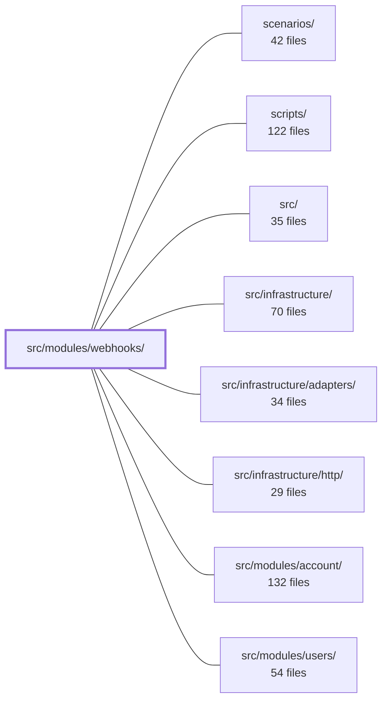

---
tags:
  - 2brain
  - 2brain/module
  - project/boilerplate-node-backend
type: module
module: src/modules/webhooks/
files: 54
updated: 2026-10-15T13:42:27.208654+00:00
---

# src/modules/webhooks/

## Purpose

The webhooks module owns the outbound webhook delivery subsystem: it manages tenant subscriptions to domain events, fans out deliveries when any registered module emits a public event, signs and POSTs them over HTTPS, retries failures on a backoff schedule, and exposes a REST admin surface for subscription CRUD, secret-ring rotation, delivery log inspection, and manual replay. It also publishes the shared event catalogue that clients query to discover which events they can subscribe to.

## Key parts

- **Module wiring** — `module.ts` (manifest, queue-consumer registration, service lifecycle), `routes.ts` (Express router with auth + permission gates), `index.ts` (public barrel, the only import surface for sibling modules), `metrics.ts` (Prometheus gauges backing fleet-wide alerts), `audit.ts` (audit-action vocabulary for every mutation).
- **Contracts & config** — `openapi.yaml` (REST contract), `asyncapi.yaml` (shared server + header schema for the public event bundle), `asyncapi.internal.yaml` (private RabbitMQ queue fragment, excluded from public bundles), `config.ts` (env-derived settings: key ring, tenant cap, retention TTL).
- **Domain rules** — `domain/backoff.ts` (delay schedule, max attempts, auto-disable threshold), `domain/event-filter.ts` (exact-membership / `'*'` wildcard matching).
- **Persistence** — `model.ts` (Mongoose schemas for `webhooksubscriptions` and `webhookdeliveries`), `repository.ts` (atomic claim, outcome-recording, and fan-out scan operations), `presenters.ts` (document → wire-shape serialization).
- **Secrets** — `secrets.ts` (ring mint/rotate/drop, encrypt/decrypt binding over the shared versioned-secret infrastructure, Standard-Webhooks-format key generation).
- **Services** — `services/publish.ts` (event fan-out: match filter, create delivery row, enqueue), `services/attempt.ts` (shared POST + outcome recording for both queued and replay paths), `services/sweep.ts` (retry sweep with inline fallback when the broker is down), `services/enqueue.ts` (Claim-Check enqueue helper), `services/subscriptions.ts` (tenant CRUD, SSRF pre-check, cap enforcement), `services/deliveries.ts` (list + replay), `services/catalogue.ts` (boot-time event catalogue from module fragments), `services/reencrypt.ts` (ring-key rotation adapter).
- **Controllers** — One file per route (create / list / update / delete subscriptions, rotate/remove secret, list/replay deliveries, list events), each a thin HTTP shell delegating to `webhooksService`.
- **Emails & docs** — `emails.ts` (auto-disable notice copy), `tests/` (contract, integration, and fuzz suites pinning schema, delivery, and SSRF behavior).

## How it connects

- **`src/infrastructure/`** — The module delegates AES-256-GCM encryption to the shared versioned-secret infrastructure and reads its queue adapter through `services/enqueue.ts`. The `reencrypt` ops script (in `scripts/`) calls `services/reencrypt.ts` to rotate stored secrets onto a new key.
- **`src/infrastructure/http/`** — The delivery attempt (`services/attempt.ts`) uses the shared HTTP client to perform the signed HTTPS POST to the subscriber's endpoint.
- **`src/infrastructure/adapters/`** — The queue adapter (RabbitMQ) is the transport behind `services/enqueue.ts` and the consumer registered in `module.ts`.
- **`src/modules/account/`** — `emails.ts` follows the same locale-resolved-copy convention as `account/emails`, and the auto-disable email is ultimately delivered through the account module's email pipeline.
- **`src/modules/users/`** — Tenant and user identity context (the "calling tenant" in every controller and service) flows from the users module's auth middleware into webhook route handlers.
- **`scenarios/` & `scripts/`** — Scenarios exercise the webhook delivery pipeline end-to-end; the `reencrypt` script drives `services/reencrypt.ts` for key rotation in production.

## Where to start

1. **`module.ts`** — Read this first. It is the single file that wires the queue consumer, event subscriptions, service registration, and secret-ring settings together; understanding it shows how every other file in the directory is activated at boot.
2. **`services/publish.ts` → `services/attempt.ts`** — These two files, read in sequence, cover the happy path from "a domain event fires" to "a signed HTTP POST lands at the subscriber's URL," which is the core behavior the rest of the module (retry, sweep, replay, audit) exists to protect.

## Connected modules

[[boilerplate-node-backend_ROOT|/ (repository root)]] · [[boilerplate-node-backend_scenarios|scenarios/]] · [[boilerplate-node-backend_scripts|scripts/]] · [[boilerplate-node-backend_src|src/]] · [[boilerplate-node-backend_src_infrastructure|src/infrastructure/]] · [[boilerplate-node-backend_src_infrastructure_adapters|src/infrastructure/adapters/]] · [[boilerplate-node-backend_src_infrastructure_http|src/infrastructure/http/]] · [[boilerplate-node-backend_src_modules_account|src/modules/account/]] · [[boilerplate-node-backend_src_modules_users|src/modules/users/]]

## Files
- `src/modules/webhooks/asyncapi.internal.yaml` — Declares the webhooks module's **private** RabbitMQ delivery-queue contract (channel, operations, and message shape) in AsyncAPI. It is a `backend`-only fragment that is merged into `./asyncapi.yaml` but deliberately excluded from any public bundle, so the paired frontend never sees the internal worker queue.
- `src/modules/webhooks/asyncapi.yaml` — The shared (non-channel) half of the webhooks public event catalogue. It defines the `subscriberEndpoint` server (the variable, per-subscription HTTPS URL) and the `WebhookHeaders` schema that every delivery carries. Individual event channels are *not* here — they live in each owning module's fragment and are merged in by the bundler while this file exists.
- `src/modules/webhooks/audit.ts` — Declares the audit-action vocabulary for all webhook-related mutations and registers it into the app-wide `AuditActionMap` via TypeScript module augmentation. Every read/write against a subscription (URL, secret, deletion) and every delivery replay is audited, not just the destructive ones, because subscription URLs and secrets are exactly the data a data-protection inquiry would target.
- `src/modules/webhooks/config.ts` — Environment-derived configuration for the webhook delivery subsystem. Values are read per call (not captured at import time) so tests can vary them per case; a deployment changes a value via env + restart. Holds the secret-encryption key ring, the per-tenant subscription cap, the secret-overlap window, and the delivery-retention TTL.
- `src/modules/webhooks/controllers/create-subscription.ts` — Express route handler for `POST /webhooks/subscriptions`. It validates the request body against the generated Zod schema, delegates creation to `webhooksService`, and returns a **201** with the created subscription plus its one-time delivery secret.
- `src/modules/webhooks/controllers/delete-subscription.ts` — Hand-written Express handler for `DELETE /webhooks/subscriptions/:id`. It permanently removes a single webhook subscription (its delivery log is intentionally left in place). It bypasses the `createDeleteController` factory because that factory is designed for soft/hard delete triplets, and this module only performs a permanent delete.
- `src/modules/webhooks/controllers/list-deliveries.ts` — Controller for `GET /webhooks/deliveries`. It exposes a tenant's webhook delivery log (newest first) with optional filtering by subscription and/or status, delegating the actual query to the webhooks service.
- `src/modules/webhooks/controllers/list-events.ts` — Express controller that handles `GET /webhooks/events`. It returns the full list of webhook event catalogue entries (sourced from `../asyncapi.yaml` upstream) so that clients and API consumers can discover every event a subscription may filter on.
- `src/modules/webhooks/controllers/list-subscriptions.ts` — Controller for `GET /webhooks/subscriptions`. Returns the calling tenant's webhook subscriptions (newest first) with pagination, and guarantees no secret material is included in the response.
- `src/modules/webhooks/controllers/remove-subscription-secret.ts` — Thin HTTP controller for `DELETE /webhooks/subscriptions/:id/secrets/:secretId`. It validates the subscription ID, delegates the actual ring-entry removal to `webhooksService`, and shapes the resulting `WebhookSubscription` into an HTTP response. It exists to isolate the request/response lifecycle (param extraction, tenant context, error mapping) from the domain logic.
- `src/modules/webhooks/controllers/replay-delivery.ts` — Thin HTTP controller for `POST /webhooks/deliveries/:id/replay`. It validates the delivery ID, delegates the re-send to the webhooks service, and shapes the response. Documented in `docs/modules/webhooks.md` as the single most-requested support action.
- `src/modules/webhooks/controllers/rotate-subscription-secret.ts` — Handler for `POST /webhooks/subscriptions/:id/rotate-secret`. It mints a new ring secret for a webhook subscription and returns the plaintext secret exactly once in the response body. The old secret remains active until it is explicitly revoked via `DELETE …/secrets/:secretId`.
- `src/modules/webhooks/controllers/update-subscription.ts` — Builds the `PUT /webhooks/subscriptions/:id` (full replace) and `PATCH /webhooks/subscriptions/:id` (partial merge) HTTP handlers from a shared `createUpdateController` factory. Both verbs delegate to the same service method but accept different request schemas. This file intentionally does **not** manage subscription secrets — that lives on dedicated action routes.
- `src/modules/webhooks/domain/backoff.ts` — Pure, dependency-free retry-backoff rules for webhook deliveries. Defines the delay schedule, the max-attempt count, and the auto-disable threshold so that the sweep worker, the attempt service, and unit tests all share a single source of truth for "when is the next try" and "when do we give up on a subscription."
- `src/modules/webhooks/domain/event-filter.ts` — Pure, I/O-free decision logic that answers one question: _does a given event type belong to a subscription's `eventTypes` filter?_ Matching is exact-membership or the `'*'` wildcard—no glob or prefix matching. The module exists to keep the "should this subscriber receive this event?" check in the domain layer, independent of transport or storage concerns.
- `src/modules/webhooks/domain/index.ts` — Barrel file for the webhooks domain layer. It re-exports the pure rules (retry/backoff constants and helpers, event-filtering logic) from two sibling modules so that consumers can import from a single entry point without reaching into sub-paths.
- `src/modules/webhooks/emails.ts` — Holds the finished-text email copy for the webhooks module. Follows the same convention as `@modules/account/emails`: the caller passes a locale, and the function returns fully resolved strings ready for template interpolation. Currently contains one email — the auto-disable notice sent to the subscription owner when repeated delivery failures switch the endpoint off.
- `src/modules/webhooks/index.ts` — Public barrel for the webhooks module. It is the **only** import surface permitted to sibling modules (enforced per `docs/theory/strategic-ddd.md` §5). It re-exports the module's public API without executing any side-effects.
- `src/modules/webhooks/metrics.ts` — Defines the webhooks module's domain-level Prometheus metrics and registers them on the shared `metricsRegistry`. The metrics exist to power two fleet-wide alerts — `WebhookDeliveriesFailingEverywhere` and `WebhookRetriesStalled` — that detect our-side outages (all deliveries failing, retry sweep stalled) as distinct from a single subscriber's endpoint being down.
- `src/modules/webhooks/model.ts` — Defines the two Mongoose collections the webhooks module owns — `webhooksubscriptions` (a tenant's standing subscription to event types) and `webhookdeliveries` (one row per event × subscription, tracking the delivery lifecycle through retries) — including their schemas, indexes, TypeScript document interfaces, and wire-shape serialization transforms.
- `src/modules/webhooks/module.ts` — Module manifest for the outbound webhooks module. It declares the module's identity (name, routes, locales), registers its queue consumer for webhook delivery, wires its services (event subscription, catalogue, re-encryption) into the kernel registry lifecycle, and configures the secret-ring / retention settings. It exists so that removing this single file fully detaches the webhook queue consumer and event subscriptions without leaving dangling references in `app/`.
- `src/modules/webhooks/openapi.yaml` — OpenAPI 3.1.0 contract for the webhooks module: defines the REST surface for managing outbound webhook subscriptions (CRUD), one-time secret minting, secret-ring rotation, and secret removal. Serves as the single source of truth for request/response shapes, validation rules, and error semantics that both the server implementation and external consumers rely on.
- `src/modules/webhooks/presenters.ts` — Converts Mongoose webhook documents (subscription and delivery) into their wire-shape TypeScript types by delegating to each document's `.toJSON()` method. It exists so controllers have a single, consistent entry point for serializing domain objects before sending them over HTTP.
- `src/modules/webhooks/repository.ts` — Defines the two MongoDB repositories (subscriptions and deliveries) for the webhook module, extending the shared generic factory with domain-specific atomic operations: queued/sweep claims, admin-replay claims, outcome recording, and the "find all enabled subscriptions" scan used during event fan-out.
- `src/modules/webhooks/routes.ts` — Defines the Express router for the `/webhooks` admin surface. It wires every webhook route—subscription CRUD, secret rotation/removal, delivery log, replay, and the public event catalogue—behind a two-layer authorization gate (auth + fine-grained permission) and delegates handling to dedicated controller modules.
- `src/modules/webhooks/secrets.ts` — Provides the secret-ring lifecycle operations (mint, rotate, drop) and the encrypt/decrypt helpers that keep webhook signing secrets at rest. The actual AES-256-GCM encryption is delegated to the shared versioned-secret infrastructure; this file adds the domain-specific binding, ring-entry shape, overlap-window expiry logic, and Standard-Webhooks-format secret generation on top.
- `src/modules/webhooks/services/attempt.ts` — Implements the single delivery-attempt pipeline shared by both the queued consumer path (`processDeliveryJob`) and the synchronous admin re-send path (`replay` in `deliveries.ts`). Given an already-claimed delivery row and its subscription, it performs the HTTP POST, then records the outcome (success, retry, or exhaustion) on the delivery row and the subscription's failure streak. The shared recording logic prevents the two call-sites from diverging on what "recording an outcome" means.
- `src/modules/webhooks/services/catalogue.ts` — Defines the public webhook event catalogue: the set of events shipped by **registered** modules, read from each module's `asyncapi.webhooks.yaml` fragment at boot. This single source of truth keeps `GET /webhooks/events`, subscription validation, and the bundled public contract (`asyncapi.public.yaml`) from drifting apart.
- `src/modules/webhooks/services/deliveries.ts` — Provides the two read-and-write operations exposed on the delivery log endpoint: a paged, filterable `list` for `GET /webhooks/deliveries` and a synchronous `replay` that re-sends a single delivery against the subscription's *current* URL and secret ring.
- `src/modules/webhooks/services/enqueue.ts` — Single-point enqueue helper for webhook delivery attempts. Both the fast path (`publish.ts`, right after a delivery row is created) and the retry sweep (`sweep.ts`, for rows already due) call this instead of touching the queue adapter directly. It implements the **Claim Check** EIP: the queue message carries only the delivery row's `_id`, treating the row in the database as the source of truth for everything an attempt needs.
- `src/modules/webhooks/services/index.ts` — Barrel file for the webhooks module's `services/` directory. It re-exports individual service functions and types, and assembles the `webhooksService` object that controllers use to call into the module. Its existence (rather than a single `service.ts`) follows the layering convention described in `docs/theory/layers.md#when-service-ts-becomes-services-`.
- `src/modules/webhooks/services/publish.ts` — Domain-event subscriber that listens to every event a registered module's manifest names a `PublicEventTarget` for, matches each projected public event against enabled subscription filters, and fans out one delivery row plus one queue message per match. Registered once from `module.ts`'s `onRegistered` hook after all modules are known.
- `src/modules/webhooks/services/reencrypt.ts` — Adapts the generic ring-key re-encryption infrastructure to the webhook subscriptions domain. It maps each subscription's per-entry signing secrets into the `EncryptedField` shape the infrastructure expects, then delegates the bulk re-encryption (or dry-run count) to the repository. This lets the ops script `reencrypt` rotate webhook secrets onto the newest `NODE_WEBHOOK_SECRET_ENCRYPTION_KEY` without duplicating domain logic in the infrastructure layer.
- `src/modules/webhooks/services/subscriptions.ts` — Tenant-scoped CRUD service for webhook subscriptions. Provides list, create, update, remove, and secret-ring actions (`rotateSecret`/`removeSecret`). Enforces a per-tenant subscription cap with a race-safe double-check, pre-validates outbound URLs against SSRF, and validates event-type filters against the known catalogue before any write.
- `src/modules/webhooks/services/sweep.ts` — Implements the webhook delivery retry sweep: finds every delivery row that is due for another attempt (including stranded `in-flight` rows whose lease expired) and dispatches them—either by publishing to a message broker or by sending inline when no broker is available. It exists as the "degrade, don't drop" fallback so that no delivery is lost when the broker is down, and it runs outside the request path so a slow subscriber never blocks the API.
- `src/modules/webhooks/tests/contract/schema-drift.test.ts` — Guards against schema drift between `WebhookSubscription` and `WebhookSubscriptionCreated` in the module's local `openapi.yaml`. Because the two schemas must be written as flat, closed (`additionalProperties: false`) objects—rather than composed with `allOf`—their property lists are duplicated by hand with nothing else enforcing consistency. This test is that enforcement: it fails the moment a field is added, removed, or renamed in one schema but not the other.
- `src/modules/webhooks/tests/contract/webhooks.test.ts` — Contract tests that exercise the `/webhooks` admin REST surface (subscriptions CRUD, secret rotation, delivery log, replay, event catalogue) against the bundled `openapi.yaml` schema. The file exists to catch schema/implementation drift without a live server, and to pin down authorization, validation, and state-transition behavior of the webhook API.
- `src/modules/webhooks/tests/fuzz/webhook-ssrf.fuzz.test.ts` — Fuzz-style tests for the SSRF-adjacent behaviour that lives inside `deliverWebhook` itself — the shared timeout budget (DNS + request), redirect refusal, the demo-host exemption, and non-443 port rejection. It complements `ssrf-guard.fuzz.test.ts`, which covers the generic guard; this file covers the delivery path that *reaches* the guard but is not owned by it.
- `src/modules/webhooks/tests/integration/delivery-log.test.ts` — Integration tests (against a real database) for two read-path behaviors of the webhook delivery log: that `list` returns only the caller's tenant's deliveries and supports narrowing by subscription and status, and that `replay` returns a 404 without mutating the delivery row when there is nothing to re-send.
- `src/modules/webhooks/tests/integration/delivery.test.ts` — Integration test suite for the webhook delivery pipeline, exercising the full path (signing → TLS request → retry scheduling → auto-disable → replay → audit log) against a real database and a self-managed local HTTPS listener. It verifies the behavioral contract documented in `docs/modules/webhooks.md`'s integration section: a signed delivery arrives correctly, a 500 triggers retries, sustained failure auto-disables the subscription, replay re-sends, and the delivery log records each step.
- `src/modules/webhooks/tests/integration/reencrypt.test.ts` — Integration test that verifies the webhook key-rotation `reencrypt` walk: after deploying a new `v2` encryption key, a previously stamped `v1` ring secret is rewritten in-place to `v2` while remaining decryptable under its original entry id. It reads the raw collection document (bypassing the repository's decrypt layer) to assert the version stamp actually changed.
- `src/modules/webhooks/tests/integration/subscription-lifecycle.test.ts` — End-to-end integration tests for the webhook subscription service (`create`, `list`, `update`, `remove`, `rotateSecret`, `removeSecret`) run against a real database. It pins service-level outcomes — listing order/tenant isolation, validation refusals, partial-update semantics, secret-ring rotation, and removal — in places where the HTTP contract suite does not already cover them (the SSRF-guard table lives under `tests/fuzz/`).
- `src/modules/webhooks/tests/integration/subscriptions.test.ts` — Integration test for the `create` service in `services/subscriptions.ts`. It verifies two behaviours that a unit test with a mocked repository cannot: (1) the race-guard re-check that prevents two truly concurrent writes from both succeeding at the subscription cap, and (2) that `ownerUserId` is persisted on the row but stripped from the API response. A real database (`setupTestDb`) is required because the race scenario depends on two transactions landing at the same instant.
- `src/modules/webhooks/tests/integration/sweep.test.ts` — Integration test for `sweepDueWebhookDeliveries` run against a **real database** with the queue publisher and the HTTP transport mocked. It verifies the sweep's selection criteria (which rows it picks up) and its two delivery paths: publishing to the worker queue, and falling back to inline delivery when the broker is unavailable. It covers the code path that `delivery.test.ts` never reaches, since that suite calls `processDeliveryJob` directly against a fixture.
- `src/modules/webhooks/tests/unit/backoff.test.ts` — Unit tests for the pure retry-backoff rules of the webhooks module: the per-tier delay schedule, the max-attempt invariant, next-attempt timestamp calculation, and the auto-disable threshold. It exists to lock down the "when do we retry / when do we give up" contract without any I/O or framework coupling.
- `src/modules/webhooks/tests/unit/catalogue.test.ts` — Unit tests for the webhook event catalogue service. Verifies that only events from explicitly registered modules appear in the catalogue, that per-event descriptions are preserved, and that `unknownEventTypes` correctly identifies (and deduplicates) event names that are not in the registered set.
- `src/modules/webhooks/tests/unit/event-filter.test.ts` — Unit tests for the `matchesEventFilter` function and the `ALL_EVENTS` constant, verifying that event-name filtering (exact match, wildcard, and empty-filter edge cases) behaves as specified in the webhook domain.
- `src/modules/webhooks/tests/unit/module.test.ts` — Unit test for the webhooks module's boot-time configuration gate. It verifies that `assertModuleConfig` rejects invalid or missing `NODE_WEBHOOK_SECRET_ENCRYPTION_KEY` values and that the module emits a boot warning when no message broker is configured. It exercises the gate through the real `assertModuleConfig` call (not by inspecting the manifest directly), ensuring the manifest wiring is part of what makes the check fire.
- `src/modules/webhooks/tests/unit/schema-contract.test.ts` — Validates the *declarations* of the two webhook Mongoose schemas (`webhookSubscriptionSchema`, `webhookDeliverySchema`) by inspecting the schema objects directly—required paths, defaults, enums, index specs, index options, and TTL—without ever creating or saving a document. This catches regressions (dropped `required`, flipped defaults, detached TTL, accidental unique/sparse flags) that a document-level integration test, which only ever exercises valid fixtures, would miss.
- `src/modules/webhooks/tests/unit/secrets.test.ts` — Unit tests for the webhook secret-ring layer: encrypt/decrypt, minting, active-secret selection with the 24-hour overlap window, and removal. It verifies the ring-level wiring on top of the underlying versioned-secret crypto (which is covered separately in `tests/unit/infrastructure/security/versioned-secret.test.ts`).
- `src/modules/webhooks/tests/unit/webhook-signing.test.ts` — Unit tests for the webhook signing and verification path. The primary goal is interop conformance: one test asserts a byte-for-byte match against the published test vector from the [Standard Webhooks](https://github.com/standard-webhooks/standard-webhooks) reference implementation. The remaining tests cover round-trip sign→verify, edge cases (Buffer vs. string body, missing/prefixed secret, tolerance windows), and multi-secret ring rotation.
- `src/modules/webhooks/tests/verify-signature.fixture.ts` — A test-only Standard Webhooks signature verifier. It intentionally does **not** reuse the production signer's private helpers (`../transport/webhook-signing.ts`); instead it implements the spec independently so a passing round-trip test demonstrates interop with the Standard Webhooks format, not merely self-consistency. The codebase only _sends_ webhooks, so no production code depends on this module.
- `src/modules/webhooks/transport/webhook-delivery.ts` — Single outbound webhook delivery attempt: SSRF-check the URL, sign the payload, POST over pinned HTTPS with a hard timeout, and return a structured result. `deliverWebhook` **never rejects** — every failure path (SSRF refusal, DNS failure, timeout, non-2xx) resolves to a `WebhookDeliveryResult` with `success: false` and a human-readable `error`, so the calling worker can always write a delivery-log row without a try/catch.
- `src/modules/webhooks/transport/webhook-signing.ts` — Implements Standard Webhooks (v1) outbound signing using `node:crypto` directly, avoiding a third-party dependency for a ~15-line HMAC routine. It produces the three required delivery headers (`webhook-id`, `webhook-timestamp`, `webhook-signature`) and supports a multi-secret "ring" for zero-downtime key rotation. This file signs only; no production verification path lives here.

---
[[boilerplate-node-backend_INDEX|← boilerplate-node-backend index]]
