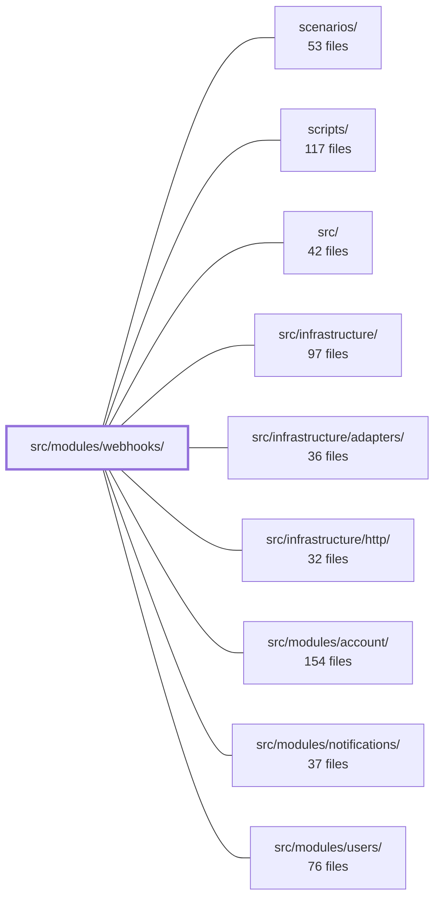

---
tags:
  - 2brain
  - 2brain/module
  - project/boilerplate-node-backend
type: module
module: src/modules/webhooks/
files: 64
updated: 2026-10-29T19:30:02.005203+00:00
---

# src/modules/webhooks/

## Purpose

The webhooks module manages **outbound webhook subscriptions** on behalf of tenants: it lets a tenant subscribe to a filtered slice of the platform's public domain-event catalogue, signs and delivers those events to the tenant's HTTPS endpoint, tracks every delivery attempt (success, retry, exhaustion), and exposes an admin REST API for managing subscriptions, rotating signing secrets, inspecting the delivery log, and replaying failed deliveries.

## Key parts

- **Domain rules** (`domain/`) — Pure, I/O-free logic: retry backoff schedule and auto-disable threshold (`backoff.ts`, `rules.generated.ts`), and event-type filtering (`event-filter.ts`). Kept here so the sweep job, the delivery worker, and unit tests all read the same constants.
- **Persistence** (`model.ts`, `repository.ts`) — Two Mongoose collections (WebhookSubscription, WebhookDelivery) and the data-access layer. The repository owns every MongoDB query, including atomic claim/lease operations and the tenant-scoped enabled-subscription scan used by the fan-out path.
- **Service layer** (`services/`) — Business logic split by concern: subscription CRUD, delivery-log queries & replay, the single delivery-attempt routine (`attempt.ts`), queue enqueue via the Claim-Check pattern (`enqueue.ts`), retry sweep, event fan-out, secret re-encryption, and the public event catalogue. `actions.ts` centralises per-caller permission checks. `index.ts` re-exports everything as one `webhooksService` object for controllers.
- **HTTP surface** (`routes.ts`, `controllers/`, `openapi.yaml`) — All `/webhooks/*` routes (subscription CRUD, enable/disable, secret mint/rotate, delivery log, replay, event catalogue). Controllers are thin; they validate input, resolve tenant context, delegate to the service, and shape the response.
- **Secrets & config** (`secrets.ts`, `config.ts`) — AES-256-GCM secret-ring operations (mint, rotate, drop) built on a versioned key ring read from environment. `config.ts` exposes the key ring, per-tenant subscription cap, overlap window, and delivery-retention TTL.
- **Event catalogue & contracts** (`asyncapi.yaml`, `asyncapi.internal.yaml`, `events.ts`, `services/catalogue.ts`) — The public event catalogue (merged from each owning module's fragment) and the private RabbitMQ delivery-queue channel definition (backend-only, excluded from the public bundle).
- **Jobs & metrics** (`jobs.ts`, `jobs.generated.ts`, `metrics.ts`) — Scheduled retry sweep job and two fleet-wide Prometheus alerts (deliveries failing everywhere, retry sweep stalled).
- **Module wiring** (`module.ts`, `index.ts`, `audit.ts`) — `module.ts` is the single registration point (routes, queue consumer, event subscriptions, jobs). `index.ts` is the public barrel. `audit.ts` declares the audit-action vocabulary.
- **Presenters** (`presenters.ts`) — Maps stored Mongoose documents to their wire (API response) shapes for both resources.

## How it connects

- **Kernel & shared infrastructure** (`src/`, `src/infrastructure/`) — `module.ts` registers the module with the kernel's registry; `events.ts` and `audit.ts` augment kernel-level TypeScript maps. `secrets.ts` delegates to the shared `versioned-secret` primitive. `metrics.ts` registers on the shared `metricsRegistry`.
- **HTTP infrastructure** (`src/infrastructure/http/`) — `routes.ts` attaches the auth/permission middleware chain and mounts handlers into the Express application.
- **Queue adapters** (`src/infrastructure/adapters/`) — `services/enqueue.ts` and the queue consumer in `module.ts` publish to and consume from the RabbitMQ delivery queue declared in `asyncapi.internal.yaml`.
- **Sibling modules** (`src/modules/notifications/`, `src/modules/users/`, `src/modules/account/`) — These modules declare their public events in their own `asyncapi.webhooks.yaml` fragments. The webhooks catalogue service reads those fragments at boot, and the module's event-bus subscription in `module.ts` fans out matching events into delivery rows. Tenant/account context is resolved per-request to scope subscriptions and deliveries.
- **Build tooling** (`scripts/`, `scenarios/`) — Codegen scripts produce `rules.generated.ts` and `jobs.generated.ts` from source-of-truth files; scenario tests exercise the full subscription → delivery → replay flow.

## Where to start

1. **`module.ts`** — the module manifest. In one file you can see every surface the module exposes (routes, queue consumer, event subscriptions, jobs, config) and how they are wired together. It is the single deletion point, so it is also the single best orientation map.
2. **`model.ts`** — defines the two entities (WebhookSubscription, WebhookDelivery) and their fields. Reading this first gives you the vocabulary that every controller, service, and repository method revolves around.

## Connected modules

[[boilerplate-node-backend_ROOT|/ (repository root)]] · [[boilerplate-node-backend_scenarios|scenarios/]] · [[boilerplate-node-backend_scripts|scripts/]] · [[boilerplate-node-backend_src|src/]] · [[boilerplate-node-backend_src_infrastructure|src/infrastructure/]] · [[boilerplate-node-backend_src_infrastructure_adapters|src/infrastructure/adapters/]] · [[boilerplate-node-backend_src_infrastructure_http|src/infrastructure/http/]] · [[boilerplate-node-backend_src_modules_account|src/modules/account/]] · [[boilerplate-node-backend_src_modules_notifications|src/modules/notifications/]] · [[boilerplate-node-backend_src_modules_users|src/modules/users/]]

## Files
- `src/modules/webhooks/asyncapi.internal.yaml` — Declares the webhooks module's **private** RabbitMQ delivery-queue contract (channel, operations, and message shape) in AsyncAPI. It is a `backend`-only fragment that is merged into `./asyncapi.yaml` but deliberately excluded from any public bundle, so the paired frontend never sees the internal worker queue.
- `src/modules/webhooks/asyncapi.yaml` — The shared (non-channel) half of the webhooks public event catalogue. It defines the `subscriberEndpoint` server (the variable, per-subscription HTTPS URL) and the `WebhookHeaders` schema that every delivery carries. Individual event channels are *not* here — they live in each owning module's fragment and are merged in by the bundler while this file exists.
- `src/modules/webhooks/audit.ts` — Declares the audit-action vocabulary for the webhooks module and registers it into the application-wide `AuditActionMap` via TypeScript module augmentation. Every mutating operation on a webhook subscription (not just deletions) produces one of these actions, because a subscription's `url` and secret ring are exactly the data a later privacy/compliance question would target.
- `src/modules/webhooks/config.ts` — Environment-derived configuration for the webhook delivery subsystem. Values are read per call (not captured at import time) so tests can vary them per case; a deployment changes a value via env + restart. Holds the secret-encryption key ring, the per-tenant subscription cap, the secret-overlap window, and the delivery-retention TTL.
- `src/modules/webhooks/controllers/create-subscription-secret.ts` — HTTP controller that handles `POST /webhooks/subscriptions/:id/secrets`. It mints a new ring secret for an existing webhook subscription and returns the plaintext secret exactly once (`newSecret`) alongside the subscription view. The previously active secret remains valid until it is explicitly revoked via `DELETE .../secrets/:secretId`.
- `src/modules/webhooks/controllers/create-subscription.ts` — HTTP controller for `POST /webhooks/subscriptions`. Parses and validates the request body, resolves the tenant/caller context, delegates creation to the webhooks service, and returns a `201 Created` response containing the subscription view plus its one-time delivery `secret`.
- `src/modules/webhooks/controllers/delete-subscription.ts` — Express controller handler for `DELETE /webhooks/subscriptions/:id`. It permanently removes a webhook subscription (leaving its delivery log intact). It is hand-written rather than built on `createDeleteController` because that factory is designed for a soft/hard delete triplet, and this module only has a single permanent delete.
- `src/modules/webhooks/controllers/disable-subscription.ts` — Controller handler for `POST /webhooks/subscriptions/:id/disable`. It validates the subscription ID, delegates to the webhooks service to pause the subscription, and returns the updated subscription (or a 409 if it was already paused).
- `src/modules/webhooks/controllers/enable-subscription.ts` — Express controller handler for `POST /webhooks/subscriptions/:id/enable`. It re-enables a previously disabled webhook subscription, validates the route ID and tenant context, delegates the state change to the webhooks service, and formats the resulting subscription object for the HTTP response.
- `src/modules/webhooks/controllers/get-delivery.ts` — Handles the `GET /webhooks/deliveries/:id` endpoint by fetching a single webhook delivery record for the authenticated tenant. It validates the id, delegates to the webhooks service, and shapes the HTTP response.
- `src/modules/webhooks/controllers/get-subscription.ts` — Single-purpose controller for `GET /webhooks/subscriptions/:id`. It retrieves one webhook subscription belonging to the caller's tenant, returning 404 for both a missing ID and an ID owned by a different shop.
- `src/modules/webhooks/controllers/list-deliveries.ts` — Controller for `GET /webhooks/deliveries`. It exposes a tenant's webhook delivery log (newest first) with optional filtering by subscription and/or status, delegating the actual query to the webhooks service.
- `src/modules/webhooks/controllers/list-events.ts` — A single-export Express controller that serves the public webhook event catalogue at `GET /webhooks/events`. It delegates to the webhooks service to retrieve the list of events a subscription may filter on (sourced from `asyncapi.yaml`) and wraps them in a standard success envelope.
- `src/modules/webhooks/controllers/list-subscriptions.ts` — HTTP controller for `GET /webhooks/subscriptions`. Returns the calling tenant's webhook subscriptions (newest first by default), with pagination and filter parameters, delegating to the webhooks service layer.
- `src/modules/webhooks/controllers/remove-subscription-secret.ts` — Controller for `DELETE /webhooks/subscriptions/:id/secrets/:secretId`. Removes a single secret from a subscription's rotation ring (the "other half" of a key rotation, once all consumers have switched). Enforces that the ring is never left empty, since a subscription with no secret cannot sign a delivery.
- `src/modules/webhooks/controllers/replay-delivery.ts` — Controller handler for `POST /webhooks/deliveries/:id/replay`. Validates the delivery ID, delegates to the webhooks service for a synchronous re-send against the subscription's current URL and secret ring, and shapes the HTTP response. Exists as the thin HTTP edge of the replay flow — the most-requested support action per `docs/modules/webhooks.md`.
- `src/modules/webhooks/controllers/update-subscription.ts` — Defines the `PUT` (replace) and `PATCH` (merge) handlers for `/webhooks/subscriptions/:id` by composing the shared `createUpdateController` factory. Both verbs delegate to a single service method (`webhooksService.updateSubscription`) and render the response via `viewSubscription`, scoped to the tenant caller extracted from the request.
- `src/modules/webhooks/domain/backoff.ts` — Pure domain rules defining the webhook retry backoff schedule (delay tiers, max attempts) and the auto-disable threshold (consecutive-failure count + minimum elapsed time). Exists so the sweep job, the delivery worker, and unit tests all read the same table instead of duplicating timing constants.
- `src/modules/webhooks/domain/event-filter.ts` — Pure, I/O-free decision logic that answers one question: _does a given event type belong to a subscription's `eventTypes` filter?_ Matching is exact-membership or the `'*'` wildcard—no glob or prefix matching. The module exists to keep the "should this subscriber receive this event?" check in the domain layer, independent of transport or storage concerns.
- `src/modules/webhooks/domain/index.ts` — Barrel file for the webhooks domain layer. It re-exports the pure rules (retry/backoff constants and helpers, event-filtering logic) from two sibling modules so that consumers can import from a single entry point without reaching into sub-paths.
- `src/modules/webhooks/domain/rules.generated.ts` — Generated configuration constants that define the retry schedule and the auto-disable threshold for webhook subscriptions. It exists as a typed, importable artifact so that runtime code can read these policy values without parsing YAML at execution time.
- `src/modules/webhooks/events.ts` — Declares the webhooks module's domain events by augmenting the kernel's `DomainEventMap` via TypeScript module augmentation. This file exists so sibling modules can type-safe subscribe to webhook lifecycle facts without importing the webhooks module directly. It contains no runtime logic beyond a single exported string constant.
- `src/modules/webhooks/index.ts` — Public barrel (the sole import surface) for the webhooks module. Sibling modules import only from this file, never from its internal sub-modules, per the strategic-DDD rule documented in `docs/theory/strategic-ddd.md` §5.
- `src/modules/webhooks/jobs.generated.ts` — Generated data file that declares the scheduled jobs for the webhooks module as a plain object (`webhooksJobData`). It exists so job metadata (name, cron schedule, summary) lives in a single machine-generated artifact produced from `module.yaml`, keeping the schedule definition separate from the execution logic in `jobs.ts`.
- `src/modules/webhooks/jobs.ts` — Declares the scheduled jobs owned by the `webhooks` module. It wires each generated job definition to its concrete handler function and exports the resulting list for the kernel's job registry to consume.
- `src/modules/webhooks/metrics.ts` — Defines the webhooks module's domain-level Prometheus metrics and registers them on the shared `metricsRegistry`. The metrics exist to power two fleet-wide alerts — `WebhookDeliveriesFailingEverywhere` and `WebhookRetriesStalled` — that detect our-side outages (all deliveries failing, retry sweep stalled) as distinct from a single subscriber's endpoint being down.
- `src/modules/webhooks/model.ts` — Defines the two Mongoose schemas and models the webhooks module persists: **WebhookSubscription** (a tenant's standing subscription to a slice of the public event catalogue) and **WebhookDelivery** (one row per event × subscription, tracking attempts through to success, exhaustion, or a subscriber never told because the subscription was disabled first). Also exports the serialization transform that shapes subscription reads for the wire.
- `src/modules/webhooks/module.ts` — Module manifest for the **outbound webhooks** feature: subscription management, delivery log, and the admin API surface. It reacts to every domain event that a registered module declares in its `publicEvents` entry (resolved via `kernel/registry`) through the domain-event bus, and it owns the queue consumer that performs actual deliveries. The file exists so that deleting the webhooks module removes its consumer, routes, config, and event subscriptions in one place—nothing in `app/` references the channel directly.
- `src/modules/webhooks/openapi.yaml` — OpenAPI 3.1.0 contract for the **webhooks** module. It defines the REST surface for outbound webhook subscriptions (CRUD, enable/disable, secret management, replay, and the public event catalogue), along with a module-specific set of 409 error codes and the schemas that back each endpoint.
- `src/modules/webhooks/presenters.ts` — Transforms stored webhook documents into their wire (API response) shapes. Webhooks serves two resource types—a subscription and its delivery log—and this file provides one presenter per resource. It is the single place where a `*Document` becomes a `*Subscription` or `*Delivery` wire type, keeping that mapping out of the service layer.
- `src/modules/webhooks/repository.ts` — Defines the data-access layer for the two webhook collections (subscriptions and deliveries). It wires the shared `createRepository` factory into both Mongoose models and then layers on the queries the generic factory cannot express: atomic claim/lease operations, failure-streak bookkeeping, tenant-scoped reads, and a full-collection enabled-subscription scan. It is the single place that talks to MongoDB for this module, so service files stay free of query logic.
- `src/modules/webhooks/routes.ts` — Defines all HTTP routes for the `/webhooks` admin surface: subscription CRUD, enable/disable, signing-secret rotation, the delivery log (inspect + replay), and the event catalogue. This is the sole routing layer for the webhooks module — it wires URLs to controller handlers and attaches the auth/permission middleware chain.
- `src/modules/webhooks/rules.schema.ts` — Defines the Zod schema for `rules.yaml` (the webhook retry ladder and auto-disable thresholds) and the `GenerateSpec` that tells the codegen pipeline what to emit as `rules.generated.ts`. It is the single source of truth for the numeric constants that both the TypeScript runtime and a PHP twin consume.
- `src/modules/webhooks/secrets.ts` — Secret-ring encryption at rest and the ring operations built on it (mint, rotate, drop). Delegates actual AES-256-GCM encryption to `versioned-secret` under a versioned key ring from config, and keeps plaintext secrets in memory only for the duration of a single mint response or one delivery-attempt signature.
- `src/modules/webhooks/services/actions.ts` — Centralises the rule for "what may this caller do to a webhook subscription or delivery?" so that no controller or client re-derives permission logic independently. Each action flag is the conjunction of an ability key the caller holds and a small piece of subscription state (enabled/disabled, secret count), keeping the check O(1) against data already in hand.
- `src/modules/webhooks/services/attempt.ts` — Core delivery-attempt logic for webhooks: signs the payload, performs the HTTP POST (via `../transport/webhook-delivery`), then records the outcome on the delivery row and the subscription's consecutive-failure streak. Shared by the queued path (`processDeliveryJob`) and the synchronous admin replay path (`./deliveries.ts`) so both cannot drift on what "recording an outcome" means.
- `src/modules/webhooks/services/catalogue.ts` — Defines the public webhook event catalogue: the set of events shipped by **registered** modules, read from each module's `asyncapi.webhooks.yaml` fragment at boot. This single source of truth keeps `GET /webhooks/events`, subscription validation, and the bundled public contract (`asyncapi.public.yaml`) from drifting apart.
- `src/modules/webhooks/services/deliveries.ts` — Service layer for the webhook delivery log's three API operations: paged listing, single-item read, and synchronous replay (re-send). It translates wire-level query parameters into repository searches, computes per-row `actions` from the subscription's enabled state and the caller's standing, and orchestrates the multi-step replay flow (lookup → subscription check → lease claim → attempt → audit).
- `src/modules/webhooks/services/enqueue.ts` — Single-point enqueue helper for webhook delivery attempts. Both the fast path (`publish.ts`, right after a delivery row is created) and the retry sweep (`sweep.ts`, for rows already due) call this instead of touching the queue adapter directly. It implements the **Claim Check** EIP: the queue message carries only the delivery row's `_id`, treating the row in the database as the source of truth for everything an attempt needs.
- `src/modules/webhooks/services/index.ts` — Barrel export for the webhooks module's `services/` directory. It aggregates every service operation (subscriptions CRUD, deliveries, delivery attempt, retry sweep, event fan-out, secret re-encryption, and the event catalogue) into a single `webhooksService` object so controllers have one consistent entry point instead of importing bare functions from individual files.
- `src/modules/webhooks/services/publish.ts` — The domain-event subscriber for webhooks. It registers one listener per `PublicEventTarget` declared by every module (resolved at boot via `kernel/registry.ts`), projects incoming domain events into public events, matches them against enabled subscriptions' filters, and fans out one delivery row plus one queue message per match. It is the single entry point that connects the kernel event bus to the webhook delivery pipeline without any module importing from `webhooks`.
- `src/modules/webhooks/services/reencrypt.ts` — Adapts the generic ring-key re-encryption infrastructure to the webhook subscriptions domain. It maps each subscription's per-entry signing secrets into the `EncryptedField` shape the infrastructure expects, then delegates the bulk re-encryption (or dry-run count) to the repository. This lets the ops script `reencrypt` rotate webhook secrets onto the newest `NODE_WEBHOOK_SECRET_ENCRYPTION_KEY` without duplicating domain logic in the infrastructure layer.
- `src/modules/webhooks/services/subscriptions.ts` — Tenant-scoped CRUD service for webhook subscriptions: list, get, create, update, enable/disable, secret-ring management, and delete. Enforces per-tenant subscription caps, validates outbound URLs against SSRF at subscription time, and validates event-type filters against the catalogue. Exists as the single write path for subscription lifecycle so that cap enforcement, secret minting, and audit logging stay consistent across every mutation.
- `src/modules/webhooks/services/sweep.ts` — Implements the periodic retry sweep for webhook deliveries. On each scheduled run it finds every delivery due for another attempt (including stranded `in-flight` rows whose lease has expired) and dispatches them — either via a message broker or inline through the same `processDeliveryJob` path a worker would use. It exists so that a failed or missed delivery is retried automatically without depending on the originating request or an external worker.
- `src/modules/webhooks/tests/contract/schema-drift.test.ts` — Contract test that guards against drift between the `WebhookSubscription` and `WebhookSubscriptionCreated` schemas in the module's `openapi.yaml`. Because both schemas must be kept flat (closed under `additionalProperties: false`) for ajv compatibility, their property lists are duplicated by hand with no other synchronization mechanism. This test is that mechanism.
- `src/modules/webhooks/tests/contract/webhooks.test.ts` — Contract tests that validate the `/webhooks` admin HTTP surface (subscription CRUD, delivery log, replay, event catalogue) against the bundled `openapi.yaml`. They assert not only status codes and response shapes but also security invariants (secret non-leakage, tenant isolation, role-based access) and business rules (subscription caps, required-field enforcement, sort validation).
- `src/modules/webhooks/tests/fuzz/webhook-ssrf.fuzz.test.ts` — Fuzz-style tests for the SSRF-adjacent behaviour that lives inside `deliverWebhook` itself — the shared timeout budget (DNS + request), redirect refusal, the demo-host exemption, and non-443 port rejection. It complements `ssrf-guard.fuzz.test.ts`, which covers the generic guard; this file covers the delivery path that *reaches* the guard but is not owned by it.
- `src/modules/webhooks/tests/integration/delivery-log.test.ts` — Integration tests (against a real database) for two read-path behaviors of the webhook delivery log: that `list` returns only the caller's tenant's deliveries and supports narrowing by subscription and status, and that `replay` returns a 404 without mutating the delivery row when there is nothing to re-send.
- `src/modules/webhooks/tests/integration/delivery.test.ts` — Integration test suite that exercises the full webhook delivery pipeline against a real database and a real local HTTPS listener (started/stopped by `tests/support/https-test-server.ts`). It verifies, end-to-end: that a delivery arrives signed over TLS, that a 500 triggers a retry, that sustained failure auto-disables the subscription, that replay re-sends, and that the delivery log records each step.
- `src/modules/webhooks/tests/integration/fan-out.test.ts` — Integration test verifying the webhook fan-out contract: when a single public event is emitted, a delivery row is created **only** for subscriptions that are both enabled and filter-matching, and all rows produced by one event share the same `eventId` (the dedup key consumers rely on).
- `src/modules/webhooks/tests/integration/reencrypt.test.ts` — Integration test verifying the webhook key-rotation "reencrypt" walk: after a ring secret stamped `v1` is re-encrypted under a new `v2` key, the ciphertext version stamp updates and the secret still decrypts to a valid `whsec_` entry id.
- `src/modules/webhooks/tests/integration/subscription-lifecycle.test.ts` — Integration tests that exercise the webhook **subscription service** end-to-end against a real database. They pin service-level outcomes for listing, reading, creation (including validation and SSRF-refusal paths), the secret ring, disable/enable, update, and removal. Because the HTTP contract suite is outside the mutation ruler's scope, these tests lock the same outcomes at the service boundary.
- `src/modules/webhooks/tests/integration/subscriptions.test.ts` — Integration test proving two things about `create` in the subscriptions service: (1) the post-insert rank re-check correctly rejects a second writer when the tenant cap is 1 and both inserts race, and (2) the creating caller's id is persisted as `ownerUserId` without being resolved or exposed on the wire. These tests require a real database because a mocked repository cannot reproduce two concurrent writers landing at the same instant.
- `src/modules/webhooks/tests/integration/sweep.test.ts` — Integration test for `sweepDueWebhookDeliveries` against a real database, with the queue publisher and the HTTP delivery transport mocked. It exercises the one path `delivery.test.ts` never reaches: delivery jobs enqueued (or sent inline) *through* the sweep rather than invoked directly.
- `src/modules/webhooks/tests/unit/backoff.test.ts` — Unit tests for the pure retry-backoff rules of the webhooks module: the per-tier delay schedule, the max-attempt invariant, next-attempt timestamp calculation, and the auto-disable threshold. It exists to lock down the "when do we retry / when do we give up" contract without any I/O or framework coupling.
- `src/modules/webhooks/tests/unit/catalogue.test.ts` — Unit tests for the webhook event catalogue service. Verifies that only events from explicitly registered modules appear in the catalogue, that per-event descriptions are preserved, and that `unknownEventTypes` correctly identifies (and deduplicates) event names that are not in the registered set.
- `src/modules/webhooks/tests/unit/event-filter.test.ts` — Unit tests for the `matchesEventFilter` function and the `ALL_EVENTS` constant, verifying that event-name filtering (exact match, wildcard, and empty-filter edge cases) behaves as specified in the webhook domain.
- `src/modules/webhooks/tests/unit/module.test.ts` — Unit test for the webhooks module's boot-time configuration gate. It verifies that `assertModuleConfig` rejects invalid or missing `NODE_WEBHOOK_SECRET_ENCRYPTION_KEY` values and that the module emits a boot warning when no message broker is configured. It exercises the gate through the real `assertModuleConfig` call (not by inspecting the manifest directly), ensuring the manifest wiring is part of what makes the check fire.
- `src/modules/webhooks/tests/unit/schema-contract.test.ts` — Validates the *declarations* of `webhookSubscriptionSchema` and `webhookDeliverySchema` (required paths, defaults, sub-schema options, index specs, index options, enums, timestamps) by reading the Mongoose schema objects directly. This exists because integration tests that only ever save valid fixtures cannot detect a dropped `required`, a flipped default, or a TTL index silently detached from its config source.
- `src/modules/webhooks/tests/unit/secrets.test.ts` — Unit tests for the webhook secret-ring operations in `secrets.ts`: encryption/decryption round-trips, secret minting, the 24-hour overlap (supersession) window, retirement reporting, and entry removal. The underlying versioned-crypto and version-mismatch logic is tested once in `tests/unit/infrastructure/security/versioned-secret.test.ts`; this file exercises the ring-level wiring around it.
- `src/modules/webhooks/tests/unit/webhook-signing.test.ts` — Unit tests for the webhook signing and verification path. The primary goal is interop conformance: one test asserts a byte-for-byte match against the published test vector from the [Standard Webhooks](https://github.com/standard-webhooks/standard-webhooks) reference implementation. The remaining tests cover round-trip sign→verify, edge cases (Buffer vs. string body, missing/prefixed secret, tolerance windows), and multi-secret ring rotation.
- `src/modules/webhooks/tests/verify-signature.fixture.ts` — A test-only Standard Webhooks signature verifier. It intentionally does **not** reuse the production signer's private helpers (`../transport/webhook-signing.ts`); instead it implements the spec independently so a passing round-trip test demonstrates interop with the Standard Webhooks format, not merely self-consistency. The codebase only _sends_ webhooks, so no production code depends on this module.
- `src/modules/webhooks/transport/webhook-delivery.ts` — Single outbound webhook delivery attempt: SSRF-check the URL, sign the payload, POST over pinned HTTPS with a hard timeout, and return a structured result. `deliverWebhook` **never rejects** — every failure path (SSRF refusal, DNS failure, timeout, non-2xx) resolves to a `WebhookDeliveryResult` with `success: false` and a human-readable `error`, so the calling worker can always write a delivery-log row without a try/catch.
- `src/modules/webhooks/transport/webhook-signing.ts` — Implements Standard Webhooks (v1) outbound signing using `node:crypto` directly, avoiding a third-party dependency for a ~15-line HMAC routine. It produces the three required delivery headers (`webhook-id`, `webhook-timestamp`, `webhook-signature`) and supports a multi-secret "ring" for zero-downtime key rotation. This file signs only; no production verification path lives here.

---
[[boilerplate-node-backend_INDEX|← boilerplate-node-backend index]]
