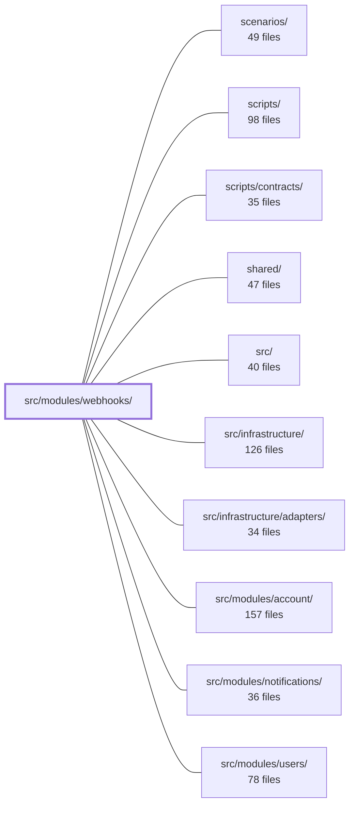

---
tags:
  - 2brain
  - 2brain/module
  - project/boilerplate-node-backend
type: module
module: src/modules/webhooks/
files: 64
updated: 2026-11-08T10:54:56.039322+00:00
---

# src/modules/webhooks/

## Purpose

The webhooks module is the outbound-event delivery subsystem: it lets tenants subscribe to platform events, handles the actual HTTP delivery (with signing, retries, and auto-disable), records every delivery attempt, and exposes a full admin API for managing subscriptions, inspecting the delivery log, and replaying deliveries. It owns two MongoDB collections, a RabbitMQ consumer queue, and the public event catalogue that tells subscribers which events they can filter on.

## Key parts

- **API surface** — `routes.ts` wires the Express router; `controllers/` holds one thin handler per endpoint (subscription CRUD, enable/disable, secret rotation, delivery log, replay, event catalogue). `openapi.yaml` is the normative contract for all request/response shapes.
- **Domain rules** — `domain/backoff.ts` and `domain/event-filter.ts` are pure, side-effect-free decision functions (retry schedule, `'*'` wildcard matching). `rules.yaml` + `rules.schema.ts` are the single source of truth for numeric thresholds, code-generated into `rules.generated.ts` for both the Node and PHP runtimes.
- **Service layer** — `services/attempt.ts` is the core sign-and-POST pipeline shared by the queue worker and the admin replay endpoint. `services/deliveries.ts` handles list/get/replay log operations. `services/enqueue.ts` is the single Claim-Check publish helper. `services/catalog.ts` builds the in-memory event catalogue at boot. `services/index.ts` aggregates everything behind one `webhooksService` object.
- **Data & secrets** — `model.ts` defines the Mongoose schemas and indexes. `repository.ts` wraps the shared factory with webhook-specific queries (lease claims, failure-streak updates, enabled-subscription scans). `secrets.ts` implements the versioned secret ring (mint, encrypt-at-rest, overlap window, retire).
- **Security & audit** — `authorization.yaml` declares per-action tenant permissions. `audit.ts` registers every subscription mutation into the app-wide `AuditActionMap`.
- **Module wiring** — `module.ts` is the manifest: it subscribes to all sibling modules' public events (reverse edge) and declares the delivery queue consumer. `index.ts` is the sole public import façade for other modules. `config.ts` exposes env-derived settings. `jobs.ts` declares the retry-sweep job; `metrics.ts` registers fleet-level delivery health metrics.
- **Spec & codegen** — `asyncapi.yaml` (shared catalogue fragment) + `asyncapi.internal.yaml` (private queue) feed the bundler that produces the final `asyncapi.public.yaml`.

## How it connects

- **`shared/`** — provides the `createRepository` and `createUpdateController` factories, the Zod schema utilities, and the shared `metricsRegistry` that this module plugs into.
- **`src/infrastructure/` & `src/infrastructure/adapters/`** — supply the outbound HTTP transport used by `services/attempt.ts` to POST to subscriber endpoints, and the versioned-secret encryption primitives wrapped by `secrets.ts`.
- **`src/modules/notifications/`** — a sibling consumer of the domain events declared in `events.ts` (e.g. subscription lifecycle changes). The webhooks module never imports notifications; it only publishes to the shared `DomainEventMap`.
- **`src/modules/account/`** — provides tenant identity and context that every controller and service scopes reads and writes against.
- **`src/modules/users/`** — supplies caller identity for audit records and permission checks.
- **`scripts/` & `scripts/contracts/`** — run the codegen step (`rules.yaml` → `rules.generated.ts`) and validate the `openapi.yaml` contract against the controller implementations.
- **`scenarios/`** — end-to-end and integration test harnesses that exercise the full subscription → delivery → replay flow.
- **Repository root** — the AsyncAPI bundler that merges this module's `asyncapi.yaml` fragment with per-module channel fragments into the final public spec.

## Where to start

1. **`services/attempt.ts`** — reading the sign → POST → record-outcome pipeline first gives you the mental model of what a "delivery" actually is, and shows how the worker and the replay path share one code path.
2. **`routes.ts`** — a single file that lists every endpoint, its controller, and its permission gate; it's the fastest way to see the module's full surface without opening 20 individual controllers.

## Connected modules

[[boilerplate-node-backend_ROOT|/ (repository root)]] · [[boilerplate-node-backend_scenarios|scenarios/]] · [[boilerplate-node-backend_scripts|scripts/]] · [[boilerplate-node-backend_scripts_contracts|scripts/contracts/]] · [[boilerplate-node-backend_shared|shared/]] · [[boilerplate-node-backend_src|src/]] · [[boilerplate-node-backend_src_infrastructure|src/infrastructure/]] · [[boilerplate-node-backend_src_infrastructure_adapters|src/infrastructure/adapters/]] · [[boilerplate-node-backend_src_modules_account|src/modules/account/]] · [[boilerplate-node-backend_src_modules_notifications|src/modules/notifications/]] · [[boilerplate-node-backend_src_modules_users|src/modules/users/]]

## Files
- `src/modules/webhooks/asyncapi.internal.yaml` — Declares the webhooks module's private RabbitMQ delivery queue (`worker.webhook.deliver`) as an AsyncAPI fragment. It exists separately from the module's public event catalogue (`./asyncapi.yaml`) so that the queue is included in the backend-bundled spec but never leaks into the frontend-facing `asyncapi.public.yaml`.
- `src/modules/webhooks/asyncapi.yaml` — The shared (module-agnostic) half of the public webhook event catalogue. It defines the single variable `subscriberEndpoint` server and the cross-event schemas (`WebhookHeaders` plus four copied scalar types) that every webhook delivery carries. The bundler merges this document with per-module channel fragments into the final `asyncapi.yaml` and `asyncapi.public.yaml`. It exists so the catalogue a subscriber reads at `GET /webhooks/events` stays in lockstep with the events that can actually fire.
- `src/modules/webhooks/audit.ts` — Declares the audit-action vocabulary for all webhook subscription and delivery mutations, and registers those actions into the app-wide `AuditActionMap` via TypeScript module augmentation. Every write to a subscription (including non-destructive ones like enabling or rotating a secret) is audited because the stored URL and signing secret are the kind of data a later data-protection question targets.
- `src/modules/webhooks/authorization.yaml` — Declarative authorization policy for the `webhooks` module. It defines which actions a tenant may perform on `WebhookSubscription` resources and groups those actions into reusable permission sets, so that downstream enforcement (middleware, API gates, etc.) can check access without hard-coding rules.
- `src/modules/webhooks/config.ts` — Defines the environment-derived configuration surface for the webhooks module (encryption key ring, per-tenant subscription cap, secret overlap window, delivery retention). Uses the read-per-call `defineConfig` pattern (same as `inventory/config.ts`) so tests can vary values per case without re-imports; a deployment changes a value via env var + restart.
- `src/modules/webhooks/controllers/delete-subscription-secret.ts` — Controller for `DELETE /webhooks/subscriptions/:id/secrets/:secretId`. Removes a single secret (ring entry) from a webhook subscription as part of a key-rotation workflow. It delegates the actual removal to the service layer and shapes the success response into a subscription view.
- `src/modules/webhooks/controllers/delete-subscription.ts` — Hand-written controller for `DELETE /webhooks/subscriptions/:id`. It permanently removes a webhook subscription (the delivery log is intentionally left in place). It exists as a standalone function rather than a product of `createDeleteController` because the webhooks module has only a permanent delete, not the soft/hard delete triplet that factory targets.
- `src/modules/webhooks/controllers/get-deliveries.ts` — Thin HTTP controller for `GET /webhooks/deliveries`. It validates query parameters, extracts tenant context from the request, and delegates to `webhooksService.listDeliveries`. Exists to keep route wiring (in `routes.ts`) free of validation and service-call logic.
- `src/modules/webhooks/controllers/get-delivery.ts` — HTTP controller for the `GET /webhooks/deliveries/:id` route. It extracts and validates the delivery ID, delegates the fetch to the webhooks service scoped to the caller's tenant, and shapes the response. It exists to keep the route handler thin and to centralise the "not found / not yours" security contract in one place.
- `src/modules/webhooks/controllers/get-events.ts` — Express controller that handles `GET /webhooks/events`, returning the full list of webhook events available for subscription filtering. The catalogue data originates from the project's `asyncapi.yaml` specification and is exposed here as a simple JSON array.
- `src/modules/webhooks/controllers/get-subscription.ts` — Defines the single GET-by-ID handler for webhook subscriptions (`GET /webhooks/subscriptions/:id`). It is a thin wrapper that delegates to the webhooks service while enforcing tenant isolation at the HTTP surface.
- `src/modules/webhooks/controllers/get-subscriptions.ts` — HTTP controller for `GET /webhooks/subscriptions`. It exposes the tenant's webhook subscriptions as a paginated, filterable list (newest-first by default) while guaranteeing that no secret material is returned. It delegates the actual data-fetching to the webhooks service and relies on the shared list-controller factory for pagination, input decoding, and response shaping.
- `src/modules/webhooks/controllers/post-delivery-replay.ts` — HTTP controller for `POST /webhooks/deliveries/:id/replay`. It re-sends a previously stored webhook delivery synchronously, targeting the subscription's *current* URL and secret ring rather than the original. Documented as the most-requested support action in the webhooks module.
- `src/modules/webhooks/controllers/post-subscription-disable.ts` — HTTP controller for `POST /webhooks/subscriptions/:id/disable`. It validates the subscription ID, delegates to the webhooks service to pause (disable) the subscription, and returns the resulting subscription view — or a 409 if it is already paused.
- `src/modules/webhooks/controllers/post-subscription-enable.ts` — HTTP controller handler for `POST /webhooks/subscriptions/:id/enable`. It validates the subscription ID, assembles a tenant caller context, delegates to the webhooks service to re-enable the subscription, and shapes the success or refusal response.
- `src/modules/webhooks/controllers/post-subscription-secret.ts` — HTTP controller for `POST /webhooks/subscriptions/:id/secrets`. It validates the subscription ID, delegates secret creation to the webhooks service, and returns the new ring secret plaintext exactly once in the response body while the previous secret remains active.
- `src/modules/webhooks/controllers/post-subscription.ts` — Single-purpose controller handler for `POST /webhooks/subscriptions`. Parses the request body against the generated Zod schema, delegates to the webhooks service, and returns a `201 Created` response containing the subscription (projected) plus the one-time `secret`.
- `src/modules/webhooks/controllers/update-subscription.ts` — Builds the `PUT /webhooks/subscriptions/:id` (full replace) and `PATCH .../:id` (partial merge) handlers for webhook subscriptions. It delegates to the shared `createUpdateController` factory so both verbs share validation, 404 handling, and response-shaping logic, while the actual write goes through `webhooksService.updateSubscription`.
- `src/modules/webhooks/domain/backoff.ts` — Defines the retry backoff schedule and the auto-disable threshold as pure, side-effect-free rules so the sweep job, the delivery worker, and unit tests all share one canonical table of delays and limits. All numeric values are pulled from a generated artifact (`rules.generated`) that is derived from `rules.yaml`; this file adds no hardcoded constants.
- `src/modules/webhooks/domain/event-filter.ts` — Pure decision function that answers a single question for the webhook publish pipeline: does a given event type match a subscription's `eventTypes` filter? It exists to keep the matching rule (exact membership or the `'*'` wildcard) in one place, decoupled from the I/O concerns of actually delivering webhooks.
- `src/modules/webhooks/domain/index.ts` — Barrel file for the webhooks domain layer. It flat-re-exports the pure business rules (retry/backoff logic and event matching) from `backoff.ts` and `event-filter.ts` so that consumers can import domain rules from a single, stable entry point without reaching into individual files.
- `src/modules/webhooks/events.ts` — Declares the webhooks module's domain events by augmenting the kernel's `DomainEventMap` interface. These events represent internal facts emitted to sibling modules (e.g. `notifications`); they are **not** webhook deliveries and never travel over an AsyncAPI channel.
- `src/modules/webhooks/index.ts` — Public barrel (module façade) for the webhooks module. By strategic-DDD convention (`docs/theory/strategic-ddd.md` §5), this file is the **only** import surface available to sibling modules. It re-exports the public API from `services`, `domain`, and `events`, plus the type definitions from `model`, while deliberately keeping `module.ts` (manifest entry) and `secrets.ts` internal.
- `src/modules/webhooks/jobs.ts` — Declares the scheduled jobs owned by the `webhooks` module. Currently exposes a single job (`sweepWebhookRetries`) that triggers the delivery-retry sweep on a schedule.
- `src/modules/webhooks/metrics.ts` — Defines and registers the webhooks module's domain metrics on the shared `metricsRegistry`. These metrics exist to power two fleet-wide alerts (`WebhookDeliveriesFailingEverywhere`, `WebhookRetriesStalled`) that detect our-side outages in the delivery path, as distinct from per-subscription auto-disable events.
- `src/modules/webhooks/model.ts` — Defines the two Mongoose collections the webhooks module owns — `webhooksubscriptions` (a tenant's standing subscription to event types) and `webhookdeliveries` (one row per event × subscription, tracking retry state) — including their schemas, indexes, TypeScript interfaces, and the wire serialization transform for subscriptions.
- `src/modules/webhooks/module.ts` — Module manifest for the **outbound webhooks** feature: subscription management, the delivery log, and the admin API. It subscribes to every `publicEvents` entry declared by other modules via the domain-event bus (a reverse edge — this module never imports `orders`/`payments`), and it declares its own queue consumer for webhook delivery so that removing this module is sufficient to stop the queue from mattering.
- `src/modules/webhooks/openapi.yaml` — OpenAPI 3.1.0 module contract for the webhooks domain. It defines the complete public API surface for outbound webhook subscriptions—creation, read, update, delete, enable/disable, secret management, delivery log, replay, and the event catalogue—along with the module's custom error-code vocabulary. Consumers (SDKs, gateway validators, docs generators) treat this file as the single source of truth for request/response shapes and state-machine transitions.
- `src/modules/webhooks/presenters.ts` — Turns stored webhook documents into their wire (API response) shapes. Two presenters exist—one per resource (subscription and delivery log)—because webhooks serves both. The presenters apply the model's `.toJSON()` transform and attach caller-scoped `actions`; they do not compute secrets or otherwise enrich the payload beyond what the document already carries.
- `src/modules/webhooks/repository.ts` — Data-access layer for the two webhook collections (subscriptions and deliveries). Wraps the shared `createRepository` factory with domain-specific queries the generic factory has no shape for: atomic lease-based claims, tenant-scoped reads, failure-streak bookkeeping, and the enabled-subscription scan that drives event dispatch.
- `src/modules/webhooks/routes.ts` — Defines the Express router for the `/webhooks` admin surface. It wires every subscription CRUD action, the delivery log, delivery replay, and the public event catalogue to their respective controller handlers, each gated behind a fine-grained `requirePermission` check.
- `src/modules/webhooks/rules.schema.ts` — Defines the Zod schema for the `rules.yaml` webhook configuration file (retry delays and auto-disable thresholds) and declares the `GenerateSpec` that drives `npm run regenerate` to produce `rules.generated.ts`. It is the single source of truth for both validation and codegen of the shared rules data that the PHP twin consumes.
- `src/modules/webhooks/rules.yaml` — Single source of truth for webhook-delivery retry and auto-disable thresholds. It is plain YAML consumed by a build step (`npm run regenerate` → `rules.generated.ts`) and copied into the PHP counterpart, so both runtimes enforce identical delivery policy without hand-syncing numbers.
- `src/modules/webhooks/secrets.ts` — Implements the secret-ring lifecycle for webhook subscriptions: minting, encrypting at rest, determining which secrets are still valid, and retiring superseded ones. It wraps the versioned-secret encryption primitives with webhook-specific binding and a time-based overlap window so a rotation never causes a verification gap.
- `src/modules/webhooks/services/actions.ts` — Centralizes the ability-to-act rules for webhook subscriptions and deliveries. Given a caller's ability keys and a subscription's minimal state, it computes the exact set of actions the caller may perform. Existing so that every controller and service reads the same single source of truth rather than re-deriving permission logic independently.
- `src/modules/webhooks/services/attempt.ts` — The core delivery-attempt pipeline for webhooks: sign the payload, perform the HTTP POST (via `transport/webhook-delivery`), and record the outcome on both the delivery row and the subscription's failure streak. It exists as a single shared code path so that the queued worker (`processDeliveryJob`) and the synchronous admin `replay` (in `deliveries.ts`) cannot drift on what "recording an outcome" means.
- `src/modules/webhooks/services/catalog.ts` — Builds the public webhook event catalogue by reading each registered module's `asyncapi.webhooks.yaml` fragment once at boot. The resulting in-memory list serves the `GET /webhooks/events` endpoint and powers subscription validation, guaranteeing that the listed events, the subscribe check, and the bundled AsyncAPI contract all derive from the same per-module files.
- `src/modules/webhooks/services/deliveries.ts` — Implements the three delivery-log operations exposed on the webhook delivery endpoint: paged `list`, single `get`, and synchronous `replay` (re-send). It sits between the HTTP handler layer and the repository/attempt primitives, handling filter remapping, action-shaping, lease claims, and audit recording.
- `src/modules/webhooks/services/enqueue.ts` — Single shared helper that publishes a delivery row's next attempt onto the worker queue. It exists so that both the fast-path publisher (`publish.ts`) and the retry sweep (`sweep.ts`) use one identical enqueue call rather than duplicating the payload shape and channel selection. Implements the Claim Check EIP: the message carries only the row's `deliveryId`; the row itself remains the source of truth for attempt details.
- `src/modules/webhooks/services/index.ts` — Barrel module for the webhooks service layer. It aggregates the individual service files (`subscriptions`, `deliveries`, `attempt`, `sweep`, `publish`, `reencrypt`, `catalog`) behind a single `webhooksService` object so that controllers and other callers have one import surface instead of reaching into each file.
- `src/modules/webhooks/services/publish.ts` — Domain-event subscriber for the webhooks module. Once every registered module is known, it listens to each domain event that a module's manifest names a `PublicEventTarget` for, projects the payload into a public event, matches it against every enabled subscription's filter, and fans out one delivery row + one queue message per match. The reverse dependency is a domain event, not an import, keeping `webhooks` decoupled from business modules like `orders` or `payments`.
- `src/modules/webhooks/services/reencrypt.ts` — Service-layer entry point that re-encrypts every webhook subscription's signing secrets onto the newest key in the encryption key ring. It exists so the ops script (defined in `@infrastructure/security/reencrypt`) can drive a bulk rotation without touching domain logic directly.
- `src/modules/webhooks/services/subscriptions.ts` — CRUD service layer for webhook subscriptions: list, get, create, update, enable/disable, secret-ring management, and remove. All operations are tenant-scoped via `context.caller.tenantId`. The file also enforces a per-tenant subscription cap (with a race-safe post-insert check), validates outbound URLs against SSRF at input time, and rejects unknown event types before they become dead subscriptions.
- `src/modules/webhooks/services/sweep.ts` — Per-minute retry sweep for webhook deliveries. It fetches every delivery due for another attempt plus any stranded `in_flight` row whose lease has expired, then dispatches each one — either by publishing to the broker or by sending inline when no broker is available. This is the "degrade, don't drop" fallback that keeps deliveries moving without tying them to an API request.
- `src/modules/webhooks/tests/contract/schema-drift.contract.test.ts` — Guards against silent drift between the `WebhookSubscription` and `WebhookSubscriptionCreated` schemas in the module's `openapi.yaml`. Because JSON Schema (and the orval-generated Zod judge) cannot compose two `additionalProperties: false` siblings via `allOf`, the field list is restated by hand in the second schema; this test is the sole sync mechanism between the two declarations.
- `src/modules/webhooks/tests/contract/webhooks.contract.test.ts` — Contract tests that validate the `/webhooks` admin HTTP surface—subscriptions CRUD, delivery log, replay, and the public event catalogue—against the bundled `openapi.yaml` schema. The file ensures that response shapes, status codes, error bodies, and field-level rules (e.g. secrets never returned in lists) stay in sync with the published API contract.
- `src/modules/webhooks/tests/fuzz/webhook-ssrf.fuzz.test.ts` — Fuzz-style tests for `deliverWebhook`'s own SSRF-adjacent behaviours: that the total timeout budget covers DNS resolution, that 3xx redirects are refused rather than followed, that the exempted demo host is still https-only, that non-443 ports are blocked before any connection, and that `durationMs` uses a monotonic clock. It deliberately does **not** re-test the generic SSRF guard (covered by `ssrf-guard.fuzz.test.ts`) because the guard is infrastructure, not webhook-owned.
- `src/modules/webhooks/tests/integration/delivery-log.test.ts` — Integration tests (run against a real database) that verify the webhook delivery log's `list` and `replay` service functions. They confirm tenant isolation on reads, filtering by subscription and status, and that a replay with nothing to re-send returns 404 without mutating the delivery row.
- `src/modules/webhooks/tests/integration/delivery.test.ts` — End-to-end integration test for the webhook delivery pipeline. Runs against a real test database and a locally spawned HTTPS listener (`tests/support/https-test-server.ts`) — never the compose `webhook-tester` service. Verifies the full lifecycle promised by `docs/modules/webhooks.md`: signed delivery arrival, 500-triggered retry, sustained-failure auto-disable, replay re-send, and delivery-log bookkeeping at every step.
- `src/modules/webhooks/tests/integration/fan-out.test.ts` — Integration test that verifies the webhook fan-out contract: a single public event produces delivery rows **only** for subscriptions that are both ENABLED and MATCHING the event type, and all rows for one event share the same `eventId` (the dedup key consumers rely on). It exists to guard against leaking data to disabled subscribers and to ensure consistent event identity across recipients.
- `src/modules/webhooks/tests/integration/reencrypt.test.ts` — Integration test for the `reencrypt` walk in the webhooks module. It verifies that after a webhook-secret key rotation (v1 → v2), a ring secret still stamped `v1` is re-stamped to `v2` and remains decryptable under its entry id. It inspects the raw ciphertext below the repository's own decryption layer to confirm the version bump actually happened.
- `src/modules/webhooks/tests/integration/subscription-lifecycle.test.ts` — Integration tests that exercise the webhook subscription service (`services/subscriptions.ts`) end-to-end against a real database. They pin the service-level contract for listing, reading, create-validation, enable/disable, the secret ring, and removal — covering outcomes that the HTTP-level contract suite does not assert. The SSRF guard is replaced (not spied) because its own dedicated test table lives in `tests/fuzz/`.
- `src/modules/webhooks/tests/integration/subscriptions.test.ts` — Integration tests for the `create` function in the webhooks subscriptions service. The suite exists because a mocked repository cannot reproduce two writers landing at the same instant; a real database is required to exercise the post-insertion rank re-check that guards the subscription cap race condition. It also verifies that `ownerUserId` is persisted at creation time but excluded from the wire response.
- `src/modules/webhooks/tests/integration/sweep.test.ts` — Integration tests for `sweepDueWebhookDeliveries` run against a real database. The queue adapter and the direct-delivery transport are mocked so the tests verify exactly what the sweep enqueues (or falls back to sending directly) without a live broker or network. This covers the path that `delivery.test.ts` never exercises: rows reached *through* the sweep rather than by calling `processDeliveryJob` directly on a fixture.
- `src/modules/webhooks/tests/unit/backoff.test.ts` — Unit tests for the pure retry-backoff rules defined in the webhooks domain layer. Validates the tiered delay schedule, the exhausted-signal convention, and the dual-threshold auto-disable logic without any external state or timers.
- `src/modules/webhooks/tests/unit/catalog.test.ts` — Unit tests for the webhook event catalogue service. They verify that the catalogue only surfaces events from *registered* modules, that unregistered modules contribute nothing, and that the subscribe-time check (`unknownEventTypes`) correctly accepts listed names and the wildcard while flagging anything else.
- `src/modules/webhooks/tests/unit/event-filter.test.ts` — Unit tests for the `matchesEventFilter` function, verifying that event-name matching against a filter array behaves correctly for exact matches, non-matches, the `ALL_EVENTS` wildcard, and the empty-filter edge case.
- `src/modules/webhooks/tests/unit/module.test.ts` — Unit tests for the webhooks module's boot-time configuration gate and its registration warning. It verifies that `assertModuleConfig` enforces a valid `NODE_WEBHOOK_SECRET_ENCRYPTION_KEY` (present, non-placeholder, 32-byte hex/base64) and that `onRegistered` warns when no message broker is configured.
- `src/modules/webhooks/tests/unit/schema-contract.test.ts` — Unit test that asserts the **declarative contract** of the two Mongoose schemas (`webhookSubscriptionSchema`, `webhookDeliverySchema`) — required paths, defaults, enums, index specs, and index options — by reading the schema objects directly. It exists because structural drift (a dropped `required`, a flipped default, a TTL index detached from the configured retention window) does not change what a *valid* document looks like, so document-based integration tests cannot detect it.
- `src/modules/webhooks/tests/unit/secrets.test.ts` — Unit tests for the secret-ring operations exported by `secrets.ts` — encryption/decryption of individual entries, minting new secrets, resolving the active signing set under the 24-hour overlap window, listing secrets that are retiring, and removing an entry by id. The file deliberately does **not** re-test the underlying crypto or version-mismatch logic; that belongs to `versioned-secret.test.ts`. Here it verifies the ring-level wiring and timing semantics.
- `src/modules/webhooks/tests/unit/webhook-signing.test.ts` — Unit tests that validate `signWebhookPayload` against the **Standard Webhooks** specification's own reference test vector (copied verbatim from the upstream repo) and confirm that the test-fixture verifier (`verifyWebhookSignatureForTest`) round-trips correctly. A byte-for-byte match here asserts interoperability with any conforming consumer, not just internal consistency.
- `src/modules/webhooks/tests/verify-signature.fixture.ts` — Test-only helper that verifies a Standard Webhooks–signed delivery. It is written independently of the production signer (`webhook-signing.ts`) so that a passing round-trip test proves conformance to the [Standard Webhooks spec](https://www.standardwebhooks.com), not merely that one function inverts itself. The codebase only ever *sends* webhooks; this fixture simulates the receiving side for tests.
- `src/modules/webhooks/transport/webhook-delivery.ts` — Implements a single outbound webhook delivery attempt — SSRF-check, sign, POST, time out — behind one function (`deliverWebhook`) that a worker calls to turn a queued delivery into an HTTP request and a recorded outcome. The function never rejects; every failure path resolves to a `WebhookDeliveryResult` with `success: false`, so a worker can always write a delivery-log row without crashing.
- `src/modules/webhooks/transport/webhook-signing.ts` — Implements Standard Webhooks (spec: standardwebhooks.com) **signing only**, hand-rolled over `node:crypto` to avoid a dependency for what is ~12 lines of HMAC. Produces the three outgoing headers (`webhook-id`, `webhook-timestamp`, `webhook-signature`) that `webhook-delivery.ts` attaches to each delivery. There is no production verifier in this codebase — the sender never receives signed webhooks.

---
[[boilerplate-node-backend_INDEX|← boilerplate-node-backend index]]
