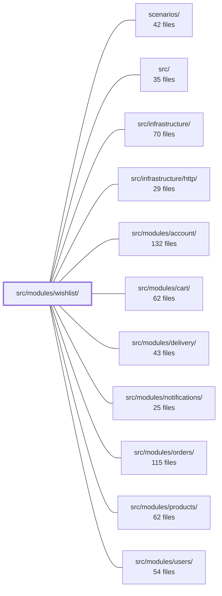

---
tags:
  - 2brain
  - 2brain/module
  - project/boilerplate-node-backend
type: module
module: src/modules/wishlist/
files: 25
updated: 2026-10-15T13:42:44.913810+00:00
---

# src/modules/wishlist/

## Purpose

The wishlist module manages a per-user "saved products" list — a lightweight, quantity-free record of which products a user wants to revisit. It provides list, save, remove, and move-to-cart operations over a single Mongoose document per user, and acts as an intermediate step between browsing and the cart (the moment a quantity matters, the item migrates to the cart domain).

## Key parts

- **Domain model & persistence** — `model.ts` defines the Mongoose schema (one document per `userId`, an array of `{ productId }` entries, no per-line identity, a unique index on `userId`). `repository.ts` wraps that schema with the four domain-specific writes (add line, remove line, delete-for-user, purge-by-product) on top of the generic CRUD helper. `factories.ts` builds ready-to-insert fixtures for tests.
- **Business logic** — `service.ts` is the single orchestration point: it composes repository calls with product-visibility checks, cart availability lookups, analytics emission, and domain-event publishing. All controllers delegate here; no controller imports bare functions.
- **HTTP surface** — `routes.ts` declares the Express route table (all user-scoped, auth-gated). The `controllers/` directory holds five thin adapters (GET, PUT, DELETE, POST move-to-cart, POST move-to-cart) that extract request context and call the service. `presenter.ts` maps the stored document to the wire shape in `openapi.yaml`.
- **Module registration & contracts** — `module.ts` is the manifest that wires routes, the `PRODUCT_DELETED` event subscription (purges stale product references), and the personal-data `collect`/`erase` hooks. `module.yaml` records domain classification and dependencies. `openapi.yaml` is the API contract. `index.ts` is the sole public barrel enforcing the strategic-DDD boundary.
- **Events & analytics** — `events.ts` declares the `WISHLIST_ITEMS_REMOVED` payload into the app-wide `DomainEventMap`. `analytics.ts` registers funnel event names into the app-wide `AnalyticsEventMap` for type-safe, string-free analytics tracking.
- **Testing** — `tests/unit/` pins schema shape, route order, factory output, and analytics constants. `tests/integration/` exercises service rules (idempotent saves, move-to-cart ordering, concurrency guarantees) against a real database. `tests/contract/` verifies every declared HTTP response branch is reachable. `probes.ts` covers edge cases the OpenAPI contract structurally cannot express.

## How it connects

- **`src/modules/cart/`** — The move-to-cart operation calls into the cart module to add the product, and only removes the wishlist line after the cart write succeeds, so a cart refusal never "vanishes" the saved item.
- **`src/modules/products/`** — The service checks product visibility before allowing a save, and `module.ts` subscribes to the `PRODUCT_DELETED` event to purge the product ID from every user's wishlist.
- **`src/modules/account/`** — The personal-data hook pair (`collect` / `erase`) registered in `module.ts` lets the account module export or permanently delete a user's saved items without importing wishlist internals.
- **`src/modules/notifications/`** — The `WISHLIST_ITEMS_REMOVED` domain event carries affected user IDs and product titles so downstream notification consumers can react; the event is suppressed when no wishlist was affected.
- **`src/infrastructure/http/`** — Controllers and routes rely on the shared HTTP infrastructure for response envelopes, auth middleware, and error formatting.
- **`scenarios/`** — End-to-end and contract test scenarios exercise the wishlist endpoints through the public barrel.

## Where to start

1. **`model.ts`** — Five lines of schema capture the entire domain shape: one document per user, a set of product IDs, no quantity. Reading this first makes every other file in the module immediately understandable.
2. **`service.ts`** — Shows how the four operations (get, add, remove, move-to-cart) are composed from repository calls, product checks, cart writes, and event emission. It is the single place where business rules live, and the natural entry point for understanding module behaviour.

## Connected modules

[[boilerplate-node-backend_ROOT|/ (repository root)]] · [[boilerplate-node-backend_scenarios|scenarios/]] · [[boilerplate-node-backend_src|src/]] · [[boilerplate-node-backend_src_infrastructure|src/infrastructure/]] · [[boilerplate-node-backend_src_infrastructure_http|src/infrastructure/http/]] · [[boilerplate-node-backend_src_modules_account|src/modules/account/]] · [[boilerplate-node-backend_src_modules_cart|src/modules/cart/]] · [[boilerplate-node-backend_src_modules_delivery|src/modules/delivery/]] · [[boilerplate-node-backend_src_modules_notifications|src/modules/notifications/]] · [[boilerplate-node-backend_src_modules_orders|src/modules/orders/]] · [[boilerplate-node-backend_src_modules_products|src/modules/products/]] · [[boilerplate-node-backend_src_modules_users|src/modules/users/]]

## Files
- `src/modules/wishlist/analytics.ts` — Defines the wishlist module's analytics event names and registers them into the app-wide `AnalyticsEventMap` via TypeScript module augmentation. This gives the wishlist a type-safe set of funnel events (save → exit-to-purchase) without the consuming code needing to know the literal strings.
- `src/modules/wishlist/controllers/delete-wishlist-item.ts` — Thin HTTP adapter for `DELETE /wishlist/:productId`. Validates the path parameter, extracts caller identity and context from the request, and delegates the actual removal to `wishlistService.wishlistRemove`. Exists to keep routing and business logic decoupled.
- `src/modules/wishlist/controllers/get-wishlist.ts` — Thin HTTP adapter for the `GET /wishlist` endpoint. It extracts the authenticated user's ID from the request, delegates to `wishlistService.wishlistGet`, and formats the result as a standard success/error response. Contains no business logic.
- `src/modules/wishlist/controllers/post-move-to-cart.ts` — Thin HTTP adapter that wires the `POST /wishlist/:productId/move-to-cart` route to the business logic in `wishlistService.wishlistMoveToCart`. It extracts the product ID from the URL, the user ID from the auth context, and the caller context, then delegates the actual "move one wishlist item into the cart" operation to the service layer.
- `src/modules/wishlist/controllers/put-wishlist-item.ts` — HTTP controller for `PUT /wishlist/:productId`. Acts as a thin adapter: extracts the authenticated user and validated product ID from the request, delegates to `wishlistService.wishlistAdd`, and maps the result to an HTTP response. No business logic lives here.
- `src/modules/wishlist/events.ts` — Declares the wishlist module's domain-event payloads by augmenting the kernel's `DomainEventMap` interface, so the app-wide event catalogue grows incrementally per module. Exports the single event-name constant used by emitters and listeners.
- `src/modules/wishlist/factories.ts` — Builds wishlist fixtures (ready for `wishlistRepository.create`) from minimal caller input. Follows the same owner-addressed pattern as cart factories: the document is keyed by `userId` and no wishlist `_id` is generated or transmitted, so no `_id` override is accepted.
- `src/modules/wishlist/index.ts` — Public barrel (re-export facade) for the wishlist module. It is the **only** import surface that sibling modules are permitted to use, enforcing the strategic-DDD boundary rule documented in `docs/theory/strategic-ddd.md` §5. It exposes no logic of its own.
- `src/modules/wishlist/model.ts` — Defines the Mongoose schema, document interfaces, and model for the wishlist collection. A wishlist is a per-user document (`userId` → `{ items: [{ productId }] }`) with no quantity — it exists solely to track "which products does this user want?" so that the moment an amount matters the item moves to the cart. All persistence shape (indexes, serialization, uniqueness guarantees) is established here.
- `src/modules/wishlist/module.ts` — Module manifest for the wishlist feature. Registers the wishlist's HTTP routes, a `PRODUCT_DELETED` event subscription (to purge stale product references), and a personal-data hook pair (`collect` / `erase`) so the account module can export or permanently delete a user's saved items without importing wishlist directly.
- `src/modules/wishlist/module.yaml` — Declarative metadata for the wishlist module. It classifies the module within the domain model, declares its inter-module dependencies, and records its audit-policy exemption. Exists so tooling and humans can resolve module boundaries without reading the implementation.
- `src/modules/wishlist/openapi.yaml` — OpenAPI 3.1.0 contract for the wishlist module. Defines the REST endpoints (list, save, remove, move-to-cart), their schemas, and the module's section in the account personal-data export. Serves as the single source of truth for the wishlist API surface that implementers, clients, and test suites code against.
- `src/modules/wishlist/presenter.ts` — Transforms the internal `WishlistDocument` into the wire shape declared by `openapi.yaml` (a `WishlistResponse`). This module is the single mapping point between the stored domain model and the API contract; the client renders product details from its own store.
- `src/modules/wishlist/probes.ts` — Exports a fixed set of wishlist HTTP probes — requests that exercise edge cases the OpenAPI contract structurally cannot describe (e.g. "save a product that will 404 on read"). The probes exist so automated collections can hit those gaps; they are intentionally kept separate from the contract bundle.
- `src/modules/wishlist/repository.ts` — Repository layer for the wishlist module. It combines the standard CRUD surface provided by `createRepository` with the four domain-specific writes a wishlist actually receives (add a line, remove a line, delete for a user, remove a product from all). It exists so the service and tests never touch Mongoose directly.
- `src/modules/wishlist/routes.ts` — Defines the Express route table for the wishlist module. All routes are user-scoped (no admin surface) and sit behind authentication. The file is thin wiring: it declares route order, applies auth/permission middleware, and delegates to the corresponding controller functions.
- `src/modules/wishlist/service.ts` — The service layer for the wishlist module. It orchestrates all wishlist operations (get, add, remove, move-to-cart, export, deletion) by composing repository access with product visibility checks, cart availability lookups, analytics emission, and domain events. Controllers call exclusively through the `wishlistService` barrel object; they never import the bare functions.
- `src/modules/wishlist/tests/contract/api.contract.test.ts` — Contract tests for the `/wishlist` API surface. Every route requires authentication and returns the same `WishlistResponseEnvelope` shape the cart uses. These tests verify that each declared response branch (success, 404, 403) is actually reachable over HTTP; they do not assert behavioural logic (that belongs to the unit suite).
- `src/modules/wishlist/tests/integration/items-removed.test.ts` — Integration test verifying that `productRemoveFromWishlistsById` emits a `WISHLIST_ITEMS_REMOVED` domain event carrying the affected user IDs and the product's localized titles, and that it emits **no** event when the product was absent from all wishlists — ensuring downstream consumers (e.g. notifications) never receive an empty announcement.
- `src/modules/wishlist/tests/integration/service.test.ts` — Integration tests that pin the domain rules of the wishlist service: idempotent saves via `$addToSet`, 404 on non-public products, move-to-cart ordering (cart write precedes wishlist-line removal so a refusal never "vanishes" the line), and correct per-line availability labelling in the read view. Exercises the real service, repository, cart, and product modules against a test database.
- `src/modules/wishlist/tests/integration/wishlist-races.test.ts` — Integration tests that pin down the concurrency guarantees of the wishlist endpoints. They verify two distinct atomicity claims: (1) `$addToSet` on `items.productId` makes the line-level write idempotent regardless of interleaving, and (2) the `upsert` filter `{ userId }` is an exact match on the unique index key, so the document-level race resolves to a single insert. The tests exist to catch regressions—e.g. swapping `$addToSet` for `$push`, or adding a condition to the upsert filter—that would break one guarantee without breaking the other.
- `src/modules/wishlist/tests/unit/analytics.test.ts` — Guarantees that the wishlist module's analytics event strings are frozen to the exact values Umami dashboards key on, and that those events are properly registered in the app-wide `AnalyticsEventMap` union. It exists to make a silent string rename (or a dropped module augmentation) a compile/test failure rather than a dashboard gap that goes unnoticed.
- `src/modules/wishlist/tests/unit/factories.test.ts` — Unit tests for the `makeWishlist` factory. Verifies that the factory correctly converts string IDs into Mongoose `ObjectId` instances, that wishlist line items contain **only** a `productId` (no quantity), and that an absent `items` field is kept distinct from an explicitly empty one so schema defaults apply.
- `src/modules/wishlist/tests/unit/routes.test.ts` — Unit test that pins down the wishlist router's contract: the exact set and order of endpoints, the auth guard on every route, the single permission guard (only on the move-to-cart write), and the declaration order that prevents a path-param collision between `/:productId/move-to-cart` and the bare `/:productId` routes.
- `src/modules/wishlist/tests/unit/schema-contract.test.ts` — Contract test that pins the structural invariants of `wishlistSchema` — the index, defaults, types, refs, and sub-schema shape that make the "one wishlist per user" and "no per-line identity" design enforceable at the database level. It asserts _what the schema declares_, not _what operations do_, so a silent schema change breaks the build before it breaks a query.

---
[[boilerplate-node-backend_INDEX|← boilerplate-node-backend index]]
