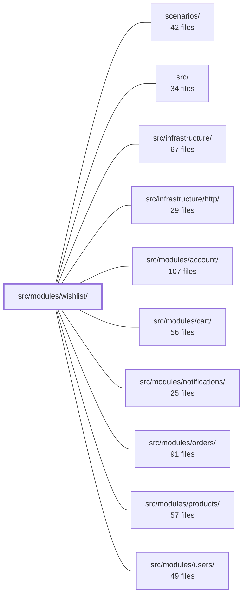

---
tags:
  - 2brain
  - 2brain/module
  - project/boilerplate-node-backend
type: module
module: src/modules/wishlist/
files: 25
updated: 2026-10-08T00:01:35.941263+00:00
---

# src/modules/wishlist/

## Purpose

The wishlist module is a supporting subdomain that tracks which products a given user has saved for later. The data model is deliberately minimal—a per-user document holding a flat list of product IDs with no quantity—because the moment a quantity matters, the item is moved into the cart. The module exposes four HTTP operations (list, save, remove, move-to-cart), fires analytics funnel events, and reacts to product/user deletions to keep wishlists clean.

## Key parts

- **Data & persistence** — `model.ts` defines the Mongoose schema and unique `userId` index; `repository.ts` wraps the generic repository factory with the four write operations (`$addToSet`, remove line, delete-by-user, remove-product-from-all) and a single `findByUserId` read; `factories.ts` builds test fixtures from minimal input.
- **Business logic** — `service.ts` translates the four user-facing operations into repository calls and cross-module side-effects (e.g. writing to cart before removing the wishlist line), and shapes every result into the `WishlistView` envelope required by the OpenAPI contract.
- **HTTP surface** — `controllers/` (get, put, delete, move-to-cart) are thin adapters that extract auth/params and delegate to the service; `routes.ts` wires verbs and paths, enforces authentication, and guards ordering; `openapi.yaml` is the machine-readable contract all four operations share.
- **Module wiring** — `module.ts` registers routes, a `personalData` erasure hook, and a domain-event subscription for product deletion cleanup; `module.yaml` declares runtime dependency order.
- **Cross-cutting** — `analytics.ts` registers type-safe funnel events (save → exit-to-purchase) into the app-wide `AnalyticsEventMap`; `events.ts` and `presenter.ts` handle domain-event payloads and view formatting; `probes.ts` supplies edge-case requests for automated collections.
- **Tests** — unit tests pin schema invariants, route table shape, factory output, and analytics strings; integration tests cover the full service→repository→DB path, race conditions, and event-driven cleanup; contract tests verify every documented response is reachable over the wire.

## How it connects

- **cart** — The move-to-cart operation writes the item into the cart *before* removing it from the wishlist, so the service depends on the cart module's write API.
- **products** — `module.ts` subscribes to a product-deletion domain event; when a product is hard-deleted, the wishlist repository removes that product ID from every user's wishlist.
- **users / account** — A `personalData` hook registered in `module.ts` erases the user's wishlist document on account deletion or GDPR purge, driven by the users/account modules.
- **infrastructure / infrastructure·http** — Controllers and routes rely on the shared Express/HTTP infrastructure (auth middleware, response helpers, route-registry conventions) provided by the `infrastructure` packages.

## Where to start

1. **`model.ts`** — the entire data shape is a few lines (one document per user, an array of product IDs). Reading this first makes the rest of the module's simplicity obvious and sets the "no quantity, no line identity" invariant.
2. **`service.ts`** — once the shape is clear, the four operations and their cross-module side-effects (especially the move-to-cart ordering guarantee) read naturally and explain why the controllers are so thin.

## Connected modules

[[boilerplate-node-backend_ROOT|/ (repository root)]] · [[boilerplate-node-backend_scenarios|scenarios/]] · [[boilerplate-node-backend_src|src/]] · [[boilerplate-node-backend_src_infrastructure|src/infrastructure/]] · [[boilerplate-node-backend_src_infrastructure_http|src/infrastructure/http/]] · [[boilerplate-node-backend_src_modules_account|src/modules/account/]] · [[boilerplate-node-backend_src_modules_cart|src/modules/cart/]] · [[boilerplate-node-backend_src_modules_notifications|src/modules/notifications/]] · [[boilerplate-node-backend_src_modules_orders|src/modules/orders/]] · [[boilerplate-node-backend_src_modules_products|src/modules/products/]] · [[boilerplate-node-backend_src_modules_users|src/modules/users/]]

## Files
- `src/modules/wishlist/analytics.ts` — Defines the wishlist module's analytics event names and registers them into the app-wide `AnalyticsEventMap` via TypeScript module augmentation. This gives the wishlist a type-safe set of funnel events (save → exit-to-purchase) without the consuming code needing to know the literal strings.
- `src/modules/wishlist/controllers/delete-wishlist-item.ts` — Thin HTTP adapter for the `DELETE /wishlist/:productId` endpoint. Validates the product ID, extracts the authenticated user, delegates to `wishlistService.wishlistRemove`, and maps the service result (or rejection) onto the HTTP response. Exists to keep route wiring in `routes.ts` declarative and to isolate Express-specific concerns from the service layer.
- `src/modules/wishlist/controllers/get-wishlist.ts` — Thin HTTP adapter for the `GET /wishlist` endpoint. It extracts the authenticated user's ID from the request, delegates to `wishlistService.wishlistGet`, and formats the result as a standard success/error response. Contains no business logic.
- `src/modules/wishlist/controllers/post-move-to-cart.ts` — Thin HTTP adapter for the `POST /wishlist/:productId/move-to-cart` endpoint. Extracts the caller's identity and product ID from the request, validates the ID, delegates to `wishlistService.wishlistMoveToCart`, and formats the HTTP response. It contains no business logic.
- `src/modules/wishlist/controllers/put-wishlist-item.ts`
- `src/modules/wishlist/events.ts`
- `src/modules/wishlist/factories.ts` — Builds wishlist fixtures (ready for `wishlistRepository.create`) from minimal caller input. Follows the same owner-addressed pattern as cart factories: the document is keyed by `userId` and no wishlist `_id` is generated or transmitted, so no `_id` override is accepted.
- `src/modules/wishlist/index.ts` — Barrel (public entry point) for the `wishlist` module. It re-exports the module's API so that sibling modules import from this single file rather than reaching into internal paths. Enforces the "single surface" rule described in `docs/theory/strategic-ddd.md` §5.
- `src/modules/wishlist/model.ts` — Defines the Mongoose schema, document interfaces, and model for the wishlist collection. A wishlist is a per-user document (`userId` → `{ items: [{ productId }] }`) with no quantity — it exists solely to track "which products does this user want?" so that the moment an amount matters the item moves to the cart. All persistence shape (indexes, serialization, uniqueness guarantees) is established here.
- `src/modules/wishlist/module.ts` — Module manifest and wiring for the wishlist feature. Registers routes, a `personalData` hook for account erasure, and a domain-event subscription so that deleted products are cleaned out of every wishlist. It is deliberately thin — no domain logic lives here, only the glue that connects the wishlist service to the kernel lifecycle.
- `src/modules/wishlist/module.yaml` — Module manifest for the **wishlist** subdomain (`supporting`). Declares the module's runtime dependencies so the build system and runtime resolver know which other modules must be initialised before wishlist code executes.
- `src/modules/wishlist/openapi.yaml` — OpenAPI 3.0.3 contract (v2.0.0) that defines the wishlist module's HTTP API surface: four operations over `/wishlist` for listing, saving, removing, and moving-to-cart a user's saved product ids. It serves as the machine-readable and human-readable specification that both the implementation and any client SDK generator consume.
- `src/modules/wishlist/presenter.ts`
- `src/modules/wishlist/probes.ts` — Exports a fixed set of wishlist HTTP probes — requests that exercise edge cases the OpenAPI contract structurally cannot describe (e.g. "save a product that will 404 on read"). The probes exist so automated collections can hit those gaps; they are intentionally kept separate from the contract bundle.
- `src/modules/wishlist/repository.ts` — Domain-specific persistence layer for the Wishlist module. It extends the generic `createRepository` factory with the four writes a wishlist actually takes (add line, remove line, delete-by-user, remove-product-from-all) and a targeted read (`findByUserId`). Every document is addressed by `userId` (the unique index key), so no caller ever reads before writing.
- `src/modules/wishlist/routes.ts` — Defines the Express route table for the wishlist module. It wires HTTP verbs and paths to the wishlist controllers, enforces authentication on every route, and handles the one ordering constraint that would otherwise cause silent mis-routing.
- `src/modules/wishlist/service.ts` — Service layer for the wishlist module. Translates high-level wishlist operations (get, add, remove, move-to-cart, bulk delete) into repository calls and cross-module interactions, and shapes every result into the `WishlistView` envelope (`{ items: [{ productId }] }`) that the OpenAPI contract requires.
- `src/modules/wishlist/tests/contract/api.contract.test.ts` — Contract tests for the `/wishlist` HTTP surface. They assert that every declared response shape (success and each error branch) is actually reachable over the wire, so the API cannot silently drop a documented response. Behavioural logic lives in the unit suite; this file only verifies the wire contract.
- `src/modules/wishlist/tests/integration/items-removed.test.ts`
- `src/modules/wishlist/tests/integration/service.test.ts` — Integration tests for the wishlist service, exercising the full request path (service → repository → DB) against a real test database. Covers the four core operations (add, remove, move-to-cart), their error contracts, the "write cart before dropping line" ordering guarantee, and the event-driven cleanup subscriptions that fire on product/user hard-deletion.
- `src/modules/wishlist/tests/integration/wishlist-races.test.ts` — Integration tests for concurrent (raced) writes against the wishlist endpoints. They pin down two specific race classes — line duplication (RW1) and duplicate-document creation via `upsert` (RW2) — plus a mixed save-and-move-to-cart race. The file exists to enforce the invariants that `wishlist/repository.ts` claims from its write shape (`$addToSet`, exact-equality filter) rather than from application-level retries.
- `src/modules/wishlist/tests/unit/analytics.test.ts` — Guarantees that the wishlist module's analytics event strings are frozen to the exact values Umami dashboards key on, and that those events are properly registered in the app-wide `AnalyticsEventMap` union. It exists to make a silent string rename (or a dropped module augmentation) a compile/test failure rather than a dashboard gap that goes unnoticed.
- `src/modules/wishlist/tests/unit/factories.test.ts` — Unit tests for the `makeWishlist` factory. Verifies that the factory correctly converts string IDs into Mongoose `ObjectId` instances, that wishlist line items contain **only** a `productId` (no quantity), and that an absent `items` field is kept distinct from an explicitly empty one so schema defaults apply.
- `src/modules/wishlist/tests/unit/routes.test.ts` — Unit test suite that pins down the wishlist route table: exact endpoint signatures, declaration order, authentication requirements, and the absence of admin guards. It exists to catch regressions where a route is added, reordered, or mis-guarded without updating the documented contract.
- `src/modules/wishlist/tests/unit/schema-contract.test.ts` — Contract test that pins the structural invariants of `wishlistSchema` — the index, defaults, types, refs, and sub-schema shape that make the "one wishlist per user" and "no per-line identity" design enforceable at the database level. It asserts _what the schema declares_, not _what operations do_, so a silent schema change breaks the build before it breaks a query.

---
[[boilerplate-node-backend_INDEX|← boilerplate-node-backend index]]
