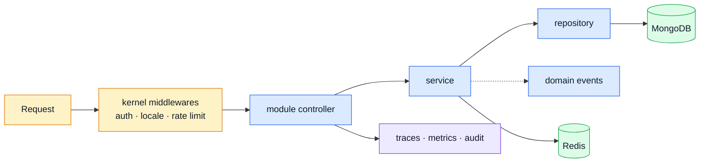

# boilerplate-node-api-mongodb-mongoose

> Express 5 + TypeScript + Mongoose REST API. Contract-first, modular, observable.
> Paired with [`boilerplate-vue-frontend`](https://github.com/Guebbit/boilerplate-vue-frontend).

**📚 The documentation is the real reference — this file is only the door.**
Run `npm run docs:dev` (or open `:3090` once the stack is up), or read `docs/`.

::: danger Uploaded images do not outlive the container
`imageStore` (`src/infrastructure/adapters/image-store.ts`) writes uploads to the container's own
filesystem. **Rebuild or remove the container and every uploaded image goes with it** — `docker
compose down -v`, a redeploy, a moved host. Only `public/images/seed/` survives, because those files
are committed. Two replicas do not share what they store either: an image uploaded to one is a 404
on the other.

A bind-mounted volume is the stopgap. It works, and it pins the deployment to one disk. The durable
answer is a second `ImageStore` implementation over an S3-compatible bucket or a CDN — nothing
selects a backend yet, on purpose, and `image-store.ts` documents what such an implementation has to
get right before anyone writes one.
:::

---

## Start here

This stack is **container-first**: the shipped `.env` uses compose service hostnames.

```bash
npm install
npm run setup              # creates .env from .env-example, fills every secret it refuses to boot without
npm run compose:up         # podman by default, CONTAINER_ENGINE=docker for Docker — 5 containers: app, cron, database, redis, rabbitmq
```

That is the whole setup. The `app` container runs `npm run db:bootstrap` before starting, so the
database is indexed and seeded on first boot — you get demo products, users and orders rather
than empty lists.

```bash
curl http://localhost:3000/            # health probe, with trace headers
curl http://localhost:3000/products    # the seeded demo data
```

Tempo, Loki, Prometheus, Grafana, Alloy and Umami are opt-in — the things that make this stack
worth cloning, but a weight most machines don't want running by default:

```bash
npm run compose:up:full   # adds observability + analytics + the docs site (17 containers)
```

`compose:restart` and `compose:rebuild` honour the same profiles: set `COMPOSE_PROFILES` in `.env`
once to keep the full stack across restarts, instead of passing `:full` every time.

→ Host mode, the collections, the pre-commit gate: **[Getting Started](./docs/build/run-locally.md)**
→ Ports and running the pair: **[Pairing & Ports](./docs/build/pairing-and-ports.md)**
→ What to set up by hand before it is yours (accounts, keys, domain, legal): **[INSTALL.md](./INSTALL.md)**

---

## What this is



Four ideas carry the whole repository:

1. **A module is a value, not a convention.** Every domain declares what it needs — routes,
   locales, scenario guarantees, event subscriptions, contract fragments — in one typed object. `src/modules.ts`
   lists them, and the registry refuses to boot on missing or placeholder config rather than
   failing at the first request. See [Adding & removing a module](docs/build/module-lifecycle.md)
   for what a domain actually costs to add or remove.
2. **The contract is an output, not a document.** `openapi.yaml` is assembled from per-module
   fragments and generates the typed client and Zod schemas that both repositories import.
3. **Layers stay honest.** `kernel` knows no domain, `infrastructure` knows no domain,
   `modules/*` know each other only through declared dependencies or domain events.
4. **Observability is wired, not planned.** OpenTelemetry traces, Prometheus metrics, Winston to
   Loki, an audit trail, and Grafana dashboards, all running in the dev stack.

---

## Where things live

The tiers, their folders and their main job are one table: [Layers](./docs/understand/layers.md#quick-map).
The domains are `src/modules/*` (each one deletable; `src/modules/example` is the one to copy for a new
domain), the contract and everything generated from it is `api/`, and `shared/` holds what both backends
read (`rules/`, `cases/`, `locales/`, `scenarios/`, `templates/`, the authorization keys). The demo records
and the flow runner are `scenarios/`, outside `src/` entirely; index sync and the one-off data scripts are `scripts/db/`.

---

## The map

| You want to                         | Read                                                                                                                                         |
| ----------------------------------- | -------------------------------------------------------------------------------------------------------------------------------------------- |
| Get it running                      | [Getting Started](./docs/build/run-locally.md)                                                                                               |
| **Read the code, first time**       | **[Reading Path](./docs/understand/reading-path.md)** — nine files, in order                                                                 |
| Look up a folder, a route or a term | [Reference](./docs/reference/start.md) — one hop to an answer                                                                                |
| Understand the shape                | [Architecture](./docs/understand/architecture.md) · [Layers](./docs/understand/layers.md) · [Modules](./docs/understand/modules.md)          |
| Add or remove a domain              | [Adding & Removing a Module](./docs/build/module-lifecycle.md)                                                                               |
| Change an endpoint                  | [OpenAPI Workflow](./docs/build/openapi-workflow.md) · [Regenerating](./docs/build/regenerating.md)                                          |
| Run the pair                        | [Pairing & Ports](./docs/build/pairing-and-ports.md)                                                                                         |
| Look up a script                    | [Package Scripts](./docs/reference/package-scripts.md)                                                                                       |
| Catch an outbound webhook           | [Docker & Podman](./docs/build/docker-and-podman.md#the-integrations-profile-is-where-a-real-consumer-would-go) — the `integrations` profile |
| Understand a dependency             | [Tools Explained](./docs/understand/tools-explained.md)                                                                                      |
| Test something                      | [Testing overview](./docs/build/testing-and-docs.md)                                                                                         |
| Deploy it                           | [Getting Started — Production](./docs/operate/first-deploy.md)                                                                               |

---

## Before you commit

```bash
npm run complete    # build + all tests + lint + format check — several minutes
```

The pre-commit hook runs a lighter slice of it (`complete:light:gates`, then `test:staged`);
`npm run complete:fix` is the full gate with lint and
formatting fixed rather than reported. Outside it, by hand: `npm run complete:manual`
(`test:prism`), `npm run mutation`, `npm run test:fuzz`, and `npm run bench`.

---

## License

AGPL-3.0-or-later. See [LICENSE](./LICENSE).

Copyright (C) 2023-2026 Andrea Guerzoni. This program is free software: you can redistribute it
and/or modify it under the terms of the GNU Affero General Public License as published by the Free
Software Foundation, either version 3 of the License, or (at your option) any later version. It is
distributed WITHOUT ANY WARRANTY; see the GNU Affero General Public License for details.

Every site built on this backend is a network service, so AGPL §13 applies: if you modify it, you
must offer everyone who interacts with it remotely a way to get the Corresponding Source of your
modified version — not just to someone you hand a copy to. The paired frontend is shipped straight
to browsers, so the same obligation covers it and the AGPL toolkits it bundles
(`@guebbit/vue-toolkit`, `@guebbit/js-toolkit`).

This binds _you_, the operator, not your users. It is not legal advice — some organisations forbid
AGPL dependencies outright; check before adopting.

The dev/production containers this repo composes carry their own licences, independent of the
above: `mongo` (SSPL), `redis` (RSAL/SSPL), and Grafana Labs' own images — Grafana, Loki, Tempo,
Alloy (AGPL). Prometheus and Alertmanager are unrelated CNCF projects, Apache-2.0.
