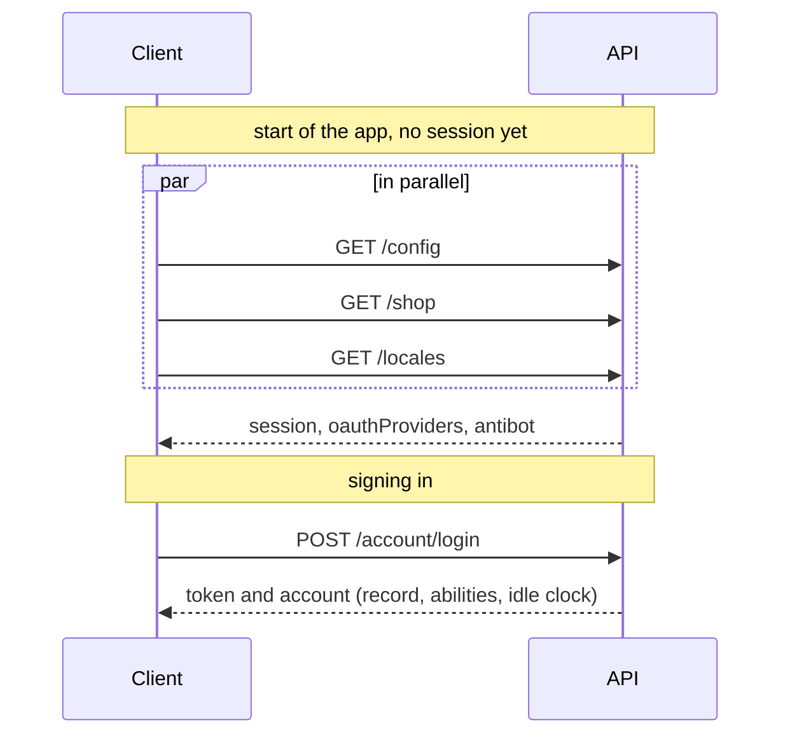

# `GET /config` — the boot answer

One public call carries what a client needs before anyone has signed in. It replaced three:
`GET /account/session-config`, `GET /account/oauth/providers` and `GET /antibot/config`.

| Member           | Owner     | What it tells the client                                                         |
| ---------------- | --------- | -------------------------------------------------------------------------------- |
| `session`        | `account` | `jwt` or `cookie`, and how long a session lasts per "remember me" tier           |
| `oauthProviders` | `account` | which "Continue with..." buttons to render; empty when no credentials are set    |
| `antibot`        | `antibot` | the active human challenge, its public parameters, and every rung's status       |

Each module keeps its piece (`accountService.sessionConfig`, `accountService.oauthProviders`,
`antibotService.config`). The route lives in `src/app/config-routes.ts` because the answer belongs
to neither owner: `app` composes, the modules do not reach each other.

None of it changes while the process runs, so a success answers `Cache-Control: public, max-age=60`.
A refusal (an unknown `NODE_ANTIBOT_PROVIDER`, say, answers 500) keeps the app-wide `no-store`.

`GET /shop` is **not** in it. The shop is removable (`demo:remove`), and a foundation answer may not
reach it, so the client asks for both in parallel.

See [Regenerating](./regenerating.md) for how a contract change reaches the frontend.
