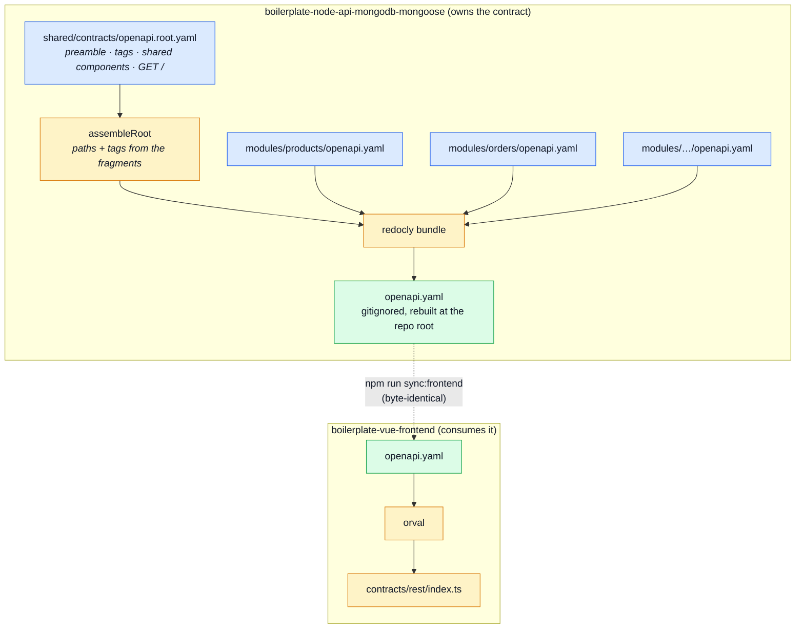

# Contract Ownership & Fragmentation

[OpenAPI Workflow](./openapi-workflow.md) covers **how to change** the contract. This page covers
**who owns it, where it lives, and how it reaches the frontend** — the part that involves two
repositories and is easy to get wrong from either side.

## The one-line version

> This repository **owns** the shared, domain-shaped documents. The frontend **holds
> byte-identical copies** of the two it consumes and never edits them.

**One backend, one paired frontend, lockstep.** `asyncapi.public.yaml` does reach a second
consumer — any webhook subscriber, guarded by the `asyncapi-breaking` job — but nothing here is
versioned or published for a second consumer to pin an *older* copy of. That is a deliberate
choice, not a gap: a versioned, publishable contract artefact is worth building once a second real
API consumer exists (a second frontend, a mobile client, a partner integration), not before. Until
then, `sync:frontend` copying two files on every change is the cheapest correct thing, and
`spec-identity` (both repos) and `contracts-bundle-freshness` are what make "lockstep" a checked
claim rather than a hope. The nightly Schemathesis run fuzzes this repo against its own spec — it
compares nothing across repos, so it isn't part of that lockstep guarantee.

## The seven bundles

`openapi.yaml` is not a special case. Seven documents are produced here from per-module
sources; two of them — `openapi` and `asyncapi-public` — also exist in
`boilerplate-vue-frontend` as byte-identical copies, because the frontend's toolchain reads them.
The four client collections stay in this repo only — they are derived from `openapi.yaml`, so a
frontend copy could never disagree without the spec disagreeing first, and nothing there reads
them:

| Bundle            | Written to                                  | Built from                                                     |
| ----------------- | ------------------------------------------- | -------------------------------------------------------------- |
| `openapi`         | `openapi.yaml`                              | `src/modules/<name>/openapi.yaml` — **compiled by `redocly bundle`** |
| `asyncapi`        | `asyncapi.yaml`                             | `src/modules/<name>/asyncapi.yaml` + `shared/contracts/asyncapi.{root,workers}.yaml` — **merged** |
| `asyncapi-public` | `asyncapi.public.yaml`                      | the same sources minus the backend-only ones — the half the frontend receives |
| `bruno`           | `contract.bruno.yml` *(untracked)*          | `openapi.yaml` + the demo dataset — **generated whole**         |
| `insomnia`        | `contract.insomnia.json` *(untracked)*      | `openapi.yaml` + the demo dataset — **generated whole**         |
| `mockoon`         | `contract.mockoon.json` *(untracked)*       | `openapi.yaml` + the demo dataset — **generated whole**         |
| `postman`         | `contract.postman.json` *(untracked)*       | `openapi.yaml` + the demo dataset — **generated whole**         |

Whatever more than one domain reads stays in `shared/contracts/`, and each bundle's section order,
layout and shared parts are declared in one file under `scripts/contracts/`.

**Four different verbs, and the difference is not cosmetic:**

| Bundle                   | Verb          | What does it                                                             |
| ------------------------ | ------------- | ------------------------------------------------------------------------ |
| `openapi.yaml`           | **compiled**  | `redocly bundle` resolves `$ref` across whole documents, then the root's `x-app-level-responses` (429, and 400/413/415 for a body-carrying operation — none of them any one module's business) is merged into every operation that doesn't already declare its own |
| `asyncapi.yaml`          | **merged**    | `scripts/contracts/asyncapi-bundles.ts` copies five maps; `$ref`s stay untouched |
| `asyncapi.public.yaml`   | **merged**    | the same merge over the shared sections only — one `SHARED_SECTIONS` list decides which |
| the 4 client collections | **generated** | produced whole from `openapi.yaml` + the dataset, nothing on disk between; untracked |

A hand-written restatement of the contract is a copy and copies rot, which is why the last row
exists at all. See [The client collections](#the-client-collections-generated).

```bash
npm run contracts:bundle              # build the committed specs
npm run contracts:bundle -- bruno     # one collection, from the committed contract
npm run check:contracts-bundle        # fail if any committed bundle is stale
```

`check:contracts-bundle` asserts every **committed** bundle equals a fresh build, so a fragment
edited without re-bundling fails it locally. `openapi.yaml` is gitignored and rebuilt by
`postinstall` on every install, so it carries no such check — only `asyncapi.yaml` and
`asyncapi.public.yaml` are committed and can go stale. In CI, `npm ci`'s `postinstall` rebuilds
every bundle before that check gets a turn, so it is the `contracts-bundle-freshness` job's
`git diff` of those two committed bundles against the checkout — not this check — that actually
catches a missed re-bundle on a push.

Nothing else is shared. `shared/contracts/spectral.yaml` and `generate-asyncapi-types.ts` exist in
both repos but are hand-maintained on each side, so a fork in one is a question (which copy is
right?) that no script could answer — they earn no gate. `src/types/asyncapi.generated.ts` is absent for the opposite reason — it is generated from a bundle by
`npm run gen:asyncapi`, so it follows one rather than being one. `asyncapi.yaml` is absent for a third:
it is a bundle, but not a SHARED one — the frontend receives `asyncapi.public.yaml` instead, so the
full contract is compared against nothing and is marked `shared: false` to say so.

## The flow



The picture is drawn for `openapi.yaml`; the other five bundles differ only in what reads the output
(the realtime type generator, four API clients). Three properties fall out of
it, and each is load-bearing:

1. **Fragments are authored here, and only here.** A module owns its slice of every shared document
   the same way it owns its routes and its seeds.
2. **The bundled file stays whole.** `openapi.yaml` is gitignored and rebuilt on every install here,
   but it is still what `spectral`, `orval`, the seed runner and the API clients all read locally —
   never fragments read piecemeal at request time.
3. **The frontend receives a finished file, and commits its copy.** It does not bundle, does not
   fragment, does not author; `sync:frontend` is what hands it across.

## Why the root file stays whole

It would be tidier to ship only fragments and bundle on demand. Three reasons not to:

- **The frontend's toolchain reads one file.** `orval.config.ts` there points at `./openapi.yaml`
  three times, and Spectral lints `openapi.yaml` in both repos.
- **Byte-identity is enforced by a test.** `scripts/pairing/spec-identity.ts` compares this repo's copy with
  the frontend's and fails the build when they fork. That check needs one file on each side to
  compare.
- **Regeneration is not reproducible across repos.** `redocly bundle` output depends on the
  installed CLI version, so two repos bundling independently can produce different bytes from the
  same sources. The output must be built once and copied, not rebuilt on both sides and assumed to
  match.

That last point is the one that bites. **If the bundle step ever produces different bytes here than
what the frontend holds, `check:spec-identity` fails and neither repo can build.** Bundle once, commit the
result, copy that.

The comments do **not** travel into `openapi.yaml` — a parse cannot keep them, and Redocly parses.
They live in the module documents instead, which is where they are read and edited. See
[Why the REST contract stopped concatenating](#why-the-rest-contract-stopped-concatenating-and-the-rest-did-not).

## Which fragment owns which operation

The rule is the one the module registry already uses: **a module owns the paths under its
`basePath`.** The count of operations per module drifts every time a route is added, so it is not
repeated here — `grep -c operationId: openapi.yaml` reads the true total, and
`tests/cross-cutting/contract-bundles.test.ts` is what actually keeps a fragment honest about which
paths it owns:

| Module          | `basePath`       | OpenAPI tag(s)         |
| --------------- | ----------------- | ---------------------- |
| `account`       | `/account`        | `Auth` + `Account`     |
| `addresses`     | `/account`        | `Account` (a subset — see below) |
| `orders`        | `/orders`         | `Orders`                |
| `invoicing`     | `/orders`         | `Invoicing` (a subset — see below) |
| `users`         | `/users`          | `Users`                  |
| `products`      | `/products`       | `Products`               |
| `cart`          | `/cart`           | `Cart`                    |
| `wishlist`      | `/wishlist`       | `Wishlist`                 |
| `payments`      | `/payments`       | `Payments`                  |
| `delivery`      | `/delivery`       | `Delivery`                   |
| `inventory`     | `/inventory`      | `Inventory`                   |
| `observability` | `/observability`  | `Observability`                |
| `feedback`      | `/feedback`       | `Feedback`                       |
| `locales`       | `/locales`        | `Locales`                          |
| `webhooks`      | `/webhooks`       | `Webhooks`                          |
| `returns`       | `/returns`        | `Returns`                           |
| `notifications` | `/notifications`  | `Notifications`                     |
| `example`       | `/examples`       | `Examples`                          |
| `api-keys`      | `/api-keys`       | `ApiKeys`                             |
| `antibot`       | `/antibot`        | `Antibot`                               |
| `audit-logs`    | `/audit`          | `Audit`                                   |
| `access`        | —                  | —                                          |

**The rows that are not a clean split are the interesting ones**, and whoever does the work will
hit them first:

- **`GET /` — the health probe — belongs to no module.** It is the application shell answering for
  itself. It goes in a `shared` or `root` fragment alongside `components:`, not into a module.
- **`account` and `addresses` share a `basePath` and a tag.** Both mount at `/account`, and address
  operations are tagged `Account` too — fragmenting by `basePath` still splits them correctly,
  since `addresses`' own paths (`/account/addresses*`) never overlap `account`'s.
- **`orders` and `invoicing` share a `basePath`, but NOT a tag.** Both mount at `/orders`;
  `invoicing`'s two paths (`/orders/{id}/invoice`, `/orders/{id}/credit-notes`) are tagged
  `Invoicing` rather than `Orders`, since download-a-frozen-document is a different concern from
  the order resource itself — fragmenting by `basePath` still splits the two files correctly.
- **`access` has no HTTP surface of its own** — headless by design, the one module whose manifest
  declares neither `basePath` nor `routes`. A module with no paths simply contributes no fragment;
  it is not an error, and it is a good sign: that module is consumed through the permission model
  every other module's routes already go through, not through an API of its own.

Also note that `Auth` and `Account` are two tags over one `basePath`. **Fragment by `basePath`, not
by tag** — tags are a documentation grouping and one module may legitimately use several.

## What a fragment contains

Everything the module's paths need and nothing else:

- its `paths:` entries,
- the `components.schemas` only it uses,
- its `tags:` declaration.

Anything used by two or more modules — the error envelope, pagination parameters, the security
schemes — stays in the shared root fragment. **Duplicating a shared schema into two fragments is
the failure mode to watch for**: the bundle will contain two definitions that drift apart silently,
and nothing but a careful reading catches it.

## Practical example: the `products` module

`products` owns everything about itself, its slice of the contract included:

```
src/modules/products/
├── module.ts        name, basePath '/products', routes, locales
├── routes.ts        the express router
├── controllers/     request handling
├── services/        business rules
├── repository.ts    persistence
├── model.ts         the mongoose schema
├── events.ts        what it publishes and subscribes to
├── openapi.yaml     its paths and the schemas only it uses
├── probes.ts        requests the contract cannot describe
├── locales/         its own copy
└── tests/           its own specs

scenarios/products.ts its own seed data — outside src/, see Demo profile
```

Its `openapi.yaml` holds every operation under `/products`:

```
/products                /products/search      /products/categories
/products/settings       /products/{id}        /products/{id}/admin
/products/{id}/restore   /products/{id}/hard
```

At which point the goal test the whole module architecture exists to satisfy finally includes the
contract:

> Deleting a domain is `rm -rf` of one folder plus removing one line from `src/modules.ts`. The
> bundler's input is what is on disk, so it needs no edit.

## Current state

Every operation and every single-domain type lives with the module that owns it.

```
shared/contracts/openapi.root.yaml    preamble · tags · securitySchemes · parameters · responses ·
                                      the shared types · GET / · the per-module path index
                                      (a preference: completed from the fragments, see below)
src/modules/<name>/openapi.yaml       one standalone OpenAPI document per module:
                                      its paths, and the schemas only its paths reference
```

```bash
npm run contracts:bundle              # rebuild every bundle from the fragments
npm run check:contracts-bundle        # fail if any committed bundle is stale
```

**The root's path index is completed, not trusted.** `scripts/contracts/root-assembly.ts` reads
every fragment on disk, drops the root's `$ref` for a path no fragment declares any more, appends
the paths and tags of a fragment the root has not heard of, and stages the completed tree under
`tmp/` for redocly. The root's hand order is kept for what it already lists, so the committed
bundle does not move; a new module is in the contract from its own `openapi.yaml` alone.

To rebuild one document while iterating, name it: `npm run contracts:bundle -- openapi`. The
ordering lives inside `scripts/contracts/build-bundles.ts` rather than as an `&&` chain in `package.json`,
which is what makes that flag narrow the run instead of silently doing everything else. See
[Regenerating After a Change](./regenerating.md#regenerate-one-bundle-only).

What `check:contracts-bundle` catches locally versus what `contracts-bundle-freshness` catches in
CI: see [The seven bundles](#the-seven-bundles) above.

### Why the REST contract stopped concatenating, and the rest did not

A module's contract is a whole OpenAPI document, not a slice of one. The explanations sit in the
file that is actually read and edited, and the bundle is an artefact nobody opens by hand. So
`redocly bundle` does the job the standard way, resolving `$ref`, and the comments in the sources
are untouched by it. One step runs after it, on the bundled document rather than on a source:
merging `x-app-level-responses` into every operation, since a `$ref` has to be resolved first for an
operation to be reachable exactly once — see `scripts/contracts/openapi-bundle.ts`. A second such
step reads the `x-versioned: [methods]` marker a fragment puts on a path item, and hangs the shared
`If-Match` parameter, the 412 and the `ETag` header on exactly the operations it lists — see
[Conditional writes](./write-methods.md#conditional-writes-etag-and-if-match).

What this buys:

- **A module contract is a valid document.** `npm run lint:openapi:modules` lints each one on its
  own; you can open one in Swagger Editor.
- **Refs are checkable where they are written.** A module `$ref`s the root across a file boundary
  instead of assuming a neighbour's text will be concatenated above it.
- **The layout is one every tool already understands** — no section-order file, no indentation
  contract between files.

**No YAML anchors.** An anchor cannot cross a file, so the success-envelope preamble is shared as
named schemas — `EnvelopeSuccess`, `EnvelopeStatus`, `EnvelopeMessage` — which a `$ref` can reach.
`additionalProperties: false` is unaffected: it constrains property *names*, so a `$ref` at a
property's value position is not the `allOf` problem the anchors would bring.

No bundle is built by concatenating text slices: the REST and AsyncAPI contracts are whole
documents, and the client collections are generated whole.

### Which schemas stayed shared, and why

The split is a transitive closure over `$ref`, not a guess from names. A schema referenced by one
module lives in that module's `openapi.yaml`; one referenced by several lives in
`shared/contracts/openapi.root.yaml`:

| Kind | Examples | Why shared |
| ---- | -------- | ---------- |
| Scalars | `Id`, `Email`, `Password`, `Locale`, `Page`, `PageSize`, `Text`, `ImageUrl` | referenced everywhere |
| Envelope machinery | `EnvelopeSuccess`, `EnvelopeStatus`, `EnvelopeMessage`, `PaginationMeta`, `MessageResponse`, `ErrorItem`, `ErrorResponse`, `ValidationErrorResponse` | every operation's success and failure shape |
| Cross-domain entities | `Product`, `Order`, `OrderItem`, `OrderAddress`, `CartItem`, `User`, `UserEnvelope` | a cart line embeds a product, a checkout returns an order, `account` authenticates the record `users` administers |
| Cross-domain requests | `HardDeleteRequest` | products, users and orders all take it |
| The shell's own | `HealthPing`, `HealthPingEnvelope` | `GET /` belongs to no module, so neither does its answer |

The root file is the authority for the exact set.

**Duplicating one of these into two module fragments is the failure to watch for** — the bundle
would carry two definitions that drift apart silently. Deleting `src/modules/products` removes its
paths and its own schemas and leaves `Product` standing, because order items still embed it;
spectral confirms no `$ref` is left dangling.

### What the split changed in the bundle

Only key ORDER. Parsed and compared ignoring order, the contract is the same as a single hand-kept
file would be, and orval's generated output does not depend on it.

Each fragment carries its own header, and the substantive comment blocks — the one explaining why
`imageUpload` declares no limits, the one explaining `active` versus `deletedAt` — sit with the
schemas they explain.

What does not change:

- the module registry, the `basePath` per module, and the one-line enable/disable in `src/modules.ts`
- `npm run lint:openapi`, `npm run gen:api`, and the `check:spec-identity` check
- the frontend holding a byte-identical copy

## The other five, and what each one taught

### `asyncapi.yaml` — one whole document per section, merged

A domain appears three times in this document (`channels:`, `components.messages:`,
`components.schemas:`). **A section is one complete AsyncAPI document**:
`src/modules/<name>/asyncapi.yaml` for a domain's public events, exactly as it carries one
`openapi.yaml`; `src/modules/<name>/asyncapi.internal.yaml` for a queue the module owns; and
`shared/contracts/asyncapi.workers.yaml` for the `worker.*` queues that belong to no domain — the
async twin of filing `GET /` under `system`. Each section also declares the SERVER its channels bind
to, so a bundle that leaves a section out leaves its transport out with it — which is what produces
`asyncapi.public.yaml` without a second list of servers to keep in step.
`shared/contracts/asyncapi.root.yaml` holds what describes the deployment rather than a domain, and
no channels.

`observability` and `notifications` own their SSE channels because the module serving the stream
decides what it pushes down it. The `worker.email.send`/`worker.image.digest` queues are shared
because those two workers are substrate, enqueued by whichever domain needs one sent.
`worker.webhook.deliver` and `worker.account.export` are the exception: `webhooks` and `account` own
those queues outright, in a PRIVATE `asyncapi.internal.yaml` section — `backend`-scoped like the
shared queues file, but a module's, so deleting the module deletes the queue's contract along with
everything else that names it.

Each public section is valid on its own — lintable by `npm run lint:asyncapi:modules`. (A private
`asyncapi.internal.yaml` is the one deliberate exception: it declares no `servers` of its own — its
channel binds to the shared queues file's `rabbitmqLocal` — so it is valid only once merged, and is
left out of that glob for that reason.)

**Why this is a merge and not `asyncapi bundle`.** `asyncapi bundle` dereferences: every `$ref` is
inlined, the document balloons, each payload is repeated once per channel that names it *and*
kept under `components` — and `scripts/contracts/generate-asyncapi-types.ts`, which walks
`channels[*].messages.*.$ref` to decide what to name a generated model, is left
with nothing to follow. So the merge happens in a small function in
`scripts/contracts/asyncapi-bundles.ts`, deliberately dumber than a bundler: it copies five maps —
`servers`, `channels`, `operations` and the two under `components` — and refuses on a collision,
carrying `$ref` strings across untouched because every section already resolves its own refs
internally. That file's header is the full argument. See also
[AsyncAPI Workflow](./asyncapi-workflow.md).

### The analytics names — owned by the module, published to no one

`PRODUCTS_SEARCHED` is a fact about products and `CART_ITEM_ADDED` one about the cart, so each
module owns its names as **ordinary TypeScript**, in `src/modules/<name>/analytics.ts`, exported as a
normal `as const` its own controllers import and augmenting the analytics port's `AnalyticsEventMap`
exactly as `audit.ts` augments `AuditActionMap`. `src/infrastructure/` stays free of domain names.

Nothing is published across the repos: the paired frontend emits no custom events, so there is no
second catalogue to disagree with. Every name in the shared Umami website is written in exactly one
place — a module's `analytics.ts`. A single catalogue shared by both sides would say which names
EXIST and never which side EMITS them, which is how one add-to-cart once counted twice.

The sweep that holds it: `tests/cross-cutting/analytics-events.test.ts` reads every
`src/modules/<name>/analytics.ts` off disk and rejects two modules claiming one constant name or one
event string, a name outside the convention, or a module that exports names without the
`declare module` block that puts them in `AnalyticsEventMap`. No list to maintain, and a module
added or deleted changes nothing but its own folder.

The lesson worth keeping: **a shared artefact is only worth its machinery when both sides really
write.**

### The demo dataset — not a bundle

Each module's seed records live in `scenarios/<name>.ts`, imported by `scenarios/index.ts` and by
nothing under `src/` — no fragment, no text concatenation. What the API actually answers for a
seeded row is not published to a file: it is asserted directly, against a real database, by
`tests/integration/scenarios/shop.test.ts`. The one thing consumers can read is
`scenarios/subjects.ts`: the named ids and credentials a consumer that cannot import module code
(a generated client collection) needs to point at a specific seeded row.

Fragmenting a document is right when both repos consume the same document. When what they actually
need is the same ANSWER, publish the answer. See `docs/tools/mongodb-mongoose.md`.

### The client collections — generated, because a restatement is a copy {#the-client-collections-generated}

A hand-written collection rots exactly as a copy does: endpoints go missing, URLs the app no longer
serves stay in, and a mock server serving shapes the frontend cannot parse is worse than no mock
server.

So `scripts/contracts/client-collections-bundle.ts` produces them — **one gitignored file
per tool, generated whole.** There is no intermediate on disk: no per-module slice to hand-edit, no
header to keep in step with a footer, and nothing under `src/` that must never be opened.

The traversal, the example synthesis and the four emitters live in
[`@guebbit/openapi-runnable-collections`](https://www.npmjs.com/package/@guebbit/openapi-runnable-collections),
which knows nothing about this repo. That file is **configuration**: which module owns which path,
where the values come from, where the probes are, and where the output lands. Everything below is a
property of that configuration rather than of the package.

- **shapes come from `openapi.yaml`** — every operation, its auth, its request body, one example per
  declared response;
- **values come from `scenarios/subjects.ts`** — `GET /products/{id}` asks for a product the
  database actually holds, and `POST /account/login` sends credentials that work. That is the
  difference between a collection you can click and one you have to fix first. Only ids and
  credentials, though: `scenarios/subjects.ts` cannot import a module's own fixtures without
  pulling in the `@api/` client the bundler is still building (see below), so a body field this
  file cannot name — a title, a price, a description — falls to a type- and format-shaped default;
- **ownership comes from the module contracts** — a path in `src/modules/orders/openapi.yaml`
  is the orders module's, so the mapping is recorded once and a path that moves between modules
  moves in all four collections with it;
- **identifiers are hashed from method and path**, not generated fresh, so regenerating rewrites
  only what actually changed rather than re-forking all three files.

Two assertions hold it in place: each collection must equal a fresh run, and every collection must
carry one request per operation the contract declares — which is precisely the check that was
missing while they rotted.

**A request the contract cannot describe still has a home — `src/modules/<name>/probes.ts`.** A
collection is also where you keep the requests that prove the API *rejects* things, and a spec
describes valid calls and their declared answers, so no generator can derive them. A module declares
its probes as data — method, path, headers, body, and a `why` that becomes the description — and
they are emitted after its contract-derived requests. Not into Mockoon: a mock server answers
requests, it does not send them.

They are TypeScript rather than YAML, and the generator is called with them directly. That buys two
things a data file cannot: the seed tokens and the probe shape are typechecked, and a module deleted
without its probes leaving `scripts/contracts/client-collections-bundle.ts` stops the build — which is the
failure [module lifecycle](../theory/module-lifecycle.md) asks for, rather than a collection that
silently comes out short.

Each probe is a question a contract cannot ask. A few examples:

| Module | Probes |
| --- | --- |
| `account` | log in as the non-admin · 401 from a bogus token · 409 from a duplicate signup · the rate limiter (send repeatedly) |
| `products` | 422 from a body that breaks two constraints · the same product under `Accept-Language: it` · every optional filter at once · the soft-deleted product · the inactive one |
| `cart` | checkout with an empty cart · adding a product that does not exist · a quantity the schema forbids |
| `orders` | the owner asking for their own soft-deleted order |
| `wishlist` | saving a product the storefront will not show · moving or unsaving one that was never saved · an id no ObjectId can be built from |
| `example` | reading a published example that does not exist · editing one with a malformed id |

A probe refers to seed records as `{{seedSoftDeletedProductId}}` rather than pasting an id — the
tokens are filled in `scripts/contracts/client-collections-bundle.ts` from the seed ids (the soft-deleted product is *named* once, in `scenarios/subjects.ts`), so
a fixture that stops being soft-deleted takes its probe with it instead of leaving one that quietly
tests nothing. An unknown token fails the generator with the list of known ones.

**Two serialisations, four tools.** Bruno and Insomnia are YAML; Mockoon and Postman are JSON.
Mockoon needs one thing the others do not — every route appears twice, once in `routes` and once as
a `rootChildren` reference fixing the order its UI shows them in — and the generator handles that
inside its own document rather than leaving two lists for this repo to keep in step. A test still
asserts the two arrays match.

**Why Postman is its own emitter and not a renamed Insomnia**, since the two look interchangeable
from outside: Insomnia exports `collection.insomnia.rest/5.0` YAML, while Postman reads Collection
Format v2.1 JSON, which splits a URL into `raw`/`host`/`path`/`query` and reads the *parts* rather
than the string. The compatibility runs one way only — Insomnia imports Postman, Postman does not
import Insomnia — so one emitter could not have served both.

## What the frontend does — and does not — do

Worth stating explicitly, because it is the question that prompted this page:

| | |
| --- | --- |
| Authors the contract | ❌ never |
| Holds a byte-identical copy | ✅ at its own repo root |
| Fragments the spec | ❌ no — it would be a second source of truth for a document it does not own |
| Owns a per-module slice of the contract | ✅ but as **code**, not YAML: `src/modules/<name>/responseSchemas.ts` maps that module's URLs to the generated Zod response schemas |

So both repos end up with per-module contract ownership — this one in YAML, the frontend in
TypeScript — while exactly one of them decides what the contract says.

## How this connects to the rest of the docs

- [OpenAPI Workflow](./openapi-workflow.md) — how to change the contract once you know who owns it
- [Theory / Layers](../theory/layers.md) — where implementation code lands after a spec change
- [Contract Testing](../tools/contract-testing.md) — how the running app is held to the spec
- [API overview](./index.md) — REST conventions used throughout

## Useful links

- [OpenAPI 3.1 specification](https://spec.openapis.org/oas/v3.1.0)
- [Redocly CLI](https://redocly.com/docs/cli/commands/bundle) — `bundle` / `split` for OpenAPI
- [swagger-cli bundle](https://github.com/APIDevTools/swagger-cli#bundle)
- [`$ref` resolution rules](https://swagger.io/docs/specification/using-ref/)
