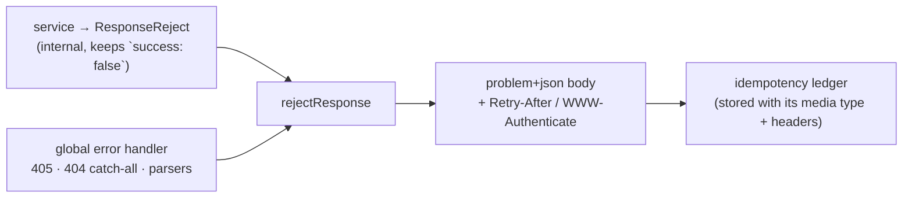

# Error Responses

Every 4xx and 5xx this API sends is an [RFC 9457](https://www.rfc-editor.org/rfc/rfc9457) problem
details document, as `application/problem+json`. One shape, one media type, whatever route failed.

| | Standard |
| --- | --- |
| The error body | [RFC 9457](https://www.rfc-editor.org/rfc/rfc9457) — Problem Details for HTTP APIs |
| Media type, content negotiation | [RFC 9110 §12.5.1](https://www.rfc-editor.org/rfc/rfc9110#section-12.5.1) |
| Status names (`title`) | [RFC 9110 §15](https://www.rfc-editor.org/rfc/rfc9110#section-15) |
| Language of the text | [RFC 9110 §8.5](https://www.rfc-editor.org/rfc/rfc9110#section-8.5) — `Content-Language` |

## Problem details

```json
404 Content-Type: application/problem+json
{
    "type": "about:blank",
    "title": "Not Found",
    "status": 404,
    "detail": "The requested order was not found",
    "instance": "urn:uuid:5b0c9a1e-7a3d-4a3e-9c53-0d6b5d5c2e11",
    "errors": [{ "code": "NOT_FOUND", "message": "The requested order was not found" }]
}
```

| Member | Rule | Why |
| --- | --- | --- |
| `type` | always `about:blank`, sent explicitly | the status says what happened (RFC 9457 §4.2.1). The machine key stays `errors[].code`: one response can carry several codes, and a URI per code needs a page per code to resolve to |
| `title` | the English RFC 9110 phrase for the status (`Not Found`, `Content Too Large`, `Unprocessable Content`) | names the status class, so it is never translated (§3.1.3) |
| `status` | the HTTP status, from the same variable | survives a proxy that rewrites the status line (§3.1.2) |
| `detail` | the translated sentence: the one error's `message`, or the status's generic text when there are several | what a person reads (§3.1.4) |
| `instance` | `urn:uuid:` and the request id, the id `x-request-id` carries | names this occurrence in a support ticket. Never the URL: an OAuth callback's query holds `code` and `state` (§5) |
| `errors` | the extension: `{ code, message, details? }` items, never empty | see [the errors extension](#the-errors-extension) |

There is no `success` and no top-level `message` in an error body. A client tells a failure from a
success by the status line, as any HTTP client does.



Inside the code, `ServiceResult` still branches on `success`: only `rejectResponse` turns a
rejection into a problem, so no service or controller builds the body itself.

## The errors extension

`errors[]` is where a client branches. Each item is `{ code, message, details? }`:

- `code` is the stable machine key. Branch on it, never on `message` or `title`.
- `message` is translated text, safe to show.
- `details.field` names the request field a refusal is about, as a dotted path
  (`shippingAddress.zip`), so a form can put the message under that input.

A response always carries at least one item: a status-only failure (a bare 404) answers one built
from the status.

## Language

`detail` and `errors[].message` follow `Accept-Language`; `title` is always English.
`Content-Language` and `Vary: Accept-Language` are set on every response, errors included, because
the language is negotiated before the request is parsed.

## Headers on an error

| Status | Header | Value |
| --- | --- | --- |
| every | `Cache-Control` | `no-store`: an error is never kept by a browser or a CDN, even on a route that caches its success |
| 401 | `WWW-Authenticate` | `Bearer realm="api"`, or the specific challenge a guard sets (`error="invalid_token"`, `error="insufficient_user_authentication"` for a step-up) |
| 405 | `Allow` | the methods the path does answer |
| 429 | `Retry-After` | whole seconds until the budget resets |
| 503 | `Retry-After` | a rough hint (a few seconds), not a promise |

An error is never an attachment: `Content-Disposition` is removed, so an export route's failure
does not reach the browser as a file download.

A replay through [`Idempotency-Key`](../tools/idempotency.md#what-a-failure-stores) sends the stored
media type and these headers back with the stored body.

## Negotiation

The response is `application/problem+json` whatever `Accept` says; the API never answers 406 to
refuse an error (RFC 9110 §12.5.1 lets a server ignore `Accept`). Express appends
`; charset=utf-8`, which carries no meaning for JSON (RFC 8259 §11).

## Outside the JSON API

These answers are not problem documents on purpose:

| Answer | Why |
| --- | --- |
| `/livez`, `/readyz` | a probe reads the status and nothing else; a 503 has no body |
| `GET /observability/metrics`, a failed scrape | Prometheus exposition text, `text/plain` |
| `GET /.well-known/security.txt`, found | plain text, fixed by RFC 9116. Its 404 is a problem |
| A stream already open (SSE) | the status line is gone; the stream carries its own events |
| A redirect (OAuth callback success) | a `302`, not an error |

The 404 for a path that matches nothing and the 405 for a method a path does not offer belong to no
operation, so the contract describes them once, in the root document's description.

## In the contract

One `Problem` schema is the body of every shared error response (`BadRequest` … `InternalError`),
declared under `application/problem+json` only. A local Spectral rule,
`error-responses-are-problem-json`, refuses any other 4xx/5xx content type; the Prometheus 500
opts out with `x-not-problem: true`. Every Jest response is checked for the media type too
(`tests/support/response-contract.ts`).
