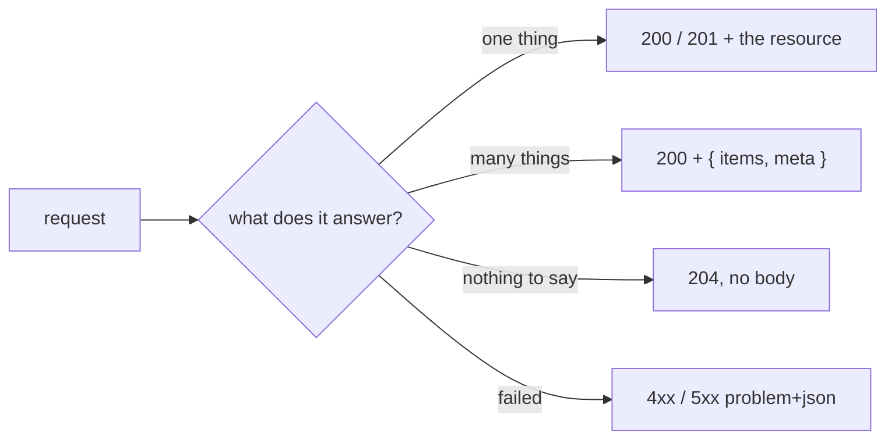

# Success Responses

A success answers with the thing itself. There is no wrapper around it: the status line says it
worked, the body says what came back. Errors are the other half: [Error Responses](./errors.md).

| | Standard |
| --- | --- |
| A resource, a list as an object | [Zalando RESTful guidelines](https://opensource.zalando.com/restful-api-guidelines/) #110, #248 |
| No body | [RFC 9110 §15.3.5](https://www.rfc-editor.org/rfc/rfc9110#section-15.3.5) — `204 No Content` |
| `Location` on a create | [RFC 9110 §9.3.3](https://www.rfc-editor.org/rfc/rfc9110#section-9.3.3) |



## A resource

`GET`, `POST`, `PUT` and `PATCH` that act on one thing answer that thing, as the schema the
contract names for it. A create answers `201`, the resource, and a `Location` header.

```json
200
{ "id": "o1", "status": "paid", "totalPrice": "70.00", "currency": "EUR" }
```

## A list

A list is always an object, never a top-level array: a field can be added later without breaking a
reader. A paginated list is `{ items, meta }`; a list that is not paged is `{ items }` or names its
resource (`{ methods }`, `{ sessions }`), and its description names the bound that excuses it
([`bounded-list-unpaged`](../theory/api-standards.md#where-we-differ-and-why)).

```json
200
{
    "items": [{ "id": "o1" }],
    "meta": { "page": 2, "pageSize": 10, "totalItems": 37, "totalPages": 4 }
}
```

### Pagination

`page` and `pageSize` in the query, `meta` beside `items`. Offset paging with totals on purpose:
the admin tables jump to page N and show "of 37". `GET /api-keys` adds `maxExpiresAt` next to
`meta`.

## Money

Every amount is a decimal string at its currency's own places: `"19.90"` EUR, `"1000"` JPY,
`"1.500"` KWD. Two equal amounts are equal strings, and the text carries its own scale, so a
client needs no currency table to show it. A request may spell an amount any plain way (`"71"`,
`"71.00"`); more places than the currency has, or a JSON number, answers 422. Rates (`taxRate`) are
the one exception and stay numbers. The resource's `currency` names the unit: on the same object,
or on the nearest parent for a line inside it. `GET /shop` publishes `minorUnits` for a price
input that starts empty.

## No content

An answer with nothing to say is `204`, with no body and no `Content-Type`: logout, the delete
routes (a soft delete too: [`soft-delete-204`](../theory/api-standards.md#where-we-differ-and-why)), reset and confirm steps, mark-all-read. The client reads the status.

A route behind `idempotencyKey` may answer `204` or `202` with no body: the ledger records a
body-less answer through `end` and replays it body-less. See
[Idempotency](../tools/idempotency.md#a-body-less-answer-is-captured-too).

## Per-user parents

A route that changes one row of a per-user collection (a cart line, a wishlist item)
answers the whole parent with `200`, not `204`, so the client redraws from one answer.

## A renewed session

Password change, `2fa/disable` and `2fa/methods/{method}/remove` revoke the caller's sessions and
replace this one. They always answer `200` with `AuthTokens`: `{ token }` or `{ sessionToken }` when
there is a credential to hand back, `{}` when the browser's cookie was refreshed in place.

## Inside the code

A service still returns a `ServiceResult` (`success`, `status`, `data`), and a controller branches on
`success`. Only the serialisers in `src/infrastructure/http/response.ts` put anything on the wire:
`successResponse` sends `data` as the body, `noContentResponse` sends `204`.
