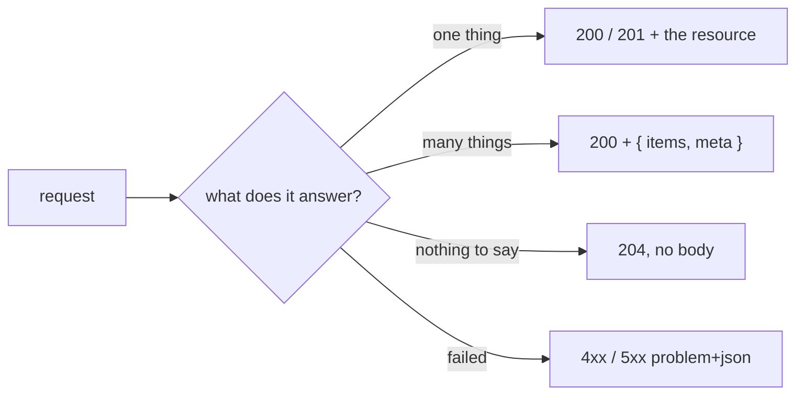

# Success Responses

A success answers with the thing itself. There is no wrapper around it: the status line says it
worked, the body says what came back. Errors are the other half: [Error Responses](./errors.md).

| | Standard |
| --- | --- |
| A resource, a list as an object | [Zalando RESTful guidelines](https://opensource.zalando.com/restful-api-guidelines/) #110, #248 |
| No body | [RFC 9110 §15.3.5](https://www.rfc-editor.org/rfc/rfc9110#section-15.3.5) — `204 No Content` |
| `Location` on a create | [RFC 9110 §9.3.3](https://www.rfc-editor.org/rfc/rfc9110#section-9.3.3) |



## A resource

`GET`, `POST`, `PUT` and `PATCH` that act on one thing answer that thing, as the schema the
contract names for it. A create answers `201`, the resource, and a `Location` header.

```json
200
{ "id": "o1", "status": "paid", "total": 70 }
```

## A list

A list is always an object, never a top-level array: a field can be added later without breaking a
reader. A paginated list is `{ items, meta }`; a list that is not paged is `{ items }` or names its
resource (`{ methods }`, `{ sessions }`).

```json
200
{
    "items": [{ "id": "o1" }],
    "meta": { "page": 2, "pageSize": 10, "totalItems": 37, "totalPages": 4 }
}
```

### Pagination

`page` and `pageSize` in the query, `meta` beside `items`. Offset paging with totals on purpose:
the admin tables jump to page N and show "of 37". `GET /api-keys` adds `maxExpiresAt` next to
`meta`.

## No content

An answer with nothing to say is `204`, with no body and no `Content-Type`: logout, the delete
routes, reset and confirm steps, mark-all-read. The client reads the status.

A route behind `idempotencyKey` must not answer `204` through `noContentResponse`: the ledger
captures a response through its JSON door, so a body-less answer would stay in flight. See
[Idempotency](../tools/idempotency.md).

## Per-user parents

A route that changes one row of a per-user collection (a cart line, a wishlist item, an address)
answers the whole parent with `200`, not `204`, so the client redraws from one answer.

## A renewed session

Password change, `2fa/disable` and `2fa/methods/{method}/remove` revoke the caller's sessions and
replace this one. They always answer `200` with `AuthTokens`: `{ token }` or `{ sessionToken }` when
there is a credential to hand back, `{}` when the browser's cookie was refreshed in place.

## Inside the code

A service still returns a `ServiceResult` (`success`, `status`, `data`), and a controller branches on
`success`. Only the serialisers in `src/infrastructure/http/response.ts` put anything on the wire:
`successResponse` sends `data` as the body, `noContentResponse` sends `204`.
