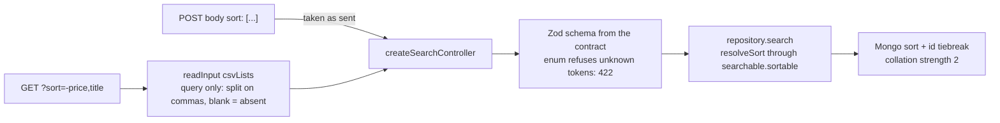

# Sorting a List

Every paged list can be ordered by the server, so "sort by price" orders the **whole** catalogue
and not just the ten rows on screen. One parameter, one grammar, everywhere.

| | Standard |
| --- | --- |
| The grammar | [JSON:API sorting](https://jsonapi.org/format/#fetching-sorting) — `sort=-price,title` |
| The query encoding | OpenAPI `style: form`, `explode: false` — a comma-separated list |

## The rule

| | |
| --- | --- |
| Parameter | `sort` — in the query of `GET /x` **and** in the body of `POST /x/search` |
| Query form | `?sort=-price,title` — comma-separated; a repeated key (`?sort=a&sort=b`) is accepted too |
| Body form | `{ "sort": ["-price", "title"] }` — one token per item, exactly as sent |
| Direction | `field` ascending, `-field` descending |
| Several fields | the earlier one ranks first; the cap is the enum's `maxItems` (3 for most resources, 2 for `PaymentSort`, `ReturnSort` and `WebhookSubscriptionSort`, 5 for `OrderSort`) |
| Absent or blank | the resource's default order, newest first (a list that takes `sort`; a fixed-order list has no `sort` at all, see below). Blank means absent on the **query only** (`?sort=`); a blank body `sort` is a 422 |
| A repeated field | the first mention wins: `price,-price` sorts by price ascending |
| A CSV inside a body item | **422** — only the query string is split on commas |
| A field outside the list | **422** — the contract enum refuses it |

Ties always end on the id, so page 2 never repeats or skips a row of page 1. Text fields compare
case-insensitively (`Apple` before `banana`).

## Who can be sorted, by what

The list is an **enum per resource** in that module's `openapi.yaml` (`ProductSort`, `UserSort`,
`OrderSort`, `PaymentSort`, `FeedbackRequestSort`, `ExampleSort`, `WebhookSubscriptionSort`, `ReturnSort`, `ApiKeySort`). It is a whitelist on purpose: an unindexed or derived field
would let a stranger ask for a collection scan.

| Resource | Sortable fields |
| --- | --- |
| Products | `createdAt` · `price` · `title` (the fallback-locale column) |
| Users | `createdAt` · `email` · `username` |
| Orders | `createdAt` · `status` · `email` · `payBy` · `paidAt` — `totalPrice` is derived, not a column |
| Payments | `createdAt` · `amount` · `payBy` (a payment with no bank-transfer deadline counts as the earliest) |
| Feedback | `createdAt` · `status` · `email` |
| Examples | `createdAt` · `title` · `status` |
| Webhook subscriptions | `createdAt` · `url` |
| Returns | `createdAt` · `status` |
| API keys | `createdAt` · `expiresAt` · `lastUsedAt` (a key never used has no `lastUsedAt`) |

## Lists with one fixed order

A paged list with no `sort` has ONE order, and says so in its 200 description. That is allowed
only when the order is why the screen exists, never for records staff manage (those take `sort`).

| Kind | Order | Lists |
| --- | --- | --- |
| log | newest first | webhook deliveries · audit logs · observability audit · stock movements · refunds |
| queue | by urgency, index-backed | inventory levels (scarcest first) · preorder allowances (most outstanding first) · preorder fulfillment orders (earliest expected first) and their product summary (earliest promise first) |
| dictionary | natural key, ascending | locale entries (both the language's and one app's) |

## How it flows

## Adding a sortable field

1. Add the token (and its `-` twin) to the module's `*Sort` enum in its `openapi.yaml`.
2. Add `wireField: 'mongoPath'` to the repository's `searchable.sortable`.
3. `npm run regenerate`. Nothing else: the controller, the cache key and the frontend's types
   follow from the contract.

The pieces live in `src/infrastructure/http/request.ts` (`parseFormCsvList`, the query decode) and
`src/infrastructure/persistence/search.ts` (`resolveSort`).
