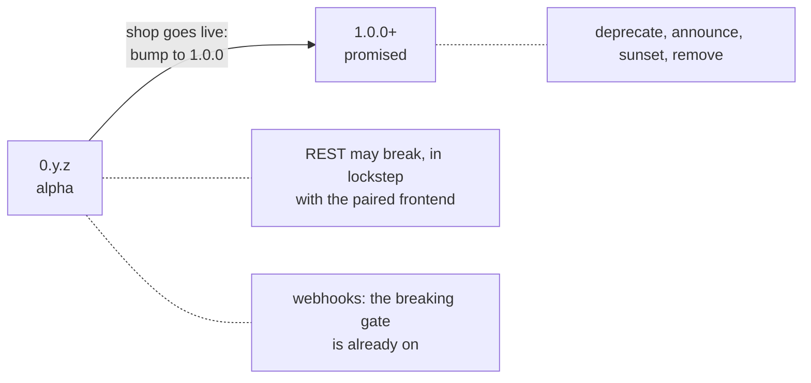
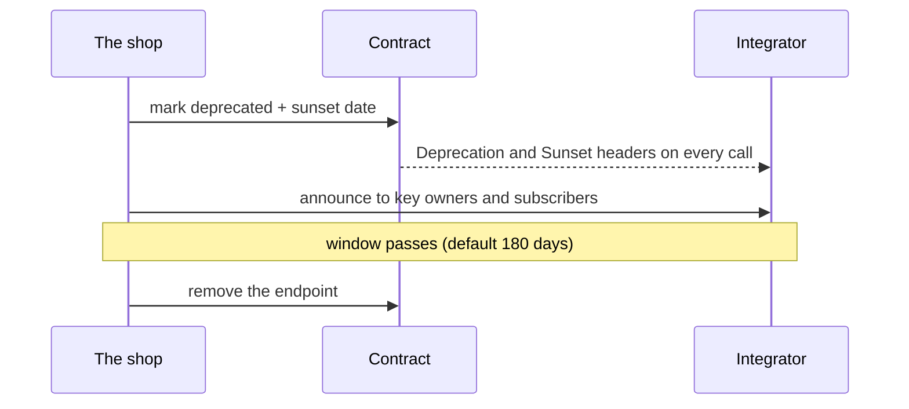

# Versioning and Retiring an Endpoint

How the API changes once somebody outside this repo depends on it, and when that starts.

The contract (`openapi.yaml`, `asyncapi.public.yaml`) is **not versioned in the URL and not dated**.
One contract evolves compatibly, and an endpoint is retired by announcing it, then removing it
after a sunset date. The version number tells a client which promise applies.

## The one version number

- The API version is the contract's `info.version` (`shared/contracts/openapi.root.yaml` for REST,
  `shared/contracts/asyncapi.root.yaml` and each module's `asyncapi.yaml` for events). It is SemVer.
  It is **not** `package.json`'s version, which versions the code.
- No `/v1` in paths, no dated version header (Zalando 113, 115, 116). Shopify, Stripe and GitHub
  version by date because they run a transform layer for every old version: the wrong size for a
  boilerplate.

## Two phases

| | `0.y.z` (today) | `1.0.0` and later |
| --- | --- | --- |
| REST | may break freely; the paired frontend is regenerated from the same contract and ships with it | a break needs a deprecation window |
| Webhook events | the AsyncAPI breaking gate refuses an unacknowledged break (`npm run check`, CI job `asyncapi-breaking`); a deliberate one is listed in `ACKNOWLEDGED_BREAKS` | same, plus a sunset date per entry |
| Why | nothing is live; replacing beats shimming | a third party's script or subscriber is not redeployed with us |

SemVer §4: `0.y.z` means anything may change. `1.0.0` is the moment the public API is promised.

## The 1.0 trigger

A copying shop bumps both contracts to `1.0.0` **before the first `sk_` API key or the first webhook
subscription is used by a third party**. The go-live checklist carries the line
([Getting started in production](../getting-started-production.md#the-first-third-party-integration)).
Until then nothing here is built; after it, everything below applies.

## What counts as breaking

Any change that makes a correct existing client fail:

- removing or renaming a path, a method, a field, an enum value, a query parameter or a header;
- making an optional request field required, or narrowing what a field accepts;
- changing a field's type or meaning, or a status code a client branches on;
- adding a value to a response enum a client may switch on (decide per case);
- for events: removing or renaming an event, a payload field, or changing the signature scheme.

Adding an optional field, a new endpoint or a new event is not breaking.

## From 1.0: the retirement path

1. **Deprecate:** mark the operation, with a sunset date no sooner than the window.
2. **Announce:** tell the registered integrators (key owners, webhook subscribers) and wait for
   their approval before the shutdown (Zalando 185, 186; from memory).
3. **Run the window.** Default **180 days** (Google AIP-185's beta window); the shop sets its own.
   Shopify keeps a version at least 12 months, GitHub 24.
4. **Remove** after the sunset date, never before.

A client never starts using a deprecated endpoint (Zalando 191).

## The mechanism (built at 1.0, not yet)

Specified now so the shop that goes live does not design it under pressure. None of it exists in
the repo today.

| Part | Shape |
| --- | --- |
| Contract | `deprecated: true` plus `x-sunset: <RFC 3339 date>` on the operation (oasdiff's own extension) |
| Bundler | like `x-versioned`, adds the `Deprecation`, `Sunset` and `Link rel="deprecation"` response headers to that operation's responses |
| Generated map | the marked operations become fields on `OPERATION_ROUTES` in `api/operation-routes.ts`, not a second table. Never YAML parsed at runtime |
| Runtime | one middleware reads that map and sets `Deprecation: @<epoch>` (RFC 9745) and `Sunset: <HTTP-date>` (RFC 8594), and counts each call (Zalando 188, "monitor use") |
| CORS | `Deprecation`, `Sunset` and `Link` join the exposed headers |
| CI | an `openapi-breaking` job next to `asyncapi-breaking`, with oasdiff's `--deprecation-days-stable`. Adding that tool needs the owner's go-ahead at 1.0 |
| Frontend | nothing: the generated client carries `@deprecated`, and the `no-deprecated` lint flags a call |

### Webhooks

AsyncAPI 3.0 has no `deprecated` on a channel or an operation, so the mark is `x-deprecated: true`
plus `x-sunset: <date>` on the channel.

- The old and the new event run **side by side** until the sunset date; a subscriber moves when it
  is ready.
- `ACKNOWLEDGED_BREAKS` entries gain a sunset date. The removal PR is checked: it is refused while
  the channel's `x-sunset` is still in the future.

## Related pages

- [Contract Ownership & Fragmentation](./contract-fragmentation.md)
- [AsyncAPI Workflow](./asyncapi-workflow.md)
- [Write Methods](./write-methods.md#conditional-writes-etag-and-if-match) (`ETag` / `If-Match` is the one
  per-resource version this API already has)
