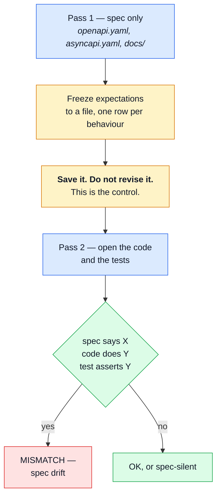
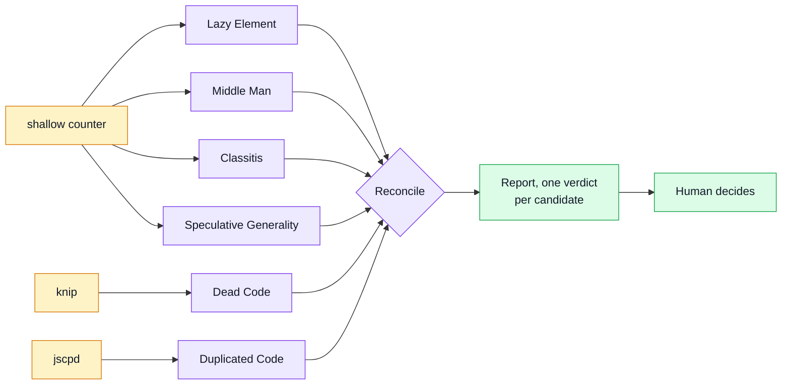

# AI auditing: the two-pass method and code-shape

Part of [AI Auditing](./ai-auditing.md): the method every audit follows, the `code-shape` audit, and how to run one.

## The two-pass method

`spec-drift` is the one worth understanding, because its **ordering is the method**. Spec
drift is a test and an implementation sharing one wrong reading of the spec — CI is
green, and the test proves only that the test agrees with the code.

You cannot find that by reading the test, because the test looks correct. You find it by deriving
what the behaviour _should_ be **before** the implementation can contaminate you.

Writing the expectations down before opening `src/` is not ceremony — it is the only thing keeping
the control uncontaminated. Skip it and the audit degrades into a code review that agrees with
whatever it just read.

The freeze is procedural, not cryptographic: the file is gitignored, so nothing stops you editing it
after the fact. Nothing except the fact that doing so destroys the only reason the second pass is
worth running. If a pass-1 row turns out to be wrong, add a pass-2 row saying so — do not quietly
rewrite the control to match what you just learned.

## `code-shape`: the tools count, the model judges

The other prompts look for gaps between prose and code. `code-shape` judges **shape**: does a
function, a file or an option earn its place? Its rules, the names the literature gives each shape
(Fowler's _Refactoring_, Ousterhout's _A Philosophy of Software Design_) and the legitimate reasons
to keep one live in the prompt itself. `CLAUDE.md` § Function design states the short form.

It applies [the one rule](./ai-auditing.md#the-one-rule) from the other side: three deterministic tools produce
every candidate, and the model only judges them. A model counting call sites by text search misses
an import alias or a re-export, and a wrong count is a wrong verdict.

| Tool                                         | Lists                                                                                                     | Configured in     | Run with                           |
| -------------------------------------------- | --------------------------------------------------------------------------------------------------------- | ----------------- | ---------------------------------- |
| [knip](https://knip.dev)                     | unused files, exports, types and dependencies                                                             | `knip.config.ts`  | `npm run audit:unused`             |
| [jscpd](https://github.com/kucherenko/jscpd) | copy-pasted blocks, exact and near-miss                                                                   | `.jscpd.json`     | `npm run audit:duplicates`         |
| `generate-shallow-candidates.ts`             | small functions with 1–2 users, pass-throughs, optional parameters never passed, files with 1–2 importers | its own constants | `npm run audit:shallow -- <paths>` |

The third is ours: knip and jscpd never count how often a _used_ function is called, and nothing
maintained on npm reports these shapes. It reads the TypeScript checker, so an alias, a re-export,
an `obj.fn` read off an object written `{ fn }` and a destructured name each count as a use of the one
function. A recursive call is not a use. The `{ fn }` slot of an unexported, untyped local object is
plumbing, because the later `obj.fn` read is the use; in a call argument, a returned, exported or
interface-typed object the slot is a use, since that is how a handler is registered. A function an
object a barrel publishes carries counts as published. A type-only re-export publishes nothing. Known
limit: `obj.fn` on an interface-typed object is not followed, so only its `{ fn }` slot counts. No
library does this: TypeScript's
find-references and knip both miss `obj.fn`. It lives in `scripts/audit/code-shape/scripts/`.

Two more shapes have no tool: Large Class (a service, controller or repository over 300 lines doing
several jobs; verdict SPLIT) and Repeated Switches (two chains over the same union in different
files; verdict LIFT). Their reviewers read the scope themselves and say how each row was found.

Each shape gets its own reviewer, so one list never crowds out another. The reconcile step exists
because the two directions disagree: jscpd says "extract", the shallow counter says "inline". It
stops the report from telling you to do both to the same code.

None of the three is a gate, by design:

- **knip** — barrel exports are unused on purpose. `knip.config.ts` declares the barrels as entry
  points, but a new false positive deserves a judgement, not a red build.
- **jscpd** — two handlers can look alike because the contract makes them look alike, with no
  shared logic to extract.
- **The shallow counter** — a threshold cannot tell `isRefundable(order)` from `add(a, b)`.

## How to run one

Each prompt is an [Agent Skill](https://agentskills.io): a folder holding a `SKILL.md` an AI reads
and follows, plus any `scripts/` it runs. The format is open, so the prompts are not tied to one
tool:

| Layer                          | What it holds                                                 |
| ------------------------------ | ------------------------------------------------------------- |
| `scripts/audit/<name>/`        | the prompt and its scripts — the only copy                    |
| `.claude/skills/audit-<name>/` | a three-line pointer that registers it as a Claude Code skill |

- **Claude Code** — `/audit-spec-drift orders`, `/audit-code-shape --diff`, and so on. The pointer
  passes the argument through as the scope.
- **Any other AI tool** — _"Read `scripts/audit/spec-drift/SKILL.md` and follow it, scope
  `orders`."_ It needs to be able to read the repo; an audit that cannot open `openapi.yaml` has
  nothing to compare against.

The pointer's `allowed-tools` is Claude Code's permission list: it only skips prompts, and it does
not keep an audit off the source (`Write` is allowed). What does is rule 1 of `RULES.md`: the audit
changes nothing but its own report folder. A helper agent that is refused a file write returns the
report as text, and the caller saves it.

::: tip Which model
Claude for `spec-drift` and `spec-gaps` — long-context reasoning over prose vs. code is exactly
where small local models confabulate citations most confidently, and a fabricated `file:line` costs
more than the finding was worth.

`suite-bloat` is no exception: the rows that mattered came from reading the code, not from
bookkeeping over `tmp/reports/mutation/mutation.json`.
:::

## Read next

- [AI Auditing](./ai-auditing.md)
