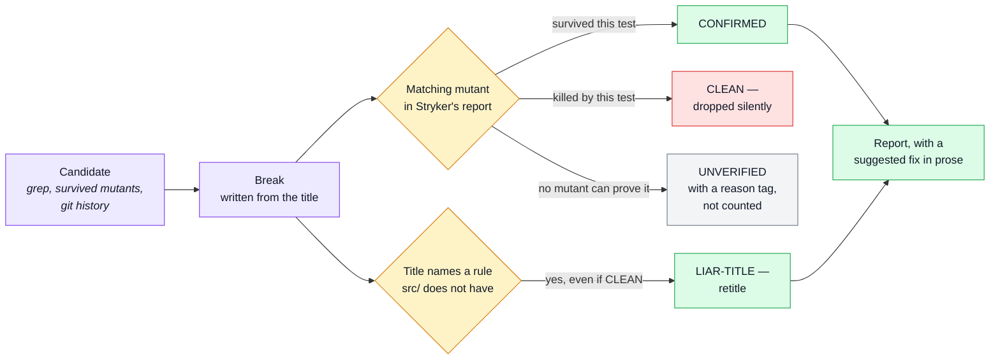

# AI auditing: test-honesty and reading the output

Part of [AI Auditing](./ai-auditing.md): the `test-honesty` audit, how to read a verdict, and whether it works.

## `test-honesty`: a test is innocent once it has failed

The fear it answers: tests written to raise a number, or to agree with whoever wrote the code, that
stay green whatever the code does. Mutation testing finds some of them. This audit finds the rest,
and names the shape — coverage padding, a mocked subject, a swallowed failure, a title that lies, an
input that cannot discriminate.

It applies [the one rule](./ai-auditing.md#the-one-rule) with Stryker as the oracle. For each suspect test, the
model writes down what the test's title claims, and the smallest `src/` change that would break
that claim. Then it looks that change up in Stryker's report, which records per mutant which tests
ran it and which failed on it. Stryker breaks the code in a sandbox copy; this audit never does.

Two things Stryker cannot prove get their own handling:

- **A title that lies.** The test checks something real, but its title names a rule `src/` does not
  have. There is no mutant to write, because the rule is not there, so it is a `LIAR-TITLE` finding
  proven by reading, and it is reported even when the test is `CLEAN`.
- **A break no mutator can make** (a changed number, a swapped constructor, a suite Stryker skips).
  It is listed as `UNVERIFIED` with a reason tag and a diff that is never applied, and never
  counted as a finding until someone runs it.

The candidate list comes from `npm run audit:test-candidates`, a report-only ESLint config that
flags tests whose every assertion is weak. The lint gate already refuses the other shapes (an
`expect` under an `if`, a test with none, a duplicate title), so the audit does not repeat them.
Its false positives are asserting helpers (`refused(...)`) and supertest's `.expect(200)`.

The break comes from the title, never from the assertions. One chosen by reading the assertions
proves only that they agree with themselves.

Like every prompt here it only reports. The fix is a human's, written from the report's suggested
fix and the spec it cites.

## Reading the output

### `spec-drift`'s verdicts

The verdict table lives in `scripts/audit/spec-drift/SKILL.md` (`## Verdicts`): one home.
Only `MISMATCH-CODE` and `TAUTOLOGY` are findings; `SPEC-CONFLICT` says prose is the stale layer.

`TAUTOLOGY` is the quiet one. `expect(f(x)).toEqual(g(x))` where `g` is a sibling export, or a
`Record<Enum, …>` whose totality TypeScript already enforces, is a test that cannot fail and
therefore proves nothing. Stryker finds some of these; the audit finds the rest.

### `compliance`'s verdicts

`compliance-backend` and `compliance-frontend` share one registry
(`scripts/audit/compliance-rules.yaml`) but use a different four verdicts, since a compliance rule
either applies here or it doesn't — there is no code/test pair to compare:

| Verdict              | Means                                                                                                                                                               |
| -------------------- | ------------------------------------------------------------------------------------------------------------------------------------------------------------------- |
| **VIOLATION**        | The rule applies and this side's evidence fails it — including a `both`-responsibility rule broken on this side alone.                                              |
| **SATISFIED**        | The rule applies and this side's evidence meets it in full.                                                                                                         |
| **NOT-APPLICABLE**   | The rule's `applies_when` condition is false for this app today, with the reason cited.                                                                             |
| **NEEDS-BOTH-SIDES** | A `both`-responsibility rule whose own-side half is fine but whose closure depends on the paired prompt's report — see the other side by rule `id`, never restated. |

Every rule in scope gets exactly one row, `NOT-APPLICABLE` included — an audit that only reports
violations can't be told apart from one that silently skipped half the registry.

## Does it work?

The first batch ran over six scopes — order lifecycle and money, inventory reservations, cart and
checkout, payments, account and auth, and the per-operation `security:` blocks. Expectations were
frozen and committed first, one commit per scope.

It produced fixes, not a report nobody read: an order accepting a same-value `paid` write that
should have 409'd, a shipping-absence case, account endpoints answering the wrong status, an
admin-delete audit action that conflated hard and soft deletes, and a duplicated union-registration
check. One of its own rollups was wrong and got corrected too, which is the honest version of this
story.

Run them before a refactor, after a contract change, or when a module's docs and tests have drifted
apart — not on a schedule.

---

## Read next

- [AI Auditing](./ai-auditing.md)
