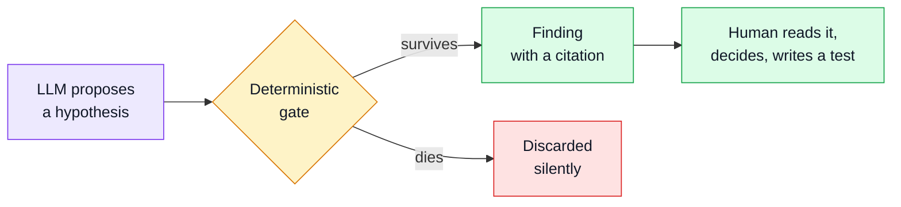

# AI Auditing

Every other instrument in this repo compares the system **to itself**: code to schema, mutant to
suite, response to contract. That is what makes them deterministic, and it is also their ceiling.
Stryker cannot read `docs/understand/domain-layer.md`. Schemathesis cannot read a task. CodeQL cannot
notice that the docs promise a rule the contract never encodes.

**Prose ↔ code is the gap**, and it is the one place a language model beats a program rather than
approximating one. This repo has many files under `docs/` stating rules no schema enforces.

`scripts/audit/` holds the prompts that work in that gap, plus two that judge something else:
`code-shape` judges design, `test-honesty` judges whether a test can fail at all. They are plain
markdown, run by hand against an LLM, and they write reports — never code. The rules every audit
shares (read-only, where the report goes, what the scope names mean, the tripwire) live in
[`scripts/audit/RULES.md`](https://github.com/Guebbit/boilerplate-node-backend/blob/main/scripts/audit/RULES.md), which each prompt reads first.

## The one rule

> The model proposes. A deterministic oracle disposes.

Two consequences, both non-negotiable:

- **Nothing AI-generated gates CI.** A red build must be reproducible by re-running it. An LLM
  verdict is not, so these report and never block.
- **A finding without a citation is not a finding.** Either a `file:line` in the spec, or nothing.
  Prose confidence is not evidence.

## The prompts

| File                                         | Asks                                                                                                                                                                                                                                                                                                               | Writes to                                      |
| -------------------------------------------- | ------------------------------------------------------------------------------------------------------------------------------------------------------------------------------------------------------------------------------------------------------------------------------------------------------------------ | ---------------------------------------------- |
| `scripts/audit/spec-drift/SKILL.md`          | Which tests assert what the **code** does rather than what the **spec** says?                                                                                                                                                                                                                                      | `tmp/reports/audit-<run>/spec-drift/`          |
| `scripts/audit/spec-gaps/SKILL.md`           | Which business rules and security boundaries have **zero** coverage?                                                                                                                                                                                                                                               | `tmp/reports/audit-<run>/spec-gaps/`           |
| `scripts/audit/suite-bloat/SKILL.md`         | Which tests cost CI time and discriminate nothing?                                                                                                                                                                                                                                                                 | `tmp/reports/audit-<run>/suite-bloat/`         |
| `scripts/audit/compliance-backend/SKILL.md`  | Which rules in the shared compliance registry (consent, privacy pages, data security, accessibility, …) does this backend violate, and which don't apply here?                                                                                                                                                     | `tmp/reports/audit-<run>/compliance-backend/`  |
| `scripts/audit/compliance-frontend/SKILL.md` | The same registry, filtered to the paired frontend's half of responsibility.                                                                                                                                                                                                                                       | `tmp/reports/audit-<run>/compliance-frontend/` |
| `scripts/audit/reachability/SKILL.md`        | Which defences are correct where they are tested and unreachable through the real mounted path?                                                                                                                                                                                                                    | `tmp/reports/audit-<run>/reachability/`        |
| `scripts/audit/rate-limit-keys/SKILL.md`     | Which rate-limit budgets bucket callers by something the attacker supplies or rotates for free?                                                                                                                                                                                                                    | `tmp/reports/audit-<run>/rate-limit-keys/`     |
| `scripts/audit/test-honesty/SKILL.md`        | Which tests stay green when the behaviour they claim to check is broken? See [below](./ai-auditing-test-honesty.md#test-honesty-a-test-is-innocent-once-it-has-failed).                                                                                                                                            | `tmp/reports/audit-<run>/test-honesty/`        |
| `scripts/audit/code-shape/SKILL.md`          | Which functions, files and options don't earn their place, and which code is dead or copy-pasted? See [below](./ai-auditing-code-shape.md#code-shape-the-tools-count-the-model-judges).                                                                                                                            | `tmp/reports/audit-<run>/code-shape/`          |
| `scripts/audit/comments/SKILL.md`            | Which comments are missing, in the wrong form, wrong, bloated or unlinked, judged against [Code comments](./code-comments.md)?                                                                                                                                                                                     | `tmp/reports/audit-<run>/comments/`            |
| `scripts/audit/ddd-drift/SKILL.md`           | Where has the code drifted from the DDD the docs describe — who drives whose state, who reads a sibling's table, where a rule lives — and which side is wrong? Mirrors `../boilerplate-vue-frontend/scripts/audit/ddd-drift/SKILL.md`; C1 (BE) and F2 (FE) are one rule seen from each side.                       | `tmp/reports/audit-<run>/ddd-drift/`           |
| `scripts/audit/api-http/SKILL.md`            | Does the API follow the eight HTTP web standards: RFC 9110 meaning, RFC 9111 caching, RFC 9457 errors, RFC 5789 and 7396 PATCH, RFC 6585 statuses, the RateLimit and Idempotency-Key drafts? A whole-contract run splits into four parts, one helper agent each; REPORTED only, never turned into a Spectral rule. | `tmp/reports/audit-<run>/api-http/`            |
| `scripts/audit/api-style/SKILL.md`           | Where do names, enums, paging, methods, money and errors differ from ONE style guide (Zalando, unless the API clearly leans Google AIP: then it asks), and is each difference written down? REPORTED only, never turned into a Spectral rule.                                                                      | `tmp/reports/audit-<run>/api-style/`           |

All of them take one argument — a module (`orders`), a path, or `--diff` for whatever the working
tree touched. The two compliance prompts, `ddd-drift` and the two `api-*` audits default an empty argument to the
**whole repo** (for `api-*`, the whole contract) rather than the touched modules — a compliance gap, a DDD drift or
a difference from an API standard is rarely introduced by the change that happens to surface it.

The two `api-*` audits take their rules from `scripts/audit/api-standards.yaml` and their background from
[API Standards](../understand/api-standards.md). `api-http` judges the web rules, which never conflict;
`api-style` judges one guide, Zalando unless the API clearly leans Google (then it asks), so the guide not taken never shows in a report. The
order is fixed, web rules first: [When standards disagree](../understand/api-standards.md#when-standards-disagree).

### Each repo keeps the prompts its own stack needs

The two repos do **not** hold one set. `reachability` and
`rate-limit-keys` both reason about a mounted Express request path, which the paired frontend
has no equivalent of — and its own
`boilerplate-vue-frontend/scripts/audit/accessibility-manual/SKILL.md` has no counterpart here.

Only `spec-drift`, `spec-gaps`, `suite-bloat` and `test-honesty` exist on both sides, because what
they ask — does the test agree with the spec, is anything uncovered, is anything redundant, can the
test fail at all — is about specs and suites rather than about a runtime. `code-shape` and `ddd-drift` exist on both sides as forks (the frontend's reads each SFC's script and keeps its own drift classes). The two `api-*` audits exist only here: the contract they read is this repo's.

Nothing keeps even those four in step, and nothing should try. None is in `SHARED_FILES`, whose
rule is that a shared file must be owned by one side and regenerated. Improve one where you find
it; carry the improvement across when it applies, and expect the two to drift in between. Reading
an audit prompt as a spec for its sibling is the mistake to avoid — it is a prompt, and the copy
in the other repo has its own history.

`scripts/audit/compliance-rules.yaml` is not a shared copy either. It lives **here, once**, and both
compliance prompts read this one file — `compliance-frontend` runs from this repo against the
paired checkout rather than from inside it. So a rule spanning both repos, like the mandatory
signup-consent checkbox, has exactly one home and no second copy to drift from.

This page is per-repo in the same way. It names this repo's own tools, its own `docs/` count and
its own findings, so the frontend's copy is _expected_ to differ and must not be reconciled.

Each `api-*` report groups operations by cause; the rule is in each SKILL's Output.

### Naming the scope

`scripts/audit/RULES.md` rules 4 and 5 own this: the report folder
(`tmp/reports/audit-<YYYY-MM-DD-HHmm>/<audit>/`), the `<SCOPE>` names, and what an empty argument or
`--diff` means.

| Argument     | `<SCOPE>`                                                           |
| ------------ | ------------------------------------------------------------------- |
| a module     | the module name — `orders`                                          |
| a path       | slugged, `src/` dropped — `infrastructure-http`                     |
| `--diff`     | the current branch name, slugged                                    |
| `whole-repo` | `whole-repo` — a skill that runs it per module says so in its SKILL |

An empty argument is `whole-repo`. A batch number never names a report: the module name tells
the next reader what it covers.

### The tripwire

An audit is read-only. To know it kept that promise, `npm run audit:check-clean` snapshots both
repos (HEAD, every ref, the stash list, `git status --ignored`, the index hashes) before the run
and diffs them after, ignoring the run's own report folder. It reports a write after the fact; it
does not stop one. A peer session in the same worktree shows up as a change, and the reader judges.
`--ignored` lists an ignored folder (`node_modules/`) as one entry, so a change inside it is not
seen.

### The reports are disposable

`tmp/` is gitignored, and that is the intended end state, not an oversight. A report is working
evidence: once its conclusions land as a fixed test, a commit message or a tracked issue, the file
has done its job. Audit paperwork that outlives the audit goes stale silently and misleads the next
reader — the prompts are the durable asset here, not their output.

## Where the rest went

The long sections moved to sub-pages; each heading below keeps its old link target.

### `code-shape`: the tools count, the model judges {#code-shape-the-tools-count-the-model-judges}

Moved: [`code-shape`: the tools count, the model judges](./ai-auditing-code-shape.md#code-shape-the-tools-count-the-model-judges).

### The two-pass method {#the-two-pass-method}

Moved: [The two-pass method](./ai-auditing-code-shape.md#the-two-pass-method).

### How to run one {#how-to-run-one}

Moved: [How to run one](./ai-auditing-code-shape.md#how-to-run-one).

### `test-honesty`: a test is innocent once it has failed {#test-honesty-a-test-is-innocent-once-it-has-failed}

Moved: [`test-honesty`: a test is innocent once it has failed](./ai-auditing-test-honesty.md#test-honesty-a-test-is-innocent-once-it-has-failed).

## Footnote: the tools we evaluated, and why none were adopted

Checked **2026-09-03**. Treat that as an expiry date, not a warranty — the whole reason this
footnote exists is that the previous round of claims had quietly gone stale.

| Tool                                 | State                                | Why not                                                                                                                                                                        |
| ------------------------------------ | ------------------------------------ | ------------------------------------------------------------------------------------------------------------------------------------------------------------------------------ |
| **Mutahunter** (LLM mutants)         | Dead — last release 2025-04-17       | Also removed its coverage-driven mode in 1.3.2, the one feature that made it fit here.                                                                                         |
| **LLMorpheus** (LLM mutants, JS)     | Archived 2025-02-03                  | The only JS-native equivalent, and it stopped.                                                                                                                                 |
| **Qodo Cover / Cover-Agent**         | Unmaintained notice since 2025-06-15 | Gates generated tests on coverage and pass/fail, never the spec — so every test it keeps agrees with the code by construction. That is the defect `spec-drift` exists to find. |
| **CodeRabbit / PR-Agent / Greptile** | Alive and healthy                    | Duplicate review surface. `/code-review` and `/security-review` already cover the diff, and there is no PR workflow here for a bot to attach to.                               |
| **promptfoo**                        | Alive, MIT, weekly releases          | ~600 MB and 524 packages for a YAML runner — 513 MB of it a local ONNX inference runtime we would never call.                                                                  |

Two notes worth keeping, because they outlived the tools:

- **The reason for rejecting the review bots changed.** It used to be "a hosted bot cannot read
  `CLAUDE.md`". That is no longer true — CodeRabbit reads that exact filename by default now. They
  are rejected on redundancy and cost, which is a different argument, and the old one should not be
  repeated.
- **Nothing in this niche is alive.** StrykerJS has not added LLM-authored mutants either.
  Meta run the idea in production internally, but it is not a product. If that changes, the
  prompt files here are the thing that would be replaced.

## Read next

- [AI auditing: the two-pass method and code-shape](./ai-auditing-code-shape.md)
- [AI auditing: test-honesty and reading the output](./ai-auditing-test-honesty.md)

- [Mutation Testing](./mutation-testing.md) — the deterministic instrument this one complements
- [Coverage & Confidence](./coverage-and-confidence.md) — what a score does and does not mean
- [Testing & Docs](./testing-and-docs.md) — every layer, and which question each answers
- [Data Protection](../understand/data-protection.md) — the GDPR record `compliance-backend` cites
  as evidence for this app's data-handling rules; the compliance registry is broader than GDPR
  alone and does not replace it
