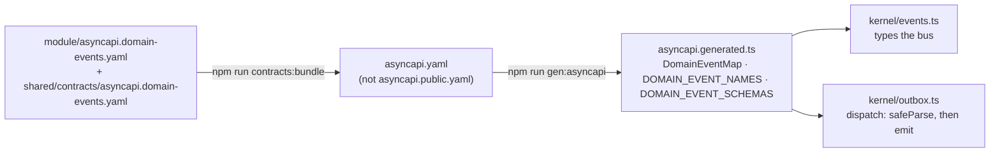

# AsyncAPI Workflow

## AsyncAPI is the async contract source of truth

For this boilerplate, keep REST and async contracts separate:

- REST: `openapi.yaml`
- Async/event-driven: `asyncapi.yaml`

Current scope of `asyncapi.yaml`:

- SSE channels: `observability.*` and the per-user `notifications.*`
- The webhook event catalogue (`order.*`, `payment.*`, `return.*`, ...), served by `GET /webhooks/events`
- RabbitMQ worker queues: the domainless ones (`worker.email.send`, `worker.image.digest`) plus
  each module's own (`webhooks`' `worker.webhook.deliver`, `account`'s `worker.account.export`)
- The [domain events](#domain-events) modules tell each other (`domain.*`), backend-only

## Two bundles: the whole contract, and the shared half

The async contract is published twice, from one set of sources:

| File                   | Holds                                                 | Who reads it                                    |
| ---------------------- | ----------------------------------------------------- | ----------------------------------------------- |
| `asyncapi.yaml`        | every channel — SSE, the queues, the domain events    | this repo: `gen:asyncapi`, `lint:asyncapi`      |
| `asyncapi.public.yaml` | every channel except the queues and the domain events | the paired frontend, as its own `asyncapi.yaml` |

The queues are backend-only because a browser can neither publish to nor consume from RabbitMQ. A
frontend holding `EmailJobPayload` would carry the shape of a message it cannot send, and read as a
contract it is expected to honour. So the split is by SECTION. `SHARED_SECTIONS`
in `scripts/contracts/asyncapi-bundles.ts` is derived from the file NAME a module chose:

```ts
const SHARED_SECTIONS: ReadonlySet<AsyncSectionName> = new Set(resolveModuleAsyncSections());
```

A module's top-level `asyncapi.yaml` IS its public event catalogue, by convention, and is shared
automatically — `observability`, `webhooks` and `notifications` qualify today. A module's OWN
queue, by contrast, lives in `asyncapi.internal.yaml` and never joins `SHARED_SECTIONS`, the same
way `workers` does; `webhooks-internal` (`worker.webhook.deliver`) and `account-internal`
(`worker.account.export`) are the examples today.

Both bundles merge the same section documents, so neither can describe a shared channel differently
— `tests/cross-cutting/contract-bundles.test.ts` asserts the public one is a strict subset. Only
`asyncapi.public.yaml` is in `SHARED_FILES`; `asyncapi.yaml` is marked `shared: false` and compared
against nothing.

A server travels with the section whose channels bind to it — `sseLocal` is declared in the
observability module, `sseNotificationsLocal` in the notifications one, `rabbitmqLocal` in `asyncapi.workers.yaml` — which is what keeps the broker
out of the public bundle without a second list to maintain.

## Where to edit it

`asyncapi.yaml` at the repo root is **merged from one complete document per section** — do not
hand-edit it. Each section is a valid AsyncAPI document on its own, carrying its own channels,
messages and payload schemas:

```
src/modules/<module>/asyncapi.yaml             a module's public events (observability, webhooks,
                                               notifications) — a module's own document,
                                               exactly as it carries one openapi.yaml
src/modules/<module>/asyncapi.internal.yaml    a module's own queue (webhooks, account)
src/modules/<module>/asyncapi.webhooks.yaml    a module's own webhook events, merged into the
                                               `webhooks` section (delivery, orders, payments, returns, example)
src/modules/<module>/asyncapi.domain-events.yaml  the domain events a module emits, merged into the
                                               `domain-events` section (backend-only)
shared/contracts/asyncapi.domain-events.yaml   that section's own document: the kernel's `outbox.event_dead`
shared/contracts/asyncapi.workers.yaml         the RabbitMQ queues, which belong to no domain
shared/contracts/asyncapi.root.yaml            version, id, info, tags — no channels, no servers
```

Most worker queues are shared rather than owned by a module because the email and image workers
are substrate — `src/app/workers.ts` over `src/infrastructure/adapters/queue.ts` — enqueued by
whichever domain needs one. It is the async twin of filing `GET /` under `system` in the REST
contract. A queue a single module owns outright gets its own PRIVATE section instead:
`webhooks`' `worker.webhook.deliver` and `account`'s `worker.account.export`
(`src/modules/<module>/asyncapi.internal.yaml`) are the examples today. It declares no `servers` of
its own (its channel binds to `shared/contracts/asyncapi.workers.yaml`'s `rabbitmqLocal`, so a
second declaration here would collide when the two sections merge) and is left out of
`lint:asyncapi:modules`'s glob for the same reason: it is valid only once bundled.

Each public section is a whole document, so it can be linted on its own:

```bash
npm run contracts:bundle        # rebuild both asyncapi bundles (and every other) from their sources
npm run lint:asyncapi:modules   # lint each section document by itself
npm run check  # fail if a bundle on disk is stale
```

**It is a merge, not `asyncapi bundle`.** The AsyncAPI CLI's `bundle` command dereferences — inlining
every payload into every channel that names it, 239 lines to 819, and leaving
`scripts/contracts/generate-asyncapi-types.ts` with no `$ref` to follow.
`scripts/contracts/asyncapi-bundles.ts` copies five maps instead and refuses on a collision; its
header carries the full argument, and is the file to read before reaching for that command again —
the CLI itself is not in this repo's dependencies; see [Package
Dependencies](../reference/package-dependencies.md).

See [Contract Ownership & Fragmentation](./contract-fragmentation.md) for the whole picture,
including why each bundle uses the verb it does.

## Servers declared

| Name                    | Protocol | Purpose                                                       | Declared in                               | In the public bundle |
| ----------------------- | -------- | ------------------------------------------------------------- | ----------------------------------------- | -------------------- |
| `sseLocal`              | `http`   | SSE observability stream                                      | `src/modules/observability/asyncapi.yaml` | yes                  |
| `sseNotificationsLocal` | `http`   | Per-user notifications SSE stream                             | `src/modules/notifications/asyncapi.yaml` | yes                  |
| `subscriberEndpoint`    | `https`  | A webhook subscriber's own URL (a variable server)            | `src/modules/webhooks/asyncapi.yaml`      | yes                  |
| `rabbitmqLocal`         | `amqp`   | Async job queues (email, image digest, and each module's own) | `shared/contracts/asyncapi.workers.yaml`  | no                   |

## Generated TypeScript types

Types are generated from `asyncapi.yaml` into `src/types/asyncapi.generated.ts` by a custom script (`scripts/contracts/generate-asyncapi-types.ts`).  
They are re-exported from `src/types/index.ts` so all app code can import them consistently:

```ts
import type { ObservabilityMetricsPayload, EmailJobPayload, ImageDigestJobPayload } from '@types';
import { WORKER_CHANNELS, OBSERVABILITY_CHANNELS } from '@types';
```

Regenerate types after editing `asyncapi.yaml`:

```bash
npm run gen:asyncapi
```

The generator (`scripts/contracts/generate-asyncapi-types.ts`) reads `asyncapi.yaml` with `yaml`, converts each `components.schemas` entry into a TypeScript interface, appends the channel-name constants and the SSE payload map, and writes the result to the path given by `--out`.

### One alias per message

Every `components.messages` entry gets its own `export type <Message> = <Payload>` alias, even
when several messages share one payload — `observability.metrics.snapshot`, `.updated` and
`heartbeat` all carry `ObservabilityMetricsPayload`, and all three get their own alias. No
hand-written caller uses any of them: real code imports the shared payload type directly, the same
way `mailer.ts` names its own `EmailJob` rather than a generated `EmailJobMessage`.

3.0 made this the whole story: a channel declares its message once, so a queue's `...Publish` and
`...Consume` operations point at the SAME message and there is only ever one alias to emit for it.

### Shared with the frontend

This script is NOT byte-identical to `scripts/contracts/generate-asyncapi-types.ts` in
`boilerplate-vue-frontend`, though both write the same path: the frontend's copy also emits an inlined-JSON-Schema map for its own runtime SSE-frame
validation, which this backend copy has no use for and emits queue-payload Zod validators instead.
What both copies still share is the input format and the channel/message-naming machinery.

| Repo     | Command                                                                                  | Reads                                                          |
| -------- | ---------------------------------------------------------------------------------------- | -------------------------------------------------------------- |
| Backend  | `tsx scripts/contracts/generate-asyncapi-types.ts --out src/types/asyncapi.generated.ts` | this repo's `asyncapi.yaml` — every channel                    |
| Frontend | `tsx scripts/contracts/generate-asyncapi-types.ts --out src/types/asyncapi.generated.ts` | its `asyncapi.yaml`, which is a copy of `asyncapi.public.yaml` |

The INPUT differs too: only this repo's output carries the queue payload
types (`EmailJobPayload`, `ImageDigestJobPayload`, each module's own like
`WebhookDeliverJobPayload` and `AccountExportJobPayload`) and `WORKER_CHANNELS`, because only this
repo generates from the whole contract rather than the public subset.

`asyncapi.public.yaml` is in `SHARED_FILES` (`scripts/pairing/spec-identity.ts`), so
The spec-identity check fails on the commit that forks it. **This script is not, and neither are the
generated outputs.** The script is held to the same shared machinery by hand, not to identical
bytes — nothing fails if the two drift further, so compare them with `diff` when you change one. It
is off the list for the reason the list itself gives: everything on it is produced in the backend
and copied, which is what makes "which side is right" answerable, and a hand-maintained twin has no
such answer. The outputs are off it for a different reason, and
deliberately: they legitimately differ now, and even where they overlap a cross-repo comparison
would only re-ask a question the two entries above already answer, at the price of carrying another
file to the frontend on every contract change.

What that comparison _would_ have added — "did this repo regenerate after the last spec edit" —
doesn't need answering: the file is gitignored and never committed, regenerated by postinstall and
the pre-commit hook before anything else runs, so there is nothing left to go stale for a check to
catch. Same in the frontend, over its own copy. The two AsyncAPI bundles are gitignored the same way.

## Tooling used here

- `@asyncapi/modelina`: schema-to-code generator used by `scripts/contracts/generate-asyncapi-types.ts` to turn `asyncapi.yaml` schemas into TypeScript models/types (then the script appends repo-specific helper exports).
- `@asyncapi/parser`: validates `asyncapi.yaml` and `asyncapi.public.yaml` against the spec's default ruleset, from `scripts/contracts/validate-asyncapi.ts`. Already in the tree as a dependency of `@asyncapi/modelina`; declared directly because we import it ourselves. `@asyncapi/cli` did this job until it left the tree — see [Package Dependencies](../reference/package-dependencies.md) for why.

## Commands used in this repo

```bash
npm run lint:asyncapi         # validate both asyncapi.yaml and asyncapi.public.yaml
npm run gen:asyncapi          # regenerate src/types/asyncapi.generated.ts from asyncapi.yaml
```

## How this complements OpenAPI

- OpenAPI describes HTTP request/response APIs.
- AsyncAPI describes message/event contracts across async transports.
- Together they provide one contract layer for REST and one for real-time/event-driven flows.

## RabbitMQ queue channels

Worker queues use AMQP (RabbitMQ) for reliable async job processing. Three live in the shared,
domainless contract (`shared/contracts/asyncapi.workers.yaml`):

- **`worker.email.send`** — email delivery jobs consumed by `src/infrastructure/adapters/email.worker.ts`
- **`worker.email.urgent`** — the same message and handler, on its own queue and consumer, for the few mails a person is waiting on (verification, password-reset, two-factor code, export-ready, account-deletion links)
- **`worker.image.digest`** — image digest jobs consumed by `src/infrastructure/adapters/image.worker.ts`

Everything else is module-owned, declared in that module's own private `asyncapi.internal.yaml`
(see [Contract Fragmentation](./contract-fragmentation.md)):

- **`worker.webhook.deliver`** — outbound webhook delivery, consumed by `webhooks`' own worker
- **`worker.account.export`** — one account's data export build, consumed by `account`'s own
  worker (`src/modules/account/asyncapi.internal.yaml`); with no broker the build runs inline after
  the `202`. See [account: data export](../modules/account.md#data-export)

Every queue's NAME is its channel name: `src/infrastructure/adapters/queue.ts` exports `EMAIL_QUEUE`
and `IMAGE_QUEUE` as aliases of `WORKER_CHANNELS.EMAIL_SEND`/`WORKER_CHANNELS.IMAGE_DIGEST`, and a
module reads its own channel directly off `WORKER_CHANNELS` the same way — so the string a producer
publishes to and the string the contract declares are one string. The worker payload types and
channel names are both derived from AsyncAPI — no hand-written duplicates.

`adapters/mailer.ts` takes `EmailJobPayload['request']` as its envelope, deliberately rather than a
local widening onto Nodemailer's full envelope. The contract declares `request` with `additionalProperties: false`,
and every field it names survives `JSON.stringify` — which is what makes the queued path and the
inline fallback the same call. A `Buffer` attachment does not survive it, so a wider type would
compile, work in development where the broker is off, and corrupt the day it is switched on.

These channels are the reason the contract is published twice: they exist only in `asyncapi.yaml`,
never in `asyncapi.public.yaml`.

## Why there is no Redis channel here

Redis is in this stack, but it is not in this contract. It is used as a **shared cache store**,
not as a message bus: every worker reads and writes the same keys, so a write that deletes them
is already visible to every other worker. There is nothing to announce.

See
[Redis Cache → Why there is no cross-instance broadcast](../understand/redis-cache.md#why-there-is-no-cross-instance-broadcast)
for what a cross-instance broadcast would take.

## Domain events {#domain-events}

Every event on the in-process bus has a payload schema, written in YAML by the module that emits
it and generated into `src/types/asyncapi.generated.ts` like the rest of the contract. The outbox
checks a stored row against it before any handler runs.

| What              | Where                                                                                         |
| ----------------- | --------------------------------------------------------------------------------------------- |
| A module's events | `src/modules/<module>/asyncapi.domain-events.yaml`, a fragment of the `domain-events` section |
| The kernel's own  | `shared/contracts/asyncapi.domain-events.yaml` (`outbox.event_dead`), the section's document  |
| Channel key       | `domain.<event>`; `address` is the event's own name (`order.canceled`)                        |
| Message, payload  | `<Pascal>DomainEvent`, `<Pascal>DomainEventPayload`; operation `domain<Pascal>` (`send`)      |
| `x-transport`     | `outbox`: stored as a row and relayed. `in-process`: a plain `emitDomainEvent`, never stored  |
| Servers           | none: neither transport is a broker                                                           |



- **It stays out of `asyncapi.public.yaml`.** The section is in `ASYNC_SECTION_ORDER` and never in `SHARED_SECTIONS`, so the frontend never receives it. A domain event is not a promise to an API client; a webhook event is, and those are `asyncapi.webhooks.yaml`.
- **The reader is tolerant.** A payload's Zod schema drops a field it does not know (an `additionalProperties: false` becomes no `.strict()` for `outbox` and `in-process` channels, as for the queues): a row written by the newer build during a rolling deploy is still read by the older one.
- **A bad row fails like a consumer would.** An unknown name, or a payload that fails its schema, makes the dispatch fail: the row is retried with backoff, then parked `dead` (an alert and an administrators' notice). Retried, not dead at once, because the retry may land on the newer build that knows the event. See [the outbox](../understand/outbox.md#using-it).
- **A closed set is declared once.** A payload field with a closed set of values `$ref`s the owning module's `openapi.yaml` schema when there is one (`OrderStatus`). Where the set is the module's own rule table, the code derives its type from the table and a compile-time check proves it against the generated enum (`REASONS_MATCH_CONTRACT` in `account/domain/revocation.ts`); `CancelCause` is simply the generated `OrderCancelCause`.
- **Adding an event** is a channel, an operation, a message and a payload in the module's fragment, a name constant in `events.ts`, then `npm run regenerate`. The compiler then knows the name and the payload everywhere.

## Naming convention

Channels use dot-separated topic-style naming (for example `observability.metrics.updated`). These names are used as event identifiers at runtime (SSE event names, queue names). Names are US English (`canceled`, `catalog`, `fulfillment`): `npm run lint:asyncapi:names` refuses the British forms in channels, messages, operations, schemas, properties and enum values.

### Internal event names

A domain event is named `<prefix>.<what_happened>`:

- the prefix is the resource or namespace the contract exposes (`account`, `inventory`, `order`…): it is kept as is, even where it is a module name;
- snake_case inside each segment, never a dash (`account.sessions_revoked`, `user.setup_requested`, `user.deletion_canceled`);
- the second segment is a past participle or a reached-state word (`product.buyable_again` stays, like Stripe `invoice.overdue`).

Two families are outside it: worker queues are imperative commands (`worker.email.send`), and SSE channels are `<stream>.<event>` (`notifications.created`, `observability.metrics.updated`, `observability.heartbeat`).

A domain event's CHANNEL key is `domain.<event>`; the event keeps the name above as its `address`.

The standards behind it: Stripe ("`resource.event`"), Solidus (`:order_finalized`) and Zalando #213 (a domain prefix).

Every channel here describes something that crosses a process boundary — a frame on an SSE stream, a message on a RabbitMQ queue, a row the outbox stores. The one exception is a domain event emitted in-process (`x-transport: in-process`): it is declared so the list of events and their payloads is one place, not because anything crosses. See [Domain events](#domain-events).

## Realtime event names

All SSE and queue names used at runtime come from the `OBSERVABILITY_CHANNELS` and `WORKER_CHANNELS` constants generated into `src/types/asyncapi.generated.ts` — the SSE frame names in `src/modules/observability/services/stream.ts` (and the notifications module's own stream), the queue names in `src/infrastructure/adapters/queue.ts`.  
There are no handwritten duplicate string constants — `asyncapi.yaml` is the single source of truth.

## CI enforcement

CI runs `lint:asyncapi` against `asyncapi.yaml` and `asyncapi.public.yaml`. There is no separate check for `src/types/asyncapi.generated.ts` going stale: the file is gitignored and never committed, regenerated by `postinstall` and the pre-commit hook before anything else runs, so there is nothing left to go stale for a check to catch.

## Breaking-change gate on the public catalogue

`GET /webhooks/events` serves `asyncapi.public.yaml`, and a subscriber builds against its event names and payload shapes — so a change that drops or narrows one breaks them silently, not loudly. `npm run check` (`scripts/contracts/check-asyncapi-breaking.ts`) diffs the working tree's bundle against `origin/main`'s, at their merge-base (no bundle is committed, so it exports that commit's tree to a scratch folder and bundles it there with that commit's own fragments); each nested command is killed after 5 minutes and the check fails with its name, rather than hanging the hook, through `@asyncapi/diff`, and fails on any change it classifies as breaking.

`/info/version` is the one pointer it ignores (an `override` entry in `scripts/contracts/asyncapi-breaking.ts`): a version number is metadata, not a shape a subscriber reads, and `@asyncapi/diff`'s own standard would otherwise fail every bump. Alpha means `0.y.z` everywhere — both roots and every module fragment carry `0.1.0`; the field stays in a fragment because its own Spectral lint requires it, and nothing checks the numbers agree. How a webhook event is retired once the API has outside users: [Versioning](./versioning.md#webhooks).

A break the maintainers decided on is listed in `ACKNOWLEDGED_BREAKS` (same file) with its JSON pointer and what replaced it, and the gate leaves exactly that pointer out. Delete the entry once the change has reached `origin/main`. Today it names `order.shipped`, replaced by `shipment.shipped` and `shipment.delivered` when an order learned to ship in parts.

It is PR-only in CI (`asyncapi-breaking` in `ci.yml`) — on a push to main the code is already merged, and there is nothing left to diff against. Locally it is part of `complete`, comparing against whatever `origin/main` your machine last fetched.

## Read next

- [Versioning and Retiring an Endpoint](./versioning.md#webhooks)
- [Regenerating After a Change](./regenerating.md)
- [Contract Ownership & Fragmentation](./contract-fragmentation.md)
