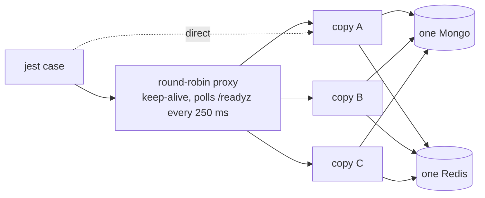

# Cluster testing

`npm run test:cluster` — the suites that boot the app as several processes: `src/cluster.ts` with real worker
processes, and separate copies behind a proxy ([below](#the-multi-copy-suite)). The whole run takes about 80 seconds and needs a Redis. A third case, `tests/cluster/redis-idle.test.ts`, forks nothing: it leaves one real shared Redis client idle past its socket ceiling and checks the keepalive holds it open.

## What it is for, and why nothing else could do it

Every other suite runs the app in **one process**: supertest against a mounted express app, which
is faster and right for almost everything — including
[the in-process race suite](./concurrency-testing.md), whose contention happens inside Mongo and
does not care whether the two callers share an event loop.

One process cannot observe the class of bug this directory exists for: **state that is correct
within a worker and absent across the cluster.** A per-process counter is indistinguishable from a
shared one when there is only one process. Cluster mode (`npm run start:cluster`) forks a worker per CPU, and orchestrator replicas run several processes, so every such bug is
real there and unreachable from the rest of the suite.

The first target is the rate limiter, because it is the one where the gap is a security control:
with per-process counters a budget of 100/minute is really `100 × workers`/minute, and nothing in
the configuration says so. The primary refuses to fork 2+ workers without the `limits` Redis.

## The shape of the assertion

Two cases in `rate-limit.test.ts`:

| Case                                  | Setup                     | Expected                                          |
| ------------------------------------- | ------------------------- | ------------------------------------------------- |
| spends one budget across every worker | Redis                     | exactly `LIMIT` allowed                           |
| refuses to boot two workers           | no `limits` Redis URL set | primary exits non-zero, output names the variable |

A single case asserting "the budget is spent once" passes just as well when the harness is broken —
if only one worker ever serves, a per-process counter also spends exactly one budget, and so does a
worker whose Redis errors (each limit falls back to in-memory counting). The spread across workers
is the control: every log line carries the writing process's `pid`, the harness counts answered
requests per pid, and the Redis case asserts at least two workers answered and that the counts sum
to the whole burst. The harness also waits for every worker's ready line and opens one connection
per request.
The refusal case boots no cluster at all (`expectRefusal`): a primary still alive after its
timeout fails the case.

## Three settings that decide whether it measures anything

Each of these made the suite pass for the wrong reason at some point while it was being written.

| Setting                              | Why                                                                                                                                                                                                                            |
| ------------------------------------ | ------------------------------------------------------------------------------------------------------------------------------------------------------------------------------------------------------------------------------ |
| `NODE_ENABLE_CLUSTERING=1`           | Clustering is **off** by default. `NODE_CLUSTER_WORKERS` alone does nothing — `src/cluster.ts` gates the fork on this flag — so without it the child is a single process and every cross-worker assertion passes vacuously.    |
| `NODE_ENV=development`, never `test` | `never test`: `assertModuleConfig` (`kernel/module-config.ts`) skips its presence checks under `NODE_ENV=test`, and this suite wants them run for real, against the secrets it sets below.                                     |
| `agent: false` + `Connection: close` | The cluster balances **connections**. Node's `fetch` keeps the socket alive and reuses it, so a burst over one socket lands entirely on one worker — and the memory-store case then reports exactly the shared-counter result. |

Counters also live under a per-run key prefix. A shared Redis remembers, the window is a minute,
and a second run inside one would start against a budget the first had already spent.

## Redis

`NODE_TEST_REDIS_URL` if set; otherwise the suite starts a container with
`${CONTAINER_ENGINE:-podman}` and stops it afterwards. CI sets the variable, because a service
container is already listening there.

Each container carries its owner's pid as a label. A killed run (Ctrl+C, a timeout) never reaches
its `afterAll`, so the next run that starts a container first removes those whose owner is gone;
a live run's container, in a parallel lane, is never touched. The owner check uses process ids, so
a run from another pid namespace that shares the engine socket (a flatpak IDE, a devcontainer)
looks dead to it.

The suite **fails** rather than skips when neither is available. A security control nobody checked
is the thing it exists for, and a green skip reads exactly like a green pass.

Inside a container this matters more than the words above suggest: the fallback shells out to
`${CONTAINER_ENGINE} run`, which needs either a nested engine or a mounted container socket —
precisely what [Docker & Podman](./docker-and-podman.md#running-the-gate-in-a-container) avoids on
purpose. The container lane **must** supply `NODE_TEST_REDIS_URL` — there is no code change to
make this work, since the resolver already honours it, only a variable to set. `test:cluster` is
not part of `npm run complete` (it is `complete:manual`), so this does not block the `container-gate`
CI job; it blocks anyone running the full manual pass
inside a container.

[testcontainers](https://testcontainers.com/) is the obvious dependency for this and was not taken:
it talks to a Docker socket, and this repo is podman-first (see
[Docker and Podman](./docker-and-podman.md)). Using it here means exporting a podman socket as
`DOCKER_HOST` everywhere — a new dependency _and_ a workaround for it. Starting a container with
the engine the repo already names is thirty lines and no dependency.

## Why the script passes `--experimental-vm-modules`

The mongodb driver (7.8) loads `os` with `await import('os')`. Jest's vm sandbox rejects a dynamic
import without that flag; the driver swallows the error and sends a handshake with no `driver`
field, and mongod refuses it (code 183). These suites start `MongoMemoryReplSet` inside the jest
process, so its own client cannot be handed the `JEST_DRIVER_OPTIONS` workaround
`tests/support/database.ts` uses. The script therefore runs jest through `node --experimental-vm-modules`.

Source: `node_modules/mongodb/lib/runtime_adapters.js:29` (the `await import('os')`), upstream
[the driver's runtime adapters source](https://github.com/mongodb/node-mongodb-native/blob/v7.8.0/src/runtime_adapters.ts).

## The multi-copy suite

`tests/replicas/` is the same idea with the shape an orchestrator gives you: N **separate**
single-process copies (`node --import tsx src/main.ts`, `NODE_ENABLE_CLUSTERING=0`, one port each) behind a
round-robin proxy written with `node:http`, over one Mongo and one Redis. It runs under the same
`npm run test:cluster`, so it is already in `complete:manual` and in CI's `cluster` job.

The proxy acts like a real balancer on purpose: per-request round robin over the copies whose
`/readyz` answers 200, pooled keep-alive sockets, `X-Forwarded-For` appended, answers streamed
unbuffered, its own 502s and 503s counted. Every copy gets the proxy's address as `NODE_URL`,
because a token's issuer is that address and real replicas share one.

| Case                                | Asserts                                                                                                                                                                                             |
| ----------------------------------- | --------------------------------------------------------------------------------------------------------------------------------------------------------------------------------------------------- |
| one rate-limit budget across copies | exactly `LIMIT` allowed through the proxy; at least two copies answered                                                                                                                             |
| a session across copies             | login anywhere, use on every copy, refresh on B, logout on C kills A                                                                                                                                |
| one write for one `Idempotency-Key` | same key on two copies at once: one 201, the other replayed or 409; one row                                                                                                                         |
| a rolling restart                   | every copy stopped and started in turn under steady load, `NODE_SHUTDOWN_DELAY_MS=1000`: the proxy counts no 502 or 503, every request answers 200, a slow POST open on each stopping copy ends 201 |

Every case ends on a control that breaks when the rig does: the proxy's spread shows at least two
copies answered, or the assertion is about a second copy by name. A case that only passes when
the rig is broken would be worse than none.

Two harness rules that bit:

- Each copy is signalled by its own pid with one `SIGTERM` (the cluster harness signals a process
  group; through `npx` a copy would be told twice).
- `tests/replicas/` is ignored by `jest.config.js` and `stryker.json`, next to `tests/cluster/`:
  a copy needs its own Mongo and a real port, not the shared in-process setup.

The rolling-restart case is red without the delay: with `NODE_SHUTDOWN_DELAY_MS=0` the proxy counted
18 `502`s in one run, from requests sent to a copy that had already closed. The delay is at least four of
the proxy's 250 ms polls, or the case races the poll it proves the copy outlives
([why](../operate/health-checks.md#shutting-down-behind-a-load-balancer)).

A "scheduled job runs once" case is not here: `tests/integration/persistence/lease.test.ts` already
proves the Mongo atomicity two callers contend on, and a second process adds nothing to it.

## Why it is not in `complete`

~80 seconds and a container engine, on a gate that otherwise runs in about ninety. It sits in
`complete:manual` — the same category as `test:prism`, which also binds a real port — and runs in
CI on every push, where a Redis service container is already there.

## What it found

On its first run, **nothing was being limited at all**: 30 of 30 requests answered 200 against a
budget of 5.

`RedisStore.init()` loads two Lua scripts back to back. Both saw `isReady` as false — it stays
false for the whole handshake — and each called `connect()` on the same client. node-redis rejected
the second with `Socket already opened`, and that failure path discarded the client the first one
was still using, which then failed with `The client is closed`. Every request afterwards passed
unbudgeted, and the log said Redis was unreachable while Redis was answering fine.

The fix is one shared in-flight connect promise (`connectPromise` in
`src/infrastructure/adapters/managed-connection.ts`, which the limiter's Redis client goes through):
one connection needs one `connect()`.
Reverting it turns the first case red with `Expected 5, Received 30`.

## Read next

- [Broker testing](./broker-testing.md)
- [Clustering & Shutdown](../understand/clustering.md)
- [Testing — Quick Start](./testing-quickstart.md)
