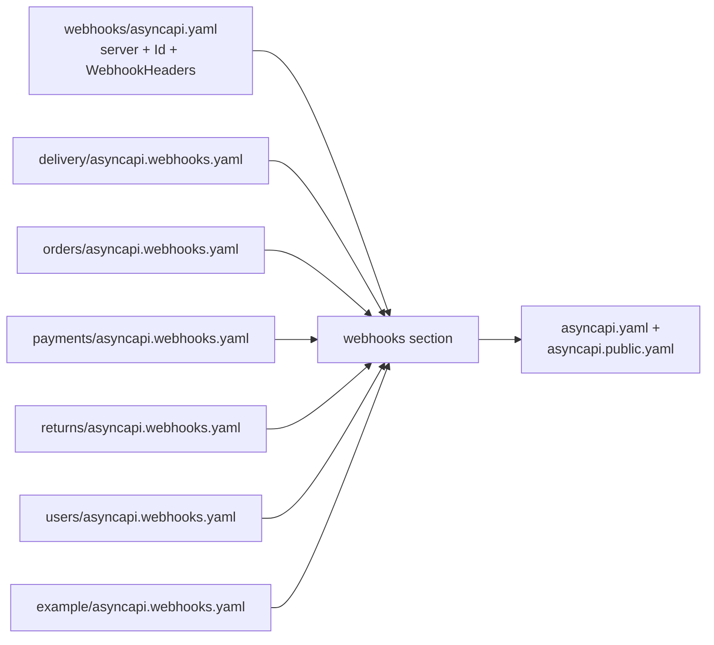

# Contract fragmentation: the other five bundles

Part of [Contract Ownership & Fragmentation](./contract-fragmentation.md): how AsyncAPI, webhooks, extensions, browser events, analytics names and client collections are owned.

## The other five, and what each one taught

### `asyncapi.yaml` — one whole document per section, merged

A domain appears three times in this document (`channels:`, `components.messages:`,
`components.schemas:`). **A section is one complete AsyncAPI document** (one exception: [`webhooks`](#module-owned-webhook-events)):
`src/modules/<name>/asyncapi.yaml` for a domain's public events, exactly as it carries one
`openapi.yaml`; `src/modules/<name>/asyncapi.internal.yaml` for a queue the module owns; and
`shared/contracts/asyncapi.workers.yaml` for the `worker.*` queues that belong to no domain — the
async twin of filing `GET /` under `system`. Each section also declares the SERVER its channels bind
to, so a bundle that leaves a section out leaves its transport out with it — which is what produces
`asyncapi.public.yaml` without a second list of servers to keep in step.
`shared/contracts/asyncapi.root.yaml` holds what describes the deployment rather than a domain, and
no channels.

`observability` and `notifications` own their SSE channels because the module serving the stream
decides what it pushes down it. The `worker.email.send`/`worker.image.digest` queues are shared
because those two workers are substrate, enqueued by whichever domain needs one sent.
`worker.webhook.deliver` and `worker.account.export` are the exception: `webhooks` and `account` own
those queues outright, in a PRIVATE `asyncapi.internal.yaml` section — `backend`-scoped like the
shared queues file, but a module's, so deleting the module deletes the queue's contract along with
everything else that names it.

Each public section is valid on its own — lintable by `npm run lint:asyncapi:modules`. (A private
`asyncapi.internal.yaml` is the one deliberate exception: it declares no `servers` of its own — its
channel binds to the shared queues file's `rabbitmqLocal` — so it is valid only once merged, and is
left out of that glob for that reason.)

**Why this is a merge and not `asyncapi bundle`.** `asyncapi bundle` dereferences: every `$ref` is
inlined, the document balloons, each payload is repeated once per channel that names it _and_
kept under `components` — and `scripts/contracts/generate-asyncapi-types.ts`, which walks
`channels[*].messages.*.$ref` to decide what to name a generated model, is left
with nothing to follow. So the merge happens in a small function in
`scripts/contracts/asyncapi-bundles.ts`, deliberately dumber than a bundler: it copies five maps —
`servers`, `channels`, `operations` and the two under `components` — and refuses on a collision,
carrying `$ref` strings across untouched because every section already resolves its own refs
internally. That file's header is the full argument. See also
[AsyncAPI Workflow](./asyncapi-workflow.md).

### Module-owned webhook events {#module-owned-webhook-events}

The `webhooks` section is the one section that is not complete on its own. Its file keeps the server
and the headers schema every event shares; each event is declared by the module that fires it, in
`src/modules/<module>/asyncapi.webhooks.yaml` (`delivery`, `orders`, `payments`, `returns`, `users`, `example`).
`scripts/contracts/asyncapi-webhook-events.ts` lists the event names, and `asyncapi-section-fragments.ts` finds those files on disk and
`withSectionFragments` folds them into the section before it joins the bundle: one call, in
`asyncapi-bundles.ts`. The same collision refusal applies, so two modules claiming one event name
fail the bundle.

Each channel also carries `x-read-rule`: `public`, or the declared tenant rule (no conditions) a subscriber
must hold to receive that event. `webhooks/services/catalog.ts` reads it at boot and refuses a channel
without a usable one; the bundler passes it through untouched into `asyncapi.public.yaml`
([who may subscribe to what](../modules/webhooks.md#who-may-subscribe-to-what)).

A payload field with a closed set of values `$ref`s the owning module's own REST schema
(`./openapi.yaml#/components/schemas/ReturnReason`) rather than copying its enum. The bundle has to
stand alone, so `withSectionFragments` copies each referenced schema into the fragment's
`components.schemas`, just before the first schema that uses it (the Zod emitter declares in order),
and points the ref at the copy. A text written next to such a `$ref` is ignored by AsyncAPI, so the
enum's own description is the one that shows.

Why: removing `orders` removes its events from the contract with no hand edit, and removing `webhooks`
leaves the fragments unmerged. The fragments are not documents (they ref the shared server), so
`lint:asyncapi:modules` skips them and `lint:asyncapi` lints the merged result.

### Extending another module's contract (`x-extends`) {#extending-another-modules-contract}

A module can add to what another module published, without that module naming it. The extender ships
a fragment named for the owner and the format:

| File in the extender      | Extends                                                      | Merged by                                                                                                                                                                             |
| ------------------------- | ------------------------------------------------------------ | ------------------------------------------------------------------------------------------------------------------------------------------------------------------------------------- |
| `openapi.<owner>.yaml`    | the owner's OpenAPI enums and `oneOf` unions                 | `scripts/contracts/openapi-extensions.ts` (its schemas are staged into redocly's tree; the variants are appended in a step in `bundleSteps`, before `pruneUnused`) and `fill-enum.ts` |
| `asyncapi.<section>.yaml` | the section's channels, messages, schemas and `oneOf` unions | `withSectionFragments` (`asyncapi-section-fragments.ts`), the generalised form of the webhook-event merge                                                                             |

The fragment's `x-extends` maps a schema name to what it appends. Both formats read the map with
`scripts/contracts/extends-map.ts`, so a map that is not string lists, an empty list, a repeated
entry or an undeclared variant fails the bundle the same way on either side. In OpenAPI the owner
(`<owner>` in the file name) must be a module with an `openapi.yaml` that declares every extended schema:

- **Enum**: values. The owner keeps its written `enum` and adds `x-enum-from: <its own name>`; the
  appended values follow the written ones. The bundle fails on a duplicate value, and on a target
  that does not declare `x-enum-from`.
- **Union**: schema names the fragment declares under `components.schemas`. Each is added to the
  `oneOf`, and to the discriminator `mapping` under the value its `<propertyName>.enum` holds
  (`propertyName` is the union's own `discriminator.propertyName`). The fragment is staged into
  redocly's tree, so its refs (`../notifications/openapi.yaml#/components/schemas/X`) resolve like any
  module's and a ref that answers nothing fails the bundle; a schema name the bundle already holds is
  a collision and fails.
- AsyncAPI payload enums use the existing way to share an enum: a `$ref` into a REST contract, copied
  in and stamped `x-openapi-schema`. A `../<module>/openapi.yaml#/...` ref reaches a sibling module's file.
  A ref to an OPEN enum (one a module extends, marked `x-enum-from`) fails the bundle: the copy would be
  the owner's raw file without the extenders' values. Write the payload's values out, or `$ref` a closed enum.

Delete the extender and its fragment goes with it: the owner's contract falls back to its own values
and variants. This is why the owner never names the extension.

**Why not OpenAPI Overlay 1.0?** It is OpenAPI only (AsyncAPI has no twin), and it would be a new
tool beside the bundler's existing `x-` steps. One mechanism for both formats won.

### Module-owned browser events {#module-owned-browser-events}

`POST /analytics/events` accepts a closed set of events, and each belongs to the module whose page
reports it. A module ships `src/modules/<m>/openapi.browser-events.yaml` (components only, one schema
per event, each with a one-value `event` enum). After the bundle is built,
`scripts/contracts/analytics-browser-events.ts` adds those schemas and replaces `analytics`'
placeholder `AnalyticsEventRequest` with a `oneOf` discriminated on `event`: one call in
`openapi-bundle.ts`. With `analytics` absent nothing is added; with no fragment the placeholder stays.
The runtime half is `AppModule.browserEvents`, the same shape as `publicEvents` for webhooks.

### The analytics names — owned by the module, published to no one

`PRODUCTS_SEARCHED` is a fact about products and `CART_ITEM_ADDED` one about the cart, so each
module owns its names as **ordinary TypeScript**, in `src/modules/<name>/analytics.ts`, exported as a
normal `as const` its own controllers import and augmenting the analytics port's `AnalyticsEventMap`
exactly as `audit.ts` augments `AuditActionMap`. `src/infrastructure/` stays free of domain names.

Nothing is published across the repos: the paired frontend emits no custom events, so there is no
second catalogue to disagree with. Every name in the shared Umami website is written in exactly one
place — a module's `analytics.ts`. A single catalogue shared by both sides would say which names
EXIST and never which side EMITS them, which is how one add-to-cart once counted twice.

The sweep that holds it: `tests/cross-cutting/analytics-events.test.ts` reads every
`src/modules/<name>/analytics.ts` off disk and rejects two modules claiming one constant name or one
event string, a name outside the convention, or a module that exports names without the
`declare module` block that puts them in `AnalyticsEventMap`. No list to maintain, and a module
added or deleted changes nothing but its own folder.

The lesson worth keeping: **a shared artefact is only worth its machinery when both sides really
write.**

### The demo dataset — not a bundle

Each module's seed records live in `scenarios/<name>.ts`, collected by `npm run regenerate` and imported by
nothing under `src/` — no fragment, no text concatenation. What the API actually answers for a
seeded row is not published to a file: it is asserted directly, against a real database, by
`tests/integration/scenarios/shop.test.ts`. The one thing consumers can read is
`scenarios/subjects.ts`: the named ids and credentials a consumer that cannot import module code
(a generated client collection) needs to point at a specific seeded row.

Fragmenting a document is right when both repos consume the same document. When what they actually
need is the same ANSWER, publish the answer. See `docs/understand/mongodb-mongoose.md`.

### The client collections — generated, because a restatement is a copy {#the-client-collections-generated}

A hand-written collection rots exactly as a copy does: endpoints go missing, URLs the app no longer
serves stay in, and a mock server serving shapes the frontend cannot parse is worse than no mock
server.

So `scripts/contracts/client-collections-bundle.ts` produces it — **one gitignored file
generated whole.** There is no intermediate on disk: no per-module slice to hand-edit, no
header to keep in step with a footer, and nothing under `src/` that must never be opened.

The traversal, the example synthesis and the emitters live in
[`@guebbit/openapi-runnable-collections`](https://www.npmjs.com/package/@guebbit/openapi-runnable-collections),
which knows nothing about this repo. That file is **configuration**: which module owns which path,
where the values come from, where the probes are, and where the output lands. Everything below is a
property of that configuration rather than of the package.

- **shapes come from `openapi.yaml`** — every operation, its auth, its request body, one example per
  declared response;
- **values come from `scenarios/subjects.ts` and `scenarios/values/<module>.ts`** — the first
  holds the credentials, each of the others the example ids its module knows, so `GET
/products/{id}` asks for a product the database actually holds and `POST /account/login` sends
  credentials that work. A deleted module's file leaves with it; the bundler scans the folder.
  That is the difference between a collection you can click and one you have to fix first. Only
  ids and credentials, though: those files cannot import a module's own fixtures without
  pulling in the `@api/` client the bundler is still building (see below), so a body field this
  file cannot name — a title, a price, a description — falls to a type- and format-shaped default;
- **ownership comes from the module contracts** — a path in `src/modules/orders/openapi.yaml`
  is the orders module's, so the mapping is recorded once and a path that moves between modules
  moves in the collection with it;
- **identifiers are hashed from method and path**, not generated fresh, so regenerating rewrites
  only what actually changed rather than re-forking all three files.

Two assertions hold it in place: each collection must equal a fresh run, and every collection must
carry one request per operation the contract declares — which is precisely the check that was
missing while they rotted.

**A request the contract cannot describe still has a home — `src/modules/<name>/probes.ts`.** A
collection is also where you keep the requests that prove the API _rejects_ things, and a spec
describes valid calls and their declared answers, so no generator can derive them. A module declares
its probes as data — method, path, headers, body, and a `why` that becomes the description — and
they are emitted after its contract-derived requests.

They are TypeScript rather than YAML, and the generator is called with them directly. That buys two
things a data file cannot: the seed tokens and the probe shape are typechecked, and a module deleted
without its probes leaving `scripts/contracts/client-collections-bundle.ts` stops the build — which is the
failure [module lifecycle](module-lifecycle.md) asks for, rather than a collection that
silently comes out short.

Each probe is a question a contract cannot ask. A few examples:

| Module     | Probes                                                                                                                                                                                      |
| ---------- | ------------------------------------------------------------------------------------------------------------------------------------------------------------------------------------------- |
| `account`  | log in as the non-admin · 401 from a bogus token · 409 from a duplicate signup · the rate limiter (send repeatedly)                                                                         |
| `products` | 422 from a body that breaks two constraints · the same product under `Accept-Language: it` · every optional filter at once · the soft-deleted product · the inactive one · the off-sale one |
| `cart`     | checkout with an empty cart · adding a product that does not exist · a quantity the schema forbids                                                                                          |
| `orders`   | the owner asking for their own soft-deleted order                                                                                                                                           |
| `wishlist` | saving a product the storefront will not show · moving or unsaving one that was never saved · an id no ObjectId can be built from                                                           |
| `example`  | reading a published example that does not exist · editing one with a malformed id                                                                                                           |

A probe refers to seed records as `{{seedSoftDeletedProductId}}` rather than pasting an id — the
tokens are filled in `scripts/contracts/client-collections-bundle.ts` from the seed ids (the soft-deleted product is _named_ once, in `scenarios/product-ids.ts`), so
a fixture that stops being soft-deleted takes its probe with it instead of leaving one that quietly
tests nothing. An unknown token fails the generator with the list of known ones.

**One tool.** The collection is Bruno's YAML. `@guebbit/openapi-runnable-collections` can also emit Insomnia, Postman and Mockoon collections: add the tool's name to `COLLECTION_TOOLS` in `scripts/contracts/client-collections-bundle.ts` (and a bundle in `bundle-registry.ts`) to get one.

## What the frontend does — and does not — do

Worth stating explicitly, because it is the question that prompted this page:

|                                         |                                                                                                                                     |
| --------------------------------------- | ----------------------------------------------------------------------------------------------------------------------------------- |
| Authors the contract                    | ❌ never                                                                                                                            |
| Holds a byte-identical copy             | ✅ at its own repo root                                                                                                             |
| Fragments the spec                      | ❌ no — it would be a second source of truth for a document it does not own                                                         |
| Owns a per-module slice of the contract | ✅ but as **code**, not YAML: `src/modules/<name>/responseSchemas.ts` maps that module's URLs to the generated Zod response schemas |

So both repos end up with per-module contract ownership — this one in YAML, the frontend in
TypeScript — while exactly one of them decides what the contract says.

## Read next

- [Contract Ownership & Fragmentation](./contract-fragmentation.md)
