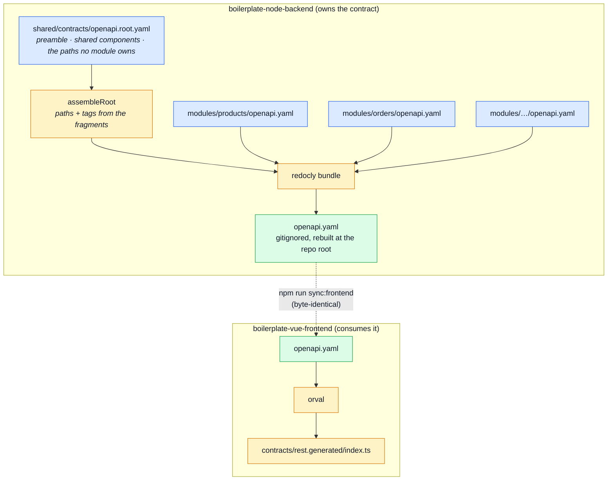

# Contract Ownership & Fragmentation

[OpenAPI Workflow](./openapi-workflow.md) covers **how to change** the contract. This page covers
**who owns it, where it lives, and how it reaches the frontend** — the part that involves two
repositories and is easy to get wrong from either side.

## The one-line version

> This repository **owns** the shared, domain-shaped documents. The frontend **holds
> byte-identical copies** of the six shared files (the two contract bundles, the authorization keys
> and three webhook-sink TLS files) and never edits them.

**One backend, one paired frontend, lockstep.** `asyncapi.public.yaml` does reach a second
consumer — any webhook subscriber, guarded by the `asyncapi-breaking` job — but nothing here is
versioned or published for a second consumer to pin an _older_ copy of. That is a deliberate
choice, not a gap: a versioned, publishable contract artefact is worth building once a second real
API consumer exists (a second frontend, a mobile client, a partner integration), not before. Until
then, `sync:frontend` copying the shared files on every change is the cheapest correct thing, and
`spec-identity` (both repos) is what makes "lockstep" a checked
claim rather than a hope. The fuzz suite (`tests/fuzz/`) fuzzes this repo against its own spec — it
compares nothing across repos, so it isn't part of that lockstep guarantee.

## The seven bundles

`openapi.yaml` is not a special case. Seven documents are produced here from per-module
sources; two of them — `openapi` and `asyncapi-public` — also exist in
`boilerplate-vue-frontend` as byte-identical copies, because the frontend's toolchain reads them.
Four more shared files travel with them (`shared/authorization-keys.generated.yaml` and three webhook-sink TLS
PEMs); the full list is `SHARED_FILES` in `scripts/pairing/spec-identity.ts`.
The client collection stays in this repo only — it is derived from `openapi.yaml`, so a
frontend copy could never disagree without the spec disagreeing first, and nothing there reads
it:

| Bundle            | Written to                                   | Built from                                                                                        |
| ----------------- | -------------------------------------------- | ------------------------------------------------------------------------------------------------- |
| `openapi`         | `openapi.yaml`                               | `src/modules/<name>/openapi.yaml` — **compiled by `redocly bundle`**                              |
| `asyncapi`        | `asyncapi.yaml`                              | `src/modules/<name>/asyncapi.yaml` + `shared/contracts/asyncapi.{root,workers}.yaml` — **merged** |
| `asyncapi-public` | `asyncapi.public.yaml`                       | the same sources minus the backend-only ones — the half the frontend receives                     |
| `bruno`           | `contract.generated.bruno.yml` _(untracked)_ | `openapi.yaml` + the demo dataset — **generated whole**                                           |

Whatever more than one domain reads stays in `shared/contracts/`, and each bundle's section order,
layout and shared parts are declared in one file under `scripts/contracts/`.

**Four different verbs, and the difference is not cosmetic:**

| Bundle                 | Verb          | What does it                                                                                                                                                                                                                                                                                                                                                                                                                                                                                                                                                                                                                                                                                                                                                                                                                                                                                                                                                                                                                                                                                                                                                                                                                                                                                                                                                                                                                                                                                                                                                                                                                                                                                                                                                                                                                                                                                                                                                                                                                                                                    |
| ---------------------- | ------------- | ------------------------------------------------------------------------------------------------------------------------------------------------------------------------------------------------------------------------------------------------------------------------------------------------------------------------------------------------------------------------------------------------------------------------------------------------------------------------------------------------------------------------------------------------------------------------------------------------------------------------------------------------------------------------------------------------------------------------------------------------------------------------------------------------------------------------------------------------------------------------------------------------------------------------------------------------------------------------------------------------------------------------------------------------------------------------------------------------------------------------------------------------------------------------------------------------------------------------------------------------------------------------------------------------------------------------------------------------------------------------------------------------------------------------------------------------------------------------------------------------------------------------------------------------------------------------------------------------------------------------------------------------------------------------------------------------------------------------------------------------------------------------------------------------------------------------------------------------------------------------------------------------------------------------------------------------------------------------------------------------------------------------------------------------------------------------------- |
| `openapi.yaml`         | **compiled**  | `redocly bundle` resolves `$ref` across whole documents, then the root's `x-app-level-responses` (429, 500 and 503 for every operation; 400/413/415 for a body-carrying one; 415 for a body-less write too — none of them any one module's business) is merged into every operation that doesn't already declare its own. A step (`scripts/contracts/image-upload-encoding.ts`) stamps the root's `x-image-upload-types` onto every multipart `imageUpload` part as `encoding.imageUpload.contentType`. A second step (`scripts/contracts/cookie-auth.ts`) adds `cookieAuth` as an alternative to every operation that takes `bearerAuth`, and the origin `403` to its unsafe methods. A step (`scripts/contracts/response-headers.ts`) stamps the root's `x-app-level-headers` (`x-request-id`, `Cache-Control`, `Content-Language`, `Vary`, `RateLimit-Policy`, `RateLimit`, `ETag`) onto every response that does not declare the same header itself, and `Idempotent-Replayed` onto every response of an operation that takes an `Idempotency-Key` except a 429 (the ledger never sees one), through a `<Name>Replayable` twin of each shared response. A step (`scripts/contracts/fill-enum.ts`) fills a schema marked `x-enum-from: <source>` with that source's values (after any written `enum`, which is how a module extends another's enum), so the webhook event names are never copied into `webhooks/openapi.yaml`. A step (`scripts/contracts/openapi-extensions.ts`) merges another module's `openapi.<owner>.yaml` variants into the owner's `oneOf` unions ([Extending another module's contract](./contract-fragmentation-other-bundles.md#extending-another-modules-contract)). An operation's own `x-error-codes: { '<status>': [CODE, ...] }` lists the codes it answers with, and the bundle fails if a name is not in the collected catalogue or sits under another status; a catalogue entry's optional `scope: app` marks a code any operation may send, so none lists it ([what an operation lists](../reference/errors.md#what-an-operation-lists)) |
| `asyncapi.yaml`        | **merged**    | `scripts/contracts/asyncapi-bundles.ts` copies five maps; `$ref`s stay untouched                                                                                                                                                                                                                                                                                                                                                                                                                                                                                                                                                                                                                                                                                                                                                                                                                                                                                                                                                                                                                                                                                                                                                                                                                                                                                                                                                                                                                                                                                                                                                                                                                                                                                                                                                                                                                                                                                                                                                                                                |
| `asyncapi.public.yaml` | **merged**    | the same merge over the shared sections only — one `SHARED_SECTIONS` list decides which                                                                                                                                                                                                                                                                                                                                                                                                                                                                                                                                                                                                                                                                                                                                                                                                                                                                                                                                                                                                                                                                                                                                                                                                                                                                                                                                                                                                                                                                                                                                                                                                                                                                                                                                                                                                                                                                                                                                                                                         |
| the client collection  | **generated** | produced whole from `openapi.yaml` + the dataset, nothing on disk between; untracked                                                                                                                                                                                                                                                                                                                                                                                                                                                                                                                                                                                                                                                                                                                                                                                                                                                                                                                                                                                                                                                                                                                                                                                                                                                                                                                                                                                                                                                                                                                                                                                                                                                                                                                                                                                                                                                                                                                                                                                            |

A 405 is not merged in: it answers a request that matched no operation, so it is the
`METHOD_NOT_ALLOWED` code in the root's `x-error-codes` and a guard built from `api.generated/operation-routes.ts`
([Write Methods](../understand/write-methods.md#a-known-path-with-the-wrong-method)).

A hand-written restatement of the contract is a copy and copies rot, which is why the last row
exists at all. See [The client collections](./contract-fragmentation-other-bundles.md#the-client-collections-generated).

```bash
npm run contracts:bundle              # build the specs
npm run contracts:bundle -- bruno     # one collection, from the contract on disk
npm run check                         # fail if any bundle on disk is stale
```

The bundle check in `npm run check` asserts every bundle on disk equals a fresh build, so a fragment
edited without re-bundling fails it locally. No bundle is committed: `postinstall` rebuilds all
three on every install, so there is no committed copy to go stale on a push and CI has no job that
diffs one. What CI compares is the frontend's copy, through `spec-identity`.

Nothing else is shared. `shared/contracts/spectral.yaml` and `generate-asyncapi-types.ts` exist in
both repos but are hand-maintained on each side, so a fork in one is a question (which copy is
right?) that no script could answer — they earn no gate. `src/types/asyncapi.generated.ts` is absent for the opposite reason — it is generated from a bundle by
`npm run gen:asyncapi`, so it follows one rather than being one. `asyncapi.yaml` is absent for a third:
it is a bundle, but not a SHARED one — the frontend receives `asyncapi.public.yaml` instead, so the
full contract is compared against nothing and is marked `shared: false` to say so.

## The flow



The picture is drawn for `openapi.yaml`; the other five bundles differ only in what reads the output
(the realtime type generator, the API client). Three properties fall out of
it, and each is load-bearing:

1. **Fragments are authored here, and only here.** A module owns its slice of every shared document
   the same way it owns its routes and its seeds.
2. **The bundled file stays whole.** `openapi.yaml` is gitignored and rebuilt on every install here,
   but it is still what `spectral`, `orval`, the seed runner and the API clients all read locally —
   never fragments read piecemeal at request time.
3. **The frontend receives a finished file, and commits its copy.** It does not bundle, does not
   fragment, does not author; `sync:frontend` is what hands it across.

## Why the root file stays whole

It would be tidier to ship only fragments and bundle on demand. Three reasons not to:

- **The frontend's toolchain reads one file.** `orval.config.ts` there points at `./openapi.yaml`
  three times, and Spectral lints `openapi.yaml` in both repos.
- **Byte-identity is enforced by a test.** `scripts/pairing/spec-identity.ts` compares this repo's copy with
  the frontend's and fails the build when they fork. That check needs one file on each side to
  compare.
- **Regeneration is not reproducible across repos.** `redocly bundle` output depends on the
  installed CLI version, so two repos bundling independently can produce different bytes from the
  same sources. The output must be built once and copied, not rebuilt on both sides and assumed to
  match.

That last point is the one that bites. **If the bundle step ever produces different bytes here than
what the frontend holds, the spec-identity check fails and neither repo can build.** Bundle once, commit the
result, copy that.

The comments do **not** travel into `openapi.yaml` — a parse cannot keep them, and Redocly parses.
They live in the module documents instead, which is where they are read and edited. See
[Why the REST contract stopped concatenating](./contract-fragmentation-state.md#why-the-rest-contract-stopped-concatenating-and-the-rest-did-not).

## Which fragment owns which operation

The rule is the one the module registry already uses: **a module owns the paths under its
`basePath`.** The count of operations per module drifts every time a route is added, so it is not
repeated here — `grep -c operationId: openapi.yaml` reads the true total, and
`tests/cross-cutting/contract-bundles.test.ts` is what actually keeps a fragment honest about which
paths it owns:

The module's `module.yaml` and its `openapi.yaml` say which paths and tags it has; no table here
repeats them, because a table of them goes stale the day a module lands. `access` is the one module
with no HTTP surface: its `openapi.yaml` is components only (`paths: {}`).

Tags are free: an operation may carry several, and a tag need not belong to one module. What a tag
is listed under in the API docs comes from `x-family` on the module's own `tags:` entry: the
bundler generates `x-tagGroups` from it (`Core`, `Catalogue`, `Buying`, `After the sale`, `Running
the shop`, `Example`). The module that declares a tag first decides its family, so a borrowed tag
lands in one group only; a tag with no `x-family` falls back to its module's `group` in
`module.yaml` (`foundation` is `Core`, `shop` is `Shop`, `example` is `Example`).

**Where a split is not clean**, whoever does the work will hit it first:

- **`GET /` — the health probe — belongs to no module.** It is the application shell answering for
  itself. It goes in a `shared` or `root` fragment alongside `components:`, not into a module.
- **`account` and `addresses` share a `basePath`.** Both mount at `/account`, and address
  operations carry the `Account` tag too — fragmenting by `basePath` still splits them correctly,
  since `addresses`' own paths (`/account/addresses*`) never overlap `account`'s.
- **`orders` and `invoicing` share a `basePath`, but NOT a tag.** Both mount at `/orders`;
  `invoicing`'s two paths (`/orders/{id}/invoice`, `/orders/{id}/credit-notes`) are tagged
  `Invoicing` rather than `Orders`, since download-a-frozen-document is a different concern from
  the order resource itself — fragmenting by `basePath` still splits the two files correctly.
- **`access` has no HTTP surface of its own** — headless by design, the one module whose manifest
  declares no `mounts`. Its `openapi.yaml` is components only (`paths: {}`):
  the abilities schemas `GET /account` carries, and the `roles` section of the data
  export. A components-only fragment owns no folder in the client collections.

Also note that `Auth` and `Account` are two tags over one `basePath`. **Fragment by `basePath`, not
by tag** — tags are a documentation grouping and one module may legitimately use several.

## What a fragment contains

Everything the module's paths need and nothing else:

- its `paths:` entries,
- the `components.schemas` only it uses,
- its `tags:` declaration.

Anything used by two or more modules — the error body (`Problem`), pagination parameters, the security
schemes — stays in the shared root fragment. **Duplicating a shared schema into two fragments is
the failure mode to watch for**: the bundle will contain two definitions that drift apart silently,
and nothing but a careful reading catches it.

### Declaring a cached read: `x-cache`

A `GET` that mounts `privateNoCache` or `setCache` says so in its own fragment, on the operation:

```yaml
/products/facets:
    get:
        x-cache: 'max-age: 3600' # or `private-no-cache`, `revalidate`, `no-store`
```

- `private-no-cache`: the route mounts `privateNoCache`.
- `revalidate`: `setCache` with `browserRevalidate`.
- `max-age: <s>`: `setCache` without it, the browser keeps the answer for `<s>` seconds.
- `no-store`: never cached (a PDF, an export). No `304`; the bundler declares
  `Cache-Control: no-store` on the `200`. Declared only: no router middleware marks it, so the test
  does not compare it with the routers.

The bundler stamps the shared `304` on every operation that carries the key. It reads the contract
only: it never boots the app, because the app imports files this same build generates.
`tests/cross-cutting/cache-policy-declared.test.ts` names the missing or stray operation when a
router and its `x-cache` disagree. It checks which GETs are cached, not the value.

### The permission on an operation

A route guarded by `requirePermission(action, subject)` names that permission in its fragment, in
the standard OpenAPI place: the scopes list of the security requirement (OAS 3.1 allows role names
there for non-OAuth schemes, [spec](https://spec.openapis.org/oas/v3.1.0#security-requirement-object)).

```yaml
security:
    - bearerAuth: ['display:Payment']
    - apiKeyAuth: ['display:Payment']
```

- Several guards on one route list several names (all must hold). A `router.use` guard counts for
  every operation under it.
- `apiKeyAuth` is listed only where an API key may reach the route, and carries the same names.
- The bundler (`scripts/contracts/permission-security.ts`) reads the names through the kernel's
  rules and merges into the operation's `x-error-codes`: the rule's `deniedCode` (else `FORBIDDEN`)
  and `SECOND_FACTOR_ENROLLMENT_REQUIRED` under 403, `REAUTH_REQUIRED` under 401 for a `stepUp`
  rule. A name no rule declares fails the bundle.
- Do not write those codes by hand. A code a service makes (`ROLE_MANAGEMENT_REQUIRED` on a user
  write, say) stays a hand line.
- `tests/cross-cutting/contract-error-declarations.test.ts` holds the names against the mounted
  guards, both ways, and the generated lists against the guard's own questions. The SSE streams
  that authenticate by cookie name no permission: their guard is not a `requirePermission`.

### Client hints a fragment can put on an operation

| key                  | on               | what the client does with it                                                                                                                                                                                                                                                                                                                                                            |
| -------------------- | ---------------- | --------------------------------------------------------------------------------------------------------------------------------------------------------------------------------------------------------------------------------------------------------------------------------------------------------------------------------------------------------------------------------------- |
| `x-no-refresh: true` | an operation     | a `401` there is a real credential failure, so the frontend never refreshes the token and replays it. The frontend's route table carries it as `noRefresh`.                                                                                                                                                                                                                             |
| `x-redirect-query`   | a `302` response | lists the schema of a query parameter on the redirect (`error` on the OAuth callback), inline. A `$ref` under an `x-` key is inlined by the bundler and its component pruned, so the set cannot be a shared schema; both repos' generators emit it as `REDIRECT_QUERY_ENUMS` (the backend's is `api.generated/redirect-query.ts`, from `scripts/contracts/generate-redirect-query.ts`). |

Neither is wire data a server reads. The bundler passes both through untouched.

## Where the rest went

The long sections moved to sub-pages; each heading below keeps its old link target.

### Why the REST contract stopped concatenating, and the rest did not {#why-the-rest-contract-stopped-concatenating-and-the-rest-did-not}

Moved: [Why the REST contract stopped concatenating, and the rest did not](./contract-fragmentation-state.md#why-the-rest-contract-stopped-concatenating-and-the-rest-did-not).

### `asyncapi.yaml` — one whole document per section, merged {#asyncapi-yaml-—-one-whole-document-per-section-merged}

Moved: [`asyncapi.yaml` — one whole document per section, merged](./contract-fragmentation-other-bundles.md#asyncapi-yaml-—-one-whole-document-per-section-merged).

### Module-owned webhook events {#module-owned-webhook-events}

Moved: [Module-owned webhook events](./contract-fragmentation-other-bundles.md#module-owned-webhook-events).

### Extending another module's contract (`x-extends`) {#extending-another-modules-contract}

Moved: [Extending another module's contract (`x-extends`)](./contract-fragmentation-other-bundles.md#extending-another-modules-contract).

### Module-owned browser events {#module-owned-browser-events}

Moved: [Module-owned browser events](./contract-fragmentation-other-bundles.md#module-owned-browser-events).

### The analytics names — owned by the module, published to no one {#the-analytics-names-—-owned-by-the-module-published-to-no-one}

Moved: [The analytics names — owned by the module, published to no one](./contract-fragmentation-other-bundles.md#the-analytics-names-—-owned-by-the-module-published-to-no-one).

### The client collections — generated, because a restatement is a copy {#the-client-collections-generated}

Moved: [The client collections — generated, because a restatement is a copy](./contract-fragmentation-other-bundles.md#the-client-collections-generated).

## How this connects to the rest of the docs

- [OpenAPI Workflow](./openapi-workflow.md) — how to change the contract once you know who owns it
- [Theory / Layers](../understand/layers.md) — where implementation code lands after a spec change
- [Contract Testing](contract-testing.md) — how the running app is held to the spec
- [API overview](./api-contracts.md) — REST conventions used throughout

## Read next

- [Contract fragmentation: the products example and current state](./contract-fragmentation-state.md)
- [Contract fragmentation: the other five bundles](./contract-fragmentation-other-bundles.md)

- [OpenAPI 3.1 specification](https://spec.openapis.org/oas/v3.1.0)
- [Redocly CLI](https://redocly.com/docs/cli/commands/bundle) — `bundle` / `split` for OpenAPI
- [swagger-cli bundle](https://github.com/APIDevTools/swagger-cli#bundle)
- [`$ref` resolution rules](https://swagger.io/docs/specification/using-ref/)
