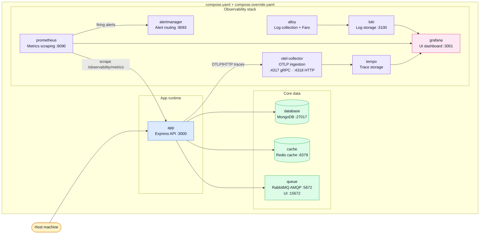

# Docker & Podman

This repo ships one local container implementation built around `compose.yaml` and `compose.override.yaml`.
It works as a Docker flow and also maps cleanly to the Podman helper scripts in `package.json`.

## Container map



## What is implemented

| Area                | Current implementation                                                                                                                                                                                                               |
| ------------------- | ------------------------------------------------------------------------------------------------------------------------------------------------------------------------------------------------------------------------------------ |
| App image           | `docker/Dockerfile` based on `node:24-trixie-slim` (Debian, glibc), with Chromium for Puppeteer-driven PDF rendering and a `mongod` baked in at build time — see [Running the gate in a container](#running-the-gate-in-a-container) |
| Local orchestration | `compose.yaml` and `compose.override.yaml` (loaded together) define app, cron, MongoDB, two Redis instances, RabbitMQ, and opt-in profiles: observability, analytics, docs, integrations                                             |
| Dev workflow        | bind mount source code into `/app`, keep `node_modules` inside the container, switch between single-process and clustered dev commands                                                                                               |
| Podman support      | `compose:restart` and `compose:rebuild` run `${CONTAINER_ENGINE:-podman} compose`; export `CONTAINER_ENGINE=docker` to switch                                                                                                        |

### After a new dependency: the container reinstalls by itself

`node_modules` lives in an ANONYMOUS VOLUME mounted over `/app/node_modules`, so the bind-mounted
source never shadows the container's own install. Under podman-compose that volume keeps a stable
name and is reused on every `up`, so it holds whatever was installed the day it was created.

`app` and `cron` therefore start with `docker/ensure-deps.sh`: it hashes `package-lock.json`,
compares it with a stamp inside the volume, and runs `npm ci` on a mismatch. A dependency added
to the lockfile needs only `podman compose up -d` (or `compose:restart`). The dev image writes the
same stamp at build time, so a fresh volume is not reinstalled.

A change to `docker/Dockerfile` itself (system packages, the baked `mongod`) is not covered:

```sh
podman compose up -d --build
```

Without the reinstall the symptom was `MODULE_NOT_FOUND` for a package that `ls node_modules` on
the host shows, raised from inside `/app`.

## Where the rest went

The long sections moved to sub-pages; each heading below keeps its old link target.

### The `integrations` profile is where a real consumer would go {#the-integrations-profile-is-where-a-real-consumer-would-go}

Moved: [The `integrations` profile is where a real consumer would go](./docker-and-podman-reference.md#the-integrations-profile-is-where-a-real-consumer-would-go).

### The compose provider behind `podman compose` {#the-compose-provider-behind-podman-compose}

Moved: [The compose provider behind `podman compose`](./docker-and-podman-podman.md#the-compose-provider-behind-podman-compose).

## Running the gate in a container

The `dev` stage of `docker/Dockerfile` carries everything `npm run complete` needs, baked mongod
included. The `container-gate` CI job builds it and runs the gate hermetically:

```sh
docker build -f docker/Dockerfile --target dev -t gate .
docker run --rm --network=none -v "$PWD/.git:/app/.git:ro" \
  -e GIT_CONFIG_COUNT=1 -e GIT_CONFIG_KEY_0=safe.directory -e GIT_CONFIG_VALUE_0=/app \
  gate npm run complete
```

No compose, no network, no `depends_on`: the image is self-contained or the job fails.

`--target dev` is required: a build without a target ends at `runtime`, which has no tests and no
devDependencies.

The root `.dockerignore` keeps `.git` out of every build context (129 MB). `npm run complete` runs
`lint`, and the `local/comment-links` ESLint rule shells out to `git ls-files`, so the gate run
mounts `.git` read-only instead. `safe.directory` is there because the checkout belongs to the
runner's user and the container runs as root, which git refuses as "dubious ownership". The `runtime`
stage never runs `lint`, so it needs no `.git`.

**Image size**: ~2.4 GB, against Alpine's usual few-hundred-MB — Debian itself, Chromium and its
font/rendering libraries, and the baked `mongod` all add up. None of it ships in the `runtime`
stage, which stays on Alpine — see
[why the image is shaped this way](../operate/ways-to-deploy/docker-server.md#why-the-image-is-shaped-this-way).

**What the production image leaves out**: every `src/**/tests/` directory and every
`src/**/factories.ts`. The build stage deletes them after the type-check gate and before the runtime
`COPY`, so the image carries no test, no builder that writes past a service's domain rules and no
fixture. Lint refuses a production import of any `factories` file, which is what makes the deletion
safe. The test doubles (a fake payment provider, a mail log) are not deleted: they were never in
`src/` — they live in `scenarios/`, which the image does not copy.

**Who owns the code in the production image**: root, read-only to `node`. The runtime stage copies
without `--chown`; only `public/images`, `tmp/storage` and `tmp/quarantine` belong to `node`. A write
primitive gained through a dependency therefore cannot rewrite the code it runs, with or without
the compose file's `read_only`. `scripts/ops/` is copied whole: it holds only what runs against a
deployment, and developer tools (`demo:remove`, `refresh:breached-passwords`) live in other folders.
A cross-cutting test checks that every crontab job's file is under `scripts/ops/`.

**Boot check**: `docker/boot-check.sh <image>` starts the `runtime` image against a throwaway Mongo
with the fail-closed env set, waits for `/livez`, and fails if `node` can write under `/app/src`. CI's
`boot` job and a developer run the same script:

```sh
docker build -f docker/Dockerfile --target runtime -t boot-check .
docker/boot-check.sh boot-check
```

## How to think about the setup

- **Compose is the local truth**: one file wires together the app plus all sidecars needed for demos and local debugging.
- **The `app` container owns the seeding**, not you: its startup command is `docker/ensure-deps.sh && npm run db:bootstrap && npm run dev:docker` (`dev:docker:cluster` when `NODE_ENABLE_CLUSTERING` is set), so a fresh volume arrives furnished — [Which database am I looking at?](run-locally.md#which-database-am-i-looking-at).
- **The Dockerfile is intentionally simple**: install dependencies once, add Chromium for PDF support, then let compose decide runtime commands.
- **Podman is treated as a compatible local engine**, not a separate architecture.

## When Kubernetes starts to make sense

You do **not** need Kubernetes for this boilerplate by default.
It becomes worth considering when the project grows into:

- multiple deploy environments with stricter secrets/policy handling,
- rolling deploys and autoscaling across several app replicas,
- multi-node scheduling for app + infra,
- platform-level health checks, ingress, and service discovery beyond one host.

Until then, Docker/Podman compose is the simpler mental model.

## Read next

- [Docker & Podman: container reference](./docker-and-podman-reference.md)
- [Docker & Podman: Podman and log collection](./docker-and-podman-podman.md)

- [Runtime](../understand/runtime.md)
- [RabbitMQ](../understand/rabbitmq.md)
- [Prometheus](../operate/prometheus.md)
- [Grafana](../operate/grafana.md)
- [Package Scripts](../reference/package-scripts.md)
- [Health checks](../operate/health-checks.md)
